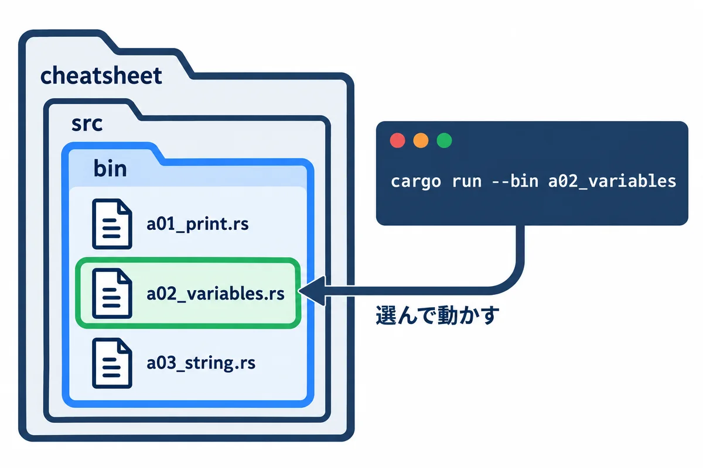
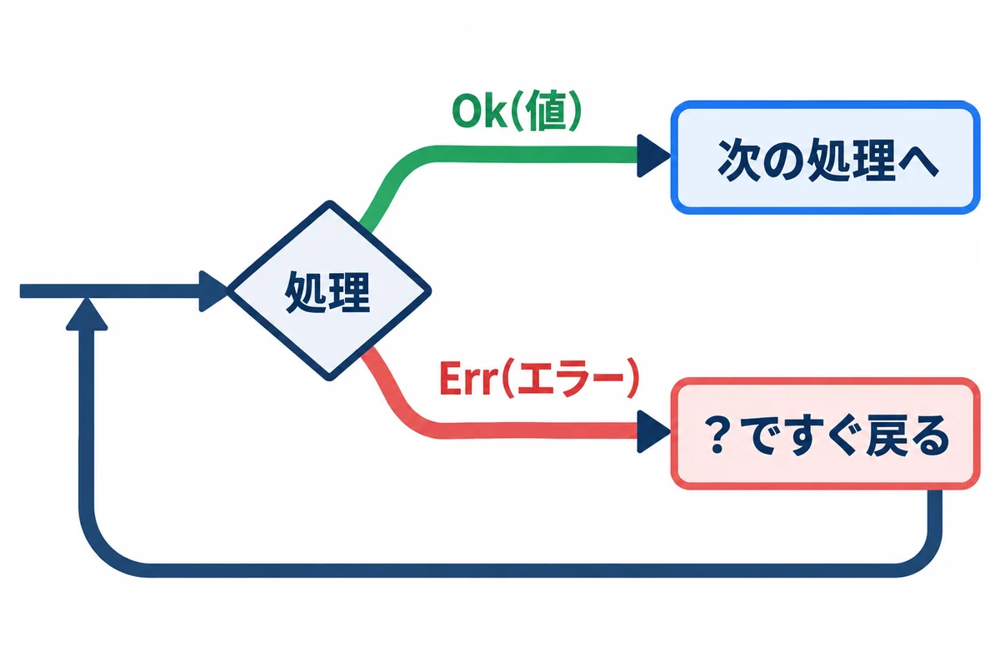
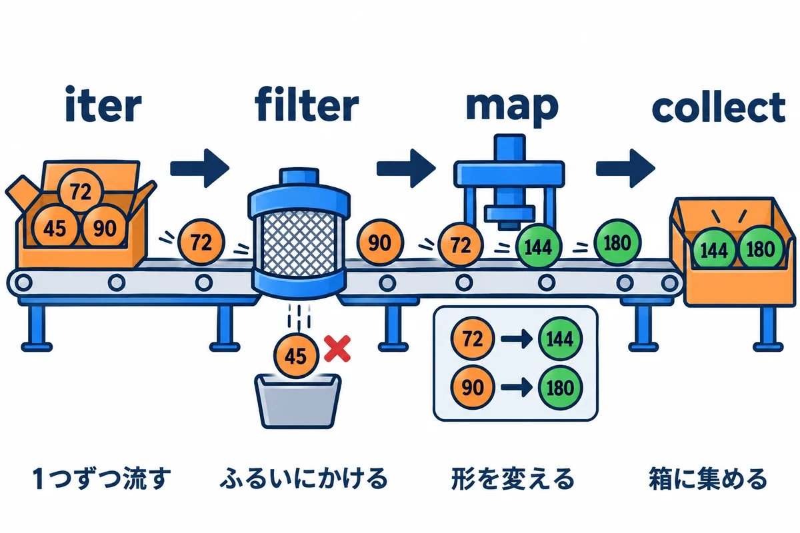
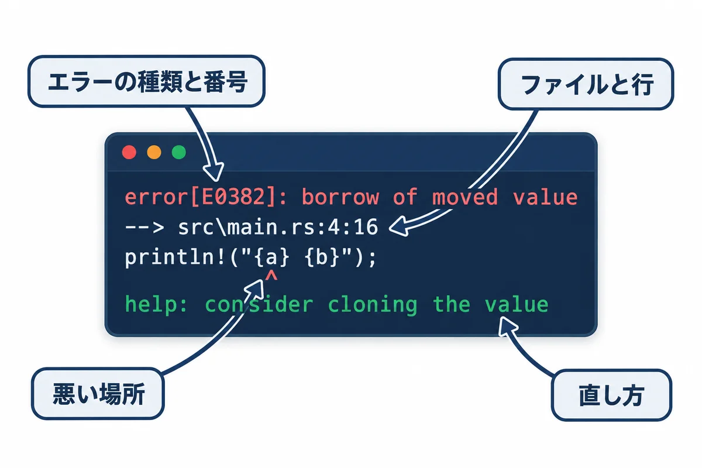

<div style="page-break-after: always; text-align: center; margin: 0; padding: 0;">

<div style="margin-top: 14px; font-size: 11px; letter-spacing: 0.18em; color: #c2410c; font-weight: 700;">APPENDIX / RUST BACKEND MASTERY</div>
<div style="font-size: 26px; font-weight: 800; color: #0f172a; margin-top: 6px; line-height: 1.35;">付録 — よく使う機能の早見表とサンプル集</div>
<div style="font-size: 13px; color: #475569; margin-top: 8px;">「あれ、どう書くんだっけ？」をすぐ引ける。全部のサンプルを、実際に動かした結果つきで</div>
</div>

# 付録: よく使う機能の早見表とサンプル集

## この付録について

この付録は、Rust で**毎日のように使う機能**を、1 か所に集めた「引くための本」です。第0巻〜第13巻の本文で学んだことを、次の形でまとめ直しました。

- **道具の早見表（A 章）:** PowerShell・cargo・rustup・VS Code・Git の、よく打つコマンドと操作。
- **サンプル集（B 章）:** 文字の表示・文字列・Vec・HashMap・Option・Result・イテレーター・構造体・トレイト・ファイル・スレッド・JSON・非同期など、22 本の**そのまま動くプログラム**。どのサンプルも、1 行ごとに日本語のコメントを付け、**この本を書いた PC で実際に動かした結果**を載せています。
- **よく出るエラー（C 章）:** 初心者が必ず出会うコンパイルエラー 6 つと、テストの失敗の読み方と直し方。
- **Web アプリと SQL の早見表（D 章）:** Topcoat と SQL で「何をしたい時に、どの巻のどこを見ればよいか」の表。

**読み方:** 頭から全部読む必要はありません。困った時に、下の「やりたいこと → 見る所」の表から探して、その節だけ読んでください。サンプルは、**写して動かして、少し書きかえてもう一度動かす**のがいちばん身に付きます。

**前提:** 第0巻の「はじめに: 手を動かす準備」で、Rust を入れてあること（`cargo --version` で版が出る）。


### やりたいこと → 見る所

| やりたいこと | 見る所 |
|---|---|
| フォルダを移動する・ファイルをコピーする・中身を見る | A-1 PowerShell の基本操作 |
| プロジェクトを作る・動かす・整える・部品（クレート）を足す | A-2 cargo のコマンド |
| Rust の版を確かめる・新しくする | A-3 rustup |
| VS Code で速く書く | A-4 VS Code の操作 |
| 変更を記録する・前の状態に戻す | A-5 Git の基本 |
| 画面に文字や数を、形を整えて出す | B-01 `println!` と `format!` |
| 変数・数の型・型の変換 | B-02 変数と数 |
| 文字列をつなぐ・分ける・探す・数に直す | B-03 文字列 |
| 並び（リスト）に足す・並べかえる・探す | B-04 Vec |
| 名前で引ける表・数を数える・重複を消す | B-05 HashMap・BTreeMap・HashSet |
| 「無いかもしれない値」を扱う | B-06 Option |
| 「失敗するかもしれない処理」を扱う | B-07 Result とエラー |
| 1 つずつ変換・絞り込み・集計する | B-08 イテレーター |
| 場合分け・くり返し | B-09 if・match・loop・while・for |
| データの形を決める・メソッドを付ける | B-10 構造体と列挙型 |
| 違う型に共通の動きを持たせる | B-11 トレイトとジェネリクス |
| 小さな関数をその場で作る | B-12 クロージャ |
| 「値が移る」「借りる」を理解する | B-13 所有権と借用 |
| ファイルを読む・書く・フォルダを作る | B-14 ファイルとフォルダ |
| 引数・環境変数を受け取る | B-15 引数と環境変数 |
| 時間を測る・待つ | B-16 時間 |
| ファイルを分けて整理する | B-17 モジュール |
| 自動のテストを書く | B-18 テスト |
| 同時に動かす | B-19 スレッド |
| JSON を読む・書く | B-20 JSON（serde） |
| エラーに説明を付けて返す | B-21 anyhow |
| 非同期（async/await）で待つ | B-22 tokio |
| コンパイルエラーの意味が分からない | C 章 |
| Web アプリ・SQL の書き方を探す | D 章 |

### サンプルを動かす準備: プロジェクト `cheatsheet` を作る

B 章の 22 本のサンプルは、全部 `cheatsheet`（早見表）という 1 つのプロジェクトの中で動かします。第0巻では `src\main.rs` を毎回書きかえましたが、この付録では**サンプルごとに別のファイル**にします。こうすると、前のサンプルを消さずに、いつでも動かし直せます。



**手順1: プロジェクトを作る。** PowerShell に、次の行を 1 行ずつ打ちます。

```powershell
# 練習用のフォルダ rust-study へ移動する（第0巻で作ったフォルダ）
cd ~\rust-study
# プロジェクト cheatsheet を作って、その中へ移動する
cargo new cheatsheet
cd cheatsheet
# サンプルを置くフォルダ src\bin を作る
mkdir src\bin
```

**手順2: サンプルのファイルを作る。** `src\bin` の中に、サンプルの名前のファイル（例: `a01_print.rs`）を作り、コードを貼り付けて保存します。VS Code なら、PowerShell で `code .` と打ってフォルダを開き、左の一覧で `src` → `bin` を右クリック →「新しいファイル」で名前を付けます。メモ帳なら `notepad src\bin\a01_print.rs` と打つと、「新しく作りますか？」と聞かれるので「はい」を押します。

**手順3: 動かす。** `--bin` のあとに、ファイルの名前（`.rs` を除いた部分）を書きます。

```powershell
cargo run -q --bin a01_print
```

- `-q` は、`Compiling ...`・`Finished ...`・`Running ...` の 3 行を省いて、**プログラムが出した行だけ**を見せる指定です（q は quiet＝静かに）。
- `src\bin` にファイルが 2 つ以上あると、`--bin` を付けずに `cargo run` と打った時に「どれを動かすか決めてください」というエラーになります。この付録では、いつも `--bin 名前` を付けます。

**手順4: 部品（クレート）を足す（B-20〜B-22 だけ）。** B-20〜B-22 は、Rust に最初から入っていない部品を使います。その節の前で、`cargo add` で足します（A-2 で説明します）。足すのは 1 回だけでかまいません。

**コードのコピー:** PDF を VS Code で見ている時は、サンプルの枠の 1 行目の最初の文字の上から、最後の行の最後の文字の上までをマウスでなぞって選び（始めと終わりは文字の上で。何もない所から始めたり、何もない所まで行ったりすると正しく選べません）、`Ctrl` ＋ `C` を押すと、字下げもそのままコピーできます（「コピー」の左にオレンジの字で「なぞってコピーすると…」と書いてある枠だけは、次の「コピー」を使います。くわしくは第0巻の P-6）。PDF を Chrome や Edge で見ている時は、コードの枠の右上の青い「コピー」を押すと、ブラウザーで Web 版（`https://oltotlo79-rgb.github.io/education/` にある HTML 版）のそのサンプルが開きます（PDF を VS Code で見ていても同じです）。そこで「コピー」ボタンを押すと、字下げもそのまま 1 回でコピーできます（くわしくは第0巻の P-6）。何行も貼り付けた時に確認が出たら、安全の確認なので、Windows Terminal なら「強制的に貼り付け」、VS Code のターミナルなら「貼り付け」を押します（「1 行として貼り付け」は押しません）。

## A. 道具の早見表

### A-1: PowerShell の基本操作

PowerShell は、文字で PC に命令する画面です（第0巻 P-1）。ここでは、ファイルとフォルダの操作でよく使う命令をまとめます。PowerShell には、昔からの短い呼び名（`cd`・`ls`・`mkdir` など）も用意されています。

| やりたいこと | 打つ命令 | 短い呼び名・メモ |
|---|---|---|
| 今いるフォルダを表示する | `Get-Location` | `pwd` |
| フォルダを移動する | `cd フォルダ名` | `cd ..` で 1 つ上、`cd ~` でホーム（`C:\Users\you`） |
| 中身の一覧を見る | `Get-ChildItem` | `ls`・`dir`。`-Recurse` で中のフォルダまで |
| フォルダを作る | `mkdir 名前` | 途中のフォルダもまとめて作れる |
| ファイルに書く（上書き） | `Set-Content 名前 "文字" -Encoding utf8` | 日本語を書く時は `-Encoding utf8` を付ける |
| ファイルに書き足す | `Add-Content 名前 "文字" -Encoding utf8` | |
| ファイルの中身を見る | `Get-Content 名前 -Encoding utf8` | `cat`。`-Tail 20` で最後の 20 行 |
| コピーする | `Copy-Item 元 先` | `cp` |
| 名前を変える | `Rename-Item 元 新しい名前` | |
| 移動する | `Move-Item 元 先` | `mv` |
| 消す | `Remove-Item 名前` | `rm`。フォルダは `-Recurse`。**ごみ箱に入らない**ので注意 |
| ある？ | `Test-Path 名前` | `True` か `False` が出る |
| 文字を探す | `Select-String -Path 名前 -Pattern "文字"` | 何行目にあるかも出る |
| コマンドの場所を見る | `(Get-Command cargo).Source` | 「入っているか」の確認に使う |
| 前に打った命令を出す | `↑` キー | `Tab` キーで名前の続きを自動で入れる |
| 動いている命令を止める | `Ctrl` ＋ `C` | サーバーを止める時もこれ |
| 画面を消す | `cls` | |

**▶ 書く所と動かし方:** PowerShell に 1 行ずつ打ちます。`ps-practice` という練習用のフォルダを作り、ファイルを作って、コピー・移動・検索をして、最後にフォルダごと消します。

```powershell
cd ~\rust-study
mkdir ps-practice
cd ps-practice
Get-Location
Set-Content memo.txt "1 行目" -Encoding utf8
Add-Content memo.txt "2 行目: rust" -Encoding utf8
Get-Content memo.txt -Encoding utf8
Copy-Item memo.txt memo-copy.txt
Rename-Item memo-copy.txt backup.txt
mkdir old
Move-Item backup.txt old\
Get-ChildItem
Get-ChildItem -Recurse -Name
Select-String -Path memo.txt -Pattern "rust" -Encoding utf8
Test-Path old\backup.txt
Remove-Item old -Recurse
Test-Path old
cd ..
Remove-Item ps-practice -Recurse
```

<!-- first-use -->

> **▶ ここで初めて出てくるコード**
>
> - **`Add-Content`**（PowerShell）: ファイルの後ろに書き足すコマンド。`Add-Content memo.txt "2 行目" -Encoding utf8`。中身を置きかえるのは `Set-Content` です。
> - **`Add-Content -Encoding`**（PowerShell）: `-Encoding utf8` で、書き足す文字を UTF-8 で書きます（日本語を書く時は付けておきます）。
> - **`Get-Content -Encoding`**（PowerShell）: `-Encoding utf8` で、ファイルを UTF-8 として読みます。付けないと、Windows PowerShell 5.1 では日本語が化けることがあります。
> - **`Rename-Item`**（PowerShell）: ファイルやフォルダの名前を変えるコマンド。`Rename-Item 今の名前 新しい名前`。
> - **`Move-Item`**（PowerShell）: ファイルやフォルダを、別の場所へ移すコマンド（短い呼び名は `mv`）。`Move-Item ファイル 先のフォルダ\`。
> - **`Get-ChildItem -Recurse`**（PowerShell）: `-Recurse` で、中のフォルダの中まで全部を一覧にします。
> - **`Select-String`**（PowerShell）: ファイルの中から、文字を含む行を探すコマンド。何行目に見つかったかも表示します。
> - **`Select-String -Path`**（PowerShell）: `-Path ファイル` で、探すファイルを指定します。`*.log` のように、いくつものファイルも指定できます。
> - **`Select-String -Pattern`**（PowerShell）: `-Pattern "文字"` で、探す文字を指定します。`"ERROR|WARN"` のように、`|` で「または」にもできます（正規表現）。
> - **`Select-String -Encoding`**（PowerShell）: `-Encoding utf8` で、ファイルを UTF-8 として読んで探します。
> - **`Remove-Item -Recurse`**（PowerShell）: フォルダを、中身ごと全部消すオプション。消した物は「ごみ箱」に入らず、元に戻せないので、場所をよく確かめてから使います。

<!-- /first-use -->

**▼ 実行結果**（表示が出る命令だけ。`mkdir` の表示は省いています）

`Get-Location`:

```text
Path
----
C:\Users\you\rust-study\ps-practice
```

`Get-Content memo.txt -Encoding utf8`:

```text
1 行目
2 行目: rust
```

`Get-ChildItem`（日時は、打った日時になります）:

```text
    ディレクトリ: C:\Users\you\rust-study\ps-practice


Mode                 LastWriteTime         Length Name
----                 -------------         ------ ----
d-----        2026/11/02     14:58                old
-a----        2026/11/02     14:58             29 memo.txt
```

`Get-ChildItem -Recurse -Name`:

```text
old
memo.txt
old\backup.txt
```

`Select-String -Path memo.txt -Pattern "rust" -Encoding utf8`:

```text
memo.txt:2:2 行目: rust
```

`Test-Path old\backup.txt` → `Remove-Item old -Recurse` → `Test-Path old`:

```text
True
False
```

**ここがポイント:**

- `Get-ChildItem` の `Mode` の列の `d` は**フォルダ**、`a` は**ファイル**です。`Length` はファイルの大きさ（バイト）です。`memo.txt` が 29 バイトなのは、日本語が 1 文字 3 バイト・改行が 2 バイト、それに UTF-8 の印（BOM）の 3 バイトが付くからです。
- `Select-String` の `memo.txt:2:2 行目: rust` は「`memo.txt` の **2 行目**に、`2 行目: rust` という行がある」という意味です。
- `Remove-Item` で消したファイルは**ごみ箱に入りません**。消す前に `Get-ChildItem` で中身を確かめる習慣を付けましょう。

**よくある間違い:**

- **`-Encoding utf8` を付けずに日本語を書く:** Windows PowerShell 5.1 の `Set-Content` は、指定しないと古い文字コード（Shift_JIS）で書きます。そのファイルを Rust で読むと、文字化けやエラーになります。
- **フォルダ名に空白がある:** `cd My Folder` は 2 つの言葉に分かれてしまいます。`cd "My Folder"` のように `"` で囲みます。

### A-2: cargo のコマンド

cargo は、Rust のプロジェクトを作る・翻訳する・動かす・テストする・部品を足す、を全部受け持つ道具です。

| やりたいこと | 打つ命令 | メモ |
|---|---|---|
| 新しいプロジェクトを作る | `cargo new 名前` | フォルダ・`Cargo.toml`・`src\main.rs`・Git の準備までしてくれる |
| 翻訳して動かす | `cargo run` | `-q` で cargo の表示を省く。`--bin 名前` で動かすファイルを選ぶ |
| プログラムに引数を渡す | `cargo run -- 引数1 引数2` | `--` から後ろがプログラムへ渡る（B-15） |
| 間違いがないかだけ調べる | `cargo check` | 実行ファイルを作らないので速い。書きながら何度も打つ |
| 実行ファイルを作る | `cargo build` | `target\debug\` にできる |
| 速い実行ファイルを作る | `cargo build --release` | `target\release\` にできる。本番用。翻訳は遅い |
| テストを動かす | `cargo test` | `cargo test 名前の一部` で絞り込める（B-18） |
| 書き方を整える | `cargo fmt` | 字下げ・改行を自動で整える。`--check` は「整っているか」だけ調べる |
| もっと良い書き方を教えてもらう | `cargo clippy` | 動くけれど直した方がよい所を、理由つきで教えてくれる |
| 部品（クレート）を足す | `cargo add 名前` | `--features 機能` で追加の機能も選べる |
| 部品を外す | `cargo remove 名前` | |
| 使っている部品の一覧 | `cargo tree --depth 1` | `--depth` を外すと、部品が使う部品まで全部 |
| 部品を新しい版にする | `cargo update` | `Cargo.lock` を書きかえる |
| 説明書（ドキュメント）を見る | `cargo doc --open` | 自分のコードと部品の説明書をブラウザーで開く |
| 翻訳したファイルを全部消す | `cargo clean` | `target` フォルダが大きくなった時に。次の翻訳は時間がかかる |

**▶ 書く所と動かし方:** PowerShell で `cd ~\rust-study` してから打ちます。`tools-demo` という練習用のプロジェクトを作り、わざと読みにくく書いたコードを `cargo fmt` と `cargo clippy` で直します。

```powershell
cargo new tools-demo
cd tools-demo
cargo run
cargo check
```

**▼ 実行結果**（`cargo run`）

```text
   Compiling tools-demo v0.1.0 (C:\Users\you\rust-study\tools-demo)
    Finished `dev` profile [unoptimized + debuginfo] target(s) in 0.26s
     Running `target\debug\tools-demo.exe`
Hello, world!
```

**▼ 実行結果**（`cargo check`）

```text
    Checking tools-demo v0.1.0 (C:\Users\you\rust-study\tools-demo)
    Finished `dev` profile [unoptimized + debuginfo] target(s) in 0.12s
```

- `Compiling`（翻訳しています）→ `Finished`（終わりました）→ `Running`（動かします）の順に出て、最後にプログラムが出した `Hello, world!` が出ます。
- `cargo check` は `Checking` と出て、実行はしません。`Finished` の秒数が `cargo run` より短いのが分かります。

次に、`src\main.rs` を、わざと字下げなしで次のように書きかえて保存します。

```rust
fn main() {
let names = vec!["a", "b"];
if names.len() == 0 { println!("空です"); }
for i in 0..names.len() { println!("{}", names[i]); }
}
```

```powershell
cargo fmt --check
cargo fmt
cargo clippy
```

**▼ 実行結果**（`cargo fmt --check`。`-` の行が今の書き方、`+` の行が整えたあとの書き方。画面では色が付きます）

```text
Diff in C:\Users\you\rust-study\tools-demo\src\main.rs:1:
 fn main() {
-let names = vec!["a", "b"];
-if names.len() == 0 { println!("空です"); }
-for i in 0..names.len() { println!("{}", names[i]); }
+    let names = vec!["a", "b"];
+    if names.len() == 0 {
+        println!("空です");
+    }
+    for i in 0..names.len() {
+        println!("{}", names[i]);
+    }
 }
```

`cargo fmt` は何も表示しませんが、`src\main.rs` が次のように整います。

```rust
fn main() {
    let names = vec!["a", "b"];
    if names.len() == 0 {
        println!("空です");
    }
    for i in 0..names.len() {
        println!("{}", names[i]);
    }
}
```

**▼ 実行結果**（`cargo clippy`）

```text
    Checking tools-demo v0.1.0 (C:\Users\you\rust-study\tools-demo)
warning: length comparison to zero
 --> src\main.rs:3:8
  |
3 |     if names.len() == 0 {
  |        ^^^^^^^^^^^^^^^^ help: using `is_empty` is clearer and more explicit: `names.is_empty()`
  |
  = help: for further information visit https://rust-lang.github.io/rust-clippy/rust-1.99.0/index.html#len_zero
  = note: `#[warn(clippy::len_zero)]` on by default

warning: the loop variable `i` is only used to index `names`
 --> src\main.rs:6:14
  |
6 |     for i in 0..names.len() {
  |              ^^^^^^^^^^^^^^
  |
  = help: for further information visit https://rust-lang.github.io/rust-clippy/rust-1.99.0/index.html#needless_range_loop
  = note: `#[warn(clippy::needless_range_loop)]` on by default
help: consider using an iterator
  |
6 -     for i in 0..names.len() {
6 +     for <item> in &names {
  |

warning: useless use of `vec!`
 --> src\main.rs:2:17
  |
2 |     let names = vec!["a", "b"];
  |                 ^^^^^^^^^^^^^^ help: you can use an array directly: `["a", "b"]`
  |
  = help: for further information visit https://rust-lang.github.io/rust-clippy/rust-1.99.0/index.html#useless_vec
  = note: `#[warn(clippy::useless_vec)]` on by default

warning: `tools-demo` (bin "tools-demo") generated 3 warnings (run `cargo clippy --fix --bin "tools-demo" -p tools-demo -- ` to apply 2 suggestions)
    Finished `dev` profile [unoptimized + debuginfo] target(s) in 0.15s
```

clippy は 3 つの「もっと良い書き方」を教えてくれました。

| clippy の指摘 | 意味 | 直し方 |
|---|---|---|
| `length comparison to zero` | 「長さが 0 か」は `is_empty()` の方が読みやすい | `if names.is_empty() {` |
| `the loop variable i is only used to index names` | 番号を使わずに、中身を直接回せる | `for name in &names { println!("{name}"); }` |
| `useless use of vec!` | 中身を足したり消したりしないなら、`vec!` でなく配列で足りる | `let names = ["a", "b"];` |

**部品（クレート）を足す・外す:** 部品は、世界中の人が公開している Rust のライブラリです。公開先（crates.io）から、cargo が自動で取ってきます。

```powershell
cargo add serde_json
cargo tree --depth 1
cargo remove serde_json
```

**▼ 実行結果**（`cargo add serde_json`）

```text
    Updating crates.io index
      Adding serde_json v1.0.154 to dependencies
             Features:
             + std
             - alloc
             - arbitrary_precision
             - float_roundtrip
             - indexmap
             - preserve_order
             - raw_value
             - unbounded_depth
    Updating crates.io index
     Locking 11 packages to highest Rust 1.99.1 compatible versions
      Adding itoa v1.0.18
      Adding memchr v2.8.3
      Adding proc-macro2 v1.0.107
      Adding quote v1.0.47
      Adding serde v1.0.229
      Adding serde_core v1.0.229
      Adding serde_derive v1.0.229
      Adding serde_json v1.0.154
      Adding syn v3.0.9
      Adding unicode-ident v1.0.27
      Adding zmij v1.0.23
```

<!-- first-use -->

> **▶ ここで初めて出てくるコード**
>
> - **`cargo remove`**（cargo のコマンド）: プロジェクトから部品（クレート）を外すコマンド。`Cargo.toml` の `[dependencies]` から、その行を消します。

<!-- /first-use -->

**▼ 実行結果**（`cargo tree --depth 1`）

```text
tools-demo v0.1.0 (C:\Users\you\rust-study\tools-demo)
└── serde_json v1.0.154
```

**▼ 実行結果**（`cargo remove serde_json`）

```text
    Removing serde_json from dependencies
```

- `cargo add` は `Cargo.toml` の `[dependencies]` に 1 行足します。版の数字は、その日の最新になります（`serde_json v1.0.154` の部分は、打った日によって変わります）。
- `Features:` の `+` は「入った機能」、`-` は「入っていない機能（必要なら `--features` で足せる）」です。
- `Adding itoa ...` などは、`serde_json` が中で使う部品です。cargo が自動で一緒に入れます。

**よくある間違い:**

- **`Cargo.toml` があるフォルダの外で打つ:** `` error: could not find `Cargo.toml` in `（今のフォルダ）` or any parent directory `` と出たら、`cd` でプロジェクトのフォルダへ移動してから打ちます。
- **保存せずに `cargo run`:** エディターで `Ctrl` ＋ `S` を押してから打ちます。前のコードのまま動いてしまいます。

### A-3: rustup（Rust そのものの管理）

| やりたいこと | 打つ命令 |
|---|---|
| 入っている Rust の版を見る | `rustc --version`・`cargo --version` |
| 入っている版と、使っている版を見る | `rustup show` |
| 新しい版が出ているか調べる | `rustup check` |
| 新しい版にする | `rustup update` |
| 入っている部品（rustfmt・clippy など）を見る | `rustup component list --installed` |
| 標準ライブラリの説明書を、ネットなしで開く | `rustup doc --std` |
| エラー番号のくわしい説明を見る | `rustc --explain E0382` |

**▼ 実行結果**（`rustup check`）

```text
stable-aarch64-pc-windows-msvc - up to date: 1.99.1 (58cf8f9c3 2026-10-13)
rustup - up to date : 1.29.2
```

**▼ 実行結果**（`rustup component list --installed`。この本を書いた PC は Arm 版の Windows なので、名前に `aarch64` が入ります。多くの PC では `x86_64` です）

```text
cargo-aarch64-pc-windows-msvc
clippy-aarch64-pc-windows-msvc
rust-docs-aarch64-pc-windows-msvc
rust-std-aarch64-pc-windows-msvc
rust-std-wasm32-unknown-unknown
rust-std-x86_64-pc-windows-msvc
rustc-aarch64-pc-windows-msvc
rustfmt-aarch64-pc-windows-msvc
```

- `up to date` は「最新です」という意味です。新しい版があると `Update available` と出るので、`rustup update` を打ちます。
- `rustfmt`（`cargo fmt` の中身）と `clippy`（`cargo clippy` の中身）は、Rust を入れた時に一緒に入っています。

### A-4: VS Code の操作

| やりたいこと | 押すキー |
|---|---|
| ファイルを保存する | `Ctrl` ＋ `S` |
| ファイルの名前で探して開く | `Ctrl` ＋ `P` |
| 何でも命令を探して実行する（コマンドパレット） | `Ctrl` ＋ `Shift` ＋ `P` |
| 下にターミナル（PowerShell）を出す・しまう | `Ctrl` ＋ `@` |
| 書き方を整える（ドキュメントのフォーマット） | `Shift` ＋ `Alt` ＋ `F` |
| 行をコメントにする・戻す | `Ctrl` ＋ `/` |
| 行を上下に動かす | `Alt` ＋ `↑`・`↓` |
| 行をコピーして下に増やす | `Shift` ＋ `Alt` ＋ `↓` |
| 同じ言葉を一度に選んで書きかえる | 言葉を選んで `Ctrl` ＋ `D` を何回か |
| ファイルの中を探す・置きかえる | `Ctrl` ＋ `F`・`Ctrl` ＋ `H` |
| フォルダ全体から探す | `Ctrl` ＋ `Shift` ＋ `F` |
| 関数や型の定義へ飛ぶ | `F12`（rust-analyzer を入れてある時） |
| 名前をまとめて変える | `F2`（rust-analyzer を入れてある時） |
| 元に戻す・やり直す | `Ctrl` ＋ `Z`・`Ctrl` ＋ `Y` |

**メモ:** キーの割り当ては、キーボードの種類や設定で違うことがあります。コマンドパレット（`Ctrl` ＋ `Shift` ＋ `P`）で「フォーマット」のように日本語で探すと、割り当てられたキーも一緒に表示されます。

### A-5: Git の基本（変更の記録）

Git は、ファイルの変更を「いつ・何を・なぜ」の記録として残す道具です（第1巻でくわしく扱います）。`cargo new` は Git の準備（`.git` フォルダ）も自動でしてくれるので、すぐに使えます。

**最初に 1 回だけ:** 記録に残す名前とメールアドレスを登録します。この 2 つは**記録の中に残り、GitHub などに送ると公開されます**。会社のルールに合わせるか、GitHub が用意する「公開用のアドレス」を使ってください。

```powershell
git config --global user.name "あなたの名前"
git config --global user.email "あなたのメールアドレス"
```

| やりたいこと | 打つ命令 |
|---|---|
| 今の状態を見る（何が変わったか） | `git status`（短く: `git status --short`） |
| 変更の中身を見る | `git diff` |
| 記録に入れるファイルを選ぶ | `git add ファイル名`（全部: `git add .`） |
| 記録する | `git commit -m "何をしたか"` |
| 記録の一覧を見る | `git log --oneline` |
| 保存していない変更を捨てて、最後の記録に戻す | `git restore ファイル名` |
| 枝（ブランチ）を作って移る | `git switch -c 枝の名前` |
| 枝の一覧を見る・移る | `git branch`・`git switch 枝の名前` |
| 記録しないファイルを決める | `.gitignore` に名前を書く |

**▶ 書く所と動かし方:** `cd ~\rust-study` してから、`cargo new git-demo` → `cd git-demo` で練習用のプロジェクトを作り、次を 1 つずつ打ちます。途中で `src\main.rs` を書きかえる所は、エディターで書きかえて保存します。

**▼ 実行結果**（`git status`。まだ何も記録していない状態）

```text
On branch master

No commits yet

Untracked files:
  (use "git add <file>..." to include in what will be committed)
	.gitignore
	Cargo.toml
	src/

nothing added to commit but untracked files present (use "git add" to track)
```

**▼ 実行結果**（`git add .` → `git commit -m "最初の版"`）

```text
warning: in the working copy of '.gitignore', LF will be replaced by CRLF the next time Git touches it
warning: in the working copy of 'Cargo.toml', LF will be replaced by CRLF the next time Git touches it
warning: in the working copy of 'src/main.rs', LF will be replaced by CRLF the next time Git touches it
```

```text
[master (root-commit) 85853bd] 最初の版
 3 files changed, 10 insertions(+)
 create mode 100644 .gitignore
 create mode 100644 Cargo.toml
 create mode 100644 src/main.rs
```

- `warning: ... LF will be replaced by CRLF` は「改行の形を Windows の形に直して取り出します」というお知らせです。**エラーではない**ので、気にしなくてかまいません。
- `85853bd` は、この記録の番号（ハッシュ）の頭の 7 文字です。記録するたびに違う番号になります。

`src\main.rs` の `"Hello, world!"` を `"こんにちは"` に書きかえて保存し、次を打ちます。

**▼ 実行結果**（`git status --short` → `git diff`）

```text
 M src/main.rs
```

```text
warning: in the working copy of 'src/main.rs', LF will be replaced by CRLF the next time Git touches it
diff --git a/src/main.rs b/src/main.rs
index e7a11a9..1f1cc27 100644
--- a/src/main.rs
+++ b/src/main.rs
@@ -1,3 +1,3 @@
 fn main() {
-    println!("Hello, world!");
+    println!("こんにちは");
 }
```

- `M` は「変更された（Modified）」という印です。
- `git diff` の `-` の行が前の内容、`+` の行が新しい内容です。

**▼ 実行結果**（`git add src/main.rs` → `git commit -m "あいさつを日本語にする"` → `git log --oneline`）

```text
[master d0633c4] あいさつを日本語にする
 1 file changed, 1 insertion(+), 1 deletion(-)
```

```text
d0633c4 あいさつを日本語にする
85853bd 最初の版
```

**まちがえた変更を捨てる:** `src\main.rs` をでたらめに書きかえて保存してから、`git restore src/main.rs` を打つと、最後に記録した内容に戻ります。

**▼ 実行結果**（`git restore src/main.rs` のあと、`Get-Content src/main.rs`）

```text
fn main() {
    println!("こんにちは");
}
```

**▼ 実行結果**（`git switch -c try-color` → `git branch` → `git switch master`）

```text
Switched to a new branch 'try-color'
```

```text
  master
* try-color
```

```text
Switched to branch 'master'
```

- `*` が付いている枝が、今いる枝です。新しいことを試す時は枝を作り、うまくいったら元の枝へ取り込みます。
- 最初の枝の名前は、Git の設定によって `master` か `main` です。`git branch` で確かめてください。
- `cargo new` が作った `.gitignore` には `/target` と書いてあります。翻訳でできる大きなファイル（`target` フォルダ）は記録しない、という意味です。

**よくある間違い:**

- **`Author identity unknown` `*** Please tell me who you are.` と出る:** 名前とメールアドレスを登録していません。上の `git config` の 2 行を打ちます。
- **パスワードや鍵のファイルを記録してしまう:** `.env` などの秘密のファイルは、記録する前に `.gitignore` に書きます。一度記録して公開すると、あとで消しても記録の中に残ります。

## B. サンプル集（標準の機能）

どのサンプルも、次の形で載せています。

1. **何に使う:** どんな時に使う機能か。
2. **▶ 書く所と動かし方:** どのファイルを作って、どう動かすか。
3. **コード:** 1 行ごとに日本語のコメント付き。`//` から行の終わりまでがコメント（説明のメモ）で、動きには関係しません。
4. **▼ 実行結果:** この本を書いた PC（Windows 11・Rust 1.99.1）で実際に動かした結果。
5. **ここがポイント・よくある間違い。**

**動かし方はどれも同じです:** `cheatsheet` の `src\bin\` に、見出しに書いたファイルを作り、コードを貼り付けて保存して、`cargo run -q --bin ファイル名（.rs を除く）` を打ちます。

### B-01: `println!` と `format!`（文字を出す・文字列を作る）

**何に使う:** 画面に結果を出す時（`println!`）と、文字列を組み立てる時（`format!`）。Rust で**いちばんよく使う**書き方です。`{}` の中に書く「書式」で、桁数・寄せ・小数の桁を決められます。

**▶ 書く所と動かし方:** `src\bin\a01_print.rs` を作り、下のコードを貼り付けて保存します。`cargo run -q --bin a01_print` を打ちます。

```rust
// 画面に文字を出す println! と、文字列を作る format! の書き方の早見表
fn main() {
    let name = "さくら";
    let age = 20;
    let price = 1234.5678;

    // {} に、後ろの値が順番に入る
    println!("名前: {}、年齢: {}", name, age);

    // {name} のように、変数の名前を { } の中に直接書いてもよい（いちばん読みやすい）
    println!("名前: {name}、年齢: {age}");

    // {:.2} は「小数点以下 2 けた」（四捨五入される）
    println!("値段: {price:.2} 円");

    // {:>8} は 8 文字分の幅で右寄せ、{:<8} は左寄せ、{:^8} は中央寄せ
    println!("[{:>8}] [{:<8}] [{:^8}]", "右", "左", "中");

    // {:05} は 5 けたになるまで前を 0 で埋める（伝票番号などに使う）
    println!("番号: {:05}", 42);

    // {:?} は「デバッグ用の表示」。Vec や Option など、{} で出せない物も出せる
    let scores = vec![80, 95, 70];
    println!("点数: {:?}", scores);

    // {:#?} は、デバッグ表示を 1 項目 1 行に整えて出す（中身が多い時に見やすい）
    let maybe: Option<i32> = Some(5);
    println!("{:#?}", maybe);

    // { と } そのものを出したい時は {{ と }} と 2 回書く
    println!("波かっこ: {{ と }}");

    // format! は println! と同じ書き方で「文字列を作るだけ」（画面には出さない）
    let message = format!("{name} さんは {age} 歳です");
    println!("作った文字列: {message}（{} バイト）", message.len());

    // print! は最後に改行しない。eprintln! はエラー用の出口（標準エラー出力）に出す
    print!("改行なし→");
    println!("ここで改行");
    eprintln!("これはエラー用の出口に出たメッセージです");
}
```

**▼ 実行結果**

```text
名前: さくら、年齢: 20
名前: さくら、年齢: 20
値段: 1234.57 円
[       右] [左       ] [   中    ]
番号: 00042
点数: [80, 95, 70]
Some(
    5,
)
波かっこ: { と }
作った文字列: さくら さんは 20 歳です（32 バイト）
改行なし→ここで改行
これはエラー用の出口に出たメッセージです
```

**ここがポイント:**

| 書き方 | 意味 | 例 → 結果 |
|---|---|---|
| `{}` | 普通に表示（Display） | `{}` に `20` → `20` |
| `{name}` | 変数 `name` をそのまま入れる | → `さくら` |
| `{:?}` | デバッグ用の表示（Debug）。Vec・Option なども出せる | `vec![80, 95]` → `[80, 95]` |
| `{:#?}` | デバッグ用を、1 項目 1 行に整えて | 中身が多い構造体を見る時 |
| `{:.2}` | 小数点以下 2 けた（四捨五入） | `1234.5678` → `1234.57` |
| `{:>8}`・`{:<8}`・`{:^8}` | 8 文字分の幅で右・左・中央に寄せる | 表のように並べる時 |
| `{:05}` | 5 けたになるまで前を 0 で埋める | `42` → `00042` |
| `{{`・`}}` | `{`・`}` そのもの | |

- 幅（`{:>8}` など）は**文字の数**で数えます。日本語は 1 文字で半角 2 文字分の幅があるので、日本語を入れると、見た目の位置がずれます（結果の `[   中    ]` を見てください）。
- `message.len()` が 32 なのは、`len()` が**バイト数**を数えるからです（B-03）。
- `eprintln!` で出した行は、「エラー用の出口」（標準エラー出力）から出ます。画面ではほかの行と同じに見えますが、`> ファイル名` でファイルに書き出した時に、ファイルには入らず画面に残ります。エラーのお知らせに使います。

**よくある間違い:**

- **`{}` の数と値の数が合わない:** `println!("{} {}", 1);` のように値が足りないと、`2 positional arguments in format string, but there is 1 argument` というエラーになります。`{}` の数と、後ろの値の数をそろえます。
- **構造体を `{}` で出そうとする:** `` `P` doesn't implement `std::fmt::Display` ``（`P` は構造体の名前）と出ます。`{:?}` を使うか、`Display` を実装します（B-10）。

### B-02: 変数と数（let・mut・型・変換）

**何に使う:** 値に名前を付けて覚えておく時。数の型（整数・小数）を選ぶ時と、型を変える時。

**▶ 書く所と動かし方:** `src\bin\a02_variables.rs` を作り、下のコードを貼り付けて保存します。`cargo run -q --bin a02_variables` を打ちます。

```rust
// 変数・定数・数の型・型の変換の早見表
const TAX_RATE_PERCENT: u32 = 10; // 定数は大文字で書き、型を必ず付ける

fn main() {
    // let で変数を作る。最初は「変えられない」
    let apples = 3;
    // mut を付けると、あとで値を変えられる
    let mut total = 0;
    total += apples * 100;
    println!("りんご {apples} 個で {total} 円");

    // 同じ名前で let し直すと、新しい変数で「覆い隠す」（シャドーイング）。型も変えられる
    let input = "42";
    let input: i32 = input.parse().unwrap();
    println!("文字列を数に直した: {}", input + 1);

    // よく使う数の型
    let small: u8 = 255; // 0〜255
    let count: usize = 3; // 長さ・番号（Vec の len() はこの型）
    let big: i64 = -9_000_000_000; // _ は読みやすくするための区切り（無視される）
    let ratio: f64 = 0.75; // 小数
    let ok: bool = true;
    let letter: char = 'あ'; // 1 文字は ' ' でくくる
    println!("{small} {count} {big} {ratio} {ok} {letter}");

    // 型の変換: as は「数の型どうし」の変換（はみ出すと切り捨てられるので注意）
    let price: u32 = 1980;
    let tax = price * TAX_RATE_PERCENT / 100;
    let average = (80 + 95 + 70) as f64 / 3.0;
    println!("税 {tax} 円、平均 {average:.1} 点");
    println!("300 を u8 に as で変換すると: {}", 300_i32 as u8);

    // 安全な変換: try_from は、入らない時に Err を返してくれる
    println!("u8::try_from(300) = {:?}", u8::try_from(300_i32));
    println!("u8::try_from(200) = {:?}", u8::try_from(200_i32));

    // 足し算のあふれ: checked_add は、あふれる時に None を返す
    println!("250 + 10 (u8) = {:?}", 250_u8.checked_add(10));
    println!("200 + 10 (u8) = {:?}", 200_u8.checked_add(10));

    // 割り算: 整数どうしは小数を切り捨て、% は余り
    println!(
        "7 / 2 = {}、7 % 2 = {}、7.0 / 2.0 = {}",
        7 / 2,
        7 % 2,
        7.0 / 2.0
    );
}
```

**▼ 実行結果**

```text
りんご 3 個で 300 円
文字列を数に直した: 43
255 3 -9000000000 0.75 true あ
税 198 円、平均 81.7 点
300 を u8 に as で変換すると: 44
u8::try_from(300) = Err(TryFromIntError(PosOverflow))
u8::try_from(200) = Ok(200)
250 + 10 (u8) = None
200 + 10 (u8) = Some(210)
7 / 2 = 3、7 % 2 = 1、7.0 / 2.0 = 3.5
```

**ここがポイント:**

| 型 | 入る値 | よく使う場面 |
|---|---|---|
| `i32` | -21 億〜21 億くらいの整数 | 普通の整数（型を書かない時はこれになる） |
| `i64` | もっと大きな整数 | お金の合計・ID |
| `u8`・`u32`・`u64` | 0 以上の整数（u は unsigned＝マイナス無し） | 色の値（0〜255）・個数 |
| `usize` | 0 以上の整数（長さ・番号用） | `Vec` の長さ・番号 |
| `f64` | 小数 | 平均・割合 |
| `bool` | `true` か `false` | 条件 |
| `char` | 1 文字（`'あ'`） | |

- **`as` は、はみ出した分を黙って切り捨てます。** `300 as u8` が `44` になったのは、300 から 256 を引いた残りだからです。範囲に入るか分からない時は、`try_from`（入らないと `Err`）を使います。
- **整数どうしの割り算は、小数を切り捨てます。** `7 / 2` は `3` です。小数で欲しい時は、片方を `f64` にします（`7.0 / 2.0`、または `x as f64`）。
- `checked_add` は、足した結果が型に入らない時に `None` を返します。お金の計算など、あふれると困る所で使います。

**よくある間違い:**

- **`mut` を付け忘れて値を変える:** `cannot assign twice to immutable variable` というエラーになります（C 章の C-3）。
- **`i32` と `f64` をそのまま足す:** `mismatched types` になります。Rust は、型が違う数を自動ではそろえません。`as` でそろえます。

### B-03: 文字列（String と &str）

**何に使う:** 名前・メッセージ・ファイルの中身など、文字を扱う時。つなぐ・分ける・探す・数に直す、がよく出てきます。

**▶ 書く所と動かし方:** `src\bin\a03_string.rs` を作り、下のコードを貼り付けて保存します。`cargo run -q --bin a03_string` を打ちます。

```rust
// 文字列（String と &str）でよく使う操作の早見表
fn main() {
    // "..." と書いた文字列は &str（読むだけの文字列）。String::from や to_string で String（変えられる文字列）になる
    let fixed: &str = "Rust";
    let mut owned: String = String::from("こんにちは");

    // 後ろに足す: push_str（文字列）・push（1 文字）
    owned.push('、');
    owned.push_str(fixed);
    owned.push_str(" の世界へ");
    owned.push('!');
    println!("{owned}");

    // つなぐ: format! がいちばん分かりやすい
    let full = format!("{}-{}", "2026", "11");
    println!("つないだ: {full}");

    // 長さ: len() は「バイト数」。文字の数は chars().count()（日本語は 1 文字 3 バイト）
    let word = "東京タワー";
    println!(
        "len() = {}、chars().count() = {}",
        word.len(),
        word.chars().count()
    );

    // 前後の空白を取る・大文字小文字
    let raw = "  Hello World  ";
    println!(
        "[{}] [{}] [{}]",
        raw.trim(),
        raw.trim().to_uppercase(),
        raw.trim().to_lowercase()
    );

    // 含む？・始まる？・終わる？
    let file = "report_2026.csv";
    println!(
        "contains(\"2026\")={} starts_with(\"report\")={} ends_with(\".csv\")={}",
        file.contains("2026"),
        file.starts_with("report"),
        file.ends_with(".csv")
    );

    // 置きかえ
    println!("replace: {}", "a-b-c".replace('-', "/"));

    // 分ける: split（区切り文字で）・split_whitespace（空白で）・lines（行で）
    let csv_line = "山田,30,大阪";
    let parts: Vec<&str> = csv_line.split(',').collect();
    println!("split: {:?}（{} 個）", parts, parts.len());
    let words: Vec<&str> = "  rust   is  fun ".split_whitespace().collect();
    println!("split_whitespace: {:?}", words);
    for (i, line) in "1 行目\n2 行目".lines().enumerate() {
        println!("lines: {} → {}", i + 1, line);
    }

    // 探す: find は見つかった「バイトの位置」を Option で返す
    println!(
        "find('_') = {:?}、find('#') = {:?}",
        file.find('_'),
        file.find('#')
    );

    // 先頭から n 文字を取る（日本語でも安全な方法）
    let first_two: String = word.chars().take(2).collect();
    println!("先頭 2 文字: {first_two}");

    // 数に直す: parse は失敗することがあるので Result が返る
    let ok: Result<i32, _> = "123".parse::<i32>();
    let ng: Result<i32, _> = "12a".parse::<i32>();
    println!("parse: {:?} / {:?}", ok, ng);

    // 空か調べる・1 文字ずつ回す
    let blank = String::new();
    println!("blank.is_empty() = {}", blank.is_empty());
    for c in "ABC".chars() {
        print!("{c} ");
    }
    println!();

    // &str を受け取る関数には、String も &を付けて渡せる
    println!("文字数: {}", count_chars(&owned));
    println!("文字数: {}", count_chars("abc"));
}

fn count_chars(text: &str) -> usize {
    text.chars().count()
}
```

**▼ 実行結果**

```text
こんにちは、Rust の世界へ!
つないだ: 2026-11
len() = 15、chars().count() = 5
[Hello World] [HELLO WORLD] [hello world]
contains("2026")=true starts_with("report")=true ends_with(".csv")=true
replace: a/b/c
split: ["山田", "30", "大阪"]（3 個）
split_whitespace: ["rust", "is", "fun"]
lines: 1 → 1 行目
lines: 2 → 2 行目
find('_') = Some(6)、find('#') = None
先頭 2 文字: 東京
parse: Ok(123) / Err(ParseIntError { kind: InvalidDigit })
blank.is_empty() = true
A B C
文字数: 16
文字数: 3
```

**ここがポイント:**

- **`String` と `&str` の違い:** `String` は「自分の物の文字列」で、後ろに足したり書きかえたりできます。`&str` は「どこかにある文字列を見ているだけ」で、変えられません。関数の引数は `&str` にしておくと、どちらも渡せて便利です（`count_chars` の例）。
- **`len()` はバイト数です。** 日本語は 1 文字が 3 バイトなので、`"東京タワー"` は 5 文字でも `len()` は 15 です。文字の数は `chars().count()` で数えます。
- **`split` の結果は、そのままでは並びになりません。** `.collect()` で `Vec` に集めます。`Vec<&str>` の型を書くのは、「何に集めるか」を Rust に教えるためです。
- **日本語の文字列を、番号で切り出さない:** `&word[0..2]` のように書くと、文字の途中で切ることになり、`` end byte index 2 is not a char boundary `` と出てプログラムが止まります（パニック）。先頭から何文字かを取る時は `chars().take(n)` を使います。

| やりたいこと | 書き方 |
|---|---|
| 作る | `String::from("文字")`・`"文字".to_string()`・`format!(...)` |
| 足す | `s.push_str("文字")`・`s.push('字')` |
| 前後の空白を取る | `s.trim()` |
| 含む？・始まる？・終わる？ | `s.contains("x")`・`s.starts_with("x")`・`s.ends_with("x")` |
| 置きかえる | `s.replace("前", "後")` |
| 分ける | `s.split(',')`・`s.split_whitespace()`・`s.lines()` |
| 数に直す | `s.parse::<i32>()`（`Result` が返る） |
| 大文字・小文字 | `s.to_uppercase()`・`s.to_lowercase()` |
| 1 文字ずつ | `for c in s.chars() { ... }` |

**よくある間違い:**

- **`String` を引数に取る関数に `"文字"` を渡す:** `mismatched types` というエラーの下に、`` expected `String`, found `&str` `` と出ます。`"文字".to_string()` で渡すか、関数の引数を `&str` にします。
- **`parse()` の結果をそのまま数として使う:** `parse()` は失敗するかもしれないので `Result` が返ります。`unwrap_or(0)` や `?` で取り出します（B-07）。

### B-04: Vec（並び・リスト）

**何に使う:** 同じ種類の値をいくつも、順番つきで持つ時。ノートの一覧・点数の一覧など。

**▶ 書く所と動かし方:** `src\bin\a04_vec.rs` を作り、下のコードを貼り付けて保存します。`cargo run -q --bin a04_vec` を打ちます。

```rust
// Vec（並び・リスト）でよく使う操作の早見表
fn main() {
    // 作る: vec![...] か Vec::new()
    let mut fruits = vec!["りんご", "みかん"];
    let mut empty: Vec<i32> = Vec::new();

    // 後ろに足す・後ろから取り出す
    fruits.push("ぶどう");
    empty.push(10);
    let last = empty.pop(); // 取り出した値は Option（空なら None）
    println!(
        "fruits = {:?}、pop した値 = {:?}、empty = {:?}",
        fruits, last, empty
    );

    // 長さ・空か
    println!("len = {}、is_empty = {}", fruits.len(), empty.is_empty());

    // 取り出す: [番号] は範囲外だとパニック（停止）。get(番号) は Option なので安全
    println!("fruits[0] = {}", fruits[0]);
    println!("get(1) = {:?}、get(9) = {:?}", fruits.get(1), fruits.get(9));
    println!("first = {:?}、last = {:?}", fruits.first(), fruits.last());

    // 1 つずつ回す（番号つきは enumerate）
    for (i, f) in fruits.iter().enumerate() {
        println!("{}番目: {}", i + 1, f);
    }

    // 中身を書きかえながら回す: iter_mut
    let mut prices = vec![100, 250, 80];
    for p in prices.iter_mut() {
        *p += 10; // * で「指している先の値」を変える
    }
    println!("10 円ずつ値上げ: {:?}", prices);

    // 並べかえ: sort（小さい順）・reverse（逆順）・sort_by_key（何で並べるか指定）
    let mut nums = vec![5, 3, 9, 1, 3];
    nums.sort();
    println!("sort: {:?}", nums);
    nums.dedup(); // 隣どうしの重複を消す（sort の後に使うと全部の重複が消える）
    println!("dedup: {:?}", nums);
    nums.reverse();
    println!("reverse: {:?}", nums);
    let mut people = vec![("田中", 35), ("佐藤", 28), ("鈴木", 41)];
    people.sort_by_key(|p| p.1); // 年齢（2 番目の値）の小さい順
    println!("年齢順: {:?}", people);

    // 条件に合う物だけ残す: retain
    let mut scores = vec![45, 80, 62, 30, 99];
    scores.retain(|s| *s >= 60);
    println!("60 点以上: {:?}", scores);

    // 含む？・位置・最大・最小・合計
    println!("contains(&80) = {}", scores.contains(&80));
    println!(
        "max = {:?}、min = {:?}、合計 = {}",
        scores.iter().max(),
        scores.iter().min(),
        scores.iter().sum::<i32>()
    );

    // 途中に入れる・途中から消す
    let mut letters = vec!['a', 'c'];
    letters.insert(1, 'b'); // 1 番目（0 から数える）に入れる
    let removed = letters.remove(0); // 0 番目を消して返す
    println!("insert/remove: {:?}（消したのは {}）", letters, removed);

    // 別の Vec を後ろにつなぐ・一部分（スライス）を見る
    let mut a = vec![1, 2];
    a.extend(vec![3, 4, 5]);
    println!("extend: {:?}、&a[1..3] = {:?}", a, &a[1..3]);

    // 文字列の Vec を、区切り文字でつないで 1 つの文字列にする
    println!("join: {}", fruits.join(" / "));
}
```

**▼ 実行結果**

```text
fruits = ["りんご", "みかん", "ぶどう"]、pop した値 = Some(10)、empty = []
len = 3、is_empty = true
fruits[0] = りんご
get(1) = Some("みかん")、get(9) = None
first = Some("りんご")、last = Some("ぶどう")
1番目: りんご
2番目: みかん
3番目: ぶどう
10 円ずつ値上げ: [110, 260, 90]
sort: [1, 3, 3, 5, 9]
dedup: [1, 3, 5, 9]
reverse: [9, 5, 3, 1]
年齢順: [("佐藤", 28), ("田中", 35), ("鈴木", 41)]
60 点以上: [80, 62, 99]
contains(&80) = true
max = Some(99)、min = Some(62)、合計 = 241
insert/remove: ['b', 'c']（消したのは a）
extend: [1, 2, 3, 4, 5]、&a[1..3] = [2, 3]
join: りんご / みかん / ぶどう
```

<!-- first-use -->

> **▶ ここで初めて出てくるコード**
>
> - **`.reverse()`**（Vec（並び））: `Vec` の順番を逆にするメソッド（その `Vec` 自身を変える）。

<!-- /first-use -->

**ここがポイント:**

- **番号は 0 から数えます。** `fruits[0]` が最初の物です。
- **`v[番号]` と `v.get(番号)` の違い:** `v[9]` のように範囲の外を指すと、プログラムが止まります。`get(9)` は止まらずに `None` を返すので、外から来た番号を使う時は `get` を使います。
- **`sort` は元の Vec を並べかえます**（新しい Vec は作りません）。だから変数に `mut` が要ります。
- `sort_by_key(|p| p.1)` の `|p| p.1` は「何で並べるか」を渡す小さな関数（クロージャ、B-12）です。`p.1` は「組の 2 番目」です。
- `retain` は「条件に合う物だけ残す」、`dedup` は「隣どうしで同じ物を 1 つにする」です。

**よくある間違い:**

- **`for f in fruits` と書いたあとで `fruits` を使う:** `&` を付けないと、Vec の中身が `for` に移ってしまい、あとで使えません（B-13）。読むだけなら `for f in &fruits` と書きます。
- **回している最中に `push` する:** `` cannot borrow `v` as mutable because it is also borrowed as immutable `` というエラーになります。足したい物は別の Vec に集めて、回し終わってから足します。

### B-05: HashMap・BTreeMap・HashSet（名前で引ける表・重複しない集まり）

**何に使う:** 「名前 → 値」のように、キーで値を引きたい時（在庫・設定・数え上げ）。重複を消したい時。

**▶ 書く所と動かし方:** `src\bin\a05_hashmap.rs` を作り、下のコードを貼り付けて保存します。`cargo run -q --bin a05_hashmap` を打ちます。

```rust
// HashMap（名前で引ける表）・BTreeMap（順番つきの表）・HashSet（重複しない集まり）の早見表
use std::collections::{BTreeMap, HashMap, HashSet};

fn main() {
    // 作る・入れる: insert(キー, 値)
    let mut stock: HashMap<String, u32> = HashMap::new();
    stock.insert("りんご".to_string(), 5);
    stock.insert("みかん".to_string(), 12);

    // 引く: get はキーが無いこともあるので Option が返る
    println!("りんご: {:?}", stock.get("りんご"));
    println!("ぶどう: {:?}", stock.get("ぶどう"));
    // 無い時の値を決めておく
    println!(
        "ぶどう（無ければ 0）: {}",
        stock.get("ぶどう").copied().unwrap_or(0)
    );

    // 同じキーで insert すると上書き（前の値が Some で返る）
    let old = stock.insert("りんご".to_string(), 8);
    println!("上書き前の値: {:?}、今: {:?}", old, stock.get("りんご"));

    // 値を書きかえる: get_mut
    if let Some(n) = stock.get_mut("みかん") {
        *n -= 2;
    }

    // キーがあるか・消す
    println!(
        "contains_key(\"みかん\") = {}",
        stock.contains_key("みかん")
    );
    stock.remove("りんご");
    println!("len = {}", stock.len());

    // entry().or_insert(0): 「無ければ 0 で作って、その値を +1」。数を数える時の決まり文句
    let text = "red blue red green blue red";
    let mut counts: HashMap<&str, i32> = HashMap::new();
    for word in text.split_whitespace() {
        *counts.entry(word).or_insert(0) += 1;
    }

    // HashMap を回す順番は決まっていない。決まった順で出したい時は、並べかえてから出す
    let mut sorted: Vec<(&&str, &i32)> = counts.iter().collect();
    sorted.sort_by(|a, b| b.1.cmp(a.1).then(a.0.cmp(b.0))); // 多い順、同じなら名前順
    for (word, n) in sorted {
        println!("{word}: {n} 回");
    }

    // BTreeMap はキーの順（文字・数の小さい順）に並んで出てくる
    let mut by_month = BTreeMap::new();
    by_month.insert(11, "文化祭");
    by_month.insert(4, "入学式");
    by_month.insert(7, "夏休み");
    for (month, event) in &by_month {
        println!("{month} 月: {event}");
    }

    // HashSet: 同じ物は 1 つしか入らない。重複を消したい時に使う
    let tags = vec!["rust", "web", "rust", "db", "web"];
    let unique: HashSet<&str> = tags.into_iter().collect();
    let mut unique_sorted: Vec<&str> = unique.into_iter().collect();
    unique_sorted.sort();
    println!("重複を消したタグ: {:?}", unique_sorted);
}
```

**▼ 実行結果**

```text
りんご: Some(5)
ぶどう: None
ぶどう（無ければ 0）: 0
上書き前の値: Some(5)、今: Some(8)
contains_key("みかん") = true
len = 1
red: 3 回
blue: 2 回
green: 1 回
4 月: 入学式
7 月: 夏休み
11 月: 文化祭
重複を消したタグ: ["db", "rust", "web"]
```

<!-- first-use -->

> **▶ ここで初めて出てくるコード**
>
> - **`.sort_by()`**（Vec（並び））: 「2 つを比べる関数」を渡して、`Vec` を並べかえるメソッド。`v.sort_by(|a, b| b.cmp(a))` は大きい順。
> - **`.cmp()`**（数）: 2 つの値を比べて、「小さい・等しい・大きい」（`Ordering`）を返すメソッド。`sort_by` の中でよく使います。`.then(…)` で「同じなら次の基準で」とつなげられます。

<!-- /first-use -->

**ここがポイント:**

- **`*counts.entry(word).or_insert(0) += 1;` は「数える」時の決まり文句です。** 「`word` の行が無ければ 0 で作り、その値に 1 を足す」という意味です。先頭の `*` は「値そのもの」を指します。
- **HashMap を回す順番は、毎回変わることがあります。** 決まった順で表示したい時は、`Vec` に集めて並べかえるか、最初から `BTreeMap`（キーの順に並ぶ）を使います。
- **`get` は `Option` を返します。** キーが無いこともあるからです。`.copied().unwrap_or(0)` は「あれば値をコピーして取り出し、無ければ 0」です。

| 種類 | 特徴 | 使う場面 |
|---|---|---|
| `HashMap` | 速い。順番は決まっていない | 数え上げ・キャッシュ・ID で引く |
| `BTreeMap` | キーの順に並ぶ | 月ごと・日付ごとに順に出す |
| `HashSet` | 値だけ。同じ物は 1 つ | 重複を消す・「もう見たか」を覚える |

**よくある間違い:**

- **`use std::collections::HashMap;` を書き忘れる:** `` cannot find type `HashMap` in this scope `` と出ます。ファイルの先頭に `use` を書きます。
- **`map["キー"]` で引く:** キーが無いとプログラムが止まります。`get` を使います。

### B-06: Option（値が「ある」か「無い」か）

**何に使う:** 見つからないかもしれない・入力されていないかもしれない値。Rust には「null」がなく、代わりに `Option` を使います。`Some(値)` か `None` のどちらかです。

**▶ 書く所と動かし方:** `src\bin\a06_option.rs` を作り、下のコードを貼り付けて保存します。`cargo run -q --bin a06_option` を打ちます。

```rust
// Option（値が「ある」か「無い」か）の扱い方の早見表
fn find_price(item: &str) -> Option<u32> {
    // 見つかれば Some(値)、見つからなければ None を返す
    match item {
        "りんご" => Some(120),
        "みかん" => Some(80),
        _ => None,
    }
}

fn main() {
    // 1. match: Some と None の両方の場合を書く（いちばん基本）
    for item in ["りんご", "メロン"] {
        match find_price(item) {
            Some(price) => println!("{item} は {price} 円"),
            None => println!("{item} は売っていません"),
        }
    }

    // 2. if let: Some の時だけ何かしたい時
    if let Some(price) = find_price("みかん") {
        println!("if let: みかんは {price} 円");
    }

    // 3. unwrap_or: 無い時に使う値を決める
    let melon = find_price("メロン").unwrap_or(0);
    println!("unwrap_or: メロンは {melon} 円（無いので 0）");

    // 4. map: 中身があれば変換する（無ければ None のまま）
    let with_tax = find_price("りんご").map(|p| p * 110 / 100);
    println!("map: 税込み {:?}", with_tax);
    println!(
        "map（無い時）: {:?}",
        find_price("メロン").map(|p| p * 110 / 100)
    );

    // 5. is_some / is_none: あるかどうかだけ知りたい時
    println!(
        "is_some: {}、is_none: {}",
        find_price("りんご").is_some(),
        find_price("メロン").is_none()
    );

    // 6. ok_or: Option を Result に変える（無い時のエラーメッセージを付ける）
    let r: Result<u32, String> = find_price("メロン").ok_or("メロンの値段がありません".to_string());
    println!("ok_or: {:?}", r);

    // 7. ? 演算子: 関数の中で「None なら、すぐに None を返して終わる」
    println!("合計: {:?}", total(&["りんご", "みかん"]));
    println!("合計: {:?}", total(&["りんご", "メロン"]));

    // 8. let-else: 無い時は先に抜ける（そのあとは中身を普通の変数として使える）
    print_price("みかん");
    print_price("メロン");

    // unwrap() は None の時にプログラムが止まる（パニック）。練習以外ではなるべく使わない
    let sure = find_price("りんご").unwrap();
    println!("unwrap: {sure}");
}

fn total(items: &[&str]) -> Option<u32> {
    let mut sum = 0;
    for item in items {
        sum += find_price(item)?; // None なら、ここで total が None を返して終わる
    }
    Some(sum)
}

fn print_price(item: &str) {
    let Some(price) = find_price(item) else {
        println!("let-else: {item} は見つからないので、ここで終わり");
        return;
    };
    println!("let-else: {item} は {price} 円");
}
```

**▼ 実行結果**

```text
りんご は 120 円
メロン は売っていません
if let: みかんは 80 円
unwrap_or: メロンは 0 円（無いので 0）
map: 税込み Some(132)
map（無い時）: None
is_some: true、is_none: true
ok_or: Err("メロンの値段がありません")
合計: Some(200)
合計: None
let-else: みかん は 80 円
let-else: メロン は見つからないので、ここで終わり
unwrap: 120
```

**ここがポイント:**


| 書き方 | 意味 | 使う場面 |
|---|---|---|
| `match x { Some(v) => ..., None => ... }` | 両方の場合を書く | どちらの時もすることがある |
| `if let Some(v) = x { ... }` | ある時だけ | 無い時は何もしない |
| `x.unwrap_or(既定値)` | 無い時はこの値 | 代わりの値が決まっている |
| <code>x.map(&#124;v&#124; ...)</code> | ある時だけ変換 | 中身を加工したい |
| `x.ok_or(エラー)` | `Result` に変える | エラーとして呼び出し元に返したい |
| `x?` | 無ければ、関数から `None` を返す | 関数の中で、続きを書きやすくする |
| `let Some(v) = x else { return; };` | 無ければ先に抜ける（let-else） | 以降で `v` を普通の変数として使いたい |
| `x.unwrap()` | 無ければプログラムが止まる | 練習・テストだけ |

**よくある間違い:**

- **`Option<u32>` をそのまま数として足す:** `` cannot add `{integer}` to `Option<u32>` `` というエラーになります。上の表の方法で、先に中身を取り出します。
- **本番のコードで `unwrap()` を使う:** 値が無い時にサーバーごと止まります。`unwrap_or`・`?`・`let-else` を使います。

### B-07: Result とエラー（成功か失敗か）

**何に使う:** 失敗するかもしれない処理（数への変換・ファイル・ネット・DB）。`Ok(値)` か `Err(エラー)` のどちらかが返ります。

**▶ 書く所と動かし方:** `src\bin\a07_result.rs` を作り、下のコードを貼り付けて保存します。`cargo run -q --bin a07_result` を打ちます。

```rust
// Result（成功か失敗か）とエラーの扱い方の早見表
use std::fmt;

// 自分のエラーの種類を enum で作る
#[derive(Debug)]
enum AgeError {
    NotNumber(String),
    OutOfRange(i32),
}

// エラーを人が読める文にする（Display を実装すると {} で出せる）
impl fmt::Display for AgeError {
    fn fmt(&self, f: &mut fmt::Formatter) -> fmt::Result {
        match self {
            AgeError::NotNumber(s) => write!(f, "「{s}」は数ではありません"),
            AgeError::OutOfRange(n) => write!(f, "{n} は 0〜150 の範囲にありません"),
        }
    }
}

// 成功なら Ok(年齢)、失敗なら Err(エラー) を返す関数
fn parse_age(text: &str) -> Result<i32, AgeError> {
    // map_err: 元のエラー（ParseIntError）を自分のエラーに変える。? で失敗ならすぐ返す
    let n: i32 = text
        .trim()
        .parse()
        .map_err(|_| AgeError::NotNumber(text.to_string()))?;
    if !(0..=150).contains(&n) {
        return Err(AgeError::OutOfRange(n));
    }
    Ok(n)
}

// main も Result を返せる。Err で終わると、エラーを表示して終了コード 1 で終わる
fn main() -> Result<(), Box<dyn std::error::Error>> {
    // 1. match で Ok と Err を分ける
    for input in ["20", "abc", "200"] {
        match parse_age(input) {
            Ok(age) => println!("OK: {age} 歳"),
            Err(e) => println!("エラー: {e}"),
        }
    }

    // 2. unwrap_or / unwrap_or_else: 失敗した時の値を決める
    let age = parse_age("x").unwrap_or(0);
    println!("unwrap_or: {age}");
    let age = parse_age("300").unwrap_or_else(|e| {
        println!("unwrap_or_else: {e} → 18 にします");
        18
    });
    println!("決まった年齢: {age}");

    // 3. is_ok / is_err
    println!(
        "is_ok: {}、is_err: {}",
        parse_age("5").is_ok(),
        parse_age("-1").is_err()
    );

    // 4. {:?} で出すと、エラーの種類と中身が見える（デバッグ用）
    println!("{:?}", parse_age("abc"));

    // 5. ? は main の中でも使える。標準のエラー（ここでは ParseIntError）もそのまま返せる
    let n: i32 = "42".parse()?;
    println!("? で取り出した値: {n}");

    // 6. ファイルを開くなどの失敗も Result で返ってくる
    match std::fs::read_to_string("no_such_file.txt") {
        Ok(text) => println!("中身: {text}"),
        Err(e) => println!("ファイルを読めません: {e}"),
    }

    Ok(())
}
```

**▼ 実行結果**

```text
OK: 20 歳
エラー: 「abc」は数ではありません
エラー: 200 は 0〜150 の範囲にありません
unwrap_or: 0
unwrap_or_else: 300 は 0〜150 の範囲にありません → 18 にします
決まった年齢: 18
is_ok: true、is_err: true
Err(NotNumber("abc"))
? で取り出した値: 42
ファイルを読めません: 指定されたファイルが見つかりません。 (os error 2)
```

**ここがポイント:**



- **`?` は「失敗なら、ここで関数を終えてエラーを返す」です。** 成功なら中身を取り出して先へ進みます。`?` を使える関数は、戻り値が `Result`（または `Option`）の関数だけです。
- **`map_err` で、エラーの種類を自分の物に変えられます。** 呼び出す側は、自分のエラーの種類だけ見ればよくなります。
- **`main` も `Result` を返せます。** `fn main() -> Result<(), Box<dyn std::error::Error>>` と書くと、`main` の中でも `?` を使えます。`Err` で終わると、エラーを表示して終了コード 1 で終わります。
- エラーの文（`Display`）は利用者に見せる文、`{:?}`（`Debug`）は開発者が中身を調べるための表示、と使い分けます。
- ファイルが無い時のメッセージ（`指定されたファイルが見つかりません。 (os error 2)`）は、Windows が日本語で返した文です。

**よくある間違い:**

- **`?` を、`Result` を返さない関数（ふつうの `fn main()` など）で使う:** `` the `?` operator can only be used in a function that returns `Result` or `Option` `` と出ます。関数の戻り値を `Result` にします。
- **エラーを `unwrap()` で握りつぶす:** 失敗した時に、何が悪かったかの説明なしに止まります。`match` で分けるか、`?` で上に返します。

### B-08: イテレーター（1 つずつ取り出して、変換・絞り込み・集計）

**何に使う:** Vec などの中身を 1 つずつ処理する時。「60 点以上だけ」「全部を 2 倍」「合計」などを、短く安全に書けます。Rust のコードで、`for` と同じくらいよく出てきます。

**▶ 書く所と動かし方:** `src\bin\a08_iter.rs` を作り、下のコードを貼り付けて保存します。`cargo run -q --bin a08_iter` を打ちます。

```rust
// イテレーター（1 つずつ取り出して処理する仕組み）の早見表
use std::collections::HashMap;

fn main() {
    let scores = [72, 45, 90, 60, 85];

    // map: 1 つずつ変換する → collect で Vec に集める
    let doubled: Vec<i32> = scores.iter().map(|s| s * 2).collect();
    println!("map: {:?}", doubled);

    // filter: 条件に合う物だけ残す
    let passed: Vec<&i32> = scores.iter().filter(|s| **s >= 60).collect();
    println!("filter: {:?}", passed);

    // filter と map をつなげる（よく使う形）
    let passed_names: Vec<String> = scores
        .iter()
        .filter(|s| **s >= 80)
        .map(|s| format!("{s}点"))
        .collect();
    println!("filter + map: {:?}", passed_names);

    // sum・count・max・min
    let total: i32 = scores.iter().sum();
    let count = scores.iter().filter(|s| **s >= 60).count();
    println!(
        "合計 {total}、60 点以上 {count} 人、最高 {:?}、最低 {:?}",
        scores.iter().max(),
        scores.iter().min()
    );

    // enumerate: 番号を付ける（0 から始まる）
    for (i, s) in scores.iter().enumerate() {
        if i < 2 {
            println!("enumerate: {i} 番目は {s}");
        }
    }

    // zip: 2 つの並びを組にする
    let names = ["佐藤", "鈴木", "高橋"];
    let ages = [31, 25, 47];
    for (name, age) in names.iter().zip(ages.iter()) {
        println!("zip: {name} {age} 歳");
    }

    // any・all: 1 つでも／全部が条件に合うか
    println!(
        "any(90 点以上) = {}、all(40 点以上) = {}",
        scores.iter().any(|s| *s >= 90),
        scores.iter().all(|s| *s >= 40)
    );

    // find・position: 最初に条件に合う物と、その位置
    println!(
        "find(50 点未満) = {:?}、position(90) = {:?}",
        scores.iter().find(|s| **s < 50),
        scores.iter().position(|s| *s == 90)
    );

    // take・skip・rev: 先頭から n 個・n 個飛ばす・逆から
    let first3: Vec<_> = scores.iter().take(3).collect();
    let after2: Vec<_> = scores.iter().skip(2).collect();
    let reversed: Vec<_> = scores.iter().rev().collect();
    println!(
        "take(3) {:?} / skip(2) {:?} / rev {:?}",
        first3, after2, reversed
    );

    // fold: 1 つの値にまとめる（ここでは文字列をつなぐ）
    let joined = scores.iter().fold(String::new(), |acc, s| {
        if acc.is_empty() {
            s.to_string()
        } else {
            format!("{acc}-{s}")
        }
    });
    println!("fold: {joined}");

    // filter_map: 変換して、None になった物は捨てる（文字列 → 数で、失敗した物を捨てる）
    let inputs = ["10", "x", "30"];
    let numbers: Vec<i32> = inputs.iter().filter_map(|t| t.parse().ok()).collect();
    println!("filter_map: {:?}", numbers);

    // chain: 2 つの並びを続けてつなぐ。flat_map: 1 つから複数を作って平らにする
    let all: Vec<i32> = vec![1, 2].into_iter().chain(vec![3, 4]).collect();
    let chars: Vec<char> = ["ab", "cd"].iter().flat_map(|w| w.chars()).collect();
    println!("chain: {:?} / flat_map: {:?}", all, chars);

    // windows・chunks: 隣どうしの組・n 個ずつの組
    for w in scores.windows(2).take(2) {
        println!("windows(2): {:?} → 差 {}", w, w[1] - w[0]);
    }
    for c in scores.chunks(2) {
        println!("chunks(2): {:?}", c);
    }

    // max_by_key: 「何で比べるか」を決めて最大を探す
    let people = [("佐藤", 31), ("鈴木", 25), ("高橋", 47)];
    println!("いちばん年上: {:?}", people.iter().max_by_key(|p| p.1));

    // collect は Vec 以外にも集められる: String・HashMap
    let word: String = vec!['R', 'u', 's', 't'].into_iter().collect();
    let table: HashMap<&str, i32> = people.iter().map(|(n, a)| (*n, *a)).collect();
    println!(
        "collect → String: {word} / HashMap の 高橋 = {:?}",
        table.get("高橋")
    );

    // 範囲もイテレーター: (1..=5) は 1〜5、step_by で飛ばしながら
    let evens: Vec<i32> = (0..=10).step_by(2).collect();
    println!(
        "(0..=10).step_by(2) = {:?}、1〜100 の合計 = {}",
        evens,
        (1..=100).sum::<i32>()
    );
}
```

**▼ 実行結果**

```text
map: [144, 90, 180, 120, 170]
filter: [72, 90, 60, 85]
filter + map: ["90点", "85点"]
合計 352、60 点以上 4 人、最高 Some(90)、最低 Some(45)
enumerate: 0 番目は 72
enumerate: 1 番目は 45
zip: 佐藤 31 歳
zip: 鈴木 25 歳
zip: 高橋 47 歳
any(90 点以上) = true、all(40 点以上) = true
find(50 点未満) = Some(45)、position(90) = Some(2)
take(3) [72, 45, 90] / skip(2) [90, 60, 85] / rev [85, 60, 90, 45, 72]
fold: 72-45-90-60-85
filter_map: [10, 30]
chain: [1, 2, 3, 4] / flat_map: ['a', 'b', 'c', 'd']
windows(2): [72, 45] → 差 -27
windows(2): [45, 90] → 差 45
chunks(2): [72, 45]
chunks(2): [90, 60]
chunks(2): [85]
いちばん年上: Some(("高橋", 47))
collect → String: Rust / HashMap の 高橋 = Some(47)
(0..=10).step_by(2) = [0, 2, 4, 6, 8, 10]、1〜100 の合計 = 5050
```

<!-- first-use -->

> **▶ ここで初めて出てくるコード**
>
> - **`.fold()`**（イテレーター）: 並びを 1 つずつ見ながら、1 つの値にまとめていくメソッド。`fold(最初の値, |ここまで, x| 次の値)`。合計・文字列をつなぐ、などに使えます。
> - **`.flat_map()`**（イテレーター）: 1 つから、いくつもの物を作って、それを全部 1 つの並びに平らにつなぐメソッド。
> - **`.chunks()`**（Vec（並び））: 並びを、決めた数ずつのかたまりに分けて取り出すメソッド。`[1,2,3,4,5].chunks(2)` は `[1,2]`・`[3,4]`・`[5]`。
> - **`.max_by_key()`**（イテレーター）: 「何で比べるか」を関数で決めて、いちばん大きい物を探すメソッド。`people.iter().max_by_key(|p| p.age)`。

<!-- /first-use -->

**ここがポイント:**



- **流れ作業の形で読みます:** `scores.iter()`（1 つずつ流す）→ `.filter(...)`（ふるいにかける）→ `.map(...)`（形を変える）→ `.collect()`（集める）。
- **`collect()` だけは、何に集めるかを教える必要があります。** `let x: Vec<i32> = ...collect();` のように、変数に型を書きます。
- **`iter()` は「借りて回す」です。** 中身は `&i32`（借りた値）になるので、`filter(|s| **s >= 60)` のように `*` が付くことがあります。`*` を付けるかどうか迷ったら、付けずに `cargo check` して、エラーの `help:` に従えば大丈夫です。
- `sum`・`count`・`max` などの集計は、最後に 1 回だけ書きます。`max`・`min` は、空の時のために `Option` を返します。

| 種類 | 書き方の例 | すること |
|---|---|---|
| 変換 | <code>map(&#124;x&#124; x * 2)</code> | 1 つずつ変える |
| 絞り込み | <code>filter(&#124;x&#124; ...)</code> | 条件に合う物だけ |
| 変換＋絞り込み | <code>filter_map(&#124;t&#124; t.parse().ok())</code> | 変換に失敗した物を捨てる |
| 番号 | `enumerate()` | `(番号, 値)` の組にする |
| 組み合わせ | `zip(別の物)` | 2 つを組にする |
| 先頭・飛ばし・逆 | `take(n)`・`skip(n)`・`rev()` | |
| 探す | `find(...)`・`position(...)`・`any(...)`・`all(...)` | |
| 集計 | `sum()`・`count()`・`max()`・`min()`・`fold(...)` | 1 つの値にまとめる |
| 集める | `collect()` | `Vec`・`String`・`HashMap` などに |

**よくある間違い:**

- **`map` だけ書いて何も起きない:** イテレーターは「なまけ者」で、`collect`・`sum`・`for` などで最後に使うまで動きません。`` unused `Map` that must be used `` という警告が出たら、最後の一手を書き忘れていないか見ます。
- **`collect()` の型を書かない:** `type annotations needed` と出ます。`let x: Vec<_> = ...` のように書きます（`_` は「中身の型はおまかせ」）。

### B-09: if・match・loop・while・for（場合分けとくり返し）

**何に使う:** 条件によって処理を変える時と、同じ処理をくり返す時。

**▶ 書く所と動かし方:** `src\bin\a09_control.rs` を作り、下のコードを貼り付けて保存します。`cargo run -q --bin a09_control` を打ちます。

```rust
// 条件分岐とくり返し（if・match・loop・while・for）の早見表
fn main() {
    // if は「値を返す式」としても使える
    let temperature = 28;
    let feeling = if temperature >= 30 {
        "暑い"
    } else if temperature >= 20 {
        "ちょうどいい"
    } else {
        "寒い"
    };
    println!("if: {temperature} 度は {feeling}");

    // match: 範囲（..=）・いくつか（|）・条件（if）で場合分けする
    for score in [100, 85, 60, 30] {
        let grade = match score {
            100 => "満点",
            80..=99 => "A",
            60 | 70 => "ちょうど合格ライン",
            n if n < 60 => "不合格",
            _ => "その他",
        };
        println!("match: {score} 点 → {grade}");
    }

    // for と範囲: 0..3 は 0, 1, 2（3 は入らない）。1..=3 は 1, 2, 3
    for i in 0..3 {
        print!("{i} ");
    }
    println!("← 0..3");
    for i in (1..=3).rev() {
        print!("{i} ");
    }
    println!("← (1..=3).rev()");

    // while: 条件が true の間くり返す
    let mut n = 1;
    while n < 100 {
        n *= 3;
    }
    println!("while: 3 倍し続けて、100 以上になった値 = {n}");

    // loop と break: break に値を付けると、loop 全体の値になる
    let mut tries = 0;
    let found = loop {
        tries += 1;
        if tries * tries > 50 {
            break tries;
        }
    };
    println!("loop: 2 乗が 50 を超える最小の数 = {found}");

    // continue: 今回の残りを飛ばして次へ
    let mut odd = Vec::new();
    for i in 1..=6 {
        if i % 2 == 0 {
            continue;
        }
        odd.push(i);
    }
    println!("continue: 奇数だけ {:?}", odd);

    // ラベル付きの break: 二重のくり返しを、外側までまとめて抜ける
    'outer: for a in 1..10 {
        for b in 1..10 {
            if a * b == 12 {
                println!("ラベル付き break: {a} × {b} = 12 が見つかったので全部やめる");
                break 'outer;
            }
        }
    }

    // while let: 取り出せる間くり返す（Vec を後ろから空になるまで）
    let mut stack = vec!["A", "B", "C"];
    while let Some(top) = stack.pop() {
        print!("{top} ");
    }
    println!("← while let で pop");
}
```

**▼ 実行結果**

```text
if: 28 度は ちょうどいい
match: 100 点 → 満点
match: 85 点 → A
match: 60 点 → ちょうど合格ライン
match: 30 点 → 不合格
0 1 2 ← 0..3
3 2 1 ← (1..=3).rev()
while: 3 倍し続けて、100 以上になった値 = 243
loop: 2 乗が 50 を超える最小の数 = 8
continue: 奇数だけ [1, 3, 5]
ラベル付き break: 2 × 6 = 12 が見つかったので全部やめる
C B A ← while let で pop
```

**ここがポイント:**

- **`if` も `match` も「値を返す式」です。** `let feeling = if ... { "暑い" } else { "寒い" };` のように、結果をそのまま変数に入れられます。この時、どの場合も同じ型の値を返す必要があります。
- **`match` は全部の場合を書かないとエラーになります。** 残り全部は `_ =>` で受けます。書き忘れをコンパイラーが見つけてくれるので、安全です。
- **範囲の書き方:** `0..3` は 0・1・2（3 は入らない）、`1..=3` は 1・2・3（3 も入る）。
- **`loop` は終わりの無いくり返し**で、`break` で抜けます。`break 値` と書くと、その値が `loop` 全体の値になります。
- `'outer:` のような**ラベル**を付けると、二重の `for` の内側から、外側まで一度に抜けられます。

**よくある間違い:**

- **`if` の条件に `( )` を付けない言語の癖で `{` を忘れる:** Rust は `if 条件 { ... }` の `{ }` が必ず要ります（`( )` は要りません）。
- **`if` の式で、`else` が無いのに値を返そうとする:** `else` が無いと「何も返さない場合」ができてしまい、`` `if` may be missing an `else` clause `` というエラーになります。

### B-10: 構造体（struct）と列挙型（enum）

**何に使う:** 「ノート」「ユーザー」のように、いくつかの値をまとめて 1 つの物として扱う時（struct）。「丸か四角か点か」のように、いくつかの種類のうち 1 つを表す時（enum）。

**▶ 書く所と動かし方:** `src\bin\a10_struct_enum.rs` を作り、下のコードを貼り付けて保存します。`cargo run -q --bin a10_struct_enum` を打ちます。

```rust
// 構造体（struct）と列挙型（enum）の早見表
use std::fmt;

// derive で、よく使う機能を自動で付ける
//   Debug: {:?} で表示できる / Clone: .clone() で複製できる / PartialEq: == で比べられる / Default: 初期値を作れる
#[derive(Debug, Clone, PartialEq, Default)]
struct Note {
    id: u32,
    title: String,
    done: bool,
}

impl Note {
    // 「関連関数」: Note::new(...) のように呼ぶ。作る係によく使う
    fn new(id: u32, title: &str) -> Self {
        Note {
            id,
            title: title.to_string(),
            done: false,
        }
    }

    // &self: 読むだけのメソッド
    fn label(&self) -> String {
        let mark = if self.done { "済" } else { "未" };
        format!("[{mark}] {}", self.title)
    }

    // &mut self: 中身を変えるメソッド（呼ぶ側の変数に mut が要る）
    fn finish(&mut self) {
        self.done = true;
    }
}

// Display を実装すると {} で表示できる（画面に出す文の形を自分で決める）
impl fmt::Display for Note {
    fn fmt(&self, f: &mut fmt::Formatter) -> fmt::Result {
        write!(f, "ノート{}: {}", self.id, self.title)
    }
}

// enum: 「どれか 1 つ」を表す。種類ごとに違うデータを持たせられる
#[derive(Debug)]
enum Shape {
    Circle { radius: f64 },
    Rect { width: f64, height: f64 },
    Dot,
}

impl Shape {
    fn area(&self) -> f64 {
        match self {
            Shape::Circle { radius } => std::f64::consts::PI * radius * radius,
            Shape::Rect { width, height } => width * height,
            Shape::Dot => 0.0,
        }
    }
}

fn main() {
    let mut note = Note::new(1, "買い物");
    println!("{}", note.label());
    note.finish();
    println!("{}", note.label());

    // {} は Display、{:?} は Debug、{:#?} は Debug を見やすく
    println!("{note}");
    println!("{:?}", note);

    // Clone と PartialEq
    let copy = note.clone();
    println!("clone と同じ？ {}", copy == note);

    // Default: 全部の項目が「空」の値（数は 0、文字列は ""、bool は false）
    let empty = Note::default();
    println!("default: {:?}", empty);

    // 一部だけ変えた新しい値を作る（..note で残りをコピー）
    let other = Note {
        id: 2,
        title: "掃除".to_string(),
        ..note.clone()
    };
    println!("..で残りをコピー: {:?}", other);

    // 項目を 1 つずつ取り出す（分解）
    let Note { id, title, .. } = other;
    println!("分解: id={id} title={title}");

    // enum と match
    let shapes = vec![
        Shape::Circle { radius: 2.0 },
        Shape::Rect {
            width: 3.0,
            height: 4.0,
        },
        Shape::Dot,
    ];
    for s in &shapes {
        println!("{:?} の面積 = {:.2}", s, s.area());
    }
}
```

**▼ 実行結果**

```text
[未] 買い物
[済] 買い物
ノート1: 買い物
Note { id: 1, title: "買い物", done: true }
clone と同じ？ true
default: Note { id: 0, title: "", done: false }
..で残りをコピー: Note { id: 2, title: "掃除", done: true }
分解: id=2 title=掃除
Circle { radius: 2.0 } の面積 = 12.57
Rect { width: 3.0, height: 4.0 } の面積 = 12.00
Dot の面積 = 0.00
```

<!-- first-use -->

> **▶ ここで初めて出てくるコード**
>
> - **`PI`**（数）: `std::f64::consts::PI` は、円周率（3.14159…）の決まった値です。

<!-- /first-use -->

**ここがポイント:**

- **`impl` の中に、その型の関数（メソッド）を書きます。** 引数の書き方で意味が変わります。

| 最初の引数 | 意味 | 呼び方 |
|---|---|---|
| なし（`fn new(...) -> Self`） | 作る係（関連関数） | `Note::new(1, "買い物")` |
| `&self` | 読むだけ | `note.label()` |
| `&mut self` | 中身を変える（変数に `mut` が要る） | `note.finish()` |
| `self` | 自分を使い切る（呼んだあとは使えない） | 変換して別の物にする時 |

- **`#[derive(...)]` で、よく使う機能を自動で付けます。** `Debug`（`{:?}` で表示）・`Clone`（`.clone()`）・`PartialEq`（`==` で比べる）・`Default`（初期値）が代表です。
- **`Display` を自分で実装すると、`{}` で表示する時の形を決められます。** 利用者に見せる形は `Display`、開発者が中身を見る形は `Debug` です。
- **`enum` の種類ごとに、違うデータを持たせられます。** `match` で種類ごとに処理を分けます。種類を足した時に `match` の書き忘れをコンパイラーが教えてくれます。

**よくある間違い:**

- **`impl` の中で、項目を `title` とだけ書く:** 自分の項目は `self.title` と書きます。
- **`&self` のメソッドの中で項目を変える:** `` cannot assign to `self.done`, which is behind a `&` reference `` と出ます。変えるメソッドは `&mut self` にします。

### B-11: トレイトとジェネリクス（共通の決まり・型を後から決める）

**何に使う:** 違う型に「同じ名前の機能」を持たせたい時（トレイト）。どの型でも使える関数を 1 つだけ書きたい時（ジェネリクス）。Web アプリの部品（ライブラリ）を使う時にも、よく目にします。

**▶ 書く所と動かし方:** `src\bin\a11_trait.rs` を作り、下のコードを貼り付けて保存します。`cargo run -q --bin a11_trait` を打ちます。

```rust
// トレイト（共通の決まり）とジェネリクス（型を後から決める）の早見表
use std::fmt::Display;

// トレイト: 「この型は、この関数を持っている」という約束
trait Speak {
    fn name(&self) -> String;

    // 中身を書いておくと「既定の動き」になる（実装する側で上書きもできる）
    fn greet(&self) -> String {
        format!("{} です。よろしく。", self.name())
    }
}

struct Dog;
struct Robot {
    id: u32,
}

impl Speak for Dog {
    fn name(&self) -> String {
        "犬".to_string()
    }
    fn greet(&self) -> String {
        "ワン！".to_string() // 既定の動きを上書き
    }
}

impl Speak for Robot {
    fn name(&self) -> String {
        format!("ロボット{}号", self.id)
    }
}

// impl Trait: 「Speak を持つ型なら何でも」受け取る関数
fn introduce(x: &impl Speak) {
    println!("紹介: {}", x.greet());
}

// ジェネリクス: T は「後で決まる型」。T: PartialOrd + Copy は「比べられて、コピーできる型」という条件
fn largest<T: PartialOrd + Copy>(items: &[T]) -> T {
    let mut big = items[0];
    for &item in items {
        if item > big {
            big = item;
        }
    }
    big
}

// where を使うと、条件が長い時に読みやすく書ける
fn show_all<T>(items: &[T])
where
    T: Display,
{
    let parts: Vec<String> = items.iter().map(|i| format!("<{i}>")).collect();
    println!("show_all: {}", parts.join(""));
}

fn main() {
    introduce(&Dog);
    introduce(&Robot { id: 7 });

    // 違う型を 1 つの Vec に入れたい時は Box<dyn トレイト> を使う
    let members: Vec<Box<dyn Speak>> = vec![
        Box::new(Dog),
        Box::new(Robot { id: 1 }),
        Box::new(Robot { id: 2 }),
    ];
    for m in &members {
        println!("dyn: {} → {}", m.name(), m.greet());
    }

    println!("largest(数) = {}", largest(&[3, 9, 4]));
    println!("largest(小数) = {}", largest(&[1.5, 0.2]));
    println!("largest(文字) = {}", largest(&['a', 'z', 'm']));
    show_all(&["赤", "青"]);
    show_all(&[10, 20, 30]);
}
```

**▼ 実行結果**

```text
紹介: ワン！
紹介: ロボット7号 です。よろしく。
dyn: 犬 → ワン！
dyn: ロボット1号 → ロボット1号 です。よろしく。
dyn: ロボット2号 → ロボット2号 です。よろしく。
largest(数) = 9
largest(小数) = 1.5
largest(文字) = z
show_all: <赤><青>
show_all: <10><20><30>
```

**ここがポイント:**

- **トレイトは「この型は、この関数を持っています」という約束です。** `impl Speak for Dog` で、`Dog` が約束を守る（関数を実装する）ことを書きます。
- **トレイトの中に中身を書いた関数は「既定の動き」です。** `Robot` は `greet` を書いていないので既定の動きになり、`Dog` は上書きしています。
- **`&impl Speak`** は「`Speak` を持つ型なら何でも受け取る」引数です。
- **`Vec<Box<dyn Speak>>`** は、違う型（`Dog` と `Robot`）を 1 つの Vec に入れる書き方です。
- **`<T: PartialOrd + Copy>`** は「`T` は、比べられて（`PartialOrd`）、コピーできる（`Copy`）型」という条件です。条件が長い時は `where` で後ろに書けます。

**よくある間違い:**

- **トレイトの関数を書き忘れる:** `` not all trait items implemented, missing: `name` `` と出ます。足りない関数を書きます。
- **ジェネリクスの条件を書かずに `>` で比べる:** `` binary operation `>` cannot be applied to type `T` `` と出ます。`T: PartialOrd` を付けます（エラーの `help:` にも、付ける条件が書いてあります）。

### B-12: クロージャ（その場で作る小さな関数）

**何に使う:** 並べかえの基準・絞り込みの条件など、「ちょっとした処理」を関数に渡す時。イテレーター（B-08）や `sort_by_key`（B-04）と一緒に、とてもよく使います。

**▶ 書く所と動かし方:** `src\bin\a12_closure.rs` を作り、下のコードを貼り付けて保存します。`cargo run -q --bin a12_closure` を打ちます。

```rust
// クロージャ（その場で作る小さな関数）の早見表
fn apply_twice(f: impl Fn(i32) -> i32, x: i32) -> i32 {
    f(f(x))
}

fn make_adder(n: i32) -> impl Fn(i32) -> i32 {
    // move: n をクロージャの中へ「持っていく」（関数が終わっても使えるように）
    move |x| x + n
}

fn main() {
    // |引数| 式 で作る。型は書かなくても推測される
    let square = |x: i32| x * x;
    println!("square(4) = {}", square(4));

    // 複数行なら { } で囲む
    let describe = |age: u32| {
        if age >= 20 { "大人" } else { "子ども" }
    };
    println!("describe(12) = {}", describe(12));

    // 外の変数を使える（読むだけ）
    let tax_rate = 10;
    let with_tax = |price: i32| price + price * tax_rate / 100;
    println!("with_tax(1000) = {}", with_tax(1000));

    // 外の変数を書きかえるクロージャは、mut を付ける
    let mut count = 0;
    let mut tick = || count += 1;
    tick();
    tick();
    println!("tick を 2 回 → count = {count}");

    // 関数に渡す
    println!("apply_twice(square, 3) = {}", apply_twice(square, 3));
    println!(
        "apply_twice(|x| x + 10, 1) = {}",
        apply_twice(|x| x + 10, 1)
    );

    // 関数からクロージャを返す
    let add5 = make_adder(5);
    println!("make_adder(5)(1) = {}", add5(1));

    // いちばんよく使う場面: sort_by_key・filter・map に渡す
    let mut words = vec!["banana", "fig", "apple"];
    words.sort_by_key(|w| w.len());
    println!("長さ順: {:?}", words);
    words.sort_by(|a, b| b.cmp(a));
    println!("逆の辞書順: {:?}", words);
}
```

**▼ 実行結果**

```text
square(4) = 16
describe(12) = 子ども
with_tax(1000) = 1100
tick を 2 回 → count = 2
apply_twice(square, 3) = 81
apply_twice(|x| x + 10, 1) = 21
make_adder(5)(1) = 6
長さ順: ["fig", "apple", "banana"]
逆の辞書順: ["fig", "banana", "apple"]
```

**ここがポイント:**

- **`|引数| 式` で作ります。** `|x: i32| x * x` は「`x` を受け取って `x * x` を返す関数」です。引数の型は、多くの場合書かなくてもかまいません。
- **外の変数を使えます**（`tax_rate`）。これが、ふつうの `fn` との大きな違いです。
- **外の変数を書きかえるクロージャは、クロージャ自身に `mut` が要ります**（`let mut tick = ...`）。
- **`move` を付けると、使う変数をクロージャの中へ持っていきます。** 関数からクロージャを返す時（`make_adder`）や、スレッドに渡す時（B-19）に必要です。
- 関数の引数で受け取る時は `impl Fn(i32) -> i32` のように書きます（「`i32` を受け取って `i32` を返す、呼べる物」）。

**よくある間違い:**

- **`|x| x * 2` の `|` を `(` と書いてしまう:** クロージャの引数は `( )` でなく `| |` で囲みます。引数が無い時は `||` です。

### B-13: 所有権と借用（値が移る・借りる・複製する）

**何に使う:** Rust の**いちばん大事な決まり**です。「この値の持ち主はだれか」をコンパイラーが見張ることで、メモリの使いまちがいを防ぎます。最初はエラーで戸惑いますが、決まりは 3 つだけです。

**▶ 書く所と動かし方:** `src\bin\a13_ownership.rs` を作り、下のコードを貼り付けて保存します。`cargo run -q --bin a13_ownership` を打ちます。

```rust
// 所有権・借用（&・&mut）・clone の早見表
fn print_len(text: &str) {
    // &str で受け取ると、String も &str も渡せて、所有権も移らない（借りるだけ）
    println!("「{text}」は {} 文字", text.chars().count());
}

fn add_suffix(text: &mut String) {
    // &mut で借りると、中身を変えられる
    text.push_str("さん");
}

fn take_and_return(text: String) -> String {
    // String で受け取ると所有権が移る。使い終わったら返すこともできる
    format!("{text}（受け取った）")
}

fn main() {
    // 1. 代入すると「所有権が移る」（ムーブ）。String は、移ったあと元の変数は使えない
    let a = String::from("りんご");
    let b = a; // a の中身が b に移る
    // println!("{a}"); // ← これを書くと「移ったあとの値を使った」というエラーになる
    println!("ムーブ: b = {b}");

    // 2. 数・bool・char などの小さな値はコピーされるので、両方使える
    let x = 5;
    let y = x;
    println!("コピー: x = {x}, y = {y}");

    // 3. 両方で使いたいなら clone（中身を丸ごと複製する）
    let c = b.clone();
    println!("clone: b = {b}, c = {c}");

    // 4. & で「借りる」と、所有権は移らない
    print_len(&b);
    print_len("みかん");
    println!("借りたあとも使える: {b}");

    // 5. &mut で借りると、借りた先で中身を変えられる（元の変数に mut が要る）
    let mut name = String::from("田中");
    add_suffix(&mut name);
    println!("&mut: {name}");

    // 6. 関数に String を渡すと移る。返してもらえば、また使える
    let name = take_and_return(name);
    println!("返してもらった: {name}");

    // 7. Vec の中身を読むだけなら &v、変えるなら &mut v で回す
    let mut v = vec![1, 2, 3];
    for n in &v {
        print!("{n} ");
    }
    println!("← &v で読むだけ");
    for n in &mut v {
        *n *= 10;
    }
    println!("&mut v で 10 倍: {:?}", v);
}
```

**▼ 実行結果**

```text
ムーブ: b = りんご
コピー: x = 5, y = 5
clone: b = りんご, c = りんご
「りんご」は 3 文字
「みかん」は 3 文字
借りたあとも使える: りんご
&mut: 田中さん
返してもらった: 田中さん（受け取った）
1 2 3 ← &v で読むだけ
&mut v で 10 倍: [10, 20, 30]
```

**ここがポイント:**


| 決まり | コードの形 | たとえ |
|---|---|---|
| 1. 値の持ち主は 1 人だけ。代入や関数に渡すと**移る**（ムーブ） | `let b = a;` | 本を人に渡すと、自分の手元から無くなる |
| 2. `&` を付けると**借りるだけ**（何人でも読める） | `print_len(&b)` | 本を貸す。読み終わったら返ってくる |
| 3. `&mut` で借りると**書きかえられる**（その間はほかの人は使えない） | `add_suffix(&mut name)` | 書き込みOKで貸す。その間はだれも読めない |

- 数・`bool`・`char` などの小さな値は、渡すと**コピー**されるので、元の変数もそのまま使えます。
- 両方で使いたい時は `.clone()` で複製します。ただし、大きなデータを何度も複製すると遅くなるので、まず `&` で借りられないか考えます。
- 関数の引数は、**読むだけなら `&str`・`&Vec<T>`（`&[T]`）、変えるなら `&mut`、持ち主になる必要がある時だけ `String`・`Vec<T>`** にするのが基本です。

**よくある間違い:** C 章の C-1（移ったあとの値を使った）と C-6（借りている間に変えた）を見てください。

### B-14: ファイルとフォルダ（std::fs と Path）

**何に使う:** 設定ファイルを読む・結果をファイルに書く・フォルダの中を一覧する時。

**▶ 書く所と動かし方:** `src\bin\a14_files.rs` を作り、下のコードを貼り付けて保存します。`cargo run -q --bin a14_files` を打ちます。プログラムは `cheatsheet` の中に `work` フォルダを作り、最後に消します。

```rust
// ファイルとフォルダの操作（std::fs と Path）の早見表
use std::fs;
use std::io::Write;
use std::path::Path;

fn main() -> std::io::Result<()> {
    // フォルダを作る（途中のフォルダもまとめて作る。もうあってもエラーにならない）
    fs::create_dir_all("work/data")?;

    // ファイルに書く（無ければ作る。あれば中身を全部置きかえる）
    fs::write("work/data/memo.txt", "1 行目\n2 行目\n")?;

    // 後ろに書き足す: OpenOptions で append を指定する
    let mut file = fs::OpenOptions::new()
        .append(true)
        .open("work/data/memo.txt")?;
    writeln!(file, "3 行目（書き足し）")?;

    // 全部を 1 つの文字列として読む
    let text = fs::read_to_string("work/data/memo.txt")?;
    println!("--- 中身 ---\n{text}--- ここまで ---");

    // 1 行ずつ処理する
    for (i, line) in text.lines().enumerate() {
        println!("{:>2}: {line}", i + 1);
    }

    // あるか調べる・ファイルの大きさ
    let path = Path::new("work/data/memo.txt");
    println!(
        "exists = {}、大きさ = {} バイト",
        path.exists(),
        fs::metadata(path)?.len()
    );

    // パスの部品を取り出す
    println!(
        "file_name = {:?}、extension = {:?}、parent = {:?}",
        path.file_name(),
        path.extension(),
        path.parent()
    );

    // パスをつなぐ（区切り文字は OS に合わせて入る）
    let joined = Path::new("work").join("data").join("copy.txt");
    fs::copy(path, &joined)?;
    println!("join してコピー: {}", joined.display());

    // フォルダの中の一覧（順番は決まっていないので、並べかえてから出す）
    let mut names: Vec<String> = fs::read_dir("work/data")?
        .filter_map(|entry| entry.ok())
        .map(|entry| entry.file_name().to_string_lossy().to_string())
        .collect();
    names.sort();
    println!("一覧: {:?}", names);

    // 名前を変える・消す
    fs::rename("work/data/copy.txt", "work/data/renamed.txt")?;
    fs::remove_file("work/data/renamed.txt")?;

    // 無いファイルを読むとエラー（Err）が返る。? を使わず、自分で扱う例
    match fs::read_to_string("work/data/none.txt") {
        Ok(_) => println!("読めた"),
        Err(e) => println!("読めない: {e}（種類: {:?}）", e.kind()),
    }

    // 片づけ: フォルダごと消す（中身もまとめて消えるので、使う時はよく確かめる）
    fs::remove_dir_all("work")?;
    println!(
        "work フォルダを消しました: exists = {}",
        Path::new("work").exists()
    );
    Ok(())
}
```

**▼ 実行結果**

```text
--- 中身 ---
1 行目
2 行目
3 行目（書き足し）
--- ここまで ---
 1: 1 行目
 2: 2 行目
 3: 3 行目（書き足し）
exists = true、大きさ = 45 バイト
file_name = Some("memo.txt")、extension = Some("txt")、parent = Some("work/data")
join してコピー: work\data\copy.txt
一覧: ["copy.txt", "memo.txt"]
読めない: 指定されたファイルが見つかりません。 (os error 2)（種類: NotFound）
work フォルダを消しました: exists = false
```

<!-- first-use -->

> **▶ ここで初めて出てくるコード**
>
> - **`fs::OpenOptions::new()`**（ファイルとフォルダ）: ファイルの開き方を決める係を作る関数（`OpenOptions::new()` と同じ）。
> - **`fs::metadata()`**（ファイルとフォルダ）: ファイルの情報（大きさ・日時など）を取り出す関数。`fs::metadata(path)?.len()` で大きさが分かります。
> - **`fs::copy()`**（ファイルとフォルダ）: ファイルをコピーする関数。`fs::copy(元, 先)?`。先にファイルがあれば上書きします。
> - **`fs::remove_dir_all()`**（ファイルとフォルダ）: フォルダを、中身ごと全部消す関数。ごみ箱は通らないので、場所をよく確かめて使います。

<!-- /first-use -->

**ここがポイント:**

| やりたいこと | 書き方 |
|---|---|
| 全部読む | `fs::read_to_string("パス")?` |
| 書く（上書き） | `fs::write("パス", "中身")?` |
| 書き足す | `OpenOptions::new().append(true).open("パス")?` ＋ `writeln!` |
| フォルダを作る | `fs::create_dir_all("パス")?` |
| 一覧 | `fs::read_dir("パス")?` |
| コピー・名前変更・削除 | `fs::copy`・`fs::rename`・`fs::remove_file`・`fs::remove_dir_all` |
| ある？ | `Path::new("パス").exists()` |
| パスをつなぐ | `Path::new("a").join("b")` |

- **ファイルの操作は、どれも失敗するかもしれないので `Result` を返します。** `main` を `-> std::io::Result<()>` にすると、`?` で書けます。
- **パスは、プログラムを動かした場所（今いるフォルダ）から数えます。** `cargo run` なら、`Cargo.toml` があるフォルダが起点です。
- `join` は、Windows では `\` でつなぎます（結果の `work\data\copy.txt`）。`/` で書いたパス（`work/data`）も Windows で使えます。
- `read_dir` の順番は決まっていないので、並べかえてから表示しています。
- `大きさ = 45 バイト` は、日本語 1 文字が 3 バイト、改行 `\n` が 1 バイトで数えた大きさです。

**よくある間違い:**

- **`remove_dir_all` のパスをまちがえる:** フォルダの中身ごと、ごみ箱を通さずに消えます。消す前に `println!` でパスを表示して確かめる習慣を付けます。
- **`?` を使ったのに `main` の戻り値を書いていない:** B-07 のよくある間違いと同じエラーになります。

### B-15: 引数と環境変数（外から値を受け取る・終了コード）

**何に使う:** コマンドに引数を付けて動きを変える時（`cargo run -- 花子 2`）と、パスワードや接続先など「コードに書きたくない値」を環境変数で受け取る時。Web アプリの設定は、ほとんど環境変数で渡します。

**▶ 書く所と動かし方:** `src\bin\a15_args_env.rs` を作り、下のコードを貼り付けて保存します。引数なし・引数あり・環境変数ありの 3 通りで動かします。

```rust
// コマンドの引数と環境変数を読む・終了コードを返す早見表
use std::env;
use std::process;

fn main() {
    // 引数: 0 番目はプログラム自身の場所。1 番目からが、渡した値
    let args: Vec<String> = env::args().collect();
    println!("引数の数（プログラム自身を除く）: {}", args.len() - 1);
    for (i, a) in args.iter().enumerate().skip(1) {
        println!("  引数{i}: {a}");
    }

    // 1 番目の引数を取り出す（無ければ使い方を出して、終了コード 2 で終わる）
    let Some(name) = args.get(1) else {
        eprintln!("使い方: cargo run -q --bin a15_args_env -- <名前> [回数]");
        process::exit(2);
    };

    // 2 番目の引数を数として読む（無い・数でない時は 1）
    let times: usize = args.get(2).and_then(|t| t.parse().ok()).unwrap_or(1);
    for _ in 0..times {
        println!("こんにちは、{name} さん");
    }

    // 環境変数: env::var は Result を返す（無い時は Err）
    match env::var("GREETING_MARK") {
        Ok(mark) => println!("GREETING_MARK = {mark}"),
        Err(_) => println!("GREETING_MARK は設定されていません"),
    }
    // 無い時の値を決めておく書き方
    let level = env::var("APP_LOG_LEVEL").unwrap_or_else(|_| "info".to_string());
    println!("APP_LOG_LEVEL = {level}");
}
```

```powershell
# 1. 引数なし（使い方が出て、終了コード 2 で終わる）
cargo run -q --bin a15_args_env
$LASTEXITCODE
# 2. 引数あり（-- のあとがプログラムへ渡る）
cargo run -q --bin a15_args_env -- 花子 2
# 3. 環境変数を決めてから動かす（この PowerShell の窓を閉じるまで有効）
$env:GREETING_MARK = "★"
$env:APP_LOG_LEVEL = "debug"
cargo run -q --bin a15_args_env -- 太郎
# 環境変数を消す
Remove-Item Env:GREETING_MARK
Remove-Item Env:APP_LOG_LEVEL
```

**▼ 実行結果**（1. 引数なし → `$LASTEXITCODE`）

```text
引数の数（プログラム自身を除く）: 0
使い方: cargo run -q --bin a15_args_env -- <名前> [回数]
```

```text
2
```

**▼ 実行結果**（2. 引数あり）

```text
引数の数（プログラム自身を除く）: 2
  引数1: 花子
  引数2: 2
こんにちは、花子 さん
こんにちは、花子 さん
GREETING_MARK は設定されていません
APP_LOG_LEVEL = info
```

**▼ 実行結果**（3. 環境変数あり）

```text
引数の数（プログラム自身を除く）: 1
  引数1: 太郎
こんにちは、太郎 さん
GREETING_MARK = ★
APP_LOG_LEVEL = debug
```

**ここがポイント:**

- **`cargo run` のあとの `--` から後ろが、プログラムへの引数です。** `--` より前は cargo への指定（`-q`・`--bin`）です。
- `env::args()` の 0 番目はプログラム自身の場所なので、`skip(1)` で飛ばしています。
- **終了コード:** `process::exit(2)` で終わると、PowerShell の `$LASTEXITCODE` に 2 が入ります。0 は「成功」、0 以外は「失敗」の決まりです。ほかのプログラムやスクリプトが、成功したかどうかを判断するのに使います。
- **環境変数は `env::var("名前")` で読みます。** 無い時は `Err` なので、`unwrap_or_else(|_| "既定値".to_string())` で既定値を決めておくのがふつうです。
- PowerShell で `$env:名前 = "値"` と決めた環境変数は、**その窓の中だけ**で有効です。窓を閉じると消えます。

**よくある間違い:**

- **`cargo run -q --bin a15_args_env 花子` と `--` を忘れる:** 引数が cargo への指定だと思われて、エラーになります。
- **パスワードをコードに直接書く:** Git に記録されて広まってしまいます。環境変数か、Git に入れないファイル（`.env` など）から読みます。

### B-16: 時間（測る・待つ）

**何に使う:** 処理にかかった時間を測る時、少し待ってからやり直す時、記録に日時を残す時。

**▶ 書く所と動かし方:** `src\bin\a16_time.rs` を作り、下のコードを貼り付けて保存します。`cargo run -q --bin a16_time` を打ちます。

```rust
// 時間を測る・待つ（std::time と std::thread::sleep）の早見表
use std::thread;
use std::time::{Duration, Instant, SystemTime, UNIX_EPOCH};

fn main() {
    // Duration: 時間の長さ。秒・ミリ秒から作る
    let wait = Duration::from_millis(1500);
    println!("1500 ミリ秒 = {} 秒（{:?}）", wait.as_secs_f64(), wait);
    println!("2 分 = {} 秒", Duration::from_secs(120).as_secs());

    // Instant: 「今」を覚えて、あとで「どれだけたったか」を測る（処理の時間を測る時に使う）
    let start = Instant::now();
    thread::sleep(Duration::from_millis(200)); // 0.2 秒待つ
    let elapsed = start.elapsed();
    println!(
        "待った時間: {:?}（この数字は実行のたびに少し変わる）",
        elapsed
    );
    println!(
        "0.2 秒以上たった？ {}",
        elapsed >= Duration::from_millis(200)
    );

    // 計算にかかった時間を測る
    let start = Instant::now();
    let sum: u64 = (1..=10_000_000u64).sum();
    println!(
        "1〜1000 万の合計 = {sum}、かかった時間: {:?}",
        start.elapsed()
    );

    // SystemTime: 今の日時を「1970 年 1 月 1 日からの秒数」で取る（記録・ログ用）
    let secs = SystemTime::now()
        .duration_since(UNIX_EPOCH)
        .unwrap()
        .as_secs();
    println!(
        "1970 年からの秒数は 17 億より大きい？ {}",
        secs > 1_700_000_000
    );
}
```

**▼ 実行結果**（`200.3875ms` と `115.3634ms` の数字は、動かすたびに少し変わります）

```text
1500 ミリ秒 = 1.5 秒（1.5s）
2 分 = 120 秒
待った時間: 200.3875ms（この数字は実行のたびに少し変わる）
0.2 秒以上たった？ true
1〜1000 万の合計 = 50000005000000、かかった時間: 115.3634ms
1970 年からの秒数は 17 億より大きい？ true
```

**ここがポイント:**

- **`Duration` は時間の長さ、`Instant` は「ある瞬間」です。** `Instant::now()` で今を覚え、`elapsed()` で「そこから何秒たったか」を `Duration` で受け取ります。
- `{:?}` で `Duration` を出すと、`1.5s`・`200.3875ms` のように単位つきで表示されます。
- 合計の計算に 0.1 秒以上かかっているのは、`cargo run` が「翻訳を速く終わらせる代わりに、実行は遅め」の作り方（`dev`）だからです。`cargo run --release` で動かすと、ずっと速くなります。
- **「2026年11月2日 15時」のような日付を扱う時は、部品（クレート）の `chrono` や `time` を使うのがふつうです。** 標準の機能では、1970 年からの秒数までしか扱いません。

**よくある間違い:**

- **非同期（async）の中で `std::thread::sleep` を使う:** ほかの仕事まで止めてしまいます。async の中では `tokio::time::sleep(...).await` を使います（B-22）。

### B-17: モジュール（コードを分けて整理する）

**何に使う:** プログラムが大きくなった時に、機能ごとにまとめて、外に見せる物（`pub`）と見せない物を分ける時。RustNote（第9巻〜）は、この仕組みでファイルを分けています。

**▶ 書く所と動かし方:** `src\bin\a17_modules.rs` を作り、下のコードを貼り付けて保存します。`cargo run -q --bin a17_modules` を打ちます。

```rust
// モジュール（mod）・公開（pub）・use の早見表
// 大きくなったら、mod の中身を別のファイル（src/shop.rs など）に分けられる

mod shop {
    // pub を付けた物だけが、外から使える
    pub struct Item {
        pub name: String,
        price: u32, // pub が無いので、外からは直接読めない
    }

    impl Item {
        pub fn new(name: &str, price: u32) -> Self {
            Item {
                name: name.to_string(),
                price,
            }
        }

        pub fn price_with_tax(&self) -> u32 {
            tax::add(self.price)
        }
    }

    // モジュールの中にモジュールを作れる
    pub mod tax {
        pub const RATE_PERCENT: u32 = 10;

        pub fn add(price: u32) -> u32 {
            price + price * RATE_PERCENT / 100
        }
    }
}

// use で、長い名前を短く呼べるようにする
use shop::Item;
use shop::tax;

fn main() {
    let pen = Item::new("ペン", 200);
    println!("{} の税込み: {} 円", pen.name, pen.price_with_tax());
    // println!("{}", pen.price); // ← price は pub ではないので、ここでは読めない（エラー）

    println!("税率: {}%", tax::RATE_PERCENT);
    println!("フルの名前で呼ぶ: {}", shop::tax::add(1000));
}
```

**▼ 実行結果**

```text
ペン の税込み: 220 円
税率: 10%
フルの名前で呼ぶ: 1100
```

**ここがポイント:**

- **`mod 名前 { ... }` でモジュールを作ります。** 中身は、外からは見えないのが基本で、**`pub` を付けた物だけ**が外から使えます。
- 構造体は、構造体に `pub` を付けても、**項目ごとに `pub` が要ります**（`name` は読めるが `price` は読めない）。外から勝手に値段を変えられないように守る、という使い方です。
- `use shop::Item;` と書くと、`shop::Item` を `Item` だけで呼べます。
- **別のファイルに分ける時:** `src\main.rs` に `mod shop;` とだけ書き、中身を `src\shop.rs` に書きます。中身の書き方（`pub` など）は同じです。

**よくある間違い:**

- **`pub` を付け忘れる:** `` function `add` is private `` のように「private（非公開）」と出ます。外から使う物に `pub` を付けます。

### B-18: テスト（#[test]・assert）

**何に使う:** 「この関数に、この値を入れたら、この結果になる」を自動で確かめる時。直したあとに、ほかの所を壊していないかを一瞬で確かめられます。

**▶ 書く所と動かし方:** `src\bin\a18_tests.rs` を作り、下のコードを貼り付けて保存します。テストは `cargo run` でなく、**`cargo test --bin a18_tests`** で動かします。

```rust
// テスト（#[test]・assert）の早見表。cargo test --bin a18_tests で動かす

/// 点数から評価を返す
fn grade(score: u32) -> &'static str {
    match score {
        90..=100 => "A",
        70..=89 => "B",
        0..=69 => "C",
        _ => panic!("点数は 0〜100 です: {score}"),
    }
}

/// 割り算。0 で割る時は Err
fn divide(a: i32, b: i32) -> Result<i32, String> {
    if b == 0 {
        return Err("0 では割れません".to_string());
    }
    Ok(a / b)
}

fn main() {
    println!("grade(95) = {}", grade(95));
    println!("divide(7, 2) = {:?}", divide(7, 2));
}

// #[cfg(test)]: cargo test の時だけ読まれる部分
#[cfg(test)]
mod tests {
    use super::*; // 上の関数（grade・divide）を使えるようにする

    #[test]
    fn grade_boundaries() {
        // assert_eq!(実際の値, 期待する値)
        assert_eq!(grade(100), "A");
        assert_eq!(grade(90), "A");
        assert_eq!(grade(89), "B");
        assert_eq!(grade(0), "C");
    }

    #[test]
    fn divide_ok_and_err() {
        assert_eq!(divide(10, 3), Ok(3));
        // assert!(条件): 条件が true でなければ失敗
        assert!(divide(1, 0).is_err());
    }

    // パニックすることを確かめるテスト
    #[test]
    #[should_panic(expected = "0〜100")]
    fn grade_rejects_over_100() {
        grade(101);
    }
}
```

```powershell
cargo test --bin a18_tests
```

**▼ 実行結果**（`a18_tests-640774359cab3b66.exe` の英数字の部分は、PC によって変わります）

```text
   Compiling cheatsheet v0.1.0 (C:\Users\you\rust-study\cheatsheet)
    Finished `test` profile [unoptimized + debuginfo] target(s) in 0.35s
     Running unittests src\bin\a18_tests.rs (target\debug\deps\a18_tests-640774359cab3b66.exe)

running 3 tests
test tests::grade_boundaries ... ok
test tests::divide_ok_and_err ... ok
test tests::grade_rejects_over_100 - should panic ... ok

test result: ok. 3 passed; 0 failed; 0 ignored; 0 measured; 0 filtered out; finished in 0.00s
```

**わざと失敗させてみる:** テストの `assert_eq!(grade(89), "B");` を `assert_eq!(grade(89), "A");` に書きかえて、もう一度 `cargo test --bin a18_tests` を打ちます（`Compiling` などの行は省いています）。

```text
running 3 tests
test tests::divide_ok_and_err ... ok
test tests::grade_boundaries ... FAILED
test tests::grade_rejects_over_100 - should panic ... ok

failures:

---- tests::grade_boundaries stdout ----

thread 'tests::grade_boundaries' (4996) panicked at src\bin\a18_tests.rs:36:9:
assertion `left == right` failed
  left: "B"
 right: "A"


failures:
    tests::grade_boundaries

test result: FAILED. 2 passed; 1 failed; 0 ignored; 0 measured; 0 filtered out; finished in 0.00s

error: test failed, to rerun pass `--bin a18_tests`
```

**ここがポイント:**

- **`#[test]` を付けた関数が、テストです。** `#[cfg(test)]` の付いた `mod tests` は、`cargo test` の時だけ翻訳されます。
- **`assert_eq!(実際の値, 期待する値)`:** 同じでなければ失敗します。失敗の表示の `left` が実際の値、`right` が期待した値です。上の例では「`grade(89)` は `"B"` を返したが、テストは `"A"` を期待した」と読めます。
- 失敗の表示の `src\bin\a18_tests.rs:36:9` は「36 行目の 9 文字目」です。VS Code で `Ctrl` ＋ `G` を押して行の番号を入れると、その行へ飛べます。
- `#[should_panic(expected = "...")]` は「この関数はパニックする（止まる）のが正しい」というテストです。
- 名前の一部で絞り込めます: `cargo test --bin a18_tests grade` は、名前に `grade` を含むテストだけを動かします。

**よくある間違い:**

- **テストの中の `use super::*;` を忘れる:** `` cannot find function `grade` in this scope `` のように、上の関数が見つからないと出ます。

### B-19: スレッド（同時に動かす）

**何に使う:** 重い計算を CPU の複数のコアで分けて速くする時、いくつかの仕事を同時に進める時。Web サーバーの中でも、この考え方が使われています。

**▶ 書く所と動かし方:** `src\bin\a19_threads.rs` を作り、下のコードを貼り付けて保存します。`cargo run -q --bin a19_threads` を打ちます。

```rust
// スレッド（同時に動かす）・Arc と Mutex（共有）・チャンネル（受け渡し）の早見表
use std::sync::mpsc;
use std::sync::{Arc, Mutex};
use std::thread;

fn main() {
    // 1. thread::spawn で別のスレッドを動かし、join で終わるのを待つ（戻り値も受け取れる）
    let handles: Vec<_> = (1..=3).map(|n| thread::spawn(move || n * 100)).collect();
    let results: Vec<i32> = handles.into_iter().map(|h| h.join().unwrap()).collect();
    println!("spawn と join: {:?}", results);

    // 2. Arc（共有の持ち主）＋ Mutex（1 人ずつ使う鍵）で、1 つの値をみんなで増やす
    let counter = Arc::new(Mutex::new(0));
    let mut workers = Vec::new();
    for _ in 0..4 {
        let counter = Arc::clone(&counter);
        workers.push(thread::spawn(move || {
            for _ in 0..1000 {
                *counter.lock().unwrap() += 1; // lock で鍵をかけてから書きかえる
            }
        }));
    }
    for w in workers {
        w.join().unwrap();
    }
    println!("Arc<Mutex>: 4 人 × 1000 回 = {}", *counter.lock().unwrap());

    // 3. チャンネル: 送る側（tx）から受ける側（rx）へ値を渡す
    let (tx, rx) = mpsc::channel();
    for id in 1..=3 {
        let tx = tx.clone();
        thread::spawn(move || {
            tx.send(format!("作業{id} が終わりました")).unwrap();
        });
    }
    drop(tx); // 元の送り口を閉じる（全部閉じると、受け取りのくり返しが終わる）
    let mut messages: Vec<String> = rx.iter().collect();
    messages.sort(); // 届く順番は毎回変わるので、並べかえて表示する
    for m in messages {
        println!("チャンネル: {m}");
    }

    // 4. thread::scope: 外の変数を借りたまま、スレッドを使える（終わるまで待ってくれる）
    let data = [1, 2, 3, 4, 5, 6];
    let (left, right) = data.split_at(3);
    let (a, b) = thread::scope(|s| {
        let h1 = s.spawn(|| left.iter().sum::<i32>());
        let h2 = s.spawn(|| right.iter().sum::<i32>());
        (h1.join().unwrap(), h2.join().unwrap())
    });
    println!("scope: 前半の合計 {a} + 後半の合計 {b} = {}", a + b);
}
```

**▼ 実行結果**

```text
spawn と join: [100, 200, 300]
Arc<Mutex>: 4 人 × 1000 回 = 4000
チャンネル: 作業1 が終わりました
チャンネル: 作業2 が終わりました
チャンネル: 作業3 が終わりました
scope: 前半の合計 6 + 後半の合計 15 = 21
```

<!-- first-use -->

> **▶ ここで初めて出てくるコード**
>
> - **`.split_at()`**（Vec（並び））: 並びを、決めた位置で 2 つに分けるメソッド。`data.split_at(3)` は、前の 3 つと残りに分けます。

<!-- /first-use -->

**ここがポイント:**

| 道具 | 役目 | たとえ |
|---|---|---|
| `thread::spawn` | 別のスレッドで動かす | 仕事を別の人に頼む |
| `join()` | 終わるのを待って、結果を受け取る | 頼んだ人から結果をもらう |
| `Arc` | 1 つの値を、何人もで持つ | 共有のノート |
| `Mutex` | 1 人ずつしか書けないようにする鍵 | ノートを使う人だけが鍵を持つ |
| `mpsc::channel` | 値を送る口と受ける口 | 郵便受け |
| `thread::scope` | 外の変数を借りたままスレッドを使う | 「全員が戻るまで解散しない」約束 |

- **スレッドに渡すクロージャには `move` を付けます。** スレッドがいつまで動くか分からないので、使う値をスレッドに持たせる必要があるからです。
- **`Arc<Mutex<T>>` は「みんなで 1 つの値を書きかえる」時の決まった形です。** `lock()` で鍵をかけている間だけ、値を変えられます。
- **スレッドの終わる順番は、毎回変わります。** だから、チャンネルで受け取ったメッセージは並べかえてから表示しています。順番が大事な時は、`join` の順に結果を受け取ります。

**よくある間違い:**

- **`move` を付け忘れる:** `` closure may outlive the current function, but it borrows `v`, which is owned by the current function ``（クロージャが関数より長生きするかもしれないのに、`v` を借りている）というエラーになります。`move ||` にします。

### B-20: JSON の読み書き（serde と serde_json）

**何に使う:** Web の API とデータをやり取りする時、設定やデータをファイルに保存する時。JSON は、Web でいちばんよく使うデータの形です。

**▶ 書く所と動かし方:** 部品を 2 つ足してから、`src\bin\a20_json.rs` を作ります。

```powershell
cargo add serde --features derive
cargo add serde_json
```

下のコードを `src\bin\a20_json.rs` に貼り付けて保存し、`cargo run -q --bin a20_json` を打ちます（最初の 1 回は、部品の翻訳に少し時間がかかります）。

```rust
// JSON の読み書き（serde と serde_json）の早見表
// 先に: cargo add serde --features derive / cargo add serde_json
use serde::{Deserialize, Serialize};

// Serialize: Rust の値 → JSON にできる / Deserialize: JSON → Rust の値にできる
#[derive(Debug, Serialize, Deserialize)]
struct Note {
    id: u32,
    title: String,
    tags: Vec<String>,
    // JSON に無い時は None になる。None の時は JSON に書き出さない
    #[serde(skip_serializing_if = "Option::is_none")]
    memo: Option<String>,
}

fn main() -> Result<(), serde_json::Error> {
    let note = Note {
        id: 1,
        title: "買い物".to_string(),
        tags: vec!["家".to_string(), "急ぎ".to_string()],
        memo: None,
    };

    // Rust の値 → JSON の文字列（1 行）
    let one_line = serde_json::to_string(&note)?;
    println!("to_string:\n{one_line}");

    // 人が読みやすい形（字下げ付き）
    let pretty = serde_json::to_string_pretty(&note)?;
    println!("to_string_pretty:\n{pretty}");

    // JSON の文字列 → Rust の値（項目の名前と型が合っていないとエラー）
    let text = r#"{"id": 2, "title": "掃除", "tags": [], "memo": "土曜日"}"#;
    let back: Note = serde_json::from_str(text)?;
    println!("from_str: {:?}", back);

    // 型を決めずに読む: serde_json::Value（何でも入る JSON の値）
    let v: serde_json::Value = serde_json::from_str(r#"{"user": {"name": "佐藤", "age": 31}}"#)?;
    println!(
        "Value: 名前 = {}、年齢 = {}",
        v["user"]["name"], v["user"]["age"]
    );

    // json! マクロで、その場で JSON を組み立てる
    let reply = serde_json::json!({ "ok": true, "count": 3 });
    println!("json!: {reply}");

    // 形が合わない JSON はエラーになる（どこが悪いかも教えてくれる）
    let bad = serde_json::from_str::<Note>(r#"{"id": "三", "title": "x", "tags": []}"#);
    if let Err(e) = bad {
        println!("エラー: {e}");
    }
    Ok(())
}
```

**▼ 実行結果**

```text
to_string:
{"id":1,"title":"買い物","tags":["家","急ぎ"]}
to_string_pretty:
{
  "id": 1,
  "title": "買い物",
  "tags": [
    "家",
    "急ぎ"
  ]
}
from_str: Note { id: 2, title: "掃除", tags: [], memo: Some("土曜日") }
Value: 名前 = "佐藤"、年齢 = 31
json!: {"count":3,"ok":true}
エラー: invalid type: string "三", expected u32 at line 1 column 12
```

<!-- first-use -->

> **▶ ここで初めて出てくるコード**
>
> - **`json!`**（JSON）: `serde_json::json!({ "ok": true })` は、JSON の形をそのまま書いて、JSON の値を作るマクロです。

<!-- /first-use -->

**ここがポイント:**

- **`#[derive(Serialize, Deserialize)]` を付けるだけで、構造体と JSON を行き来できます。** 項目の名前が、そのまま JSON のキーになります。
- `to_string` は 1 行、`to_string_pretty` は人が読みやすい字下げ付きです。ファイルに保存して人が読むなら pretty が便利です。
- `from_str::<Note>(...)` で JSON から構造体に戻します。**JSON の形が構造体と合わないとエラー**になり、どこが違うか（`expected u32 at line 1 column 12`＝1 行目 12 文字目に数が来るはずだった）を教えてくれます。
- 形が決まっていない JSON は `serde_json::Value` で受け取り、`v["user"]["name"]` のように中を見られます。
- `Option` の項目は、JSON にキーが無くてもエラーになりません（`None` になる）。`skip_serializing_if` は、`None` の時に JSON に書き出さない指定です。
- `json!` で作った JSON は、キーが名前の順に並んで出ています（`count` が `ok` より先）。順番に意味がある時は注意します。

**よくある間違い:**

- **`--features derive` を付けずに `cargo add serde` する:** `` cannot find derive macro `Serialize` in this scope `` というエラーになります。`cargo add serde --features derive` をもう一度打ちます。

### B-21: anyhow（エラーに説明を付けて返す）

**何に使う:** アプリを作る時の、エラーの扱いを楽にする部品です。いろいろな種類のエラーを 1 つの型（`anyhow::Error`）にまとめて `?` で返せて、「何をしていて失敗したか」の説明を足せます。

**▶ 書く所と動かし方:** `cargo add anyhow` を打ってから、`src\bin\a21_anyhow.rs` を作り、下のコードを貼り付けて保存します。`cargo run -q --bin a21_anyhow` を打ちます。

```rust
// エラーをまとめて扱う anyhow の早見表（アプリを作る時によく使う）
// 先に: cargo add anyhow
use anyhow::{Context, Result, bail};

// Result<T> は anyhow::Result<T>。どんな種類のエラーでも ? でそのまま返せる
fn read_port(text: &str) -> Result<u16> {
    // context: エラーに「何をしていて失敗したか」を書き足す
    let port: u16 = text
        .trim()
        .parse()
        .with_context(|| format!("ポート番号「{text}」を数として読めませんでした"))?;
    if port < 1024 {
        // bail!: その場でエラーを作って返す
        bail!("ポート番号 {port} は小さすぎます（1024 以上にしてください）");
    }
    Ok(port)
}

fn load_config(path: &str) -> Result<String> {
    std::fs::read_to_string(path).with_context(|| format!("設定ファイル {path} を読めませんでした"))
}

fn main() {
    for input in ["8080", "80", "abc"] {
        match read_port(input) {
            Ok(p) => println!("OK: {p}"),
            // {:#} で出すと「書き足した説明: 元のエラー」の順につないで表示する
            Err(e) => println!("エラー: {e:#}"),
        }
    }
    if let Err(e) = load_config("no_such_config.toml") {
        println!("エラー: {e:#}");
        // chain で、原因をたどって 1 つずつ見られる
        for (i, cause) in e.chain().enumerate() {
            println!("  原因{i}: {cause}");
        }
    }
}
```

**▼ 実行結果**

```text
OK: 8080
エラー: ポート番号 80 は小さすぎます（1024 以上にしてください）
エラー: ポート番号「abc」を数として読めませんでした: invalid digit found in string
エラー: 設定ファイル no_such_config.toml を読めませんでした: 指定されたファイルが見つかりません。 (os error 2)
  原因0: 設定ファイル no_such_config.toml を読めませんでした
  原因1: 指定されたファイルが見つかりません。 (os error 2)
```

**ここがポイント:**

- **`with_context(|| ...)` で、エラーに「何をしていたか」を書き足します。** 元のエラー（`invalid digit found in string`＝数でない文字があった）だけでは、どこで何が起きたか分かりません。説明を足すと、ログを見た人がすぐに分かります。
- **`bail!(...)` は、その場でエラーを作って返す近道です。**
- **`{:#}` で表示すると、「足した説明: 元のエラー」とつないで 1 行で出ます。** `{}` だと、いちばん外側の説明だけです。
- `chain()` で、原因を外側から順にたどれます。
- **使い分け:** ライブラリ（ほかの人が使う部品）を作る時は、B-07 のように自分のエラーの型を作ります（`thiserror` という部品が便利です）。アプリ（自分で動かすプログラム）を作る時は `anyhow` が手軽です。

### B-22: tokio（非同期 async/await の土台）

**何に使う:** たくさんの「待ち」（ネット・DB・ファイル）を、少ないスレッドで同時にさばく時。Topcoat などの Web フレームワークは、この上で動きます（くわしくは第5巻）。

**▶ 書く所と動かし方:** `cargo add tokio --features full` を打ってから、`src\bin\a22_tokio.rs` を作り、下のコードを貼り付けて保存します。`cargo run -q --bin a22_tokio` を打ちます。

```rust
// 非同期（async/await）と tokio の早見表（Web サーバーの土台）
// 先に: cargo add tokio --features full
use std::time::{Duration, Instant};
use tokio::time::sleep;

// async fn: 「待つ」所で、ほかの仕事に順番をゆずれる関数
async fn fetch(name: &str, ms: u64) -> String {
    sleep(Duration::from_millis(ms)).await; // .await で待つ（待っている間、ほかの仕事が進む）
    format!("{name}（{ms} ミリ秒）")
}

// #[tokio::main]: main を async にして、tokio の仕組みの上で動かす
#[tokio::main]
async fn main() {
    // 1. 順番に待つ: 合計の時間がかかる
    let start = Instant::now();
    let a = fetch("A", 300).await;
    let b = fetch("B", 300).await;
    println!(
        "順番に: {a}, {b} → 0.6 秒以上？ {}",
        start.elapsed() >= Duration::from_millis(600)
    );

    // 2. join! で同時に待つ: いちばん長い物の時間で終わる
    let start = Instant::now();
    let (a, b) = tokio::join!(fetch("A", 300), fetch("B", 300));
    println!(
        "join!: {a}, {b} → 0.5 秒未満？ {}",
        start.elapsed() < Duration::from_millis(500)
    );

    // 3. tokio::spawn: 別の仕事（タスク）として動かし、あとで結果を受け取る
    let task = tokio::spawn(async { fetch("C", 100).await });
    let c = task.await.unwrap();
    println!("spawn: {c}");

    // 4. timeout: 時間内に終わらなければあきらめる
    let r = tokio::time::timeout(Duration::from_millis(100), fetch("D", 1000)).await;
    println!(
        "timeout: {}",
        if r.is_err() {
            "時間切れ"
        } else {
            "間に合った"
        }
    );

    // 5. select!: 先に終わった方だけを使う
    tokio::select! {
        v = fetch("速い", 50) => println!("select!: 先に終わったのは {v}"),
        v = fetch("遅い", 500) => println!("select!: 先に終わったのは {v}"),
    }
}
```

**▼ 実行結果**

```text
順番に: A（300 ミリ秒）, B（300 ミリ秒） → 0.6 秒以上？ true
join!: A（300 ミリ秒）, B（300 ミリ秒） → 0.5 秒未満？ true
spawn: C（100 ミリ秒）
timeout: 時間切れ
select!: 先に終わったのは 速い（50 ミリ秒）
```

**ここがポイント:**


- **`async fn` は「待つ所で、ほかの仕事に順番をゆずれる関数」、`.await` は「ここで待つ」です。** `.await` を付けないと、関数は動き始めません。
- **順番に `.await` すると時間は足し算**（0.3 秒 ＋ 0.3 秒）、**`join!` で同時に待つといちばん長い物の時間**で終わります。Web サーバーが、たくさんの人を同時にさばける理由です。
- `tokio::spawn` は、別の仕事として動かし、あとで `.await` で結果を受け取ります。
- `timeout` は「時間内に終わらなければあきらめる」、`select!` は「先に終わった方だけ使う」です。外のサービスが遅い時の備えに使います。

**よくある間違い:**

- **`#[tokio::main]` を付けずに `async fn main` と書く:** `` `main` function is not allowed to be `async` `` と出ます。
- **`.await` を付け忘れる:** 何も起きず、`` unused implementer of `Future` that must be used `` という警告と、`` futures do nothing unless you `.await` or poll them `` という説明が出ます。

## C. よく出るコンパイルエラーと直し方

Rust のコンパイラー（翻訳する係）は、まちがいを見つけると、**どこが・なぜ悪いか・どう直すか**まで教えてくれます。エラーの読み方は、どれも同じです。



1. **1 行目:** `error[E0382]: ...` の `E0382` がエラーの番号、そのあとがエラーの一言説明です。
2. **`-->` の行:** `src\main.rs:4:16` は「`src\main.rs` の 4 行目の 16 文字目」です。
3. **`|` の付いた行:** 自分のコードが表示され、`^` や `-` の印の所に、何が起きたかが書いてあります。
4. **`help:` の行:** 直し方の提案です。**まずここを読みます。**
5. **`rustc --explain 番号`** を打つと、そのエラーのくわしい説明（英語）が読めます。

下の 6 つは、第0巻の `practice` の `src\main.rs` に書いて `cargo build` した時の、本物のエラーです。

### C-1: 移ったあとの値を使った（E0382）

```rust
fn main() {
    let a = String::from("りんご");
    let b = a;
    println!("{a} {b}");
}
```

```text
error[E0382]: borrow of moved value: `a`
 --> src\main.rs:4:16
  |
2 |     let a = String::from("りんご");
  |         - move occurs because `a` has type `String`, which does not implement the `Copy` trait
3 |     let b = a;
  |             - value moved here
4 |     println!("{a} {b}");
  |                ^ value borrowed here after move
  |
help: consider cloning the value if the performance cost is acceptable
  |
3 |     let b = a.clone();
  |              ++++++++

For more information about this error, try `rustc --explain E0382`.
```

- **読み方:** 3 行目で `a` の中身が `b` に**移った**（value moved here）のに、4 行目で `a` を使った（value borrowed here after move）。
- **直し方:** 両方使いたいなら `help:` のとおり `let b = a.clone();`。`b` だけ使えばよいなら、4 行目で `a` を使わない（B-13）。

### C-2: 型が合わない（E0308）

```rust
fn main() {
    let count: i32 = "3";
    println!("{count}");
}
```

```text
error[E0308]: mismatched types
 --> src\main.rs:2:22
  |
2 |     let count: i32 = "3";
  |                ---   ^^^ expected `i32`, found `&str`
  |                |
  |                expected due to this

For more information about this error, try `rustc --explain E0308`.
```

- **読み方:** `i32`（整数）が来るはずの所に、`&str`（文字列）が来た。
- **直し方:** 数なら `let count: i32 = 3;`（`" "` を外す）。文字列を数に直したいなら `"3".parse().unwrap_or(0)`（B-03）。

### C-3: `mut` の付け忘れ（E0384）

```rust
fn main() {
    let total = 0;
    total += 10;
    println!("{total}");
}
```

```text
error[E0384]: cannot assign twice to immutable variable `total`
 --> src\main.rs:3:5
  |
2 |     let total = 0;
  |         ----- first assignment to `total`
3 |     total += 10;
  |     ^^^^^^^^^^^ cannot assign twice to immutable variable
  |
help: consider making this binding mutable
  |
2 |     let mut total = 0;
  |         +++

For more information about this error, try `rustc --explain E0384`.
```

- **直し方:** `help:` のとおり、`let mut total = 0;` にします（B-02）。

### C-4: 戻り値の行に `;` を付けた（E0308）

```rust
fn add(a: i32, b: i32) -> i32 {
    a + b;
}

fn main() {
    println!("{}", add(1, 2));
}
```

```text
error[E0308]: mismatched types
 --> src\main.rs:1:27
  |
1 | fn add(a: i32, b: i32) -> i32 {
  |    ---                    ^^^ expected `i32`, found `()`
  |    |
  |    implicitly returns `()` as its body has no tail or `return` expression
2 |     a + b;
  |          - help: remove this semicolon to return this value

For more information about this error, try `rustc --explain E0308`.
```

- **読み方:** 関数は `i32` を返すと書いたのに、最後の行に `;` があるので何も返していない（`()` は「何も無い」という値）。
- **直し方:** `help: remove this semicolon` のとおり、最後の `a + b` の `;` を消します。Rust では、**関数の最後の `;` の無い行が、戻り値**になります。

### C-5: 名前の打ちまちがい（E0425）

```rust
fn main() {
    let message = "こんにちは";
    println!("{mesage}");
}
```

```text
error[E0425]: cannot find value `mesage` in this scope
 --> src\main.rs:3:16
  |
3 |     println!("{mesage}");
  |                ^^^^^^
  |
help: a local variable with a similar name exists
  |
3 |     println!("{message}");
  |                   +

For more information about this error, try `rustc --explain E0425`.
```

- **直し方:** `help:` が、似た名前の `message` を教えてくれています。

### C-6: 借りている間に書きかえた（E0502）

```rust
fn main() {
    let mut list = vec![1, 2, 3];
    let first = &list[0];
    list.push(4);
    println!("{first}");
}
```

```text
error[E0502]: cannot borrow `list` as mutable because it is also borrowed as immutable
 --> src\main.rs:4:5
  |
3 |     let first = &list[0];
  |                  ---- immutable borrow occurs here
4 |     list.push(4);
  |     ^^^^^^^^^^^^ mutable borrow occurs here
5 |     println!("{first}");
  |                ----- immutable borrow later used here

For more information about this error, try `rustc --explain E0502`.
```

- **読み方:** 3 行目で `list` の中を**借りて**（`first`）、まだ 5 行目で使うのに、4 行目で `list` を**書きかえ**ようとした。`push` で Vec の中身の置き場所が引っ越すと、`first` が指す場所が無くなってしまうので、Rust が止めています。
- **直し方:** 値をコピーして借りるのをやめる（`let first = list[0];`）か、`first` を使い終わってから `push` します。

### C-7: エラー番号のくわしい説明を読む

```powershell
rustc --explain E0382
```

**▼ 実行結果**（はじめの 3 行）

```text
A variable was used after its contents have been moved elsewhere.

Erroneous code example:
```

「中身がほかへ移ったあとに、変数が使われた」という説明のあとに、まちがいの例と直し方の例が続きます。

## D. Web アプリと SQL の早見表

Web アプリ（Topcoat）と SQL は、本文の巻で、動く例と実行結果をつけてくわしく説明しています。ここでは「何をしたい時に、どこを見るか」をまとめます。

### D-1: Topcoat（Web アプリ）でやりたいこと

| やりたいこと | 見る所 |
|---|---|
| HTTP の要求・応答・状態コード（200・404 など）を知る | 第6巻 UNIT 01 |
| いちばん小さな Topcoat のアプリを動かす | 第6巻 UNIT 02 |
| URL ごとに画面を分ける（ルーター・page・route・layout） | 第6巻 UNIT 03 |
| URL の部品（path・query）を受け取る | 第6巻 UNIT 04 |
| HTML を組み立てる（`view!`・コンポーネント・エスケープ） | 第6巻 UNIT 05 |
| フォームと JSON を受け取る・送ったあとに別の画面へ移す（PRG） | 第6巻 UNIT 06 |
| アプリ全体で 1 つの物を共有する（`app_context`・`memoize`） | 第6巻 UNIT 07 |
| CSS・画像などのファイルを配る | 第6巻 UNIT 08 |
| エラーの画面・クッキー・セッション・CSRF | 第6巻 UNIT 10 |
| 一覧・作成・詳細・編集・削除（CRUD）の画面を作る | 第10巻 UNIT 01〜06 |
| 検索・ページ送り・お知らせ（フラッシュ） | 第10巻 UNIT 07〜09 |
| ログイン・パスワード（Argon2id） | 第8巻 UNIT 02〜05 |
| 持ち主しか見られないようにする（認可） | 第8巻 UNIT 07 |

### D-2: SQL（libSQL・SQLite の書き方）でやりたいこと

| やりたいこと | SQL の形 | 見る所 |
|---|---|---|
| 表を作る | `CREATE TABLE notes (id INTEGER PRIMARY KEY, title TEXT NOT NULL);` | 第7巻 UNIT 01 |
| 行を取り出す | `SELECT id, title FROM notes WHERE user_id = ?1 ORDER BY id DESC LIMIT 20;` | 第7巻 UNIT 02 |
| 行を足す | `INSERT INTO notes (user_id, title) VALUES (?1, ?2);` | 第7巻 UNIT 03 |
| 行を変える | `UPDATE notes SET title = ?1 WHERE id = ?2 AND user_id = ?3;` | 第7巻 UNIT 03 |
| 行を消す | `DELETE FROM notes WHERE id = ?1 AND user_id = ?2;` | 第7巻 UNIT 03 |
| 速く探せるようにする | `CREATE INDEX idx_notes_user ON notes(user_id);` | 第7巻 UNIT 04 |
| まとめて成功・まとめて取り消し | `BEGIN;` … `COMMIT;`（失敗したら `ROLLBACK;`） | 第7巻 UNIT 05 |
| 表の形を変えていく | migration（変更の手順をファイルで残す） | 第7巻 UNIT 06 |
| Rust から SQL を送る（値は `?1` で渡す） | libsql の `execute`・`query` | 第7巻 UNIT 07 |
| あいまい検索 | `WHERE title LIKE ?1 ESCAPE '\'` | 第10巻 UNIT 07 |
| ページ送り | `LIMIT 20 OFFSET 40` | 第10巻 UNIT 08 |

**いちばん大事な決まり:** 利用者が入力した値を、SQL の文字列に `format!` でつないではいけません（SQL インジェクションという攻撃を受けます）。値は必ず `?1`・`?2` の場所に「パラメーター」として渡します（第7巻 UNIT 07）。

## E. もっと調べる時

| 調べたい物 | 方法 |
|---|---|
| 標準ライブラリ（`String`・`Vec` など）の全部の関数 | `rustup doc --std`（ネットが無くても開ける）。左上の検索に `Vec` などと入れる |
| 部品（クレート）の使い方 | `https://docs.rs/部品の名前`（例: `https://docs.rs/serde_json`） |
| 自分のプロジェクトと、使っている部品の説明書 | `cargo doc --open` |
| エラー番号の説明 | `rustc --explain E0382` |
| Rust の公式の入門書（英語） | `rustup doc --book` |
| この本の言葉 | 第13巻の用語集・索引 |
