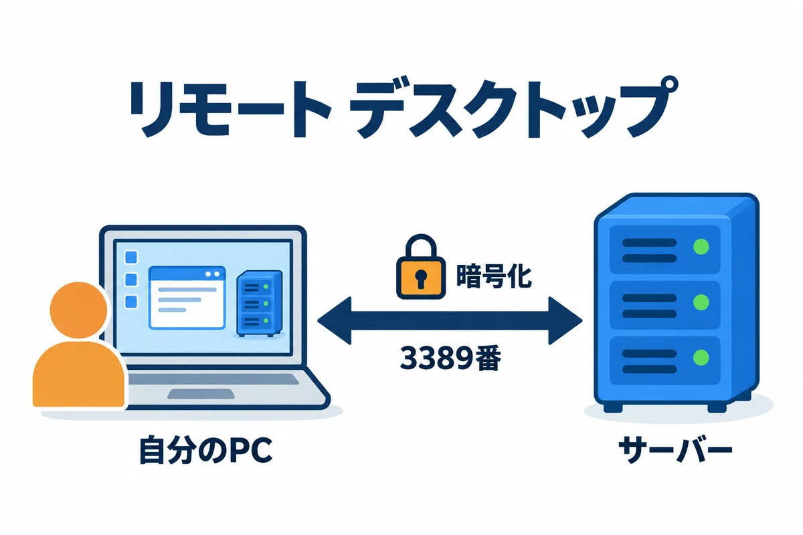
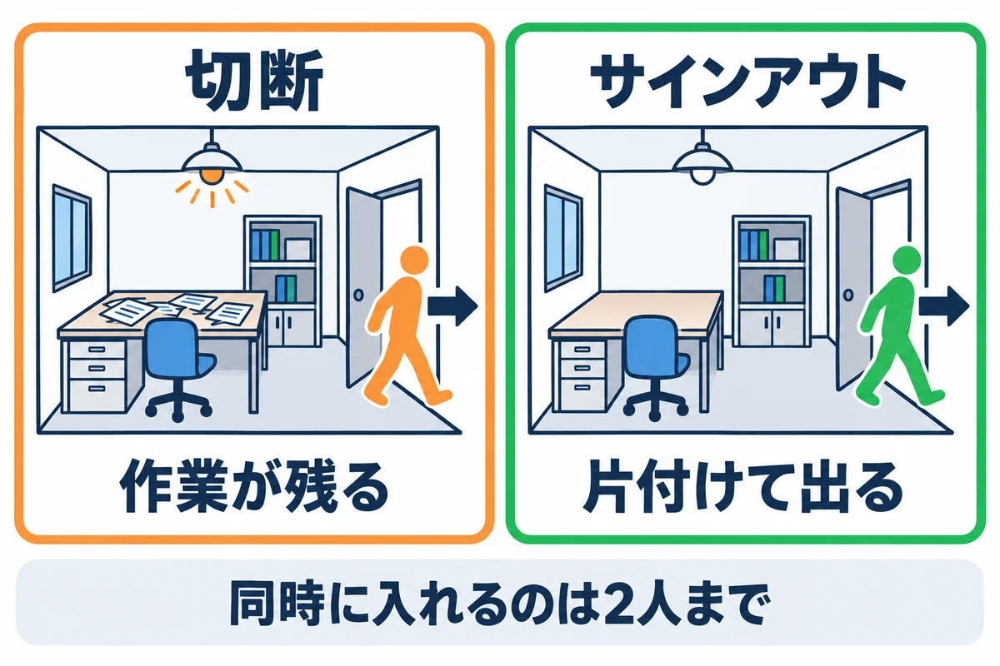
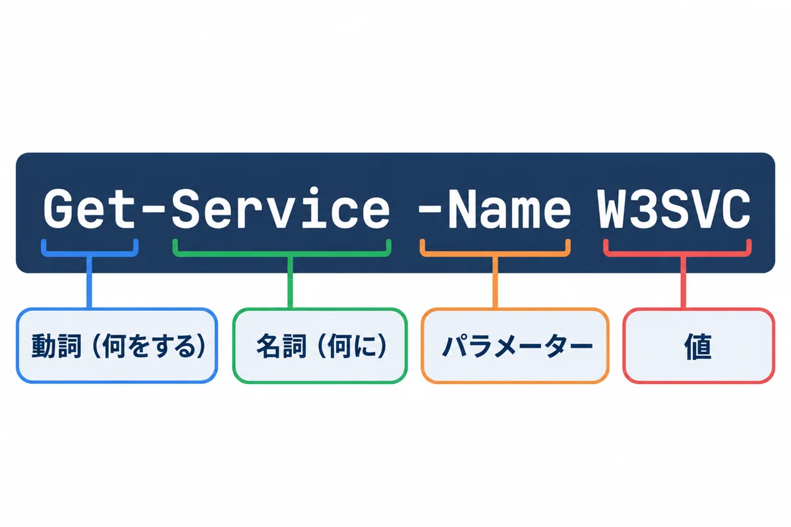
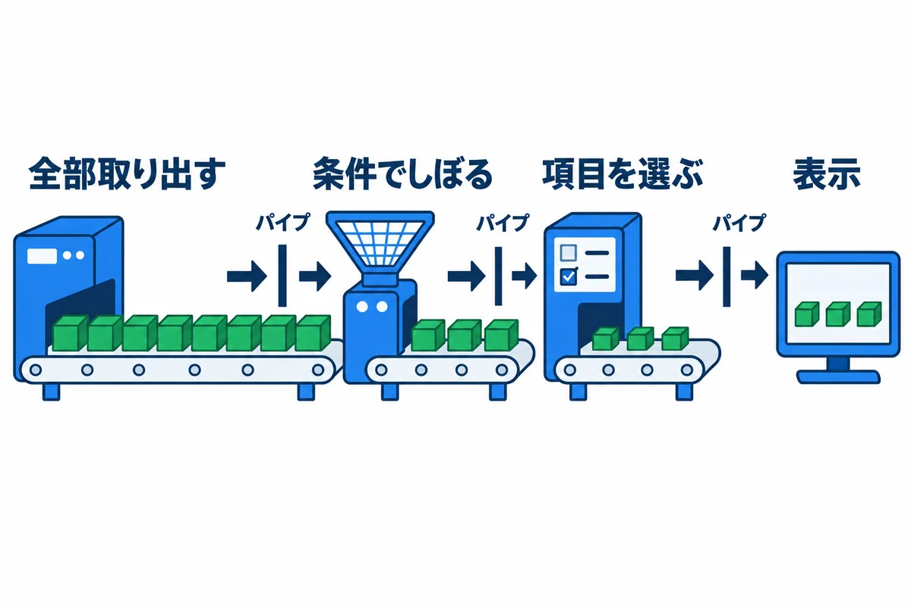
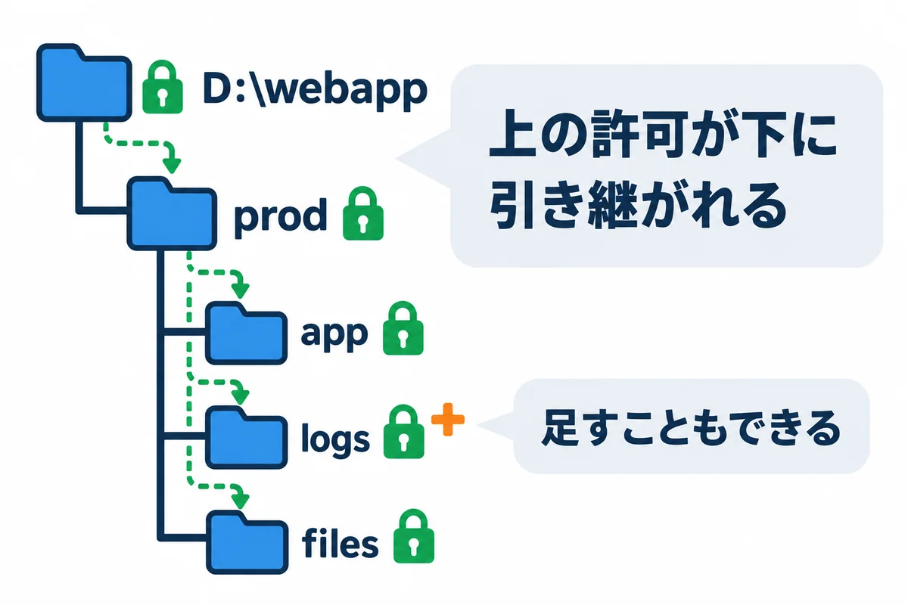
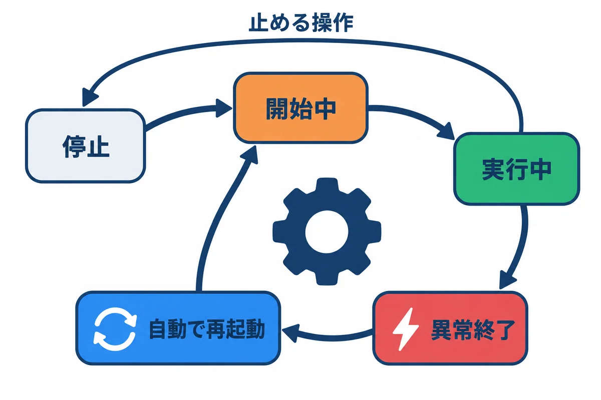
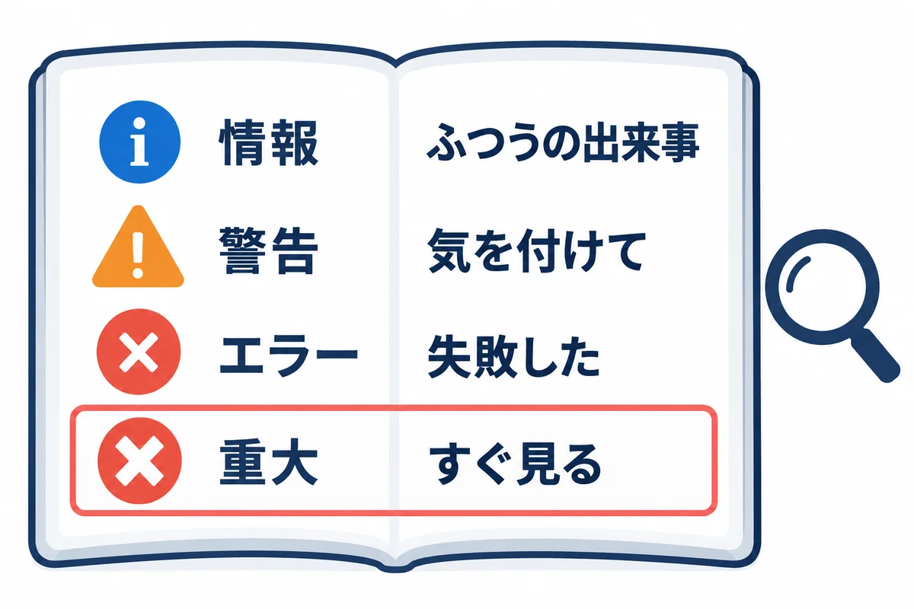
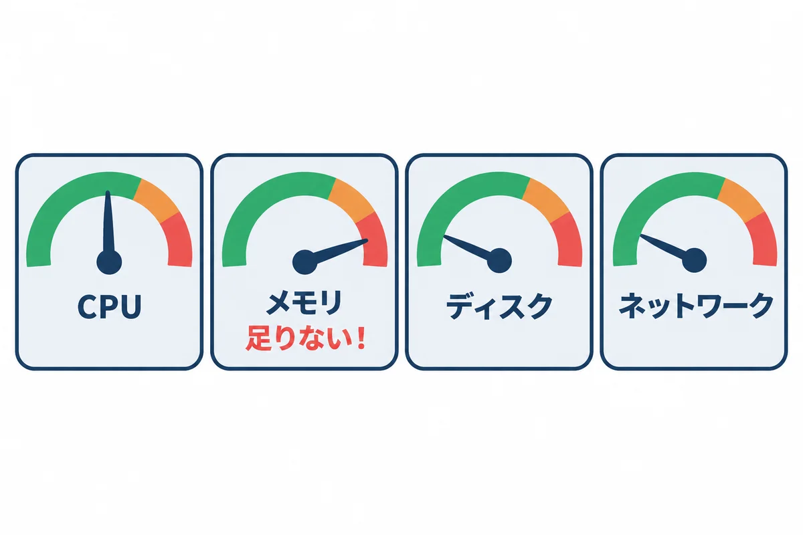
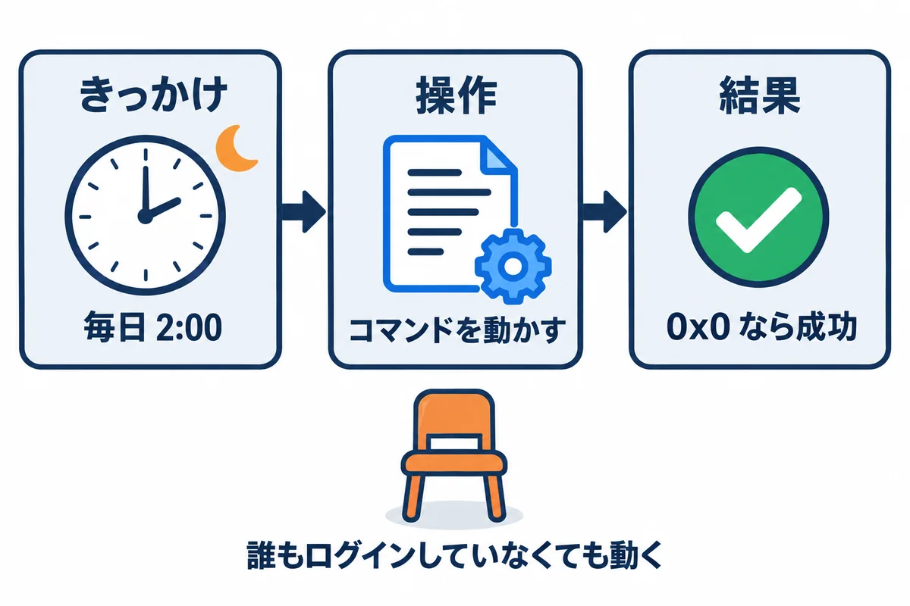
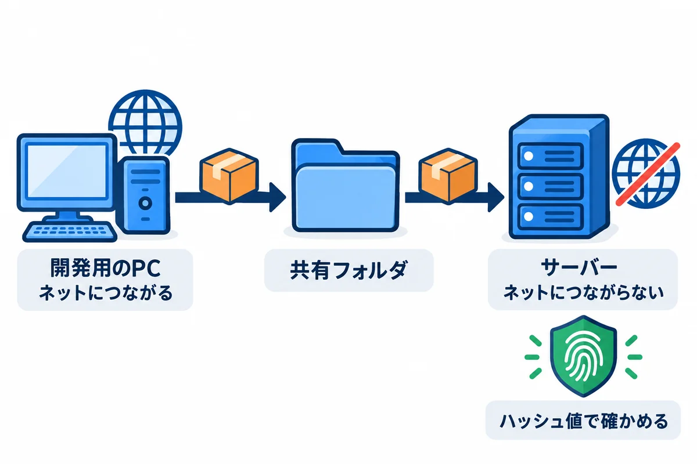

<div style="text-align: center; padding: 28px 0 8px;">
<div style="font-size: 14px; color: #475569;">オンプレミス構築 教育資料</div>
<div style="font-size: 26px; font-weight: 800; color: #0f172a; margin-top: 6px; line-height: 1.35;">Windows Server の使い方 — ログイン・PowerShell・管理の道具</div>
<div style="font-size: 13px; color: #475569; margin-top: 8px;">サーバーに入って、見て、動かして、困ったときに調べるための道具の使い方</div>
</div>

# Windows Server の使い方: ログイン・PowerShell・管理の道具

## この資料について

会社から「サーバーを用意しました。OS（Windows Server）だけ入っています」と言われた**その日から使う道具**の使い方を、1つずつ説明します。

- **前提:** Windows Server 2025 または 2022 の「デスクトップ エクスペリエンス」（画面のある形）。会社のドメイン（Active Directory）に参加していて、自分の会社のアカウントでログインできる。
- **読む順番:** 1 章（ログイン）と 3 章（PowerShell）は、構築を始める前に必ず読んでください。ほかの章は、手順書（04・05）で出てきたときに読み返せば十分です。
- **言葉:** ネットワーク・サービス・アカウントなどの考え方は、**00 基礎知識**で説明しています。この資料は「実際にどう操作するか」を受け持ちます。
- **コマンドの書き方:** `#` から後ろは説明です。`WEBAPP-SV01`（サーバーの名前）、`EXAMPLE`（会社のドメインの短い名前）、`taro.yamada`（自分のアカウント）は、自分の環境のものに読みかえてください。

> **サンプルの結果について:** この資料では、コマンドの結果（画面に出る文字）は載せず、「**確かめること**」として、結果のどこを見て、何なら正しいかを書きます。結果の細かい見た目は、版や設定によって変わるからです。

## 1. サーバーに入る（リモート デスクトップ）

### 1.1 リモート デスクトップとは

サーバーは、データセンターやサーバー室にあり、目の前にはありません。自分のパソコンから、**サーバーの画面を自分の画面に映して操作する**仕組みが、**リモート デスクトップ**（RDP）です。

<div style="max-width: 760px; margin: 18px auto; text-align: center;">

<div style="font-size: 12px; color: #64748b; margin-top: 6px;">図1-1: リモート デスクトップは、サーバーの画面を自分の PC に映す</div>
</div>

- 自分のパソコンで打ったキーとマウスの動きがサーバーに送られ、サーバーの画面が送り返されてきます。**プログラムは、サーバーの上で動いています。**
- 通信には **3389 番**のポートを使います。リモート デスクトップの通信は、**それ自体が暗号化**されています（Web アプリの HTTP とは別の話です）。

> **用語:** リモート デスクトップ（Remote Desktop：離れたコンピューターの画面を、自分の画面に映して操作する Windows の機能。通信の決まりの名前は RDP）

<!-- -->

> **用語:** mstsc（エムエスティーエスシー：Windows に付いている「リモート デスクトップ接続」のプログラムの名前。`Win`＋`R` で `mstsc` と打つと開く）

### 1.2 つなぐ前にそろえる物

| そろえる物 | 例 | だれに聞くか |
|---|---|---|
| サーバーの名前（または IP アドレス） | `WEBAPP-SV01.example.local`（または `10.20.30.40`） | 情報システム部門 |
| ログインに使うアカウント | `EXAMPLE\taro.yamada` | 情報システム部門（**サーバーへのログインの許可**をもらう） |
| 自分のパソコンからサーバーの 3389 番への通り道 | 管理者のパソコンからだけ通す | 情報システム部門（ネットワークの関所） |
| サーバーの中での権限 | Administrators グループに入れてもらう（構築の間） | 情報システム部門 |

> **注意:** サーバーへのログインの許可は、**ふつうの社員の会社アカウントには、最初は付いていません**。依頼の文面は、07 付録の依頼シートにあります。

### 1.3 つなぎ方（初めての接続）

1. 自分のパソコンで `Win`＋`R` を押し、`mstsc` と打って Enter を押します。「リモート デスクトップ接続」の画面が開きます。
2. 「**オプションの表示**」を押して、画面を広げます。
3. 「コンピューター」に、サーバーの名前（`WEBAPP-SV01.example.local`）を入れます。
4. 「ユーザー名」に、`EXAMPLE\taro.yamada` の形で入れます（1.4 の表）。
5. 「**接続**」を押し、パスワードを入れます。
6. 初めてのときは、「**このリモート コンピューターの ID を識別できません**」という意味の確認が出ます。「証明書を表示」で、名前がつなごうとしたサーバーの名前と同じであることを確かめてから、「はい」を押します。
7. サーバーのデスクトップが表示され、少し待つと「**サーバー マネージャー**」が自動で開きます（2 章）。

**確かめること:** 画面の右下（または「サーバー マネージャー」の「ローカル サーバー」）で、コンピューター名が、つなごうとしたサーバーの名前になっていること。**別のサーバーにつないで作業してしまう事故**を防ぐため、作業の前に毎回確かめます。

> **用語:** 証明書（ここでは、サーバーが「自分は WEBAPP-SV01 です」と名乗るための電子の身分証。リモート デスクトップでは、サーバーが自分で作った証明書を使うことが多く、初回に「信頼してよいか」を聞かれる）

### 1.4 ユーザー名の書き方

同じ人でも、ログインのときのユーザー名の書き方がいくつかあります。

| 書き方 | 例 | 意味 |
|---|---|---|
| `ドメイン\ユーザー名` | `EXAMPLE\taro.yamada` | 会社（ドメイン）のアカウント。いちばんよく使う |
| `ユーザー名@ドメイン` | `taro.yamada@example.local` | 同じく会社のアカウント（UPN という書き方） |
| `.\ユーザー名` | `.\Administrator` | **このサーバーの中だけ**のアカウント（ローカル アカウント）。`.` は「この機械」の意味 |
| `コンピューター名\ユーザー名` | `WEBAPP-SV01\Administrator` | 上と同じ。ローカル アカウント |

> **よくある失敗:** `taro.yamada` とだけ打つと、自分のパソコンの名前やローカル アカウントと取り違えられ、「資格情報が機能しませんでした」になることがあります。**ドメインまで付けて**打ちます。

### 1.5 終わり方:「切断」と「サインアウト」

リモート デスクトップの画面の右上の「×」で閉じると、**切断**になります。切断は、部屋を出ただけで、**中の作業（開いたままのプログラム）はサーバーに残ります**。

<div style="max-width: 760px; margin: 18px auto; text-align: center;">

<div style="font-size: 12px; color: #64748b; margin-top: 6px;">図1-2: 切断は「作業を残したまま出る」、サインアウトは「片付けて出る」</div>
</div>

- Windows Server は、管理のためのリモート デスクトップを、**同時に 2 人まで**しか受け付けません（それより多くするには、別のライセンスが要ります）。切断したままの人が 2 人いると、3 人目はログインできません。
- 作業が終わったら、スタートボタン → 自分のアイコン →「**サインアウト**」で終わります。
- ただし、**長い処理を動かしている途中なら、切断**にします。サインアウトすると、自分が手で動かしたプログラムは止まります。

だれがログインしているかを見て、残っている作業を終わらせるには、管理者の PowerShell で次のようにします。

```powershell
# このサーバーにログインしている人の一覧を見る（ID・状態（Active／Disc）・ログインした時刻）
quser

# ID が 3 の作業（セッション）をサインアウトさせる。開いていたプログラムは閉じられる
logoff 3
```

<!-- first-use -->

> **▶ ここで初めて出てくるコード**
>
> - **`quser`**（コマンド）: このサーバーにログインしている人の一覧（名前・番号・状態・ログインした時刻）を表示するコマンド。
> - **`logoff`**（コマンド）: 決めた番号の人を、ログオフさせるコマンド。`logoff 3` は、`quser` で見た番号 3 の人。保存していない作業は消えるので、必ず本人に確かめてから使います。

<!-- /first-use -->

**確かめること:** `quser` の `STATE` が `Disc`（切断）の行が、長く残っていないこと。**ほかの人の作業を `logoff` で消すときは、その人に確かめてから**にします（保存していない作業が消えます）。

> **用語:** セッション（ここでは、1人がリモート デスクトップでログインしている間の「作業の部屋」のこと。00 基礎知識の Web のセッションとは別のもの）

### 1.6 接続の設定を保存する

毎回サーバーの名前とユーザー名を打つのは手間です。

1. 「リモート デスクトップ接続」の「オプションの表示」→「全般」タブで、コンピューター名とユーザー名を入れます。
2. 「**名前を付けて保存**」で、`WEBAPP-SV01.rdp` のように保存します。次からは、このファイルをダブルクリックするだけでつながります。

> **注意:** 「資格情報を保存できるようにする」にチェックを入れて、**パスワードを保存しないで**ください。そのパソコンを使える人なら、だれでもサーバーに入れてしまいます。

### 1.7 ファイルと文字のやり取り

- **コピーと貼り付け:** 自分のパソコンでコピーした文字は、ふつうサーバーの中に貼り付けられます（逆も同じ）。手順書のコマンドを貼り付けるときに使います。
- **ファイル:** 会社の決まりで、リモート デスクトップでのファイルのコピーが止められていることがあります。その場合は、会社の**共有フォルダ**（`\\fileserver\share\...`）を経由します（12 章）。

### 1.8 リモート デスクトップのトラブル

| 症状 | 考えられる原因 | 調べ方・直し方 |
|---|---|---|
| 「リモート コンピューターに接続できません」という意味のエラー。すぐに失敗する | 名前の打ち間違い／DNS に名前が無い／3389 番が関所で止まっている／サーバーが止まっている | 自分のパソコンで `Test-NetConnection WEBAPP-SV01.example.local -Port 3389` を打つ。`TcpTestSucceeded : False` なら、名前と関所（情報システム部門）を確かめる |
| 「資格情報が機能しませんでした」 | ユーザー名の書き方（1.4）／パスワードの打ち間違い／Caps Lock | ユーザー名を `EXAMPLE\taro.yamada` の形で打ち直す。何度も失敗すると、アカウントが**ロック**されることがあるので、3 回失敗したら止めて情報システム部門に聞く |
| 「リモート デスクトップ サービスを使ったサインインの権限が必要」という意味のエラー | そのアカウントに、このサーバーへのログインの許可が無い | 情報システム部門に、Remote Desktop Users か Administrators グループへの追加を頼む |
| 「パスワードの有効期限が切れています」という意味のメッセージ | 会社の決まりで、パスワードに期限がある | 自分のパソコンでパスワードを変えてから、つなぎ直す。サーバーの中にいるときは、`Ctrl`＋`Alt`＋`End` →「パスワードの変更」 |
| 「別のユーザーがサインインしています」「接続数の上限」という意味のメッセージ | 同時に 2 人まで（1.5）がふさがっている | 切断のまま残っている人に連絡してサインアウトしてもらう。管理者なら、ほかのサーバーから `quser /server:WEBAPP-SV01` で一覧を見られる |
| 「認証エラーが発生しました」「CredSSP」という言葉が入ったエラー | 自分のパソコンとサーバーの、Windows Update の当て具合が食い違っている | 両方に Windows Update を当てる。直らなければ情報システム部門に聞く（自分で安全の設定を下げない） |
| つながったが、画面が真っ黒のまま | ログインの処理が遅れている／画面の描き直しの不調 | 1〜2 分待つ。だめなら `Ctrl`＋`Alt`＋`End` →「タスク マネージャー」を開く。それでもだめなら切断して、つなぎ直す |
| 文字や画面がぼやける・小さすぎる | 画面の大きさ（解像度）の合わない設定 | 「オプションの表示」→「画面」タブで、画面の大きさを変える |

> **用語:** `Ctrl`＋`Alt`＋`End`（リモート デスクトップの中で、`Ctrl`＋`Alt`＋`Del` の代わりに押すキー。`Ctrl`＋`Alt`＋`Del` は自分のパソコンの方に効いてしまうため）

## 2. 最初の画面と、よく使う管理の道具

### 2.1 サーバー マネージャー

ログインすると自動で開くのが「**サーバー マネージャー**」です。サーバーの状態を見たり、機能を追加したりする、**サーバーの管理の入口**です。

左の「**ローカル サーバー**」を押すと、このサーバーの基本の情報が一覧で出ます。受け取ったときに、ここで次を確かめます（04 の 3 章のチェック）。

| 項目 | 確かめること |
|---|---|
| コンピューター名 | 頼んだ名前（例：`WEBAPP-SV01`） |
| ドメイン | 会社のドメイン（例：`example.local`） |
| Microsoft Defender ファイアウォール | 「ドメイン: 有効」になっている（10 章） |
| リモート デスクトップ | 「有効」 |
| イーサネット | 頼んだ固定の IP アドレス |
| タイム ゾーン | `(UTC+09:00) 大阪、札幌、東京` |
| 最後に更新プログラムをインストールした日時 | 最近の日付（11 章） |

右上の「**管理**」→「**役割と機能の追加**」で、IIS などの Windows の機能を追加します（04 の 8 章では、同じことを PowerShell で行います）。

> **用語:** 役割と機能（Windows Server に後から足せる機能のまとまり。「Web サーバー（IIS）」は役割の1つ）

### 2.2 よく使う管理の道具

Windows Server には、たくさんの管理の道具が入っています。この資料と手順書で使うのは、次の道具です。

<div style="max-width: 760px; margin: 18px auto; text-align: center;">

<div style="font-size: 12px; color: #64748b; margin-top: 6px;">図2-1: この資料で使う、Windows Server の管理の道具</div>
</div>

`Win`＋`R` で「ファイル名を指定して実行」を開き、表の「開き方」の名前を打つと、すぐに開けます。

| 道具 | 開き方 | 何をするか | 説明の章 |
|---|---|---|---|
| サーバー マネージャー | `servermanager` | サーバーの状態を見る、機能を足す | 2.1 |
| ターミナル／PowerShell | スタートボタンを右クリック | 文字のコマンドで操作する | 3 |
| コンピューターの管理 | `compmgmt.msc` | ローカルのユーザーとグループ、ディスクなどをまとめて見る | 4 |
| サービス | `services.msc` | サービスの起動・停止・設定 | 6 |
| イベント ビューアー | `eventvwr.msc` | Windows とアプリの記録（ログ）を見る | 7 |
| タスク マネージャー | `taskmgr`（または `Ctrl`＋`Shift`＋`Esc`） | 重いプログラムを探す | 8 |
| リソース モニター | `resmon` | CPU・メモリ・ディスク・通信を、プログラムごとに詳しく見る | 8 |
| タスク スケジューラ | `taskschd.msc` | 決まった時刻にコマンドを動かす | 9 |
| ファイアウォール | `wf.msc` | 通信の関所の決まりを見る・作る | 10 |
| IIS マネージャー | `inetmgr` | Web サーバー（IIS）の設定（IIS を入れた後） | 04 の 8 章 |
| ディスクの管理 | `diskmgmt.msc` | ディスクの割り当てとドライブ文字 | 04 の 4 章 |
| ネットワーク接続 | `ncpa.cpl` | IP アドレスなどの設定を見る | 00 の 4 章 |

> **触らない方がよい道具:** レジストリ エディター（`regedit`）やグループ ポリシーの設定は、間違えると Windows が起動しなくなったり、会社の決まりとぶつかったりします。手順書に書いていない限り、触りません。

> **用語:** `.msc`（Windows の管理の道具の画面のファイル。ダブルクリックや `Win`＋`R` で開く）

## 3. PowerShell の基本

### 3.1 開き方と「管理者として実行」

- **Windows Server 2025:** スタートボタンを右クリック →「**ターミナル（管理者）**」。
- **Windows Server 2022:** スタートボタンを右クリック →「**Windows PowerShell（管理者）**」。
- 「このアプリがデバイスに変更を加えることを許可しますか?」と聞かれたら、「はい」を押します（**ユーザー アカウント制御**。4.3）。

ウィンドウの題名に「**管理者**」と出ていれば、管理者として動いています。コマンドで確かめることもできます。

```powershell
# 管理者として動いていれば True、そうでなければ False
([Security.Principal.WindowsPrincipal][Security.Principal.WindowsIdentity]::GetCurrent()).IsInRole(
    [Security.Principal.WindowsBuiltInRole]::Administrator)
```

**確かめること:** `True` と出ること。`False` なら、一度閉じて、「管理者」の方で開き直します。インストール・サービス・ファイアウォール・アクセス許可の変更は、管理者でないと「**アクセスが拒否されました**」になります。

> **PowerShell の版:** Windows Server に最初から入っているのは **Windows PowerShell 5.1** です。別に入れる「PowerShell 7」もありますが、この資料と手順書は、すべて 5.1 で動くように書いています。

### 3.2 コマンドの形

PowerShell のコマンド（**コマンドレット**）は、「**動詞-名詞**」の形の名前に、「**-パラメーター 値**」を続けて書きます。

<div style="max-width: 760px; margin: 18px auto; text-align: center;">

<div style="font-size: 12px; color: #64748b; margin-top: 6px;">図3-1: コマンドの形は「動詞-名詞 -パラメーター 値」</div>
</div>

```powershell
# 「W3SVC という名前のサービス（IIS の本体）の、状態を見せて」
Get-Service -Name W3SVC
```

よく出てくる動詞を覚えておくと、知らないコマンドでも意味の見当が付きます。

| 動詞 | 意味 | 例 |
|---|---|---|
| `Get` | 見る・取り出す | `Get-Service`（サービスを見る） |
| `Set` | 設定を変える | `Set-Service`（サービスの設定を変える） |
| `New` | 新しく作る | `New-Item`（ファイルやフォルダを作る） |
| `Remove` | 消す | `Remove-Item`（ファイルを消す） |
| `Start`・`Stop`・`Restart` | 始める・止める・やり直す | `Restart-Service`（サービスを再起動する） |
| `Test` | 確かめる | `Test-NetConnection`（つながるか確かめる） |
| `Copy`・`Move` | 写す・動かす | `Copy-Item`（ファイルを写す） |

> **用語:** コマンドレット（cmdlet：PowerShell の中に用意されたコマンド。「動詞-名詞」の名前が付いている）

<!-- -->

> **用語:** パラメーター（コマンドに渡す「どれを・どうやって」の指定。`-` で始まる）

### 3.3 打つときの便利な操作

| 操作 | キー | 使いどころ |
|---|---|---|
| 名前の残りを補う | `Tab` | `Get-Ser` まで打って `Tab` で `Get-Service` になる。打ち間違いが減る |
| 前に打ったコマンドを出す | `↑`・`↓` | 同じコマンドを、少し変えて打ち直す |
| 実行中のコマンドを止める | `Ctrl`＋`C` | 終わらないコマンドや、間違えて始めたコマンドを止める |
| 貼り付け | 右クリック、または `Ctrl`＋`V` | 手順書のコマンドを貼る |
| 画面を消す | `cls` と打つ | 画面がいっぱいになったとき |

困ったときの調べ方です。

```powershell
# コマンドの使い方を見る（例：Get-Service）
Get-Help Get-Service -Examples

# 名前に Firewall を含むコマンドを探す
Get-Command *Firewall*

# 前に打ったコマンドの一覧を見る
Get-History
```

<!-- first-use -->

> **▶ ここで初めて出てくるコード**
>
> - **`Get-Help`**（PowerShell）: コマンドの説明を表示するコマンド。`Get-Help Get-Service` で使い方、`-Examples` で例が見られます。
> - **`Get-Help -Examples`**（PowerShell）: `Get-Help` で、使い方の例だけを表示するオプション。初めてのコマンドは、まずこれで例を見ると早いです。
> - **`Get-Command`**（PowerShell）: コマンドがどこにあるか・何なのかを調べるコマンド。`(Get-Command rustc).Source` は、`rustc.exe` の場所を返します。入っているかを確かめる時に使います。
> - **`Get-History`**（PowerShell）: この窓で、これまでに打ったコマンドの一覧を表示するコマンド。

<!-- /first-use -->

### 3.4 パイプ: 結果を次のコマンドに渡す

`|`（**パイプ**）を使うと、前のコマンドの結果を、次のコマンドに渡せます。「全部取り出す → しぼる → 項目を選ぶ → 表示する」のように、小さなコマンドをつないで使います。

<div style="max-width: 760px; margin: 18px auto; text-align: center;">

<div style="font-size: 12px; color: #64748b; margin-top: 6px;">図3-2: パイプは、結果を次の機械へ流すベルトコンベア</div>
</div>

```powershell
# サービスを全部取り出し → 動いている物だけにしぼり → 名前と表示名だけを選び → 名前の順に並べる
Get-Service |
    Where-Object Status -eq 'Running' |
    Select-Object Name, DisplayName |
    Sort-Object Name
```

<!-- first-use -->

> **▶ ここで初めて出てくるコード**
>
> - **`-eq`**（PowerShell）: PowerShell の「等しい」の比べ方（equal）。`$LASTEXITCODE -eq 0` は「終わった時の番号が 0（成功）か」。PowerShell では `==` ではなく `-eq` と書きます。大文字・小文字は区別しません（`"ABC" -eq "abc"` も `True`）。
> - **`Where-Object`**（PowerShell）: `|` で流れてきた物のうち、条件に合う物だけを残すコマンド。`{ }` の中の `$_` が「今の 1 つ」です。`Where-Object { $_.Length -gt 1000 }` のように使います。

<!-- /first-use -->

| よく使う相手 | 役目 | 例 |
|---|---|---|
| `Where-Object` | 条件でしぼる | `Where-Object Status -eq 'Running'`（状態が Running の物だけ） |
| `Select-Object` | 項目（列）を選ぶ・先頭だけにする | `Select-Object Name, Status`、`Select-Object -First 10` |
| `Sort-Object` | 並べかえる | `Sort-Object CPU -Descending`（CPU の多い順） |
| `Format-List` | 全部の項目を縦に並べて見る | `Get-Service W3SVC \| Format-List *` |
| `Out-File`・`Export-Csv` | ファイルに書き出す | `Export-Csv D:\work\services.csv -Encoding UTF8 -NoTypeInformation` |

比べる書き方（`-eq` など）は、記号ではなく文字で書きます。

| 書き方 | 意味 |
|---|---|
| `-eq` | 等しい |
| `-ne` | 等しくない |
| `-gt`・`-lt` | より大きい・より小さい |
| `-like` | `*` を使った形に合う（例：`-like 'webapp*'`） |

### 3.5 変数と文字列

```powershell
# 変数は $ で始める。= で値を入れる
$site = "webapp-prod"
$port = 8080

# " で囲んだ文字の中の変数は、中身に置きかわる
"サイト $site は $port 番で待ち受けます"   # → サイト webapp-prod は 8080 番で待ち受けます

# ' で囲むと、置きかわらない（そのままの文字）
'サイト $site'                              # → サイト $site

# 環境変数は $env: を付けて読む
$env:COMPUTERNAME
```

**確かめること:** `"..."` と `'...'` で結果が変わること。パスワードなど `$` を含む文字を書くときは、`'...'` で囲まないと、`$` の後ろが変数として消えてしまいます。

### 3.6 ファイルとフォルダの操作

| やりたいこと | コマンド | 昔のコマンドの書き方（同じ意味で使える） |
|---|---|---|
| 今いるフォルダを見る | `Get-Location` | `pwd` |
| フォルダを移る | `Set-Location D:\webapp` | `cd D:\webapp` |
| 中身の一覧 | `Get-ChildItem` | `dir`、`ls` |
| フォルダを作る | `New-Item -ItemType Directory D:\work` | `mkdir D:\work` |
| 写す | `Copy-Item 元 先` | `copy` |
| 動かす・名前を変える | `Move-Item 元 先`、`Rename-Item` | `move`、`ren` |
| 消す | `Remove-Item パス` | `del` |
| 中身を見る | `Get-Content パス` | `type` |
| ログの最後を見続ける | `Get-Content パス -Tail 50 -Wait` | （無い） |
| 文字を探す | `Select-String -Path *.log -Pattern "ERROR"` | `findstr` |
| zip にまとめる・広げる | `Compress-Archive`・`Expand-Archive` | （無い） |
| ファイルの指紋（ハッシュ値）を出す | `Get-FileHash パス -Algorithm SHA256` | `certutil -hashfile` |

使い方の例です。

```powershell
# アプリのログの最後の 50 行を見て、そのまま新しい行を待ち続ける（止めるときは Ctrl+C）
Get-Content D:\webapp\prod\logs\webapp-prod-service.out.log -Tail 50 -Wait

# logs フォルダの中の全部のログから、ERROR を含む行を探す
Select-String -Path D:\webapp\prod\logs\*.log -Pattern "ERROR" | Select-Object -Last 20

# D ドライブの中の、大きいファイルを上から 20 個
Get-ChildItem D:\ -Recurse -File -ErrorAction SilentlyContinue |
    Sort-Object Length -Descending |
    Select-Object -First 20 FullName, @{ Name = 'MB'; Expression = { [int]($_.Length / 1MB) } }
```

<!-- first-use -->

> **▶ ここで初めて出てくるコード**
>
> - **`Get-Content -Tail`**（PowerShell）: `Get-Content` で、ファイルの最後から決めた行数だけを読むオプション。`-Tail 50` は最後の 50 行。ログの新しい所を見る時に使います。
> - **`Get-Content -Wait`**（PowerShell）: ファイルの最後まで読んだあとも閉じずに待ち、新しく書き足された行を、その都度表示し続けるオプション。ログを見張る時に `-Tail 50 -Wait` と組み合わせます。止める時は `Ctrl` ＋ `C` です。
> - **`Select-String`**（PowerShell）: ファイルの中から、文字を含む行を探すコマンド。何行目に見つかったかも表示します。
> - **`Select-String -Path`**（PowerShell）: `-Path ファイル` で、探すファイルを指定します。`*.log` のように、いくつものファイルも指定できます。
> - **`Select-String -Pattern`**（PowerShell）: `-Pattern "文字"` で、探す文字を指定します。`"ERROR|WARN"` のように、`|` で「または」にもできます（正規表現）。
> - **`Select-Object -Last`**（PowerShell）: 受け取った物の、最後から決めた数だけを取り出すオプション。`Select-Object -Last 20` は最後の 20 個。
> - **`Get-ChildItem`**（PowerShell）: フォルダの中の一覧を出すコマンド（短い呼び名は `ls`・`dir`）。`Get-ChildItem フォルダ` でそのフォルダの中身、`-Recurse` で中のフォルダまで全部を出します。
> - **`Get-ChildItem -Recurse`**（PowerShell）: `-Recurse` で、中のフォルダの中まで全部を一覧にします。
> - **`Get-ChildItem -File`**（PowerShell）: `Get-ChildItem` で、ファイルだけを取り出す（フォルダを除く）オプション。
> - **`Get-ChildItem -ErrorAction`**（PowerShell）: エラーが起きた時の動きを決めるオプション。`-ErrorAction SilentlyContinue` は、読めないフォルダ（権限が無い所）があっても、エラーを出さずに続けます。
> - **`Sort-Object -Descending`**（PowerShell）: 大きい順（新しい順）に並べるオプション。`Sort-Object Length -Descending` は、大きいファイルから順に並べます。
> - **`Select-Object -First`**（PowerShell）: `-First 1` で、結果の最初の 1 つだけを取り出します。`-Last 3` なら最後の 3 つです。

<!-- /first-use -->

> **`Remove-Item` は、ごみ箱に入りません。** 消したファイルは戻せないので、消す前に `Get-ChildItem` で、消す物を確かめてから消します。`-Recurse`（中身ごと）を付けるときは特に気を付けます。

### 3.7 スクリプトを動かす

コマンドを `.ps1` のファイルに書いて保存したものが**スクリプト**です（00 基礎知識 0.5）。

```powershell
# 今いるフォルダの backup.ps1 を動かす（.\ は「今いるフォルダの」という意味。省くと動かない）
.\backup.ps1

# 場所を全部書いて動かす
& D:\webapp\tools\backup.ps1
```

<!-- first-use -->

> **▶ ここで初めて出てくるコード**
>
> - **`.\backup.ps1`**（PowerShell）: 今いるフォルダの `backup.ps1`（この資料で作る、データベースとファイルの控えを取るスクリプト）を動かす書き方。PowerShell では、今いるフォルダのスクリプトも `.\` を付けないと動きません（うっかり同じ名前の物を動かさないための決まり）。

<!-- /first-use -->

**実行ポリシー**: PowerShell には、知らないスクリプトを勝手に動かさないための決まりがあります。Windows Server では、最初は `RemoteSigned`（このサーバーで書いたスクリプトは動く。インターネットから取ってきたスクリプトは、署名が無いと動かない）になっています。

```powershell
# 今の実行ポリシーを見る
Get-ExecutionPolicy

# インターネットから取ってきた（印の付いた）ファイルの印を外す。中身を確かめてから行う
Unblock-File D:\webapp\tools\some-script.ps1
```

<!-- first-use -->

> **▶ ここで初めて出てくるコード**
>
> - **`Get-ExecutionPolicy`**（PowerShell）: 今の実行ポリシー（スクリプトを動かしてよいかの決まり）を見るコマンド。`Restricted` はスクリプトを動かせない、`RemoteSigned` は自分で作った物は動かせる、という意味です。
> - **`Unblock-File`**（PowerShell）: インターネットやほかのパソコンから持ってきたファイルに付く「よそから来た」印を外すコマンド。印が付いたスクリプトは、決まりによって動かないことがあります。中身を確かめてから外します。

<!-- /first-use -->

**確かめること:** `Get-ExecutionPolicy` が `RemoteSigned` であること。「このシステムではスクリプトの実行が無効になっているため…」と出たら、そのファイルがインターネットから取ってきた物で印が付いているか、会社の決まりで実行ポリシーが厳しくなっています。**`Set-ExecutionPolicy` で、サーバー全体の実行ポリシーを `Unrestricted` や `Bypass` に変えて逃げないで**ください。会社の決まりに反することがあります。（04 の 11 章のタスクで `-ExecutionPolicy Bypass` を付けているのは、自分で書いて中身の分かっているスクリプト1つを、そのタスクの中でだけ動かすためで、サーバー全体の決まりは変えません。）

**スクリプトの文字コード（とても大事）:** Windows PowerShell 5.1 は、**BOM（ファイルの先頭の印）の無い UTF-8** のファイルを、Shift_JIS だと思って読みます。日本語のコメントや文字が入ったスクリプトをそのまま保存すると、日本語の所で行の区切りが食われ、**次の行が消えたり、構文エラーで丸ごと動かなかったり**します（試して確かめました）。日本語を含むスクリプトは、メモ帳の「名前を付けて保存」で、エンコードを「**UTF-8 (BOM 付き)**」にして保存します。

```powershell
# 先頭の 3 つの数が 239 187 191 なら BOM 付き
(Get-Content D:\webapp\tools\backup.ps1 -Encoding Byte -TotalCount 3) -join ' '
```

<!-- first-use -->

> **▶ ここで初めて出てくるコード**
>
> - **`-join`**（PowerShell）: 並びの中身を、区切り文字でつないで 1 つの文字列にする演算子。`$lines -join "`n"` は「改行でつなぐ」、`@("a","b") -join ","` は `"a,b"`。

<!-- /first-use -->

> **用語:** 実行ポリシー（Execution Policy：どのスクリプトを動かしてよいかの PowerShell の決まり）

<!-- -->

> **用語:** BOM（ボム。Byte Order Mark：ファイルの先頭に付ける「これは UTF-8 です」という 3 バイトの印。Windows PowerShell 5.1 は、これが無いと UTF-8 と分からない）

### 3.8 よくある間違い

| 間違い | 何が起きるか | 直し方 |
|---|---|---|
| 全角の空白・全角の `－`・全角の `"` が混じる | 「認識されません」などのエラー | 手順書から貼り付けるか、日本語入力を切って打つ |
| 管理者でない PowerShell で打つ | 「アクセスが拒否されました」 | 「管理者」で開き直す（3.1） |
| 空白を含むパスを `"` で囲まない | 「パスが見つかりません」 | `"C:\Program Files\..."` のように囲む |
| `sc` と打つ | サービスの道具ではなく、**ファイルに書き込むコマンド**（`Set-Content`）が動く | サービスの道具は、必ず `sc.exe` と打つ |
| `curl` と打つ | Windows PowerShell 5.1 では、`Invoke-WebRequest` の別名として動き、使い方が違う | `Invoke-WebRequest` を使うか、`curl.exe` と打つ |
| コマンドプロンプト（`cmd`）の書き方をそのまま使う | `%PATH%` などが効かない | PowerShell では `$env:PATH` |
| 日本語を含む `.ps1` を、BOM 無しの UTF-8 で保存する | 行が消える・構文エラーで動かない | 「UTF-8 (BOM 付き)」で保存し直す（3.7） |

> **用語:** 別名（エイリアス：コマンドの短い呼び名。`dir`・`ls` は `Get-ChildItem` の別名。`sc` は `Set-Content` の別名なので注意）

## 4. アカウントとグループ

### 4.1 自分がだれかを見る

```powershell
# 自分のアカウント
whoami

# 自分が入っているグループ（Administrators が入っているか）
whoami /groups | Select-String "Administrators"
```

**確かめること:** `whoami` が `example\taro.yamada` のように、会社のドメインのアカウントであること。構築の作業の間は、`whoami /groups` に `BUILTIN\Administrators` が出ること。

### 4.2 ローカルのユーザーとグループ

このサーバーの中だけのユーザーとグループは、「コンピューターの管理」（`compmgmt.msc`）→「ローカル ユーザーとグループ」で見られます。PowerShell では次のようにします。

```powershell
# このサーバーの中だけのユーザー
Get-LocalUser

# Administrators グループに入っている人（ドメインのアカウントも並ぶ）
Get-LocalGroupMember -Group Administrators

# リモート デスクトップでログインしてよい人
Get-LocalGroupMember -Group "Remote Desktop Users"
```

<!-- first-use -->

> **▶ ここで初めて出てくるコード**
>
> - **`Get-LocalUser`**（PowerShell）: このサーバーの中の利用者（ローカルユーザー）の一覧と、使えるか（`Enabled`）を表示するコマンド。
> - **`Get-LocalGroupMember`**（PowerShell）: このサーバーの中のグループに、だれが入っているかを表示するコマンド。
> - **`Get-LocalGroupMember -Group`**（PowerShell）: 調べるグループの名前を決めるオプション。`-Group Administrators` は、管理者のグループ（入っている人は何でもできるので、少なくしておく）。

<!-- /first-use -->

**確かめること:** Administrators に、**知らない人が入っていないこと**。構築が終わったら、自分を Administrators から外してもらうかどうかを、情報システム部門と決めます（会社の決まりによります）。

> **日本語の Windows でも:** `Administrators`・`Users`・`Remote Desktop Users` などの、最初からあるグループの名前は英語のままです。

### 4.3 ユーザー アカウント制御（UAC）

管理者のグループに入っている人でも、ふだんは**管理者の力を使わない**状態でプログラムが動きます。管理者の力が要るときだけ、「このアプリがデバイスに変更を加えることを許可しますか?」と聞かれ、「はい」を押すと、そのプログラムだけが管理者として動きます。これを**ユーザー アカウント制御**（UAC）と呼びます。

- 管理者のグループに入っているのに「アクセスが拒否されました」になるのは、たいてい「管理者として実行」をしていないからです。
- UAC を切る設定はしないでください。

### 4.4 アプリを動かすアカウント（サービス用アカウント）の種類

アプリやデータベースのサービスを、だれの名前で動かすかを選べます。

| 種類 | 書き方 | パスワード | 力の強さ | 向いている使い方 |
|---|---|---|---|---|
| LocalSystem | `LocalSystem` | 無い | **最も強い**（サーバーの全部をさわれる） | Windows 自身の大事なサービス。**アプリには使わない** |
| LocalService | `NT AUTHORITY\LocalService` | 無い | 弱い。ネットワークには名無しで出る | ネットワークに出ない小さなサービス |
| NetworkService | `NT AUTHORITY\NetworkService` | 無い | 弱い。ネットワークにはサーバーの名前で出る | IIS のアプリケーション プールなど |
| **仮想アカウント** | `NT SERVICE\サービス名` | 無い（Windows が管理する） | 弱い。サービスごとに別のアカウントになる | **今回のアプリ**（04 の 4・7 章）。サービスごとに分かれるので、本番と検証のフォルダの許可を分けられる |
| gMSA（グループ管理サービス アカウント） | `EXAMPLE\svc-webapp$` | 無い（ドメインが自動で変える） | 決めた分だけ | ほかのサーバーのフォルダに書き込むときなど。情報システム部門が用意する |
| ふつうのドメイン アカウント | `EXAMPLE\svc-webapp` | **ある** | 決めた分だけ | 昔のやり方。**パスワードの期限が切れるとサービスが起動しなくなる**ので、避ける |

> **用語:** 仮想アカウント（Virtual Account：サービス1つごとに Windows が自動で作る、パスワードの無いアカウント。名前は `NT SERVICE\サービス名`）

## 5. ファイルとアクセス許可（NTFS）

### 5.1 アクセス許可と継承

Windows のフォルダとファイルには、「だれが、何をしてよいか」（**アクセス許可**）を付けられます（00 基礎知識 3.4）。

| 許可 | 意味 | icacls での書き方 |
|---|---|---|
| フル コントロール | 何でもできる（許可の変更も） | `F` |
| 変更 | 読む・書く・消す | `M` |
| 読み取りと実行 | 読む・プログラムを動かす | `RX` |
| 読み取り | 読むだけ | `R` |
| 書き込み | 書くだけ | `W` |

上のフォルダに付けた許可は、ふつう**中のフォルダとファイルに引き継がれます**。これを**継承**と呼びます。

<div style="max-width: 760px; margin: 18px auto; text-align: center;">

<div style="font-size: 12px; color: #64748b; margin-top: 6px;">図5-1: 上のフォルダの許可が、下へ引き継がれる（継承）</div>
</div>

### 5.2 画面での見方

フォルダを右クリック →「プロパティ」→「**セキュリティ**」タブで、だれにどの許可があるかを見られます。「詳細設定」を押すと、継承されている許可かどうか（「継承元」の列）も見られます。

### 5.3 icacls で見る・付ける

手順書では、同じ結果を何度でも出せるように、`icacls` というコマンドで許可を付けます。

```powershell
# D:\webapp\prod\logs の許可を見る
icacls D:\webapp\prod\logs

# 仮想アカウント NT SERVICE\webapp-prod に、logs フォルダの「変更」の許可を足す
#   (OI) … 中のファイルに引き継ぐ   (CI) … 中のフォルダに引き継ぐ   M … 変更
icacls D:\webapp\prod\logs /grant "NT SERVICE\webapp-prod:(OI)(CI)M"

# 上からの継承を切り、今の許可を写し取ってから、だれかの許可を外す（秘密のフォルダなどで使う）
icacls D:\webapp\secrets /inheritance:d
icacls D:\webapp\secrets /remove "BUILTIN\Users"
```

<!-- first-use -->

> **▶ ここで初めて出てくるコード**
>
> - **`icacls`**（コマンド）: ファイルやフォルダの権限（だれが読める・書けるか）を表示する・変えるコマンド。`(R)` は読む、`(M)` は変える、`(F)` は全部できる、`(OI)(CI)` は中のファイルとフォルダにも引き継ぐ、という意味です。

<!-- /first-use -->

| 結果の書き方 | 意味 |
|---|---|
| `(F)`・`(M)`・`(RX)`・`(R)` | 5.1 の表の許可 |
| `(OI)` | 中のファイルに引き継ぐ |
| `(CI)` | 中のフォルダに引き継ぐ |
| `(IO)` | このフォルダ自身には効かず、中にだけ効く |
| `(I)` | 上のフォルダから引き継いだ許可 |

**確かめること:** 付けたアカウントの行に、付けた許可（例：`NT SERVICE\webapp-prod:(OI)(CI)(M)`）が出ること。秘密のフォルダでは、`BUILTIN\Users` の行が無いこと。

> **注意:** `/inheritance:r`（継承を外して、引き継いだ許可を消す）は、自分の許可まで消えて、だれもフォルダを開けなくなることがあります。手順書のとおりの順番で打ってください。

### 5.4 「アクセスが拒否されました」のとき

1. 管理者として動いているか（3.1）。
2. そのアカウントに許可があるか（`icacls` で見る）。サービスなら、`NT SERVICE\サービス名` の行があるか。
3. ほかのプログラムがファイルを開いたままにしていないか（ログのファイルを、メモ帳などで開いたままにしていないか）。

## 6. サービス

### 6.1 サービスの画面

`services.msc` を開くと、サービスの一覧が出ます。

| 列 | 意味 |
|---|---|
| 名前 | 画面に出る名前（表示名） |
| 状態 | 「実行中」なら動いている。空なら止まっている |
| スタートアップの種類 | Windows の起動のときに、どうするか（下の表） |
| ログオン | どのアカウントで動くか（4.4） |

| スタートアップの種類 | 意味 | 今回の使い方 |
|---|---|---|
| 自動 | Windows の起動と一緒に始まる | PostgreSQL・IIS |
| 自動（遅延開始） | Windows の起動が落ち着いてから始まる | アプリ（データベースが先に起動してから始まるように） |
| 手動 | だれかが始めたときだけ動く | 使わない |
| 無効 | 始められない | 使わないサービス |

サービスをダブルクリックすると、プロパティが開きます。「**回復**」タブでは、サービスが異常終了したときに「**サービスを再起動する**」ように決められます。

<div style="max-width: 760px; margin: 18px auto; text-align: center;">

<div style="font-size: 12px; color: #64748b; margin-top: 6px;">図6-1: サービスの状態の移り変わり。異常終了したら、自動で再起動させる</div>
</div>

### 6.2 PowerShell でのサービスの操作

```powershell
# アプリのサービスの状態を見る（webapp で始まる物）
Get-Service -Name webapp*

# 止める・始める・再起動する（管理者の PowerShell）
Stop-Service -Name webapp-stg
Start-Service -Name webapp-stg
Restart-Service -Name webapp-stg

# スタートアップの種類を「自動」にする
Set-Service -Name webapp-stg -StartupType Automatic

# どのアカウントで動いているか・どのプログラムを動かしているかを見る
Get-CimInstance Win32_Service -Filter "Name='webapp-stg'" |
    Select-Object Name, State, StartMode, StartName, PathName

# 異常終了したら、1 分後に再起動する（3 回まで。1 日たったら数え直す）
sc.exe failure webapp-stg reset= 86400 actions= restart/60000/restart/60000/restart/60000
```

<!-- first-use -->

> **▶ ここで初めて出てくるコード**
>
> - **`Stop-Service`**（PowerShell）: Windows のサービスを止めるコマンド。管理者の PowerShell で動かします。
> - **`Stop-Service -Name`**（PowerShell）: 止めるサービスの名前を決めるオプション。`Stop-Service -Name webapp-stg`。
> - **`Start-Service`**（PowerShell）: 止まっている Windows のサービスを始めるコマンド。
> - **`Start-Service -Name`**（PowerShell）: 始めるサービスの名前を決めるオプション。
> - **`Restart-Service`**（PowerShell）: Windows のサービスを、止めてから始め直すコマンド。設定ファイルを変えたあとに、読み直させる時に使います。
> - **`Restart-Service -Name`**（PowerShell）: 始め直すサービスの名前を決めるオプション。
> - **`Set-Service`**（PowerShell）: Windows のサービスの設定（始まり方など）を変えるコマンド。
> - **`Set-Service -Name`**（PowerShell）: 設定を変えるサービスの名前を決めるオプション。
> - **`Set-Service -StartupType`**（PowerShell）: サービスの始まり方を決めるオプション。`Automatic`（サーバーが起動したら自動で始まる）・`Manual`（手で始める）・`Disabled`（使えなくする）。
> - **`Get-CimInstance`**（PowerShell）: Windows の中の情報（OS・CPU・サービス・ディスクなど）を問い合わせるコマンド。`Get-CimInstance Win32_OperatingSystem` は OS の情報、`Get-CimInstance Win32_Service` はサービスの一覧（自動で始まるかどうかも分かる）です。
> - **`Get-CimInstance -Filter`**（PowerShell）: `Get-CimInstance` で、条件に合う物だけを取り出すオプション。`-Filter "Name='webapp-stg'"` は、名前が webapp-stg のサービスだけ。
> - **`sc.exe`**（コマンド）: Windows のサービスの細かい設定をするコマンド。`sc.exe failure 名前 reset= 86400 actions= restart/60000/…` は「止まったら 60 秒後に始め直す。数えるのは 1 日ごとにやり直す」。PowerShell では `sc` だけだと別のコマンドになるので、必ず `.exe` まで書きます（`=` の後ろの空白も必要）。

<!-- /first-use -->

**確かめること:** `Get-CimInstance` の `StartName` が `NT SERVICE\webapp-stg`、`State` が `Running` であること。`sc.exe` の `=` の後ろには、**必ず空白を1つ**入れます（`reset= 86400`）。空白が無いと失敗します。

> **用語:** sc.exe（サービスの設定を変える、Windows の昔からのコマンド。PowerShell では必ず `.exe` まで打つ（3.8））

### 6.3 サービスが始まらないとき

| 出るメッセージ（意味） | 考えられる原因 | 調べ方・直し方 |
|---|---|---|
| 「サービスは開始要求または制御要求に適時に応答しませんでした」（エラー 1053） | プログラムが起動の途中で止まった／30 秒以内に起動を知らせなかった | アプリのログ（`D:\webapp\stg\logs`）とイベント ビューアー（7 章）を見る |
| 「ログオンに失敗したため、サービスを開始できませんでした」（エラー 1069） | ログオンのアカウントのパスワードが違う・期限切れ | 仮想アカウント（4.4）にしていれば起きない。ふつうのアカウントなら、パスワードを直す |
| 「アクセスが拒否されました」（エラー 5） | 管理者でない PowerShell で操作した／サービスのアカウントに、プログラムのフォルダを読む許可が無い | 3.1 と 5.3 |
| 始まってすぐに止まる | 設定の間違い（データベースのパスワード、ポートの重複など） | アプリのログの最後を見る。ポートの重複は `Get-NetTCPConnection -LocalPort 8080` |

## 7. イベント ビューアー（Windows の記録）

### 7.1 ログの種類とレベル

`eventvwr.msc` を開き、左の「**Windows ログ**」の下を見ます。

| ログ | 何が書かれるか |
|---|---|
| アプリケーション | アプリやデータベースの出来事（PostgreSQL のエラーなど） |
| システム | Windows とサービスの出来事（サービスの起動・停止、再起動、ディスクのエラー） |
| セキュリティ | ログインの成功・失敗など |

<div style="max-width: 760px; margin: 18px auto; text-align: center;">

<div style="font-size: 12px; color: #64748b; margin-top: 6px;">図7-1: 記録には4つの重さ（レベル）がある</div>
</div>

右の「**現在のログをフィルター**」で、「エラー」と「重大」だけ、最近 24 時間だけ、のようにしぼって見ます。

### 7.2 覚えておくと便利なイベント ID

| ログ | ID | 意味 |
|---|---|---|
| システム | 6005・6006 | イベント ログの記録が始まった・終わった（＝ Windows が起動した・正しく止まった） |
| システム | 6008 | **前回、正しく止まらなかった**（電源断・固まって強制再起動など） |
| システム | 41 | 正しく止まらずに再起動した（Kernel-Power） |
| システム | 1074 | だれ（どのプログラム）が、再起動・シャットダウンをしたか（Windows Update も出る） |
| システム | 7036 | サービスが「実行中」「停止」になった |
| システム | 7000・7009 | サービスが始まらなかった・時間内に応答しなかった |
| システム | 7031・7034 | サービスが**予期せず終了した** |
| アプリケーション | 1000 | プログラムが異常終了した（Application Error） |
| セキュリティ | 4624・4625 | ログインの成功・失敗 |

### 7.3 PowerShell で記録を見る

```powershell
# システムのログから、最近 24 時間の「重大」(1) と「エラー」(2) を新しい順に
Get-WinEvent -FilterHashtable @{ LogName = 'System'; Level = 1, 2; StartTime = (Get-Date).AddDays(-1) } |
    Select-Object TimeCreated, Id, ProviderName, Message |
    Format-List

# だれが再起動したか（ID 1074）の最近 5 件
Get-WinEvent -FilterHashtable @{ LogName = 'System'; Id = 1074 } -MaxEvents 5 |
    Select-Object TimeCreated, Message | Format-List

# サービスが予期せず終了した記録（ID 7031・7034）
Get-WinEvent -FilterHashtable @{ LogName = 'System'; Id = 7031, 7034 } -MaxEvents 10 -ErrorAction SilentlyContinue
```

<!-- first-use -->

> **▶ ここで初めて出てくるコード**
>
> - **`Get-WinEvent`**（PowerShell）: Windows のイベントログ（Windows やサービスが残す記録）を読むコマンド。
> - **`Get-WinEvent -FilterHashtable`**（PowerShell）: 読むイベントの条件を、表（`@{ }`）で決めるオプション。`@{ LogName = 'System'; Level = 1, 2; StartTime = (Get-Date).AddDays(-1) }` は「System のログの、重大（1）とエラー（2）の、この 1 日の物」。`Id = 7031` のように、イベントの番号でも選べます。
> - **`Get-Date`**（PowerShell）: 今の日時を返すコマンド。`(Get-Date).AddDays(-1)` は「今から 1 日前」、`(Get-Date).AddHours(-26)` は「26 時間前」です（`( )` で囲んでから、`.AddDays()` などのメソッドを呼びます）。
> - **`Format-List`**（PowerShell）: 受け取った物の項目を、1 行に 1 つずつ縦に並べて表示するコマンド。項目が多くて表（`Format-Table`）では切れてしまう時に使います。
> - **`Get-WinEvent -MaxEvents`**（PowerShell）: 読むイベントの数の上限を決めるオプション（新しい物から）。`-MaxEvents 5` は最新の 5 件。
> - **`Get-WinEvent -ErrorAction`**（PowerShell）: エラーが起きた時の動きを決めるオプション。条件に合うイベントが 1 件も無いと、`Get-WinEvent` はエラーを出すので、`-ErrorAction SilentlyContinue` で黙らせます。

<!-- /first-use -->

**確かめること:** 何も出ない（「指定された選択条件に一致するイベントは見つかりませんでした」という意味のエラー）なら、その期間にその記録は無かった、ということです。

> **用語:** イベント ID（Windows の記録の種類ごとに付いた番号。番号で検索すると、意味を調べやすい）

## 8. 重い・遅いを調べる（タスク マネージャーとリソース モニター）

<div style="max-width: 760px; margin: 18px auto; text-align: center;">

<div style="font-size: 12px; color: #64748b; margin-top: 6px;">図8-1: 4つの部品のどれが足りないかを見る</div>
</div>

- **タスク マネージャー**（`Ctrl`＋`Shift`＋`Esc`）の「パフォーマンス」タブで、CPU・メモリ・ディスク・ネットワークの使い具合をグラフで見られます。「詳細」タブで、プログラムごとの使い具合を見られます。
- **リソース モニター**（`resmon`）では、「どのプログラムが、どのファイルを読み書きしているか」「どのプログラムが、どのポートで通信しているか」まで見られます。

PowerShell でも見られます。

```powershell
# CPU を多く使ったプログラムの上から 10 個（CPU は、起動してから使った秒数の合計）
Get-Process | Sort-Object CPU -Descending |
    Select-Object -First 10 Name, Id, CPU, @{ Name = 'メモリMB'; Expression = { [int]($_.WorkingSet64 / 1MB) } }

# メモリの全体と空き（GB）
$os = Get-CimInstance Win32_OperatingSystem
"全体 {0:N1} GB / 空き {1:N1} GB" -f ($os.TotalVisibleMemorySize / 1MB), ($os.FreePhysicalMemory / 1MB)

# ドライブの空き（GB）
Get-Volume | Where-Object DriveLetter |
    Select-Object DriveLetter, @{ Name = '空きGB'; Expression = { [int]($_.SizeRemaining / 1GB) } },
                               @{ Name = '全体GB'; Expression = { [int]($_.Size / 1GB) } }

# 80 番で待ち受けているのは、どのプログラムか
Get-NetTCPConnection -LocalPort 80 -State Listen | Select-Object LocalAddress, OwningProcess
```

<!-- first-use -->

> **▶ ここで初めて出てくるコード**
>
> - **`Get-Process`**（PowerShell）: 動いているプログラム（プロセス）の一覧を出すコマンド。`Get-Process -Id 1234` で、番号 1234 のプロセスの名前などが分かります。
> - **`-f`**（PowerShell）: 書式（形）を決めて文字列を作る演算子。`"{0,-10} {1}" -f $name, $hash` は、`{0}` に 1 つ目、`{1}` に 2 つ目を入れます（`,-10` は「10 文字分の幅で左に寄せる」）。
> - **`Get-Volume`**（PowerShell）: ディスク（ボリューム）の一覧と、大きさ・空いている量を表示するコマンド。
> - **`Get-NetTCPConnection -LocalPort`**（PowerShell）: `-LocalPort 8080` で、このパソコン側のポート番号が 8080 の物だけに絞ります。

<!-- /first-use -->

**確かめること:**

- メモリの空きが、全体の 1 割を切る状態が続いていないこと。続いているなら、メモリを増やすか、重いプログラムを探します。
- ドライブの空きが、全体の 2 割より多いこと。少ないなら、ログとバックアップの古い物が消えているか（04 の 11・12 章）を確かめます。
- 80 番の `OwningProcess` が `4`（`System`）になること。IIS は、Windows の中の部品（http.sys）を通して 80 番で待ち受けるので、プログラムの名前は `System` と出ます。故障ではありません。

## 9. タスク スケジューラ（決まった時刻に動かす）

**タスク スケジューラ**は、「いつ（**トリガー**）」「何を（**操作**）」を決めておくと、その時刻にコマンドを動かしてくれる道具です。毎晩のバックアップに使います（04 の 11 章）。

<div style="max-width: 760px; margin: 18px auto; text-align: center;">

<div style="font-size: 12px; color: #64748b; margin-top: 6px;">図9-1: タスクは「きっかけ → 操作 → 結果」</div>
</div>

### 9.1 画面での見方

1. `taskschd.msc` を開きます。
2. 左の「タスク スケジューラ ライブラリ」を押すと、タスクの一覧が出ます。
3. 右の「**すべてのタスク履歴を有効にする**」を押しておきます（最初は記録しない設定です）。履歴が無いと、失敗したときに理由を追えません。
4. タスクを選ぶと、下に「前回の実行時刻」「**前回の実行結果**」「次回の実行時刻」が出ます。

| 前回の実行結果 | 意味 |
|---|---|
| `この操作を正しく終了しました。(0x0)` | 成功 |
| `(0x1)` | 動かしたスクリプトが、失敗（終了コード 1）で終わった。スクリプトのログを見る |
| `(0x41301)` | 今、動いている途中 |
| `(0x41303)` | まだ一度も動いていない |

### 9.2 PowerShell で見る・動かす

```powershell
# 「\webapp\」のフォルダに入れたタスクの、前回の実行時刻・結果・次回の時刻
Get-ScheduledTask -TaskPath "\webapp\" | Get-ScheduledTaskInfo |
    Select-Object TaskName, LastRunTime, LastTaskResult, NextRunTime

# 時刻を待たずに、今すぐ1回動かして試す
Start-ScheduledTask -TaskPath "\webapp\" -TaskName "webapp-backup"
```

<!-- first-use -->

> **▶ ここで初めて出てくるコード**
>
> - **`Get-ScheduledTask`**（PowerShell）: タスクスケジューラーに登録した「予定の仕事」の一覧を表示するコマンド。
> - **`Get-ScheduledTask -TaskPath`**（PowerShell）: 予定の仕事を入れたフォルダを決めるオプション。`-TaskPath "\webapp\"` は、この資料で作る仕事をまとめた `\webapp\` フォルダだけ。
> - **`Get-ScheduledTaskInfo`**（PowerShell）: 予定の仕事の、前に動いた時刻（`LastRunTime`）・結果（`LastTaskResult`。`0` なら成功）・次に動く時刻（`NextRunTime`）を表示するコマンド。
> - **`Start-ScheduledTask`**（PowerShell）: 予定の仕事を、時刻を待たずに今すぐ動かすコマンド。登録したあと、正しく動くかを確かめる時に使います。
> - **`Start-ScheduledTask -TaskPath`**（PowerShell）: 動かす予定の仕事のフォルダを決めるオプション。
> - **`Start-ScheduledTask -TaskName`**（PowerShell）: 動かす予定の仕事の名前を決めるオプション。

<!-- /first-use -->

**確かめること:** `LastTaskResult` が `0`（成功）であること。タスクの作り方は、04 の 11 章に、コマンドで書いてあります。

- 「**ユーザーがログオンしているかどうかにかかわらず実行する**」にしておかないと、だれもログインしていない夜中に動きません。手順書では、`SYSTEM` のアカウントで動かすので、この心配はありません。

> **用語:** トリガー（タスクを動かすきっかけ。「毎日 2:00」「起動したとき」など）

## 10. Windows Defender ファイアウォール（サーバーの関所）

### 10.1 プロファイル

Windows のファイアウォールには、つながっているネットワークの種類ごとに、3つの決まりの組（**プロファイル**）があります。

<div style="max-width: 760px; margin: 18px auto; text-align: center;">

<div style="font-size: 12px; color: #64748b; margin-top: 6px;">図10-1: 3つのプロファイル。会社のドメインに参加したサーバーは「ドメイン」</div>
</div>

```powershell
# 今つながっているネットワークが、どのプロファイルか
Get-NetConnectionProfile | Select-Object InterfaceAlias, NetworkCategory

# 3つのプロファイルで、ファイアウォールが有効か
Get-NetFirewallProfile | Select-Object Name, Enabled
```

<!-- first-use -->

> **▶ ここで初めて出てくるコード**
>
> - **`Get-NetConnectionProfile`**（PowerShell）: ネットワークの種類（`DomainAuthenticated`＝会社のドメイン・`Private`・`Public`）を表示するコマンド。ファイアウォールの決まりは、この種類ごとに効きます。
> - **`Get-NetFirewallProfile`**（PowerShell）: ファイアウォールの、種類（Domain・Private・Public）ごとの設定と、有効か（`Enabled`）を表示するコマンド。

<!-- /first-use -->

**確かめること:** `NetworkCategory` が `DomainAuthenticated`（ドメイン）であること。`Enabled` が3つとも `True` であること。

### 10.2 決まり（ルール）を見る・作る

```powershell
# 自分で作った決まり（名前が webapp で始まる物）を見る
Get-NetFirewallRule -DisplayName "webapp*" |
    Select-Object DisplayName, Enabled, Direction, Action, Profile

# 例: 社内（10.0.0.0/8）からの 80 番を通す決まりを作る（04 の 9 章で実際に作る）
New-NetFirewallRule -DisplayName "webapp HTTP 80 (社内から)" `
    -Direction Inbound -Protocol TCP -LocalPort 80 `
    -RemoteAddress 10.0.0.0/8 -Profile Domain -Action Allow
```

<!-- first-use -->

> **▶ ここで初めて出てくるコード**
>
> - **`Get-NetFirewallRule`**（PowerShell）: ファイアウォールの決まり（どの通信を通す・止めるか）の一覧を表示するコマンド。
> - **`Get-NetFirewallRule -DisplayName`**（PowerShell）: 表示名で決まりを探すオプション。`-DisplayName "webapp*"` は、名前が webapp で始まる決まりだけ。
> - **`New-NetFirewallRule`**（PowerShell）: ファイアウォールに、新しい決まり（この通信を通す、など）を足すコマンド。管理者の PowerShell で動かします。
> - **`New-NetFirewallRule -DisplayName`**（PowerShell）: 決まりの表示名を決めるオプション。あとで `Get-NetFirewallRule -DisplayName` で探せるように、分かりやすい名前を付けます。
> - **`New-NetFirewallRule -Direction`**（PowerShell）: 通信の向きを決めるオプション。`Inbound` は「外からこのサーバーへ入ってくる通信」、`Outbound` は「このサーバーから出ていく通信」。
> - **`New-NetFirewallRule -Protocol`**（PowerShell）: 通信の種類を決めるオプション。Web やデータベースは `TCP` です。
> - **`New-NetFirewallRule -LocalPort`**（PowerShell）: このサーバーの、どのポート（窓口の番号）への通信かを決めるオプション。`-LocalPort 80` は Web（HTTP）の窓口。
> - **`New-NetFirewallRule -RemoteAddress`**（PowerShell）: どこから来た通信を通すかを決めるオプション。`-RemoteAddress 10.0.0.0/8` のように、社内の住所の範囲だけに絞ります。
> - **`New-NetFirewallRule -Profile`**（PowerShell）: 決まりを効かせるネットワークの種類を決めるオプション。`-Profile Domain` は、会社のドメインのネットワークの時だけ。
> - **`New-NetFirewallRule -Action`**（PowerShell）: 合った通信をどうするかを決めるオプション。`Allow` は通す、`Block` は止める。

<!-- /first-use -->

- 行の最後の `` ` ``（バッククォート）は、「次の行に続く」という印です。後ろに空白を入れると、続きと見なされないので注意します。
- **ファイアウォール自体を無効にしないでください。** つながらないときは、決まりを足して直します。

## 11. Windows Update と再起動

- Windows の安全の修正（**更新プログラム**）は、毎月出ます。多くの会社では、**情報システム部門がまとめて配る仕組み**（WSUS など）と、当てる日の決まりがあります。自分で勝手に当てる前に、決まりを確かめます。
- 更新を当てると、**再起動**が要ることがあります。再起動の間（数分〜十数分）は、アプリを使えません。社員が使わない時間で、**毎朝 8:00 の処理や、夜 2:00 のバックアップと重ならない**時間に決めます。

```powershell
# 当たっている更新プログラムを、新しい順に 10 個
Get-HotFix | Sort-Object InstalledOn -Descending | Select-Object -First 10 HotFixID, InstalledOn

# 最後に Windows が起動した時刻
(Get-CimInstance Win32_OperatingSystem).LastBootUpTime
```

<!-- first-use -->

> **▶ ここで初めて出てくるコード**
>
> - **`Get-HotFix`**（PowerShell）: 入っている Windows の更新プログラム（番号 `HotFixID` と、入れた日 `InstalledOn`）の一覧を表示するコマンド。

<!-- /first-use -->

**確かめること:** 再起動の後に、PostgreSQL・IIS・アプリのサービスが、すべて自動で「実行中」に戻っていること（`Get-Service postgresql*, W3SVC, webapp*`）。

## 12. ファイルを持ち込む

サーバーは、ふつうインターネットにつながりません（00 基礎知識 2.3）。インストーラーや新しい版のアプリは、**インターネットにつながる開発用のパソコン**で用意して、サーバーへ持ち込みます。

<div style="max-width: 760px; margin: 18px auto; text-align: center;">

<div style="font-size: 12px; color: #64748b; margin-top: 6px;">図12-1: 開発用の PC から共有フォルダを経由して持ち込み、ハッシュ値で確かめる</div>
</div>

1. 開発用のパソコンで、インストーラーを、**作った会社の公式のページ**から取ってきます。
2. 開発用のパソコンで、ファイルの**ハッシュ値**（指紋）を出して、控えておきます。
3. 会社の共有フォルダ（またはリモート デスクトップのコピー）で、サーバーの `D:\webapp\installers\` に写します。
4. サーバーで、もう一度ハッシュ値を出し、2 と同じであることを確かめます。

```powershell
# ハッシュ値（SHA256）を出す。開発用のパソコンとサーバーの両方で打ち、同じ文字列になることを確かめる
Get-FileHash D:\webapp\installers\postgresql-18.6-1-windows-x64.exe -Algorithm SHA256

# 共有フォルダからまとめて写す（/R:2 /W:5 は、失敗したら 5 秒おきに 2 回までやり直す）
robocopy \\fileserver\share\webapp\installers D:\webapp\installers /R:2 /W:5
```

<!-- first-use -->

> **▶ ここで初めて出てくるコード**
>
> - **`Get-FileHash`**（PowerShell）: ファイルの中身から、ハッシュ（指紋のような長い英数字）を計算するコマンド。中身が 1 文字でも違えば、まったく違う値になります。ダウンロードしたファイルが壊れていないか確かめる時に使います。
> - **`Get-FileHash -Algorithm`**（PowerShell）: ハッシュの計算のしかたを決めるオプション。`-Algorithm SHA256` は、配っている所が公開している SHA256 の値と比べて、ファイルが壊れていない・すりかえられていないかを確かめる時に使います。
> - **`robocopy`**（コマンド）: フォルダを丸ごとコピーする、Windows のコマンド（途中で切れても続きからやり直せる）。`/E` は中のフォルダも全部（空のフォルダも）、`/R:2` はしくじった時に 2 回までやり直す、`/W:5` はやり直す前に 5 秒待つ、`/NP` `/NFL` `/NDL` は、進み具合やファイルの名前を 1 つずつ表示しない、という意味です。終わった時の番号は、`0`〜`7` なら成功（`8` 以上が失敗）です。

<!-- /first-use -->

**確かめること:** 2 つのハッシュ値が、1 文字も違わないこと。違うなら、写している途中で壊れたか、別のファイルです。使わずに、取り直します。

> **用語:** ハッシュ値（ファイルの中身から計算した、ファイルの指紋のような文字列。1 バイトでも違えば、まったく違う値になる）

<!-- -->

> **用語:** robocopy（ロボコピー：Windows に付いている、フォルダをまとめて写す道具。途中で失敗してもやり直してくれる）

## 13. sconfig（基本の設定のメニュー）

PowerShell で `sconfig` と打つと、サーバーの基本の設定を、番号を選んで変えられるメニューが出ます。コンピューター名・ドメイン・リモート デスクトップ・ネットワーク・Windows Update・日付と時刻・再起動などを、1か所で見られます。

- 画面の無い形（Server Core）では、これが主な設定の道具になります。
- **コンピューター名・ドメイン・ネットワークは、情報システム部門が設定済み**のはずです。自分では変えず、見て確かめるだけにします。

## 14. トラブルシューティング（この資料の範囲）

困ったときは、**06 トラブルシューティング**の「調べ方の手順」から始めます。ここでは、Windows Server の操作で起きやすいことをまとめます。

| 症状 | 考えられる原因 | 調べ方 | 直し方 |
|---|---|---|---|
| リモート デスクトップでつながらない | 1.8 の表 | 1.8 の表 | 1.8 の表 |
| コマンドで「アクセスが拒否されました」 | 管理者として動いていない／許可が無い | 3.1 の確かめ方、`icacls` | 管理者で開き直す。許可を足す（5.3） |
| 「〜は、コマンドレット、関数、スクリプト ファイル、または操作可能なプログラムの名前として認識されません」 | 打ち間違い／全角の文字／そのプログラムが入っていない・場所（PATH）が通っていない | `Get-Command 名前` | 打ち直す。場所を全部書いて `& "C:\...\psql.exe"` で動かす |
| 「スクリプトの実行が無効になっているため」 | 実行ポリシー（3.7） | `Get-ExecutionPolicy`、ファイルのプロパティの「許可する」のチェック | 中身を確かめてから `Unblock-File` |
| サービスが始まらない | 6.3 の表 | イベント ビューアーのシステム（7000・7009・7031・7034）とアプリのログ | 6.3 の表 |
| 夜中のタスクが動いていない | 「ログオンしているときだけ実行」になっている／パスワードの期限切れ／履歴が無効 | 9.1 の「前回の実行結果」 | `SYSTEM` で動かす。履歴を有効にする |
| 急に遅くなった | メモリ・ディスクの不足、重いプログラム | 8 章のコマンド | 原因のプログラムを確かめる。足りなければ、情報システム部門に増設を頼む |
| ディスクがいっぱい | ログやバックアップが消えていない | 3.6 の「大きいファイル」のコマンド | 古いログ・バックアップを消す仕組みを確かめる（04 の 11・12 章） |
| 時刻がずれている | 時刻の合わせ先の設定 | `w32tm /query /status`（「ソース」を見る） | 情報システム部門に確かめる（ドメインのサーバーは、ふつう自動で合う） |
| 知らない間に再起動していた | Windows Update の自動の再起動／電源の問題 | イベント ID 1074・6008・41（7.2） | 更新と再起動の決まりを、情報システム部門と決める |

## 用語の索引

| 用語 | 短い説明 | 章 |
|---|---|---|
| `Ctrl`＋`Alt`＋`End` | リモート デスクトップの中での `Ctrl`＋`Alt`＋`Del` | 1 |
| gMSA | ドメインが自動でパスワードを変えるサービス用アカウント | 4 |
| icacls | フォルダとファイルのアクセス許可を見る・付けるコマンド | 5 |
| mstsc | リモート デスクトップ接続のプログラム | 1 |
| robocopy | フォルダをまとめて写す道具 | 12 |
| sc.exe | サービスの設定を変えるコマンド | 6 |
| sconfig | 基本の設定のメニュー | 13 |
| アクセス許可・継承 | だれが何をしてよいか／上のフォルダから引き継ぐこと | 5 |
| イベント ビューアー・イベント ID | Windows の記録を見る道具／記録の種類の番号 | 7 |
| 仮想アカウント | サービスごとに Windows が作る、パスワードの無いアカウント | 4 |
| コマンドレット | PowerShell の「動詞-名詞」のコマンド | 3 |
| サーバー マネージャー | サーバーの管理の入口の画面 | 2 |
| 実行ポリシー | 動かしてよいスクリプトの決まり | 3 |
| 切断・サインアウト | 作業を残して出る／片付けて出る | 1 |
| タスク スケジューラ・トリガー | 決まった時刻にコマンドを動かす道具／そのきっかけ | 9 |
| ハッシュ値 | ファイルの指紋 | 12 |
| パイプ（`\|`） | 結果を次のコマンドに渡す記号 | 3 |
| 別名（エイリアス） | コマンドの短い呼び名 | 3 |
| プロファイル（ファイアウォール） | ネットワークの種類ごとの決まりの組 | 10 |
| ユーザー アカウント制御（UAC） | 管理者の力を、要るときだけ使う仕組み | 4 |
| リソース モニター | プログラムごとの使い具合を詳しく見る道具 | 8 |
| リモート デスクトップ（RDP） | 離れたサーバーの画面を映して操作する機能 | 1 |
