<div style="text-align: center; padding: 28px 0 8px;">
<div style="font-size: 14px; color: #475569;">オンプレミス構築 教育資料</div>
<div style="font-size: 26px; font-weight: 800; color: #0f172a; margin-top: 6px; line-height: 1.35;">SQL と PostgreSQL の使い方</div>
<div style="font-size: 13px; color: #475569; margin-top: 8px;">データベースにログインし、SQL でデータを見て・直し、ユーザーと控えを管理する</div>
</div>

# SQL と PostgreSQL の使い方

## この資料について

アプリのデータは、**データベース**（PostgreSQL）に入っています。アプリが正しく動いているときは、データベースを直接さわる必要はありません。しかし、次のようなときには、自分でデータベースにログインして **SQL** を打つことになります。

- 「依頼が画面に出ない」と言われて、データが本当に入っているかを確かめるとき
- 社員データをまとめて取り込んだ後、件数を確かめるとき
- 毎晩の控え（バックアップ）から、本当に戻せるかを練習するとき
- ディスクが減ってきて、どのテーブルが大きいかを調べるとき

この資料では、**練習用のデータベース**を作り、サンプルの SQL を1つずつ動かしながら覚えます。

- **前提:** 04 構築手順の 5 章のとおり、PostgreSQL 18 が入っていること。データベースの考え方は **00 基礎知識の 7 章**にあります。
- **サンプルの結果:** この資料に載せた SQL の結果は、**PostgreSQL 18.3 で実際に動かした結果**です。日時が入る所など、打つたびに変わる所はそう書いています。
- **練習は検証環境か、自分のパソコンで:** 本番のデータベース（`webapp_prod`）で練習してはいけません。この資料では、練習用に `practice` という別のデータベースを作り、最後に消します。

## 1. データベースの中の構造

<div style="max-width: 760px; margin: 18px auto; text-align: center;">
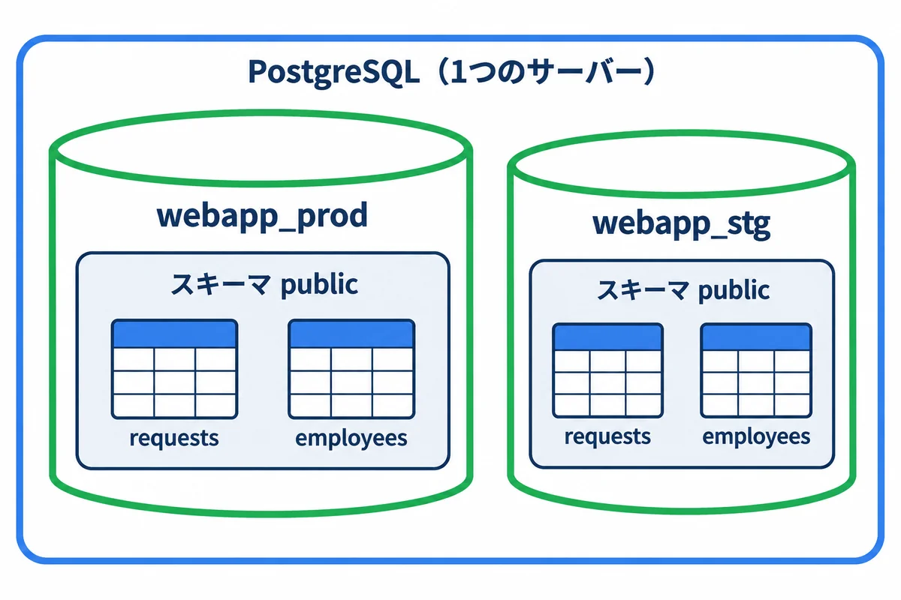
<div style="font-size: 12px; color: #64748b; margin-top: 6px;">図1-1: PostgreSQL → データベース → スキーマ → テーブル の入れ子</div>
</div>

| 入れ物 | 説明 | 今回の例 |
|---|---|---|
| PostgreSQL（サーバー） | 1つのサービスとして動く、データベースの管理のプログラム。**クラスター**とも呼ぶ | `postgresql-x64-18` のサービス |
| データベース | データのまとまり。**データベースをまたいだ SQL は書けない**ので、本番と検証を分けるのに使う | `webapp_prod`、`webapp_stg` |
| スキーマ | データベースの中の、テーブルを入れる棚。何も決めなければ `public` という棚に入る | `public` |
| テーブル | 表（00 基礎知識 7.1） | `requests`、`employees` |
| ロール | ログインする人やアプリ（9 章） | `postgres`、`webapp_prod_app` |

> **用語:** スキーマ（schema：データベースの中で、テーブルを分けて入れる棚。今回は `public` だけを使う）

### 1.1 列の型

テーブルの列には、入れてよいデータの**型**を決めます。型が違うデータは入りません（例：日付の列に `あした` は入らない）。

| 型 | 入るもの | 例 |
|---|---|---|
| `integer`・`bigint` | 整数（`bigint` は、とても大きな数まで） | `101`、`7` |
| `numeric(10,2)` | 小数（お金など、誤差を出したくない数） | `1234.50` |
| `text`・`varchar(100)` | 文字（`varchar(100)` は 100 文字まで） | `'治具の製作'` |
| `boolean` | はい・いいえ | `true`、`false` |
| `date` | 日付 | `'2026-11-10'` |
| `timestamptz` | 日時（時間帯つき） | `'2026-10-20 09:15+09'` |
| `bytea` | バイナリ（画像などの、文字でないデータ） | 図面のデータなど |
| `jsonb` | JSON（入れ子になったデータ） | `'{"width": 120}'` |

> **文字は `'`（シングルクォート）で囲みます。** `"`（ダブルクォート）は、テーブルや列の名前を囲む記号で、意味が違います（14 章のトラブル）。

### 1.2 主キーと外部キー

<div style="max-width: 760px; margin: 18px auto; text-align: center;">
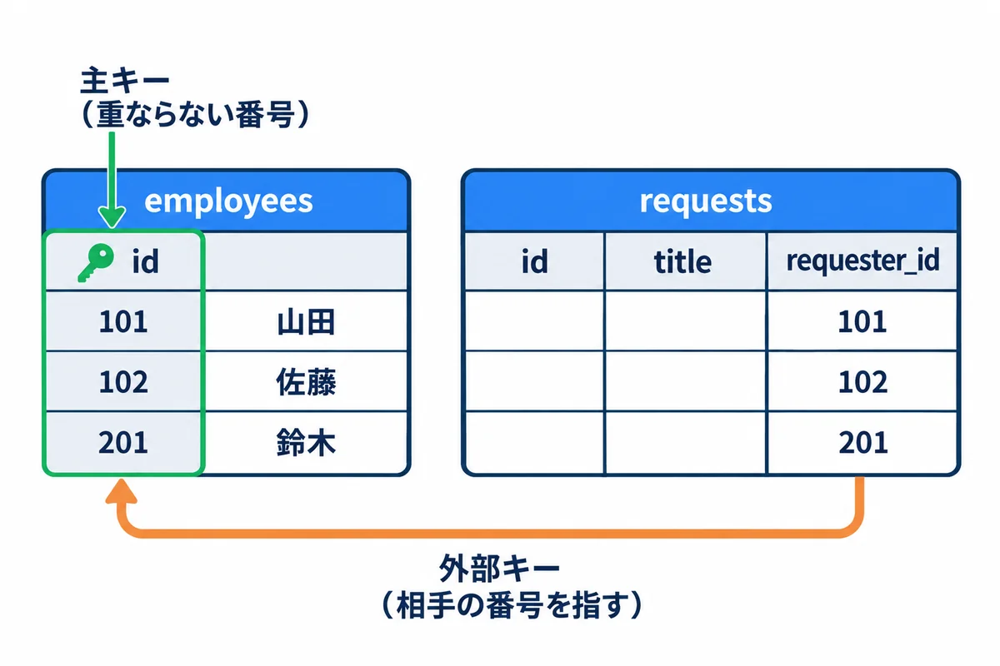
<div style="font-size: 12px; color: #64748b; margin-top: 6px;">図1-2: 主キーは重ならない番号、外部キーは相手の番号を指す列</div>
</div>

- **主キー**（PRIMARY KEY）: 1 行を見分けるための、**重ならず、空でない**列。社員番号のようなもの。
- **外部キー**（FOREIGN KEY）: ほかのテーブルの主キーを指す列。依頼の「依頼者」の列が、社員テーブルの番号を指す。**存在しない社員の番号は入れられない**ので、データの食い違いを防げます。
- **NULL**（ヌル）: 「値が無い」という特別な印。`0` や空の文字（`''`）とは違います。

> **用語:** 主キー（primary key：1 行を見分ける、重ならない列）

<!-- -->

> **用語:** 外部キー（foreign key：ほかのテーブルの主キーを指す列。指す先が無い値は入れられない）

<!-- -->

> **用語:** 制約（constraint：「空は不可」「重複は不可」「この値だけ」など、テーブルに入れてよいデータの決まり）

## 2. ログインする（psql と pgAdmin）

### 2.1 ログインの流れ

<div style="max-width: 760px; margin: 18px auto; text-align: center;">
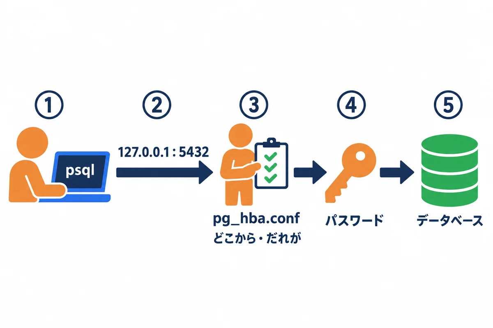
<div style="font-size: 12px; color: #64748b; margin-top: 6px;">図2-1: psql → 住所とポート → 門番（pg_hba.conf）→ パスワード → データベース</div>
</div>

1. **psql**（文字の道具）が、`127.0.0.1` の **5432 番**につなぐ。
2. PostgreSQL の門番（**pg_hba.conf**。10 章）が、「どこから・だれが・どのデータベースに・どの方法で」来たかを見て、通すかを決める。
3. **パスワード**を確かめる。
4. 指定した**データベース**に入る。

### 2.2 psql でつなぐ

管理者の PowerShell で、psql の場所を教えてからつなぎます（04 の 5.4）。

```powershell
# この窓の中だけ、psql の場所を教える
$env:Path += ";C:\Program Files\PostgreSQL\18\bin"

# スーパーユーザー postgres で、サーバーの中からつなぐ（パスワードを聞かれる）
psql -h 127.0.0.1 -p 5432 -U postgres -d postgres
```

<!-- first-use -->

> **▶ ここで初めて出てくるコード**
>
> - **`psql`**（psql）: PostgreSQL に、コマンドでつないで SQL を打つ道具。`psql -h 127.0.0.1 -U postgres -d データベース名` でつなぎます（`-h` は相手の住所、`-U` は利用者の名前、`-d` はデータベース）。`\q` で抜けます。

<!-- /first-use -->

| 指定 | 意味 | 省いたとき |
|---|---|---|
| `-h 127.0.0.1` | どの機械の PostgreSQL か | Windows では `localhost` |
| `-p 5432` | ポート | `5432` |
| `-U postgres` | だれとしてつなぐか（ロール） | **Windows にログインしている名前**（たいてい失敗する） |
| `-d postgres` | どのデータベースに入るか | `-U` と同じ名前 |

つながると、次のような**プロンプト**（入力待ちの印）が出ます。

```text
postgres=#
```

| プロンプト | 意味 |
|---|---|
| `postgres=#` | `postgres` データベースに、スーパーユーザーでつないでいる（`#` は強い権限の印） |
| `webapp_stg=>` | `webapp_stg` データベースに、ふつうのユーザーでつないでいる |
| `postgres-#` | SQL の途中（`;` をまだ打っていない）。続きを打つか、`;` を打つ |
| `postgres(#` | かっこが閉じていない |

> **SQL は `;`（セミコロン）で終わります。** `;` を打つまで、何行でも続きを打てます。Enter を押しても何も起きないときは、`;` を忘れています。

### 2.3 psql の便利なコマンド

`\`（円記号）で始まるのは、SQL ではなく **psql の道具のコマンド**です。`;` は要りません。

| コマンド | 意味 |
|---|---|
| `\l` | データベースの一覧 |
| `\c webapp_stg` | 別のデータベースに入り直す |
| `\dt` | 今のデータベースのテーブルの一覧 |
| `\d requests` | テーブル `requests` の列・型・制約・索引 |
| `\du` | ロール（ユーザー）の一覧 |
| `\x` | 結果を縦に並べて見る（列が多いときに便利）。もう一度打つと戻る |
| `\timing` | SQL にかかった時間を表示する |
| `\i D:\work\file.sql` | ファイルに書いた SQL を実行する |
| `\encoding` | 今の文字コードを見る（14 章） |
| `\?` | psql のコマンドの一覧 |
| `\h SELECT` | SQL の書き方の説明（例：SELECT） |
| `\q` | psql を終わる |

結果が画面に入りきらないと、`--続く--` と出て止まります。スペースキーで次へ、`q` で終わります。

### 2.4 1行だけ実行して終わる

決まった SQL を1つだけ動かすときは、`-c` を使います。

```powershell
# アプリ用のユーザーで、今のユーザー・データベース・時刻を見る
psql -h 127.0.0.1 -U webapp_stg_app -d webapp_stg -c "SELECT current_user, current_database(), now();"
```

> **日本語を含む SQL は、`-c` で渡さない方が安全です。** 試した環境では、`-c` に日本語を書くと、文字コードの食い違いで `invalid byte sequence for encoding "UTF8"` というエラーになりました。日本語を含む SQL は、psql の中で打つか、**UTF-8 で保存した `.sql` のファイル**を `-f` で渡します（`psql ... -f D:\work\check.sql`）。

### 2.5 pgAdmin（画面の道具）

PostgreSQL のインストーラーで「pgAdmin 4」を入れていれば、画面で操作できます（スタートメニュー → pgAdmin 4）。

1. 左の「Servers」を右クリック →「Register」→「Server」。
2. 「General」の Name に `local`、「Connection」の Host に `127.0.0.1`、Port に `5432`、Username に `postgres` を入れて保存します。
3. 左の木を開いていくと、データベース → Schemas → public → Tables の順に、テーブルが見えます。
4. テーブルを右クリック →「View/Edit Data」で中身を見られます。上のメニューの「Query Tool」で SQL を打てます。

> **注意:** pgAdmin の表の画面では、セルを直接書きかえて保存できます。**本番のデータを画面で直接書きかえないでください。** 何を変えたかの記録が残らず、アプリの決まり（承認の順番など）を飛ばしてしまいます。直すときは、SQL を書き、検証で試してから、トランザクション（7 章）の中で行います。

## 3. 練習用のデータベースを作る

スーパーユーザーでつないで、練習用のデータベースを作ります。

**▶ 打つ所:** 2.2 のとおり、PowerShell で `psql -h 127.0.0.1 -U postgres` と打ってつなぎ、`postgres=#` と出ている所に、下の SQL を 1 行ずつ打ちます（`--` で始まる行は説明のメモなので、打たなくてよい）。`\c practice` のあとは、行の頭が `practice=#` に変わります。

```sql
-- 練習用のデータベースを作る
CREATE DATABASE practice ENCODING 'UTF8' TEMPLATE template0;

-- 作ったデータベースに入り直す
\c practice
```

<!-- first-use -->

> **▶ ここで初めて出てくるコード**
>
> - **`CREATE`**（SQL）: `CREATE ROLE`（ユーザーを作る）・`CREATE DATABASE`（データベースを作る）・`CREATE TABLE`（表を作る）のように、何かを新しく作る SQL の命令です。
> - **`DATABASE`**（SQL）: `CREATE DATABASE 名前` で、データベースを作ります。
> - **`ENCODING`**（SQL）: `ENCODING 'UTF8'` で、データベースの文字コードを UTF-8 にします（日本語を正しく入れるため）。
> - **`TEMPLATE`**（SQL）: `TEMPLATE template0` で、何も手を加えていない元の形から、データベースを作ります（文字コードを指定する時に必要）。

<!-- /first-use -->

次の SQL を、メモ帳に貼り付けて **UTF-8** で `D:\work\practice_setup.sql` に保存し、psql の中で `\i D:/work/practice_setup.sql` と打って実行します（`\i` では、`\` の代わりに `/` で書くと間違いが起きにくいです）。

```sql
-- 練習用のテーブルを作り、データを入れる（practice データベースの中で動かす）

-- 部署
CREATE TABLE departments (
    id   integer PRIMARY KEY,                -- 部署の番号（主キー）
    name text    NOT NULL UNIQUE             -- 部署の名前（空は不可・重複不可）
);

-- 社員
CREATE TABLE employees (
    id            integer PRIMARY KEY,
    name          text    NOT NULL,
    email         text    NOT NULL UNIQUE,
    department_id integer NOT NULL REFERENCES departments (id),  -- 外部キー: departments の id
    is_active     boolean NOT NULL DEFAULT true                 -- 在籍中か
);

-- 依頼
CREATE TABLE requests (
    id           bigint GENERATED ALWAYS AS IDENTITY PRIMARY KEY,  -- 番号は自動で振る
    title        text   NOT NULL,
    status       text   NOT NULL DEFAULT '下書き'
                 CHECK (status IN ('下書き', '回覧中', '承認済み', '差し戻し')),
    requester_id integer NOT NULL REFERENCES employees (id),
    due_date     date,                                              -- 期限（空でもよい）
    created_at   timestamptz NOT NULL DEFAULT now()
);

INSERT INTO departments (id, name) VALUES
    (1, '設計部'),
    (2, '製造部'),
    (3, '品質保証部'),
    (4, '総務部');

INSERT INTO employees (id, name, email, department_id, is_active) VALUES
    (101, '山田 太郎', 'taro.yamada@example.com',   1, true),
    (102, '佐藤 花子', 'hanako.sato@example.com',   1, true),
    (201, '鈴木 一郎', 'ichiro.suzuki@example.com', 2, true),
    (202, '田中 次郎', 'jiro.tanaka@example.com',   2, false),
    (301, '高橋 三郎', 'saburo.takahashi@example.com', 3, true);

INSERT INTO requests (title, status, requester_id, due_date, created_at) VALUES
    ('治具の製作',       '回覧中',   101, '2026-11-10', '2026-10-20 09:15+09'),
    ('部品の追加工',     '承認済み', 102, '2026-10-31', '2026-10-15 13:40+09'),
    ('試作品の溶接',     '下書き',   201, NULL,         '2026-10-28 10:05+09'),
    ('検査用の台の修理', '回覧中',   301, '2026-11-05', '2026-10-25 16:20+09'),
    ('棚の取り付け',     '差し戻し', 101, '2026-11-20', '2026-10-27 11:00+09'),
    ('型の改造',         '回覧中',   201, '2026-11-03', '2026-10-29 08:30+09');
```

<!-- first-use -->

> **▶ ここで初めて出てくるコード**
>
> - **`TABLE`**（SQL）: SQL で「表」を表す言葉。`CREATE TABLE`（表を作る）・`DROP TABLE`（表を消す）のように使います。
> - **`PRIMARY`**（SQL）: `PRIMARY KEY`（主キー）の一部。主キーは、表の中で 1 行を必ず見分けられる列で、同じ値が 2 回入りません。ふつうは `id` 列にします。
> - **`KEY`**（SQL）: `PRIMARY KEY`（主キー）・`FOREIGN KEY`（よその表とつなぐ列）などの「キー」。
> - **`NOT`**（SQL）: SQL で「〜ではない」。`NOT NULL` は「この列は空（NULL）を許さない」という決まりです。
> - **`NULL`**（SQL）: SQL で「値が無い」ことを表す特別な値。0 や空の文字列とは違います。
> - **`UNIQUE`**（SQL）: 「この列の値は、表の中で重ならない」という決まり。`email TEXT NOT NULL UNIQUE` は、同じメールアドレスを 2 回登録できなくします。
> - **`REFERENCES`**（SQL）: 「この列の値は、あの表の、あの列に必ずある値」という決まり（外部キー）。`user_id INTEGER REFERENCES users(id)` で、存在しないユーザーの番号を入れられなくなります。
> - **`DEFAULT`**（SQL）: 列に値を入れなかった時に使う、決めておいた値（既定値）。`done INTEGER NOT NULL DEFAULT 0` は「指定が無ければ 0」。
> - **`GENERATED`**（SQL）: `GENERATED ALWAYS AS IDENTITY` は、行を足すたびに、番号を自動で振る列にする書き方です（PostgreSQL の新しい書き方。`ALWAYS` は「自分で番号を入れさせない」）。
> - **`ALWAYS`**（SQL）: `GENERATED ALWAYS AS IDENTITY` の一部で、「番号は必ずデータベースが振る（自分で入れようとするとエラー）」という意味です。
> - **`AS`**（SQL）: SQL で、列や表に別の名前を付ける書き方。`SELECT COUNT(*) AS notes` は、結果の列の名前を `notes` にします。`FROM users AS u` は、表を `u` と短く呼べるようにします。
> - **`IDENTITY`**（SQL）: `GENERATED ALWAYS AS IDENTITY` の一部で、「1, 2, 3… と自動で振る番号の列」という意味です。
> - **`CHECK`**（SQL）: 「この列に入れてよい値の条件」を決める決まり。`CHECK (length(title) BETWEEN 1 AND 80)` は、題名を 1〜80 文字に限ります。合わない値を入れようとすると、データベースが断ります。
> - **`IN`**（SQL）: SQL で「このどれか」。`WHERE status IN ('queued', 'running')` は、状態がどちらかの行だけです。`CHECK (pinned IN (0, 1))` は、0 か 1 しか入れられない決まりです。
> - **`INSERT`**（SQL）: `INSERT INTO 表 (列, …) VALUES (値, …)` で、表に新しい行を足す SQL の命令。
> - **`INTO`**（SQL）: `INSERT INTO 表` の一部で、「この表へ」入れる、という意味。
> - **`VALUES`**（SQL）: `INSERT INTO 表 (列, …) VALUES (値, …)` の、入れる値を書く所。

<!-- /first-use -->

| 書き方 | 意味 |
|---|---|
| `CREATE TABLE 名前 (列 型 制約, ...)` | テーブルを作る |
| `PRIMARY KEY` | 主キー |
| `NOT NULL` | 空（NULL）は不可 |
| `UNIQUE` | 重複は不可 |
| `REFERENCES departments (id)` | 外部キー（`departments` の `id` を指す） |
| `DEFAULT true`・`DEFAULT now()` | 入れなかったときの値 |
| `CHECK (status IN (...))` | この値だけ入れてよい |
| `GENERATED ALWAYS AS IDENTITY` | 番号を自動で振る |
| `-- ...` | コメント（説明）。SQL としては無視される |

**確かめること:** `\dt` で `departments`・`employees`・`requests` の3つが出ること。`\d requests` で、列と制約（Check・外部キー）が出ること。

## 4. データを見る（SELECT）

<div style="max-width: 760px; margin: 18px auto; text-align: center;">
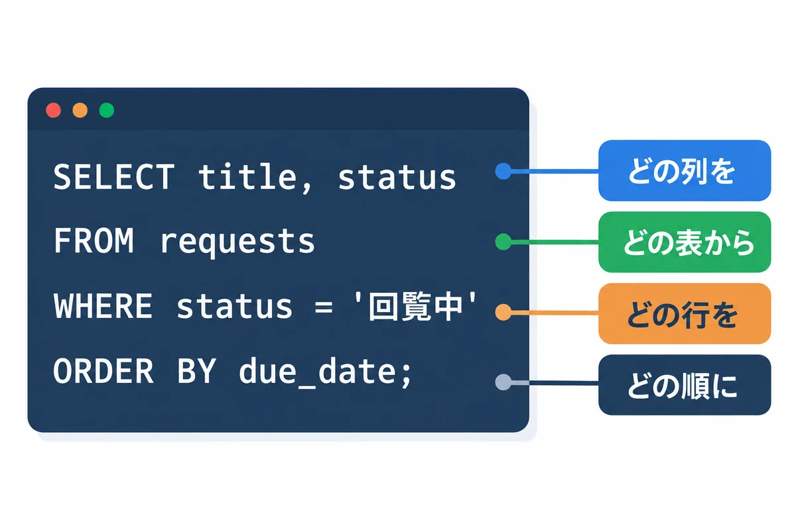
<div style="font-size: 12px; color: #64748b; margin-top: 6px;">図4-1: SELECT 文は「どの列を・どの表から・どの行を・どの順に」</div>
</div>

**▶ 打つ所:** この章からの SQL は、全部 `practice=#` と出ている所（3 章で `\c practice` したあと）に打ちます。1 つの SQL の終わりには `;` を付け、Enter キーで実行します。`psql` を閉じてしまったら、`psql -h 127.0.0.1 -U postgres -d practice` で入り直します。

### 4.1 全部見る

```sql
SELECT * FROM departments;
```

```text
 id |    name
----+------------
  1 | 設計部
  2 | 製造部
  3 | 品質保証部
  4 | 総務部
(4 行)
```

`*` は「全部の列」です。本番の大きなテーブルで `SELECT *` を打つと、何万行も流れて止まらなくなるので、**ふだんは列を選び、`LIMIT` で件数をしぼります**。

### 4.2 しぼる（WHERE）・並べる（ORDER BY）

```sql
SELECT id, title, status, due_date
FROM requests
WHERE status = '回覧中'
ORDER BY due_date;
```

```text
 id |      title       | status |  due_date
----+------------------+--------+------------
  6 | 型の改造         | 回覧中 | 2026-11-03
  4 | 検査用の台の修理 | 回覧中 | 2026-11-05
  1 | 治具の製作       | 回覧中 | 2026-11-10
(3 行)
```

条件は `AND`（かつ）・`OR`（または）でつなげます。

```sql
SELECT id, title, due_date
FROM requests
WHERE status = '回覧中'
  AND due_date <= DATE '2026-11-05'
ORDER BY due_date;
```

<!-- first-use -->

> **▶ ここで初めて出てくるコード**
>
> - **`AND`**（SQL）: SQL で「かつ」。`WHERE a = 1 AND b = 2` は両方に合う行だけ。`BETWEEN 0 AND 100` の一部としても使います。
> - **`DATE`**（SQL）: 日付（年・月・日。時刻は無し）を入れる列の型。期限（`due_date`）などに使います。Rust では `time::Date` で受け取ります。

<!-- /first-use -->

```text
 id |      title       |  due_date
----+------------------+------------
  6 | 型の改造         | 2026-11-03
  4 | 検査用の台の修理 | 2026-11-05
(2 行)
```

### 4.3 よく使う条件の書き方

| 書き方 | 意味 | 例 |
|---|---|---|
| `=`・`<>` | 等しい・等しくない | `status = '回覧中'` |
| `<`・`<=`・`>`・`>=` | より小さい・以下・より大きい・以上 | `due_date <= DATE '2026-11-05'` |
| `IN (...)` | どれかに当てはまる | `status IN ('回覧中', '差し戻し')` |
| `BETWEEN a AND b` | a 以上 b 以下 | `id BETWEEN 100 AND 199` |
| `LIKE '%田%'` | 文字の一部が合う（`%` は何文字でも） | 下の例 |
| `IS NULL`・`IS NOT NULL` | 空である・空でない | 下の例 |

```sql
SELECT name, email
FROM employees
WHERE name LIKE '%田%';
```

<!-- first-use -->

> **▶ ここで初めて出てくるコード**
>
> - **`LIKE`**（SQL）: SQL のあいまい検索。`WHERE title LIKE '%買い物%'` は、`買い物` を含む行です（`%` は「何文字でも」、`_` は「どれか 1 文字」）。

<!-- /first-use -->

```text
   name    |          email
-----------+-------------------------
 山田 太郎 | taro.yamada@example.com
 田中 次郎 | jiro.tanaka@example.com
(2 行)
```

```sql
SELECT id, title, status
FROM requests
WHERE due_date IS NULL;
```

<!-- first-use -->

> **▶ ここで初めて出てくるコード**
>
> - **`IS`**（SQL）: SQL で NULL かどうかを調べる時の書き方。`WHERE x IS NULL`（無い）・`WHERE x IS NOT NULL`（ある）。NULL は `= NULL` では比べられません。

<!-- /first-use -->

```text
 id |    title     | status
----+--------------+--------
  3 | 試作品の溶接 | 下書き
(1 行)
```

> **`= NULL` とは書きません。** NULL は「値が無い」ので、`due_date = NULL` は何にも当てはまらず、0 行になります。必ず `IS NULL` と書きます。

### 4.4 数える・まとめる（COUNT・GROUP BY）

```sql
SELECT status, count(*) AS 件数
FROM requests
GROUP BY status
ORDER BY 件数 DESC, status;
```

<!-- first-use -->

> **▶ ここで初めて出てくるコード**
>
> - **`GROUP`**（SQL）: `GROUP BY 列` で、同じ値の行をまとめて、まとめごとに数える・足す時の書き方。`SELECT user_id, COUNT(*) FROM notes GROUP BY user_id` は、人ごとのノートの数です。

<!-- /first-use -->

```text
  status  | 件数
----------+------
 回覧中   |    3
 下書き   |    1
 差し戻し |    1
 承認済み |    1
(4 行)
```

| 書き方 | 意味 |
|---|---|
| `count(*)` | 行の数 |
| `sum(列)`・`avg(列)` | 合計・平均 |
| `min(列)`・`max(列)` | いちばん小さい・大きい値（日付なら、いちばん古い・新しい） |
| `GROUP BY 列` | その列の値ごとにまとめる |
| `HAVING 条件` | まとめた後でしぼる（例：`HAVING count(*) >= 2`） |
| `AS 件数` | 結果の列に名前を付ける |
| `DESC` | 大きい順（新しい順）。`ASC`（小さい順）は省ける |

### 4.5 速く探す（索引）

行が何万・何十万と増えると、`WHERE` で探すのに時間がかかるようになります。よく探す列に**索引**（インデックス）を作っておくと、本の後ろの索引のように、すぐに目当ての行へたどり着けます。

<div style="max-width: 760px; margin: 18px auto; text-align: center;">

<div style="font-size: 12px; color: #64748b; margin-top: 6px;">図4-2: 索引は、本の後ろの索引と同じ</div>
</div>

```sql
-- 「状態」と「期限」で探して並べることが多いので、2つの列の索引を作る
CREATE INDEX requests_status_due_idx ON requests (status, due_date);

-- PostgreSQL が、どうやって探すつもりか（計画）を見る
EXPLAIN SELECT id, title FROM requests WHERE status = '回覧中' ORDER BY due_date;
```

<!-- first-use -->

> **▶ ここで初めて出てくるコード**
>
> - **`INDEX`**（SQL）: `CREATE INDEX 名前 ON 表 (列)` で、表に索引（本の索引のような、速く探すための仕組み）を作る SQL の命令。よく条件や並べかえに使う列に作ります。
> - **`ON`**（SQL）: SQL の「〜の時」「〜で」。`ON DELETE CASCADE` は「消された時は」、`JOIN … ON a.id = b.user_id` は「この条件で横につなぐ」、`CREATE INDEX … ON 表 (列)` は「この表の、この列に」という意味です。
> - **`EXPLAIN`**（SQL）: `EXPLAIN QUERY PLAN SELECT …` で、データベースがその SQL をどう実行するつもりか（索引を使うか、全部の行を見るか）を表示します。

<!-- /first-use -->

```text
                          QUERY PLAN
---------------------------------------------------------------
 Sort  (cost=1.08..1.09 rows=1 width=44)
   Sort Key: due_date
   ->  Seq Scan on requests  (cost=0.00..1.07 rows=1 width=44)
         Filter: (status = '回覧中'::text)
(4 行)
```

- `Seq Scan` は「テーブルを頭から全部読む」という意味です。この練習のように**行が少ないうちは、全部読む方が速い**ので、PostgreSQL は索引を使いません。行が増えると、索引を使う計画（`Index Scan` など）に自動で切りかわります。
- 主キーと `UNIQUE` の列には、索引が自動で作られます。
- 索引は、増やすほど**書き込みが少し遅くなり、ディスクも使います**。「遅い」と分かった探し方にだけ作ります。どこに作るかは、アプリを作る人が決めて、マイグレーション（00 基礎知識 7.3）で入れるのがふつうです。

> **用語:** 索引（インデックス。index：よく探す列について、行の場所を早く引けるようにした目録）

<!-- -->

> **用語:** EXPLAIN（エクスプレイン：SQL を、どうやって実行するつもりか（実行計画）を見る SQL）

## 5. テーブルをつなぐ（JOIN）

依頼のテーブルには、依頼者の**番号**しか入っていません。名前や部署を一緒に見るには、テーブルを**番号でつなぎます**。

<div style="max-width: 760px; margin: 18px auto; text-align: center;">
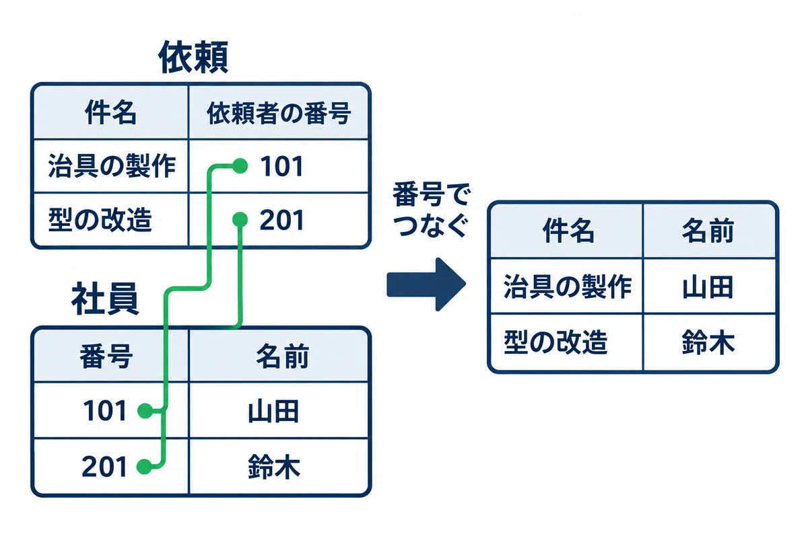
<div style="font-size: 12px; color: #64748b; margin-top: 6px;">図5-1: JOIN は、同じ番号どうしを結んで1つの表にする</div>
</div>

```sql
SELECT r.id, r.title, e.name AS 依頼者, d.name AS 部署
FROM requests AS r
JOIN employees   AS e ON e.id = r.requester_id
JOIN departments AS d ON d.id = e.department_id
ORDER BY r.id;
```

<!-- first-use -->

> **▶ ここで初めて出てくるコード**
>
> - **`JOIN`**（SQL）: 2 つの表を、条件で横につないで取り出す書き方。`FROM notes JOIN users ON users.id = notes.user_id` は、ノートと、その持ち主を 1 行に並べます。

<!-- /first-use -->

```text
 id |      title       |  依頼者   |    部署
----+------------------+-----------+------------
  1 | 治具の製作       | 山田 太郎 | 設計部
  2 | 部品の追加工     | 佐藤 花子 | 設計部
  3 | 試作品の溶接     | 鈴木 一郎 | 製造部
  4 | 検査用の台の修理 | 高橋 三郎 | 品質保証部
  5 | 棚の取り付け     | 山田 太郎 | 設計部
  6 | 型の改造         | 鈴木 一郎 | 製造部
(6 行)
```

- `requests AS r` は、「`requests` を、この SQL の中では `r` と呼ぶ」という意味です。`r.title` は「`r`（requests）の `title` 列」です。
- `ON e.id = r.requester_id` が、「どの列とどの列が同じなら結ぶか」です。

### 5.1 相手がいない行も残す（LEFT JOIN）

ふつうの `JOIN` は、相手が見つからない行を**消します**。「依頼が 0 件の部署も出したい」ときは、`LEFT JOIN` を使います。

<div style="max-width: 760px; margin: 18px auto; text-align: center;">
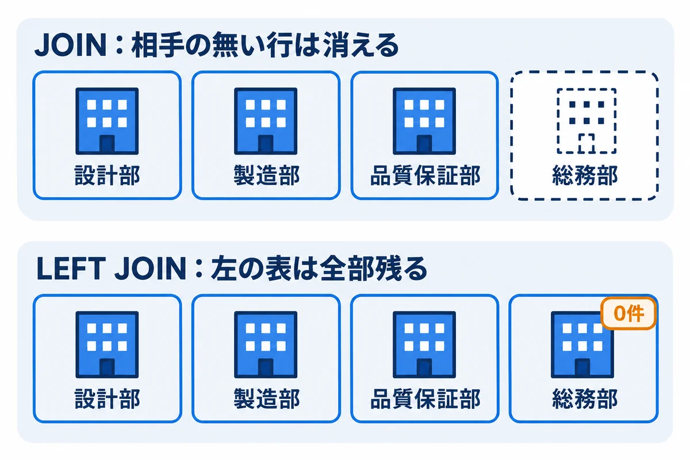
<div style="font-size: 12px; color: #64748b; margin-top: 6px;">図5-2: LEFT JOIN は、左の表の行を全部残す</div>
</div>

```sql
SELECT d.name AS 部署, count(r.id) AS 依頼の件数
FROM departments AS d
LEFT JOIN employees AS e ON e.department_id = d.id
LEFT JOIN requests  AS r ON r.requester_id  = e.id
GROUP BY d.id, d.name
ORDER BY d.id;
```

<!-- first-use -->

> **▶ ここで初めて出てくるコード**
>
> - **`LEFT`**（SQL）: `LEFT JOIN` は、左の表の行は、相手が無くても全部残す JOIN。「ノートが 0 件の人も一覧に出す」時に使います。

<!-- /first-use -->

```text
    部署    | 依頼の件数
------------+------------
 設計部     |          3
 製造部     |          2
 品質保証部 |          1
 総務部     |          0
(4 行)
```

**確かめること:** 社員のいない「総務部」が、`0` 件として出ること。`LEFT JOIN` を `JOIN` に変えると、総務部の行が消えることも試してみてください。

## 6. データを入れる・直す・消す

### 6.1 入れる（INSERT）

```sql
INSERT INTO requests (title, requester_id, due_date)
VALUES ('工具箱の作成', 102, '2026-11-30')
RETURNING id, title, status, created_at;
```

<!-- first-use -->

> **▶ ここで初めて出てくるコード**
>
> - **`RETURNING`**（SQL）: `INSERT … RETURNING id` で、入れた（変えた）行の値（作られた番号など）を、その場で返してもらう書き方。

<!-- /first-use -->

```text
 id |    title     | status |          created_at
----+--------------+--------+-------------------------------
  7 | 工具箱の作成 | 下書き | 2026-11-01 21:23:50.806647+09
(1 行)

INSERT 0 1
```

- 書かなかった列（`status`・`created_at`）には、`DEFAULT` の値（`下書き`・今の時刻）が入りました。`created_at` は、打った時刻になります。
- `RETURNING` を付けると、入れた行（自動で振られた番号など）をその場で見られます。
- 最後の `INSERT 0 1` は、「1 行入れた」という意味です。

### 6.2 直す（UPDATE）

```sql
UPDATE requests
SET status = '承認済み'
WHERE id = 1;
```

<!-- first-use -->

> **▶ ここで初めて出てくるコード**
>
> - **`UPDATE`**（SQL）: `UPDATE 表 SET 列 = 値 WHERE 条件` で、行の中身を書きかえる SQL の命令。`WHERE` を忘れると、全部の行が変わります。
> - **`SET`**（SQL）: `UPDATE` の中で、「どの列を、どの値にするか」を書く所。

<!-- /first-use -->

```text
UPDATE 1
```

`UPDATE 1` は、「1 行を直した」という意味です。**この数が、思った数と同じか**を必ず見ます。

<div style="max-width: 760px; margin: 18px auto; text-align: center;">
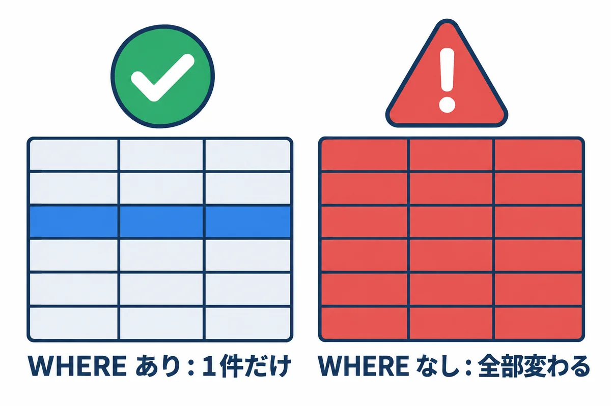
<div style="font-size: 12px; color: #64748b; margin-top: 6px;">図6-1: WHERE を忘れると、全部の行が変わる</div>
</div>

> **いちばん怖い間違い:** `UPDATE`・`DELETE` で **`WHERE` を忘れると、テーブルの全部の行**が変わる・消えます。本番で打つときは、必ず次の順で行います。
>
> 1. 同じ `WHERE` で `SELECT` を打ち、**対象の行と件数**を確かめる。
> 2. `BEGIN;` を打ってから（7 章）、`UPDATE`・`DELETE` を打つ。
> 3. 出た件数が 1 と同じなら `COMMIT;`、違えば `ROLLBACK;`。

### 6.3 消す（DELETE）

書き方の例です（**練習では、ここではまだ打たないでください**。7 章で、取り消せる形で試します）。

```sql
-- 番号 7 の依頼を消す
DELETE FROM requests WHERE id = 7;
```

<!-- first-use -->

> **▶ ここで初めて出てくるコード**
>
> - **`DELETE`**（SQL）: `DELETE FROM 表 WHERE 条件` で、表の行を消す SQL の命令。`WHERE` を忘れると、全部の行が消えます。`ON DELETE CASCADE` の中では「消された時」という意味です。

<!-- /first-use -->

消した行は、元に戻せません（7 章のトランザクションの中なら、`ROLLBACK` で戻せます）。

## 7. トランザクション（BEGIN・COMMIT・ROLLBACK）

**トランザクション**は、いくつかの SQL を「全部やるか、全部やめるか」でまとめる仕組みです（00 基礎知識 7.3）。手で直すときの**安全ネット**にもなります。

<div style="max-width: 760px; margin: 18px auto; text-align: center;">
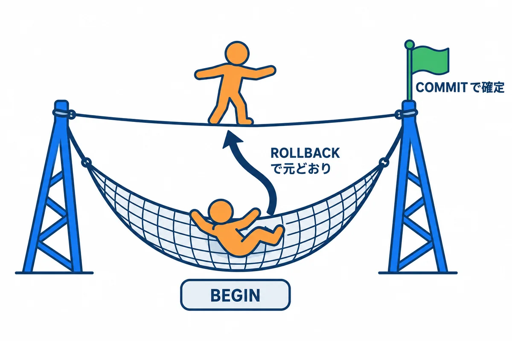
<div style="font-size: 12px; color: #64748b; margin-top: 6px;">図7-1: BEGIN で安全ネットを張り、COMMIT で確定、ROLLBACK で取り消し</div>
</div>

わざと `WHERE` を忘れて、全部消してみます。

```sql
BEGIN;
DELETE FROM requests;
SELECT count(*) FROM requests;
ROLLBACK;
SELECT count(*) FROM requests;
```

<!-- first-use -->

> **▶ ここで初めて出てくるコード**
>
> - **`BEGIN`**（SQL）: トランザクションを始める SQL の命令。ここから `COMMIT`（確定）か `ROLLBACK`（取り消し）までが、1 つのまとまりになります。
> - **`ROLLBACK`**（SQL）: トランザクションの中でした変更を、全部取り消す SQL の命令。

<!-- /first-use -->

```text
BEGIN
DELETE 7
 count
-------
     0
(1 行)

ROLLBACK
 count
-------
     7
(1 行)
```

- `DELETE 7` で全部の 7 行が消え、`count` は `0` になりました。
- `ROLLBACK` で取り消したので、最後の `count` は `7` に戻りました。
- `ROLLBACK` の代わりに `COMMIT` を打つと、確定して元に戻せなくなります。

> **トランザクションの途中で、長く放っておかないでください。** `BEGIN` したまま止めていると、そのテーブルの行がほかの人（アプリ）から書きかえられなくなり、アプリの画面が固まることがあります。確かめたら、すぐに `COMMIT` か `ROLLBACK` を打ちます。

## 8. 制約に止められたとき（エラーの読み方）

テーブルの決まり（制約）に合わないデータは、エラーで止められます。**エラーは、データを守ってくれた印**です。英語のエラーの文の、最初の行（`ERROR:`）と次の行（`DETAIL:`）を読みます。

> **メッセージが英語なのは、** 04 の 5.3 で `lc_messages = 'C'` にしたためです（ログの文字化けを防ぐため）。

**決まっていない値を入れた（CHECK 制約）**

```sql
INSERT INTO requests (title, status, requester_id) VALUES ('テスト', '完了', 101);
```

```text
ERROR:  new row for relation "requests" violates check constraint "requests_status_check"
DETAIL:  Failing row contains (8, テスト, 完了, 101, null, 2026-11-01 21:23:51.252143+09).
```

`status` に、決まっていない `完了` を入れようとしたので、止められました。

> **番号が飛ぶ:** エラーで止められた行のために、自動の番号（ここでは `8`）が使われています。次に入れる行は `9` になります。番号が飛ぶのは正しい動きで、故障ではありません。

**存在しない相手を指した（外部キー）**

```sql
INSERT INTO requests (title, requester_id) VALUES ('テスト', 999);
```

```text
ERROR:  insert or update on table "requests" violates foreign key constraint "requests_requester_id_fkey"
DETAIL:  Key (requester_id)=(999) is not present in table "employees".
```

**重複した（UNIQUE）**

```sql
INSERT INTO employees (id, name, email, department_id)
VALUES (103, '山田 二郎', 'taro.yamada@example.com', 1);
```

```text
ERROR:  duplicate key value violates unique constraint "employees_email_key"
DETAIL:  Key (email)=(taro.yamada@example.com) already exists.
```

**ほかの行から指されている行を消そうとした（外部キー）**

```sql
DELETE FROM departments WHERE id = 1;
```

```text
ERROR:  update or delete on table "departments" violates foreign key constraint "employees_department_id_fkey" on table "employees"
DETAIL:  Key (id)=(1) is still referenced from table "employees".
```

**テーブルの名前の打ち間違い**

```sql
SELECT * FROM request;
```

```text
ERROR:  relation "request" does not exist
```

| エラーの文 | 意味 | 直し方 |
|---|---|---|
| `violates check constraint` | 決まっていない値 | 入れてよい値を `\d テーブル` の Check で確かめる |
| `violates foreign key constraint` ... `is not present` | 指す相手が無い | 先に相手（社員など）を入れる |
| `violates foreign key constraint` ... `is still referenced` | ほかから指されている | 指している行を先に直す。または消さずに「無効」の印にする |
| `duplicate key value violates unique constraint` | 重複 | 既にある行を確かめる |
| `relation "..." does not exist` | テーブルが無い | 名前・データベース（`\c`）・スキーマを確かめる |
| `column "..." does not exist` | 列が無い | `\d テーブル` で列の名前を確かめる |
| `syntax error at or near "..."` | 書き方の間違い | `"..."` の所の直前を見る（`,` の抜け、`'` の閉じ忘れ） |
| `permission denied for table ...` | 権限が無い | 9 章 |

## 9. ユーザー（ロール）と権限

<div style="max-width: 760px; margin: 18px auto; text-align: center;">
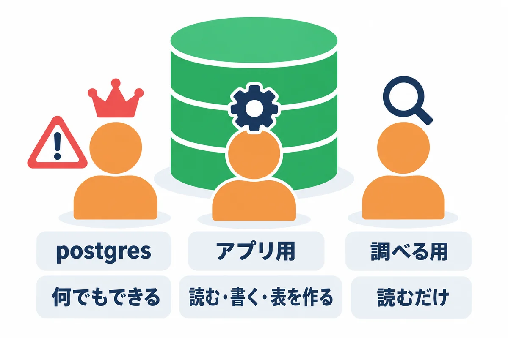
<div style="font-size: 12px; color: #64748b; margin-top: 6px;">図9-1: ロールごとに、できることを分ける</div>
</div>

| ロール | 使う人 | できること |
|---|---|---|
| `postgres` | 管理者（構築・バックアップ・リストア） | 何でも（スーパーユーザー）。**ふだんの調べ物には使わない** |
| `webapp_prod_app` | 本番のアプリ | 自分のデータベース（`webapp_prod`）の読み書き・テーブルを作る |
| `webapp_readonly`（作る） | 調べ物をする人 | 読むだけ |

### 9.1 読むだけのユーザーを作る

調べ物で `postgres` や アプリ用のユーザーを使うと、うっかり `UPDATE` を打ったときに本当に変わってしまいます。**読むだけのユーザー**を作っておくと安全です。

```sql
-- postgres でつないで打つ
CREATE ROLE webapp_readonly LOGIN;
\password webapp_readonly

-- 本番のデータベースにつなぐことを許す（04 の 5.5 で、全員から取り上げてあるため）
GRANT CONNECT ON DATABASE webapp_prod TO webapp_readonly;

-- 本番のデータベースに入り直して、テーブルを読む許可を出す
\c webapp_prod
GRANT USAGE ON SCHEMA public TO webapp_readonly;
GRANT SELECT ON ALL TABLES IN SCHEMA public TO webapp_readonly;

-- これからアプリ（webapp_prod_app）が作るテーブルも、読めるようにしておく
ALTER DEFAULT PRIVILEGES FOR ROLE webapp_prod_app IN SCHEMA public
    GRANT SELECT ON TABLES TO webapp_readonly;
```

<!-- first-use -->

> **▶ ここで初めて出てくるコード**
>
> - **`ROLE`**（SQL）: PostgreSQL のユーザー（ログインする名前と、持つ権限のまとまり）。`CREATE ROLE webapp_dev_app LOGIN CREATEDB;` は「ログインでき、データベースを作れるユーザー」を作ります。
> - **`LOGIN`**（SQL）: `CREATE ROLE … LOGIN` で、そのユーザーがログインできるようにします。
> - **`GRANT`**（SQL）: 利用者（ロール）に、権限を与える命令。`GRANT CONNECT ON DATABASE webapp_prod TO webapp_readonly;` は「webapp_readonly に、webapp_prod へつなぐことを許す」。
> - **`CONNECT`**（SQL）: `GRANT CONNECT ON DATABASE …` の `CONNECT` は、「そのデータベースにつなぐ」権限です。
> - **`TO`**（SQL）: `RENAME TO 新しい名前` の「〜へ」の部分です。
> - **`SCHEMA`**（SQL）: スキーマは、データベースの中の、表をまとめる入れ物（ふだんは `public`）。`GRANT USAGE ON SCHEMA public TO …` は「public の中の物を使ってよい」。
> - **`ALL`**（SQL）: `UNION ALL` は、2 つの結果を、重なりも消さずにそのままつなげる書き方です。
> - **`TABLES`**（SQL）: `ON ALL TABLES IN SCHEMA public` は「public の中の、今ある表すべて」。`GRANT SELECT ON ALL TABLES …` で、全部の表を読めるようにします。
> - **`ALTER`**（SQL）: `ALTER TABLE 表 …` で、もうある表の形を変える SQL の命令（列を足す・名前を変える など）。
> - **`PRIVILEGES`**（SQL）: `ALTER DEFAULT PRIVILEGES … GRANT SELECT ON TABLES TO …` は、「これから作られる表にも、自動で同じ権限を付ける」という決まりを作る命令です。これが無いと、あとで足した表は読めません。
> - **`FOR`**（SQL）: `SELECT … FOR UPDATE` は、読んだ行に鍵をかける書き方です。同じ行を、別の人が同時に変えようとしても、こちらのトランザクションが終わるまで待たせるので、「2 人が同時に承認して 2 回進む」ことを防げます。

<!-- /first-use -->

| 書き方 | 意味 |
|---|---|
| `GRANT 権限 ON 物 TO ロール` | 権限を渡す |
| `REVOKE 権限 ON 物 FROM ロール` | 権限を取り上げる |
| `GRANT SELECT ON ALL TABLES IN SCHEMA public` | 今ある全部のテーブルを読める |
| `ALTER DEFAULT PRIVILEGES FOR ROLE webapp_prod_app ...` | **これから** `webapp_prod_app` が作るテーブルにも、同じ権限を付ける |

**確かめること:** 練習用のデータベースで同じことをして、読むだけのユーザーでつなぎ、`SELECT` はでき、`UPDATE` は `ERROR:  permission denied for table requests` で止められること（試した結果、そうなりました）。

> **`ALTER DEFAULT PRIVILEGES` の `FOR ROLE` を忘れると、** アプリが新しい版でテーブルを足したときに、読むだけのユーザーからそのテーブルが読めなくなります。テーブルを作るのはアプリ用のユーザーなので、そのユーザーを `FOR ROLE` に書きます。

## 10. 設定ファイル

PostgreSQL の設定ファイルは、データの場所（04 では `D:\pgsql\18\data`）にあります。

| ファイル | 中身 | 変えたら |
|---|---|---|
| `postgresql.conf` | 待ち受ける住所・ポート・メモリ・ログ・時間帯など | 多くは再読み込みで効く。`listen_addresses`・`port` などは**再起動**が要る |
| `pg_hba.conf` | だれが・どこから・どの方法でつなげるか（門番） | 再読み込みで効く |

### 10.1 pg_hba.conf（門番のチェック表）

<div style="max-width: 760px; margin: 18px auto; text-align: center;">
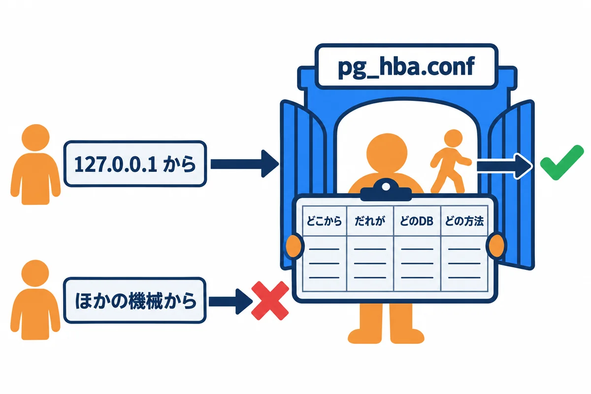
<div style="font-size: 12px; color: #64748b; margin-top: 6px;">図10-1: pg_hba.conf は、門番のチェック表</div>
</div>

1行が1つの決まりで、**上から順に見て、最初に当てはまった行**が使われます。

```text
# TYPE  DATABASE        USER            ADDRESS                 METHOD
host    all             all             127.0.0.1/32            scram-sha-256
host    all             all             ::1/128                 scram-sha-256
```

| 列 | 意味 | この例 |
|---|---|---|
| TYPE | つなぎ方（`host` は TCP の通信） | `host` |
| DATABASE | どのデータベースに | `all`（全部） |
| USER | どのロールが | `all`（全部） |
| ADDRESS | どこから | `127.0.0.1/32`（このサーバー自身だけ） |
| METHOD | どうやって確かめるか | `scram-sha-256`（パスワード。安全な方式） |

今回は、データベースをサーバーの中からしか使わないので、`127.0.0.1` と `::1` の行だけにします。**`0.0.0.0/0`（どこからでも）や `trust`（パスワード無し）の行は書きません。**

### 10.2 設定を確かめる・再読み込みする

```sql
-- 今の設定の値を見る
SHOW listen_addresses;
SHOW lc_messages;
SHOW timezone;

-- どの設定ファイルを読んでいるか
SHOW config_file;
SHOW hba_file;

-- 設定ファイルを読み直す（再起動しなくてよい設定だけ効く）
SELECT pg_reload_conf();
```

<!-- first-use -->

> **▶ ここで初めて出てくるコード**
>
> - **`SHOW`**（SQL）: PostgreSQL の設定の、今の値を表示する命令。`SHOW listen_addresses;` は、どの住所で待ち受けているか。

<!-- /first-use -->

再起動が要る設定は、PowerShell で `Restart-Service postgresql-x64-18` を打ちます（アプリが一時的にエラーになるので、使われていない時間に）。

## 11. バックアップとリストア

<div style="max-width: 760px; margin: 18px auto; text-align: center;">
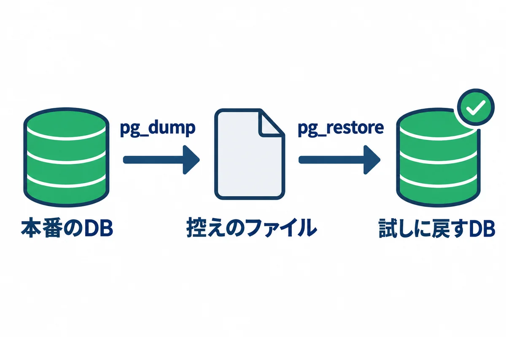
<div style="font-size: 12px; color: #64748b; margin-top: 6px;">図11-1: pg_dump で控えを取り、pg_restore で別のデータベースに戻して確かめる</div>
</div>

### 11.1 控えを取る（pg_dump）

```powershell
# practice データベースを、PostgreSQL 独自の形式（-Fc）で 1 つのファイルに書き出す
pg_dump -h 127.0.0.1 -U postgres -Fc -f D:\work\practice.dump practice
```

<!-- first-use -->

> **▶ ここで初めて出てくるコード**
>
> - **`pg_dump`**（psql）: PostgreSQL のデータベースの中身を、まるごと 1 つのファイルに書き出す（控えを取る）コマンド。`-Fc` はあとで `pg_restore` で戻せる形、`-f` は書き出すファイルの場所。動かしている途中でも、ある瞬間の中身がそろった形で取れます。

<!-- /first-use -->

| 指定 | 意味 |
|---|---|
| `-Fc` | PostgreSQL 独自の形式（縮めてあり、後で一部だけ戻すこともできる） |
| `-f ファイル` | 書き出す先 |
| 最後の `practice` | 控えを取るデータベース |

- 動いている最中のデータベースでも、**その瞬間の、食い違いの無い控え**が取れます。アプリを止める必要はありません。
- ロール（ユーザー）とパスワードは、データベースの外にあるので、`pg_dump` には入りません。ロールも控えたいときは、`pg_dumpall -h 127.0.0.1 -U postgres --roles-only -f D:\work\roles.sql` を使います（パスワードの暗号の形が入るので、ファイルの置き場所に気を付けます）。

### 11.2 戻す（pg_restore）

**本番のデータベースに直接戻さず、まず別の名前のデータベースに戻して確かめます。**

```powershell
# 戻す先の、空のデータベースを作る
psql -h 127.0.0.1 -U postgres -c "CREATE DATABASE practice_restore ENCODING 'UTF8' TEMPLATE template0;"

# 控えのファイルから戻す
pg_restore -h 127.0.0.1 -U postgres -d practice_restore D:\work\practice.dump

# 中身を確かめる（件数が、控えを取ったときと同じか）
psql -h 127.0.0.1 -U postgres -d practice_restore -c "SELECT count(*) FROM requests;"

# 控えのファイルの中身の目録を見る（テーブルのデータが入っているか）
pg_restore --list D:\work\practice.dump
```

<!-- first-use -->

> **▶ ここで初めて出てくるコード**
>
> - **`pg_restore`**（psql）: `pg_dump -Fc` で取った控えを、データベースに戻すコマンド。`-d` で戻す先のデータベースを決めます。戻す練習は、本物とは別の、空のデータベースに対してします。

<!-- /first-use -->

**確かめること:** `pg_restore` がエラー無しで終わること。`count` が、控えを取る前の件数と同じであること（練習では 7。試した結果、そうなりました）。

本番の毎晩のバックアップと、戻す練習の手順は、04 の 11 章にあります。

## 12. 運用で使う SQL

```sql
-- データベースごとの大きさ
SELECT datname, pg_size_pretty(pg_database_size(datname)) AS 大きさ
FROM pg_database
ORDER BY pg_database_size(datname) DESC;

-- 大きいテーブルの上から 10 個（今のデータベースの中で。索引を含む）
SELECT relname AS テーブル, pg_size_pretty(pg_total_relation_size(relid)) AS 大きさ
FROM pg_statio_user_tables
ORDER BY pg_total_relation_size(relid) DESC
LIMIT 10;

-- 今つないでいる人と、している事
SELECT pid, datname, usename, client_addr, state, now() - query_start AS 経過, left(query, 60) AS SQL
FROM pg_stat_activity
WHERE datname IS NOT NULL
ORDER BY query_start;

-- 5 分以上かかっている SQL
SELECT pid, usename, now() - query_start AS 経過, left(query, 80) AS SQL
FROM pg_stat_activity
WHERE state = 'active' AND now() - query_start > interval '5 minutes';
```

<!-- first-use -->

> **▶ ここで初めて出てくるコード**
>
> - **`SQL`**（SQL）: ここでは SQL の命令ではなく、`AS SQL` で列に付けた名前（見出し）です。`left(query, 60) AS SQL` は「動いている SQL の先頭 60 文字を、SQL という見出しで出す」。

<!-- /first-use -->

**確かめること:**

- データベースの大きさが、急に増えていないこと（ディスクの見積もり。00 基礎知識 0.2）。
- `pg_stat_activity` の `state` が `idle in transaction` のまま、`経過` が長い行が無いこと（7 章の「BEGIN したまま」）。

止まらない SQL を止めるときは、次のようにします（`pid` は上の結果の番号）。

```sql
-- SQL だけを取り消す（つないだままにする）。まずこちらを試す
SELECT pg_cancel_backend(12345);

-- つないでいるのを切る（アプリのつなぎが切れることがあるので、最後の手段）
SELECT pg_terminate_backend(12345);
```

> **用語:** VACUUM（バキューム：消したり直したりした行の、使われなくなった場所を片付ける PostgreSQL の仕組み。ふつうは自動（autovacuum）で動くので、自分で打つ必要はない）

## 13. 練習の片付け

```sql
-- postgres データベースに移ってから消す（自分が入っているデータベースは消せない）
\c postgres
DROP DATABASE practice;
DROP DATABASE practice_restore;
```

<!-- first-use -->

> **▶ ここで初めて出てくるコード**
>
> - **`DROP`**（SQL）: `DROP TABLE 表`・`DROP INDEX 索引` で、表や索引を消す SQL の命令。中のデータも消えるので注意します。

<!-- /first-use -->

> **`DROP DATABASE` は、データベースを丸ごと消し、元に戻せません。** 打つ前に、名前が `practice` であること（`webapp_prod` でないこと）を、声に出して確かめるくらいの気持ちで見ます。

## 14. トラブルシューティング

| 症状（エラーの文） | 考えられる原因 | 調べ方・直し方 |
|---|---|---|
| `connection refused`・`Connection refused` | PostgreSQL が止まっている／ポートが違う | `Get-Service postgresql-x64-18`。止まっていれば `Start-Service`。始まらなければ、データの場所の `log` フォルダのログを見る |
| `password authentication failed for user "..."` | パスワードの間違い／ユーザー名の間違い | `-U` の名前を確かめる。パスワードを忘れたら、`postgres` でつないで `\password ユーザー名` で付け直す |
| `no pg_hba.conf entry for host "..."` | 門番のチェック表に、その組み合わせが無い | `-h 127.0.0.1` でつないでいるか。`pg_hba.conf`（10.1）を確かめる |
| `database "..." does not exist` | データベースの名前の間違い | `\l` で一覧を見る |
| `permission denied for database ...` | そのデータベースへの CONNECT の権限が無い | 9.1 の `GRANT CONNECT` |
| `permission denied for table ...` | そのテーブルを読む・書く権限が無い | 9.1 の `GRANT SELECT` と `ALTER DEFAULT PRIVILEGES` |
| `relation "..." does not exist`、でもテーブルはある | 別のデータベースに入っている／名前に大文字や `"` | `SELECT current_database();`。`"Requests"` のように `"` で作ったテーブルは、`"` で囲まないと見つからない |
| `too many clients already` | つなぎすぎ（決まりは 100 まで） | 12 章の `pg_stat_activity` で、だれが多くつないでいるか見る。アプリのつなぎ方の設定を確かめる |
| `could not extend file`・`No space left on device` | ディスクがいっぱい | 01 の 8 章のコマンドで空きを見る。古いバックアップ・ログを消す |
| 日本語が化ける（psql の画面） | 画面の文字コードと、psql の文字コードの食い違い | PowerShell で `chcp` の番号を見て、psql の中で `\encoding` を見る。`932` なら `\encoding SJIS`、`65001` なら `\encoding UTF8` にそろえる。`PGCLIENTENCODING` は自分で決めない |
| ログのファイルの一部が化ける | 日本語のメッセージで、UTF-8 と Shift_JIS が混ざっている | `postgresql.conf` の `lc_messages = 'C'`（04 の 5.3） |
| `-c` で日本語を渡すと `invalid byte sequence for encoding "UTF8"` | 引数の文字コードの食い違い | 日本語を含む SQL は、UTF-8 のファイルにして `-f` で渡す（2.4） |
| アプリの画面が固まる・保存が終わらない | だれかが `BEGIN` したまま止まっている（ロック） | 12 章の `idle in transaction` を探し、本人に確かめてから `pg_cancel_backend`／`pg_terminate_backend` |

## 15. SQL Server を使うときの違い

00 基礎知識 7.5 のとおり、会社の決まりで SQL Server を使うこともあります。SQL の基本（`SELECT`・`WHERE`・`JOIN`・`GROUP BY`・`BEGIN`）は同じですが、次の所が違います。

| やりたいこと | PostgreSQL | SQL Server |
|---|---|---|
| 先頭の 10 件 | `... LIMIT 10` | `SELECT TOP 10 ...` |
| 番号を自動で振る | `GENERATED ALWAYS AS IDENTITY` | `IDENTITY(1,1)` |
| 文字をつなぐ | `'a' \|\| 'b'` | `'a' + 'b'` |
| 今の日時 | `now()` | `SYSDATETIMEOFFSET()` |
| 日本語の文字の型 | `text` | `nvarchar(...)`（`N'日本語'` と書く） |
| トランザクション | `BEGIN;` ... `COMMIT;` | `BEGIN TRANSACTION;` ... `COMMIT;` |
| 文字の道具 | `psql` | `sqlcmd` |
| 画面の道具 | pgAdmin | SQL Server Management Studio（SSMS） |
| 控え | `pg_dump`・`pg_restore` | `BACKUP DATABASE`・`RESTORE DATABASE` |

## 用語の索引

| 用語 | 短い説明 | 章 |
|---|---|---|
| BEGIN・COMMIT・ROLLBACK | トランザクションの始まり・確定・取り消し | 7 |
| CHECK・UNIQUE・NOT NULL | 入れてよい値・重複不可・空は不可の制約 | 1・3 |
| DELETE | 行を消す SQL | 6 |
| GRANT・REVOKE | 権限を渡す・取り上げる | 9 |
| GROUP BY・count | 値ごとにまとめる・数える | 4 |
| INSERT | 行を入れる SQL | 6 |
| JOIN・LEFT JOIN | テーブルをつなぐ・左を全部残してつなぐ | 5 |
| NULL | 値が無いという印 | 1・4 |
| pg_dump・pg_restore | 控えを取る・戻す道具 | 11 |
| pg_hba.conf | だれがどこからつなげるかの門番の表 | 10 |
| pg_stat_activity | 今つないでいる人と SQL の一覧 | 12 |
| pgAdmin | PostgreSQL の画面の道具 | 2 |
| psql | PostgreSQL の文字の道具 | 2 |
| SELECT・WHERE・ORDER BY | 見る・しぼる・並べる SQL | 4 |
| UPDATE | 行を直す SQL | 6 |
| VACUUM | 使われなくなった場所の片付け | 12 |
| 外部キー・主キー | 相手を指す列・1 行を見分ける列 | 1 |
| 型 | 列に入れてよいデータの種類 | 1 |
| スキーマ | データベースの中の、テーブルの棚 | 1 |
| 制約 | 入れてよいデータの決まり | 1・8 |
| プロンプト | psql の入力待ちの印（`postgres=#`） | 2 |
| ロール | PostgreSQL のユーザー・グループ | 9 |
