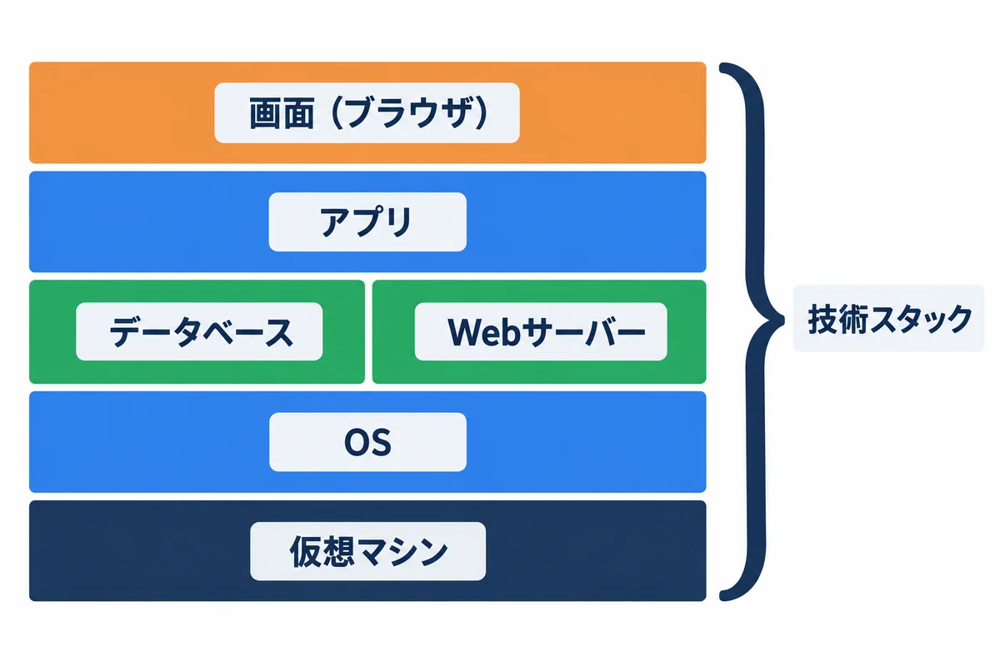
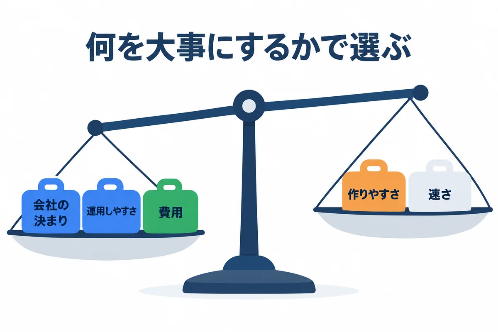
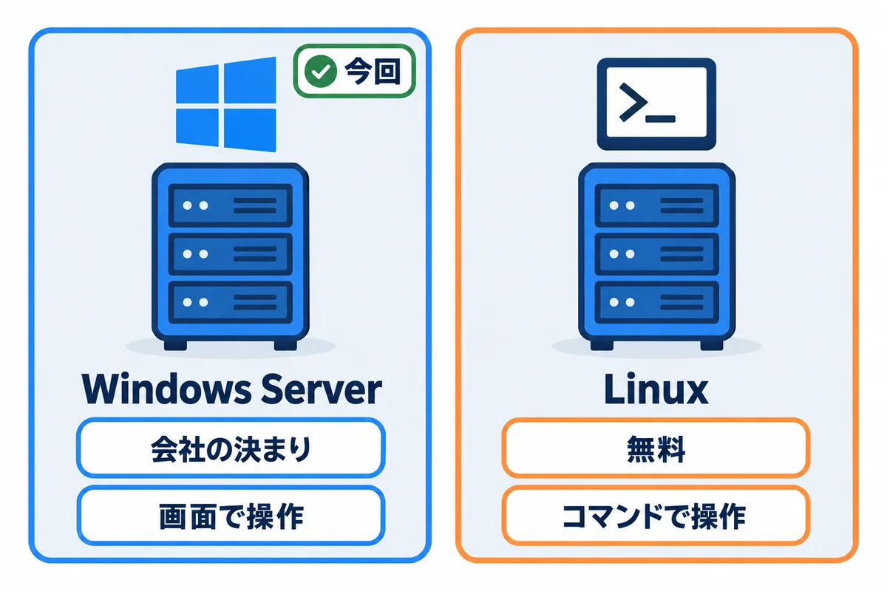
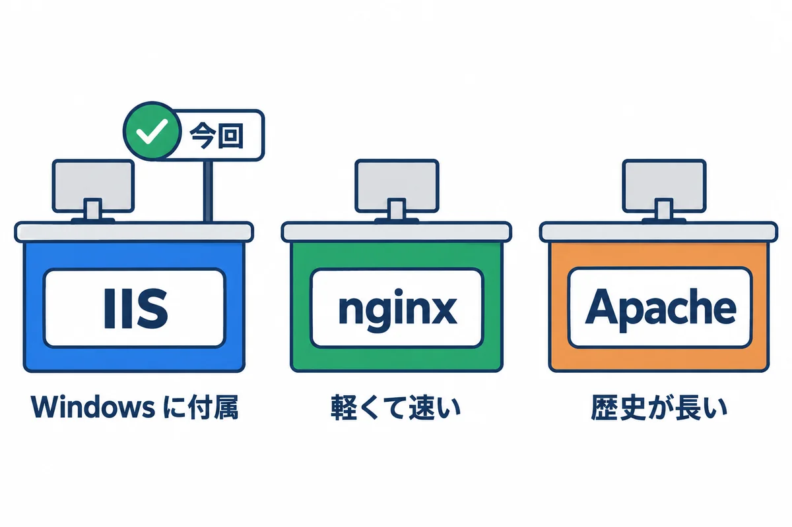
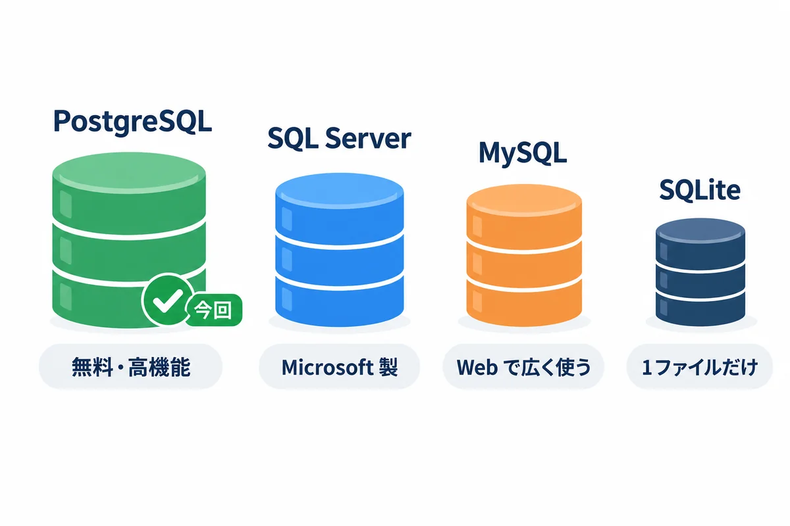
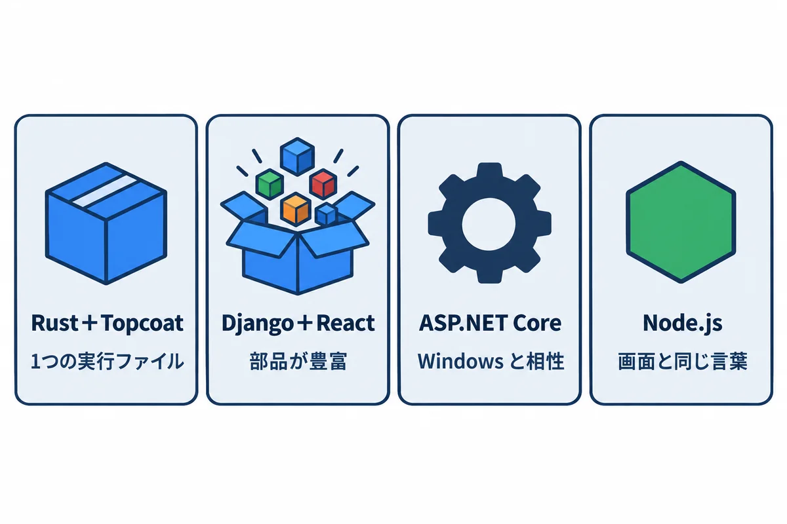
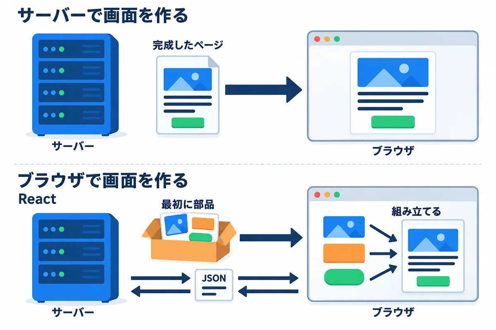
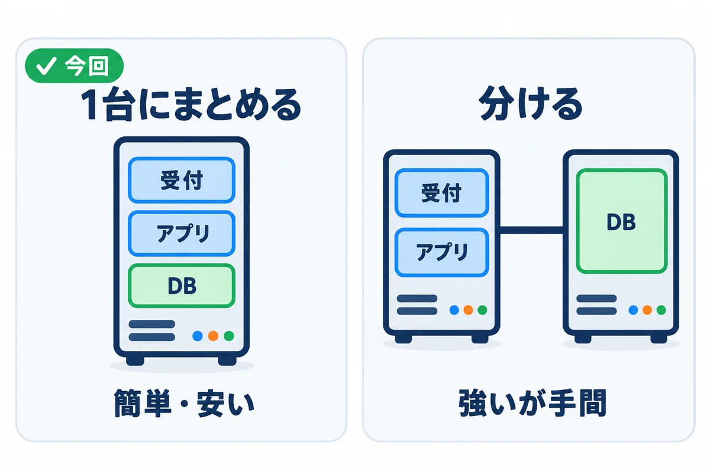
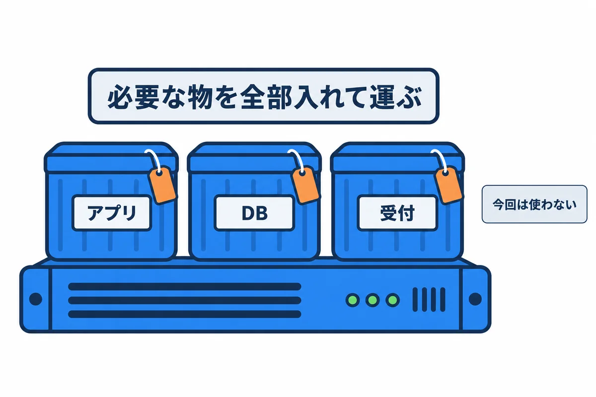

オンプレミス構築 教育資料

技術スタックの比較と選定理由

ほかにどんな選び方があり、それぞれの長所と短所は何で、今回なぜこれを選んだのか

# 技術スタックの比較と選定理由

## この資料について

手順書（04・05）は、「Windows Server ＋ IIS ＋ PostgreSQL ＋ アプリ」という組み合わせで書いています。でも、Web アプリを動かす方法は、これだけではありません。この資料では、

- 層ごとに、**ほかにどんな選択肢があるか**
- それぞれの**長所と短所**
- 今回の条件で、**なぜこれを選んだか**
- **どんなときに見直すか**

を説明します。上司や情報システム部門に「なぜこの構成なのか」を聞かれたときに、答えられるようになることが目的です。

> **情報の時点:** サポートの期限や無料版の制限は、2026-11-01 時点で各社の公式の情報を確かめたものです。年に1回は、公式のページで確かめ直してください。

## 1. 技術スタックとは

図1-1: 技術スタックは、アプリを動かす技術の積み重ね

**技術スタック**は、アプリを動かすために積み重ねる技術の組み合わせです。下の層が無いと、上の層は動きません。

| 層 | 今回の選択 | ほかの選択肢 | 説明の章 |
|---|---|---|---|
| 仮想マシン | 会社が用意（VMware・Hyper-V など） | クラウド（Azure・AWS） | 00 基礎知識 2 章 |
| OS | **Windows Server** | Linux（Red Hat Enterprise Linux・Ubuntu Server など） | 3 |
| Web サーバー（受付） | **IIS** | nginx・Apache・Caddy・受付を置かない | 4 |
| データベース | **PostgreSQL** | SQL Server・MySQL・SQLite | 5 |
| アプリ | **Rust＋Topcoat** または **Django＋React** | ASP.NET Core・Node.js・Java（Spring Boot）・PHP（Laravel） | 6 |
| 画面の作り方 | サーバーで作る（Rust 版）／React（Django 版） | — | 7 |
| 常駐のさせ方 | **WinSW**（Rust 版） | NSSM・IIS に起動させる・タスク スケジューラ | 8 |
| サーバーの台数 | **1 台にまとめる** | 役割ごとに分ける | 9 |
| 置き方 | **そのまま入れる** | コンテナ（Docker） | 10 |

> **用語:** 技術スタック（technology stack：アプリを動かすために重ねて使う、OS・データベース・言語・フレームワークなどの組み合わせ）

## 2. 選ぶときの基準

図2-1: 何を大事にするかで、選ぶ物が変わる

技術に「いちばん良い物」はありません。**条件によって、良い物が変わります**。今回は、次の順に大事にしました。

| 順 | 基準 | 今回の条件 |
|---|---|---|
| 1 | **会社の決まり・サポート** | OS は会社が Windows Server を入れる。サーバーはインターネットにつながらない。HTTPS は使えない |
| 2 | **運用しやすさ** | インフラの専任がいない。作った人が異動しても、手順書を見れば別の人が続けられること |
| 3 | **費用** | 追加のライセンス費用を、なるべくかけない |
| 4 | **長く使えること** | 安全の修正（サポート）が、長く続くこと |
| 5 | **作りやすさ・速さ** | 社内の数十〜数百人が使う規模。とびきりの速さは要らない |

「作りやすさ」や「速さ」を上にすると、別の選び方になります。たとえば、インフラの専任がいて Linux に慣れているなら、OS は Linux を選ぶ方が自然です。

## 3. OS: Windows Server か Linux か

図3-1: サーバーの OS の2つの系統

| | Windows Server | Linux（RHEL・Ubuntu Server など） |
|---|---|---|
| 費用 | ライセンスが要る（会社が払う） | 無料の物が多い（RHEL など、サポート付きは有料） |
| 操作 | 画面（デスクトップ）でも、PowerShell でも | 主にコマンド（SSH でつなぐ） |
| 会社の管理との相性 | **Active Directory・Windows Update の配布・ウイルス対策など、会社の仕組みにそのまま乗る** | 会社によっては、管理の仕組みが無い |
| Web の情報の多さ | Web アプリの運用の情報は、Linux より少ない | **Web アプリの運用の情報が最も多い** |
| 向いているアプリ | ASP.NET Core、IIS で動く物 | ほとんどの Web の技術（Python・Node.js・Rust・Java・PHP） |
| 長所 | 情報システム部門が慣れている／画面で確かめられる | 軽い・速い・コンテナと相性が良い |
| 短所 | Linux 向けに作られた道具の一部が、Windows では使えない・動きが違う（例：nginx・Python の gunicorn） | 情報システム部門が管理していないと、更新や監視を全部自分でする |

**Windows Server のサポートの期限**（Microsoft のライフサイクルの情報。2026-11-01 時点）:

| 版 | 通常のサポート（機能の改善も） | 延長サポート（安全の修正だけ） |
|---|---|---|
| Windows Server 2022 | 2026-10-13 に終了 | 2031-10-14 まで |
| Windows Server 2025 | 2029-11-13 まで | 2034-11-14 まで |

どちらの版でも、安全の修正は 2031 年以降まで続きます。新しく借りるなら、**2025 の方が長く使えます**。

**今回の選定: Windows Server**

- 会社が入れてくれる OS が Windows Server だから（**会社の決まり**）。
- 会社のアカウント・更新の配布・ウイルス対策などに、最初から乗っている（**運用しやすさ**）。
- **見直すとき:** 会社が Linux の仮想マシンも貸してくれて、Linux を管理できる人がいる場合。

## 4. Web サーバー（受付）: IIS・nginx・Apache・Caddy

図4-1: 受付（Web サーバー）の選択肢

| | IIS | nginx | Apache（httpd） | Caddy |
|---|---|---|---|---|
| どこの物 | Microsoft（Windows Server に付属） | F5（無料の版あり） | Apache ソフトウェア財団 | 有志（無料） |
| Windows での扱い | **Windows の一部として、Microsoft がサポート** | 公式の説明で「Windows 版はベータ版と見なされる」とされ、性能にも制限がある | 公式は Windows 用の実行ファイルを配っておらず、別の団体の物を使う | Windows 用の実行ファイルがある |
| リバースプロキシ | URL Rewrite と ARR の追加が要る | 標準でできる | 標準でできる（mod_proxy） | 標準でできる |
| HTTPS | Windows の証明書の仕組みで管理 | 設定ファイルで | 設定ファイルで | **自動で証明書を取る**（インターネットにつながる場合） |
| 長所 | 画面で設定できる／Windows Update で更新される／情報システム部門が慣れている | 軽くて速い。Linux では定番 | 機能と情報が多い | 設定が短い |
| 短所 | ARR は長く新しい版が出ていない（3.0 のまま） | Windows では本領を出せない | Windows では入手と更新が手間 | 社内（インターネットにつながらない）では、自動の証明書が使えない |

**受付を置かずに、アプリが直接 80 番で受ける**こともできます。部品は減りますが、本番と検証を同じ 80 番で分けられない、アクセスの記録や大きさの制限をアプリで全部作る必要がある、などの短所があります。

**今回の選定: IIS**

- Windows Server の一部なので、追加の費用が無く、**安全の修正が Windows Update で届く**。
- 名前（Host）で本番と検証を分けられる（00 基礎知識 5.2）。
- 将来 HTTPS にするとき、Windows の証明書の仕組みで管理できる（参考資料）。
- **見直すとき:** OS を Linux にするとき（nginx が定番）。

## 5. データベース: PostgreSQL・SQL Server・MySQL・SQLite

図5-1: データベースの選択肢

| | PostgreSQL | SQL Server | MySQL | SQLite |
|---|---|---|---|---|
| 費用 | 無料 | Express は無料。Standard 以上は有料 | 無料の版（Community）あり | 無料 |
| 無料の版の制限 | 無い | Express は、1つのデータベースが 50GB まで（2025 の版。2022 までは 10GB）、CPU は 4 コアまで、メモリの使い道にも上限 | 無い | 無い |
| Windows での扱い | 公式の Windows 用インストーラーがある | **Microsoft の製品。Windows と最も相性が良い** | Windows 用インストーラーがある | ファイル1つ。サーバーのプログラムが要らない |
| 機能 | 豊富（JSON・全文検索・いろいろな型） | 豊富。管理の画面（SSMS）が強い | 十分 | 少ない。**同時の書き込みに弱い** |
| アプリの部品 | Rust・Python（Django）とも、定番 | Django は追加の部品（mssql-django）。Rust は部品が少ない | Rust・Python とも、定番 | Rust・Python とも、定番 |
| 長所 | 無料で制限が無い／SQL が標準にそっている／情報が多い | 情報システム部門が慣れていることが多い／Windows の認証でログインできる | 世界で広く使われている | 準備が要らない |
| 短所 | Windows での運用の情報は、Linux より少ない | 大きくなると有料の版が要る | 一部の SQL の書き方が独特 | 複数の人が同時に書く業務アプリには向かない |

**今回の選定: PostgreSQL（仮想マシンの中に入れる）**

- **無料で、大きさの制限が無い**。図面のデータ（1件で最大 50MB）をデータベースに入れるので、年月がたつと大きくなる。
- Rust（sqlx など）と Django の、どちらからも定番として使える。
- **見直すとき:** 会社の決まりで SQL Server を使う場合や、情報システム部門が SQL Server の運用（バックアップ・更新）を引き受けてくれる場合（00 基礎知識 7.5、02 の 15 章）。

## 6. アプリの作り方（言語とフレームワーク）

図6-1: アプリの作り方の選択肢

> **用語:** フレームワーク（framework：Web アプリでよく使う仕組み（ログイン・画面・データベースとのやり取りなど）を、まとめて用意してくれる土台）

| | Rust＋Topcoat（04） | Django＋React（05） | ASP.NET Core（C#） | Node.js（Express・NestJS など） | Java（Spring Boot） | PHP（Laravel） |
|---|---|---|---|---|---|---|
| サーバーに置く物 | **実行ファイル1つ**（＋画面の部品のフォルダ） | Python の実行の環境＋アプリ＋画面の成果物 | .NET の実行の環境＋アプリ | Node.js＋アプリ＋部品のフォルダ | Java の実行の環境＋アプリ | PHP＋アプリ |
| Windows・IIS との相性 | 良い（ただの実行ファイル） | 普通（Windows で動く Web サーバーの部品が限られる。下の注） | **最も良い**（IIS の中で直接動かせる。Microsoft の製品） | 普通 | 普通 | 普通（IIS の FastCGI で動く） |
| 速さ・メモリ | **とても速く、メモリが少ない** | 普通 | 速い | 普通 | 速いが、メモリを多く使う | 普通 |
| 作りやすさ | 覚えることが多い（所有権など） | **管理画面・ログイン・データベースの道具が最初から付いている** | 道具（Visual Studio）が強い | 画面と同じ JavaScript で書ける | 大きなシステム向けの決まりごとが多い | 簡単に始められる |
| 型の安全さ | **とても強い**（間違いの多くを作る前に見つける） | 弱い（Python）／TypeScript で補う（React） | 強い | TypeScript で補う | 強い | 弱い |
| 部品の多さ | 増えている途中。Topcoat はまだ 0.x の版 | **とても多い** | 多い | とても多い | とても多い | 多い |
| 部品の更新の手間 | 少ない（実行ファイルに全部入る） | 多い（Python の部品と、npm の部品の両方） | 普通 | **多い**（npm の部品の入れ替わりが速い） | 普通 | 普通 |
| 書ける人の探しやすさ | 少ない | 多い | 多い | とても多い | とても多い | 多い |

> **注（Python の Web サーバー）:** Linux で定番の gunicorn は、Windows では動きません。Windows では、すべて Python で書かれた **waitress** を使うのが一般的です（05 で使う）。

**この資料で2つの作り方を用意した理由**

| | Rust＋Topcoat（04） | Django＋React（05） |
|---|---|---|
| こんなときに選ぶ | 運用の手間を減らしたい／サーバーの力が小さい／型で間違いを防ぎたい | 早く作りたい／画面を細かく動かしたい／Python と JavaScript を書ける人が多い |
| 運用の手間 | 実行ファイルを入れ替えるだけ | Python の環境と部品を、サーバーに持ち込んで管理する |
| 気を付けること | Topcoat は新しく、版が上がると書き方が変わることがある | Python・Django・npm の部品の、安全の修正を追い続ける |

**ほかの選択肢を選ぶとき:** 会社に C# を書ける人が多いなら、**ASP.NET Core** は Windows Server・IIS との相性が最も良く、有力な選択肢です。この資料の、OS・IIS・PostgreSQL・バックアップ・ファイアウォールの部分は、そのまま使えます。

## 7. 画面の作り方: サーバーで作るか、ブラウザで作るか

図7-1: サーバーで画面を作る形と、ブラウザで画面を作る形

| | サーバーで画面を作る（Rust＋Topcoat 版） | ブラウザで画面を作る（React。Django 版） |
|---|---|---|
| 仕組み | ボタンを押すたびに、サーバーが完成したページ（HTML）を返す | 最初に画面の部品（JavaScript）を渡し、その後はデータ（JSON）だけをやり取りして、ブラウザが画面を組み立てる |
| 長所 | 作る物が1つで済む／古いブラウザでも動きやすい／最初の表示が速い | 画面の動きを細かく作れる（入力しながら絞り込む、など）／画面とサーバーを別の人が作れる |
| 短所 | 細かい画面の動きには工夫が要る | **作る物が2つになる**（画面とサーバー）／画面を作るのに Node.js などの道具が要る（開発用のパソコンだけ） |
| サーバーで要る物 | アプリだけ | アプリ＋画面の成果物（05 では Django のプロジェクトの中に入れて、Django が配る） |

> **用語:** SPA（エスピーエー。Single Page Application：最初に1枚のページを読み込み、後は JavaScript で画面を書きかえていく作り方。React で作る画面がこれ）

## 8. アプリを常駐させる方法（Rust 版）

アプリを Windows のサービスにする方法（01 の 6 章）にも、いくつかあります。

| 方法 | 長所 | 短所 |
|---|---|---|
| **WinSW**（今回） | XML の設定ファイル1つで、サービスにできる／ログの切りかえや、異常終了したときの再起動の設定がある／無料 | 別のソフト（実行ファイル1つ）を持ち込む |
| NSSM | 画面で設定できる／広く使われてきた | 長く新しい版が出ていない |
| アプリ自身を Windows サービスとして作る | 部品が増えない | アプリの中に Windows 専用の作りが要る |
| IIS に起動させる（HttpPlatformHandler など） | IIS が、アプリの起動と再起動を受け持つ | IIS の設定が増える。IIS が止まるとアプリも止まる |
| タスク スケジューラの「起動したとき」 | 追加の部品が要らない | 止まったときの再起動や、状態の確かめ方が弱い |

**今回の選定: WinSW** — 設定が1つのファイルにまとまり、手順書で再現しやすいため。Django 版（05）でも同じ WinSW を使い、覚えることを減らします。

## 9. サーバーの台数: 1 台にまとめるか、分けるか

図9-1: 1 台にまとめるか、役割ごとに分けるか

| | 1 台にまとめる（今回） | 分ける（Web・アプリのサーバーと、DB のサーバー） |
|---|---|---|
| 費用・手間 | **仮想マシン1台分** | 2 台分。更新・監視・バックアップも 2 台分 |
| 安全 | DB が外に出ない（127.0.0.1 だけ） | DB をネットワークに出すので、ファイアウォールと認証の設定が増える |
| 壊れたとき | 1 台が止まると全部止まる | 片方の故障の影響を分けられる（ただし、どちらが止まってもアプリは使えない） |
| 重くなったとき | 仮想マシンの CPU・メモリを増やす | 重い方だけ増やせる |
| 向いている規模 | 社内の数十〜数百人 | 利用者が多い・止めてはいけない時間が長い |

**本番と検証を同じサーバーに同居させる**のも、同じ考え方です。費用は半分になりますが、検証で重い試験をすると本番が遅くなる、Windows Update の再起動で両方止まる、という短所があります。検証で重い試験をするときは、社員が使わない時間にします。**見直すとき:** 利用者が増えて遅くなったとき、または「止めてはいけない時間」が長くなったとき。

## 10. コンテナ（Docker）を使わない理由

図10-1: コンテナは、必要な物を全部入れて運ぶ箱

**コンテナ**は、アプリと、アプリが動くのに要る物（OS の一部・部品）を、まとめて1つの箱にする技術です。「開発用のパソコンで動いた箱を、そのままサーバーで動かせる」のが長所です。

ただし、今回は使いません。

- Web の世界のコンテナは、ほとんどが **Linux 用**です。Windows Server の上で Linux のコンテナを動かすには、さらに仮想化の仕組みを重ねる必要があり、設定と運用が複雑になります。
- コンテナの更新・ログ・バックアップの仕組みを、別に覚えて管理する必要があります。インフラの専任がいない今回の条件では、**覚えることを増やさない方が安全**です。
- 会社の情報システム部門のサポートの範囲から外れやすくなります。

**見直すとき:** Linux のサーバーを使えるようになり、コンテナを管理できる人がいるとき。

> **用語:** コンテナ（container：アプリと、動くのに要る物をまとめて1つの箱にし、どこでも同じように動かす技術。Docker が代表）

## 11. バックアップと監視の道具

| 層 | 今回の選定 | ほかの選択肢 | 今回の理由 |
|---|---|---|---|
| DB のバックアップ | `pg_dump`＋タスク スケジューラ（毎晩） | 仮想マシンごとの控え（会社のバックアップの仕組み）／PostgreSQL の WAL を使った「その時刻に戻す」控え（PITR） | 仕組みが分かりやすく、別のデータベースに戻して確かめやすい。データの量が少ないうちは十分 |
| ファイルのバックアップ | robocopy＋タスク スケジューラ | 会社のバックアップの仕組み | 追加の道具が要らない |
| 監視 | アプリの `/health`＋イベント ログ＋毎朝の点検 | 会社の監視の仕組み（Zabbix など）に入れてもらう | まずは追加の道具なしで始める。会社に監視の仕組みがあれば、`/health` を見てもらうよう頼む |

- **会社に仮想マシンごとのバックアップの仕組みがあるなら、両方を使います。** 仮想マシンごとの控えは「サーバーが丸ごと壊れた」ときに、`pg_dump` の控えは「データを間違えて消した」ときに役立ちます。
- 「その時刻に戻す」控え（PITR）は、「1 日分のデータも失えない」ときに考えます。設定と練習の手間が増えます。

## 12. 今回の選定のまとめ

| 層 | 選んだ物 | いちばんの理由 | 見直すとき |
|---|---|---|---|
| OS | Windows Server（2025 を推奨） | 会社の決まり・会社の管理の仕組みに乗る | Linux を管理できる人がいるとき |
| 受付 | IIS（HTTP の 80 番） | Windows の一部で、更新が Windows Update で届く | OS を Linux にするとき |
| データベース | PostgreSQL 18（同じサーバーの中） | 無料で制限が無い。どちらのアプリからも定番 | 会社の決まりで SQL Server のとき |
| アプリ | Rust＋Topcoat（04）／Django＋React（05） | 運用の手間の少なさ／作りやすさ（条件で選ぶ） | C# の人が多いなら ASP.NET Core |
| 常駐 | WinSW | 設定が1ファイルで再現しやすい | — |
| 台数 | 1 台（本番と検証を同居） | 費用と手間が最小 | 利用者が増えた・止められない時間が長くなった |
| 置き方 | そのまま入れる（コンテナなし） | 覚えることを増やさない | Linux とコンテナの運用ができるとき |
| 通信 | HTTP | 社内で HTTPS を使えない | 証明書を用意できるようになったら HTTPS（参考資料） |

## 用語の索引

| 用語 | 短い説明 | 章 |
|---|---|---|
| ARR・URL Rewrite | IIS をリバースプロキシにする追加の部品 | 4 |
| ASP.NET Core | Microsoft の C# の Web フレームワーク | 6 |
| Caddy | 設定が短い Web サーバー | 4 |
| Django | Python の Web フレームワーク | 6 |
| gunicorn・waitress | Python の Web サーバーの部品（Windows では waitress） | 6 |
| nginx・Apache | Linux で定番の Web サーバー | 4 |
| NSSM・WinSW | プログラムを Windows のサービスにする道具 | 8 |
| PITR | その時刻の状態に戻せる、PostgreSQL の控えの取り方 | 11 |
| React | ブラウザで画面を組み立てる JavaScript の部品 | 7 |
| SPA | ブラウザで画面を書きかえていく作り方 | 7 |
| SQL Server Express | SQL Server の無料の版（大きさなどに上限） | 5 |
| SQLite | ファイル1つのデータベース | 5 |
| コンテナ・Docker | アプリと必要な物を1つの箱にする技術 | 10 |
| 技術スタック | アプリを動かす技術の組み合わせ | 1 |
| 延長サポート | 安全の修正だけが出る期間 | 3 |
| フレームワーク | Web アプリのよく使う仕組みをまとめた土台 | 6 |
