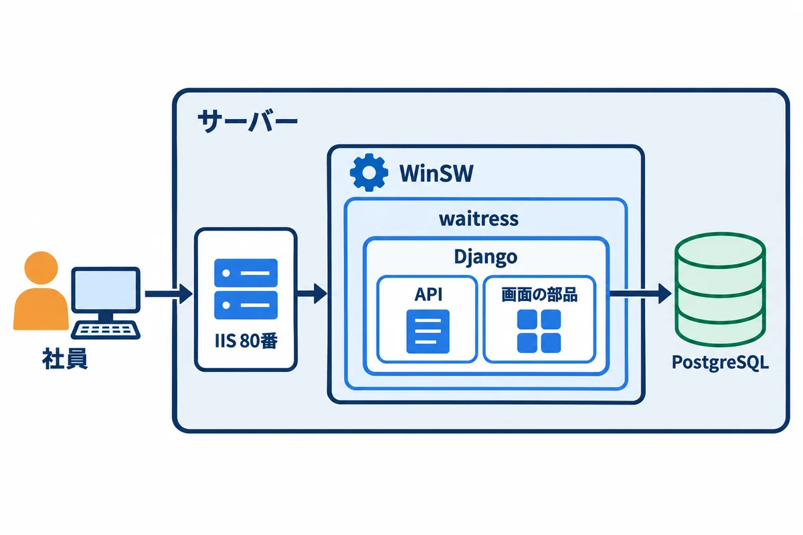
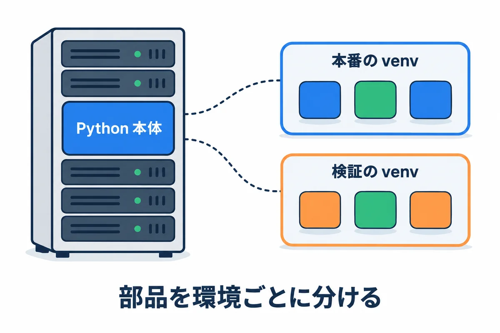
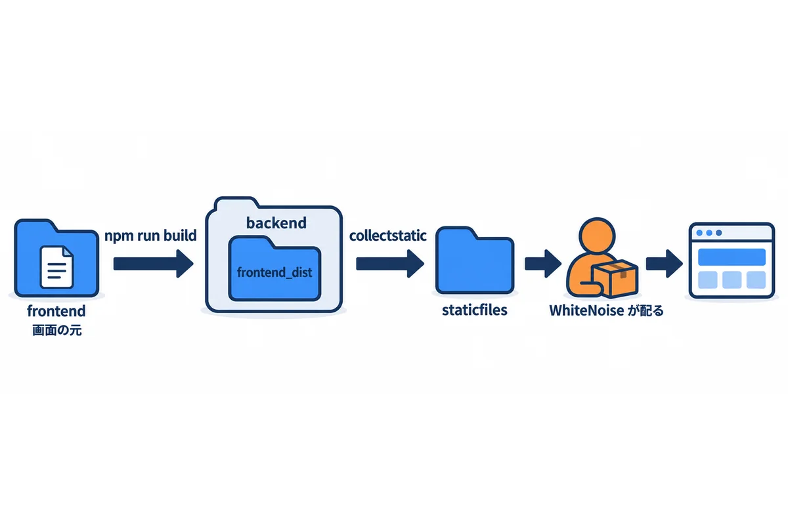
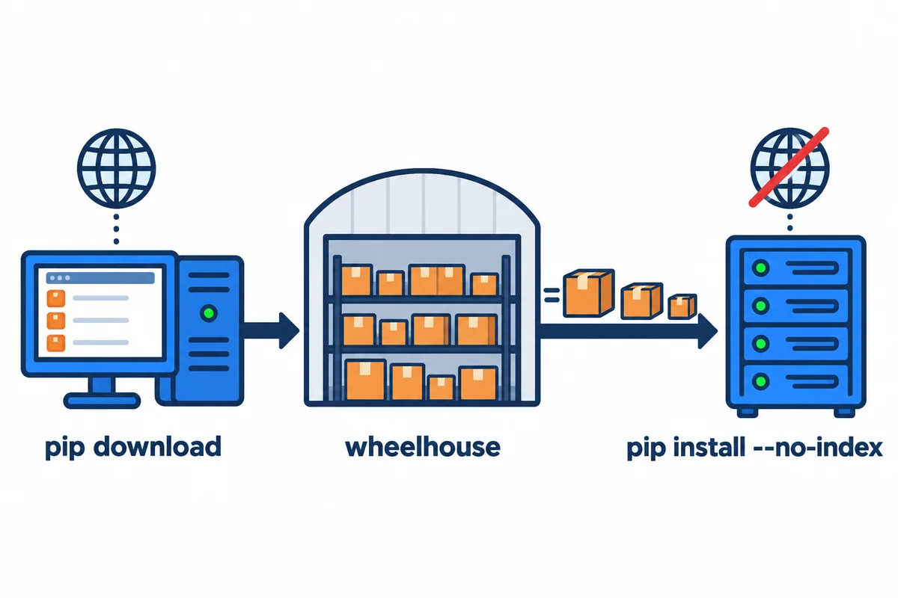
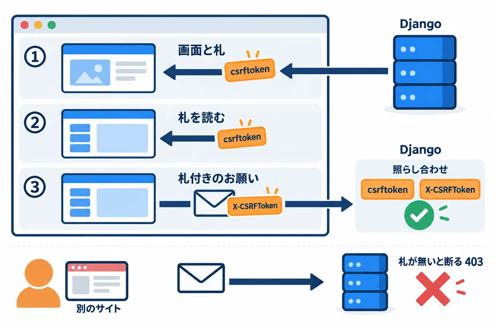
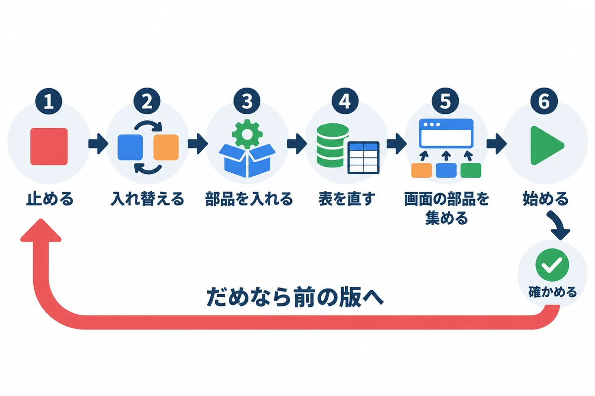

<div style="text-align: center; padding: 28px 0 8px;">
<div style="font-size: 14px; color: #475569;">オンプレミス構築 教育資料</div>
<div style="font-size: 26px; font-weight: 800; color: #0f172a; margin-top: 6px; line-height: 1.35;">構築手順 — Django＋React版</div>
<div style="font-size: 13px; color: #475569; margin-top: 8px;">React の画面を Django のプロジェクトに入れ、Django が同じサーバーで配る形で、Windows Server に建てる</div>
</div>

# 構築手順: Django＋React版

## この資料について

04 構築手順（Rust＋Topcoat版）と**同じアプリ**を、**Django（Python）と React（JavaScript）**で作った場合の手順です。

- **前提:** 04 と同じ。会社が Windows Server の仮想マシンを貸してくれて、データベースは仮想マシンの中の PostgreSQL。通信は HTTP（80 番）。
- **構成:** React で作った画面の**成果物（ビルドしたファイル）を、Django のプロジェクトの中に置き**、Django が同じサーバーから配ります。React のための別のサーバーは要りません。
- **04 と同じ所は、04 を見ます。** サーバーの受け取り・フォルダの考え方・PostgreSQL・IIS・ファイアウォール・バックアップは、ほとんど同じです。この資料では、**違う所**を詳しく書きます。
- **試して確かめた範囲:** この資料の Django の設定・画面の配り方・ログイン・CSRF・大きさの上限・Python の部品の持ち込み・`manage.ps1` は、2026-11-01 に、Python 3.14・Django 5.2.18・waitress 3.0.2・PostgreSQL 18.3 で、**実際に動かして確かめました**（8.4 の表）。IIS とサービスへの登録は、04 と同じ手順です。

### この資料で使う版（2026-11-01 時点）

| もの | 版 | どこで使う |
|---|---|---|
| Windows Server・PostgreSQL・IIS・URL Rewrite・ARR・WinSW | 04 と同じ | サーバー |
| Python | 3.14 系の最新（Windows 用の 64 ビットのインストーラー） | サーバーと開発用のパソコン |
| Django | 5.2.18（長期サポート版。2028 年 4 月まで安全の修正が出る） | アプリの中 |
| Django REST framework | 3.18.3（API を作る部品） | アプリの中 |
| psycopg | 3.3.6（PostgreSQL につなぐ部品） | アプリの中 |
| waitress | 3.0.2（Windows で動く、Python の Web サーバー） | アプリの中 |
| WhiteNoise | 6.12.0（画面の部品のファイルを、Django から配る部品） | アプリの中 |
| React | 19.3.1 | 画面（開発用のパソコンで作る） |
| Vite | 8.3.5（React の画面をビルドする道具） | 開発用のパソコンだけ |
| Node.js | LTS 版（Vite を動かすため） | **開発用のパソコンだけ**。サーバーには入れない |

> **用語:** Django（ジャンゴ：Python で Web アプリを作るための、全部入りのフレームワーク。ログイン・管理画面・データベースの道具が最初から付いている）

<!-- -->

> **用語:** React（リアクト：ブラウザの中で画面を組み立てる、JavaScript の部品。03 の 7 章）

<!-- -->

> **用語:** ビルド（build：作った元のファイルを、ブラウザやサーバーで動かせる形にまとめて変換すること。React なら、たくさんのファイルを、少ない JavaScript のファイルにまとめる）

## 1. 全体像（04 との違い）

<div style="max-width: 760px; margin: 18px auto; text-align: center;">

<div style="font-size: 12px; color: #64748b; margin-top: 6px;">図1-1: Django 版の形。IIS の奥で、waitress が Django を動かし、Django が API と画面の部品の両方を配る</div>
</div>

| | 04 Rust＋Topcoat版 | この資料 Django＋React版 |
|---|---|---|
| アプリの中身 | `webapp.exe` 1つ＋`assets\` | Python のコード＋画面の成果物（`frontend_dist\`・`staticfiles\`） |
| サーバーに入れる物 | 無し（実行ファイルだけ） | **Python**（3.14）と、**仮想環境（venv）**に入れた部品 |
| アプリを動かす物 | `webapp.exe` 自身 | **waitress**（`python -m waitress ...`） |
| サービスにする道具 | WinSW | WinSW（同じ） |
| 画面の部品の配り方 | アプリが配る | **WhiteNoise**（Django の中の部品）が `/static/` で配る |
| テーブルを作る・直す | アプリの起動のとき（設計例） | `manage.py migrate` を手で動かす |
| 毎朝 8:00 の処理 | アプリの中の定期処理（設計例） | Django の管理コマンドを、**タスク スケジューラ**で動かす（設計例） |
| HTTP のための設定 | カスタムの TokenStore（04 の 6.4） | `SESSION_COOKIE_SECURE = False` などの設定（8 章） |

本番と検証の分け方（名前・IIS のサイト・ポート・サービス・データベース）は、**04 の 1.2 と同じ**です（本番 8080・検証 8081）。

### 1.1 作業の順番

1. サーバーの受け取りと最初の確認（**04 の 2・3 章**のとおり）
2. フォルダとアカウント（4 章。04 の 4 章に、Python 用のフォルダを足す）
3. PostgreSQL（**04 の 5 章**のとおり）
4. Python を入れる（5 章）
5. 開発用のパソコンで、アプリを作り、まとめる（6・7 章）
6. HTTP のための設定を確かめる（8 章）
7. サーバーに置き、Windows サービスにする（9 章）
8. 受付（IIS）（10 章。**04 の 8 章**とほぼ同じ）
9. ファイアウォール・メール・バックアップ（11 章。**04 の 9〜11 章**）
10. 毎朝 8:00 の処理・ログ（12 章）
11. 動作確認・更新・切り戻し（13 章）

## 2. フォルダとアカウント

04 の 4 章のフォルダに、次を足します。

```text
D:\webapp\
├─ prod\
│  ├─ app\          アプリ（backend\ の中身）
│  ├─ venv\         本番の Python の仮想環境（部品の置き場）  ← 足す
│  ├─ tmp\          大きな添付ファイルを受け取る途中の一時ファイル  ← 足す
│  ├─ service\      WinSW と設定（XML）と manage.ps1
│  ├─ files\        添付ファイル
│  ├─ logs\         ログ
│  └─ iis\          IIS のサイトのフォルダ（web.config）
├─ stg\             検証（中身は prod\ と同じ形）
├─ releases\        持ち込んだ版の zip（webapp-1.0.0.zip など）
├─ backup\ tools\ secrets\ installers\    04 と同じ
```

```powershell
# 足すフォルダを作る（本番と検証）
New-Item -ItemType Directory -Force D:\webapp\prod\venv, D:\webapp\prod\tmp, D:\webapp\stg\venv, D:\webapp\stg\tmp
```

アプリを動かすアカウントは、04 と同じ**仮想アカウント**（`NT SERVICE\webapp-prod`・`NT SERVICE\webapp-stg`）です。許可は 9.3 で付けます。

## 3. PostgreSQL

**04 の 5 章のとおり**に入れて、本番と検証のデータベースとユーザーを作ります（`lc_messages = 'C'` も同じ）。Django は、アプリ用のユーザーでつないで、テーブルを作ります（9.5 の `migrate`）。

## 4. Python を入れる（サーバー）

### 4.1 インストーラーを持ち込む

1. 開発用のパソコンで、Python の公式のページ（`https://www.python.org/downloads/windows/`）から、**3.14 系の最新の「Windows installer (64-bit)」**（`python-3.14.x-amd64.exe`）を取ってきます。
2. 01 の 12 章のとおり、`D:\webapp\installers\` に持ち込み、ハッシュ値を確かめます。

> **インストーラーの種類について:** Python 3.14 からは、新しい「Python install manager」が勧められていますが、これは**人ごと**に Python を入れる道具です。サーバーでは、**サービスのアカウントからも使えるように、全部のユーザー向けに 1 か所に入れたい**ので、従来のインストーラー（`python-3.14.x-amd64.exe`）を使います。従来のインストーラーは 3.14 では使えますが、Python 3.16 からは出なくなる予定です。そのころには、入れ方を見直します。

### 4.2 インストールする

1. `python-3.14.x-amd64.exe` を、右クリック →「管理者として実行」します。
2. 最初の画面の下の「**Add python.exe to PATH**」には**チェックを入れません**（サーバーでは、どの Python を使うかを、いつも場所を書いて決めるため）。
3. 「**Customize installation**」を押します。
4. 「Optional Features」はそのまま「Next」。
5. 「Advanced Options」で「**Install Python 3.14 for all users**」にチェックを入れます。入れる場所が `C:\Program Files\Python314` になったことを確かめて、「Install」を押します。

```powershell
& "C:\Program Files\Python314\python.exe" --version
```

**確かめること:** `Python 3.14.x` と出ること。

> **用語:** PATH に追加（コマンドの名前だけで呼べるようにすること。01 の 3.8。サーバーに Python が何個もあると、どれが動くか分からなくなるので、今回は追加しない）

### 4.3 仮想環境（venv）を作る

<div style="max-width: 760px; margin: 18px auto; text-align: center;">

<div style="font-size: 12px; color: #64748b; margin-top: 6px;">図4-1: venv は、部品を環境ごとに分けて入れる箱</div>
</div>

**仮想環境（venv）**は、Python の部品（Django など）を、**環境ごとに分けて入れる箱**です。本番と検証で別の venv にしておくと、検証で新しい版の部品を試しても、本番に影響しません。

```powershell
& "C:\Program Files\Python314\python.exe" -m venv D:\webapp\prod\venv
& "C:\Program Files\Python314\python.exe" -m venv D:\webapp\stg\venv

# venv の中の python で、版を確かめる
D:\webapp\prod\venv\Scripts\python.exe --version
```

**確かめること:** `D:\webapp\prod\venv\Scripts\python.exe` があり、`Python 3.14.x` と出ること。部品は、7 章で持ち込んでから入れます。

> **用語:** 仮想環境（venv。ブイエンブ：Python の部品を、プロジェクトや環境ごとに分けて入れる仕組み。`venv\Scripts\python.exe` を使うと、その箱の部品が使われる）

## 5. 開発用のパソコンの準備

開発用のパソコン（インターネットにつながる）に、次を入れます。

| 道具 | 入れ方 | 何に使う |
|---|---|---|
| Python 3.14 | 公式のページから | Django の開発と、サーバー用の部品の取り寄せ |
| Node.js の LTS 版 | 公式のページ（`https://nodejs.org/`）から | React の画面のビルド（Vite を動かす） |
| Git | 公式のページから | ソースの管理 |

> **用語:** LTS（エルティーエス。Long Term Support：長くサポートされる版。会社で使うなら、LTS を選ぶ）

## 6. アプリの作り（開発用のパソコン）

### 6.1 フォルダの形

```text
webapp\                     ソース一式（Git で管理する）
├─ backend\                 Django のプロジェクト
│  ├─ manage.py             Django の管理コマンドの入口
│  ├─ requirements.txt      使う部品と版の一覧
│  ├─ config\               設定（settings.py・urls.py・wsgi.py）
│  ├─ accounts\             アプリの部品（ログインなど。例）
│  ├─ frontend_dist\        ← React の成果物（npm run build で作られる。Git には入れない）
│  └─ staticfiles\          ← 配る部品を集めた物（collectstatic で作られる。Git には入れない）
└─ frontend\                React の画面の元
   ├─ package.json
   ├─ vite.config.js
   ├─ index.html
   └─ src\
```

<div style="max-width: 760px; margin: 18px auto; text-align: center;">

<div style="font-size: 12px; color: #64748b; margin-top: 6px;">図6-1: React の成果物を Django のプロジェクトに入れ、WhiteNoise が配る</div>
</div>

| 段階 | コマンド | 何が起きるか |
|---|---|---|
| ① React をビルドする | `npm run build`（`frontend\` で） | `frontend\` の元から、`backend\frontend_dist\` に `index.html` と `assets\index-（指紋）.js` ができる |
| ② 配る部品を集める | `python manage.py collectstatic`（`backend\` で） | `frontend_dist\` と、Django の管理画面の部品が、`backend\staticfiles\` に集まる。同時に、縮めた `.gz` も作られる |
| ③ 配る | （サーバーで動いている間） | WhiteNoise が、`/static/...` のお願いに、`staticfiles\` のファイルを返す。`index.html` は、Django が画面として返す |

### 6.2 requirements.txt（使う部品と版）

```text
Django==5.2.18
djangorestframework==3.18.3
psycopg[binary]==3.3.6
waitress==3.0.2
whitenoise==6.12.0
```

版を `==` で決めておくと、開発用のパソコンとサーバーで、**同じ版の部品**が入ります。

### 6.3 config\settings.py（設定）

秘密の値（`SECRET_KEY`・データベースのパスワード）と、サーバーごとに違う値は、**環境変数**から読みます。環境変数は、9 章の WinSW の XML に書きます。

```python
"""webapp の設定。秘密の値と、サーバーごとに違う値は、環境変数から読む。"""
import os
import re
from pathlib import Path

BASE_DIR = Path(__file__).resolve().parent.parent


def env(name, default=None):
    """環境変数を読む。無くて、決まりの値も無いときは、起動を止める。"""
    value = os.environ.get(name, default)
    if value is None:
        raise RuntimeError(f"環境変数 {name} がありません")
    return value


SECRET_KEY = env("DJANGO_SECRET_KEY")
DEBUG = env("DJANGO_DEBUG", "false").lower() == "true"

# 社員が開く名前（例: webapp-stg.example.local）。IIS が名前をそのまま渡すので、ここに書いた名前だけ受け付ける
ALLOWED_HOSTS = env("DJANGO_ALLOWED_HOSTS").split(",")
CSRF_TRUSTED_ORIGINS = [f"http://{host}" for host in ALLOWED_HOSTS]

INSTALLED_APPS = [
    "django.contrib.admin",
    "django.contrib.auth",
    "django.contrib.contenttypes",
    "django.contrib.sessions",
    "django.contrib.messages",
    "django.contrib.staticfiles",
    "rest_framework",
    "accounts",
]

MIDDLEWARE = [
    "django.middleware.security.SecurityMiddleware",
    "whitenoise.middleware.WhiteNoiseMiddleware",  # SecurityMiddleware のすぐ後
    "django.contrib.sessions.middleware.SessionMiddleware",
    "django.middleware.common.CommonMiddleware",
    "django.middleware.csrf.CsrfViewMiddleware",
    "django.contrib.auth.middleware.AuthenticationMiddleware",
    "django.contrib.messages.middleware.MessageMiddleware",
    "django.middleware.clickjacking.XFrameOptionsMiddleware",
]

ROOT_URLCONF = "config.urls"

TEMPLATES = [
    {
        "BACKEND": "django.template.backends.django.DjangoTemplates",
        "DIRS": [BASE_DIR / "frontend_dist"],  # React の成果物の index.html
        "APP_DIRS": True,
        "OPTIONS": {
            "context_processors": [
                "django.template.context_processors.request",
                "django.contrib.auth.context_processors.auth",
                "django.contrib.messages.context_processors.messages",
            ],
        },
    },
]

WSGI_APPLICATION = "config.wsgi.application"

DATABASES = {
    "default": {
        "ENGINE": "django.db.backends.postgresql",
        "HOST": "127.0.0.1",
        "PORT": env("DB_PORT", "5432"),
        "NAME": env("DB_NAME"),
        "USER": env("DB_USER"),
        "PASSWORD": env("DB_PASSWORD"),
        "CONN_MAX_AGE": 60,
    }
}

AUTH_PASSWORD_VALIDATORS = [
    {"NAME": "django.contrib.auth.password_validation.UserAttributeSimilarityValidator"},
    {"NAME": "django.contrib.auth.password_validation.MinimumLengthValidator"},
    {"NAME": "django.contrib.auth.password_validation.CommonPasswordValidator"},
    {"NAME": "django.contrib.auth.password_validation.NumericPasswordValidator"},
]

LANGUAGE_CODE = "ja"
TIME_ZONE = "Asia/Tokyo"
USE_I18N = True
USE_TZ = True

# 画面の部品（React の成果物）と管理画面の部品は、WhiteNoise が /static/ で配る
STATIC_URL = "/static/"
STATIC_ROOT = BASE_DIR / "staticfiles"
STATICFILES_DIRS = [BASE_DIR / "frontend_dist"]
STORAGES = {
    "default": {"BACKEND": "django.core.files.storage.FileSystemStorage"},
    "staticfiles": {"BACKEND": "whitenoise.storage.CompressedStaticFilesStorage"},
}


def _vite_hashed(path, url):
    """Vite が名前に指紋を付けたファイル（例: index-BX3k9a2Q.js）は、ずっとキャッシュしてよい。"""
    return re.match(r"^.+[.-][0-9a-zA-Z_-]{8,12}\..+$", url)


WHITENOISE_IMMUTABLE_FILE_TEST = _vite_hashed

# 添付ファイルの置き場所（例: D:\webapp\stg\files）
MEDIA_ROOT = env("DJANGO_MEDIA_ROOT", str(BASE_DIR / "media"))

# 図面の JSON（1 枚 5MB まで）を受け取れるように、本文の上限を 10MB にする（決まりの値は 2.5MB）
DATA_UPLOAD_MAX_MEMORY_SIZE = 10 * 1024 * 1024
# 大きな添付ファイルを受け取る途中で使う、一時ファイルの置き場所（例: D:\webapp\stg\tmp）
FILE_UPLOAD_TEMP_DIR = os.environ.get("DJANGO_TMP_DIR")  # 無ければ Windows の一時フォルダ

# メール（Microsoft 365 の SMTP リレー。04 の 10 章）
EMAIL_BACKEND = "django.core.mail.backends.smtp.EmailBackend"
EMAIL_HOST = env("SMTP_HOST", "localhost")
EMAIL_PORT = int(env("SMTP_PORT", "25"))
EMAIL_USE_TLS = True  # 25 番でつないでから、STARTTLS で暗号化する
DEFAULT_FROM_EMAIL = env("MAIL_FROM", "noreply@example.com")
EMAIL_TIMEOUT = 30

# HTTP で動かすため、クッキーに Secure を付けない（HTTPS にしたら True にする。参考資料）
SESSION_COOKIE_SECURE = False
CSRF_COOKIE_SECURE = False
SESSION_COOKIE_HTTPONLY = True
SESSION_COOKIE_SAMESITE = "Lax"
# 60 分操作が無ければログアウト（操作のたびに期限を延ばす）
SESSION_COOKIE_AGE = 60 * 60
SESSION_SAVE_EVERY_REQUEST = True

REST_FRAMEWORK = {
    "DEFAULT_AUTHENTICATION_CLASSES": ["rest_framework.authentication.SessionAuthentication"],
    "DEFAULT_PERMISSION_CLASSES": ["rest_framework.permissions.IsAuthenticated"],
}

# ログは画面（標準出力）に出す。WinSW がファイルに書く
LOGGING = {
    "version": 1,
    "disable_existing_loggers": False,
    "formatters": {"plain": {"format": "{asctime} {levelname} {name} {message}", "style": "{"}},
    "handlers": {"console": {"class": "logging.StreamHandler", "formatter": "plain"}},
    "root": {"handlers": ["console"], "level": "INFO"},
}

DEFAULT_AUTO_FIELD = "django.db.models.BigAutoField"

# HTTP で動かすために出る、HTTPS 関係の注意だけを黙らせる（HTTPS にしたら、この行を消す）
SILENCED_SYSTEM_CHECKS = ["security.W004", "security.W008", "security.W012", "security.W016"]
```

| 設定 | 意味 | 大事な理由 |
|---|---|---|
| `ALLOWED_HOSTS` | 受け付ける名前 | ここに無い名前で来たお願いは、**400** で断られる（8.4 の表の 5） |
| `CSRF_TRUSTED_ORIGINS` | 信頼する送り元 | `http://` を付けて書く |
| `WhiteNoiseMiddleware` | 画面の部品を配る | `SecurityMiddleware` の**すぐ後**に置く決まり |
| `TEMPLATES` の `DIRS` | `index.html` を探す場所 | React の成果物の `frontend_dist` |
| `STATICFILES_DIRS`・`STATIC_ROOT` | 集める元と、集めた先 | 6.1 の ①→② |
| `CompressedStaticFilesStorage` | 縮めた `.gz` も作る | Vite がすでに名前に指紋を付けているので、Django の「指紋を付ける」方式（Manifest）は使わない |
| `WHITENOISE_IMMUTABLE_FILE_TEST` | 指紋の付いた部品を、長くキャッシュさせる | 2 回目からの表示が速くなる。新しい版では名前が変わるので、古い物が使われる心配が無い |
| `DATA_UPLOAD_MAX_MEMORY_SIZE` | 受け取る本文の上限 | 決まりの値（2.5MB）のままだと、5MB の図面の JSON を受け取れない |
| `SESSION_COOKIE_SECURE`・`CSRF_COOKIE_SECURE` | クッキーに `Secure` を付けるか | **HTTP では `False` にする**（8 章） |
| `SESSION_COOKIE_AGE`・`SESSION_SAVE_EVERY_REQUEST` | 60 分・操作のたびに延ばす | 60 分操作が無いとログアウト |
| `SILENCED_SYSTEM_CHECKS` | HTTPS 関係の注意を黙らせる | 8.3 |

> **用語:** SECRET_KEY（Django が、クッキーの改ざんを見抜くなどに使う秘密の値。長いでたらめな文字にし、本番と検証で別にする。漏れたら変える）

<!-- -->

> **用語:** ミドルウェア（middleware：すべてのお願いと返事が通る、Django の中の関所の列。上から順に通る）

### 6.4 画面を返す所と URL（accounts\views.py・config\urls.py）

ログインなどの API と、React の画面を返す所の例です。

```python
import json

from django.contrib.auth import authenticate, login, logout
from django.http import JsonResponse
from django.utils.decorators import method_decorator
from django.views.decorators.csrf import ensure_csrf_cookie
from django.views.decorators.http import require_POST
from django.views.generic import TemplateView
from rest_framework.decorators import api_view
from rest_framework.response import Response


@method_decorator(ensure_csrf_cookie, name="dispatch")
class IndexView(TemplateView):
    """React の画面（index.html）を返す。CSRF のクッキーもここで渡す。"""

    template_name = "index.html"


def health(request):
    return JsonResponse({"status": "ok"})


@require_POST
def login_view(request):
    """ログイン。CSRF の確かめは、Django の CsrfViewMiddleware が行う。"""
    data = json.loads(request.body or b"{}")
    user = authenticate(request, username=data.get("username"), password=data.get("password"))
    if user is None:
        return JsonResponse({"detail": "ID かパスワードが違います"}, status=400)
    login(request, user)
    return JsonResponse({"username": user.get_username()})


@require_POST
def logout_view(request):
    logout(request)
    return JsonResponse({"ok": True})


@api_view(["GET"])
def me(request):
    return Response({"username": request.user.get_username(), "remote_addr": request.META.get("REMOTE_ADDR")})


@api_view(["POST"])
def echo(request):
    """ログイン後の保存の操作の代わり。DRF の SessionAuthentication が CSRF を確かめる。"""
    return Response({"received": len(request.body)})
```

```python
from django.contrib import admin
from django.urls import path, re_path

from accounts import views

urlpatterns = [
    path("admin/", admin.site.urls),
    path("health", views.health),
    path("api/login/", views.login_view),
    path("api/logout/", views.logout_view),
    path("api/me/", views.me),
    path("api/echo/", views.echo),
    # それ以外の URL は、React の画面（index.html）を返す。React が画面を切りかえる
    re_path(r"^(?!api/|admin/|static/).*$", views.IndexView.as_view()),
]
```

- 最後の `re_path` は、「`api/`・`admin/`・`static/` で始まらない URL は、全部 React の画面を返す」という意味です。React が、URL を見て画面を切りかえます（`/requests/123` を直接開いても、画面が出る）。
- `ensure_csrf_cookie` で、画面を開いたときに CSRF の札（`csrftoken` のクッキー）を渡します（8.2）。

### 6.5 React 側（frontend\vite.config.js・src\api.js）

```javascript
import { defineConfig } from "vite";
import react from "@vitejs/plugin-react";

export default defineConfig({
  plugins: [react()],
  // 成果物は Django の /static/ から配られるので、部品の URL の頭を /static/ にする
  base: "/static/",
  build: {
    // 成果物を Django のプロジェクトの中（backend/frontend_dist）に書き出す
    outDir: "../backend/frontend_dist",
    emptyOutDir: true,
  },
  server: {
    // 開発のときだけ: /api/ を Django の開発用サーバーへ回す
    proxy: { "/api": "http://127.0.0.1:8000" },
  },
});
```

```javascript
// Django が渡した csrftoken のクッキーを読む
function csrfToken() {
  const m = document.cookie.match(/(?:^|; )csrftoken=([^;]+)/);
  return m ? decodeURIComponent(m[1]) : "";
}

// Django の API を呼ぶ。POST などには、CSRF の札（X-CSRFToken）を付ける
export async function api(path, { method = "GET", body } = {}) {
  const res = await fetch(path, {
    method,
    credentials: "same-origin",
    headers: {
      "Content-Type": "application/json",
      ...(method !== "GET" ? { "X-CSRFToken": csrfToken() } : {}),
    },
    body: body ? JSON.stringify(body) : undefined,
  });
  const data = await res.json().catch(() => ({}));
  if (!res.ok) throw new Error(data.detail || `エラー ${res.status}`);
  return data;
}
```

- **`base: "/static/"` が大事です。** これが無いと、`index.html` の中の部品の住所が `/assets/...` になり、Django の 6.4 の `re_path` が `index.html` を返してしまうため、**画面が真っ白**になります（15 章）。
- `api()` は、毎回クッキーから札を読み直します。**ログインすると、Django が札を新しい物に取りかえる**からです（8.4 の表の 9）。

> **用語:** CSRF（シーサーフ。Cross-Site Request Forgery：別のサイトから、ログイン中の人のブラウザを使って、勝手に送信させる攻撃。Django は、札（トークン）を照らし合わせて防ぐ）

## 7. ビルドして、まとめる（開発用のパソコン）

### 7.1 画面をビルドし、部品を集める

```powershell
# ① React をビルドする（frontend フォルダで）
cd C:\work\webapp\frontend
npm ci
npm run build

# ② 配る部品を集める（backend フォルダで）。collectstatic はデータベースにつながないので、仮の値でよい
cd C:\work\webapp\backend
$env:DJANGO_SECRET_KEY = "build-only"; $env:DJANGO_ALLOWED_HOSTS = "localhost"
$env:DB_NAME = "x"; $env:DB_USER = "x"; $env:DB_PASSWORD = "x"
.\.venv\Scripts\python.exe manage.py collectstatic --noinput
```

**確かめること:**

- `npm run build` の最後に、`../backend/frontend_dist/index.html` と `../backend/frontend_dist/assets/index-（指紋）.js` が出ること。
- `collectstatic` の最後に「〜 static files copied to '…\staticfiles'」と出ること。

> **用語:** `npm ci`（`package-lock.json` に書かれたとおりの版の部品を、きっちり入れ直すコマンド。ビルドの前に使う）

### 7.2 サーバー用の Python の部品を取り寄せる（wheelhouse）

<div style="max-width: 760px; margin: 18px auto; text-align: center;">

<div style="font-size: 12px; color: #64748b; margin-top: 6px;">図7-1: 部品を倉庫（wheelhouse）にまとめて持ち込み、サーバーではネットを使わずに入れる</div>
</div>

サーバーはインターネットにつながらないので、`pip install` で部品を取ってこられません。開発用のパソコンで、**サーバー用（Windows の 64 ビット・Python 3.14）の部品のファイル**を取り寄せておきます。

```powershell
cd C:\work\webapp\backend
.\.venv\Scripts\python.exe -m pip download -r requirements.txt -d ..\wheelhouse `
    --only-binary=:all: --platform win_amd64 --python-version 3.14 --implementation cp
Get-ChildItem ..\wheelhouse
```

**確かめること:** `wheelhouse` に、次の 9 個の `.whl` ができること（試した結果）。`psycopg_binary-3.3.6-cp314-cp314-win_amd64.whl` のように、**`cp314` と `win_amd64` が付いた物**があること。

```text
asgiref-3.13.0-py3-none-any.whl
django-5.2.18-py3-none-any.whl
djangorestframework-3.18.3-py3-none-any.whl
psycopg-3.3.6-py3-none-any.whl
psycopg_binary-3.3.6-cp314-cp314-win_amd64.whl
sqlparse-0.6.0-py3-none-any.whl
tzdata-2026.6-py2.py3-none-any.whl
waitress-3.0.2-py3-none-any.whl
whitenoise-6.12.0-py3-none-any.whl
```

- `--platform win_amd64 --python-version 3.14` を付けるのは、**開発用のパソコンが ARM（Snapdragon など）や別の版の Python でも、サーバー用の部品を取ってこられる**ようにするためです。
- `asgiref`・`sqlparse`・`tzdata` は、Django が使う部品で、自動で一緒に取り寄せられます。

> **用語:** wheel（ホイール。`.whl`：Python の部品を、すぐ入れられる形にまとめたファイル）

<!-- -->

> **用語:** wheelhouse（ホイールハウス：wheel のファイルを集めて置いたフォルダ。ネットにつながらない所で `pip install --no-index --find-links` に使う）

### 7.3 版の名前を付けて、まとめる

```powershell
cd C:\work\webapp
$ver = "1.0.0"
New-Item -ItemType Directory -Force "out\webapp-$ver" | Out-Null

# アプリ（backend の中身。開発用の venv と、Git の物は入れない）
robocopy backend "out\webapp-$ver\app" /E /XD .venv __pycache__ media /XF *.pyc
# 部品の倉庫
robocopy wheelhouse "out\webapp-$ver\wheelhouse" /E

Compress-Archive -Path "out\webapp-$ver\*" -DestinationPath "out\webapp-$ver.zip" -Force
Get-FileHash "out\webapp-$ver.zip" -Algorithm SHA256
```

**確かめること:** zip の中に、`app\manage.py`・`app\frontend_dist\index.html`・`app\staticfiles\`・`app\requirements.txt`・`wheelhouse\*.whl` があること。

## 8. HTTP で動かすための設定（なぜ要るか）

### 8.1 クッキーの Secure

Django の決まりの設定でも、`SESSION_COOKIE_SECURE`・`CSRF_COOKIE_SECURE` は `False`（付けない）です。ただし、多くの解説や `check --deploy` は「`True` にせよ」と勧めます。**HTTP で `True` にすると、ブラウザがクッキーを受け取らず、ログインが続きません**（04 の 6.4 と同じ理由）。設定ファイルに `False` と**はっきり書き、理由のコメントを残します**。

### 8.2 CSRF の札の流れ

<div style="max-width: 760px; margin: 18px auto; text-align: center;">

<div style="font-size: 12px; color: #64748b; margin-top: 6px;">図8-1: CSRF の札は、クッキーで渡し、お願いの X-CSRFToken で返してもらう</div>
</div>

1. 画面（`index.html`）を開くと、Django が `csrftoken` のクッキーを渡す（`ensure_csrf_cookie`）。
2. React の `api()` が、クッキーから札を読む。
3. POST などのお願いに、`X-CSRFToken` という付け札で札を付けて送る。Django は、クッキーの札と付け札が合っているか、**送り元（`Origin`）が自分の名前（`Host`）と同じか**を確かめる。

HTTP では、Django は `Origin` の `http://webapp-stg.example.local` と、お願いの `Host` を比べます。**IIS が `Host` を `127.0.0.1:8081` に書きかえると、この比べ合いの前に、`ALLOWED_HOSTS` に無い名前として 400 で断られます**。04 と同じく、IIS の `preserveHostHeader` を必ず `true` にします（10 章）。

### 8.3 `check --deploy` の注意

```powershell
.\manage.ps1 check --deploy
```

`SILENCED_SYSTEM_CHECKS` を書く前は、次の 4 つの注意が出ました（試した結果）。どれも「HTTPS にせよ」という意味で、HTTP で動かす今回は当てはまりません。

| 番号 | 意味 |
|---|---|
| `security.W004` | HSTS（HTTPS だけを使わせる仕組み）を設定していない |
| `security.W008` | HTTP を HTTPS に転送していない |
| `security.W012` | `SESSION_COOKIE_SECURE` が `True` でない |
| `security.W016` | `CSRF_COOKIE_SECURE` が `True` でない |

この 4 つだけを黙らせ、ほかの注意は出るようにしておきます。**確かめること:** `System check identified no issues (4 silenced).` と出ること。HTTPS にしたら、`SILENCED_SYSTEM_CHECKS` の行を消して、`True` に戻します（参考資料）。

### 8.4 試して確かめた結果

IIS（`preserveHostHeader=true`）から来るのと同じ形のお願いを、waitress に直接送って確かめました（2026-11-01。Django 5.2.18・waitress 3.0.2）。

| # | 試したこと | 結果 |
|---|---|---|
| 1 | `/health` | 200 |
| 2 | `/requests/123`（React の画面の URL）を開く | 200 で `index.html` が返る。`csrftoken` のクッキーに `Secure` が**付かない** |
| 3 | `/static/assets/index-（指紋）.js` | 200。`Cache-Control: max-age=315360000, public, immutable`（長くキャッシュ） |
| 4 | 無い部品 `/static/assets/nothing.js` | 404（`index.html` は返らない） |
| 5 | `Host: 127.0.0.1:8081`（IIS が名前を書きかえたとき） | **400**（`ALLOWED_HOSTS` に無い） |
| 6 | ログインを、`X-CSRFToken` 無しで送る | **403** |
| 7 | ログインを、`Origin` が違う所から送る | **403** |
| 8 | パスワード違い | 400 と「ID かパスワードが違います」 |
| 9 | 正しくログイン | 200。`sessionid` のクッキーは `HttpOnly`・`Max-Age=3600`・`SameSite=Lax`、`Secure` 無し。`csrftoken` が新しい物に変わる |
| 10 | ログイン後、`X-Forwarded-For: 10.1.2.3` を付けて `/api/me/` | 200。アプリから見た相手の住所が `10.1.2.3`（waitress の `--trusted-proxy` が効いている） |
| 11 | ログイン後の保存（DRF）を、`X-CSRFToken` 無しで | **403**「CSRF Failed: CSRF token missing.」 |
| 12 | 同じく、`X-CSRFToken` を付けて | 200 |
| 13 | 6MB の本文 | 200（上限 10MB の内） |
| 14 | 11MB の本文 | 400（上限を超えた） |
| 15・16 | 管理画面のログインのページと、その部品（CSS） | 200 |

## 9. サーバーに置き、Windows サービスにする

### 9.1 置く

```powershell
# 持ち込んだ zip のハッシュ値を確かめてから、検証の app\ に広げる
Get-FileHash D:\webapp\releases\webapp-1.0.0.zip -Algorithm SHA256
Expand-Archive D:\webapp\releases\webapp-1.0.0.zip -DestinationPath D:\webapp\releases\webapp-1.0.0
robocopy D:\webapp\releases\webapp-1.0.0\app D:\webapp\stg\app /E

# 部品を、検証の venv に、インターネットを使わずに入れる
D:\webapp\stg\venv\Scripts\python.exe -m pip install --no-index `
    --find-links D:\webapp\releases\webapp-1.0.0\wheelhouse -r D:\webapp\stg\app\requirements.txt
D:\webapp\stg\venv\Scripts\python.exe -m pip list
```

**確かめること:** `pip install` がエラー無しで終わり、`pip list` に `Django 5.2.18`・`waitress 3.0.2` などが並ぶこと（試した環境で、`--no-index` で入ることを確かめました）。

> **用語:** `--no-index --find-links`（「インターネットの部品の置き場を見ずに、このフォルダの中の部品だけで入れて」という指定）

### 9.2 WinSW の設定（XML）

WinSW は、04 の 7.2 のとおり持ち込み、`D:\webapp\stg\service\webapp-stg-service.exe` に置きます。設定ファイル `D:\webapp\stg\service\webapp-stg-service.xml` を作ります。

```xml
<service>
  <id>webapp-stg</id>
  <name>業務 Web アプリ（検証）</name>
  <description>業務 Web アプリの検証（Django）。127.0.0.1:8081 で待ち受け、IIS から転送を受ける。</description>

  <!-- venv の中の python で、waitress を動かす -->
  <executable>D:\webapp\stg\venv\Scripts\python.exe</executable>
  <arguments>-m waitress --listen=127.0.0.1:8081 --threads=8 --trusted-proxy=127.0.0.1 --trusted-proxy-headers=x-forwarded-for config.wsgi:application</arguments>
  <workingdirectory>D:\webapp\stg\app</workingdirectory>

  <!-- Django に渡す設定（6.3 の settings.py が読む） -->
  <env name="DJANGO_SECRET_KEY" value="（長いでたらめな文字。本番と検証で別）" />
  <env name="DJANGO_ALLOWED_HOSTS" value="webapp-stg.example.local" />
  <env name="DB_NAME" value="webapp_stg" />
  <env name="DB_USER" value="webapp_stg_app" />
  <env name="DB_PASSWORD" value="（パスワード）" />
  <env name="DJANGO_MEDIA_ROOT" value="D:\webapp\stg\files" />
  <env name="DJANGO_TMP_DIR" value="D:\webapp\stg\tmp" />
  <env name="SMTP_HOST" value="example-com.mail.protection.outlook.com" />
  <env name="SMTP_PORT" value="25" />
  <env name="MAIL_FROM" value="noreply@example.com" />
  <env name="APP_BASE_URL" value="http://webapp-stg.example.local" />
  <env name="MAIL_REDIRECT_TO" value="（検証のメールを受け取る、IT 担当者などのアドレス）" />
  <env name="PYTHONUNBUFFERED" value="1" />

  <startmode>Automatic</startmode>
  <depend>postgresql-x64-18</depend>
  <onfailure action="restart" delay="10 sec" />
  <onfailure action="restart" delay="30 sec" />
  <stoptimeout>15 sec</stoptimeout>

  <logpath>D:\webapp\stg\logs</logpath>
  <log mode="roll-by-size">
    <sizeThreshold>10240</sizeThreshold>
    <keepFiles>8</keepFiles>
  </log>
</service>
```

| 設定 | 意味 |
|---|---|
| `--listen=127.0.0.1:8081` | サーバーの中だけで待ち受ける（**`0.0.0.0` にしない**。IIS を通らずに外からつながってしまう） |
| `--threads=8` | 同時に処理する数。社内の数十〜数百人なら、8 で足りる |
| `--trusted-proxy=127.0.0.1 --trusted-proxy-headers=x-forwarded-for` | IIS（127.0.0.1）が付けた「本当の相手の住所」（`X-Forwarded-For`）を信じる。アプリのログに、社員のパソコンの住所が残る |
| `config.wsgi:application` | Django のアプリの入口 |
| `APP_BASE_URL` | メールに書く URL の頭（承認の URL など）。社員が開く名前にする |
| `MAIL_REDIRECT_TO` | **検証だけ**に書く。検証のメールを、全部この宛先に送る（社員に本物の承認のお願いが届かないように。04 の 10.4）。本番の XML には書かない |
| `PYTHONUNBUFFERED=1` | Python の出力を、ためずにすぐログへ書く（止まる前のログが消えないように） |
| `DJANGO_SECRET_KEY` | 次のコマンドで作った値を貼る |

```powershell
# SECRET_KEY 用の、長いでたらめな文字を作る（本番用と検証用で、2 回動かして別の値にする）
D:\webapp\stg\venv\Scripts\python.exe -c "import secrets; print(secrets.token_urlsafe(50))"
```

本番の XML は、`id`・`name`・ポート（`8080`）・`DJANGO_ALLOWED_HOSTS`（`webapp.example.local`）・`APP_BASE_URL`（`http://webapp.example.local`）・データベース・フォルダを本番のものにし、`MAIL_REDIRECT_TO` の行は消します。

> **アプリの作り:** この XML の環境変数の名前は、`webapp_learning/06`（Django＋React で練習アプリを作る）の `config/settings.py` が読む名前と同じです。

### 9.3 サービスを登録し、許可を付ける

```powershell
D:\webapp\stg\service\webapp-stg-service.exe install
sc.exe config webapp-stg obj= "NT SERVICE\webapp-stg"

icacls D:\webapp\stg /grant "NT SERVICE\webapp-stg:(OI)(CI)RX"
icacls D:\webapp\stg\files /grant "NT SERVICE\webapp-stg:(OI)(CI)M"
icacls D:\webapp\stg\logs  /grant "NT SERVICE\webapp-stg:(OI)(CI)M"
icacls D:\webapp\stg\tmp   /grant "NT SERVICE\webapp-stg:(OI)(CI)M"

# パスワードが書かれた XML：管理者・SYSTEM・検証のアプリだけ
icacls D:\webapp\stg\service\webapp-stg-service.xml /inheritance:r /grant:r "*S-1-5-32-544:F" "*S-1-5-18:F" "NT SERVICE\webapp-stg:R"
```

- `D:\webapp\stg` に読む・実行する許可を付けると、`venv\` と `app\` にも引き継がれます。
- Python 本体（`C:\Program Files\Python314`）は、最初から全員が読めるので、許可を足す必要はありません。

### 9.4 manage.ps1（管理コマンドを動かす道具）

Django の管理コマンド（`migrate` など）は、データベースのパスワードなどの環境変数が無いと動きません。毎回手で打つのは危ないので、**サービスの XML に書いた値を、その窓の中だけ読み込んで `manage.py` を動かす**スクリプトを置きます。

`D:\webapp\stg\service\manage.ps1`（本番は `D:\webapp\prod\service\manage.ps1`。中身は同じ）:

```powershell
# サービスの XML に書いた環境変数を、この窓の中だけ読み込んでから、Django の manage.py を動かす
# 使い方: .\manage.ps1 migrate   .\manage.ps1 showmigrations   .\manage.ps1 createsuperuser
param([Parameter(ValueFromRemainingArguments = $true)] [string[]] $ManageArgs)
$ErrorActionPreference = "Stop"

$xmlPath = Get-ChildItem -Path $PSScriptRoot -Filter "*-service.xml" | Select-Object -First 1
$svc = ([xml](Get-Content -LiteralPath $xmlPath.FullName -Encoding UTF8)).service

Push-Location $svc.workingdirectory
try {
    foreach ($e in $svc.env) { Set-Item -Path "Env:$($e.name)" -Value $e.value }
    & $svc.executable manage.py @ManageArgs
    $code = $LASTEXITCODE
} finally {
    # パスワードなどを窓に残さない
    foreach ($e in $svc.env) { Remove-Item -Path "Env:$($e.name)" -ErrorAction SilentlyContinue }
    Pop-Location
}
exit $code
```

> **必ず「UTF-8 (BOM 付き)」で保存します（01 の 3.7）。** BOM 無しで保存して試すと、日本語のコメントの所で次の行（環境変数を消す行）が読み飛ばされ、**パスワードが窓に残りました**。BOM 付きにすると、残りませんでした。

使い方:

```powershell
cd D:\webapp\stg\service
.\manage.ps1 check --deploy
.\manage.ps1 showmigrations
```

**確かめること:** 終わった後に `$env:DB_PASSWORD` を打って、何も出ないこと（パスワードが窓に残っていない）。

### 9.5 テーブルを作り、最初の管理者を作り、起動する

```powershell
cd D:\webapp\stg\service

# テーブルを作る（マイグレーション）
.\manage.ps1 migrate

# 最初の管理者（Django の管理画面に入れる人）を作る。名前とパスワードを聞かれる
.\manage.ps1 createsuperuser

# 起動して確かめる
Start-Service webapp-stg
Get-NetTCPConnection -State Listen -LocalPort 8081 | Format-Table LocalAddress, LocalPort
Invoke-WebRequest http://127.0.0.1:8081/health -UseBasicParsing -Headers @{ Host = "webapp-stg.example.local" } |
    Select-Object StatusCode, Content
```

**確かめること:**

- `migrate` の最後まで、`Applying ... OK` が並ぶこと。
- 8081 番の `LocalAddress` が `127.0.0.1` であること。
- `/health` が `200` と `{"status": "ok"}` を返すこと。`-Headers @{ Host = ... }` を付けないと、`ALLOWED_HOSTS` に無い名前（`127.0.0.1:8081`）になり、**400** になります（8.4 の表の 5）。

**起動しないとき:** `D:\webapp\stg\logs\webapp-stg-service.err.log` を見ます（15 章）。

## 10. 受付（IIS）

**04 の 8 章とほぼ同じ**です。違うのは、取り次ぎ先のポートだけです（本番 8080・検証 8081。04 と同じ）。

- `preserveHostHeader` を必ず `true` にします（04 の 8.3）。`false` のままだと、Django が **400 Bad Request** を返します（8.4 の表の 5）。
- IIS の `maxAllowedContentLength`（04 は 100MB）と、Django の `DATA_UPLOAD_MAX_MEMORY_SIZE`（10MB）の、**小さい方が上限**になります。IIS の上限を超えると IIS が **404.13**、Django の上限を超えると Django が **400** を返します。

## 11. ファイアウォール・メール・バックアップ

| 作業 | 手順 | Django 版で違う所 |
|---|---|---|
| ファイアウォール | 04 の 9 章 | 無し |
| メール | 04 の 10 章 | アプリからの試しは、`.\manage.ps1 sendtestemail 自分のアドレス`（Django に付いている、試しのメールを送るコマンド）。届けば、settings.py の `EMAIL_*` の設定が正しい |
| バックアップ | 04 の 11 章 | 無し（データベースと添付ファイルのフォルダは同じ） |

検証から社員に本物のメールが届かないようにする工夫（04 の 10.4）は、Django では、検証のときだけ宛先を書きかえるメールの送り方（バックエンド）を作る、などで行います（設計例）。

## 12. 毎朝 8:00 の処理・ログ

### 12.1 毎朝 8:00 の処理（設計例）

Django には、アプリの中で時刻を待って動く仕組みが、最初からはありません。そこで、**Django の管理コマンド**として作り、**タスク スケジューラ**で毎朝 8:00 に動かします。

> **設計例:** アプリに `send_daily_reminders` という管理コマンドを作る（期限の近い依頼や止まっている承認を調べて、メールを送る）。

```powershell
$action  = New-ScheduledTaskAction -Execute "powershell.exe" `
               -Argument '-NoProfile -ExecutionPolicy Bypass -File "D:\webapp\prod\service\manage.ps1" send_daily_reminders'
$trigger = New-ScheduledTaskTrigger -Daily -At "08:00"
$princ   = New-ScheduledTaskPrincipal -UserId "SYSTEM" -LogonType ServiceAccount -RunLevel Highest
Register-ScheduledTask -TaskPath "\webapp\" -TaskName "webapp-daily-reminders" `
    -Action $action -Trigger $trigger -Principal $princ
```

- `SYSTEM` は、パスワードの書かれた XML を読めるので、`manage.ps1` が使えます。
- **確かめること:** `Start-ScheduledTask -TaskPath "\webapp\" -TaskName "webapp-daily-reminders"` で一度動かし、`Get-ScheduledTaskInfo` の `LastTaskResult` が `0` であること（01 の 9 章）。

### 12.2 ログ

| ログ | 場所 | 中身 |
|---|---|---|
| WinSW | `D:\webapp\stg\logs\webapp-stg-service.wrapper.log` | サービスの起動・停止・再起動 |
| アプリ（Django・waitress） | `D:\webapp\stg\logs\webapp-stg-service.err.log` | **Python のログは、決まりで「エラーの出力」の方に書かれる**ので、ふつうのログもこちらに出る |
| アプリ（画面への出力） | `D:\webapp\stg\logs\webapp-stg-service.out.log` | `print` などで出した物 |
| IIS のアクセスログ | 04 の 12.2 | 同じ |

> **`err.log` に、エラーでない行も出ます。** 6.3 の `LOGGING` は、Python の決まりの `StreamHandler`（標準エラー出力に書く）を使うためです。`ERROR` や `Traceback` を探すときは、`Select-String -Path D:\webapp\stg\logs\*.err.log -Pattern "ERROR|Traceback"` を使います。

## 13. 動作確認・更新・切り戻し

### 13.1 検証で一通り確かめる

04 の 13.1 と同じです。社員のパソコンから `http://webapp-stg.example.local/` を開き、ログイン・保存・ログアウト・60 分のログアウトを確かめます。ブラウザの開発者ツール（00 基礎知識 5.4）の「アプリケーション」タブで、`sessionid` と `csrftoken` のクッキーがあることも見ます。

### 13.2 更新の手順（2 回目以降）

<div style="max-width: 760px; margin: 18px auto; text-align: center;">

<div style="font-size: 12px; color: #64748b; margin-top: 6px;">図13-1: Django 版の更新の手順</div>
</div>

**必ず検証で先に行い、確かめてから本番で行います。** 本番の前には、**データベースの控えを取ります**（04 の 11 章のスクリプトを手で動かす）。

```powershell
$ver = "1.1.0"
$rel = "D:\webapp\releases\webapp-$ver"

# 0. 持ち込んだ zip のハッシュ値を確かめ、広げる
Get-FileHash "$rel.zip" -Algorithm SHA256
Expand-Archive "$rel.zip" -DestinationPath $rel

# ① 止める
Stop-Service webapp-stg

# ② 入れ替える（今の版を app_prev に取っておく）
if (Test-Path D:\webapp\stg\app_prev) { Remove-Item D:\webapp\stg\app_prev -Recurse -Force }
Rename-Item D:\webapp\stg\app app_prev
robocopy "$rel\app" D:\webapp\stg\app /E

# ③ 部品を入れる（版が変わった物だけ入れかわる）
D:\webapp\stg\venv\Scripts\python.exe -m pip install --no-index --find-links "$rel\wheelhouse" -r D:\webapp\stg\app\requirements.txt

# ④ 表を直す（マイグレーション）
cd D:\webapp\stg\service
.\manage.ps1 migrate

# ⑤ 画面の部品は、zip の中の staticfiles に集めてあるので、ここでは何もしない（7.1 の ②）

# ⑥ 始めて、確かめる
Start-Service webapp-stg
Invoke-WebRequest http://127.0.0.1:8081/health -UseBasicParsing -Headers @{ Host = "webapp-stg.example.local" } |
    Select-Object StatusCode
```

- 新しい版の `app\` には、許可が引き継がれます（許可は `D:\webapp\stg` に付けてあるため）。
- `Rename-Item` で「使われています」と出たら、サービスが止まりきっていません。`Get-Service webapp-stg` が `Stopped` になるまで待ちます。

### 13.3 切り戻し

```powershell
Stop-Service webapp-stg
Rename-Item D:\webapp\stg\app app_bad
Rename-Item D:\webapp\stg\app_prev app
# 部品も前の版に戻す（前の版の wheelhouse で入れ直す）
D:\webapp\stg\venv\Scripts\python.exe -m pip install --no-index `
  --find-links D:\webapp\releases\webapp-1.0.0\wheelhouse -r D:\webapp\stg\app\requirements.txt
Start-Service webapp-stg
```

- **新しい版でマイグレーション（④）をした後は、テーブルの形も変わっています。** 前の版のアプリが新しい形のテーブルで動かないときは、更新の前に取った**データベースの控えから戻します**（04 の 11.5）。だから、本番の更新の前の控えは欠かせません。
- 切り戻しの判断を早くするため、「何を確かめて、だめなら戻す」を、更新の前に決めておきます（04 の 13.4）。

## 14. セキュリティと日々の点検（Django 版で足す物）

04 の 14 章に、次を足します。

| 点検 | 頻度 | やり方 |
|---|---|---|
| Django の安全の修正 | 月 1 回 | Django の公式のお知らせ（security releases）を見る。5.2 の修正版（5.2.19 など）が出たら、検証で試して入れる |
| Python の部品の古さ | 月 1 回 | 開発用のパソコンで `python -m pip list --outdated` |
| npm の部品の弱点 | 月 1 回 | 開発用のパソコンの `frontend\` で `npm audit` |
| Python 本体 | 半年に 1 回 | 3.14 系の新しい修正版が出ていれば、検証で試して入れる。venv は作り直す |
| `DEBUG` が `false` | 建てたとき・更新のたび | `.\manage.ps1 shell -c "from django.conf import settings; print(settings.DEBUG)"` が `False`。**`True` だと、エラーの画面に設定やコードが丸見えになる** |
| `SECRET_KEY` | 漏れたとき | 新しい値に変える（全員がログアウトされる） |

## 15. 困ったとき（トラブルシューティング）

困ったときの考え方は、**06 トラブルシューティング**にあります。ここでは、Django 版で起きやすい物をまとめます。

| 症状 | 考えられる原因 | 調べ方・直し方 |
|---|---|---|
| サービスがすぐ止まる。`err.log` に `RuntimeError: 環境変数 ... がありません` | XML の `env` の書き忘れ・名前の打ち間違い | XML と 6.3 の名前を見比べる |
| `err.log` に `ModuleNotFoundError: No module named 'django'` | venv に部品が入っていない／XML の `executable` が venv の python でない | 9.1 の `pip list`。`executable` が `...\venv\Scripts\python.exe` か |
| `err.log` に `connection failed` ・`password authentication failed`（psycopg） | PostgreSQL が止まっている／パスワード違い | 02 の 14 章 |
| ブラウザに `Bad Request (400)` | `Host` が `ALLOWED_HOSTS` に無い。IIS の `preserveHostHeader` が `false`／名前の打ち間違い | 04 の 8.3。`DJANGO_ALLOWED_HOSTS` |
| ログインや保存で `403`、`err.log` に `Forbidden (CSRF ...)` | 札（`X-CSRFToken`）が付いていない／`Origin` と `Host` が違う／クッキーが受け取られていない | 8.2。開発者ツールで `csrftoken` のクッキーと `X-CSRFToken` の付け札を見る |
| ログインしても、すぐログインしていない扱い | `SESSION_COOKIE_SECURE = True` になっている（HTTP では受け取られない） | 6.3 のとおり `False` |
| 画面が真っ白。開発者ツールのコンソールに、JavaScript の読み込みのエラー | Vite の `base: "/static/"` が無い／`collectstatic` をしていない | 6.5・7.1。`/static/assets/...` を直接開いて 200 か |
| `/static/...` が 404 | `collectstatic` をしていない／`staticfiles\` を zip に入れ忘れた | 7.1・7.3 |
| `err.log` に `TemplateDoesNotExist: index.html` | React をビルドしていない（`frontend_dist\` が無い） | 7.1 の ① |
| 図面の保存で 400、`err.log` に `RequestDataTooBig` | 本文が `DATA_UPLOAD_MAX_MEMORY_SIZE`（10MB）を超えた | 図面の大きさを確かめる。上限を変えるなら IIS の上限も見る（10 章） |
| 添付の保存で 404.13 | IIS の `maxAllowedContentLength` を超えた | 04 の 8.5 |
| 添付の保存で `PermissionError` | `tmp\`・`files\` に書く許可が無い | 9.3 の `icacls` |
| `502 Bad Gateway`（IIS が返す） | waitress が止まっている・起動中 | `Get-Service webapp-stg`、`wrapper.log` |
| `manage.ps1` の後に、パスワードが窓に残る・途中の行が動かない | `manage.ps1` を BOM 無しで保存した | 9.4。「UTF-8 (BOM 付き)」で保存し直す |
| `pip install` が `No matching distribution found` | wheelhouse に、サーバー用（`cp314`・`win_amd64`）の部品が無い | 7.2 の `--platform`・`--python-version` を付けて取り直す |

## 16. 用語ミニ辞典（この資料に出た主な言葉）

| 用語 | 短い説明 | 章 |
|---|---|---|
| ALLOWED_HOSTS | Django が受け付ける名前の一覧 | 6.3・8 |
| collectstatic | 配る部品を `staticfiles\` に集める Django のコマンド | 6.1・7.1 |
| CSRF・X-CSRFToken | なりすまし送信を防ぐ札／それを付ける付け札 | 6.5・8.2 |
| Django REST framework（DRF） | Django で API を作る部品 | 6.4 |
| manage.py・manage.ps1 | Django の管理コマンドの入口／それを環境変数付きで動かすスクリプト | 9.4 |
| migrate | テーブルを作る・直す Django のコマンド | 9.5 |
| npm run build | React の画面をビルドするコマンド | 7.1 |
| SECRET_KEY | Django の秘密の値 | 6.3 |
| venv | Python の部品を環境ごとに分ける箱 | 4.3 |
| Vite | React の画面をビルドする道具 | 6.5 |
| waitress | Windows で動く Python の Web サーバー | 9.2 |
| wheel・wheelhouse | Python の部品のファイル／それを集めたフォルダ | 7.2 |
| WhiteNoise | Django から画面の部品を配る部品 | 6.3 |
