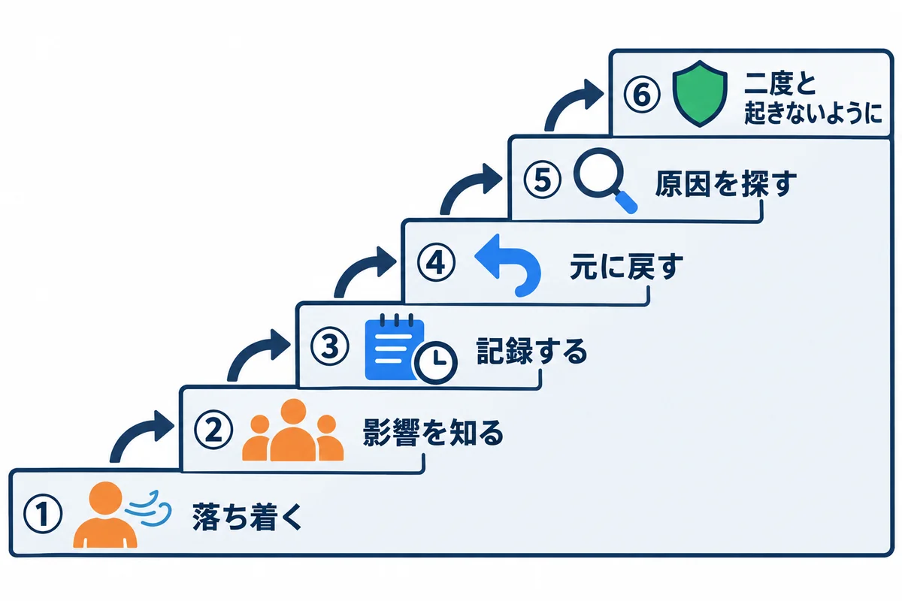
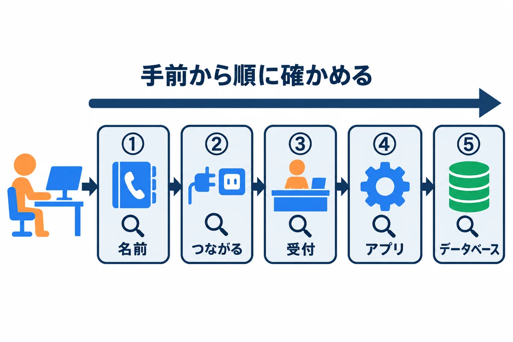
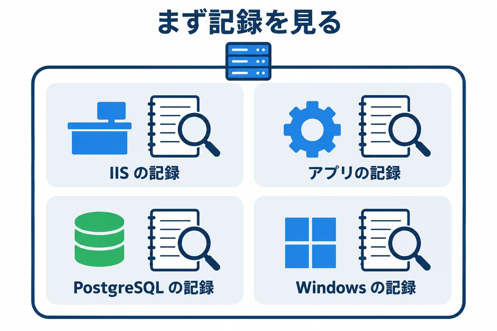
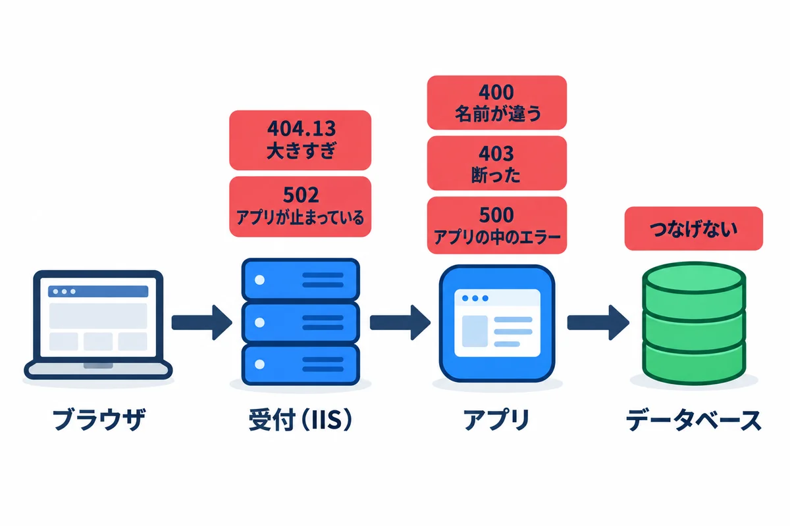
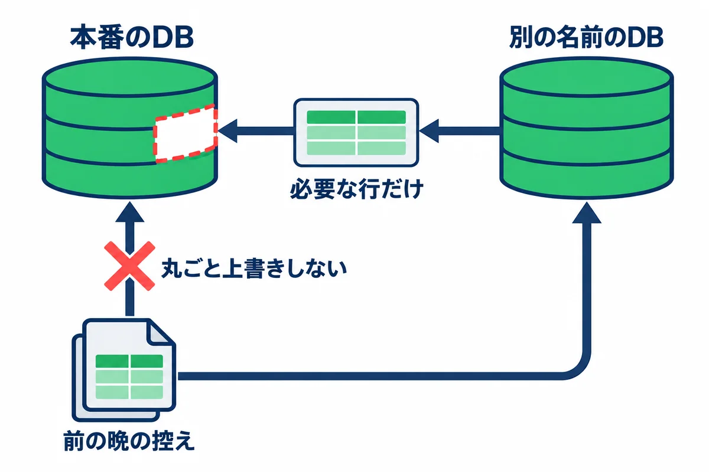
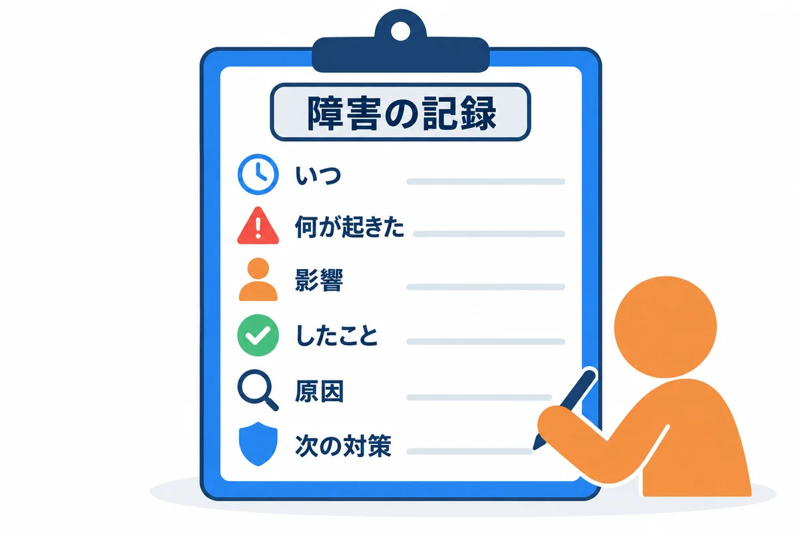

<div style="text-align: center; padding: 28px 0 8px;">
<div style="font-size: 14px; color: #475569;">オンプレミス構築 教育資料</div>
<div style="font-size: 26px; font-weight: 800; color: #0f172a; margin-top: 6px; line-height: 1.35;">トラブルシューティング</div>
<div style="font-size: 13px; color: #475569; margin-top: 8px;">困ったときの動き方・調べ方と、よく起きるトラブルの症状・原因・直し方</div>
</div>

# トラブルシューティング

## この資料について

「画面が開かない」「遅い」「メールが届かない」と言われたときに、**落ち着いて、順番に調べて、直す**ための資料です。

- **1〜4 章**は、どのトラブルでも同じ「動き方」と「調べ方」です。最初に読んでおきます。
- **5 章**は、症状ごとの詳しい説明です。困ったときに、目次から症状を探して読みます。
- 個別の手順書にも、それぞれの範囲のトラブル表があります（01 の 1.8・14 章、02 の 14 章、04 の 15 章、05 の 15 章）。この資料は、それらをつなぐ「入口」です。

## 1. トラブルのときの動き方

<div style="max-width: 760px; margin: 18px auto; text-align: center;">

<div style="font-size: 12px; color: #64748b; margin-top: 6px;">図1-1: トラブルのときは、この順に上る</div>
</div>

| 順 | すること | 具体的には |
|---|---|---|
| ① | **落ち着く** | 慌てて設定を次々に変えると、何が効いたか分からなくなり、かえって壊す。まず 1 分、状況を見る |
| ② | **影響を知る** | 全員か、一部の人か。本番か、検証か。いつからか。何ができないのか（全部か、一部の画面か） |
| ③ | **記録する** | 気付いた時刻、症状、エラーの文（画面の写し）、自分がしたことを、時刻付きでメモする（6 章の形） |
| ④ | **元に戻す** | 直前に更新・設定の変更をしていたら、**まず元に戻す**（切り戻し。04 の 13.4・05 の 13.3）。原因を探すのは、使える状態に戻してから |
| ⑤ | **原因を探す** | 2〜4 章の順で調べる |
| ⑥ | **二度と起きないように** | 手順書・点検・監視を直す。同じ失敗をしないための仕組みにする |

> **大事な考え方:** トラブルの多くは、**直前に何かを変えた**ことがきっかけです。「最後に何を変えたか」（更新・設定・Windows Update・パスワードの変更・ディスクの拡張など）を、最初に思い出します。

**連絡の目安:**

| こんなとき | 連絡する相手 |
|---|---|
| 本番が使えず、15 分で直る見込みが無い | 利用者（社員）に「使えない・いつ頃直るか未定」を知らせる。上司にも知らせる |
| サーバーが落ちた・つながらない（リモート デスクトップも入れない） | 情報システム部門（仮想マシンの基盤の確認） |
| ネットワーク・DNS・メールの道（コネクタ）が原因らしい | 情報システム部門 |
| データが消えた・おかしい | 上司。勝手に戻さず、どこまで戻すかを決めてもらう（5.12） |

## 2. 切り分け: 手前から順に確かめる

<div style="max-width: 760px; margin: 18px auto; text-align: center;">

<div style="font-size: 12px; color: #64748b; margin-top: 6px;">図2-1: 社員のパソコンからデータベースまで、手前から順に確かめる</div>
</div>

お願いは、**社員のパソコン → 名前（DNS）→ ネットワーク → 受付（IIS）→ アプリ → データベース** の順に進みます（00 基礎知識 4.6）。どこで止まっているかを、**手前から順に**確かめると、早く原因にたどり着けます。

| 順 | 確かめること | どこで打つか | コマンド | 正しいとき |
|---|---|---|---|---|
| ① | 名前が引けるか | 社員のパソコン | `Resolve-DnsName webapp.example.local` | サーバーの IP アドレスが出る |
| ② | 80 番につながるか | 社員のパソコン | `Test-NetConnection webapp.example.local -Port 80` | `TcpTestSucceeded : True` |
| ③ | 受付（IIS）が返事をするか | サーバー | `Invoke-WebRequest http://127.0.0.1/health -UseBasicParsing -Headers @{ Host = "webapp.example.local" }` | `StatusCode` が `200` |
| ④ | アプリが返事をするか | サーバー | `Invoke-WebRequest http://127.0.0.1:8080/health -UseBasicParsing -Headers @{ Host = "webapp.example.local" }` | `StatusCode` が `200` |
| ⑤ | データベースにつながるか | サーバー | `psql -h 127.0.0.1 -U webapp_prod_app -d webapp_prod -c "SELECT 1;"` | `1` が出る |

- ③ が NG で ④ が OK なら、**受付（IIS）**の問題。④ も NG なら、**アプリ**の問題。
- ① が NG なら、サーバーではなく**名前（DNS）**の問題。② だけ NG なら、**ネットワークの関所**の問題（情報システム部門）。
- `-Headers @{ Host = ... }` を付けるのは、社員のブラウザと同じ名前でお願いするためです（Django 版は、付けないと 400 になる。05 の 8.4）。

### 2.1 まとめて確かめるスクリプト

①〜⑤ のうち、サーバーの中で確かめられる物と、ディスクとバックアップを、まとめて確かめるスクリプトです。`D:\webapp\tools\check.ps1` に置いておき、**毎朝の点検と、トラブルのときの最初の一手**に使います。

```powershell
# D:\webapp\tools\check.ps1（必ず「UTF-8 (BOM 付き)」で保存する）
# 受付からデータベースまでを順に確かめて、OK / NG を表示する
# 使い方: .\check.ps1          （本番）
#         .\check.ps1 -Env stg （検証）
param(
    [ValidateSet("prod", "stg")] [string] $Env = "prod"
)

$targets = @{
    prod = @{ Name = "webapp.example.local";     Port = 8080; Service = "webapp-prod" }
    stg  = @{ Name = "webapp-stg.example.local"; Port = 8081; Service = "webapp-stg" }
}
$t = $targets[$Env]

function Show-Result($label, $ok, $detail) {
    $mark = if ($ok) { "OK" } else { "NG" }
    "{0}  {1}  {2}" -f $mark, $label, $detail
}

# 1. サービスが動いているか
foreach ($svc in @("postgresql-x64-18", "W3SVC", $t.Service)) {
    $s = Get-Service -Name $svc -ErrorAction SilentlyContinue
    $detail = if ($s) { $s.Status } else { "登録されていない" }
    Show-Result "サービス $svc" ($s -and $s.Status -eq "Running") $detail
}

# 2. ポートで待ち受けているか
foreach ($port in @(80, $t.Port, 5432)) {
    $l = Get-NetTCPConnection -State Listen -LocalPort $port -ErrorAction SilentlyContinue
    Show-Result "待ち受け $port" ([bool]$l) ((@($l.LocalAddress) | Sort-Object -Unique) -join ",")
}

# 3. アプリに直接聞く（IIS を通さない）
try {
    $r = Invoke-WebRequest "http://127.0.0.1:$($t.Port)/health" -UseBasicParsing -TimeoutSec 10 -Headers @{ Host = $t.Name }
    Show-Result "アプリ /health" ($r.StatusCode -eq 200) $r.StatusCode
} catch {
    Show-Result "アプリ /health" $false $_.Exception.Message
}

# 4. IIS を通して聞く（社員と同じ道）
try {
    $r = Invoke-WebRequest "http://127.0.0.1/health" -UseBasicParsing -TimeoutSec 10 -Headers @{ Host = $t.Name }
    Show-Result "IIS 経由 /health" ($r.StatusCode -eq 200) $r.StatusCode
} catch {
    Show-Result "IIS 経由 /health" $false $_.Exception.Message
}

# 5. ディスクの空き（2 割を切ったら NG）
foreach ($v in Get-Volume | Where-Object { $_.DriveLetter -in "C", "D" }) {
    $free = [int](100 * $v.SizeRemaining / $v.Size)
    Show-Result "ディスク $($v.DriveLetter): の空き" ($free -ge 20) "$free %"
}

# 6. 最後のデータベースの控えが、26 時間以内か
$last = Get-ChildItem D:\webapp\backup\db -Filter "webapp_prod_*.dump" -ErrorAction SilentlyContinue |
    Sort-Object LastWriteTime -Descending | Select-Object -First 1
$detail = if ($last) { $last.LastWriteTime.ToString("yyyy-MM-dd HH:mm") } else { "無い" }
Show-Result "最後の DB の控え" ($last -and $last.LastWriteTime -gt (Get-Date).AddHours(-26)) $detail
```

<!-- first-use -->

> **▶ ここで初めて出てくるコード**
>
> - **`function`**（PowerShell）: PowerShell で、自分の関数を作る書き方。`function New-LfFile($Path, $Lines) { … }` と書くと、`New-LfFile` をコマンドのように呼べます。
> - **`else`**（PowerShell）: `if (条件) { … } else { … }` の、条件に合わなかった時の所。`elseif (条件)` で、条件をつなげられます。
> - **`Get-Service -ErrorAction`**（PowerShell）: `Get-Service` で、エラーが起きた時の動きを決めるオプション。`-ErrorAction SilentlyContinue` は「そのサービスが無くても、赤いエラーを出さずに進む」。
> - **`-and`**（PowerShell）: 「かつ」（両方とも `True` の時だけ `True`）。`$a -gt 0 -and $b -gt 0` のように、条件をつなぎます。
> - **`Get-NetTCPConnection -ErrorAction`**（PowerShell）: エラーが起きた時の動きを決めるオプション。待ち受けが無い時に出るエラーを、`-ErrorAction SilentlyContinue` で黙らせます。
> - **`Sort-Object -Unique`**（PowerShell）: 並べかえたうえで、同じ物を 1 つにまとめるオプション。
> - **`Invoke-WebRequest -TimeoutSec`**（PowerShell）: 答えを待つ時間の上限（秒）を決めるオプション。過ぎたらエラーにして、いつまでも止まらないようにします。
> - **`-gt`**（PowerShell）: PowerShell の「より大きい」の比べ方（greater than）。`$failed -gt 0` は「失敗が 1 つ以上あるか」。

<!-- /first-use -->

```powershell
# 管理者の PowerShell で
cd D:\webapp\tools
.\check.ps1            # 本番
.\check.ps1 -Env stg   # 検証
```

<!-- first-use -->

> **▶ ここで初めて出てくるコード**
>
> - **`.\check.ps1`**（PowerShell）: 今いるフォルダの `check.ps1`（この資料で作る、サービス・待ち受け・応答・控えなどを、まとめて確かめるスクリプト）を動かす書き方。

<!-- /first-use -->

**確かめること:** 全部の行の頭が `OK` であること。`NG` の行があれば、その行の項目から 5 章の症状を探します。

| NG の行 | 読み方 |
|---|---|
| `サービス ...` | そのサービスが止まっている（5.2・5.9） |
| `待ち受け 80` | IIS が止まっている。`待ち受け 8080` ならアプリ、`5432` なら PostgreSQL |
| `待ち受け` の右に `0.0.0.0` や `::` | 外からも待ち受けている。アプリと PostgreSQL は `127.0.0.1`（と `::1`）だけのはず（04 の 5.3・7.3） |
| `アプリ /health` | アプリが返事をしない（5.2） |
| `IIS 経由 /health` だけ NG | 受付（IIS）の設定・サイトの停止（5.2・5.3） |
| `ディスク ... の空き` | 5.10 |
| `最後の DB の控え` | 毎晩のバックアップが動いていない（5.11） |

> **このスクリプトも「UTF-8 (BOM 付き)」で保存します**（01 の 3.7）。試した環境で、Windows PowerShell 5.1 で動くことを確かめました。

## 3. 記録（ログ）を見る

<div style="max-width: 760px; margin: 18px auto; text-align: center;">

<div style="font-size: 12px; color: #64748b; margin-top: 6px;">図3-1: 記録は 4 か所にある。まず記録を見る</div>
</div>

| 記録 | 場所 | 何が分かるか |
|---|---|---|
| IIS のアクセスログ | `C:\inetpub\logs\LogFiles\W3SVC（サイトの番号）\u_ex（日付）.log` | だれ（どの IP）が、いつ、どの URL を開き、何番（ステータスコード）が返ったか |
| アプリのログ | `D:\webapp\prod\logs\webapp-prod-service.*.log` | アプリの中のエラー。起動・停止の記録（`wrapper.log`） |
| PostgreSQL のログ | `D:\pgsql\18\data\log\` | データベースのエラー、つなげなかった記録 |
| Windows のイベント ログ | イベント ビューアー（01 の 7 章） | サービスの停止、再起動、Windows Update、ディスクのエラー |

### 3.1 IIS のアクセスログの読み方

1 行が 1 回のお願いです。先頭の `#Fields:` の行に、列の名前が書いてあります。

| 列 | 意味 |
|---|---|
| `date`・`time` | 日時。**世界標準時（UTC）で書かれる**ので、日本時間は **9 時間足す** |
| `cs-method`・`cs-uri-stem` | お願いの種類（GET・POST）と URL |
| `c-ip` | 社員のパソコンの IP アドレス |
| `sc-status`・`sc-substatus` | ステータスコードと、その細かい番号（例：`404` と `13` で 404.13） |
| `sc-win32-status` | Windows の中の番号（例：`12029` は「アプリにつなげなかった」） |
| `time-taken` | 返事までにかかった時間（ミリ秒） |

```powershell
# 今日のログで、500 番台（サーバー側のエラー）の行だけを見る
$log = Get-ChildItem C:\inetpub\logs\LogFiles\W3SVC* -Filter *.log | Sort-Object LastWriteTime | Select-Object -Last 1
Select-String -Path $log.FullName -Pattern " 5\d\d \d+ \d+ \d+$" | Select-Object -Last 20

# 時間がかかった（5 秒以上）お願い
Get-Content $log.FullName | Where-Object { $_ -notmatch "^#" } |
    Where-Object { [int]($_ -split " ")[-1] -ge 5000 } | Select-Object -Last 20
```

<!-- first-use -->

> **▶ ここで初めて出てくるコード**
>
> - **`-notmatch`**（PowerShell）: `-match` の逆で、正規表現に合わないかの比べ方。`$line -notmatch '='` は「`=` を含まない行か」。
> - **`-split`**（PowerShell）: 文字列を、区切り（正規表現）で分けて並びにする演算子。`"a=b" -split '=', 2` は `"a"` と `"b"`（`2` は「多くても 2 つに分ける」）。

<!-- /first-use -->

### 3.2 アプリのログ・PostgreSQL のログ

```powershell
# アプリのエラーの文の最後の 50 行
Get-Content D:\webapp\prod\logs\webapp-prod-service.err.log -Tail 50

# PostgreSQL の、いちばん新しいログの中の ERROR・FATAL
$pg = Get-ChildItem D:\pgsql\18\data\log | Sort-Object LastWriteTime | Select-Object -Last 1
Select-String -Path $pg.FullName -Pattern "ERROR|FATAL|PANIC" | Select-Object -Last 20
```

> **PostgreSQL のログが化けて読めないときは、** `lc_messages = 'C'` になっているかを確かめます（04 の 5.3）。

## 4. エラーの番号と、どこで出るか

<div style="max-width: 760px; margin: 18px auto; text-align: center;">

<div style="font-size: 12px; color: #64748b; margin-top: 6px;">図4-1: エラーの番号で、どこで止まったかの見当が付く</div>
</div>

| 番号 | だれが返すか | よくある原因 | 詳しく |
|---|---|---|---|
| ブラウザに「このサイトにアクセスできません」 | （返事が無い） | 名前が引けない・80 番に届かない・IIS が止まっている | 5.1 |
| `400 Bad Request` | アプリ（Django） | 名前（Host）が `ALLOWED_HOSTS` に無い／本文が大きすぎ | 5.4 |
| `Bad Request - Invalid Hostname`（400） | IIS（Windows の http.sys） | 開いた名前に合う IIS のサイトが無い（バインドの名前の打ち間違い・DNS の名前とずれている） | 5.3 |
| `403 Forbidden` | アプリ | CSRF の札が無い・送り元が違う（Topcoat・Django とも）／権限が無い | 5.5 |
| `404 Not Found` | IIS またはアプリ | URL の打ち間違い／名前に合う IIS のサイトが無い | 5.3 |
| `404.13` | IIS | 送った物が IIS の上限（`maxAllowedContentLength`）より大きい | 5.4 |
| `500 Internal Server Error` | アプリ | アプリの中のエラー（データベースにつなげない、など） | 5.6 |
| `502 Bad Gateway`（IIS のログでは `502` と `3`） | IIS（ARR） | アプリが止まっている・起動中・待ち時間を超えた | 5.2 |
| `503 Service Unavailable` | IIS | IIS のサイト・アプリケーション プールが止まっている | 5.3 |

## 5. 症状別の詳しい説明

### 5.1 画面が開かない（「このサイトにアクセスできません」）

**よくある原因（多い順）:** ① サーバーが再起動中・止まっている ② IIS（W3SVC）が止まっている ③ 名前（DNS）が引けない ④ ネットワークの関所で止められている ⑤ URL の打ち間違い（`https://` で開いている）

**調べ方:**

1. **一部の人だけか、全員か**を確かめます。一部の人だけなら、その人のパソコン（プロキシの設定・打ち間違い）を疑います。
2. その人のパソコンで、2 章の ① と ② を打ちます。
3. ② が NG なら、サーバーにリモート デスクトップで入れるか試します。入れなければ、サーバーごと止まっています（情報システム部門）。
4. 入れたら、`check.ps1` を動かします。

**直し方:**

| 原因 | 直し方 |
|---|---|
| IIS が止まっている | `Start-Service W3SVC`。止まった理由を、イベント ログ（システム）で見る |
| `https://` で開いている | `http://webapp.example.local/` を案内する。ブラウザが自動で `https://` に変えるときは、ブックマークを `http://` で作り直す |
| 名前が引けない | 情報システム部門に、DNS の登録を確かめてもらう |
| ② だけ NG | サーバーの関所（`Get-NetFirewallRule -DisplayName "webapp*"`。01 の 10 章）を確かめ、正しければネットワークの関所（情報システム部門） |

### 5.2 502 Bad Gateway

IIS は動いていて、**その奥のアプリが返事をしない**ときに出ます。

**調べ方:**

```powershell
Get-Service webapp-prod
Get-Content D:\webapp\prod\logs\webapp-prod-service.wrapper.log -Tail 20
Get-Content D:\webapp\prod\logs\webapp-prod-service.err.log -Tail 50
```

**よくある原因と直し方:**

| 原因 | 見分け方 | 直し方 |
|---|---|---|
| アプリのサービスが止まっている | `Get-Service` が `Stopped` | `Start-Service webapp-prod`。すぐ止まるなら 5.9 |
| アプリが起動しては落ちるのを繰り返している | `wrapper.log` に起動と終了が何度も並ぶ | `err.log` の最後のエラーを読む（データベースにつなげない・設定の書き間違い） |
| アプリの中で時間がかかりすぎた | IIS のログの `time-taken` が大きく、`sc-win32-status` が `12002` | 重い処理（大きな図面・大量の検索）を調べる。5.7 |
| 再起動の直後 | 1〜2 分で直る | 待つ。毎回なら、`/health` が `200` になるまでの時間を測っておく |

### 5.3 404・503（IIS のサイトの問題）

| 症状 | 原因 | 直し方 |
|---|---|---|
| どの URL を開いても `Bad Request - Invalid Hostname` | 開いた名前に合うサイトが無い（バインドのホスト名の打ち間違い、または DNS の名前とバインドの名前が違う） | IIS マネージャーで、サイトの「バインド」のホスト名を確かめる（04 の 8.4） |
| 503 | サイトのアプリケーション プールが止まっている | IIS マネージャー →「アプリケーション プール」で、止まっている物を「開始」。止まった理由をイベント ログ（システム、「WAS」）で見る |
| IIS の 500.19 | `web.config` の書き間違い・URL Rewrite が入っていない | エラーの画面の「構成ソース」の行を見て直す（04 の 8.5） |

### 5.4 400 Bad Request・404.13（大きさと名前）

| 症状 | 原因 | 直し方 |
|---|---|---|
| Django 版で、どの画面も `Bad Request (400)` | 名前（Host）が `ALLOWED_HOSTS` に無い。IIS が名前を書きかえている（`preserveHostHeader` が `false`） | 04 の 8.3 で `true` にする。`DJANGO_ALLOWED_HOSTS` の名前を確かめる |
| 大きな図面の保存だけ 400 | 本文がアプリの上限を超えた（Django は `DATA_UPLOAD_MAX_MEMORY_SIZE`） | 上限と、実際の大きさを確かめる（05 の 6.3） |
| 大きな添付の保存で 404.13 | IIS の上限（`maxAllowedContentLength`）を超えた | 04 の 8.5 の値を確かめる |

### 5.5 403 Forbidden（ボタンを押すと断られる）

| 症状 | 原因 | 直し方 |
|---|---|---|
| ログイン・保存のボタンだけ 403。画面は開ける | **CSRF の確かめに失敗**。IIS が名前を書きかえて、送り元（`Origin`）とアプリの見た名前（`Host`）が食い違っている | 04 の 8.3（`preserveHostHeader=true`）。直したら IIS を再起動する（`iisreset`） |
| Django 版で 403、ログに `CSRF token missing` | 画面が札（`X-CSRFToken`）を付けていない／`csrftoken` のクッキーが無い | 05 の 8.2。開発者ツールで、クッキーと付け札を見る |
| 特定の人だけ 403 | その人に権限が無い（アプリの権限の設定） | アプリの権限の画面で確かめる |

### 5.6 500 Internal Server Error・ログインできない

| 症状 | 原因 | 直し方 |
|---|---|---|
| どの画面も 500 | アプリがデータベースにつなげない（PostgreSQL が止まっている・パスワードの変更） | `Get-Service postgresql-x64-18`。アプリのログのエラーを読む |
| ログインしても、すぐログインしていない扱いになる | セッションのクッキーに `Secure` が付いていて、HTTP では受け取られない | 04 の 6.4（Topcoat）・05 の 8.1（Django）。開発者ツールの「アプリケーション」→「Cookie」で、クッキーがあるか見る |
| 60 分たっていないのにログアウトされる | サーバーの再起動・アプリの再起動で、セッションが消える作り（設計による）／時刻のずれ | 再起動の時刻と合うか見る。`w32tm /query /status` |
| パスワードを忘れた | — | アプリの管理者が、アプリの画面で再設定する。管理者自身なら、04 の 7.7 のコマンド（Topcoat）・`.\manage.ps1 changepassword 名前`（Django） |

### 5.7 遅い

**まず「何が」遅いかをはっきりさせます。** 全部の画面か、特定の画面か。いつも遅いか、特定の時間だけか。

| 見る所 | コマンド・道具 | 読み方 |
|---|---|---|
| サーバー全体 | タスク マネージャー・01 の 8 章のコマンド | CPU・メモリ・ディスクのどれかが張り付いていないか |
| 遅いお願い | 3.1 の「時間がかかった」コマンド | どの URL が遅いか |
| データベース | 02 の 12 章の「5 分以上かかっている SQL」 | 重い SQL・`idle in transaction` |
| 時間帯 | IIS のログの時刻（**UTC なので 9 時間足す**） | 毎晩 2:00（バックアップ）や毎朝 8:00（定期処理）と重なっていないか |

**よくある原因と直し方:**

| 原因 | 直し方 |
|---|---|
| メモリが足りない（空きが 1 割を切る） | 情報システム部門に増設を頼む（04 の 2.2 の目安を見直す） |
| ディスクの空きが少ない・遅い | 5.10 |
| 特定の検索だけ遅い | 索引（02 の 4.5）を、アプリの作者と相談する |
| 検証で重い試験をしている | 本番と同居しているので、本番も遅くなる（03 の 9 章）。時間をずらす |
| ウイルス対策ソフトが、データベースやログのフォルダを毎回調べている | 情報システム部門に、`D:\pgsql\18\data` などを調べる対象から外せるか相談する（会社の決まりに従う） |

### 5.8 メールが届かない

**送ったのか、送れなかったのか、届いて迷惑メールに入ったのか**を分けます。

1. アプリのログに、送った記録・エラーがあるか。
2. サーバーから、Microsoft 365 の 25 番につながるか: `Test-NetConnection example-com.mail.protection.outlook.com -Port 25`。
3. アプリを使わずに送れるか（04 の 10.3）。
4. 受け取る人の「迷惑メール」のフォルダに入っていないか。

| 結果 | 原因 | 直し方 |
|---|---|---|
| 2 が `False` | 25 番が、ネットワークの関所で止められている | 情報システム部門 |
| 3 で `550 5.7.64 ... Relay Access Denied` | コネクタが無い・会社の出口の IP がコネクタと違う | 情報システム部門（04 の 10.1） |
| 3 は届くが、アプリからは届かない | アプリのメールの設定（宛先・送り主・TLS）の誤り | アプリのログのエラーを読む。Django 版は `.\manage.ps1 sendtestemail 自分のアドレス` |
| 迷惑メールに入る | SPF に、出口の IP が書かれていない | 情報システム部門 |
| 検証から社員にメールが届いた | 検証の宛先の書きかえ（04 の 10.4）が効いていない | すぐ検証のサービスを止め、社員に「検証からの誤送信」と知らせる。設定を直す |

### 5.9 サービスが起動しない（再起動の後など）

```powershell
# どのサービスが止まっているか（自動のはずなのに止まっている物）
Get-CimInstance Win32_Service | Where-Object { $_.StartMode -eq "Auto" -and $_.State -ne "Running" } |
    Select-Object Name, State, StartName

# サービスの起動の失敗の記録（01 の 7.2）
Get-WinEvent -FilterHashtable @{
    LogName = 'System'; Id = 7000, 7009, 7031, 7034, 7038, 7041; StartTime = (Get-Date).AddDays(-1)
} -ErrorAction SilentlyContinue |
    Select-Object TimeCreated, Id, Message | Format-List
```

| 原因 | 見分け方 | 直し方 |
|---|---|---|
| PostgreSQL より先にアプリが起動した | アプリの `err.log` に「つなげない」、少しして直る | WinSW の XML の `<depend>postgresql-x64-18</depend>` を確かめる |
| 設定ファイル（XML）の書き間違い | `wrapper.log` にエラー | XML を見直す（`<` `>` の閉じ忘れ、`&` は `&amp;` と書く） |
| 許可が足りない | `err.log` に `Access is denied`・`PermissionError` | 04 の 7.4・05 の 9.3 の `icacls` |
| ポートが使われている | `err.log` に「すでに使われている」・`address already in use` | `Get-NetTCPConnection -LocalPort 8080` で使っているプログラムを探す |
| Windows Update で部品が変わった | 更新の直後から | イベント ログ。どうしても直らなければ、更新を戻せるか情報システム部門に相談 |

### 5.10 ディスクがいっぱい

**放っておくと、データベースもアプリも止まります。** 空きが 2 割を切ったら対応します。

```powershell
# どのフォルダが大きいか（D ドライブの 1 段目）
Get-ChildItem D:\ -Directory | ForEach-Object {
    $size = (Get-ChildItem $_.FullName -Recurse -File -ErrorAction SilentlyContinue | Measure-Object Length -Sum).Sum
    [pscustomobject]@{ Folder = $_.FullName; GB = [math]::Round($size / 1GB, 2) }
} | Sort-Object GB -Descending
```

<!-- first-use -->

> **▶ ここで初めて出てくるコード**
>
> - **`Get-ChildItem -Directory`**（PowerShell）: `-Directory` で、フォルダだけを一覧にします（ファイルだけなら `-File`）。
> - **`ForEach-Object`**（PowerShell）: `|` で流れてきた物を、1 つずつ処理するコマンド。`{ }` の中の `$_` が「今の 1 つ」を表します。`… | ForEach-Object { $_.Name }` は、1 つずつ名前を取り出します。
> - **`Measure-Object`**（PowerShell）: 受け取った物の数や、合計・平均などを計算するコマンド。
> - **`Measure-Object -Sum`**（PowerShell）: 決めた項目の合計を計算するオプション。`Measure-Object Length -Sum` は、ファイルの大きさの合計（`.Sum` で取り出す）。

<!-- /first-use -->

| よくある原因 | 直し方 |
|---|---|
| バックアップの古い物が消えていない | `backup.ps1` の「古い控えを消す」が動いているか（記録の `OK:`）。BOM の問題（5.11）も疑う |
| IIS のログがたまっている | 04 の 12.2 の「古いログを消す」タスクが動いているか |
| PostgreSQL のログがたまっている | `D:\pgsql\18\data\log` の古い物を消す。`postgresql.conf` の `log_rotation_age` などを見直す |
| データそのものが増えた | 00 基礎知識 0.2 の見積もりを見直し、情報システム部門にディスクの拡張を頼む |

> **データベースのフォルダ（`D:\pgsql\18\data`）の中のファイルを、手で消してはいけません。** データベースが壊れます。

### 5.11 毎晩のバックアップが失敗している

```powershell
Get-ScheduledTask -TaskPath "\webapp\" | Get-ScheduledTaskInfo | Select-Object TaskName, LastRunTime, LastTaskResult
Get-ChildItem D:\webapp\backup\logs | Sort-Object LastWriteTime | Select-Object -Last 3
```

| 結果 | 原因 | 直し方 |
|---|---|---|
| `LastTaskResult` が `1` で、`backup\logs` に記録が無い | `backup.ps1` を **BOM 無し**で保存した（構文エラーで動かない） | 「UTF-8 (BOM 付き)」で保存し直す（04 の 11.3） |
| 記録に `NG: pg_dump が失敗しました` | パスワードのファイル（pgpass）の誤り・PostgreSQL が止まっていた | 04 の 11.2。手で `backup.ps1` を動かして確かめる |
| 記録に `robocopy（別の場所…）が失敗` | 会社のファイルサーバーに書けない（`SYSTEM` の許可・ネットワーク） | 情報システム部門。別の場所に書けないと、サーバーが壊れたときに控えも失う |
| `LastRunTime` が古い | タスクが無効・サーバーが止まっていた | タスク スケジューラで「有効」か確かめる |

### 5.12 データがおかしい・間違えて消した

<div style="max-width: 760px; margin: 18px auto; text-align: center;">

<div style="font-size: 12px; color: #64748b; margin-top: 6px;">図5-1: 控えは別の名前のデータベースに戻し、必要な行だけを取り出す</div>
</div>

1. **すぐに上司に知らせ、どこまで戻すかを決めてもらいます。** 本番のデータベースを控えで丸ごと上書きすると、**控えを取った後に社員が入れたデータ**も消えます。
2. 前の晩の控えを、**別の名前のデータベース**に戻します（02 の 11.2、04 の 11.5）。
3. 別のデータベースで、消えた行・正しい値を `SELECT` で確かめます。
4. 必要な行だけを、本番に戻します。SQL は**検証で試してから**、`BEGIN` の中で行います（02 の 7 章）。
5. 終わったら、別のデータベースを消します。

### 5.13 時刻がずれる・毎朝 8:00 の処理が動かない

| 症状 | 原因 | 直し方 |
|---|---|---|
| ログ・承認の時刻が数分ずれる | 時刻の合わせ先の不調 | `w32tm /query /status` の「ソース」。情報システム部門に確かめる |
| ログの時刻が 9 時間ずれる | IIS のログは UTC（3.1）／アプリかデータベースの時間帯の設定 | IIS は仕様。PostgreSQL は `timezone`・`log_timezone`（04 の 5.3） |
| 8:00 の処理が動いていない | その時刻にアプリ（Topcoat 版）が止まっていた・タスク（Django 版）が失敗 | Topcoat 版は 04 の 12.1 の設計例。Django 版は `Get-ScheduledTaskInfo` |

### 5.14 文字化け

| どこで | 原因 | 直し方 |
|---|---|---|
| 取り込んだ社員の名前（CSV） | Excel の「CSV（コンマ区切り）」は Shift_JIS | 「CSV UTF-8（コンマ区切り）」で保存し直す（00 基礎知識 0.4） |
| PostgreSQL のログ | 日本語のメッセージで、UTF-8 と Shift_JIS が混ざる | `lc_messages = 'C'`（04 の 5.3） |
| psql の画面 | 画面と psql の文字コードの食い違い | 02 の 14 章 |
| PowerShell のスクリプトが変な所でエラー | BOM 無しの UTF-8 | 「UTF-8 (BOM 付き)」で保存し直す（01 の 3.7） |

## 6. 障害の記録の書き方

<div style="max-width: 760px; margin: 18px auto; text-align: center;">

<div style="font-size: 12px; color: #64748b; margin-top: 6px;">図6-1: 障害の記録は、6 つの見出しで書く</div>
</div>

トラブルが終わったら、次の形で記録を残します。**同じトラブルが起きたときに、次の人が早く直せる**ようにするためです。

```text
件名: 【障害】本番で 502 が出て、使えなかった（2026-11-05 09:12〜09:40）

1. いつ
   - 09:12 社員から「画面が開かない」と連絡
   - 09:15 自分が確認を始めた
   - 09:40 直った（使えるようになった）

2. 何が起きた
   - 本番の画面を開くと「502 Bad Gateway」
   - check.ps1 で「サービス webapp-prod」が NG（Stopped）

3. 影響
   - 本番を使う全員が、28 分間使えなかった
   - データの消失は無し（ログで確かめた）

4. したこと（時刻つき）
   - 09:18 webapp-prod-service.err.log に「データベースにつなげない」を見つけた
   - 09:25 PostgreSQL のサービスが止まっていた。イベント ログで、09:05 の Windows Update の再起動の後に起動に失敗していた
   - 09:30 Start-Service postgresql-x64-18、09:35 Start-Service webapp-prod
   - 09:40 check.ps1 で全部 OK、社員に連絡

5. 原因
   - Windows Update の再起動の後、PostgreSQL の起動が遅れ、アプリが先に起動して止まった

6. 次の対策
   - WinSW の XML に <depend>postgresql-x64-18</depend> があるか確かめる（無かったので足した）
   - Windows Update の再起動の時間を、情報システム部門と決め直す
```

> この例は、書き方を示すための**作り話**です。

## 7. 問い合わせる前に集める物

情報システム部門や、アプリの作者に聞く前に、次をそろえると話が早くなります。

| 集める物 | 例 |
|---|---|
| いつから・どのくらいの人が | 「09:12 から、本番を使う全員」 |
| 開いた URL と、出た画面 | 画面の写し（エラーの番号が見えるように） |
| 2 章の ①〜⑤ の結果 | 「① OK、② False」 |
| `check.ps1` の結果 | 全部の行 |
| 関係するログの、その時刻の前後 | IIS のログ（UTC に注意）・アプリのログ |
| 最後に変えたこと | 「昨日の夜に Windows Update」「今朝 1.1.0 に更新」 |

> **パスワードや、社員の個人情報が写ったログを、そのままメールやチャットに貼らないでください。** 必要な行だけにして、パスワードなどは消してから渡します。

## 用語の索引

| 用語 | 短い説明 | 章 |
|---|---|---|
| 502・`sc-win32-status` 12029 | IIS の奥のアプリにつなげなかった | 4・5.2 |
| 404.13 | IIS の大きさの上限を超えた | 4・5.4 |
| check.ps1 | 受付からデータベースまで、まとめて確かめるスクリプト | 2.1 |
| UTC | 世界標準時。日本時間は 9 時間足す | 3.1 |
| 切り分け | どこで止まっているかを、順に確かめて絞り込むこと | 2 |
| 切り戻し | 前の版・前の設定に戻すこと | 1 |
| 障害の記録 | トラブルの経緯と対策を残す文書 | 6 |
