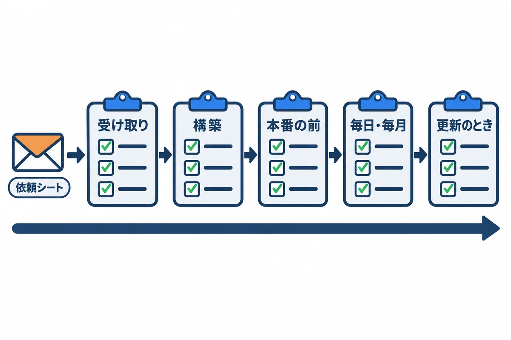

<div style="text-align: center; padding: 28px 0 8px;">
<div style="font-size: 14px; color: #475569;">オンプレミス構築 教育資料</div>
<div style="font-size: 26px; font-weight: 800; color: #0f172a; margin-top: 6px; line-height: 1.35;">付録 — 依頼シートとチェック表</div>
<div style="font-size: 13px; color: #475569; margin-top: 8px;">情報システム部門への依頼の文面と、場面ごとに使うチェック表</div>
</div>

# 付録: 依頼シートとチェック表

## この資料について

構築と運用の場面ごとに、**そのまま写して使える**文面と表をまとめました。`（ ）` の所は、自分の会社の値に書きかえます。

<div style="max-width: 760px; margin: 18px auto; text-align: center;">

<div style="font-size: 12px; color: #64748b; margin-top: 6px;">図1: 依頼シートと、場面ごとのチェック表</div>
</div>

| 章 | 使う場面 |
|---|---|
| 1 | 情報システム部門に、サーバーなどを頼むとき |
| 2 | サーバーを受け取ったとき |
| 3 | 構築が終わったとき |
| 4 | 本番を始める前（検証での動作確認） |
| 5 | 毎日・毎月の点検 |
| 6 | 更新（新しい版を入れる）のとき |
| 7 | 年に 1〜2 回（戻す練習・見直し） |

## 1. 情報システム部門への依頼シート

### 1.1 依頼の文面（例）

```text
件名: 社内向け業務 Web アプリ用のサーバーと設定のお願い

情報システム部門 ご担当者様

（部署名）の（名前）です。
社内向けの業務 Web アプリを、会社の仮想マシンで動かしたく、
下の「依頼の内容」の準備をお願いできますでしょうか。

・使う人: 社員（社内のパソコンのブラウザから。社外からは使いません）
・始めたい時期: （年月）
・本番と検証を、同じサーバーに置きます
・通信は HTTP（80 番）です（社内で HTTPS を使えないと伺ったため）

ご不明な点や、会社の決まりと合わない所があれば、ご指摘ください。
よろしくお願いいたします。
```

### 1.2 依頼の内容

| # | 項目 | お願いする内容（例） | 決まった値（情報システム部門に書いてもらう） |
|---|---|---|---|
| 1 | 仮想マシン | Windows Server 2025（デスクトップ エクスペリエンス、日本語）。vCPU 4、メモリ 16GB、C ドライブ 100GB、D ドライブ 200GB（04 の 2.2） | |
| 2 | 名前と住所 | サーバーの名前（例：`WEBAPP-SV01`）、固定の IP アドレス、ドメインへの参加 | 名前: ／ IP: |
| 3 | DNS | `webapp.example.local`（本番）と `webapp-stg.example.local`（検証）を、上のサーバーの IP アドレスに向ける | |
| 4 | ログイン | 自分のアカウント（`（ドメイン）\（名前）`）に、リモート デスクトップでのログインと、構築の間の Administrators の権限 | |
| 5 | 関所（受信） | 社内のネットワーク（`（社内の範囲）`）から、サーバーの **80 番**を通す。管理者のパソコン（`（IP）`）から **3389 番**を通す | |
| 6 | 関所（送信） | サーバーから、Microsoft 365 の受付（`（会社のドメイン）.mail.protection.outlook.com`）の **25 番**を通す。ほかの外向きは不要 | |
| 7 | メール | Microsoft 365 に、会社の出口の公開 IP アドレスで見分けるコネクタを作る。送り主のアドレス（例：`noreply@（会社のドメイン）`）。SPF に出口の IP を足す（04 の 10 章） | 送り主: |
| 8 | 出口の IP | 会社のインターネットの出口の IP アドレスが固定で、ほかの会社と共有していないか | |
| 9 | 控えの置き場所 | 毎晩の控えを写す共有フォルダ（例：`\\（ファイルサーバー）\backup\webapp`）。サーバーのコンピューター アカウント（`（ドメイン）\WEBAPP-SV01$`）に書き込みの許可 | 場所: |
| 10 | Windows Update | 更新の配り方と、再起動してよい時間帯（毎晩 2:00 のバックアップと毎朝 8:00 の処理を避けたい） | 時間帯: |
| 11 | ウイルス対策 | 会社の決まりのソフト。データベースのフォルダ（`D:\pgsql`）を調べる対象から外せるか | |
| 12 | 時刻 | 時刻の合わせ先（ドメインの決まりどおりでよいか） | |
| 13 | 仮想マシンの控え | 仮想マシンごとの控え（バックアップ）の仕組みがあれば、対象に入れてほしい | |
| 14 | 監視 | 会社の監視の仕組みがあれば、`http://webapp.example.local/health` を見てほしい | |

> **9 の「コンピューター アカウント」について:** 毎晩のバックアップは、サーバーの `SYSTEM` のアカウントで動きます。`SYSTEM` がほかのサーバーの共有フォルダに書くときは、**サーバー自身の名前（`WEBAPP-SV01$`）**として書きます。だから、共有フォルダの許可は、この名前に付けてもらいます。

## 2. サーバーを受け取ったときのチェック表

| # | 確かめること | 確かめ方 | 結果 |
|---|---|---|---|
| 1 | リモート デスクトップで入れる | 01 の 1.3 | ☐ |
| 2 | コンピューター名・ドメインが頼んだとおり | `hostname`、サーバー マネージャーの「ローカル サーバー」 | ☐ |
| 3 | OS の版 | `(Get-CimInstance Win32_OperatingSystem).Caption` | ☐ |
| 4 | vCPU・メモリ | `(Get-CimInstance Win32_ComputerSystem).NumberOfLogicalProcessors`、タスク マネージャー | ☐ |
| 5 | C・D ドライブの大きさ | `Get-Volume` | ☐ |
| 6 | 固定の IP アドレス | `Get-NetIPConfiguration` | ☐ |
| 7 | 名前が引ける | 社員のパソコンで `Resolve-DnsName webapp.example.local` | ☐ |
| 8 | 時間帯が日本時間 | `Get-TimeZone`（`Tokyo Standard Time`） | ☐ |
| 9 | 時刻が合っている | `w32tm /query /status` | ☐ |
| 10 | Administrators に入っている | `whoami /groups` | ☐ |
| 11 | ファイアウォールが有効・ドメインのプロファイル | 01 の 10.1 | ☐ |
| 12 | Windows Update が当たっている | `Get-HotFix` | ☐ |

## 3. 構築が終わったときのチェック表

| # | 確かめること | 確かめ方 | 結果 |
|---|---|---|---|
| 1 | PostgreSQL が `127.0.0.1` と `::1` だけで待ち受け | `Get-NetTCPConnection -State Listen -LocalPort 5432` | ☐ |
| 2 | `lc_messages = 'C'`・時間帯が `Asia/Tokyo` | psql で `SHOW lc_messages; SHOW timezone;` | ☐ |
| 3 | 検証のユーザーで本番の DB につなげない | 04 の 5.6 | ☐ |
| 4 | アプリのサービスが仮想アカウントで動いている | `Get-CimInstance Win32_Service -Filter "Name like 'webapp%'"` の `StartName` | ☐ |
| 5 | アプリが `127.0.0.1` だけで待ち受け | `Get-NetTCPConnection -State Listen -LocalPort 8080,8081` | ☐ |
| 6 | パスワードの書かれた XML・pgpass を、ほかの人が読めない | `icacls`（04 の 7.4・11.2） | ☐ |
| 7 | IIS の `preserveHostHeader` が `true` | 04 の 8.3 | ☐ |
| 8 | 社員のパソコンから、本番と検証の両方が開ける | ブラウザ | ☐ |
| 9 | サーバーの関所: 80 は社内から、3389 は管理者のパソコンから、だけ | `Get-NetFirewallRule -DisplayName "webapp*"` | ☐ |
| 10 | 社員のパソコンから、5432・8080・8081 につながらない | `Test-NetConnection webapp.example.local -Port 5432` が `False` | ☐ |
| 11 | テストのメールが受信トレイに届く | 04 の 10.3 | ☐ |
| 12 | 毎晩のバックアップのタスクが成功する | `Start-ScheduledTask` の後、`LastTaskResult` が `0` | ☐ |
| 13 | `.ps1` が全部「UTF-8 (BOM 付き)」 | 01 の 3.7 のコマンドで `239 187 191` | ☐ |
| 14 | 控えから、別の DB に戻せる | 04 の 11.5 | ☐ |
| 15 | `check.ps1` が全部 OK | 06 の 2.1 | ☐ |
| 16 | （Django 版）`check --deploy` が `no issues (4 silenced)`・`DEBUG` が `False` | 05 の 8.3・14 章 | ☐ |

## 4. 本番を始める前のチェック表（検証での動作確認）

検証環境で、実際の使い方に沿って確かめます。

| # | 確かめること | 結果 |
|---|---|---|
| 1 | ログインできる。間違ったパスワードでは入れない | ☐ |
| 2 | 60 分操作しないと、ログアウトされる | ☐ |
| 3 | 依頼を登録・保存・一覧で見られる | ☐ |
| 4 | 大きめの図面（5MB に近い物）を保存できる | ☐ |
| 5 | 添付ファイル（JPG・PNG・PDF、10MB に近い物）を保存し、開ける | ☐ |
| 6 | 承認のお願いのメールが、決まった宛先だけに届く（検証の宛先の書きかえ） | ☐ |
| 7 | メールの中の URL が、検証の名前になっている | ☐ |
| 8 | 権限の無い人には、設定の画面が開けない | ☐ |
| 9 | 毎朝 8:00 の処理が動き、メールが届く（時刻を待つか、手で動かす） | ☐ |
| 10 | 社員データの CSV を取り込め、日本語が化けない | ☐ |
| 11 | アプリのサービスを止めると、ブラウザに 502 が出て、始めると戻る | ☐ |
| 12 | サーバーを再起動しても、全部のサービスが自動で戻る | ☐ |
| 13 | 本番の名前・ポート・DB・メールの宛先が、本番の値になっている（XML を見比べる） | ☐ |
| 14 | 本番の最初の管理者と、社員データの取り込みの段取り | ☐ |
| 15 | 社員への案内（URL、パスワードを使い回さないこと、問い合わせ先） | ☐ |

## 5. 毎日・毎月の点検表

| 頻度 | 確かめること | 確かめ方 |
|---|---|---|
| 毎日 | 全部 OK か | `check.ps1`（06 の 2.1） |
| 毎日 | 前の晩のバックアップが成功 | `D:\webapp\backup\logs\` の最後の行に `OK:` |
| 毎日 | アプリのログに、見慣れないエラーが増えていない | `Select-String -Path D:\webapp\prod\logs\*.log -Pattern "ERROR"` |
| 毎週 | ディスクの空きの減り方 | `Get-Volume`。先週と比べる |
| 毎月 | Windows Update が当たり、再起動の後に全部戻った | `Get-HotFix`、`check.ps1` |
| 毎月 | PostgreSQL の新しい修正版が出ていないか | PostgreSQL の公式のお知らせ |
| 毎月 | アプリの部品の安全の修正 | Rust 版: `cargo audit` など（開発用のパソコン）。Django 版: 05 の 14 章 |
| 毎月 | Administrators・Remote Desktop Users に、知らない人がいない | `Get-LocalGroupMember`（01 の 4.2） |
| 毎月 | 本番の DB の大きさ | 02 の 12 章 |
| 毎月 | 別の場所の控えが増えている（写せている） | 共有フォルダを見る |

## 6. 更新のときのチェック表

| # | 確かめること | 結果 |
|---|---|---|
| 1 | 新しい版で何が変わるか（マイグレーションがあるか）を、アプリの作者に確かめた | ☐ |
| 2 | zip のハッシュ値が、開発用のパソコンで控えた値と同じ | ☐ |
| 3 | **検証**で更新し、4 章の主な項目を確かめた | ☐ |
| 4 | 本番の更新の時間を、社員に知らせた | ☐ |
| 5 | 本番の更新の**直前**に、データベースの控えを取った | ☐ |
| 6 | 切り戻しの手順と、「何を確かめて、だめなら戻すか」を決めた | ☐ |
| 7 | 本番で更新し、`check.ps1` が全部 OK | ☐ |
| 8 | 社員の画面で、主な操作ができる | ☐ |
| 9 | 古い版（`app_prev` など）を、次の更新まで残してある | ☐ |
| 10 | 更新の記録（日時・版・した人・結果）を残した | ☐ |

## 7. 年に 1〜2 回すること

| すること | なぜ | 手順 |
|---|---|---|
| 控えから戻す練習 | いざというときに戻せないと、控えの意味が無い | 04 の 11.5 |
| 別の場所の控えから戻す練習 | サーバーが丸ごと壊れたときのため | 共有フォルダの控えを使って、04 の 11.5 |
| サポートの期限の見直し | 期限が切れると安全の修正が出ない | 03 の 3 章、Python・Django・PostgreSQL の期限 |
| ディスクの見積もりの見直し | 足りなくなる前に頼む | 00 基礎知識 0.2 |
| 手順書の見直し | 版や画面が変わる | この資料一式 |
| 権限の棚卸し | 異動した人の権限が残らないように | アプリの権限、サーバーの Administrators |
| （HTTPS の見直し） | 社内で証明書を使えるようになっていないか | 参考資料「HTTPS にする場合」 |
