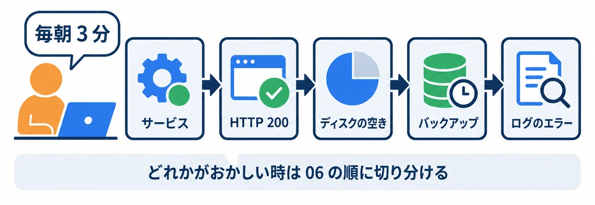

<div style="text-align: center; padding: 28px 0 8px;">
<div style="font-size: 14px; color: #475569;">オンプレミス構築 教育資料</div>
<div style="font-size: 26px; font-weight: 800; color: #0f172a; margin-top: 6px; line-height: 1.35;">付録 — よく使うコマンドの早見表</div>
<div style="font-size: 13px; color: #475569; margin-top: 8px;">毎日の確認・サービス・通信・ログ・ディスクとバックアップ・PostgreSQL・更新と切り戻しで打つコマンドを、やりたいこと別に</div>
</div>

# 付録: よく使うコマンドの早見表（運用・確認・トラブルの最初の一手）

## この資料について

サーバーを建てたあと、**毎日の確認・困った時の切り分け・更新や片づけ**で打つコマンドを、「やりたいこと」ごとに 1 か所に集めた早見表です。01〜06 の資料に散らばっているコマンドを、ここから引けるようにしました。

- **名前の決まり:** この資料のほかの巻と同じです。本番のサービスは `webapp-prod`、検証は `webapp-stg`、PostgreSQL は `postgresql-x64-18`、IIS は `W3SVC`、フォルダは `D:\webapp\…`（04 の 4.1）。
- **▼ 実行結果:** 2026-11-02 に、資料を作ったパソコン（Windows 11・PowerShell 5.1・PostgreSQL 18）で実際に打った結果です。Windows Server 2025／2022 でも、同じ形で出ます。日時・大きさ・番号は、打った時によって変わります。**表示の言葉（英語か日本語か）は、Windows の言語の設定によって変わります。**
- **▼ 確かめること:** 自分のパソコンで試せない物（サーバーの設定を変える物・本番のサービスを止める物）は、結果の代わりに「何が出れば正しいか」を書いています。
- **大事:** サービスを止める・消す・設定を変えるコマンドは、**本番では、決めた時間に、決めた手順で**打ちます（04 の 13 章・07 のチェック表）。まず検証（`webapp-stg`）で試します。



### やりたいこと → 見る所

| やりたいこと | 見る所 |
|---|---|
| 毎朝の確認を 3 分で済ませる | 1 章 |
| サービスを見る・止める・動かす・再起動する | 2 章 |
| 画面が開かない時に、どこまで届いているか調べる | 3 章 |
| ログを見る・エラーを探す | 4 章 |
| ディスクの空き・フォルダの大きさ・古いファイルの片づけ | 5 章 |
| コピー・圧縮・ファイルが同じか確かめる | 5 章 |
| データベースの状態・大きさ・つながっている数 | 6 章 |
| 更新・切り戻し・バックアップからの戻し方 | 7 章 |
| Windows の記録・予定の仕事・ファイアウォール | 8 章 |

### 練習の準備（自分のパソコンで試す時だけ）

4・5 章の例は、自分のパソコンの PowerShell で、そのまま試せます。先に、練習用のフォルダ `ops-practice` を作り、**練習用のログとバックアップ（中身はダミー）**を入れておきます。

```powershell
cd ~
mkdir ops-practice
cd ops-practice
mkdir logs, backup\db, copy-from
# 練習用のログ（アプリのログの形をまねた物）
Set-Content logs\webapp.log -Encoding utf8 -Value @(
  "2026-11-02 07:59:58 INFO  サーバーを起動しました port=8080",
  "2026-11-02 08:00:00 INFO  毎朝の通知: 3 件送りました",
  "2026-11-02 09:12:41 WARN  ログインに失敗しました user=012345",
  "2026-11-02 09:15:03 ERROR データベースにつなげません: connection refused",
  "2026-11-02 09:15:08 INFO  データベースにつなぎ直しました"
)
# 練習用のバックアップ 4 つ（中身はダミー。作った日時だけ、昔の日付にする）
foreach ($day in "20261021", "20261022", "20261023", "20261101") {
  $file = "backup\db\webapp_$day.dump"
  Set-Content $file "練習用のダミー $day"
  (Get-Item $file).LastWriteTime = [datetime]::ParseExact("$day 0200", "yyyyMMdd HHmm", $null)
}
# 練習用のコピー元
Set-Content copy-from\app.txt "version 1.1.0"
Set-Content copy-from\readme.txt "webapp"
```

<!-- first-use -->

> **▶ ここで初めて出てくるコード**
>
> - **`mkdir`**（PowerShell）: 「make directory（フォルダを作る）」の略。`mkdir ~\Documents\my-practice\01` のように、途中のフォルダもまとめて作れます（`~` はホームフォルダ `C:\Users\you`）。もう同じ名前のフォルダがあると、エラーで知らせます。
> - **`Set-Content`**（PowerShell）: ファイルに文字を書くコマンド。`Set-Content memo.txt "1 行目"` で、ファイルを作るか、中身を置きかえます。後ろに書き足す時は `Add-Content` を使います。
> - **`Set-Content -Encoding`**（PowerShell）: `-Encoding utf8` で、ファイルを UTF-8 という文字コードで書きます。Windows PowerShell 5.1 は、指定しないと古い文字コード（Shift_JIS）で書くので、日本語を書く時は付けておくと安心です。
> - **`Set-Content -Value`**（PowerShell）: `-Value 中身` で、ファイルに書く中身を指定します。`@' … '@` で囲むと、何行もの文章をそのまま中身にできます（ヒア文字列）。
> - **`Get-Item`**（PowerShell）: ファイルやフォルダ 1 つの情報（名前・大きさ・日時）を取り出すコマンド。

<!-- /first-use -->

終わったら、`cd ~` → `Remove-Item ops-practice -Recurse` で片づけます。

## 1. 毎日の確認（3 分）

毎朝、次の 5 つを上から順に見ます。どれか 1 つでもおかしければ、06 の 2 章の順に切り分けます。

| # | 見る物 | 打つコマンド（管理者の PowerShell） | 正しい時 |
|---|---|---|---|
| 1 | サービスが動いているか | `Get-Service webapp-prod, webapp-stg, postgresql-x64-18, W3SVC` | 4 つとも `Running` |
| 2 | アプリが返事をするか | `curl.exe -s -o NUL -w "%{http_code}" http://127.0.0.1:8080/health` | `200` |
| 3 | 受付（IIS）を通しても返事をするか | `curl.exe -s -o NUL -w "%{http_code}" -H "Host: webapp.example.local" http://127.0.0.1/health` | `200` |
| 4 | ディスクの空き | `Get-Volume -DriveLetter C, D` | 空きが 20% 以上 |
| 5 | ゆうべのバックアップ | <code>Get-ChildItem D:\webapp\backup\db &#124; Sort-Object LastWriteTime -Descending &#124; Select-Object -First 1</code> | 今日の日付の 2:00 ごろ |
| 6 | ログのエラー | <code>Select-String -Path D:\webapp\prod\logs\*.log -Pattern "ERROR" &#124; Select-Object -Last 5</code> | 何も出ない（出たら中身を読む） |

**メモ:** 毎日打つなら、06 の 2.1 の「まとめて確かめるスクリプト」を使うと、1 回で全部見られます。

## 2. サービス

| やりたいこと | コマンド | メモ |
|---|---|---|
| 状態を見る | `Get-Service webapp-prod` | `Status` が `Running`（動いている）・`Stopped`（止まっている） |
| 名前の一部で探す | `Get-Service postgresql*` | `*` は「何でもよい」 |
| 動かす | `Start-Service webapp-prod` | 管理者の PowerShell で |
| 止める | `Stop-Service webapp-prod` | 本番は、決めた時間に |
| 再起動する | `Restart-Service webapp-prod` | 設定ファイルを変えたあとなど |
| 起動の種類を見る | <code>Get-Service webapp-prod &#124; Select-Object Name, StartType</code> | `Automatic` なら、Windows の起動時に自動で動く |
| サービスを動かしているアカウント | <code>Get-CimInstance Win32_Service -Filter "Name='webapp-prod'" &#124; Select-Object Name, StartName</code> | 04 の 4.3 の仮想アカウントになっているか |
| WinSW で状態を見る | `D:\webapp\prod\service\webapp-prod-service.exe status` | WinSW を使った時（04 の 7 章） |

**▼ 実行結果**（`Get-Service postgresql*`）

```text
Status   Name               DisplayName
------   ----               -----------
Running  postgresql-x64-18  postgresql-x64-18 - PostgreSQL Serv...
```

- `DisplayName` は、長いと `...` で切られます。全部見たい時は `Get-Service postgresql* | Format-List *` です。

**▼ 確かめること**（`Restart-Service webapp-prod` のあと）

- `Get-Service webapp-prod` が `Running` に戻る（数秒かかることがある）。
- 1 章の 2 の `curl.exe` が `200` を返す。
- `Running` にならない時は、`D:\webapp\prod\logs\webapp-prod-service.err.log` の最後を読みます（06 の 5.9）。

## 3. 通信（どこまで届いているか）

画面が開かない時は、**手前（サーバーの中）から順に**確かめます（06 の 2 章）。

| やりたいこと | コマンド | 正しい時 |
|---|---|---|
| アプリに、サーバーの中から直接 | `curl.exe -s -o NUL -w "%{http_code}" http://127.0.0.1:8080/health` | `200` |
| IIS を通して、サーバーの中から | `curl.exe -s -o NUL -w "%{http_code}" -H "Host: webapp.example.local" http://127.0.0.1/health` | `200` |
| 返事の中身も見る | `curl.exe -s -i http://127.0.0.1:8080/health` | 1 行目が `HTTP/1.1 200 OK` |
| その番号で待ち受けているか | `Get-NetTCPConnection -State Listen -LocalPort 80, 8080, 5432` | 番号ごとに行が出る |
| 待ち受けているプログラム | `Get-Process -Id （OwningProcess の番号）` | アプリ・IIS・postgres |
| ほかの PC から、その番号へつながるか | `Test-NetConnection webapp.example.local -Port 80` | `TcpTestSucceeded : True` |
| 名前が IP アドレスに変わるか | `Resolve-DnsName webapp.example.local` | サーバーの IP アドレス |
| ファイアウォールの決まり | <code>Get-NetFirewallRule -DisplayName "webapp*" &#124; Select-Object DisplayName, Enabled, Direction, Action</code> | 80 番の受信が `True`・`Allow`（04 の 9 章） |

**▼ 実行結果**（PostgreSQL の 5432 番。この PC で）

`Test-NetConnection 127.0.0.1 -Port 5432 -InformationLevel Quiet`（`Quiet` を付けると、`True`・`False` だけが出る）:

```text
True
```

`Get-NetTCPConnection -State Listen -LocalPort 5432 | Select-Object LocalAddress, LocalPort, OwningProcess`:

```text
LocalAddress LocalPort OwningProcess
------------ --------- -------------
::                5432          6900
0.0.0.0           5432          6900
```

- **`LocalAddress` の読み方:** `0.0.0.0` と `::` は「どの宛先から来ても受ける」、`127.0.0.1` は「サーバーの中からだけ受ける」です。**本番の PostgreSQL は、サーバーの中からだけ受けるように絞ります**（04 の 5.3。この PC は練習用なので絞っていません）。
- `OwningProcess` の `6900` は、プログラムの番号です。`Get-Process -Id 6900` で名前が分かります（番号は起動のたびに変わります）。

**HTTP の返事の番号（よく出る物）:**

| 番号 | 意味 | まず疑う所 |
|---|---|---|
| `200` | 成功 | — |
| `302` | 別のページへ移る（ログインの画面へ、など） | ふつうの動き |
| `400` | 頼み方がおかしい（Host が違う、など） | IIS の Host 名・アプリの許可する Host（06 の 5.4） |
| `403` | 断られた | CSRF・権限（06 の 5.5） |
| `404` | 無い | URL・IIS のサイト（06 の 5.3） |
| `500` | アプリの中のエラー | アプリのログ（06 の 5.6） |
| `502` | IIS の先のアプリが返事をしない | アプリのサービスが止まっている（06 の 5.2） |
| `503` | IIS のサイトが止まっている | IIS のサイト・アプリケーション プール（06 の 5.3） |

## 4. ログを見る・エラーを探す

| やりたいこと | コマンド |
|---|---|
| 最後の 20 行 | `Get-Content D:\webapp\prod\logs\webapp-prod-service.err.log -Tail 20 -Encoding utf8` |
| 増えるのを見続ける（`Ctrl` ＋ `C` で終わる） | `Get-Content D:\webapp\prod\logs\webapp-prod-service.out.log -Tail 5 -Wait -Encoding utf8` |
| 言葉で探す（何行目かも出る） | <code>Select-String -Path D:\webapp\prod\logs\*.log -Pattern "ERROR&#124;WARN" -Encoding utf8</code> |
| 見つかった数 | `(Select-String -Path ... -Pattern "ERROR").Count` |
| IIS のアクセスログ | `C:\inetpub\logs\LogFiles\W3SVC（サイトの番号）\u_ex（日付）.log`（読み方は 06 の 3.1） |
| PostgreSQL のログ | `D:\pgsql\18\data\log\` の、いちばん新しいファイル（06 の 3.2） |
| ログの場所と、たまりすぎを防ぐ方法 | 04 の 12.2 の表 |

**▼ 実行結果**（練習のフォルダで `Get-Content logs\webapp.log -Tail 3 -Encoding utf8`）

```text
2026-11-02 09:12:41 WARN  ログインに失敗しました user=012345
2026-11-02 09:15:03 ERROR データベースにつなげません: connection refused
2026-11-02 09:15:08 INFO  データベースにつなぎ直しました
```

**▼ 実行結果**（`Select-String -Path logs\webapp.log -Pattern "ERROR|WARN" -Encoding utf8`）

```text
logs\webapp.log:3:2026-11-02 09:12:41 WARN  ログインに失敗しました user=012345
logs\webapp.log:4:2026-11-02 09:15:03 ERROR データベースにつなげません: connection refused
```

- `logs\webapp.log:4:...` は「`webapp.log` の **4 行目**」です。
- `-Pattern "ERROR|WARN"` の `|` は「または」です（正規表現という書き方）。
- **`-Encoding utf8` を付けます。** 付けないと、Windows PowerShell 5.1 は UTF-8 のログを古い文字コードで読み、日本語が化けます。

## 5. ディスク・ファイル・コピー・圧縮

| やりたいこと | コマンド |
|---|---|
| ドライブの空き | `Get-Volume -DriveLetter C, D` |
| フォルダの大きさ（合計） | <code>(Get-ChildItem D:\webapp\prod\logs -Recurse &#124; Measure-Object Length -Sum).Sum / 1MB</code> |
| 大きいファイルの上から 10 個 | <code>Get-ChildItem D:\webapp -Recurse -File &#124; Sort-Object Length -Descending &#124; Select-Object -First 10 FullName, Length</code> |
| いちばん新しいファイル | <code>Get-ChildItem D:\webapp\backup\db &#124; Sort-Object LastWriteTime -Descending &#124; Select-Object -First 1</code> |
| 古いファイルを消す（**先に `-WhatIf` で確かめる**） | <code>Get-ChildItem D:\webapp\backup\db\*.dump &#124; Where-Object LastWriteTime -lt (Get-Date).AddDays(-14) &#124; Remove-Item -WhatIf</code> |
| フォルダを丸ごと同じにする（コピー） | `robocopy コピー元 コピー先 /MIR` |
| 圧縮する | `Compress-Archive -Path フォルダ\* -DestinationPath 名前.zip` |
| 展開する | `Expand-Archive 名前.zip -DestinationPath フォルダ` |
| 2 つのファイルが同じか | `(Get-FileHash A).Hash -eq (Get-FileHash B).Hash` |

**▼ 実行結果**（この PC の C ドライブ。`Get-Volume -DriveLetter C | Select-Object DriveLetter, @{n="空き(GB)";e={[math]::Round($_.SizeRemaining/1GB,1)}}, @{n="全体(GB)";e={[math]::Round($_.Size/1GB,1)}}`）

```text
DriveLetter 空き(GB) 全体(GB)
----------- ------ ------
          C   73.4  951.6
```

- `@{n="名前";e={計算}}` は、「計算した列」を作る書き方です。バイトのままだと読みにくいので、`1GB` で割って GB にしています。

**▼ 実行結果**（練習のフォルダで、いちばん新しいバックアップ）

```text
Name                 LastWriteTime      Length
----                 -------------      ------
webapp_20261101.dump 2026/11/01 2:00:00     25
```

**▼ 実行結果**（10 月 25 日より古いバックアップを消すと、どれが消えるか。`-WhatIf` なので、本当は消さない）

```text
What if: Performing the operation "Remove File" on target "C:\Users\you\ops-practice\backup\db\webapp_20261021.dump".
What if: Performing the operation "Remove File" on target "C:\Users\you\ops-practice\backup\db\webapp_20261022.dump".
What if: Performing the operation "Remove File" on target "C:\Users\you\ops-practice\backup\db\webapp_20261023.dump".
```

- **`-WhatIf` を付けると、「何をするはずか」を表示するだけで、本当には消しません。** 消す対象が正しいと分かってから、`-WhatIf` を外して打ちます。本番の運用では `(Get-Date).AddDays(-14)`（今日から 14 日前）のように書きます（04 の 11.3 のスクリプトも、14 日より古いバックアップを消しています）。
- 日本語の Windows では、`WhatIf: 対象 "…" に対して操作 "ファイルの削除" を実行しています。` のように日本語で出ることがあります。

**▼ 実行結果**（`robocopy copy-from copy-to /MIR /NP /NJH` → `$LASTEXITCODE`）

```text
	  New Dir          2	C:\Users\you\ops-practice\copy-from\
	    New File  		      15	app.txt
	    New File  		       8	readme.txt

------------------------------------------------------------------------------

               Total    Copied   Skipped  Mismatch    FAILED    Extras
    Dirs :         1         1         0         0         0         0
   Files :         2         2         0         0         0         0
   Bytes :        23        23         0         0         0         0
   Times :   0:00:00   0:00:00                       0:00:00   0:00:00


   Speed :              23,000 Bytes/sec.
   Speed :               1.316 MegaBytes/min.
   Ended : 2026年11月2日 15:26:13
```

```text
1
```

- `/MIR` は「コピー先を、コピー元と**まったく同じ**にする」です。**コピー元に無いファイルは、コピー先から消えます。** コピー元とコピー先を逆に書かないように気を付けます。
- `/NP` は進み具合（%）を出さない、`/NJH` は最初の見出しを出さない、という指定です。
- **robocopy の終了コードは、ふつうと違います。** `0`（何もしなかった）・`1`（コピーした）〜`7` は**成功**、`8` 以上が**失敗**です。スクリプトでは `if ($LASTEXITCODE -ge 8) { 失敗 }` と書きます（04 の 11.3）。

**▼ 実行結果**（圧縮して、大きさを見る）

`Compress-Archive -Path copy-from\* -DestinationPath backup\app_1.1.0.zip` は何も表示しません。

```text
Name          Length
----          ------
app_1.1.0.zip    235
```

**▼ 実行結果**（コピーした 2 つのファイルが同じか）

```text
8DA215143FD2F22146BC1218B40C36574CCEDE25869B00F5CA50C0A6EABCDA66
```

```text
True
```

- **ハッシュ**は、ファイルの中身から計算した「指紋」です。1 文字でも違うと、まったく違う値になります。開発用のパソコンから持ち込んだファイルが壊れていないか確かめる時に使います（04 の 6.3）。

## 6. PostgreSQL

`psql` の入り方と SQL の練習は、02 にくわしく（実際の出力つきで）あります。ここでは運用でよく使う物をまとめます。

| やりたいこと | コマンド・SQL | メモ |
|---|---|---|
| 受け付けているか（ログイン無しで） | `pg_isready -h 127.0.0.1 -p 5432` | 下の実行結果 |
| つなぐ | `psql -h 127.0.0.1 -U webapp_prod_app -d webapp_prod` | 02 の 2 章 |
| データベースの大きさ | `SELECT pg_size_pretty(pg_database_size('webapp_prod'));` | 02 の 12 章 |
| 今つながっている数 | `SELECT state, count(*) FROM pg_stat_activity WHERE datname = 'webapp_prod' GROUP BY state;` | 多すぎる時は、アプリの接続のたまりを疑う |
| 表ごとの行の数（だいたい） | `SELECT relname, n_live_tup FROM pg_stat_user_tables ORDER BY n_live_tup DESC LIMIT 10;` | 増え方を月ごとに見る |
| 長く動いている問い合わせ | `SELECT pid, now() - query_start AS 時間, left(query, 60) FROM pg_stat_activity WHERE state = 'active' ORDER BY 2 DESC;` | 遅い時（06 の 5.7） |
| バックアップを取る | `pg_dump -h 127.0.0.1 -U webapp_prod_app -d webapp_prod -Fc -f D:\webapp\backup\db\手動_（日付）.dump` | 更新の前に必ず（04 の 13.3） |
| バックアップの中身の一覧 | `pg_restore -l ファイル.dump` | 壊れていないかの確かめ |
| 戻す | `pg_restore -h 127.0.0.1 -U … -d … --clean ファイル.dump` | 手順は 02 の 11 章・04 の 11.5 |
| サービスの再起動 | `Restart-Service postgresql-x64-18` | 設定を変えたあと。アプリもつなぎ直す |

**▼ 実行結果**（この PC で。受け付けている時 ／ 待っていない番号を指定した時）

```text
127.0.0.1:5432 - 接続を受け付けています
```

```text
127.0.0.1:5999 - レスポンスがありません
```

- `pg_isready` は、パスワード無しで「受け付けているか」だけを調べます。終了コードは、受け付けていれば `0`、返事が無ければ `2` です（スクリプトで使えます）。
- `pg_isready` が無いと言われた時は、`C:\Program Files\PostgreSQL\18\bin` を PATH に入れます（04 の 5.4）。

**▼ 確かめること**（`psql` でつないで、大きさとつながっている数を見た時）

- 大きさが `12 MB` のように単位つきで出る。
- `active`（今、問い合わせ中）が 1 つ（自分）、`idle`（待っている）がアプリの分だけ出る。`idle` が何百もある時は、アプリのつなぎ方を疑う。

## 7. 更新・切り戻し・戻し方の流れ

くわしい手順は 04 の 13 章（Rust 版）・05 の 13 章（Django 版）にあります。ここでは、順番を忘れないための要点だけです。

| 場面 | 順番（要点） | 見る所 |
|---|---|---|
| 更新（新しい版を入れる） | ① 検証で確かめる → ② `pg_dump` でバックアップ → ③ `Stop-Service webapp-prod` → ④ 今の版を `D:\webapp\releases\` に残す → ⑤ 新しい版を置く → ⑥ マイグレーション → ⑦ `Start-Service` → ⑧ 1 章の確認 | 04 の 13.3 |
| 切り戻し（前の版に戻す） | ① `Stop-Service` → ② 残しておいた前の版を置く → ③ 必要ならデータベースを ② のバックアップから戻す → ④ `Start-Service` → ⑤ 1 章の確認 | 04 の 13.4 |
| バックアップから戻す練習 | 検証のデータベースに `pg_restore` して、画面で中身を確かめる（年 1〜2 回） | 04 の 11.5・07 のチェック表 |

## 8. Windows の記録・予定の仕事・ファイアウォール

| やりたいこと | コマンド | 見る所 |
|---|---|---|
| システムのエラーを新しい順に 10 件 | `Get-WinEvent -FilterHashtable @{LogName='System'; Level=2} -MaxEvents 10` | 01 の 7.3 |
| サービスが急に止まった記録 | `Get-WinEvent -FilterHashtable @{LogName='System'; Id=7031,7034} -MaxEvents 10` | 01 の 7.2 |
| 前回の起動の時刻 | `(Get-CimInstance Win32_OperatingSystem).LastBootUpTime` | 再起動されたかの確かめ |
| 予定の仕事の一覧 | `Get-ScheduledTask -TaskPath \webapp\` | 01 の 9.2 |
| 予定の仕事の前回の結果 | `Get-ScheduledTaskInfo -TaskPath \webapp\ -TaskName 名前` | `LastTaskResult` が `0` なら成功 |
| 予定の仕事を今すぐ動かす | `Start-ScheduledTask -TaskPath \webapp\ -TaskName 名前` | バックアップの試しなど |
| ファイアウォールの決まりの一覧 | <code>Get-NetFirewallRule -Enabled True -Direction Inbound &#124; Select-Object DisplayName, Action</code> | 01 の 10.2 |
| サーバーの時刻と時間帯 | `Get-Date`・`Get-TimeZone` | 毎朝 8:00 の処理がずれる時（06 の 5.13） |

**▼ 確かめること**（`Get-ScheduledTaskInfo` でバックアップの仕事を見た時）

- `LastRunTime` が今日の 2:00 ごろ、`LastTaskResult` が `0`。
- `0` 以外の時は、`D:\webapp\backup\logs\` の、その日のログを読みます（06 の 5.11）。
