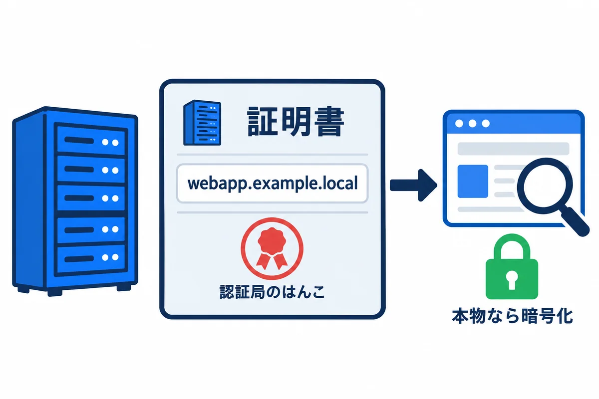
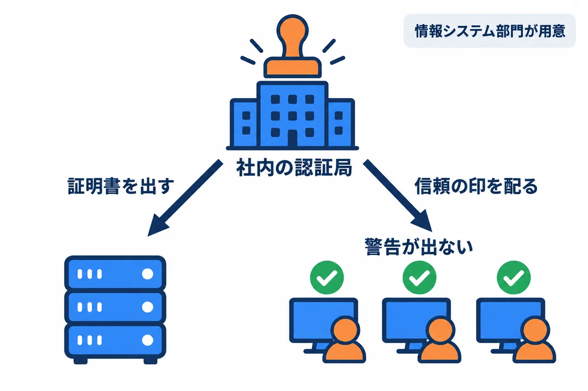
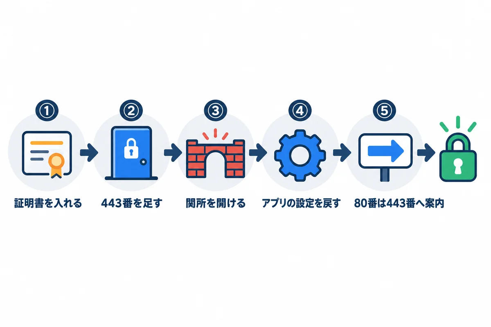

<div style="text-align: center; padding: 28px 0 8px;">
<div style="font-size: 14px; color: #475569;">オンプレミス構築 教育資料</div>
<div style="font-size: 26px; font-weight: 800; color: #0f172a; margin-top: 6px; line-height: 1.35;">参考 — HTTPS にする場合</div>
<div style="font-size: 13px; color: #475569; margin-top: 8px;">今は使わない。社内で証明書を用意できるようになったときに読む</div>
</div>

# 参考: HTTPS にする場合

## この資料について

今回の会社の環境では、社内で HTTPS を使えないため、本編（04・05）は **HTTP（80 番）**で書いています。この資料は、**将来、証明書を用意できるようになったときに、HTTPS に切りかえる**ための参考です。

- HTTP と HTTPS の違いは、00 基礎知識の 6 章にあります。
- この資料の手順は、04・05 で建てた形（IIS が 80 番で受け、名前で本番と検証に振り分ける）を前提にしています。
- Django 版の HTTPS の設定（11.3 の X-Forwarded-Proto）は、試して確かめました。IIS と証明書の手順は、本物の証明書が要るので、ここでは試していません。**検証のサイトで先に試して**から、本番にします。

## 1. HTTPS と証明書の考え方

<div style="max-width: 760px; margin: 18px auto; text-align: center;">

<div style="font-size: 12px; color: #64748b; margin-top: 6px;">図1-1: 証明書は、サーバーの身分証。はんこ（認証局）を確かめてから、暗号化して話す</div>
</div>

HTTPS は、2 つのことをします。

1. **相手が本物か確かめる:** サーバーが、自分の名前（`webapp.example.local`）が書かれた**証明書**を見せます。ブラウザは、その証明書に押された**認証局のはんこ（電子署名）**が、自分の信じているはんこかを確かめます。
2. **暗号化する:** 本物と分かったら、それから先の会話を暗号化します。途中で読まれたり、書きかえられたりしなくなります。

| 証明書に書かれていること | 意味 | 合わないと |
|---|---|---|
| 名前（サブジェクトの別名。SAN） | この証明書が使える名前（`webapp.example.local` など） | ブラウザに「名前が違う」という警告 |
| 有効期限 | 使ってよい期間（今は長くて 1 年ほど。だんだん短くなっている） | ブラウザに「期限切れ」という警告。**全員が使えなくなる** |
| 発行者（認証局） | はんこを押した所 | ブラウザが信じていない所なら、「信頼されていない」という警告 |

> **用語:** 証明書（サーバー証明書：サーバーの名前と、暗号に使う鍵の片方を、認証局が「本物です」とはんこを押して証明した電子の身分証）

<!-- -->

> **用語:** 認証局（CA。シーエー：証明書にはんこを押す所。ブラウザや Windows は、信じてよい認証局の一覧を持っている）

<!-- -->

> **用語:** 秘密鍵（証明書と組になる、サーバーだけが持つ鍵。これが漏れると、ほかの人がサーバーになりすませる。証明書の `.pfx` ファイルに一緒に入っていることが多く、パスワードで守る）

## 2. 社内で証明書を用意する 3 つの方法

<div style="max-width: 760px; margin: 18px auto; text-align: center;">

<div style="font-size: 12px; color: #64748b; margin-top: 6px;">図2-1: 社内の認証局を使うと、社員のパソコンで警告が出ない</div>
</div>

| 方法 | 仕組み | 長所 | 短所 | 向き・不向き |
|---|---|---|---|---|
| **社内の認証局**（Active Directory 証明書サービスなど） | 情報システム部門が、会社の中の認証局で証明書を出す。社員のパソコンには、会社の認証局を信じる設定が自動で配られる | `webapp.example.local` のような社内だけの名前でも出せる。費用がかからない | 会社に認証局が無ければ、情報システム部門が作る必要がある | **社内向けのアプリに最も向く** |
| 公的な認証局 | インターネットの認証局から証明書を取る | どのパソコンでも、何もしなくても信じられる | **`.local` のような社内だけの名前には出してもらえない**。会社が持っている本物のドメイン（例：`webapp.example.com`）の名前にし、DNS を社内と社外で合わせる必要がある | 会社の本物のドメインを社内でも使っている場合 |
| 自己署名（自分ではんこを押す） | サーバーが自分で証明書を作る | すぐ作れる | どのパソコンでも「信頼されていない」と警告が出る。社員が警告を無視する癖が付き、**かえって危ない** | **使わない** |

**情報システム部門に頼むこと（例）:**

- 本番と検証の名前（`webapp.example.local`・`webapp-stg.example.local`）の両方が入った証明書（または 1 つずつ）。
- 秘密鍵ごと書き出した `.pfx` ファイルと、そのパスワード（パスワードは、ファイルとは別の方法で受け取る）。
- 有効期限と、更新の段取り（だれが、いつ、新しい証明書を出すか）。
- 社員のパソコンが、その認証局を信じる設定になっていること。

## 3. 切りかえの手順の全体

<div style="max-width: 760px; margin: 18px auto; text-align: center;">

<div style="font-size: 12px; color: #64748b; margin-top: 6px;">図3-1: HTTPS への切りかえは 5 つの手順</div>
</div>

| 手順 | すること | 章 |
|---|---|---|
| ① | 証明書をサーバーに入れる | 4 |
| ② | IIS のサイトに、443 番のバインドを足す | 5 |
| ③ | ファイアウォールで、社内からの 443 番を通す | 6 |
| ④ | アプリの設定を、HTTPS 用に戻す | 7（Rust）・8（Django） |
| ⑤ | 80 番で来たお願いを、443 番へ案内する | 9 |

**順番が大事です。** ①〜③ の間は、HTTP のまま使えます。④ と ⑤ は、**同じ時間にまとめて**切りかえます（④ だけ先にすると、HTTP でログインできなくなる）。必ず**検証のサイトで先に**行います。

## 4. 証明書をサーバーに入れる

```powershell
# .pfx のパスワードを、画面に出さずに入れる
$pw = Read-Host ".pfx のパスワード" -AsSecureString

# コンピューターの「個人」の証明書の置き場に入れる
Import-PfxCertificate -FilePath D:\webapp\secrets\webapp.pfx `
    -CertStoreLocation Cert:\LocalMachine\My -Password $pw

# 入った証明書の、名前・期限・指紋（Thumbprint）を見る
Get-ChildItem Cert:\LocalMachine\My |
    Select-Object Subject, @{ Name = "Names"; Expression = { $_.DnsNameList.Unicode -join "," } }, NotAfter, Thumbprint
```

**確かめること:** `Names` に、本番と検証の名前が入っていること。`NotAfter`（期限）が先の日付であること。

- 入れ終わったら、`.pfx` のファイルは、サーバーに残さず、会社の決まりに従って保管します（秘密鍵が入っているため）。

> **用語:** Thumbprint（サムプリント：証明書の指紋。IIS に「どの証明書を使うか」を教えるのに使う）

## 5. IIS に 443 番のバインドを足す

```powershell
Import-Module IISAdministration

# 本番の名前の証明書を探す（期限のいちばん先の物）
$cert = Get-ChildItem Cert:\LocalMachine\My |
    Where-Object { $_.DnsNameList.Unicode -contains "webapp.example.local" } |
    Sort-Object NotAfter -Descending | Select-Object -First 1

# 本番のサイトに、443 番・名前つき（SNI）のバインドを足す
New-IISSiteBinding -Name "webapp-prod" -BindingInformation "*:443:webapp.example.local" `
    -Protocol https -CertificateThumbPrint $cert.Thumbprint -CertStoreLocation "Cert:\LocalMachine\My" -SslFlag "Sni"

Get-IISSiteBinding -Name "webapp-prod"
```

検証も、名前とサイトを変えて同じことをします。

**確かめること:** `Get-IISSiteBinding` に、`http *:80:webapp.example.local` と `https *:443:webapp.example.local` の 2 つが出ること。

> **用語:** SNI（エスエヌアイ：1 つの IP アドレスと 443 番で、名前ごとに別の証明書を使い分ける仕組み。本番と検証を同じ 443 番に置くのに使う）

## 6. ファイアウォールで 443 番を通す

```powershell
New-NetFirewallRule -DisplayName "webapp HTTPS 443 (社内から)" `
    -Direction Inbound -Protocol TCP -LocalPort 443 `
    -RemoteAddress 10.0.0.0/8 -Profile Domain -Action Allow
```

`-RemoteAddress` は、04 の 9.2 で 80 番に使った社内の範囲と同じにします。**ネットワークの関所（情報システム部門）でも 443 番を通してもらいます。**

この時点で、社員のパソコンから `https://webapp-stg.example.local/` を開くと、**鍵のマーク**が出て画面が出ます（まだログインは HTTP 用の設定なので、④ をするまで試すのは表示だけにします）。

## 7. アプリの設定を戻す（Rust＋Topcoat版）

04 の 6.4 で作った「HTTP 用のクッキーの置き場」（`HttpCookieTokenStore`）をやめ、**Topcoat の決まりの設定**に戻します。

```rust
// 変更前（HTTP 用。04 の 6.4）
.sessions(
    SessionConfig::builder()
        .token_store(crate::http_cookie::HttpCookieTokenStore)
        .lifetime(std::time::Duration::from_secs(60 * 60))
        .build(),
)

// 変更後（HTTPS 用）: 決まりのクッキー（__Host- が付き、Secure が付く）に戻す。期限の 60 分は残す
.sessions(
    SessionConfig::builder()
        .lifetime(std::time::Duration::from_secs(60 * 60))
        .build(),
)
```

- 決まりのクッキーは、名前の頭に `__Host-` が付き、`Secure`（HTTPS のときだけ送る）が付きます。HTTPS なら、ブラウザが受け取ります。
- 切りかえた後、ブラウザに残っている古い `session` のクッキーは使われなくなるので、**全員が一度ログインし直し**になります。社員に知らせておきます。
- HTTPS では、ブラウザが `Sec-Fetch-Site` を送るので、Topcoat の送り元の確かめ（04 の 8.3）が、より確かになります。`preserveHostHeader=true` は、そのままにしておきます。

## 8. アプリの設定を戻す（Django＋React版）

### 8.1 settings.py

```python
# HTTPS にしたら
SESSION_COOKIE_SECURE = True
CSRF_COOKIE_SECURE = True
CSRF_TRUSTED_ORIGINS = [f"https://{host}" for host in ALLOWED_HOSTS]

# HTTP のときに黙らせていた注意を、また出す（SILENCED_SYSTEM_CHECKS の行を消す）
# SILENCED_SYSTEM_CHECKS = [...]
```

### 8.2 waitress に「HTTPS で来た」ことを信じさせる

IIS からアプリへは、サーバーの中の HTTP（`127.0.0.1:8080`）のままです。そこで、**IIS が「元は HTTPS だった」という付け札（`X-Forwarded-Proto: https`）を付け**（9 章）、**waitress がそれを信じる**ようにします。05 の 9.2 の XML の `arguments` を、次のように変えます。

```xml
<arguments>-m waitress --listen=127.0.0.1:8081 --threads=8 --trusted-proxy=127.0.0.1 "--trusted-proxy-headers=x-forwarded-for x-forwarded-proto" config.wsgi:application</arguments>
```

**試して確かめた結果**（Django 5.2.18・waitress 3.0.2。`--trusted-proxy-headers` に `x-forwarded-proto` を足した状態）:

| 試したこと | 結果 |
|---|---|
| `Origin: https://...` でログインを送る。`X-Forwarded-Proto` 無し | **403**（Django は HTTP で来たと思い、送り元が食い違う） |
| 同じく、`X-Forwarded-Proto: https` を付ける | 200（ログインできる） |
| ログイン後、`X-Forwarded-Proto: https` を付けて `request.is_secure()` を見る | `True` |
| 付けないとき | `False` |

つまり、**IIS が付け札を付けること（9 章）と、waitress がそれを信じること（この章）の、両方が要ります**。

```powershell
# 変えたら、注意が HTTPS 関係も含めて出ないか確かめる
cd D:\webapp\stg\service
.\manage.ps1 check --deploy
```

**確かめること:** `security.W012`・`W016`（クッキーの Secure）が出なくなること。`W004`（HSTS）・`W008`（HTTPS への転送）は、Django ではなく IIS で受け持つので、出たままでかまいません（10 章）。

## 9. 80 番で来たお願いを、443 番へ案内する

`web.config`（04 の 8.5）のルールを、次のようにします。

```xml
<?xml version="1.0" encoding="UTF-8"?>
<configuration>
  <system.webServer>
    <rewrite>
      <rules>
        <!-- 1. HTTP で来たら、同じ名前・同じ道の HTTPS へ案内する -->
        <rule name="http-to-https" stopProcessing="true">
          <match url="(.*)" />
          <conditions>
            <add input="{HTTPS}" pattern="off" />
          </conditions>
          <action type="Redirect" url="https://{HTTP_HOST}/{R:1}" redirectType="Found" />
        </rule>
        <!-- 2. HTTPS で来たお願いを、「元は HTTPS」の付け札を付けて、アプリへ取り次ぐ -->
        <rule name="to-webapp-prod" stopProcessing="true">
          <match url="(.*)" />
          <serverVariables>
            <set name="HTTP_X_FORWARDED_PROTO" value="https" />
          </serverVariables>
          <action type="Rewrite" url="http://127.0.0.1:8080/{R:1}" />
        </rule>
      </rules>
    </rewrite>
    <security>
      <requestFiltering>
        <requestLimits maxAllowedContentLength="104857600" />
      </requestFiltering>
    </security>
  </system.webServer>
</configuration>
```

`HTTP_X_FORWARDED_PROTO` を、ルールの中で使ってよい名前として、IIS に登録します（1 回だけ）。

```powershell
& "$env:windir\system32\inetsrv\appcmd.exe" set config `
  -section:system.webServer/rewrite/allowedServerVariables /+"[name='HTTP_X_FORWARDED_PROTO']" /commit:apphost
```

| 部分 | 意味 |
|---|---|
| `{HTTPS}` が `off` | HTTP で来たお願い |
| `redirectType="Found"` | 「一時的に移った」（302）。**最初は Found にします**。`Permanent`（301）はブラウザが長く覚えるので、HTTP に戻したくなったときに戻せなくなる。HTTPS で落ち着いてから `Permanent` にする |
| `serverVariables` の `HTTP_X_FORWARDED_PROTO` | アプリに渡すお願いに、`X-Forwarded-Proto: https` の付け札を付ける |

**確かめること:**

- 社員のパソコンで `http://webapp-stg.example.local/` を開くと、`https://webapp-stg.example.local/` に変わって、鍵のマークが出ること。
- ログイン・保存・ログアウトができること。開発者ツールで、セッションのクッキーに `Secure` が付いていること。
- メールの中の URL（04 の `APP_BASE_URL` など）を、`https://` に直したこと。

## 10. HSTS（HTTPS だけを使わせる仕組み）は、あわてて入れない

**HSTS** は、ブラウザに「この名前は、これから先ずっと HTTPS だけで開いて」と覚えさせる仕組みです。安全を高めますが、**一度覚えさせると、期間が過ぎるまで HTTP に戻せません**。証明書の期限切れを起こすと、警告を無視して進むこともできなくなります。

- HTTPS で数か月落ち着き、証明書の更新の段取りが確かになってから考えます。
- 入れるときも、最初は短い期間（例：1 日 ＝ `max-age=86400`）から始め、少しずつ延ばします。

> **用語:** HSTS（エイチエスティーエス。HTTP Strict Transport Security：ブラウザに「この名前は HTTPS だけで開く」と覚えさせる仕組み）

## 11. 証明書の期限を切らさない

証明書の期限が切れると、**全員の画面に警告が出て、使えなくなります**。HTTPS にしたら、いちばん大事な点検になります。

```powershell
# 30 日以内に期限が切れる証明書を探す（毎月の点検に入れる。07 付録の 5 章）
Get-ChildItem Cert:\LocalMachine\My |
    Where-Object { $_.NotAfter -lt (Get-Date).AddDays(30) } |
    Select-Object Subject, NotAfter, Thumbprint
```

新しい証明書をもらったら、4 章のとおり入れ、5 章のバインドの証明書を入れかえます（`Remove-IISSiteBinding` で外して、`New-IISSiteBinding` で付け直す）。**入れかえは、社員が使わない時間に、検証から**行います。

## 12. 困ったとき

| 症状 | 原因 | 直し方 |
|---|---|---|
| 「この接続ではプライバシーが保護されません」（名前が違う） | 証明書に、開いた名前が入っていない | 証明書の `Names`（4 章）を見る。入っていなければ、作り直してもらう |
| 同じく（信頼されていない） | 社員のパソコンが、その認証局を信じていない／自己署名 | 情報システム部門に、認証局の信頼の配り方を確かめる |
| 同じく（期限切れ） | 証明書の期限が切れた | 11 章。新しい証明書を入れる |
| HTTPS にしたら、ログインできない（403） | Django: `X-Forwarded-Proto` が付いていない・waitress が信じていない（8.2 の表）／`CSRF_TRUSTED_ORIGINS` が `http://` のまま | 8・9 章 |
| ログインしても、すぐログインしていない扱い（HTTP で開いたとき） | クッキーが `Secure` になったので、HTTP では送られない | 9 章の「HTTPS へ案内する」ルールが動いているか |
| ページが何度も移り変わって開かない（リダイレクトが終わらない） | アプリ側でも HTTP→HTTPS の転送をしていて、IIS とぶつかっている | 転送は IIS だけで行う。Django の `SECURE_SSL_REDIRECT` は `True` にしない |
| 一部の画像や部品が出ない | 画面の中に `http://` で書いた住所が残っている（混在コンテンツ） | 住所を `https://` か、`/static/...` のような名前なしの書き方にする |

## 用語の索引

| 用語 | 短い説明 | 章 |
|---|---|---|
| HSTS | ブラウザに HTTPS だけを使わせる仕組み | 10 |
| SNI | 1 つの 443 番で、名前ごとに証明書を使い分ける仕組み | 5 |
| Thumbprint | 証明書の指紋 | 4 |
| X-Forwarded-Proto | 「元は HTTPS だった」とアプリに伝える付け札 | 8・9 |
| 混在コンテンツ | HTTPS の画面の中に、HTTP の部品が混ざること | 12 |
| 自己署名証明書 | 自分ではんこを押した証明書（使わない） | 2 |
| 証明書・認証局・秘密鍵 | サーバーの身分証／はんこを押す所／組になる秘密の鍵 | 1 |
