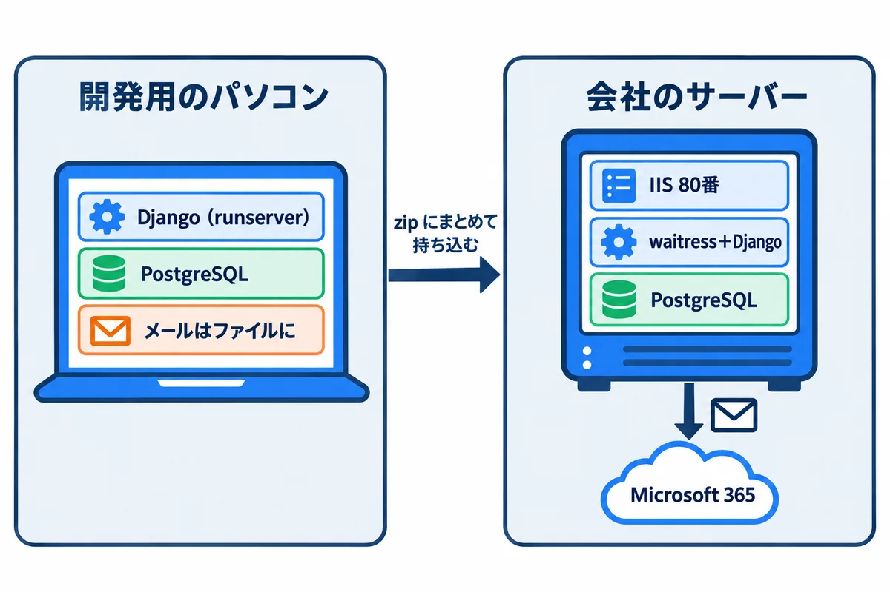
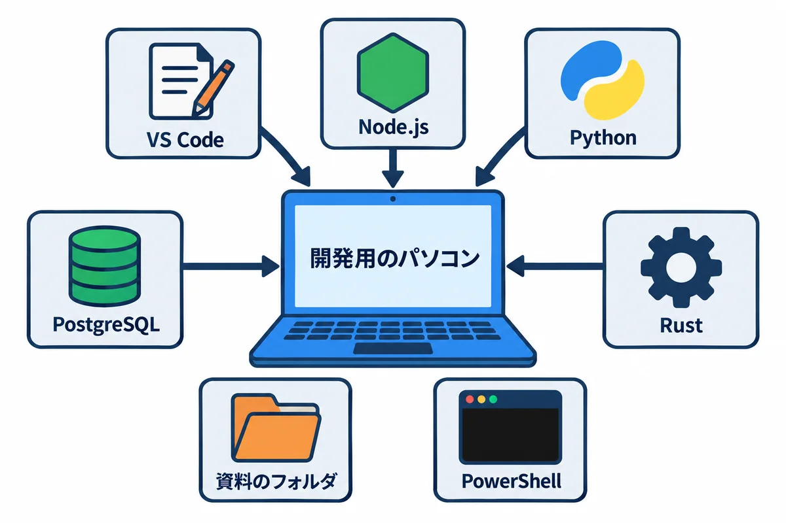
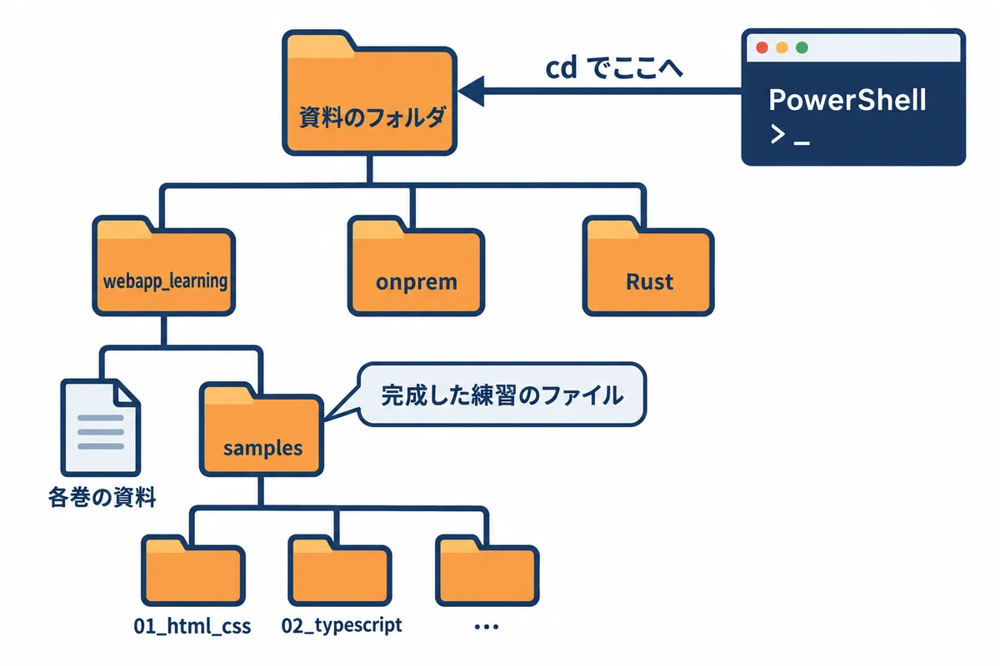
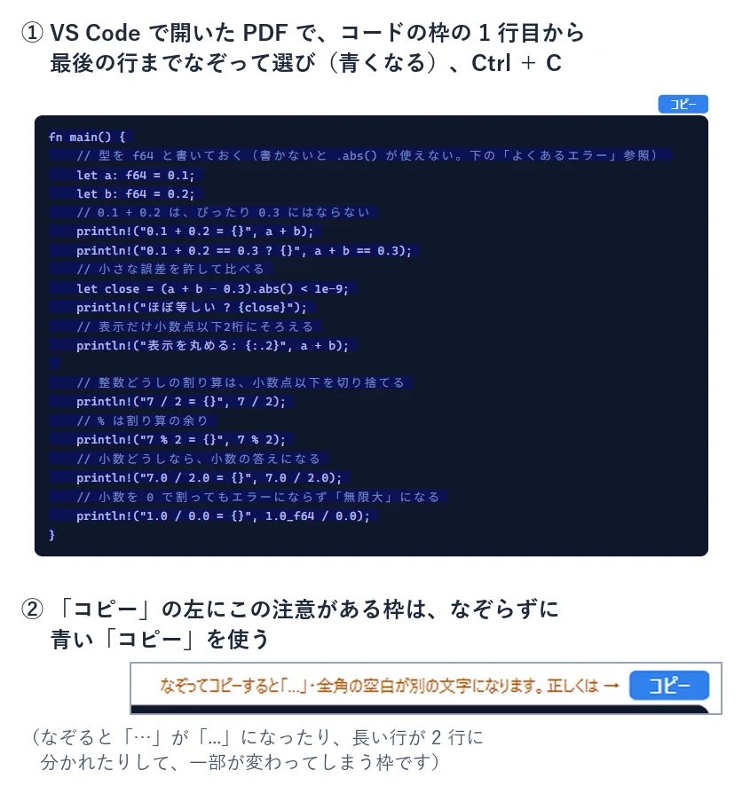
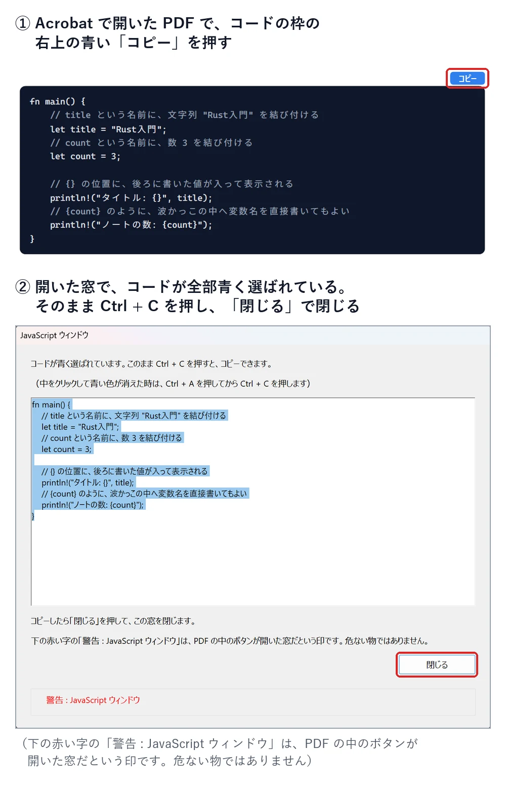
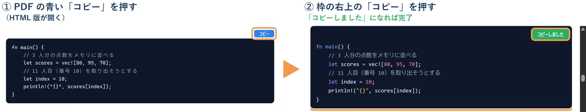

<div style="text-align: center; padding: 28px 0 8px;">
<div style="font-size: 14px; color: #475569;">Web アプリ開発 学習資料</div>
<div style="font-size: 26px; font-weight: 800; color: #0f172a; margin-top: 6px; line-height: 1.35;">学習ガイド — 作るアプリと、学ぶ技術の地図</div>
<div style="font-size: 13px; color: #475569; margin-top: 8px;">依頼・承認の練習アプリを作りながら、HTML・CSS・TypeScript・React・Python・Django・Rust・Topcoat・メール送信を学ぶ</div>
</div>

# 学習ガイド: 作るアプリと、学ぶ技術の地図

## この資料について

この資料集は、**プログラミングや Web の経験がほとんど無い人**が、社内向けの業務 Web アプリを作れるようになるための教材です。

- **1 つの練習アプリ**（依頼・承認アプリ）を、少しずつ作りながら学びます。「何のために、その技術が要るのか」が分かるようにするためです。
- 同じアプリを、**2 つの作り方**で作ります。**Python＋Django（サーバー）と TypeScript＋React（画面）**の組み合わせと、**Rust＋Topcoat**の組み合わせです。
- 専門用語は、出てくるたびに説明します。図（考え方の絵）と、練習アプリの**本物の画面の写し**を多く入れています。
- 練習のコードは `samples/` のフォルダにあり、**実際に動かして確かめた物**です。

> **用語:** Web アプリ（ブラウザで開いて使うアプリ。社員のパソコンにアプリを入れなくても、URL を開くだけで使える）

## 1. 作る練習アプリ: 依頼・承認アプリ

### 1.1 仕事の流れ

<div style="max-width: 760px; margin: 18px auto; text-align: center;">

<div style="font-size: 12px; color: #64748b; margin-top: 6px;">図1-1: 練習アプリの仕事の流れ</div>
</div>

社員が、ほかの部署に「これをお願いします」という**依頼**を出し、上司などが順に**承認**してから、担当の部署が対応する、という社内のよくある仕事を、アプリにします。

1. 依頼する人が、件名・内容・希望の納期・添付ファイル・図面を入れて、**依頼を出す**。
2. アプリが、1 人目の承認者に**メール**を送る。メールの中の URL を開いて「承認」を押すと、次の人へメールが届く（**順に回す**＝回覧）。
3. 途中の人が「差し戻し」を押すと、依頼する人に戻る。直して、もう一度出せる。
4. 全員が承認すると「**回覧完了**」。担当の部署が「**対応中**」にして作業し、終わったら「**完了**」。

### 1.2 依頼の状態

<div style="max-width: 760px; margin: 18px auto; text-align: center;">

<div style="font-size: 12px; color: #64748b; margin-top: 6px;">図1-2: 依頼の状態の移り変わり（状態遷移図）</div>
</div>

依頼は、いつも 7 つの**状態**のどれか 1 つです。「どの状態から、どの操作で、どの状態へ進めるか」を決めておくことが、業務アプリのいちばん大事な設計です（06・08 で、プログラムにします）。

| 状態 | 意味 | 依頼した人ができること |
|---|---|---|
| 回覧中 | 承認者の確認を待っている | 見る・引き戻す（直すことはできない） |
| 差し戻し中 | 承認者から直すように言われた | 直して出し直す・取り下げる |
| 引き戻し中 | 自分で取り戻した | 直して出し直す・取り下げる |
| 回覧完了 | 全員が承認した | 見る |
| 対応中 | 担当者が作業している | 見る |
| 完了 | 終わった | 見る |
| 取り下げ | やめた | — |

> **用語:** 状態遷移図（じょうたいせんいず：状態を四角、移り変わりを矢印で描いた図。「この状態からは、この操作しかできない」を、目で確かめられる）

### 1.3 練習アプリの機能と、学ぶ技術

練習アプリには、社内の業務アプリでよく出てくる機能を、ひととおり入れます。

| 機能 | 中身 | 主に学ぶ技術 | 資料 |
|---|---|---|---|
| ログイン | 社員番号とパスワードでログイン。60 分操作が無いと、自動でログアウト | セッション・クッキー・パスワードの安全な保存 | 05・06・08・10 |
| 権限 | 一般の社員・承認者・担当者・管理者で、できることを変える | 権限の確かめ方 | 06・08・10 |
| 依頼の入力 | 件名・内容・納期・回覧者を入れる画面 | HTML のフォーム・CSS・React のフォーム | 01・03・06 |
| 図面 | 画面の上で図を描き、JSON というデータの形で保存する | JSON・TypeScript・Canvas | 02・03・06 |
| 添付ファイル | JPG・PNG・PDF を付ける（1 ファイル 10MB まで） | ファイルの受け取りと、種類・大きさの確かめ | 06・08・10 |
| 承認の回覧 | メールの URL から承認・差し戻し。URL は 1 回限り・14 日で期限切れ | 状態遷移・推測できない URL・メール送信 | 06・08・09・10 |
| 一覧・詳細 | 自分の依頼の一覧、状態の色分け、進み具合 | 表・データベースの検索・API | 01・03・05・06 |
| 社員データの取り込み | 社員の一覧を CSV で取り込む | CSV・文字コード・トランザクション | 04・06 |
| 毎朝の通知 | 毎朝 8:00 に、期限の近い依頼や止まっている承認をメールで知らせる | 定期処理 | 06・08・09 |
| グラフ | 担当者ごとの件数などをグラフで見る | 集計の SQL・グラフの部品 | 06 |
| メール | 会社の Microsoft 365 を通して送る | SMTP・SMTP リレー | 09 |

## 2. 技術の地図

<div style="max-width: 760px; margin: 18px auto; text-align: center;">

<div style="font-size: 12px; color: #64748b; margin-top: 6px;">図2-1: 練習アプリで使う技術の地図</div>
</div>

| 場所 | 技術 | ひとことで言うと | 資料 |
|---|---|---|---|
| ブラウザ | **HTML** | 画面の**中身と骨組み**（見出し・入力欄・表） | 01 |
| ブラウザ | **CSS** | 画面の**見た目**（色・大きさ・並べ方） | 01 |
| ブラウザ | **TypeScript** | 画面の**動き**を書く言葉（JavaScript に「型」を足した物） | 02 |
| ブラウザ | **React** | 画面を**部品（コンポーネント）**に分けて作る道具 | 03 |
| サーバー | **Python**＋**Django** | サーバーの言葉と、Web アプリの全部入りの土台 | 04・05・06 |
| サーバー | **Rust**＋**Topcoat** | 速くて間違いに強い言葉と、その Web の土台 | 07・08 |
| データベース | **PostgreSQL**（SQL） | データを表で保存する | 05・06・08（onprem の 02 も） |
| メール | **SMTP**・**SMTP リレー** | メールを送る決まりと、会社のメールに配達を任せる仕組み | 09 |
| 間をつなぐ | **HTTP**・**JSON** | ブラウザとサーバーの会話の決まりと、データの書き方 | 02・05 |

> **用語:** フロントエンド・バックエンド（ブラウザの中で動く側＝画面と、サーバーの中で動く側＝処理とデータ）

## 3. 2 つの作り方

<div style="max-width: 760px; margin: 18px auto; text-align: center;">

<div style="font-size: 12px; color: #64748b; margin-top: 6px;">図3-1: 同じアプリを、2 つの作り方で作る</div>
</div>

| | Django＋React | Rust＋Topcoat |
|---|---|---|
| 画面 | React（TypeScript）で作り、サーバーとは JSON でやり取り | サーバーで HTML を作って返す（Topcoat の機能） |
| サーバー | Python＋Django | Rust＋Topcoat |
| 長所 | 部品が多く、早く作れる。管理画面が最初から付いている | 実行ファイル1つで動き、速い。型が強く、間違いを作る前に見つけやすい |
| 短所 | 画面とサーバーの 2 つを作る。部品の更新の手間が多い | 覚えることが多い。Topcoat はまだ新しい（0.x の版） |
| サーバーへの建て方 | onprem の 05 | onprem の 04 |

どちらか一方だけを学んでもかまいません。**初めての人には、Django＋React から始める**ことをすすめます。情報と部品が多く、つまずいたときに調べやすいからです。

> **用語:** 技術スタック（アプリを作るのに組み合わせて使う技術の一式。onprem の 03 で、選び方を比べている）

### 3.1 作ったアプリが動く場所（onprem の資料とつながっている）

<div style="max-width: 760px; margin: 18px auto; text-align: center;">

<div style="font-size: 12px; color: #64748b; margin-top: 6px;">図3-2: 開発用のパソコンで作り、会社のサーバーに建てる</div>
</div>

この資料集で作る練習アプリは、**`onprem/` の資料のとおりに、会社の Windows Server（仮想マシン）に建てる前提**で作ります。だから、作り方の中に、次のような「会社のサーバーの事情」が入っています。

| 会社のサーバーの事情（onprem） | この資料集での扱い | 巻 |
|---|---|---|
| 社内では HTTPS を使えないので、**HTTP（80 番）**で動かす | ログインのクッキーに `Secure` を付けない設定にする | 06・08（onprem の 04 の 6.4・05 の 8 章） |
| IIS が、**名前で本番と検証を振り分けて**、アプリに取り次ぐ | アプリは、受け付ける名前（`ALLOWED_HOSTS` など）を決める | 06・08 |
| データベースは、**仮想マシンの中の PostgreSQL** | 06・08 は PostgreSQL で作る（05 の最初の練習だけ SQLite） | 05・06・08 |
| Django は **waitress** で動かし、**WinSW** で Windows サービスにする。React の画面の成果物は、**Django のプロジェクトの中**に置いて、Django が配る | その形で作る | 06（onprem の 05） |
| Rust＋Topcoat は、**実行ファイル 1 つ**を WinSW で Windows サービスにする | その形で作る | 08（onprem の 04） |
| メールは、**Microsoft 365 の SMTP リレー（25 番）**で送る | 開発中はメールをファイルに書き、サーバーでは SMTP で送る | 06・09 |
| サーバーは**インターネットにつながらない** | 部品は、開発用のパソコンで取り寄せて持ち込む | 06・08（onprem の 05 の 7.2） |
| サーバーごとの設定とパスワードは、**WinSW の XML の環境変数**で渡す | アプリは、onprem の XML と**同じ名前の環境変数**を読む | 06・08 |
| 本番と検証が同じサーバーにある | 検証のメールは、決まった宛先だけに送る（`MAIL_REDIRECT_TO`） | 06 |

> **作る人と建てる人が同じでも、別でも:** この資料集（作る）と onprem（建てる）は、同じ名前・同じ設定でつながっています。作る側で設定の名前を変えたら、onprem の XML も同じように直します。

## 4. 学ぶ順番

<div style="max-width: 760px; margin: 18px auto; text-align: center;">

<div style="font-size: 12px; color: #64748b; margin-top: 6px;">図4-1: 学習の道のり</div>
</div>

| 巻 | 内容 | 先に読む物 | Django＋React の道 | Rust＋Topcoat の道 |
|---|---|---|---|---|
| 01 | HTML と CSS | この巻 | ● | ● |
| 02 | TypeScript の基礎 | 01 | ● | （画面の動きを書くなら） |
| 03 | React の基礎 | 02 | ● | — |
| 04 | Python の基礎 | — | ● | — |
| 05 | Django の基礎 | 04 | ● | — |
| 06 | Django＋React で練習アプリを作る | 03・05 | ● | — |
| 07 | Rust と Topcoat の基礎 | 01 | — | ● |
| 08 | Topcoat で練習アプリを作る | 07 | — | ● |
| 09 | メールと SMTP リレー | 06 か 08 | ● | ● |
| 10 | 安全とテスト | 06 か 08 | ● | ● |

全部の巻ができています。06 と 08 は、それぞれ前編（サーバー側）と後編（画面側）に分かれています（README の一覧）。

## 5. ほかの資料との関係

このリポジトリには、ほかにも資料があります。この資料集は、それらを**入口からつなぐ**役目です。深く知りたいときは、次を読みます。

| フォルダ | 中身 | この資料集との関係 |
|---|---|---|
| `onprem/` | 会社のサーバー（Windows Server）に、アプリを建てて運用する | 作ったアプリを、どうやって社内で動かすか |
| `docs/` | Django＋React の業務アプリ（別のアプリ）を、1 行ずつ読み解く全 13 章 | 01〜06 の、さらに詳しい説明（HTML・CSS・TypeScript・React・Python・Django・テスト） |
| `Rust/` | Rust と Topcoat を、ゼロから完成まで学ぶ全 14 巻 | 07・08 の、さらに詳しい説明 |
| `next/`・`react_native/` | Next.js・React Native のアプリの作り方 | 別の作り方（参考） |

## 6. 練習の環境を用意する（最初に 1 回だけ）

この資料のコードを、自分のパソコンで動かすための準備です。巻ごとに要る道具が違うので、表の「要る巻」を見て、**これから読む巻に要る物だけ**入れればかまいません。



| 道具 | 要る巻 | この資料で確かめた版 | 入れ方 |
|---|---|---|---|
| VS Code（エディター） | 全部 | 1.129.1 | 6.2 |
| Node.js | 02・03・06・10 | 25.9.0 | 6.3 |
| Python | 04・05・06・09・10 | 3.14.4 | 6.4 |
| PostgreSQL | 06・08・10 | 18.3 | 6.5 |
| Rust | 07・08 | 1.99.1 | 6.6 |
| ブラウザ | 全部 | Edge か Chrome | 最初から入っている |

### 6.1 資料のフォルダと、PowerShell の開き方

**資料のフォルダ:** この資料一式（`webapp_learning`・`onprem`・`Rust` などのフォルダが入った物）を、自分のパソコンに置いた場所を、この資料では「**資料のフォルダ**」と呼びます。例えば `C:\Users\you\Documents\def` に置いたとします（`you` は自分の Windows のユーザー名）。



```text
C:\Users\you\Documents\def\          ← 資料のフォルダ
├─ webapp_learning\
│  ├─ 01_HTMLとCSS_….md              ← この資料（各巻）
│  ├─ samples\
│  │  ├─ 01_html_css\                ← 01 の練習のファイル（完成した物）
│  │  ├─ 02_typescript\
│  │  └─ …
│  └─ images\
├─ onprem\
└─ Rust\
```

**PowerShell の開き方:** 画面の下のスタートボタンを押し、`powershell` と打って、「Windows PowerShell」を選びます（文字を打ってパソコンに指示する窓が開きます）。

**資料のフォルダへ移動する:** 各巻に `cd webapp_learning\samples\02_typescript` のように書いてあるのは、**資料のフォルダにいるところから**打つコマンドです。PowerShell を開いたら、最初に資料のフォルダへ移動します。

```powershell
# 例: 資料を C:\Users\you\Documents\def に置いたとき（~ は C:\Users\you のこと）
cd ~\Documents\def
```

<!-- first-use -->

> **▶ ここで初めて出てくるコード**
>
> - **`cd`**（PowerShell）: 「change directory（フォルダを移る）」の略。`cd rust-study` で、今いるフォルダの中の `rust-study` へ移ります。`cd ..` は 1 つ上のフォルダへ、`cd ~` はホームフォルダ（`C:\Users\you`）へ戻ります。今いる場所は、行の頭の `PS C:\Users\you\rust-study>` の部分に表示されます。

<!-- /first-use -->

> **ヒント:** エクスプローラーで資料のフォルダを開き、上のアドレス欄に `powershell` と打って Enter キーを押すと、そのフォルダにいる PowerShell が開きます。

### 6.2 VS Code（プログラムを書く道具）

1. ブラウザで `https://code.visualstudio.com/` を開き、Windows 用をダウンロードします。
2. ダウンロードした物を動かし、表示に従って進めます（「PATH への追加」は、チェックが入ったままにします）。
3. **新しく開いた** PowerShell で、入ったかを確かめます。

```powershell
code --version
```

**▼ 実行結果**（この資料を作ったパソコン。3 行目は CPU の種類で、多くのパソコンでは `x64`）

```text
1.129.1
8a7abeba6e03ea3af87bfbce9a1b7e48fed567b8
arm64
```

<!-- first-use -->

> **▶ ここで初めて出てくるコード**
>
> - **`code`**（コマンド）: VS Code を動かすコマンド。`code .` で今のフォルダを開き、`code --version` で版を確かめます。

<!-- /first-use -->

**VS Code の基本の使い方（この資料で使う所だけ）:**

| したいこと | やり方 |
|---|---|
| フォルダを開く | PowerShell でそのフォルダにいるときに `code .` と打つ。または VS Code の「ファイル」→「フォルダーを開く」 |
| ファイルを開く | 左の一覧（エクスプローラー）で、ファイルの名前を押す |
| 新しいファイルを作る | 左の一覧で、入れたいフォルダを右クリック →「新しいファイル」→ 名前（例: `hello.html`）を打って Enter |
| 保存する | `Ctrl` ＋ `S`（文字コードは、VS Code の決まりで UTF-8 になる） |
| 中の PowerShell（ターミナル）を開く | 上のメニューの「表示」→「ターミナル」 |

### 6.3 Node.js（TypeScript・React を動かす道具。02・03・06・10）

1. ブラウザで `https://nodejs.org/` を開き、**LTS**（長く使える版）の Windows 用のインストーラーをダウンロードします。この資料は Node.js 25.9.0 で確かめました（02 では TypeScript のファイルを Node.js でそのまま動かすので、Node.js 24 以上をすすめます）。
2. ダウンロードした物を動かし、表示に従って進めます。
3. **新しく開いた** PowerShell で確かめます。

```powershell
node --version
npm --version
```

**▼ 実行結果**（この資料を作ったパソコン）

```text
v25.9.0
11.12.1
```

<!-- first-use -->

> **▶ ここで初めて出てくるコード**
>
> - **`node`**（Node.js）: Node.js（パソコンの上で JavaScript を動かす道具）を動かすコマンド。`node probe.mjs` で、そのファイルを動かします。
> - **`npm`**（Node.js）: Node.js の部品を入れる・動かす道具のコマンド。`npm --version` で版を確かめ、`npm install`（部品を入れる）・`npm run dev`（`package.json` の `scripts` を動かす）のように使います。PowerShell で「スクリプトの実行が無効」と出る時は `npm.cmd` と打ちます。

<!-- /first-use -->

**`npm` と打つと、次のように止められたとき:**

```text
npm : このシステムではスクリプトの実行が無効になっているため、ファイル C:\Program Files\nodejs\npm.ps1 を読み込むことができません。詳細については、「about_Execution_Policies」
(https://go.microsoft.com/fwlink/?LinkID=135170) を参照してください。
```

- **原因:** Windows の PowerShell は、最初の設定では、スクリプト（`npm.ps1`）を動かさない決まりになっている。
- **直し方:** `npm` の代わりに `npm.cmd` と打つと動きます（例: `npm.cmd install`）。自分のパソコンなら、`Set-ExecutionPolicy -Scope CurrentUser RemoteSigned` で、自分が作ったスクリプトと、署名の付いたスクリプトを動かせるようになります（会社のパソコンでは、会社の決まりに従います）。`npx` も同じで、止められたら `npx.cmd` と打ちます。

### 6.4 Python（Django を動かす道具。04・05・06・09・10）

1. ブラウザで `https://www.python.org/downloads/` を開き、Windows 用の **Python 3.14** を入れます。
2. **新しく開いた** PowerShell で確かめます。`py` は、入っている Python の版を選んで動かす道具です。

```powershell
py --version
py -0
```

**▼ 実行結果**（この資料を作ったパソコン。`py -0` は、入っている版の一覧。`*` が付いた物が、版を書かないときに使われる）

```text
Python 3.14.4
 -V:3.14 *        Python 3.14.4
 -V:3.12          Python 3.12 (64-bit)
```

<!-- first-use -->

> **▶ ここで初めて出てくるコード**
>
> - **`py`**（Python の道具）: Windows の Python を、版を選んで動かすコマンド（Python Launcher）。`py --version` で版を確かめ、`py -3.14 -m venv .venv` のように、版を指定して仮想環境を作ります。

<!-- /first-use -->

**確かめること:** `3.14` が一覧にある。04 からは、`py -3.14` のように版を書いて動かします。

### 6.5 PostgreSQL（データベース。06・08・10）

会社のサーバーに入れるのと同じインストーラーを、自分のパソコンにも入れられます。手順は **onprem の 04 の 5.1〜5.4**（インストーラーの入手・入れ方・`psql` を使えるようにする）にあります。SQL の打ち方は onprem の 02 で練習できます。

### 6.6 Rust（07・08）

**Rust/00 の「はじめに: 手を動かす準備」の P-1〜P-4**（Build Tools と Rust を入れて、版を確かめる）のとおりに入れます。Topcoat の道具（`topcoat`）は、07 の 1 章で入れます。

### 6.7 書いて動かす流れ（全部の巻で同じ）

各巻の `samples\` の中には、**完成した練習のファイル**が入っています。次のどちらでも練習できます。

- **読んで動かす:** VS Code で練習のフォルダを開いてファイルを読み、PowerShell で各巻に書いてあるコマンドを打って動かす。
- **写して打つ（おすすめ）:** 自分用の新しいフォルダ（例: `~\Documents\my-practice`）を作り、各巻のコードを、新しいファイルに自分で打つ（または貼り付ける）。動かなければ、`samples\` の完成したファイルと見比べる。

どちらのときも、各巻のコードの前に「`samples/01_html_css/hello.html`:」のように、**どのファイルの中身か**が書いてあります。

**コードのコピーのしかた:** PDF を何で見ているかで、やり方が 3 つあります。

**PDF を VS Code で見ている時（PDF の中だけでコピーできます）:** コードの枠の 1 行目の最初の文字の上でマウスのボタンを押し、押したまま、最後の行の最後の文字の上まで動かして離します（なぞった所が青くなります）。1 行目の最初から最後の行の最後まで青くなったのを確かめて `Ctrl` ＋ `C` を押すと、字下げも改行も、原稿のとおりにコピーできます。



- **始めと終わりは、文字の上で:** 最初の文字より左の何もない所から始めると、何も選ばれません。最後の文字より右の何もない所まで行って離すと、終わりがずれて、最後の方の行が抜けることがあります。青くなった所が違っていたら、やり直してください。
- **長い枠を選ぶ時:** 1 行目の最初の文字の上をクリックしてから、スクロールして、`Shift` キーを押したまま最後の文字の上をクリックしても選べます。枠が次のページに続いていても、そのまま選べます（ページの番号は入りません）。
- **空の行には、目に見えない空白が 1 つ入ります。** 貼り付けた後の動きには影響しません（Python でも、空白だけの行は空の行と同じに扱われます）。
- **枠の右上の「コピー」の左に、オレンジの字で「なぞってコピーすると…」と書いてある枠**は、なぞってコピーすると一部が変わってしまう枠です（「…」が「...」になる、長い行が 2 行に分かれる、など）。その枠だけは、次の青い「コピー」を使ってください。

**PDF を Adobe Acrobat（Acrobat Reader）で見ている時（PDF の中だけでコピーできます）:** コードの枠の**右上にある青い「コピー」**を押します。インターネットには行かずに、Acrobat の中に「JavaScript ウィンドウ」という窓が開きます。窓には、その枠のコードが全部入っていて、青く選ばれています。そのまま `Ctrl` ＋ `C` を押すと、字下げも空の行も、原稿のとおりにコピーできます（オレンジの字の注意が付いた枠も、この方法なら正しくコピーできます）。コピーしたら、窓の「閉じる」を押します（`Enter` キーでも閉じます）。



- **窓の下の赤い字「警告 : JavaScript ウィンドウ」は、** この窓が PDF の中のボタンから開いた物だと知らせる、Acrobat の決まった印です。エラーではなく、危ない物でもありません。
- **窓の中をクリックして青い色が消えた時は、** `Ctrl` ＋ `A`（全部選ぶ）を押してから `Ctrl` ＋ `C` を押します。窓の中の文字を間違えて書き換えても、PDF は変わりません（閉じて、もう一度「コピー」を押せば元どおりです）。
- **Acrobat では、なぞってコピーしないでください。** 行の先頭の空白（字下げ）と空の行が消えます（Python は、字下げが崩れると動きません）。Acrobat では、いつも「コピー」を使います。
- **「コピー」を押しても窓が開かず、「この文書は次のサイトへの接続を試みています」のような確認が出た時は、** Acrobat の JavaScript が切られています。メニュー →「環境設定」（`Ctrl` ＋ `K`）→ 左の「JavaScript」→「Acrobat JavaScript を使用」にチェックを入れて「OK」を押し、PDF を開き直してください（Acrobat を入れたばかりの時は、チェックが入っています）。確認で「許可」を押すと、次の Web 版が開きます。

**PDF を Chrome や Edge で見ている時と、VS Code でいちばん確かにコピーしたい時:** PDF のコードの枠の**右上にある青い「コピー」**を押します。ブラウザーで、この資料の **Web 版**（中身は PDF と同じ HTML 版。`https://oltotlo79-rgb.github.io/education/` にあります）の、そのコードの所が開きます（オレンジの枠で囲まれています）。そこで、枠の右上の**「コピー」ボタン**を押すと、字下げや空の行も含めて、原稿のとおりに 1 回でコピーできます（ボタンが「コピーしました」に変わります）。コピーしたら、PDF を見ていた画面に戻ります（ブラウザーで PDF を見ていた時は「戻る」（`Alt` ＋ `←`）、VS Code で PDF を見ていた時は VS Code の窓に切り替えます）。



- **初めて出てくるコードには、すぐ下に説明の箱があります。** 「**▶ ここで初めて出てくるコード**」の箱に、その場で初めて出てくるタグ・メソッド・関数・コマンドなどの意味と使い方を、1 つずつ書いています。あとで「これは何だっけ？」と思ったら、**12 付録「出てくるコードとコマンドの一覧」**で、機能ごとの表から引けます。
- **PDF を VS Code で見ていても、Chrome や Edge で見ていても、同じように開きます。** 開くのはインターネットの上のページなので、インターネットにつながっている必要があります。
- **インターネットにつながっていない時や、最初から HTML 版で読みたい時:** パソコンの中にも同じ HTML 版があります。`webapp_learning\html\index.html` をダブルクリックすると、巻の一覧が開きます（中身は PDF と同じで、どのコードにも「コピー」ボタンがあります）。
- **PDF の「コピー」を押した時に「セキュリティ警告」が出たら:** Acrobat で JavaScript を切っている時などは、PDF の外のページ（ここでは Web 版）を開く前に、「この文書は次のサイトへの接続を試みています」のような確認が出ることがあります。開く先が `https://oltotlo79-rgb.github.io/education/` で始まるなら、この資料の Web 版なので、「許可」を押してかまいません。心配な時は、上の HTML 版（`html` フォルダの `index.html`）から読んでください。
- **貼り付けた時に確認が出たら:** 何行もの文字を貼ると、`Enter` を押さなくても次々にコマンドが動きます。そのため、知らない文字を貼っていないかを確かめる**安全の確認**が出ることがあります。エラーではありません。貼る物がこの資料のコードなら、次のボタンを押してください（HTML 版でも、何行もコピーした時に同じ案内が出ます）。
- **Windows Terminal（Windows 11 のコマンド プロンプトや PowerShell の窓）で「複数の行を含むテキストを貼り付けようとしています。…続行してもよろしいですか?」と出たら:** **「強制的に貼り付け」**を押します。毎回出したくない時は、Windows Terminal の 設定 → 操作 →「改行を貼り付ける際に警告する」で変えられますが、安全のため、そのままがおすすめです。
- **VS Code のターミナルで「3 行のテキストをターミナルに貼り付けますか?」（数は貼る行の数）と出たら:** **「貼り付け」**を押します。「1 行として貼り付け」は、何行もの文字を 1 行にまとめて貼る物なので、この資料のコードでは押さないでください。
- **コマンドは、特に書いていない限り PowerShell の物です。** コマンド プロンプト（cmd）に貼ると、`#` で始まる説明の行が「'#' は、内部コマンドまたは外部コマンド、操作可能なプログラムまたはバッチ ファイルとして認識されていません。」になります。PowerShell の窓に貼ってください（`#` の行は、PowerShell では何もしない説明の行です）。
- **Chrome や Edge で開いた PDF では、なぞってコピーしないでください。** 行の先頭の空白（字下げ）が 1 つに縮まり、空の行が消えます。これは Chrome や Edge の PDF の見方の決まった動きで、資料の作り方では直せません（なぞってコピーがそのままできるのは、VS Code で開いた時です。Acrobat で開いた時も、なぞらずに「コピー」を使います）。**特に Python は、字下げで「どこからどこまでが中身か」を表すので、字下げが崩れると動きません。**

## 7. 学び方のコツ

1. **まず写して、動かす。** サンプルのコードを、自分の手で打って（または貼って）、動くのを見ます。
2. **少し変えてみる。** 色・文字・数を変えて、何が変わるかを見ます。
3. **わざと壊してみる。** 1 文字消して、どんなエラーが出るかを見ます。エラーの文を読む練習になります。
4. **エラーの文は、最初の行と、自分のファイルの名前が出ている行を読む。** 英語でも、単語を拾えば見当が付きます。
5. **分からない言葉は、各巻の終わりの用語の表を引く。**

## 用語の索引

| 用語 | 短い説明 | 章 |
|---|---|---|
| Web アプリ | ブラウザで開いて使うアプリ | はじめ |
| 技術スタック | 組み合わせて使う技術の一式 | 3 |
| 状態・状態遷移図 | 依頼が今どこにいるか／その移り変わりの図 | 1.2 |
| フロントエンド・バックエンド | 画面の側／処理とデータの側 | 2 |
| 回覧 | 承認者に順に回すこと | 1.1 |
