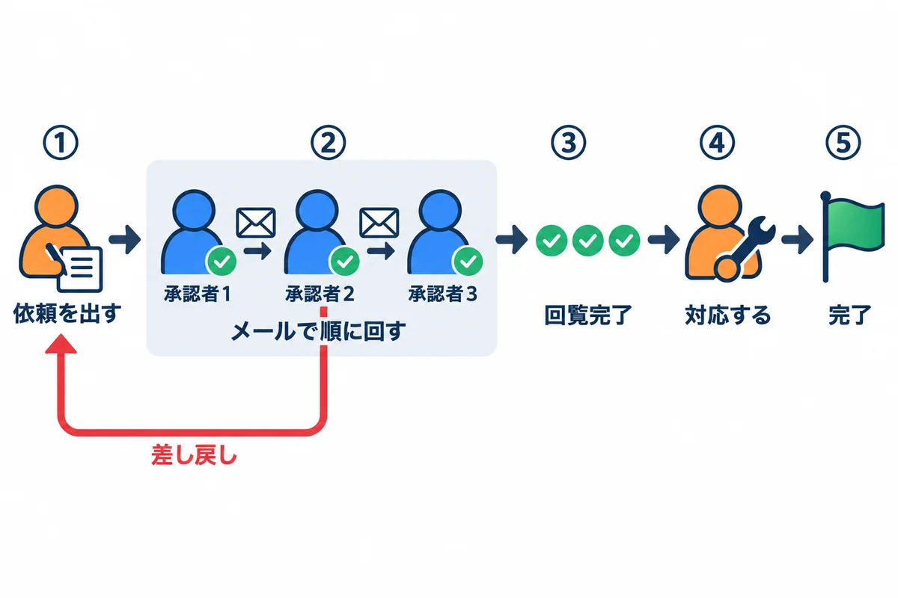
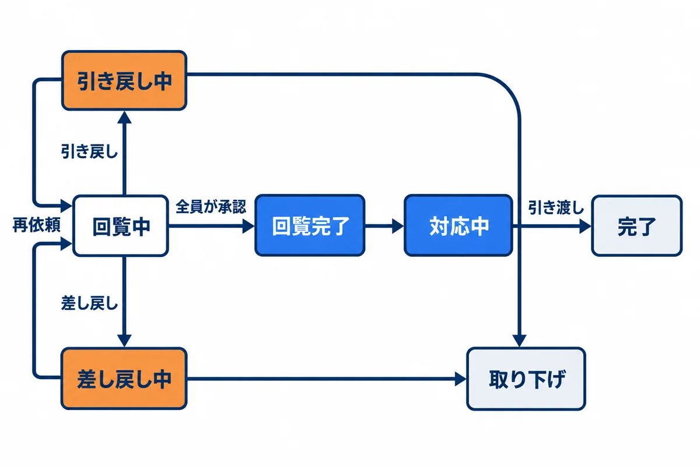
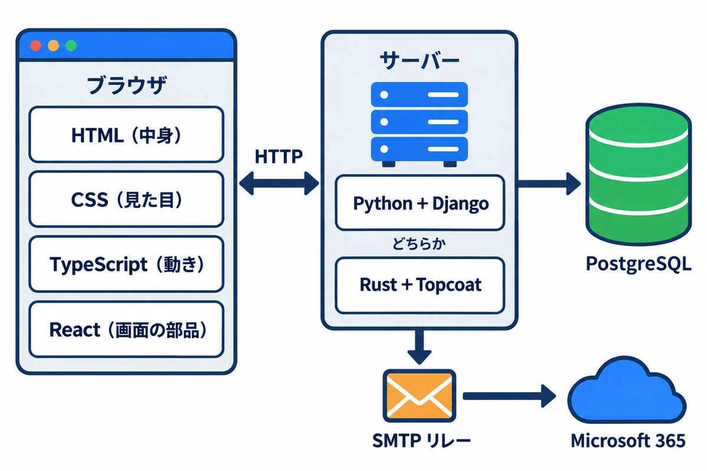
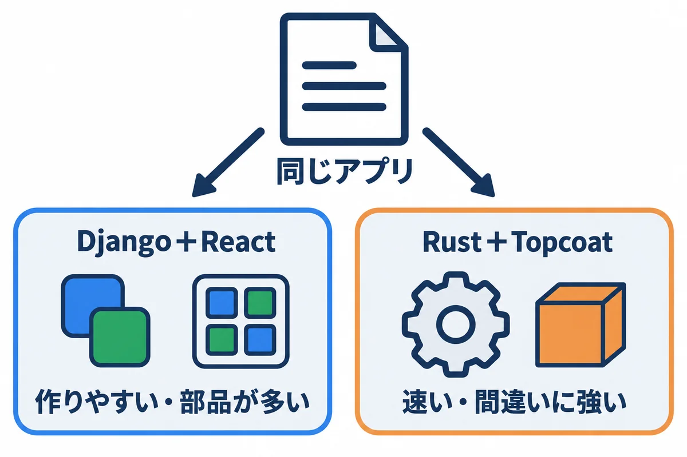
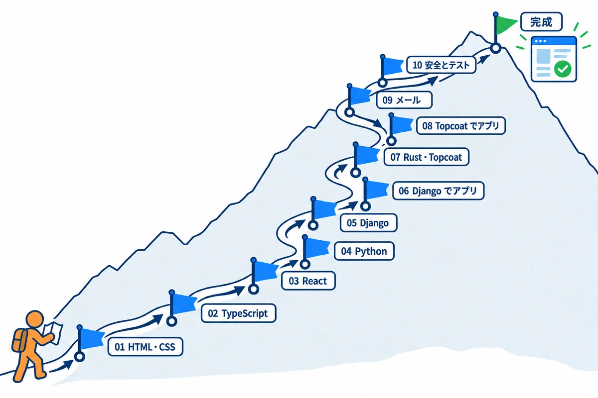

Web アプリ開発 学習資料

学習ガイド — 作るアプリと、学ぶ技術の地図

依頼・承認の練習アプリを作りながら、HTML・CSS・TypeScript・React・Python・Django・Rust・Topcoat・メール送信を学ぶ

# 学習ガイド: 作るアプリと、学ぶ技術の地図

## この資料について

この資料集は、**プログラミングや Web の経験がほとんど無い人**が、社内向けの業務 Web アプリを作れるようになるための教材です。

- **1 つの練習アプリ**（依頼・承認アプリ）を、少しずつ作りながら学びます。「何のために、その技術が要るのか」が分かるようにするためです。
- 同じアプリを、**2 つの作り方**で作ります。**Python＋Django（サーバー）と TypeScript＋React（画面）**の組み合わせと、**Rust＋Topcoat**の組み合わせです。
- 専門用語は、出てくるたびに説明します。図（考え方の絵）と、練習アプリの**本物の画面の写し**を多く入れています。
- 練習のコードは `samples/` のフォルダにあり、**実際に動かして確かめた物**です。

> **用語:** Web アプリ（ブラウザで開いて使うアプリ。社員のパソコンにアプリを入れなくても、URL を開くだけで使える）

## 1. 作る練習アプリ: 依頼・承認アプリ

### 1.1 仕事の流れ

図1-1: 練習アプリの仕事の流れ

社員が、ほかの部署に「これをお願いします」という**依頼**を出し、上司などが順に**承認**してから、担当の部署が対応する、という社内のよくある仕事を、アプリにします。

1. 依頼する人が、件名・内容・希望の納期・添付ファイル・図面を入れて、**依頼を出す**。
2. アプリが、1 人目の承認者に**メール**を送る。メールの中の URL を開いて「承認」を押すと、次の人へメールが届く（**順に回す**＝回覧）。
3. 途中の人が「差し戻し」を押すと、依頼する人に戻る。直して、もう一度出せる。
4. 全員が承認すると「**回覧完了**」。担当の部署が「**対応中**」にして作業し、終わったら「**完了**」。

### 1.2 依頼の状態

図1-2: 依頼の状態の移り変わり（状態遷移図）

依頼は、いつも 7 つの**状態**のどれか 1 つです。「どの状態から、どの操作で、どの状態へ進めるか」を決めておくことが、業務アプリのいちばん大事な設計です（06・08 で、プログラムにします）。

| 状態 | 意味 | 依頼した人ができること |
|---|---|---|
| 回覧中 | 承認者の確認を待っている | 見る・引き戻す（直すことはできない） |
| 差し戻し中 | 承認者から直すように言われた | 直して出し直す・取り下げる |
| 引き戻し中 | 自分で取り戻した | 直して出し直す・取り下げる |
| 回覧完了 | 全員が承認した | 見る |
| 対応中 | 担当者が作業している | 見る |
| 完了 | 終わった | 見る |
| 取り下げ | やめた | — |

> **用語:** 状態遷移図（じょうたいせんいず：状態を四角、移り変わりを矢印で描いた図。「この状態からは、この操作しかできない」を、目で確かめられる）

### 1.3 練習アプリの機能と、学ぶ技術

練習アプリには、社内の業務アプリでよく出てくる機能を、ひととおり入れます。

| 機能 | 中身 | 主に学ぶ技術 | 資料 |
|---|---|---|---|
| ログイン | 社員番号とパスワードでログイン。60 分操作が無いと、自動でログアウト | セッション・クッキー・パスワードの安全な保存 | 05・06・08・10 |
| 権限 | 一般の社員・承認者・担当者・管理者で、できることを変える | 権限の確かめ方 | 06・08・10 |
| 依頼の入力 | 件名・内容・納期・回覧者を入れる画面 | HTML のフォーム・CSS・React のフォーム | 01・03・06 |
| 図面 | 画面の上で図を描き、JSON というデータの形で保存する | JSON・TypeScript・Canvas | 02・03・06 |
| 添付ファイル | JPG・PNG・PDF を付ける（1 ファイル 10MB まで） | ファイルの受け取りと、種類・大きさの確かめ | 06・08・10 |
| 承認の回覧 | メールの URL から承認・差し戻し。URL は 1 回限り・14 日で期限切れ | 状態遷移・推測できない URL・メール送信 | 06・08・09・10 |
| 一覧・詳細 | 自分の依頼の一覧、状態の色分け、進み具合 | 表・データベースの検索・API | 01・03・05・06 |
| 社員データの取り込み | 社員の一覧を CSV で取り込む | CSV・文字コード・トランザクション | 04・06 |
| 毎朝の通知 | 毎朝 8:00 に、期限の近い依頼や止まっている承認をメールで知らせる | 定期処理 | 06・08・09 |
| グラフ | 担当者ごとの件数などをグラフで見る | 集計の SQL・グラフの部品 | 06 |
| メール | 会社の Microsoft 365 を通して送る | SMTP・SMTP リレー | 09 |

## 2. 技術の地図

図2-1: 練習アプリで使う技術の地図

| 場所 | 技術 | ひとことで言うと | 資料 |
|---|---|---|---|
| ブラウザ | **HTML** | 画面の**中身と骨組み**（見出し・入力欄・表） | 01 |
| ブラウザ | **CSS** | 画面の**見た目**（色・大きさ・並べ方） | 01 |
| ブラウザ | **TypeScript** | 画面の**動き**を書く言葉（JavaScript に「型」を足した物） | 02 |
| ブラウザ | **React** | 画面を**部品（コンポーネント）**に分けて作る道具 | 03 |
| サーバー | **Python**＋**Django** | サーバーの言葉と、Web アプリの全部入りの土台 | 04・05・06 |
| サーバー | **Rust**＋**Topcoat** | 速くて間違いに強い言葉と、その Web の土台 | 07・08 |
| データベース | **PostgreSQL**（SQL） | データを表で保存する | 05・06・08（onprem の 02 も） |
| メール | **SMTP**・**SMTP リレー** | メールを送る決まりと、会社のメールに配達を任せる仕組み | 09 |
| 間をつなぐ | **HTTP**・**JSON** | ブラウザとサーバーの会話の決まりと、データの書き方 | 02・05 |

> **用語:** フロントエンド・バックエンド（ブラウザの中で動く側＝画面と、サーバーの中で動く側＝処理とデータ）

## 3. 2 つの作り方

図3-1: 同じアプリを、2 つの作り方で作る

| | Django＋React | Rust＋Topcoat |
|---|---|---|
| 画面 | React（TypeScript）で作り、サーバーとは JSON でやり取り | サーバーで HTML を作って返す（Topcoat の機能） |
| サーバー | Python＋Django | Rust＋Topcoat |
| 長所 | 部品が多く、早く作れる。管理画面が最初から付いている | 実行ファイル1つで動き、速い。型が強く、間違いを作る前に見つけやすい |
| 短所 | 画面とサーバーの 2 つを作る。部品の更新の手間が多い | 覚えることが多い。Topcoat はまだ新しい（0.x の版） |
| サーバーへの建て方 | onprem の 05 | onprem の 04 |

どちらか一方だけを学んでもかまいません。**初めての人には、Django＋React から始める**ことをすすめます。情報と部品が多く、つまずいたときに調べやすいからです。

> **用語:** 技術スタック（アプリを作るのに組み合わせて使う技術の一式。onprem の 03 で、選び方を比べている）

## 4. 学ぶ順番

図4-1: 学習の道のり

| 巻 | 内容 | 先に読む物 | Django＋React の道 | Rust＋Topcoat の道 |
|---|---|---|---|---|
| 01 | HTML と CSS | この巻 | ● | ● |
| 02 | TypeScript の基礎 | 01 | ● | （画面の動きを書くなら） |
| 03 | React の基礎 | 02 | ● | — |
| 04 | Python の基礎 | — | ● | — |
| 05 | Django の基礎 | 04 | ● | — |
| 06 | Django＋React で練習アプリを作る | 03・05 | ● | — |
| 07 | Rust と Topcoat の基礎 | 01 | — | ● |
| 08 | Topcoat で練習アプリを作る | 07 | — | ● |
| 09 | メールと SMTP リレー | 06 か 08 | ● | ● |
| 10 | 安全とテスト | 06 か 08 | ● | ● |

まだできていない巻は、README の一覧に「作成中」と書いてあります。

## 5. ほかの資料との関係

このリポジトリには、ほかにも資料があります。この資料集は、それらを**入口からつなぐ**役目です。深く知りたいときは、次を読みます。

| フォルダ | 中身 | この資料集との関係 |
|---|---|---|
| `onprem/` | 会社のサーバー（Windows Server）に、アプリを建てて運用する | 作ったアプリを、どうやって社内で動かすか |
| `docs/` | Django＋React の業務アプリ（別のアプリ）を、1 行ずつ読み解く全 13 章 | 01〜06 の、さらに詳しい説明（HTML・CSS・TypeScript・React・Python・Django・テスト） |
| `Rust/` | Rust と Topcoat を、ゼロから完成まで学ぶ全 14 巻 | 07・08 の、さらに詳しい説明 |
| `next/`・`react_native/` | Next.js・React Native のアプリの作り方 | 別の作り方（参考） |

## 6. 練習の環境（開発用のパソコン）

| 道具 | 版（2026-11-01 時点） | 何に使う | 入れ方の詳しい説明 |
|---|---|---|---|
| Visual Studio Code | 最新 | プログラムを書く | `docs/01_環境構築.md` |
| Git | 最新 | プログラムの変更を記録する | `docs/02_Git_GitHub.md` |
| Python | 3.14 系 | Django を動かす | `docs/01_環境構築.md` |
| Node.js | LTS 版 | TypeScript・React を動かす | `docs/01_環境構築.md` |
| Rust | 1.99.1 | Rust・Topcoat を動かす | `Rust/01_環境構築_…` |
| PostgreSQL | 18 | データベース | onprem の 04 の 5 章（パソコンにも同じように入れられる） |
| ブラウザ | Edge か Chrome | 画面を見る・`F12` で開発者ツール | — |

## 7. 学び方のコツ

1. **まず写して、動かす。** サンプルのコードを、自分の手で打って（または貼って）、動くのを見ます。
2. **少し変えてみる。** 色・文字・数を変えて、何が変わるかを見ます。
3. **わざと壊してみる。** 1 文字消して、どんなエラーが出るかを見ます。エラーの文を読む練習になります。
4. **エラーの文は、最初の行と、自分のファイルの名前が出ている行を読む。** 英語でも、単語を拾えば見当が付きます。
5. **分からない言葉は、各巻の終わりの用語の表を引く。**

## 用語の索引

| 用語 | 短い説明 | 章 |
|---|---|---|
| Web アプリ | ブラウザで開いて使うアプリ | はじめ |
| 技術スタック | 組み合わせて使う技術の一式 | 3 |
| 状態・状態遷移図 | 依頼が今どこにいるか／その移り変わりの図 | 1.2 |
| フロントエンド・バックエンド | 画面の側／処理とデータの側 | 2 |
| 回覧 | 承認者に順に回すこと | 1.1 |
