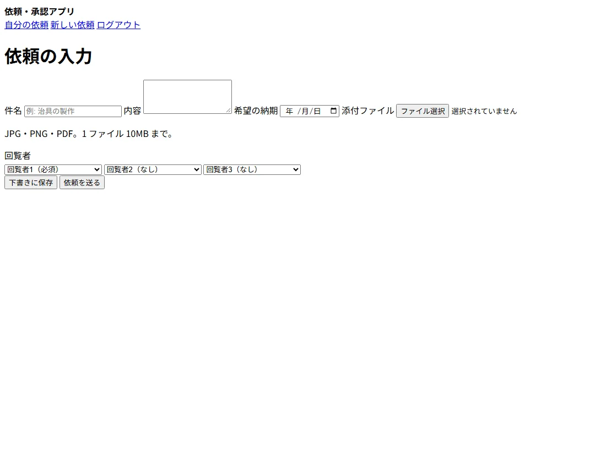
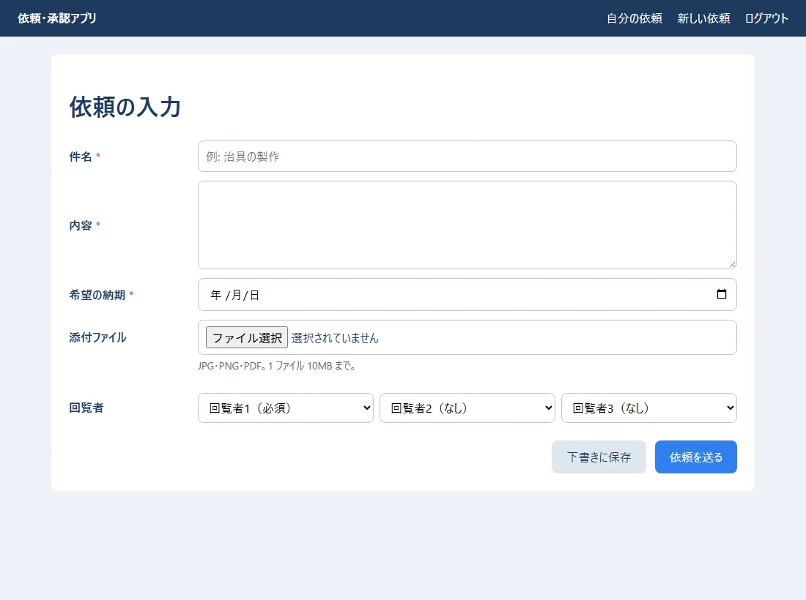
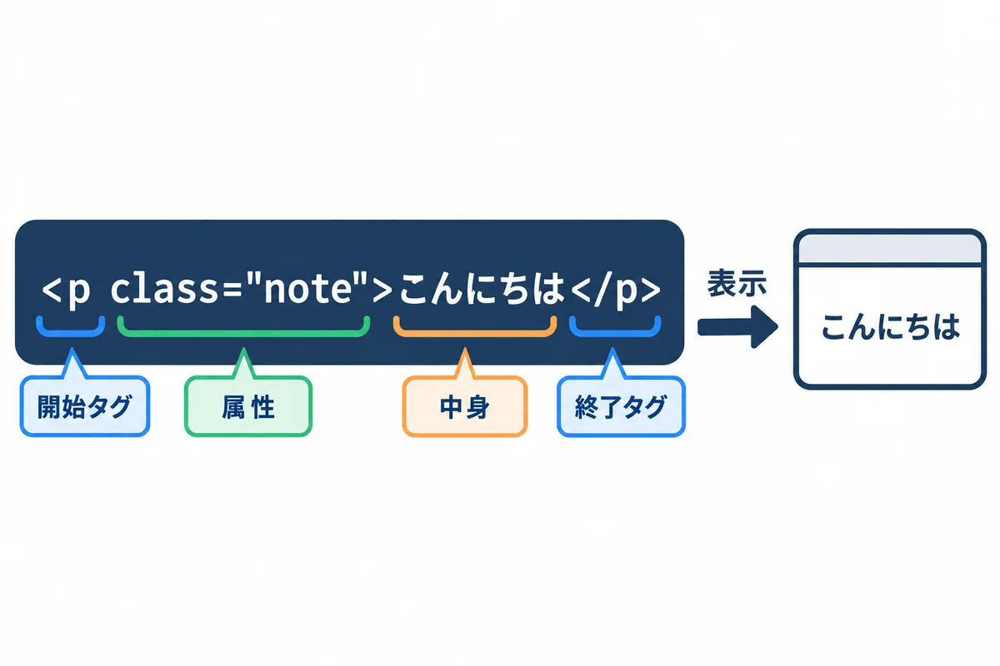
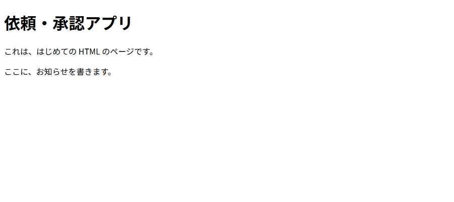
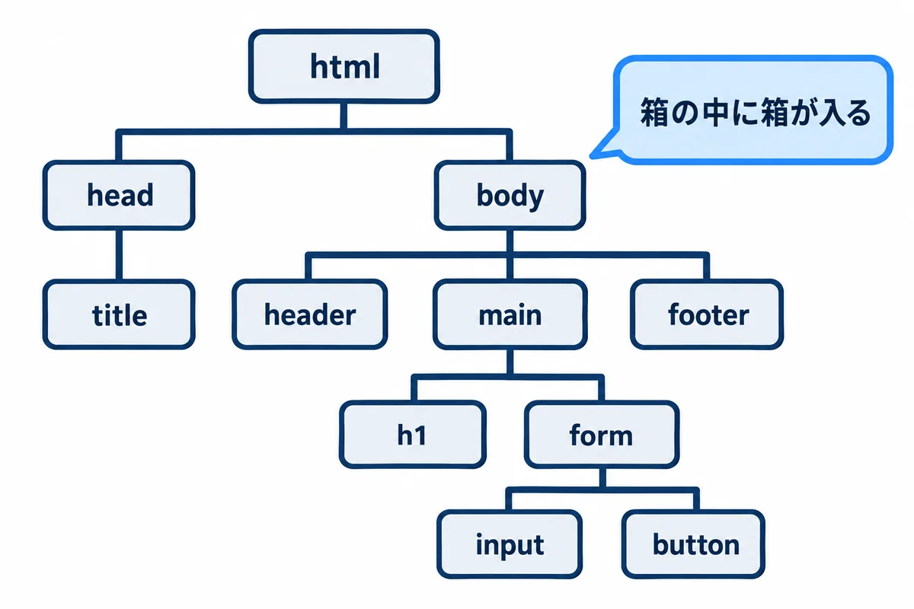
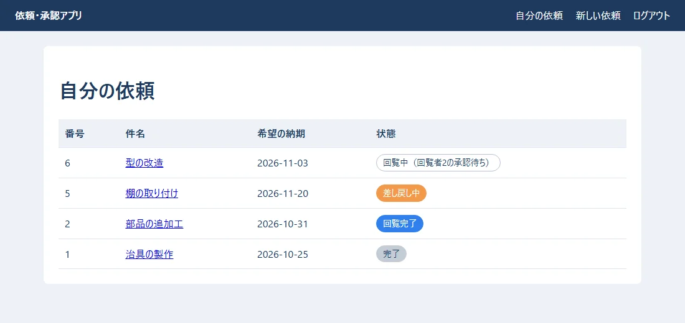
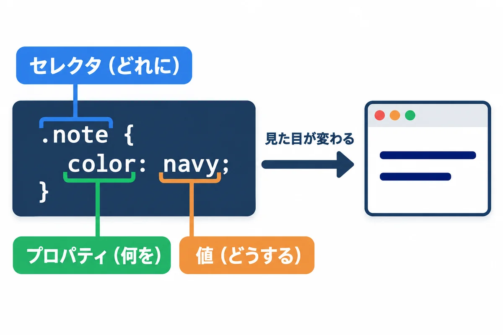
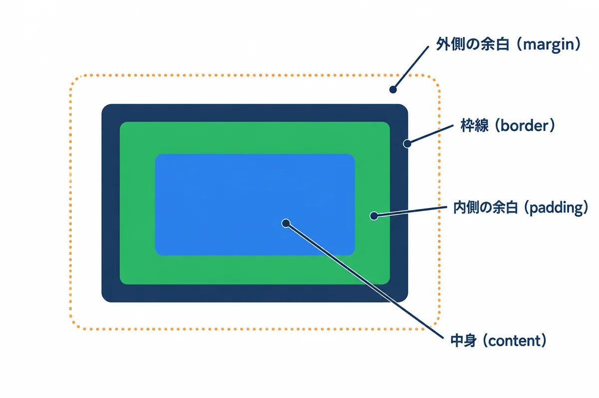
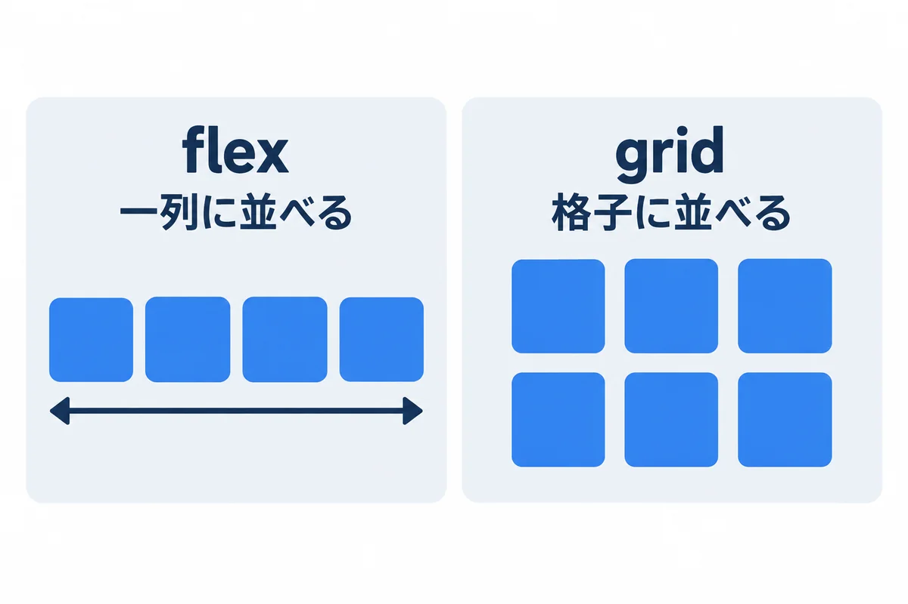
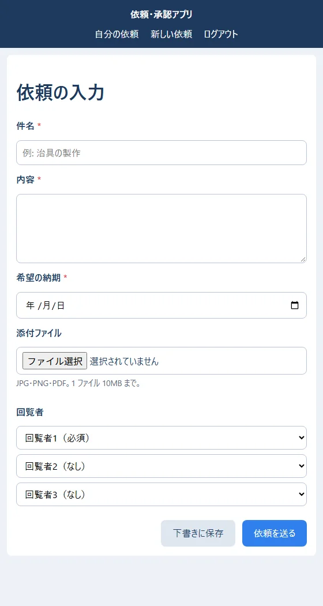

<div style="text-align: center; padding: 28px 0 8px;">
<div style="font-size: 14px; color: #475569;">Web アプリ開発 学習資料</div>
<div style="font-size: 26px; font-weight: 800; color: #0f172a; margin-top: 6px; line-height: 1.35;">01 HTML と CSS — 画面の中身と見た目</div>
<div style="font-size: 13px; color: #475569; margin-top: 8px;">依頼の入力画面と一覧画面を、HTML と CSS だけで作る</div>
</div>

# 01 HTML と CSS: 画面の中身と見た目

## この巻で学ぶこと

- Web の画面が、**HTML（中身）・CSS（見た目）・JavaScript（動き）**の 3 つでできていること
- HTML のタグの書き方と、入れ子の構造
- 依頼の**入力フォーム**と、依頼の**一覧の表**の作り方
- CSS で色・余白・並べ方を決める方法（ボックスモデル・flex・grid）
- 画面の幅に合わせて並べ方を変える方法（レスポンシブ）

練習のファイルは `samples/01_html_css/` にあります。**ファイルをダブルクリックすると、ブラウザで開けます**（サーバーは要りません）。この巻の画面の写しは、そのファイルを Chrome で開いて撮った本物です。

> **もっと詳しく:** `docs/03_Web基礎_HTML_CSS.md` に、HTML と CSS の、より詳しい説明があります。

## 1. Web の画面は 3 つでできている

| 言葉 | 受け持ち | たとえ（家） |
|---|---|---|
| **HTML** | 中身と骨組み（見出し・文・入力欄・ボタン・表） | 柱と部屋と家具 |
| **CSS** | 見た目（色・大きさ・余白・並べ方） | 壁紙・ペンキ・家具の配置 |
| **JavaScript**（TypeScript） | 動き（ボタンを押したら何かする） | 電気の配線・スイッチ |

同じ HTML でも、CSS があるかどうかで、見た目が大きく変わります。

<div style="max-width: 760px; margin: 18px auto; text-align: center;">

<div style="font-size: 12px; color: #64748b; margin-top: 6px;">図1-1: CSS が無いとき（HTML だけ）</div>
</div>

<div style="max-width: 760px; margin: 18px auto; text-align: center;">

<div style="font-size: 12px; color: #64748b; margin-top: 6px;">図1-2: CSS を付けたとき（同じ HTML に style.css を読み込んだだけ）</div>
</div>

> **用語:** HTML（エイチティーエムエル。HyperText Markup Language：Web の画面の中身を、タグという印で書く言葉）

<!-- -->

> **用語:** CSS（シーエスエス。Cascading Style Sheets：画面の見た目を決める言葉）

## 2. HTML の基本

### 2.1 タグの形

<div style="max-width: 760px; margin: 18px auto; text-align: center;">
こんにちは</p> の、開始タグ・属性・中身・終了タグ" style="width: 100%;">
<div style="font-size: 12px; color: #64748b; margin-top: 6px;">図2-1: タグは「開始タグ・中身・終了タグ」。開始タグに属性を付けられる</div>
</div>

- `<p>` が**開始タグ**、`</p>` が**終了タグ**です。間に**中身**を書きます。`p` は「段落（paragraph）」という意味です。
- 開始タグの中の `class="note"` のような物を**属性**と呼び、タグに追加の情報を付けます。
- `<input>` や `<meta>` のように、**中身を持たず、終了タグの無いタグ**もあります。

### 2.2 はじめてのページ

**▶ 準備:** 00 の 6.1（資料のフォルダと PowerShell）と 6.2（VS Code）。

**▶ 書く所と見方:**

1. 自分用の練習のフォルダを作って、VS Code で開きます。PowerShell に 1 行ずつ打ちます。

```powershell
mkdir ~\Documents\my-practice\01
cd ~\Documents\my-practice\01
code .
```

2. VS Code の左の一覧（エクスプローラー）の空いている所を右クリック →「新しいファイル」→ `hello.html` と打って Enter キーを押します。
3. 下のコードを打つ（または貼り付ける）→ `Ctrl` ＋ `S` で保存します。
4. PowerShell で `explorer .` と打つと、このフォルダがエクスプローラーで開きます。`hello.html` をダブルクリックすると、ブラウザで開きます。
5. コードを書きかえたら、保存してから、ブラウザで `F5` キー（読み込み直し）を押します。保存を忘れると、画面は変わりません。

完成したファイルは、資料のフォルダの `webapp_learning\samples\01_html_css\hello.html` にあります。読んで開くだけなら、それをダブルクリックしてもかまいません。


`samples/01_html_css/hello.html`:

```html
<!doctype html>
<html lang="ja">
  <head>
    <meta charset="utf-8">
    <title>はじめての HTML</title>
  </head>
  <body>
    <h1>依頼・承認アプリ</h1>
    <p>これは、はじめての HTML のページです。</p>
    <p class="note">ここに、お知らせを書きます。</p>
  </body>
</html>
```

<div style="max-width: 640px; margin: 18px auto; text-align: center;">

<div style="font-size: 12px; color: #64748b; margin-top: 6px;">図2-2: hello.html をブラウザで開いたところ</div>
</div>

| 行 | 意味 |
|---|---|
| `<!doctype html>` | 「これは今の HTML で書いています」という宣言。いつも 1 行目に書く |
| `<html lang="ja">` | ページ全体。`lang="ja"` で日本語のページだと伝える（読み上げソフトなどが使う） |
| `<head>` | ページの情報（画面には出ない）。文字コード・題名・CSS の読み込みなど |
| `<meta charset="utf-8">` | 文字コードは UTF-8。**これが無いと文字化けすることがある**（onprem の 00 基礎知識 0.4） |
| `<title>` | ブラウザのタブに出る題名 |
| `<body>` | 画面に出る中身 |
| `<h1>` | いちばん大きな見出し（`h1`〜`h6` の 6 段階） |

### 2.3 入れ子の構造

<div style="max-width: 760px; margin: 18px auto; text-align: center;">

<div style="font-size: 12px; color: #64748b; margin-top: 6px;">図2-3: タグは入れ子になり、木の形の構造を作る</div>
</div>

タグの中に、別のタグを入れられます。**内側のタグは、外側のタグより先に閉じます**（`<p><strong>…</strong></p>` は正しい、`<p><strong>…</p></strong>` は間違い）。ブラウザは、HTML を読んで、この木の形の構造（**DOM**）を作ってから、画面に描きます。

> **用語:** DOM（ドム。Document Object Model：ブラウザが HTML から作る、タグの木の形の構造。JavaScript は、この DOM を書きかえて画面を変える）

### 2.4 よく使うタグ

| タグ | 意味 | 練習アプリでの使い道 |
|---|---|---|
| `<header>`・`<main>`・`<footer>`・`<nav>` | ページの上の帯・中心・下の帯・行き先の並び | 上の帯とメニュー |
| `<h1>`〜`<h3>` | 見出し | 画面の題名 |
| `<p>` | 段落 | 説明の文 |
| `<a href="...">` | 別のページへの案内（リンク） | 一覧の件名から詳細へ |
| `<ul>`・`<li>` | 箇条書き | お知らせの一覧 |
| `<table>`・`<tr>`・`<th>`・`<td>` | 表・行・見出しのマス・中身のマス | 依頼の一覧 |
| `<form>` | 入力をまとめて送る | 依頼の入力 |
| `<label>`・`<input>`・`<select>`・`<textarea>` | 入力欄の名前・1 行の入力・選ぶ・何行もの入力 | 件名・回覧者・内容 |
| `<button>` | ボタン | 依頼を送る |
| `<span>`・`<div>` | 意味の無い、ただの入れ物（小さい・大きい） | 状態の札・並べ方のまとまり |

> **意味のあるタグを使う:** 見た目が同じでも、`<div>` だらけにせず、見出しは `<h1>`、表は `<table>` のように、**意味の合ったタグ**を使います。読み上げソフトを使う人や、検索、後から読む人が、ページの構造を理解しやすくなります。

## 3. フォーム: 依頼の入力画面

**▶ 書く所と見方:** 2.2 と同じフォルダに `request_form.html` を作ります。この画面は、見た目を `style.css`（5〜7 章で説明する CSS のファイル）から読み込みます。資料の `webapp_learning\samples\01_html_css\style.css` を、同じフォルダに写してから（エクスプローラーでコピーして貼り付け）、`request_form.html` をダブルクリックで開きます。`style.css` が同じフォルダに無いと、色も並べ方も無い、文字だけの画面になります。


`samples/01_html_css/request_form.html`:

```html
<!doctype html>
<html lang="ja">
  <head>
    <meta charset="utf-8">
    <meta name="viewport" content="width=device-width, initial-scale=1">
    <title>依頼の入力 - 依頼・承認アプリ</title>
    <link rel="stylesheet" href="style.css">
  </head>
  <body>
    <header class="site-header">
      <strong>依頼・承認アプリ</strong>
      <nav>
        <a href="request_list.html">自分の依頼</a>
        <a href="request_form.html">新しい依頼</a>
        <a href="#">ログアウト</a>
      </nav>
    </header>

    <main>
      <h1>依頼の入力</h1>
      <form action="/requests" method="post" enctype="multipart/form-data">
        <div class="form-grid">
          <label for="title" class="required">件名</label>
          <input id="title" name="title" type="text" maxlength="100" required placeholder="例: 治具の製作">

          <label for="detail" class="required">内容</label>
          <textarea id="detail" name="detail" rows="4" required></textarea>

          <label for="due" class="required">希望の納期</label>
          <input id="due" name="due_date" type="date" required>

          <label for="files">添付ファイル</label>
          <input id="files" name="files" type="file" accept=".jpg,.jpeg,.png,.pdf" multiple>
          <p class="hint">JPG・PNG・PDF。1 ファイル 10MB まで。</p>

          <label>回覧者</label>
          <div class="approvers">
            <select name="approver1" required aria-label="回覧者1">
              <option value="">回覧者1（必須）</option>
              <option value="101">山田 太郎（設計部 課長）</option>
              <option value="102">佐藤 花子（設計部 係長）</option>
            </select>
            <select name="approver2" aria-label="回覧者2">
              <option value="">回覧者2（なし）</option>
              <option value="101">山田 太郎（設計部 課長）</option>
              <option value="102">佐藤 花子（設計部 係長）</option>
            </select>
            <select name="approver3" aria-label="回覧者3">
              <option value="">回覧者3（なし）</option>
              <option value="101">山田 太郎（設計部 課長）</option>
              <option value="102">佐藤 花子（設計部 係長）</option>
            </select>
          </div>
        </div>

        <div class="actions">
          <button type="button" class="btn-secondary">下書きに保存</button>
          <button type="submit" class="btn-primary">依頼を送る</button>
        </div>
      </form>
    </main>
  </body>
</html>
```

| 部分 | 意味 |
|---|---|
| `<form action="/requests" method="post">` | 「送る」を押すと、入力した物を `/requests` へ、`POST`（処理をお願いする送り方。onprem の 00 基礎知識 5.4）で送る |
| `enctype="multipart/form-data"` | ファイルを一緒に送るときの送り方。**添付ファイルがあるフォームには必ず付ける** |
| `<label for="title">` と `<input id="title">` | `for` と `id` を同じにすると、ラベルと入力欄が結び付く。ラベルを押すと入力欄に移り、読み上げソフトも名前を読める |
| `name="title"` | サーバーに送るときの名前。**`name` が無い入力欄は、送られない** |
| `type="text"`・`type="date"`・`type="file"` | 入力欄の種類。`date` ならカレンダー、`file` ならファイルを選ぶ欄になる |
| `required`・`maxlength="100"` | 空は不可・100 文字まで。ブラウザが、送る前に確かめてくれる |
| `accept=".jpg,.jpeg,.png,.pdf"`・`multiple` | 選べるファイルの種類・何個も選べる |
| `<select>` と `<option value="101">` | 選ぶ欄。サーバーには、表示の文字ではなく `value`（社員番号）が送られる |

> **ブラウザの確かめは、ただのお手伝いです。** `required` や `accept` は、悪意のある人なら簡単に外せます。**サーバーでも必ず同じことを確かめます**（06・08・10）。

## 4. 表: 依頼の一覧

`samples/01_html_css/request_list.html`:

```html
<!doctype html>
<html lang="ja">
  <head>
    <meta charset="utf-8">
    <meta name="viewport" content="width=device-width, initial-scale=1">
    <title>自分の依頼 - 依頼・承認アプリ</title>
    <link rel="stylesheet" href="style.css">
  </head>
  <body>
    <header class="site-header">
      <strong>依頼・承認アプリ</strong>
      <nav>
        <a href="request_list.html">自分の依頼</a>
        <a href="request_form.html">新しい依頼</a>
        <a href="#">ログアウト</a>
      </nav>
    </header>

    <main>
      <h1>自分の依頼</h1>
      <table>
        <thead>
          <tr><th>番号</th><th>件名</th><th>希望の納期</th><th>状態</th></tr>
        </thead>
        <tbody>
          <tr><td>6</td><td><a href="#">型の改造</a></td><td>2026-11-03</td><td><span class="badge badge-circulating">回覧中（回覧者2の承認待ち）</span></td></tr>
          <tr><td>5</td><td><a href="#">棚の取り付け</a></td><td>2026-11-20</td><td><span class="badge badge-returned">差し戻し中</span></td></tr>
          <tr><td>2</td><td><a href="#">部品の追加工</a></td><td>2026-10-31</td><td><span class="badge badge-approved">回覧完了</span></td></tr>
          <tr><td>1</td><td><a href="#">治具の製作</a></td><td>2026-10-25</td><td><span class="badge badge-done">完了</span></td></tr>
        </tbody>
      </table>
    </main>
  </body>
</html>
```

<div style="max-width: 760px; margin: 18px auto; text-align: center;">

<div style="font-size: 12px; color: #64748b; margin-top: 6px;">図4-1: 依頼の一覧。状態ごとに札の色を変えている</div>
</div>

- `<thead>` に見出しの行、`<tbody>` に中身の行を入れます。
- 状態の札は `<span class="badge badge-returned">` のように、**共通の `badge` と、状態ごとの `badge-returned` の 2 つの class** を付けます。色は CSS で決めます（6 章）。
- 今は、行を HTML に直接書いています。本物のアプリでは、データベースから読んだ依頼の数だけ、行をプログラムで作ります（React は 03・06、Topcoat は 08）。

## 5. CSS の基本

### 5.1 ルールの形

<div style="max-width: 760px; margin: 18px auto; text-align: center;">

<div style="font-size: 12px; color: #64748b; margin-top: 6px;">図5-1: CSS は「どれに（セレクタ）・何を（プロパティ）・どうする（値）」</div>
</div>

HTML から CSS を読み込むには、`<head>` に `<link rel="stylesheet" href="style.css">` を書きます。

### 5.2 セレクタ（どれに当てるか）

| 書き方 | 当たる物 | 練習の例 |
|---|---|---|
| `button` | すべての `<button>` | すべてのボタンの角を丸める |
| `.badge` | `class="badge"` を持つ物 | 状態の札 |
| `#title` | `id="title"` の物（1 ページに 1 つ） | （練習では使っていない） |
| `.site-header nav a` | `.site-header` の中の `nav` の中の `a` | 上の帯のリンク |
| `a:hover` | マウスを乗せている `a` | リンクに下線を出す |
| `input:focus` | 今、入力している欄 | 青い枠を出す |
| `.required::after` | `.required` の後ろに、文字を足す | 必須の `*` |

> **同じ物に、何個もルールが当たったら:** 基本は「**後に書いた方**」が勝ちます。ただし、`#id` は `.class` より、`.class` はタグの名前より強い、という強さの順（**詳細度**）があります。迷ったら、**class だけを使う**と、強さがそろって分かりやすくなります。

### 5.3 色と大きさの決まり（変数）

`style.css` の最初で、使う色を**変数**として決めています。

```css
:root {
  --navy: #1e3a5f;
  --blue: #2f80ed;
}
body { color: var(--navy); }
```

色を変えたくなったら、ここを 1 か所直すだけで、全部の画面の色が変わります。この資料の図の色も、同じ 6 色にそろえています。

> **用語:** カスタム プロパティ（CSS の変数。`--名前: 値;` で決め、`var(--名前)` で使う）

## 6. ボックスモデル（余白と枠線）

<div style="max-width: 760px; margin: 18px auto; text-align: center;">

<div style="font-size: 12px; color: #64748b; margin-top: 6px;">図6-1: すべての要素は、4 重の箱でできている</div>
</div>

| プロパティ | 意味 | 練習の例 |
|---|---|---|
| `padding` | 枠線の**内側**の余白 | `main { padding: 24px; }`（白い板の内側の余白） |
| `border` | 枠線 | `input { border: 1px solid #b8c4d6; }` |
| `margin` | 枠線の**外側**の余白 | `main { margin: 24px auto; }`（`auto` で左右の真ん中に置く） |
| `border-radius` | 角の丸み | `--radius: 8px` |
| `box-sizing: border-box` | `width` に、padding と border も含める | `* { box-sizing: border-box; }`。**最初に書いておくと、幅の計算が楽になる** |

## 7. 並べ方: flex と grid

<div style="max-width: 760px; margin: 18px auto; text-align: center;">

<div style="font-size: 12px; color: #64748b; margin-top: 6px;">図7-1: flex は一列に、grid は格子に並べる</div>
</div>

**flex（一列に並べる）:** 上の帯で、アプリの名前とメニューを左右に分けています。

```css
.site-header {
  display: flex;
  align-items: center;             /* 縦の真ん中にそろえる */
  justify-content: space-between;  /* 両端に分ける */
}
```

**grid（格子に並べる）:** 入力フォームで、左にラベル（160px）、右に入力欄（残りの全部）の 2 列にしています。

```css
.form-grid {
  display: grid;
  grid-template-columns: 160px 1fr;  /* 1 列目は 160px、2 列目は残り */
  gap: 12px 16px;                    /* 行の間 12px、列の間 16px */
}
```

> **用語:** `fr`（フラクション：grid で「残りの幅を分ける割合」。`1fr` は残り全部）

## 8. 画面の幅に合わせる（レスポンシブ）

`style.css` の 7 番目の所で、画面の幅が 640px 以下のときだけ、並べ方を変えています。

```css
@media (max-width: 640px) {
  main { margin: 12px; padding: 16px; }
  .form-grid { grid-template-columns: minmax(0, 1fr); }  /* 1 列にする */
  .approvers { flex-direction: column; }                 /* 回覧者を縦に並べる */
}
```

<div style="max-width: 420px; margin: 18px auto; text-align: center;">

<div style="font-size: 12px; color: #64748b; margin-top: 6px;">図8-1: 幅のせまい画面では、1 列に並ぶ（同じ HTML と CSS）</div>
</div>

- `<head>` の `<meta name="viewport" content="width=device-width, initial-scale=1">` が無いと、スマートフォンが「パソコンの幅のページ」として縮めて表示し、`@media` が効きません。
- `minmax(0, 1fr)` は、「中身の長さに引っ張られて、列が画面より広がらない」ようにする書き方です（ただの `1fr` だと、長い選択肢などに合わせて広がることがある）。
- 印刷するときの見た目も、`@media print { ... }` で決められます（メニューとボタンを消している）。

## 9. 開発者ツールで、HTML と CSS を見る

ブラウザで `F12` を押すと、**開発者ツール**が開きます。

1. 左上の矢印のボタンを押してから、画面の部品をクリックすると、その部品の HTML が「要素」（Elements）のタブで選ばれます。
2. 右側の「スタイル」（Styles）に、その部品に当たっている CSS が、強い順に並びます。線で消されているのは、ほかのルールに負けた物です。
3. 値をクリックして書きかえると、**その場で見た目が変わります**（ファイルは変わらないので、読み直すと戻る）。色や余白を試すのに便利です。
4. 開発者ツールの上の、スマートフォンの形のボタンを押すと、幅のせまい画面を試せます。

## 10. よくある失敗

| 症状 | 原因 | 直し方 |
|---|---|---|
| CSS がまったく効かない | `<link href="style.css">` の場所の打ち間違い／ファイルの名前の違い | 開発者ツールの「ネットワーク」タブで、`style.css` が 404 になっていないか見る |
| CSS を直したのに、変わらない | ブラウザが古い CSS を覚えている（キャッシュ） | `Ctrl`＋`F5` で読み直す |
| 日本語が化ける | `<meta charset="utf-8">` が無い／ファイルが UTF-8 で保存されていない | `<head>` の最初に書く。エディターで UTF-8 で保存する |
| class を付けたのに色が変わらない | class の名前の打ち間違い（`badge-retuned` など）／ほかのルールの方が強い | 開発者ツールの「スタイル」で、当たっているルールを見る |
| ラベルを押しても、入力欄に移らない | `for` と `id` が違う | 同じ文字にする |
| サーバーに値が届かない | 入力欄に `name` が無い | `name` を付ける |
| 添付ファイルが届かない | `<form>` に `enctype="multipart/form-data"` が無い | 付ける |
| 全角の空白で、タグが効かない | `<input　type="text">` のように、全角の空白が入った | 半角の空白にする。エディターで全角の空白が見える設定にする |
| スマートフォンで小さく表示される | `viewport` の `<meta>` が無い | 8 章 |

## 11. 練習問題

1. `hello.html` の `<h1>` を `<h2>` に変えて、文字の大きさがどう変わるか見てください。
2. `request_list.html` に、状態が「引き戻し中」の行を足してください。札の色は、差し戻し中と同じオレンジにします（ヒント：class は `badge badge-returned` でよい）。
3. `style.css` の `--blue` を、別の色（例：`#27ae60`）に変えて、どこの色が変わるか見てください。
4. 入力フォームに、「数量」の入力欄（`type="number"`、1 以上）を足してください（ヒント：`min="1"`）。
5. 開発者ツールで、`main` の `padding` を `48px` に書きかえて、見た目がどう変わるか見てください。

**答えの例:** 2 は `<tr><td>7</td><td><a href="#">工具箱の作成</a></td><td>2026-11-30</td><td><span class="badge badge-returned">引き戻し中</span></td></tr>`。4 は `<label for="qty">数量</label><input id="qty" name="quantity" type="number" min="1">`。

## 用語の索引

| 用語 | 短い説明 | 章 |
|---|---|---|
| HTML・タグ・属性 | 画面の中身を書く言葉／その印／印に付ける情報 | 2 |
| DOM | ブラウザが HTML から作る木の形の構造 | 2.3 |
| フォーム・`name` | 入力をまとめて送る仕組み／送るときの名前 | 3 |
| CSS・セレクタ・プロパティ | 見た目を決める言葉／どれに／何を | 5 |
| 詳細度 | 当たるルールの強さの順 | 5.2 |
| カスタム プロパティ | CSS の変数 | 5.3 |
| ボックスモデル | 中身・padding・border・margin の 4 重の箱 | 6 |
| flex・grid | 一列に並べる・格子に並べる | 7 |
| レスポンシブ・`@media` | 画面の幅に合わせて変える／その書き方 | 8 |
| 開発者ツール | `F12` で開く、HTML と CSS を調べる道具 | 9 |
