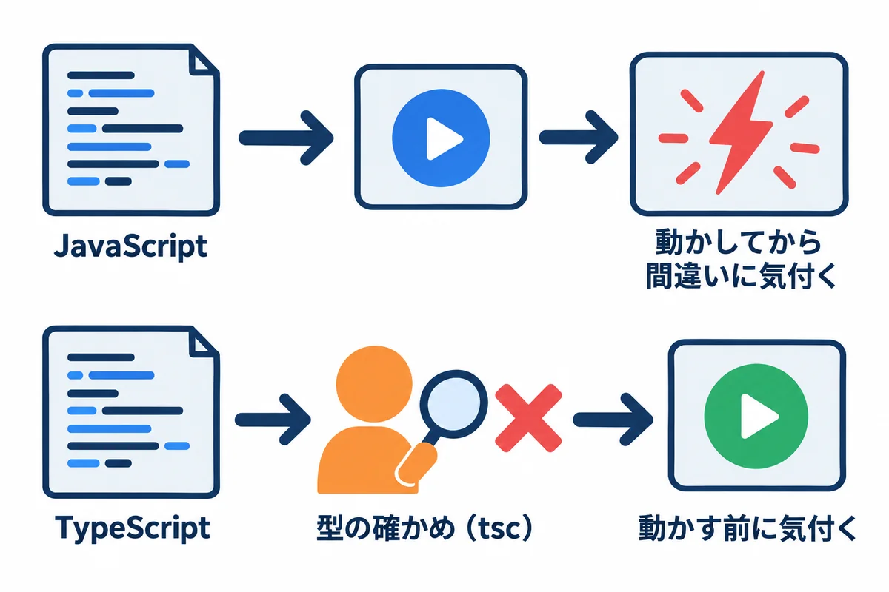
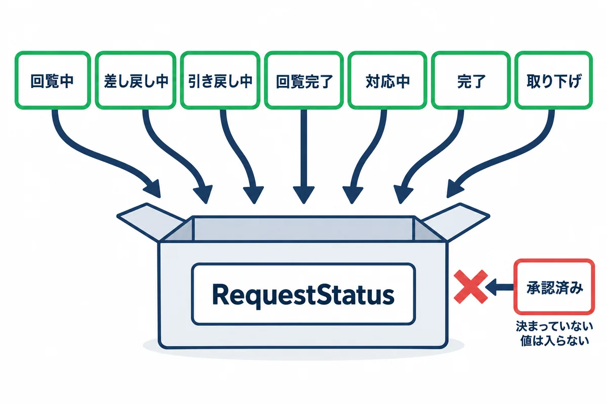
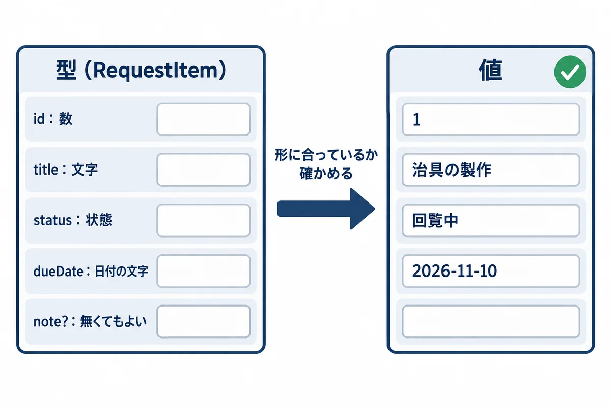
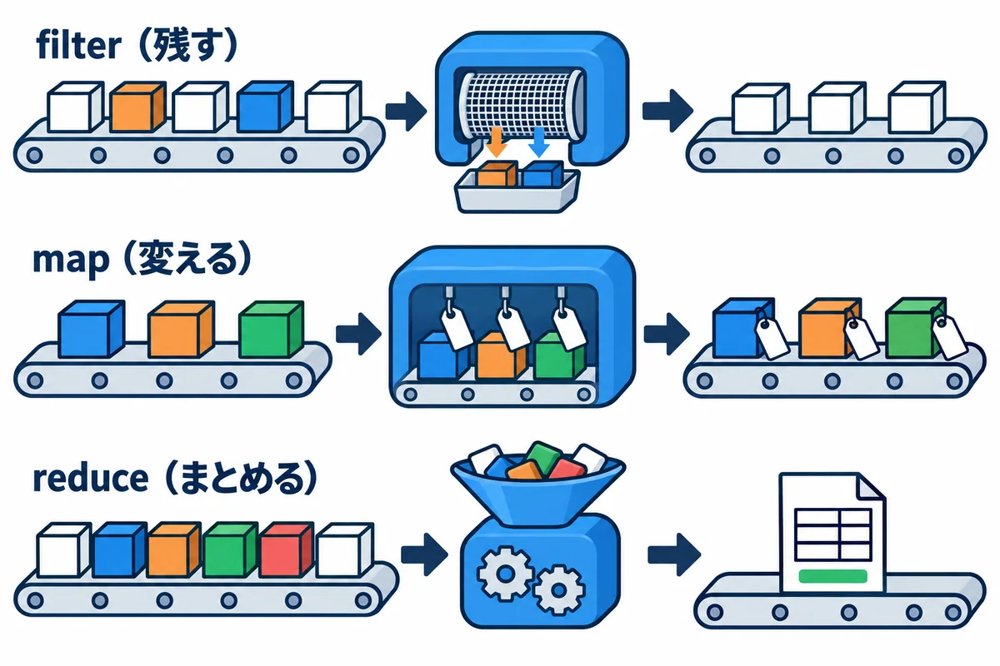
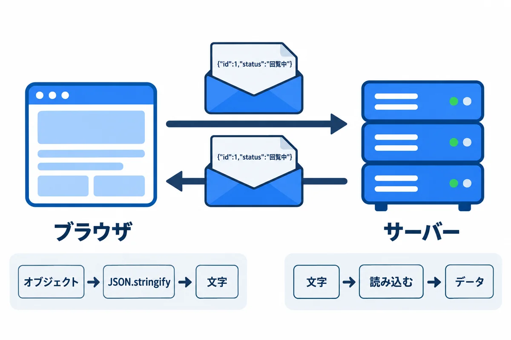
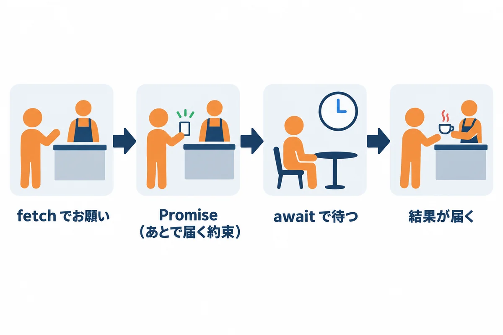

<div style="text-align: center; padding: 28px 0 8px;">
<div style="font-size: 14px; color: #475569;">Web アプリ開発 学習資料</div>
<div style="font-size: 26px; font-weight: 800; color: #0f172a; margin-top: 6px; line-height: 1.35;">02 TypeScript の基礎 — 型で間違いを防ぐ</div>
<div style="font-size: 13px; color: #475569; margin-top: 8px;">依頼の状態・図面の JSON・サーバーとのやり取りを、TypeScript で書く</div>
</div>

# 02 TypeScript の基礎: 型で間違いを防ぐ

## この巻で学ぶこと

- TypeScript が JavaScript に「**型**」を足した言葉であること、型が何を守ってくれるか
- 変数・配列・オブジェクト・関数の書き方
- 依頼の**状態**を「決まった値だけ」の型にして、状態の移り変わりを関数にする
- 配列の道具（`filter`・`map`・`reduce`）で、一覧を絞る・変える・数える
- 図面のデータを **JSON** で保存する・読み込む
- サーバーとのやり取り（`fetch`・`async`・`await`）

練習のファイルは `samples/02_typescript/` にあります。この巻の結果は、Node.js（25 系）と TypeScript 7.0.2 で、実際に動かした結果です。

> **もっと詳しく:** `docs/04_JavaScript_TypeScript.md`、`next/02-typescript-basics.md` にも、TypeScript の説明があります。

## 1. TypeScript とは

<div style="max-width: 760px; margin: 18px auto; text-align: center;">

<div style="font-size: 12px; color: #64748b; margin-top: 6px;">図1-1: TypeScript は、動かす前に間違いを見つける</div>
</div>

- **JavaScript** は、ブラウザが直接動かせる、ただ 1 つのプログラムの言葉です。画面の動き（ボタンを押したら何かする）は、JavaScript で書きます。
- **TypeScript** は、JavaScript に「**この変数には数しか入れない**」「**この項目は必ずある**」という**型**の決まりを足した言葉です。型の決まりは、**動かす前に**、`tsc` という道具が確かめます。
- 確かめが済んだら、型の書き込みを取り除いて、ふつうの JavaScript として動かします（ブラウザは TypeScript を直接は動かせない）。

> **用語:** 型（かた。type：その値が「文字」か「数」か「決まった形のまとまり」か、という種類。型が合わない使い方を、動かす前に見つけられる）

<!-- -->

> **用語:** tsc（ティーエスシー：TypeScript の型を確かめる道具。TypeScript Compiler）

### 1.1 準備と動かし方

**▶ 準備:** 00 の 6.1（資料のフォルダ）・6.2（VS Code）・6.3（Node.js）。下のコマンドは、PowerShell で**資料のフォルダにいるところから**打ちます（00 の 6.1）。`npm` が「スクリプトの実行が無効」で止められたら、`npm.cmd`・`npx.cmd` と打ちます（00 の 6.3）。

**▶ 書く所と動かし方:** 練習のファイルは `src\` の中にあります。`code .` で VS Code を開いて読み、書きかえたら `Ctrl` ＋ `S` で保存して、PowerShell で `node src\basics.ts` のように動かします。自分で新しいファイルを作るときも、`src\` の中に `.ts` で作ります（`npx tsc` が確かめるのは `src\` の `.ts` です）。


```powershell
cd webapp_learning\samples\02_typescript
npm install          # TypeScript などの部品を入れる（最初の 1 回）
npx tsc              # 型を確かめる（何も出なければ、間違い無し）
node src\basics.ts   # 動かす
```

<!-- first-use -->

> **▶ ここで初めて出てくるコード**
>
> - **`npm install`**（Node.js）: `package.json` に書いてある部品（TypeScript など）を、まとめて入れるコマンド。入った部品は `node_modules` フォルダに入ります（Git には入れません）。最初の 1 回だけ打ちます。`npm install 部品の名前` なら、その部品を足します。
> - **`npx tsc`**（Node.js）: TypeScript の型の確かめ（`tsc`）を動かすコマンド。何も出なければ、型のまちがいはありません。まちがいがあると、ファイル名・行・何がおかしいかを表示します。`npx` は、入れた部品のコマンドを動かす道具です。

<!-- /first-use -->

- **Node.js** は、ブラウザの外で JavaScript を動かす道具です。今の Node.js は、`.ts` のファイルの型の書き込みを取り除いて、そのまま動かせます。
- ただし、**Node.js は型を確かめません**。型を確かめるのは `npx tsc` です（6 章で、その違いを見ます）。

`package.json`（使う部品と版）と `tsconfig.json`（型の確かめ方の設定）:

```json
{
  "name": "webapp-learning-typescript",
  "private": true,
  "type": "module",
  "scripts": {
    "check": "tsc"
  },
  "devDependencies": {
    "@types/node": "24.19.2",
    "typescript": "7.0.2"
  }
}
```

```json
{
  "compilerOptions": {
    "strict": true,
    "target": "es2023",
    "module": "nodenext",
    "noEmit": true,
    "allowImportingTsExtensions": true,
    "erasableSyntaxOnly": true,
    "types": ["node"]
  },
  "include": ["src/*.ts"]
}
```

| 設定 | 意味 |
|---|---|
| `"strict": true` | 型の確かめを、いちばん厳しくする。**初めから厳しくしておく方が、間違いが少ない** |
| `"noEmit": true` | 型を確かめるだけで、JavaScript のファイルは作らない（Node.js が直接動かすため） |
| `"include": ["src/*.ts"]` | 確かめるファイル |

## 2. 変数・配列・オブジェクト・関数

`src/basics.ts`:

```typescript
// 1. 変数と型
const appName: string = "依頼・承認アプリ"; // 文字
let count: number = 3;                     // 数
const isOpen: boolean = true;              // はい・いいえ
count = count + 1;                         // let は、あとから変えられる

// 2. 配列（同じ型の物の並び）
const approvers: string[] = ["山田", "佐藤", "鈴木"];

// 3. オブジェクト（名前の付いた値のまとまり）
const user = { employeeNo: "012345", name: "山田 太郎", isAdmin: false };

// 4. 関数（引数と戻り値に型を付ける）
function greet(name: string): string {
  return `${name} さん、こんにちは`; // ` で囲むと、${ } の中に値を埋め込める
}

// 5. アロー関数（短い書き方の関数）
const double = (n: number): number => n * 2;

console.log(appName, count, isOpen);
console.log(approvers.length, "人:", approvers.join("、"));
console.log(user.name, user.isAdmin ? "管理者" : "一般");
console.log(greet(user.name));
console.log(double(21));
```

<!-- first-use -->

> **▶ ここで初めて出てくるコード**
>
> - **`const`**（JavaScript・TypeScript）: JavaScript・TypeScript で、変えない値に名前を付ける書き方。`const db = …;`。あとで別の値を入れようとするとエラーになります。
> - **`let`**（JavaScript・TypeScript）: JavaScript・TypeScript で、あとで変える値に名前を付ける書き方。
> - **`function`**（TypeScript）: 関数（ひとまとまりの処理）を作る書き方。`function greet(name: string): string { … }` は、「文字列の `name` を受け取って、文字列を返す関数 `greet`」です。
> - **`return`**（JavaScript・TypeScript）: JavaScript・TypeScript で、関数の結果を返して、関数を終える命令。
> - **`.log()`**（JavaScript・TypeScript）: `console.log(…)` は、渡した値を画面（ターミナルやブラウザーの開発者ツール）に表示します。
> - **`.join()`**（JavaScript・TypeScript）: JavaScript・TypeScript で、配列の中身を区切り文字でつないで 1 つの文字列にするメソッド。`["a", "b"].join(";")` は `"a;b"`。
> - **`=>`**（JavaScript・TypeScript）: アロー関数（短く書ける関数）の矢印。`(path) => \`…${path}\`` は「`path` を受け取って文字列を返す関数」。

<!-- /first-use -->

動かした結果（`node src\basics.ts`）:

```text
依頼・承認アプリ 4 true
3 人: 山田、佐藤、鈴木
山田 太郎 一般
山田 太郎 さん、こんにちは
42
```

| 書き方 | 意味 |
|---|---|
| `const 名前: 型 = 値` | 変えない値（定数）。**ふだんはこちらを使う** |
| `let 名前: 型 = 値` | あとから変える値 |
| `string`・`number`・`boolean` | 文字・数・はい／いいえ |
| `string[]` | 文字の配列 |
| `{ employeeNo: "012345", ... }` | オブジェクト。型を書かなくても、TypeScript が中身から型を決めてくれる（**型推論**） |
| `function greet(name: string): string` | 引数 `name` は文字、戻り値も文字 |
| `` `${name} さん` `` | 文字の中に値を埋め込む（テンプレート文字列。`` ` `` はバッククォート） |
| `条件 ? A : B` | 条件が正しければ A、違えば B |

> **用語:** 型推論（かたすいろん：型を書かなくても、入れた値から TypeScript が型を決めてくれること）

## 3. 依頼の状態を型にする

### 3.1 決まった値だけの型（ユニオン型）

<div style="max-width: 760px; margin: 18px auto; text-align: center;">

<div style="font-size: 12px; color: #64748b; margin-top: 6px;">図3-1: ユニオン型は、決まった値だけが入る箱</div>
</div>

依頼の状態は、7 つのどれかです（00 学習ガイド 1.2）。ただの `string` にすると、`"承認済み"` のような、決まっていない文字も入ってしまいます。**決まった値を `|`（または）でつないだ型**にすると、ほかの値を入れたときに、`tsc` が止めてくれます。

`src/status.ts`:

```typescript
// 依頼の状態と、状態を変える操作を「型」で決める

/** 依頼の状態。この 7 つ以外の文字は入れられない */
export type RequestStatus =
  | "回覧中"
  | "差し戻し中"
  | "引き戻し中"
  | "回覧完了"
  | "対応中"
  | "完了"
  | "取り下げ";

/** 状態を変える操作 */
export type Action =
  | "全員が承認"
  | "差し戻し"
  | "引き戻し"
  | "再依頼"
  | "取り下げ"
  | "担当を決める"
  | "引き渡し";

/** 今の状態と操作から、次の状態を返す。できない操作なら null を返す */
export function nextStatus(current: RequestStatus, action: Action): RequestStatus | null {
  switch (current) {
    case "回覧中":
      if (action === "全員が承認") return "回覧完了";
      if (action === "差し戻し") return "差し戻し中";
      if (action === "引き戻し") return "引き戻し中";
      return null;
    case "差し戻し中":
    case "引き戻し中":
      if (action === "再依頼") return "回覧中";
      if (action === "取り下げ") return "取り下げ";
      return null;
    case "回覧完了":
      return action === "担当を決める" ? "対応中" : null;
    case "対応中":
      return action === "引き渡し" ? "完了" : null;
    case "完了":
    case "取り下げ":
      return null;
    default: {
      // ここに来るのは、状態を足したのに case を書き忘れたとき。型の確かめでエラーになる
      const unreachable: never = current;
      return unreachable;
    }
  }
}

/** 一覧で使う札の色 */
export function badgeColor(status: RequestStatus): "白" | "オレンジ" | "青" | "グレー" {
  switch (status) {
    case "回覧中":
      return "白";
    case "差し戻し中":
    case "引き戻し中":
      return "オレンジ";
    case "回覧完了":
    case "対応中":
      return "青";
    case "完了":
    case "取り下げ":
      return "グレー";
  }
}
```

<!-- first-use -->

> **▶ ここで初めて出てくるコード**
>
> - **`export`**（TypeScript）: 「このファイルの外から使ってよい」という印。`export type RequestStatus = …` と書くと、ほかのファイルで `import` して使えます。
> - **`type`**（TypeScript）: 型に名前を付ける書き方。`type RequestStatus = "回覧中" | "回覧完了";` のように、決まった値だけを許す型や、オブジェクトの形を決められます。
> - **`null`**（TypeScript）: 「値が無い」ことを、わざと表す値。「できない操作なら `null` を返す」のように使います。
> - **`switch`**（TypeScript）: 値によって処理を分ける書き方。`switch (current) { case "回覧中": … }`。合う `case` から下を動かすので、それぞれの終わりに `return` や `break` を書きます。
> - **`case`**（TypeScript）: `switch` の中の「この値の時は」の部分。
> - **`if`**（JavaScript・TypeScript）: JavaScript・TypeScript の条件。`if (条件) { … } else { … }`。条件は `( )` で囲みます。
> - **`default`**（JavaScript・TypeScript）: `export default` は、そのファイルから「いちばんの物」を 1 つ外に出す書き方。読み込む側は `import 名前 from "./ファイル"` と、好きな名前で受け取れます。
> - **`never`**（TypeScript）: 「ここには絶対に来ない」ことを表す型。`switch` の最後に `const unreachable: never = current;` と書いておくと、状態を足したのに `case` を書き忘れた時、`npx tsc` がエラーで教えてくれます。
> - **`===`**（TypeScript）: 「型も値も同じか」を比べる書き方。`==` は型を勝手にそろえてから比べて思わぬ結果になるので、ふつうは `===` を使います（違うかは `!==`）。

<!-- /first-use -->

| 書き方 | 意味 |
|---|---|
| `type RequestStatus = "回覧中" \| "差し戻し中" \| ...` | 型に名前を付ける。`\|` でつないだ値のどれか（**ユニオン型**） |
| `export` | ほかのファイルから使えるようにする |
| `RequestStatus \| null` | 状態か、「無し」（`null`） |
| `switch (current) { case "回覧中": ... }` | 値ごとに分ける |
| `case "差し戻し中": case "引き戻し中":` | 2 つの値で、同じことをする |
| `const unreachable: never = current;` | **全部の状態を `case` に書いたか**の確かめ。書き忘れると、`tsc` がここでエラーにする（6 章） |
| `/** ... */` | 説明のコメント。エディターで、関数の名前にマウスを乗せると表示される |

この `nextStatus` は、00 学習ガイドの状態遷移図を、そのままプログラムにした物です。サーバー（06 の Django・08 の Topcoat）でも、同じ考え方で作ります。

> **用語:** ユニオン型（union：「A か B か C」のように、いくつかの型や値のどれか、という型）

### 3.2 オブジェクトの型

<div style="max-width: 760px; margin: 18px auto; text-align: center;">

<div style="font-size: 12px; color: #64748b; margin-top: 6px;">図3-2: オブジェクトの型は、記入欄の決まった用紙</div>
</div>

```typescript
export type RequestItem = {
  id: number;
  title: string;
  status: RequestStatus;
  dueDate: string;
  approvers: string[];
  note?: string;        // ? が付いた項目は、無くてもよい
};
```

- `status` に `RequestStatus` を使うと、依頼のデータにも、決まった状態しか入らなくなります。
- `note?:` のように `?` を付けた項目は、無くてもかまいません。その代わり、使う前に「あるか」を確かめる必要があります（4 章の最後）。

## 4. 配列の道具: 絞る・変える・まとめる

<div style="max-width: 760px; margin: 18px auto; text-align: center;">

<div style="font-size: 12px; color: #64748b; margin-top: 6px;">図4-1: filter・map・reduce</div>
</div>

`src/requests.ts`:

```typescript
import { badgeColor, nextStatus, type RequestStatus } from "./status.ts";

/** 依頼 1 件の形 */
export type RequestItem = {
  id: number;
  title: string;
  status: RequestStatus;
  dueDate: string;      // "2026-11-10" の形の日付
  approvers: string[];  // 回覧者（1〜3 人）
  note?: string;        // ? が付いた項目は、無くてもよい
};

const requests: RequestItem[] = [
  { id: 1, title: "治具の製作", status: "回覧中", dueDate: "2026-11-10", approvers: ["山田", "佐藤"] },
  { id: 2, title: "部品の追加工", status: "回覧完了", dueDate: "2026-10-31", approvers: ["山田"] },
  { id: 3, title: "棚の取り付け", status: "差し戻し中", dueDate: "2026-11-20", approvers: ["佐藤"], note: "寸法を追記" },
  { id: 4, title: "型の改造", status: "回覧中", dueDate: "2026-11-03", approvers: ["鈴木", "山田", "佐藤"] },
];

// filter: 条件に合う物だけ残す
const circulating = requests.filter((r) => r.status === "回覧中");
console.log("回覧中:", circulating.map((r) => r.title));

// map: 1 つずつ、別の形に変える
const rows = requests.map((r) => `${r.id} ${r.title}（${r.status}・${badgeColor(r.status)}）`);
console.log(rows.join("\n"));

// reduce: 全部をまとめて 1 つの値にする（状態ごとの件数）
const counts = requests.reduce<Record<string, number>>((acc, r) => {
  acc[r.status] = (acc[r.status] ?? 0) + 1;
  return acc;
}, {});
console.log("状態ごとの件数:", counts);

// 期限の近い順に並べる（元の配列は変えない）
const byDue = [...requests].sort((a, b) => a.dueDate.localeCompare(b.dueDate));
console.log("期限の近い順:", byDue.map((r) => r.dueDate));

// 状態を変える
console.log(nextStatus("回覧中", "差し戻し"));  // 差し戻し中
console.log(nextStatus("完了", "差し戻し"));    // null（完了した依頼は差し戻せない）

// ? の付いた項目は、無いかもしれないので、確かめてから使う
for (const r of requests) {
  if (r.note !== undefined) console.log(`${r.title} のメモ: ${r.note}`);
}
```

<!-- first-use -->

> **▶ ここで初めて出てくるコード**
>
> - **`import`**（JavaScript・TypeScript）: ほかのファイルや部品から、関数などを読み込む書き方。`import { rmSync } from "node:fs";` は、Node.js のファイルの道具から `rmSync` を使えるようにします。
> - **`from`**（JavaScript・TypeScript）: `import { 名前 } from "場所";` の一部で、「どこから読み込むか」を書きます。
> - **`for`**（JavaScript・TypeScript）: くり返しの書き方。`for (const x of 配列) { … }` は、配列の中身を 1 つずつ `x` に入れてくり返します。
> - **`of`**（TypeScript）: `for (const 名前 of 配列)` の一部で、「配列の中身を 1 つずつ」という意味です（`in` を使うと、中身ではなく番号が出てくるので注意）。
> - **`undefined`**（TypeScript）: 「まだ値が入っていない」ことを表す値。`?` の付いた無くてもよい項目が無い時や、配列の範囲の外を読んだ時に出てきます。
> - **`.filter()`**（JavaScript・TypeScript）: 配列から、条件に合う物だけを集めた新しい配列を作るメソッド。
> - **`.map()`**（JavaScript・TypeScript）: 配列の中身を 1 つずつ変換した、新しい配列を作るメソッド。
> - **`.sort()`**（TypeScript）: 配列を並べかえるメソッド。`(a, b) => …` の比べる関数を渡し、マイナスなら `a` が先、プラスなら `b` が先になります。**元の配列を書きかえる**ので、`[...requests].sort(…)` のように写してから並べかえることがよくあります（新しい配列を作る `toSorted` もあります）。
> - **`.localeCompare()`**（TypeScript）: 2 つの文字列を、辞書の順で比べるメソッド。`a.localeCompare(b)` は、`a` が先ならマイナス、同じなら 0、後ならプラス。`sort` の中で、文字（日付の文字など）で並べる時に使います。
> - **`??`**（TypeScript）: `a ?? b` は、`a` が `null` か `undefined` なら `b` を使う書き方。`(acc[key] ?? 0) + 1` は「まだ無ければ 0 から数える」。
> - **`...`**（TypeScript）: スプレッド構文。`[...requests]` は配列の中身を広げて、新しい配列（写し）を作ります。`{ ...user, isAdmin: true }` は、オブジェクトを写して一部だけ変えます。

<!-- /first-use -->

動かした結果（`node src\requests.ts`）:

```text
回覧中: [ '治具の製作', '型の改造' ]
1 治具の製作（回覧中・白）
2 部品の追加工（回覧完了・青）
3 棚の取り付け（差し戻し中・オレンジ）
4 型の改造（回覧中・白）
状態ごとの件数: { '回覧中': 2, '回覧完了': 1, '差し戻し中': 1 }
期限の近い順: [ '2026-10-31', '2026-11-03', '2026-11-10', '2026-11-20' ]
差し戻し中
null
棚の取り付け のメモ: 寸法を追記
```

| 道具 | 意味 | 練習での使い道 |
|---|---|---|
| `filter((r) => 条件)` | 条件に合う物だけを残した、新しい配列 | 回覧中の依頼だけ |
| `map((r) => 新しい形)` | 1 つずつ変えた、新しい配列（数は同じ） | 一覧の 1 行の文字にする |
| `reduce((まとめ, r) => ..., 最初の値)` | 全部を 1 つの値にまとめる | 状態ごとの件数（グラフの元） |
| `[...requests].sort(...)` | 写しを作ってから並べる（`sort` は元の配列を変えるため） | 期限の近い順 |
| `import { ... } from "./status.ts"` | ほかのファイルの物を使う | 状態の型と関数 |
| `(r) => ...` | 短い関数（アロー関数）。`r` に 1 件ずつ入る | — |
| `??` | 左が無い（`null`・`undefined`）なら右を使う | `acc[r.status] ?? 0` |

## 5. 図面を JSON で保存する

<div style="max-width: 760px; margin: 18px auto; text-align: center;">

<div style="font-size: 12px; color: #64748b; margin-top: 6px;">図5-1: JSON は、データを文字にして運ぶ書き方</div>
</div>

**JSON** は、オブジェクトや配列を、**文字で書き表す**決まりです。ブラウザとサーバーの間でデータを送るとき、データベースに図面を保存するときに使います。

`src/drawing.ts`:

```typescript
// 図面を JSON で保存する・読み込む

/** 線・四角・文字の 3 種類の図形。kind の値で、どの種類かが決まる */
type Line = { kind: "line"; x1: number; y1: number; x2: number; y2: number };
type Rect = { kind: "rect"; x: number; y: number; width: number; height: number };
type Label = { kind: "text"; x: number; y: number; text: string };
export type Shape = Line | Rect | Label;

export type Drawing = { version: 1; widthMm: number; heightMm: number; shapes: Shape[] };

/** 図形の説明の文を作る。kind で分けると、その種類の項目だけが使える */
export function describe(shape: Shape): string {
  switch (shape.kind) {
    case "line":
      return `線 (${shape.x1},${shape.y1})→(${shape.x2},${shape.y2})`;
    case "rect":
      return `四角 ${shape.width}×${shape.height}`;
    case "text":
      return `文字「${shape.text}」`;
  }
}

/** JSON から読み込んだ物が、本当に Drawing の形かを確かめる（型ガード） */
export function isDrawing(value: unknown): value is Drawing {
  if (typeof value !== "object" || value === null) return false;
  const v = value as Record<string, unknown>;
  return v.version === 1 && typeof v.widthMm === "number" && typeof v.heightMm === "number" && Array.isArray(v.shapes);
}

const drawing: Drawing = {
  version: 1,
  widthMm: 297,
  heightMm: 210,
  shapes: [
    { kind: "rect", x: 10, y: 10, width: 120, height: 60 },
    { kind: "line", x1: 10, y1: 80, x2: 130, y2: 80 },
    { kind: "text", x: 12, y: 95, text: "穴 φ8 × 4" },
  ],
};

// 保存するとき: オブジェクト → JSON の文字
const json = JSON.stringify(drawing);
const bytes = new TextEncoder().encode(json).length;
console.log(json);
console.log(`大きさ: ${bytes} バイト（上限 5MB = ${5 * 1024 * 1024} バイト）`);

// 読み込むとき: JSON の文字 → 何が入っているか分からない物（unknown）→ 確かめてから使う
const loaded: unknown = JSON.parse(json);
if (isDrawing(loaded)) {
  console.log(loaded.shapes.map(describe).join(" / "));
}
console.log(isDrawing(JSON.parse('{"version": 2}'))); // false（形が違う）
```

<!-- first-use -->

> **▶ ここで初めて出てくるコード**
>
> - **`unknown`**（TypeScript）: 「何が入っているか分からない」ことを表す型。そのままでは使えず、`typeof` などで確かめてから使います。外から来た JSON を受け取る時に使うと安全です。
> - **`typeof`**（TypeScript）: 値の種類を文字で返す書き方。`typeof value === "number"` は「数か」を調べます。調べたあとの `if` の中では、TypeScript がその型として扱ってくれます。
> - **`as`**（JavaScript・TypeScript）: TypeScript で「この値は、この型として扱う」と伝える書き方（`値 as 型`）。
> - **`new`**（JavaScript・TypeScript）: クラスから、新しい物を作る書き方。`new DatabaseSync("ba.sqlite")`・`new Date()`・`new Error("…")` のように使います。
> - **`.isArray()`**（TypeScript）: `Array.isArray(値)` は、値が配列かどうかを調べる関数です。
> - **`.stringify()`**（TypeScript）: `JSON.stringify(値)` は、オブジェクトや配列を、JSON の文字列にする関数です。保存したり、サーバーへ送ったりする時に使います。
> - **`.encode()`**（TypeScript）: `new TextEncoder().encode(文字列)` は、文字列を UTF-8 のバイトの並びにするメソッド。`.length` で、何バイトになるかが分かります（日本語は 1 文字 3 バイト）。
> - **`.parse()`**（JavaScript・TypeScript）: `JSON.parse(文字列)` は、JSON の文字列を、JavaScript のオブジェクトや配列に変えます。逆は `JSON.stringify(値)` です。

<!-- /first-use -->

動かした結果（`node src\drawing.ts`）:

```text
{"version":1,"widthMm":297,"heightMm":210,"shapes":[{"kind":"rect","x":10,"y":10,"width":120,"height":60},{"kind":"line","x1":10,"y1":80,"x2":130,"y2":80},{"kind":"text","x":12,"y":95,"text":"穴 φ8 × 4"}]}
大きさ: 208 バイト（上限 5MB = 5242880 バイト）
四角 120×60 / 線 (10,80)→(130,80) / 文字「穴 φ8 × 4」
false
```

| 書き方 | 意味 |
|---|---|
| `type Shape = Line \| Rect \| Label` | 3 種類の図形のどれか。`kind` の値で、どの種類かが分かる（**判別できるユニオン型**） |
| `switch (shape.kind)` | `kind` で分けると、`case "line":` の中では `x1` などの線の項目だけが使える |
| `JSON.stringify(値)` | オブジェクト → JSON の文字（保存・送るとき） |
| `JSON.parse(文字)` | JSON の文字 → オブジェクト（読み込むとき） |
| `unknown` | 「何が入っているか分からない」型。**確かめるまで、中身を使えない** |
| `value is Drawing` | 「この関数が true を返したら、value は Drawing の形」と TypeScript に教える（**型ガード**） |
| `new TextEncoder().encode(json).length` | 文字を UTF-8 にしたときのバイト数（上限 5MB を確かめる。日本語は 1 文字 3 バイト） |

> **大事:** 外から来たデータ（サーバーの返事・ファイル・JSON）は、**型を書いても、本当にその形とは限りません**。`unknown` で受けて、確かめてから使います。サーバーの側でも、必ずもう一度確かめます（06・10）。

> **用語:** JSON（ジェイソン。JavaScript Object Notation：オブジェクトと配列を、文字で書き表す決まり。`{"id": 1}` のように書く）

## 6. 型の確かめで見つかる間違い

`mistakes/mistakes.ts` には、わざと 4 つの間違いを入れてあります。

```typescript
import type { RequestStatus } from "../src/status.ts";

// 間違い 1: 決まっていない状態を入れる
const s: RequestStatus = "承認済み";

// 間違い 2: 数を入れる所に文字を入れる
let count: number = 3;
count = "4";

// 間違い 3: 無い項目を使う
const user = { name: "山田" };
console.log(user.mail);

// 間違い 4: 関数に渡す数の間違い
function greet(name: string): string {
  return `${name} さん`;
}
greet();
```

型を確かめる（`npx tsc -p mistakes`）と、次のエラーが出ます（実際の出力）。

```text
mistakes/mistakes.ts(4,7): error TS2322: Type '"承認済み"' is not assignable to type 'RequestStatus'.
mistakes/mistakes.ts(8,1): error TS2322: Type 'string' is not assignable to type 'number'.
mistakes/mistakes.ts(12,18): error TS2339: Property 'mail' does not exist on type '{ name: string; }'.
mistakes/mistakes.ts(18,1): error TS2554: Expected 1 arguments, but got 0.
```

| エラー | 読み方 |
|---|---|
| `mistakes.ts(4,7)` | 4 行目の 7 文字目 |
| `TS2322: Type '"承認済み"' is not assignable to type 'RequestStatus'` | 「承認済み」は、RequestStatus に入れられない（決まっていない状態） |
| `TS2322: Type 'string' is not assignable to type 'number'` | 数の変数に、文字を入れようとした |
| `TS2339: Property 'mail' does not exist` | `mail` という項目は無い（打ち間違いを見つけてくれる） |
| `TS2554: Expected 1 arguments, but got 0` | 引数を 1 つ渡すはずが、0 だった |

ところが、同じファイルを **`node mistakes\mistakes.ts` で動かすと、エラーにならずに `undefined` と表示して終わります**（実際に試した結果）。Node.js は型を確かめないからです。**型の間違いは、`npx tsc` を動かさないと見つかりません。** エディター（VS Code）は、打っている途中で同じ確かめをして、赤い波線で教えてくれます。

**状態の書き忘れの確かめ（`never`）:** `mistakes/never.ts` では、状態が `"a" | "b" | "c"` の 3 つなのに、`case` を 2 つしか書いていません。`tsc` は次のように知らせます（実際の出力）。

```text
mistakes/never.ts(6,22): error TS2322: Type '"c"' is not assignable to type 'never'.
```

「`"c"` の場合が、`case` に書かれていない」という意味です。状態を足したときの**書き忘れ**を、動かす前に見つけられます。

> **用語:** never（ネバー：「ここに来ることは無い」という型。全部の場合を書いたかの確かめに使う）

## 7. サーバーとのやり取り（fetch・async・await）

<div style="max-width: 760px; margin: 18px auto; text-align: center;">

<div style="font-size: 12px; color: #64748b; margin-top: 6px;">図7-1: async / await は、注文して番号札で待つのと同じ</div>
</div>

サーバーへのお願いは、返事が来るまで時間がかかります。その間、画面が固まらないように、**「あとで届く約束」（Promise）**を受け取って、**`await` で待つ**書き方をします。

`src/api_demo.ts`（練習用に、同じプログラムの中で小さなサーバーを動かしています）:

```typescript
// サーバーから JSON を受け取る（fetch と async / await）
import { createServer } from "node:http";
import type { AddressInfo } from "node:net";

type RequestSummary = { id: number; title: string; status: string };

// 1. 練習用に、このパソコンの中で小さなサーバーを動かす（本物のアプリでは Django や Topcoat）
const server = createServer((req, res) => {
  if (req.url === "/api/requests") {
    res.writeHead(200, { "Content-Type": "application/json; charset=utf-8" });
    res.end(JSON.stringify([{ id: 1, title: "治具の製作", status: "回覧中" }]));
  } else {
    res.writeHead(404).end();
  }
});
await new Promise<void>((resolve) => server.listen(0, "127.0.0.1", resolve));
const base = `http://127.0.0.1:${(server.address() as AddressInfo).port}`;

// 2. async の関数の中では、await で「返事が来るまで待つ」と書ける
async function fetchRequests(): Promise<RequestSummary[]> {
  const res = await fetch(`${base}/api/requests`);
  if (!res.ok) throw new Error(`サーバーのエラー: ${res.status}`);
  return (await res.json()) as RequestSummary[];
}

try {
  const list = await fetchRequests();
  console.log("受け取った:", list);
  await fetch(`${base}/api/nothing`).then((r) => console.log("無い URL:", r.status));
} catch (e) {
  console.error("失敗:", e);
} finally {
  server.close();
}
```

<!-- first-use -->

> **▶ ここで初めて出てくるコード**
>
> - **`else`**（JavaScript・TypeScript）: JavaScript・TypeScript で、`if` の条件に合わなかった時の所。`else if (条件)` で、条件をつなげられます。
> - **`await`**（JavaScript・TypeScript）: JavaScript・TypeScript で、時間のかかる処理（`Promise`）が終わるまで待って、結果を受け取る書き方。`async` の関数の中で使います。
> - **`void`**（TypeScript）: 「何も返さない」ことを表す型。`Promise<void>` は「終わったことだけを知らせる約束」です。
> - **`async`**（JavaScript・TypeScript）: JavaScript・TypeScript で、中で `await` を使える関数にする印。結果は `Promise`（あとで届く約束）で返ります。
> - **`throw`**（TypeScript）: エラーを起こして、処理を止める書き方。`throw new Error("サーバーのエラー")`。`try … catch` で受け止められます。
> - **`try`**（TypeScript）: 失敗するかもしれない処理を `try { … }` で囲み、失敗した時の処理を `catch` に書く書き方。
> - **`catch`**（TypeScript）: `try` の中で失敗した時に動く所。`catch (e)` の `e` にエラーが入ります（何が来るか分からないので、使う前に確かめます）。
> - **`finally`**（TypeScript）: `try … catch` のあと、成功しても失敗しても最後に必ず動く所。片づけ（サーバーを閉じる など）を書きます。
> - **`.writeHead()`**（Node.js）: Node.js の練習用サーバーで、答えの番号（200 など）とヘッダーを書き始めるメソッド。
> - **`.end()`**（Node.js）: Node.js のサーバーで、答え（レスポンス）の本文を送って、答えを終えるメソッド。`res.end(JSON.stringify(データ))`。これを呼ばないと、ブラウザーはずっと待ち続けます。
> - **`.listen()`**（Node.js）: Node.js のサーバーを、決めた番号で待ち受け始めるメソッド。番号を 0 にすると、空いている番号を自動で選びます。
> - **`.then()`**（TypeScript）: `Promise`（あとで届く約束）の結果が届いた時に動く関数を登録するメソッド。`await` を使えば、多くの場合は書かずに済みます。
> - **`.error()`**（TypeScript）: `console.error(…)` は、エラーの知らせを出す関数です（`console.log` のエラー版）。
> - **`.close()`**（JavaScript・TypeScript）: Playwright で、ブラウザーを閉じるメソッド（`await browser.close()`）。

<!-- /first-use -->

動かした結果（`node src\api_demo.ts`）:

```text
受け取った: [ { id: 1, title: '治具の製作', status: '回覧中' } ]
無い URL: 404
```

| 書き方 | 意味 |
|---|---|
| `async function 名前(): Promise<型>` | 待つことのある関数。戻り値は「あとで届く、その型の値」 |
| `await fetch(URL)` | サーバーにお願いを出し、返事が来るまで待つ |
| `res.ok`・`res.status` | 成功（200 番台）か・ステータスコード（onprem の 00 基礎知識 5.1） |
| `await res.json()` | 返事の本文の JSON を、オブジェクトにする |
| `throw new Error(...)` | エラーを起こして、呼んだ側の `catch` に知らせる |
| `try { ... } catch (e) { ... } finally { ... }` | 失敗したら `catch`、成功でも失敗でも最後に `finally` |

> **`as RequestSummary[]` について:** これは「この形のはずだ」と TypeScript に**言い切る**書き方で、本当に確かめてはいません。本物のアプリでは、5 章の型ガードのように確かめるか、サーバーを信じてよい場面だけで使います。

## 8. よくある失敗

| 症状 | 原因 | 直し方 |
|---|---|---|
| `Cannot find name 'xxx'` | 名前の打ち間違い／`import` を忘れた | 名前を確かめる。ほかのファイルの物は `import` する |
| `Object is possibly 'undefined'` | `?` の付いた項目や、見つからないかもしれない値を、確かめずに使った | `if (x !== undefined)` で確かめる。または `?.`（あれば使う）・`??`（無ければ別の値） |
| `is not assignable to type` | 型の合わない値を入れた | 6 章の表 |
| ブラウザでは動くのに、`tsc` でエラー | 型の間違いがある（動くのは、たまたま） | `tsc` のエラーを直す。**エラーを残したまま進めない** |
| `tsc` は通るのに、動かすとエラー | 外から来たデータが、型の形と違った（`as` で言い切った所など） | 5 章の型ガードで確かめる |
| `Cannot use import statement outside a module` | `package.json` に `"type": "module"` が無い | 足す |
| `const` に入れ直そうとしてエラー | `const` は入れ直せない | 入れ直すなら `let` |

## 9. 練習問題

1. `status.ts` の `RequestStatus` に `"保留"` を足して、`npx tsc` を動かしてください。どこでエラーが出るか見て、`nextStatus` と `badgeColor` に `"保留"` の `case` を足して直してください。
2. `requests.ts` に、「回覧者が 2 人以上の依頼の件名だけ」を出す 1 行を書いてください（ヒント：`filter` と `map`、`approvers.length`）。
3. `drawing.ts` の図形に、円（`kind: "circle"`、中心 `cx`・`cy`、半径 `r`）を足し、`describe` で「円 半径 10」のように出してください。
4. `api_demo.ts` で、`/api/requests` の返事に、もう 1 件の依頼を足してください。

**答えの例:** 1 は、`badgeColor` に `case "保留": return "オレンジ";` などを足す（`nextStatus` は、`never` の行でエラーになるので気付ける）。2 は `console.log(requests.filter((r) => r.approvers.length >= 2).map((r) => r.title));`。

## 用語の索引

| 用語 | 短い説明 | 章 |
|---|---|---|
| TypeScript・型 | JavaScript に型を足した言葉／値の種類 | 1 |
| tsc | 型を確かめる道具 | 1・6 |
| Node.js | ブラウザの外で JavaScript を動かす道具 | 1.1 |
| 型推論 | 値から型を決めてくれること | 2 |
| ユニオン型 | いくつかの値や型のどれか | 3 |
| filter・map・reduce | 配列を絞る・変える・まとめる | 4 |
| JSON・JSON.stringify・JSON.parse | 文字で書くデータ／文字にする／オブジェクトにする | 5 |
| unknown・型ガード | 分からない型／確かめて型を決める関数 | 5 |
| never | ここに来ないことを表す型 | 3・6 |
| Promise・async・await・fetch | あとで届く約束／待つ関数／待つ／サーバーにお願いする | 7 |
