<div style="text-align: center; padding: 28px 0 8px;">
<div style="font-size: 14px; color: #475569;">Web アプリ開発 学習資料</div>
<div style="font-size: 26px; font-weight: 800; color: #0f172a; margin-top: 6px; line-height: 1.35;">03 React の基礎 — 画面を部品で作る</div>
<div style="font-size: 13px; color: #475569; margin-top: 8px;">依頼の一覧・入力・図面の画面を、React と TypeScript で動かす</div>
</div>

# 03 React の基礎: 画面を部品で作る

## この巻で学ぶこと

- React で、画面を**部品（コンポーネント）**に分けて作る考え方
- 部品に値を渡す **props** と、部品が自分で持つ **state**
- state が変わると、React が画面を**描き直す**仕組み
- 画面を開いたときにデータを読み込む（`useEffect`）
- 入力フォーム（制御されたコンポーネント）と、入力の確かめ
- 図面を描く画面と、その JSON

練習のアプリは `samples/03_react/` にあります。01 の HTML・CSS と、02 の TypeScript で作った物を、React で動く画面にします。この巻の画面の写しは、練習のアプリをビルドして Chrome で開き、**実際に操作して撮った**物です。

> **もっと詳しく:** `docs/05_React_フロントエンド.md`、`next/03-react-basics.md` にも、React の説明があります。

## 1. 動かしてみる

```powershell
cd webapp_learning\samples\03_react
npm install       # 部品を入れる（最初の 1 回）
npm run dev       # 開発用のサーバーを起動する
```

表示された `http://localhost:5173/` をブラウザで開きます。ファイルを直して保存すると、**すぐに画面に反映されます**。止めるときは `Ctrl`＋`C` です。

| コマンド | 意味 |
|---|---|
| `npm run dev` | 開発用のサーバー（Vite）。直すとすぐ反映される |
| `npm run check` | 型を確かめる（`tsc`） |
| `npm run build` | 型を確かめてから、サーバーに置くためのファイル（`dist\`）を作る |
| `npm run preview` | ビルドした物を、手元で開いて確かめる |

> **用語:** Vite（ヴィート：React などの画面を、開発中はすぐ反映し、本番用には小さくまとめてくれる道具）

<!-- -->

> **用語:** React（リアクト：画面を部品に分けて作り、データが変わったら画面を自動で描き直してくれる、JavaScript の部品）

## 2. 部品（コンポーネント）に分ける

<div style="max-width: 760px; margin: 18px auto; text-align: center;">
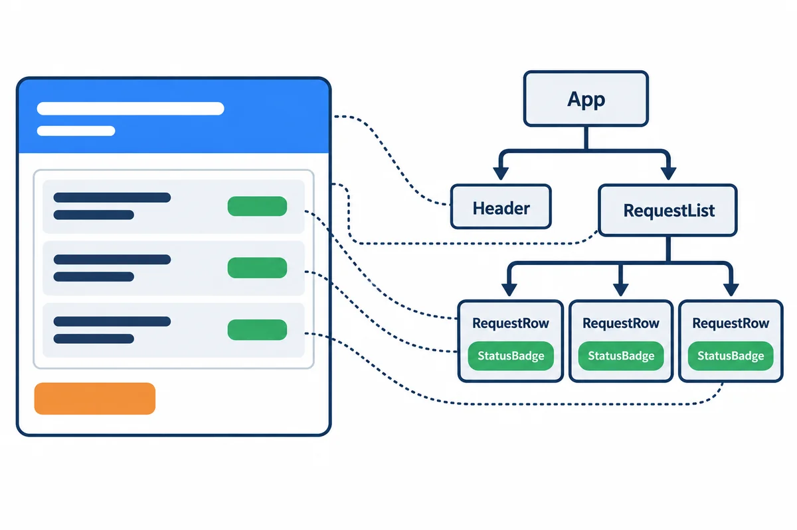
<div style="font-size: 12px; color: #64748b; margin-top: 6px;">図2-1: 画面を部品に分けて、木の形に組み立てる</div>
</div>

React の部品は、**HTML のような物を返す関数**です。いちばん小さな部品の「状態の札」を見てみます。

`src/components/StatusBadge.tsx`:

```tsx
import type { RequestStatus } from "../types.ts";

// 状態ごとの CSS の class（01 HTML と CSS の 4 章と同じ色）
const className: Record<RequestStatus, string> = {
  回覧中: "badge-circulating",
  差し戻し中: "badge-returned",
  引き戻し中: "badge-returned",
  回覧完了: "badge-approved",
  対応中: "badge-approved",
  完了: "badge-done",
  取り下げ: "badge-done",
};

/** 状態の札。props で状態を受け取って、色を変える */
export function StatusBadge({ status }: { status: RequestStatus }) {
  return <span className={`badge ${className[status]}`}>{status}</span>;
}
```

| 書き方 | 意味 |
|---|---|
| `export function StatusBadge(...)` | 部品は関数。**名前は大文字で始める**（小文字だと HTML のタグと見なされる） |
| `return <span ...>{status}</span>;` | HTML のような書き方（**JSX**）で、画面の部品を返す |
| `className="..."` | HTML の `class`。JSX では `className` と書く（`class` は JavaScript の予約語のため） |
| `{status}` | `{ }` の中に、TypeScript の値や式を書ける |
| `Record<RequestStatus, string>` | 7 つの状態のすべてに、class の名前を決めた表。**状態を足して書き忘れると、`tsc` が教えてくれる** |

使う側は、HTML のタグのように書きます: `<StatusBadge status="回覧中" />`。

> **用語:** JSX（ジェイエスエックス：TypeScript（JavaScript）の中に、HTML のような書き方で画面を書ける仕組み。ファイルの拡張子は `.tsx`）

<!-- -->

> **用語:** コンポーネント（component：画面の部品。React では、JSX を返す関数）

## 3. props と state

<div style="max-width: 760px; margin: 18px auto; text-align: center;">
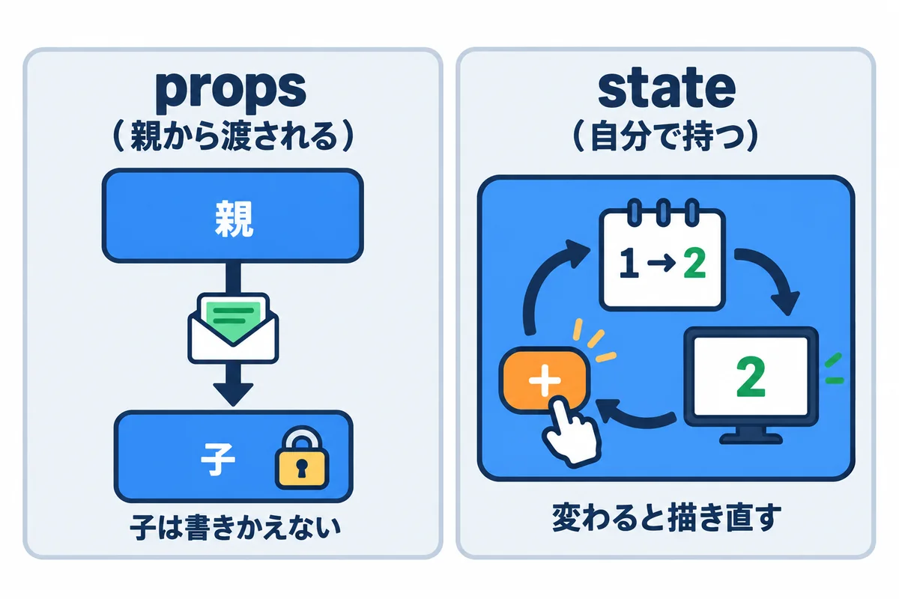
<div style="font-size: 12px; color: #64748b; margin-top: 6px;">図3-1: props は親から渡される値、state は部品が自分で持つ値</div>
</div>

| | props | state |
|---|---|---|
| だれの物 | 親の部品が渡す | その部品が自分で持つ |
| 変えられるか | **子は変えない**（読むだけ） | `set...` の関数で変える |
| 例 | `StatusBadge` の `status` | 一覧の「しぼる文字」、フォームの入力の値 |

state は、`useState` で作ります。

```tsx
const [keyword, setKeyword] = useState("");   // 最初の値は空の文字
// keyword … 今の値      setKeyword("部品") … 値を変えて、描き直してもらう
```

### 3.1 描き直しの流れ

<div style="max-width: 760px; margin: 18px auto; text-align: center;">
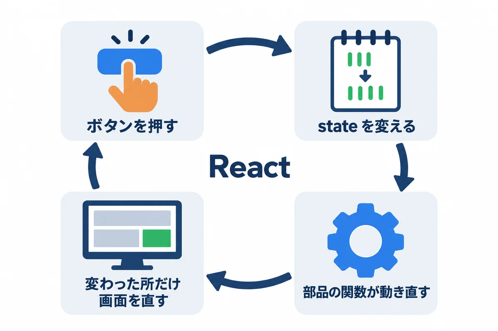
<div style="font-size: 12px; color: #64748b; margin-top: 6px;">図3-2: state を変えると、React が部品の関数を動かし直し、変わった所だけ画面を直す</div>
</div>

1. 人が入力したり、ボタンを押したりする。
2. 部品が、`set...` で state を変える。
3. React が、その部品の関数を**もう一度動かして**、新しい JSX を作る。
4. 前の JSX と比べて、**変わった所だけ**を本物の画面（DOM。01 の 2.3）に反映する。

> **大事:** state は、**`set...` を使わずに直接書きかえてはいけません**（`keyword = "部品"` や、配列の `push` など）。React が変わったことに気付かず、描き直しません。配列やオブジェクトは、**新しい物を作って** `set...` に渡します（6 章の図面）。

## 4. 一覧の画面: 読み込みと、しぼり込み

<div style="max-width: 760px; margin: 18px auto; text-align: center;">
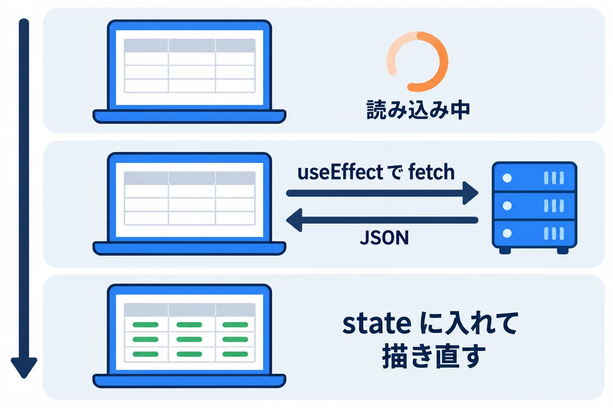
<div style="font-size: 12px; color: #64748b; margin-top: 6px;">図4-1: 画面を開いたら読み込み、届いたら state に入れて描き直す</div>
</div>

`src/components/RequestList.tsx`:

```tsx
import { useEffect, useState } from "react";
import { fetchRequests } from "../api.ts";
import type { RequestItem } from "../types.ts";
import { StatusBadge } from "./StatusBadge.tsx";

/** 自分の依頼の一覧。開いたときにサーバーから読み込む */
export function RequestList() {
  const [items, setItems] = useState<RequestItem[] | null>(null); // null = まだ読み込み中
  const [keyword, setKeyword] = useState("");

  useEffect(() => {
    fetchRequests().then(setItems);
  }, []); // [] = 画面を開いたときに 1 回だけ

  if (items === null) return <p>読み込み中…</p>;

  const shown = items.filter((r) => r.title.includes(keyword));
  return (
    <section>
      <h1>自分の依頼</h1>
      <input
        className="search"
        placeholder="件名でしぼる"
        value={keyword}
        onChange={(e) => setKeyword(e.target.value)}
      />
      <table>
        <thead>
          <tr><th>番号</th><th>件名</th><th>希望の納期</th><th>状態</th></tr>
        </thead>
        <tbody>
          {shown.map((r) => (
            <tr key={r.id}>
              <td>{r.id}</td>
              <td>{r.title}</td>
              <td>{r.dueDate}</td>
              <td><StatusBadge status={r.status} /></td>
            </tr>
          ))}
        </tbody>
      </table>
      <p className="hint">{shown.length} 件</p>
    </section>
  );
}
```

<div style="max-width: 760px; margin: 18px auto; text-align: center;">
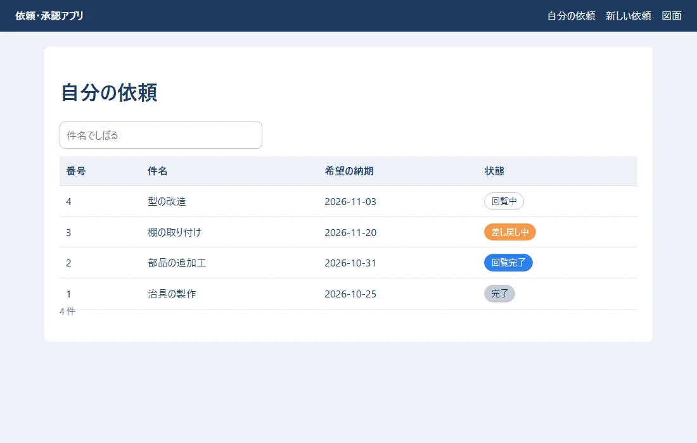
<div style="font-size: 12px; color: #64748b; margin-top: 6px;">図4-2: 一覧の画面（読み込みが終わったところ）</div>
</div>

<div style="max-width: 760px; margin: 18px auto; text-align: center;">
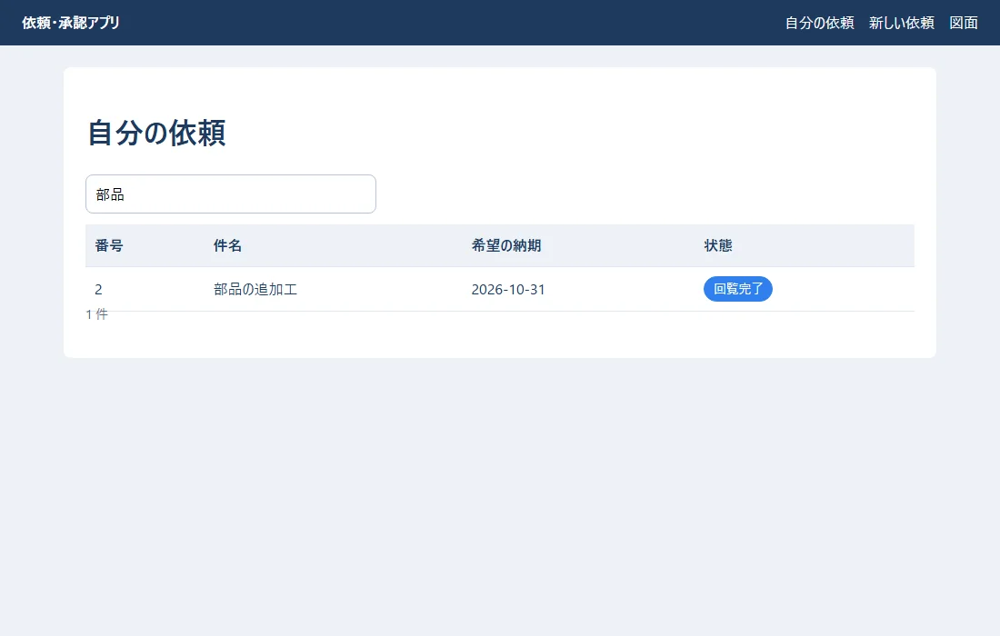
<div style="font-size: 12px; color: #64748b; margin-top: 6px;">図4-3: 「部品」と入れると、その場で 1 件にしぼられる（サーバーにお願いし直していない）</div>
</div>

| 書き方 | 意味 |
|---|---|
| `useState<RequestItem[] \| null>(null)` | 最初は `null`（まだ読み込み中）。届いたら配列 |
| `useEffect(() => { ... }, [])` | **画面に出たあと**に動く処理。最後の `[]` は「最初の 1 回だけ」 |
| `fetchRequests().then(setItems)` | 読み込んで、届いたら state に入れる（ここで描き直される） |
| `if (items === null) return <p>読み込み中…</p>;` | 読み込み中は、別の画面を返す |
| `value={keyword} onChange={(e) => setKeyword(e.target.value)}` | 入力の値を state と結ぶ（5 章） |
| `shown.map((r) => <tr key={r.id}>...)` | 配列の数だけ行を作る。**`key` には、行ごとに違う値（番号）を付ける** |

> **`key` について:** React は `key` で「どの行がどの依頼か」を見分けて、変わった行だけを直します。`key` が無いと警告が出ます。配列の何番目か（`index`）を `key` にすると、並べかえたときに入力の中身がずれることがあるので、**データの番号**を使います。

> **練習では、サーバーの代わりに `src/api.ts` の「にせのサーバー」を使っています。** 0.3 秒待ってからデータを返し、本物のサーバーとのやり取りのまねをしています。06 では、ここを本物の Django の API に置きかえます。

## 5. 入力フォーム

<div style="max-width: 760px; margin: 18px auto; text-align: center;">
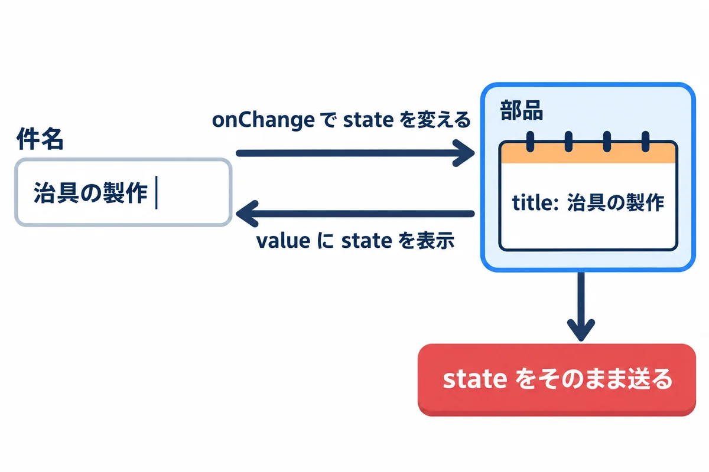
<div style="font-size: 12px; color: #64748b; margin-top: 6px;">図5-1: 入力の値を state に持つ（制御されたコンポーネント）</div>
</div>

`src/components/RequestForm.tsx`:

```tsx
import { useState, type FormEvent } from "react";
import { createRequest, employees } from "../api.ts";

type Props = { onCreated: (id: number) => void };

/** 依頼の入力。入力の値は、全部 state に持つ（制御されたコンポーネント） */
export function RequestForm({ onCreated }: Props) {
  const [title, setTitle] = useState("");
  const [detail, setDetail] = useState("");
  const [dueDate, setDueDate] = useState("");
  const [approvers, setApprovers] = useState<string[]>(["", "", ""]);
  const [errors, setErrors] = useState<string[]>([]);
  const [sending, setSending] = useState(false);

  function setApprover(index: number, value: string) {
    setApprovers((prev) => prev.map((v, i) => (i === index ? value : v)));
  }

  function validate(): string[] {
    const list: string[] = [];
    if (title.trim() === "") list.push("件名を入れてください");
    if (title.length > 100) list.push("件名は 100 文字までです");
    if (dueDate === "") list.push("希望の納期を入れてください");
    const chosen = approvers.filter((a) => a !== "");
    if (chosen.length === 0) list.push("回覧者を 1 人以上選んでください");
    if (new Set(chosen).size !== chosen.length) list.push("同じ人を 2 回選べません");
    return list;
  }

  async function handleSubmit(e: FormEvent<HTMLFormElement>) {
    e.preventDefault(); // ブラウザが自分でページを送り直すのを止める
    const found = validate();
    setErrors(found);
    if (found.length > 0) return;
    setSending(true);
    const created = await createRequest({ title, detail, dueDate, approvers: approvers.filter((a) => a !== "") });
    setSending(false);
    onCreated(created.id);
  }

  return (
    <form onSubmit={handleSubmit}>
      <h1>依頼の入力</h1>
      {errors.length > 0 && (
        <ul className="errors" role="alert">
          {errors.map((m) => <li key={m}>{m}</li>)}
        </ul>
      )}
      <div className="form-grid">
        <label htmlFor="title" className="required">件名</label>
        <input id="title" value={title} onChange={(e) => setTitle(e.target.value)} placeholder="例: 治具の製作" />

        <label htmlFor="detail">内容</label>
        <textarea id="detail" rows={3} value={detail} onChange={(e) => setDetail(e.target.value)} />

        <label htmlFor="due" className="required">希望の納期</label>
        <input id="due" type="date" value={dueDate} onChange={(e) => setDueDate(e.target.value)} />

        <label className="required">回覧者</label>
        <div className="approvers">
          {approvers.map((value, i) => (
            <select key={i} aria-label={`回覧者${i + 1}`} value={value} onChange={(e) => setApprover(i, e.target.value)}>
              <option value="">{i === 0 ? "回覧者1（必須）" : `回覧者${i + 1}（なし）`}</option>
              {employees.map((emp) => (
                <option key={emp.no} value={emp.no}>{emp.name}（{emp.dept}）</option>
              ))}
            </select>
          ))}
        </div>
      </div>
      <div className="actions">
        <button type="submit" className="btn-primary" disabled={sending}>
          {sending ? "送っています…" : "依頼を送る"}
        </button>
      </div>
    </form>
  );
}
```

**何も入れずに「依頼を送る」を押したとき:**

<div style="max-width: 760px; margin: 18px auto; text-align: center;">
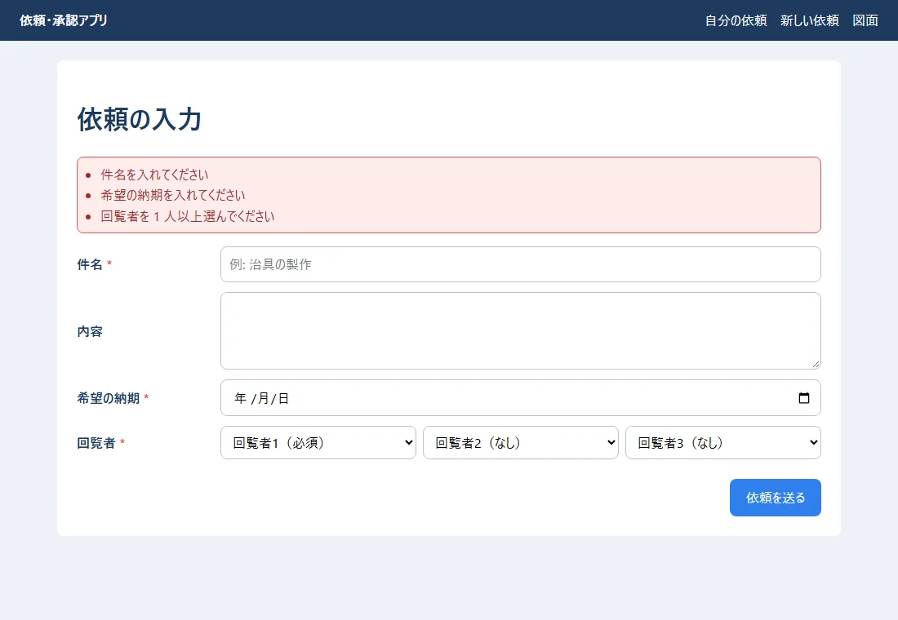
<div style="font-size: 12px; color: #64748b; margin-top: 6px;">図5-2: 足りない所を、まとめて知らせる</div>
</div>

**同じ人を 2 回選んだとき:**

<div style="max-width: 760px; margin: 18px auto; text-align: center;">
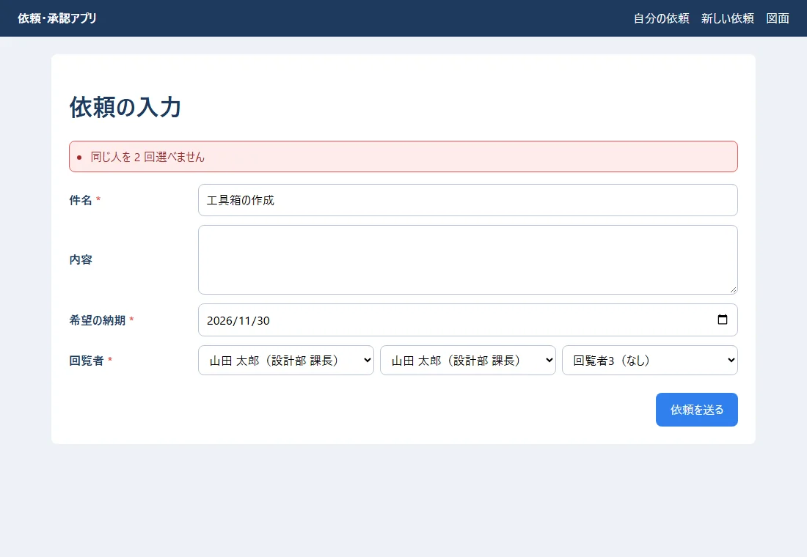
<div style="font-size: 12px; color: #64748b; margin-top: 6px;">図5-3: 同じ回覧者は選べない</div>
</div>

**正しく入れて送ったとき:** 一覧に戻り、新しい依頼（5 番）が「回覧中」で先頭に出ます。

<div style="max-width: 760px; margin: 18px auto; text-align: center;">
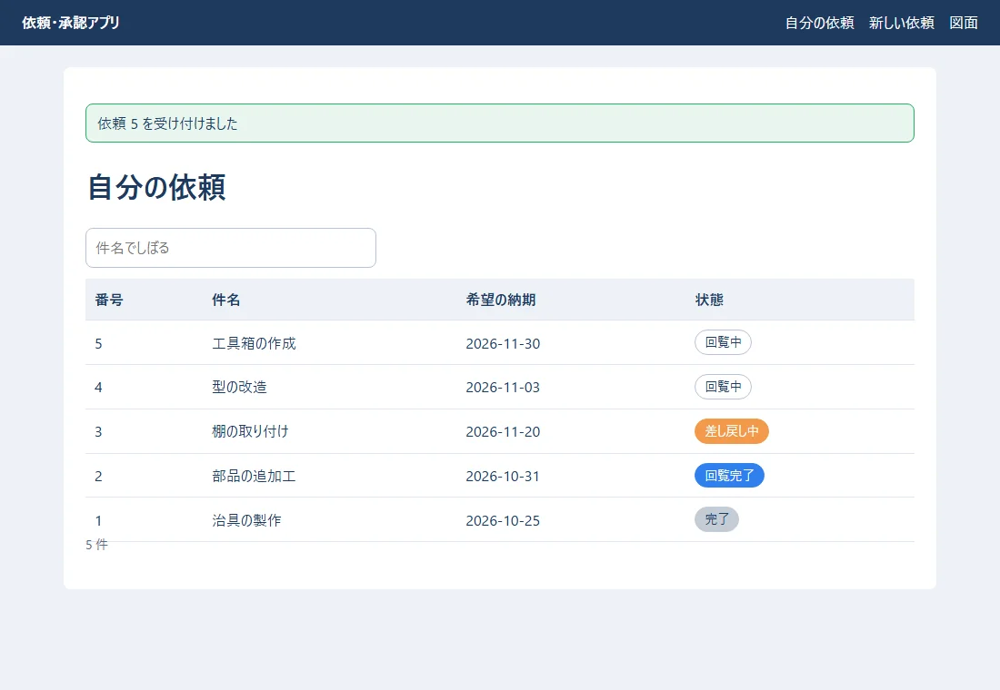
<div style="font-size: 12px; color: #64748b; margin-top: 6px;">図5-4: 送ったあと。一覧に新しい依頼が増える</div>
</div>

| 書き方 | 意味 |
|---|---|
| `value={title} onChange={(e) => setTitle(e.target.value)}` | 入力欄の値は、いつも state と同じ（**制御されたコンポーネント**）。送るときは state をそのまま使える |
| `<label htmlFor="title">` | HTML の `for`（JSX では `htmlFor`） |
| `setApprovers((prev) => prev.map(...))` | 前の値（`prev`）から、新しい配列を作って入れる（3 章の「大事」） |
| `onSubmit={handleSubmit}` と `e.preventDefault()` | 送るボタンで、ブラウザがページを送り直すのを止めて、自分で処理する |
| `new Set(chosen).size !== chosen.length` | `Set` は重複を消すので、数が減れば「同じ人がいる」 |
| `disabled={sending}` | 送っている間は、ボタンを押せなくする（二重に送らないため） |
| `{errors.length > 0 && (...)}` | 条件が正しいときだけ表示する書き方 |
| `onCreated` | 親（`App`）から渡された関数（props）。送れたことを親に知らせる |

> **ここでの確かめは、使う人のためのお手伝いです。** 悪意のある人は、画面を通さずにサーバーへ直接送れます。**同じ確かめを、サーバーでも必ず行います**（06・10）。

## 6. 図面の画面

`src/components/DrawingPad.tsx`:

```tsx
import { useState, type PointerEvent } from "react";

type Rect = { kind: "rect"; x: number; y: number; width: number; height: number };
type Drawing = { version: 1; widthMm: number; heightMm: number; shapes: Rect[] };

const sample: Drawing = {
  version: 1,
  widthMm: 297,
  heightMm: 210,
  shapes: [
    { kind: "rect", x: 20, y: 20, width: 120, height: 70 },
    { kind: "rect", x: 160, y: 40, width: 90, height: 120 },
  ],
};

/** 図面を描く。ドラッグで四角を足し、図面は JSON で持つ */
export function DrawingPad() {
  const [drawing, setDrawing] = useState<Drawing>(sample);
  const [start, setStart] = useState<{ x: number; y: number } | null>(null);

  // 画面の上の位置 → 図面の上の位置（mm）
  function toMm(e: PointerEvent<SVGSVGElement>) {
    const box = e.currentTarget.getBoundingClientRect();
    return {
      x: Math.round(((e.clientX - box.left) / box.width) * drawing.widthMm),
      y: Math.round(((e.clientY - box.top) / box.height) * drawing.heightMm),
    };
  }

  function handleUp(e: PointerEvent<SVGSVGElement>) {
    if (start === null) return;
    const end = toMm(e);
    const rect: Rect = {
      kind: "rect",
      x: Math.min(start.x, end.x),
      y: Math.min(start.y, end.y),
      width: Math.abs(end.x - start.x),
      height: Math.abs(end.y - start.y),
    };
    setStart(null);
    if (rect.width < 2 || rect.height < 2) return; // 小さすぎる物は無視
    setDrawing({ ...drawing, shapes: [...drawing.shapes, rect] }); // 新しいオブジェクトを作って入れる
  }

  const json = JSON.stringify(drawing);
  return (
    <section>
      <h1>図面</h1>
      <p className="hint">ドラッグで四角を描きます（{drawing.shapes.length} 個）。</p>
      <svg
        className="pad"
        viewBox={`0 0 ${drawing.widthMm} ${drawing.heightMm}`}
        onPointerDown={(e) => setStart(toMm(e))}
        onPointerUp={handleUp}
      >
        {drawing.shapes.map((s, i) => (
          <rect key={i} x={s.x} y={s.y} width={s.width} height={s.height} />
        ))}
      </svg>
      <div className="actions">
        <button type="button" className="btn-secondary" onClick={() => setDrawing({ ...drawing, shapes: [] })}>全部消す</button>
      </div>
      <h2>保存する JSON（{new TextEncoder().encode(json).length} バイト）</h2>
      <pre className="json">{JSON.stringify(drawing, null, 2)}</pre>
    </section>
  );
}
```

<div style="max-width: 760px; margin: 18px auto; text-align: center;">
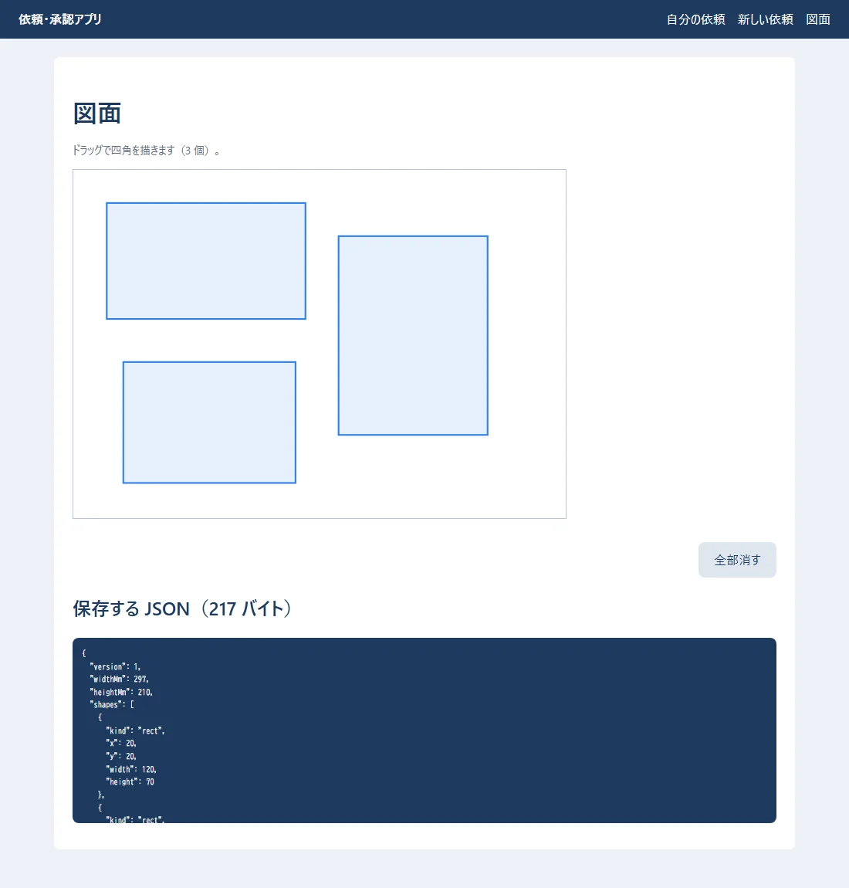
<div style="font-size: 12px; color: #64748b; margin-top: 6px;">図6-1: ドラッグで四角を 1 つ足したところ（2 個 → 3 個。JSON は 162 → 217 バイトになった）</div>
</div>

- 図は **SVG**（線や形を、数で表す画像の書き方）で描いています。`viewBox="0 0 297 210"` で、中の座標を mm（A4 の横）にしています。
- 押した所（`onPointerDown`）と、離した所（`onPointerUp`）から、四角の位置と大きさを計算します。
- 図面は、**02 で作った JSON の形**（`version`・`widthMm`・`heightMm`・`shapes`）で、state に持っています。保存するときは、この JSON をそのままサーバーに送ります（06）。
- 四角を足すときは `setDrawing({ ...drawing, shapes: [...drawing.shapes, rect] })` のように、**新しいオブジェクトと配列を作って**入れます。`drawing.shapes.push(rect)` では、描き直されません。

> **用語:** SVG（エスブイジー：線・四角・円などを、座標の数で書き表す画像の形式。拡大してもぼやけない。HTML の中に直接書ける）

<!-- -->

> **用語:** スプレッド構文（`...`：配列やオブジェクトの中身を広げて、新しい物にコピーする書き方。`[...a, x]` は「a の中身の後ろに x を足した新しい配列」）

## 7. 画面の切りかえと、部品の組み立て

`src/App.tsx`:

```tsx
import { useEffect, useState } from "react";
import { DrawingPad } from "./components/DrawingPad.tsx";
import { RequestForm } from "./components/RequestForm.tsx";
import { RequestList } from "./components/RequestList.tsx";

type Page = "list" | "new" | "drawing";

// URL の # の後ろ（#/new など）で、どの画面を出すかを決める
function pageFromHash(): Page {
  if (location.hash === "#/new") return "new";
  if (location.hash === "#/drawing") return "drawing";
  return "list";
}

export function App() {
  const [page, setPage] = useState<Page>(pageFromHash());
  const [message, setMessage] = useState("");

  useEffect(() => {
    const onChange = () => setPage(pageFromHash());
    window.addEventListener("hashchange", onChange);
    return () => window.removeEventListener("hashchange", onChange); // 片付け
  }, []);

  return (
    <>
      <header className="site-header">
        <strong>依頼・承認アプリ</strong>
        <nav>
          <a href="#/">自分の依頼</a>
          <a href="#/new">新しい依頼</a>
          <a href="#/drawing">図面</a>
        </nav>
      </header>
      <main>
        {message && <p className="message">{message}</p>}
        {page === "list" && <RequestList />}
        {page === "new" && (
          <RequestForm
            onCreated={(id) => {
              setMessage(`依頼 ${id} を受け付けました`);
              location.hash = "#/";
            }}
          />
        )}
        {page === "drawing" && <DrawingPad />}
      </main>
    </>
  );
}
```

`src/main.tsx`（React を HTML の `<div id="root">` に入れる、いちばん最初の所）:

```tsx
import { StrictMode } from "react";
import { createRoot } from "react-dom/client";
import { App } from "./App.tsx";
import "./style.css";

createRoot(document.getElementById("root")!).render(
  <StrictMode>
    <App />
  </StrictMode>,
);
```

- URL の `#/new` などで、どの画面を出すかを決めています。本物のアプリでは、**React Router** のような部品を使うと、`/requests/5` のような URL も扱えます（06）。
- `useEffect` が返す関数（`return () => ...`）は、部品が画面から消えるときの**片付け**です。
- `<StrictMode>` は、開発中だけ、間違いを見つけやすくするために、一部の処理をわざと 2 回動かします（本番では 1 回）。

## 8. よくある失敗

| 症状 | 原因 | 直し方 |
|---|---|---|
| 入力しても、文字が入らない | `value` を付けたのに `onChange` で state を変えていない | `onChange={(e) => setX(e.target.value)}` を付ける |
| 値を変えたのに、画面が変わらない | state を直接書きかえた（`push` など） | 新しい配列・オブジェクトを作って `set...` に渡す |
| 警告 `Each child in a list should have a unique "key" prop` | `map` で作った物に `key` が無い | データの番号を `key` にする |
| 画面が何度も読み込みを繰り返す | `useEffect` の最後の `[]` を忘れた | `[]`（最初の 1 回だけ）を付ける |
| 部品が表示されない／HTML のタグとして扱われる | 部品の名前が小文字で始まる | 大文字で始める |
| `class` が効かない | JSX で `class` と書いた | `className` |
| `Cannot find module './style.css'`（`tsc`） | CSS の読み込みの型の説明が無い | `tsconfig.json` の `"types": ["vite/client"]` |
| 本番でだけ画面が真っ白 | 部品の置き場所の URL の設定（Django に入れるときの `base`） | onprem の 05 の 6.5 |

## 9. 練習問題

1. `StatusBadge` を使って、一覧の上に「回覧中」「差し戻し中」の札の見本を並べてください。
2. 一覧に「状態でしぼる」選ぶ欄（すべて／回覧中／差し戻し中）を足してください（ヒント：`useState` をもう 1 つ。`filter` の条件を足す）。
3. 入力フォームで、希望の納期が今日より前なら「納期は今日以降にしてください」と出してください（ヒント：`new Date().toISOString().slice(0, 10)` で今日の日付の文字）。
4. 図面に「最後の 1 つを消す」ボタンを足してください（ヒント：`drawing.shapes.slice(0, -1)`）。

**答えの例:** 4 は `<button type="button" onClick={() => setDrawing({ ...drawing, shapes: drawing.shapes.slice(0, -1) })}>最後の 1 つを消す</button>`。

## 用語の索引

| 用語 | 短い説明 | 章 |
|---|---|---|
| React・Vite | 画面を部品で作る部品／その開発の道具 | 1 |
| コンポーネント・JSX | 画面の部品／HTML のような書き方 | 2 |
| props・state | 親から渡される値／部品が持つ値 | 3 |
| useState・useEffect | state を作る／画面に出たあとに動く処理 | 3・4 |
| key | 一覧の行を見分ける印 | 4 |
| 制御されたコンポーネント | 入力の値を state に持つ書き方 | 5 |
| SVG | 座標で書く画像の形式 | 6 |
| スプレッド構文 | `...` で中身を広げてコピーする | 6 |
| StrictMode | 開発中の間違い見つけの仕組み | 7 |
