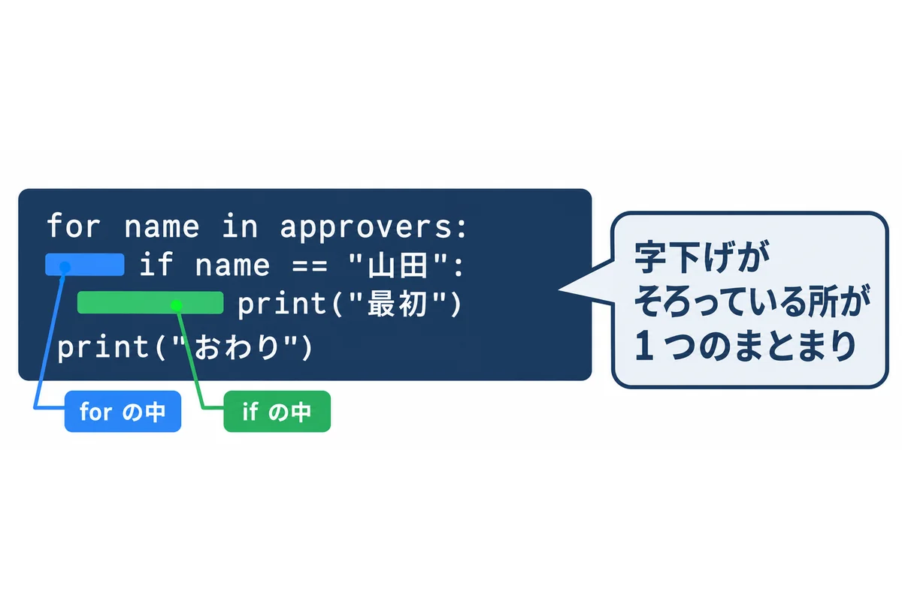
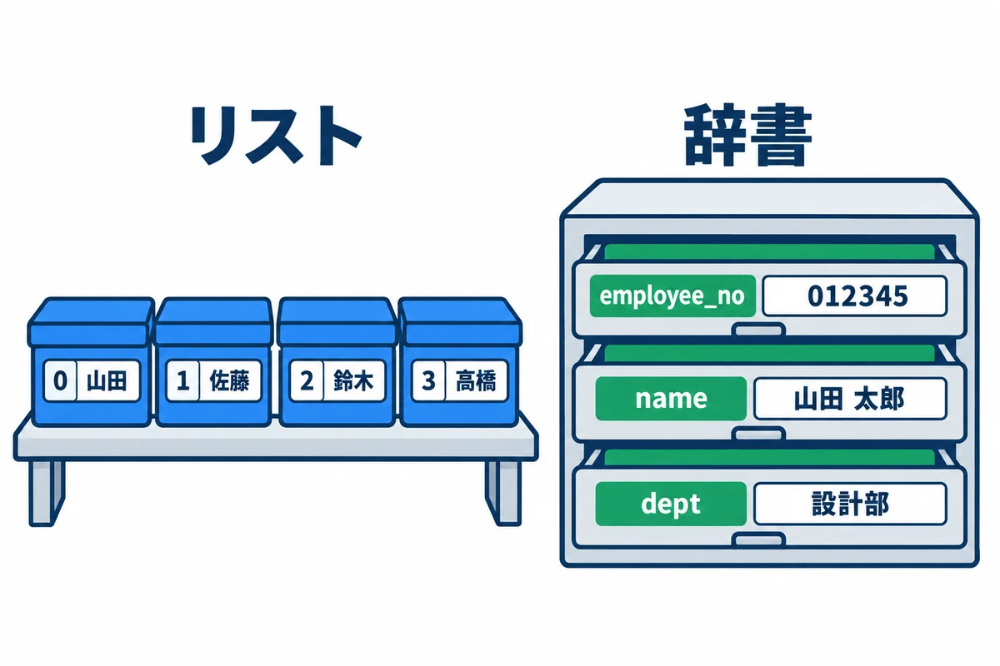
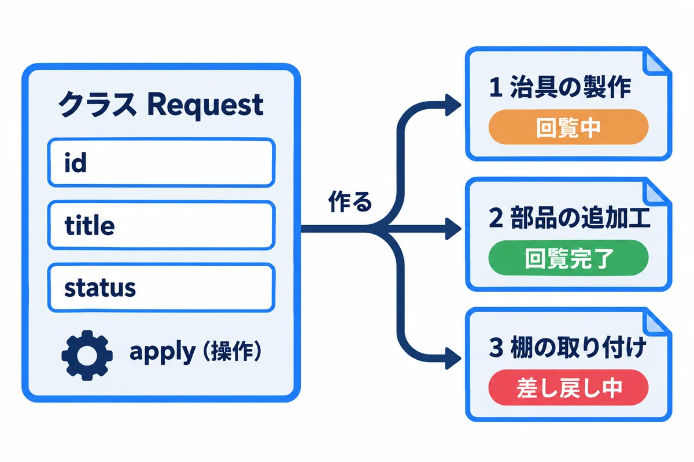
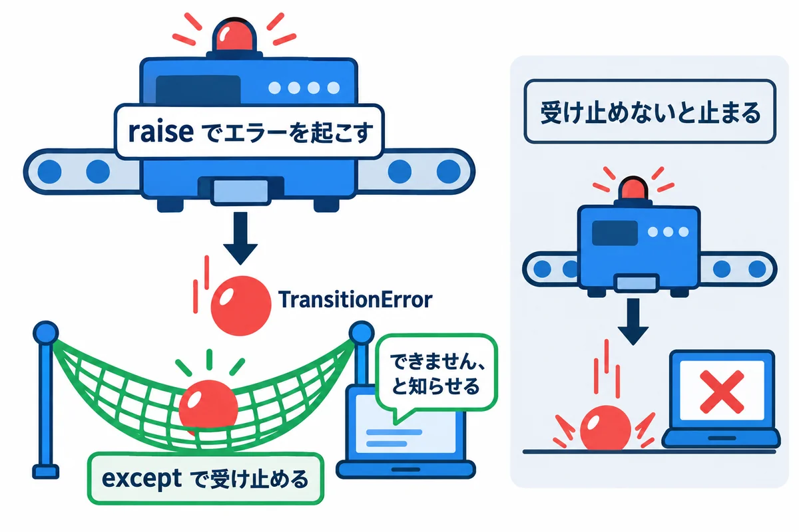
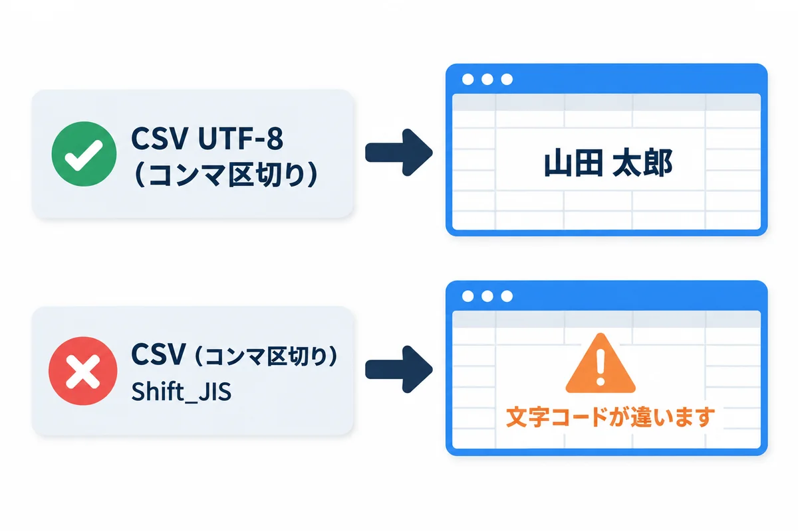

<div style="text-align: center; padding: 28px 0 8px;">
<div style="font-size: 14px; color: #475569;">Web アプリ開発 学習資料</div>
<div style="font-size: 26px; font-weight: 800; color: #0f172a; margin-top: 6px; line-height: 1.35;">04 Python の基礎 — Django の前に知っておくこと</div>
<div style="font-size: 13px; color: #475569; margin-top: 8px;">依頼の状態・社員の CSV の取り込み・日本時間・承認の URL の文字列を、Python で書く</div>
</div>

# 04 Python の基礎: Django の前に知っておくこと

## この巻で学ぶこと

- Python の書き方（字下げ・変数・リスト・辞書・関数・クラス）
- 依頼の状態を **Enum**、依頼を **dataclass** にして、状態の移り変わりを書く
- エラー（例外）を起こす・受け止める
- 社員の **CSV** を読み込み、行ごとに確かめる（文字コードの落とし穴も）
- **日本時間**の日時と、承認の URL に入れる**推測できない文字列**
- 仮想環境（venv）と、部品を入れる `pip`

練習のファイルは `samples/04_python/` にあります。この巻の結果は、**Python 3.14 で実際に動かした結果**です（打つたびに変わる所は、そう書いています）。

> **もっと詳しく:** `docs/06_Python基礎.md` に、Python のより詳しい説明があります。

## 1. 準備: 仮想環境を作って、部品を入れる

**▶ 準備:** 00 の 6.4（Python 3.14）。下のコマンドは、PowerShell で資料のフォルダにいるところから打ちます。練習のファイル（`basics.py` など）は VS Code で開いて読み、書きかえたら `Ctrl` ＋ `S` で保存して、もう一度 `.\.venv\Scripts\python.exe ファイルの名前.py` で動かします。


```powershell
cd webapp_learning\samples\04_python

# 仮想環境（この練習用の部品の箱）を作る
py -3.14 -m venv .venv

# 部品を入れる（Windows で日本時間を扱うための tzdata）
.\.venv\Scripts\python.exe -m pip install -r requirements.txt

# 動かす
.\.venv\Scripts\python.exe basics.py
```

- **仮想環境（venv）**は、Python の部品を、練習やアプリごとに分けて入れる箱です（onprem の 05 の 4.3 にも図があります）。
- `.\.venv\Scripts\python.exe` のように、**仮想環境の中の python を、場所を書いて動かす**のがいちばん確かです。
- `.\.venv\Scripts\Activate.ps1` で「仮想環境に入る」と、`python` と打つだけで済むようになります。ただし、Windows 10・11 の最初の設定では、PowerShell のスクリプトが動かない（「このシステムではスクリプトの実行が無効」）ことがあります。自分のパソコンなら `Set-ExecutionPolicy -Scope CurrentUser RemoteSigned` で動くようになりますが、会社のパソコンでは決まりがあるので、場所を書いて動かす方法をすすめます。

> **用語:** pip（ピップ：Python の部品を入れる道具。`python -m pip install 部品の名前`）

<!-- -->

> **用語:** requirements.txt（使う部品と版を並べたファイル。`pip install -r requirements.txt` で、まとめて入れられる）

### 1.1 試しに打てる画面（対話モード）

`.\.venv\Scripts\python.exe` とだけ打つと、`>>>` が出て、1 行ずつ試せます。

```text
>>> 1 + 2
3
>>> "依頼" * 3
'依頼依頼依頼'
>>> exit()
```

## 2. Python の書き方

### 2.1 字下げで、まとまりを表す

<div style="max-width: 760px; margin: 18px auto; text-align: center;">

<div style="font-size: 12px; color: #64748b; margin-top: 6px;">図2-1: Python は、字下げ（行の先頭の空白）でまとまりを表す</div>
</div>

TypeScript や Java は `{ }` でまとまりを表しますが、Python は**字下げ**で表します。字下げは**半角の空白 4 つ**にそろえます（全角の空白・タブを混ぜるとエラー）。

### 2.2 変数・リスト・辞書・関数

<div style="max-width: 760px; margin: 18px auto; text-align: center;">

<div style="font-size: 12px; color: #64748b; margin-top: 6px;">図2-2: リストは「番号で取り出す」、辞書は「名前で取り出す」</div>
</div>

`basics.py`:

```python
# 1. 変数と型（型ヒントは「説明」で、Python は動かすときに確かめない）
app_name: str = "依頼・承認アプリ"
count: int = 3
price: float = 1234.5
is_open: bool = True
count = count + 1

# 2. リスト（順番のある並び）
approvers: list[str] = ["山田", "佐藤", "鈴木"]
approvers.append("高橋")              # 後ろに足す

# 3. 辞書（名前と値の組の集まり）
user: dict[str, str] = {"employee_no": "012345", "name": "山田 太郎"}
user["dept"] = "設計部"               # 足す・書きかえる


# 4. 関数（def で作る。中身は字下げで表す）
def greet(name: str) -> str:
    return f"{name} さん、こんにちは"   # f"..." の { } に値を埋め込める


# 5. if と for
for i, name in enumerate(approvers, start=1):
    if i == 1:
        print(f"{i} 番目: {name}（最初）")
    elif i == len(approvers):
        print(f"{i} 番目: {name}（最後）")
    else:
        print(f"{i} 番目: {name}")

print(app_name, count, price, is_open)
print(user["name"], user.get("mail", "（メール無し）"))  # get は、無いときの値を決められる
print(greet(user["name"]))

# 6. 内包表記（リストを作る短い書き方）
lengths = [len(n) for n in approvers]
print(lengths)
```

動かした結果:

```text
1 番目: 山田（最初）
2 番目: 佐藤
3 番目: 鈴木
4 番目: 高橋（最後）
依頼・承認アプリ 4 1234.5 True
山田 太郎 （メール無し）
山田 太郎 さん、こんにちは
[2, 2, 2, 2]
```

| 書き方 | 意味 | TypeScript では |
|---|---|---|
| `count: int = 3` | 変数（型ヒントは説明。動かすときには確かめない） | `let count: number = 3` |
| `list[str]` | 文字のリスト | `string[]` |
| `dict[str, str]` | 名前と値の組の集まり（辞書） | オブジェクト |
| `def greet(name: str) -> str:` | 関数を作る。最後の `:` と、次の行の字下げを忘れない | `function greet(name: string): string` |
| `f"{name} さん"` | 文字に値を埋め込む（f 文字列） | `` `${name} さん` `` |
| `for i, name in enumerate(approvers, start=1):` | 番号（1 から）と中身を、1 つずつ取り出す | `approvers.forEach((name, i) => ...)` |
| `if`・`elif`・`else` | 条件で分ける | `if`・`else if`・`else` |
| `user.get("mail", "（メール無し）")` | 無いときの値を決めて取り出す（`user["mail"]` は、無いとエラー） | `user.mail ?? "（メール無し）"` |
| `[len(n) for n in approvers]` | 新しいリストを作る短い書き方（内包表記） | `approvers.map((n) => n.length)` |
| `#` | コメント | `//` |

> **型ヒントは、確かめてくれない:** Python の `: int` などは、読む人と道具（エディターや mypy などの確かめの道具）のための説明です。**`count: int = "4"` と書いても、Python はそのまま動きます。** 02 の TypeScript の `tsc` のように確かめたいときは、別の道具を使います。

## 3. 依頼の状態と、状態の移り変わり

<div style="max-width: 760px; margin: 18px auto; text-align: center;">

<div style="font-size: 12px; color: #64748b; margin-top: 6px;">図3-1: クラスは設計図、インスタンスはそこから作った 1 件 1 件</div>
</div>

`status.py`（02 の `status.ts` と同じことを、Python で書いた物）:

```python
"""依頼の状態と、状態の移り変わり（02 TypeScript の status.ts を Python で書いた物）"""

from dataclasses import dataclass, field
from enum import StrEnum


class Status(StrEnum):
    """依頼の状態。この 7 つ以外は作れない"""

    CIRCULATING = "回覧中"
    RETURNED = "差し戻し中"
    PULLED_BACK = "引き戻し中"
    APPROVED = "回覧完了"
    IN_PROGRESS = "対応中"
    DONE = "完了"
    WITHDRAWN = "取り下げ"


# (今の状態, 操作) → 次の状態 の表。表に無い組み合わせは、できない操作
TRANSITIONS: dict[tuple[Status, str], Status] = {
    (Status.CIRCULATING, "全員が承認"): Status.APPROVED,
    (Status.CIRCULATING, "差し戻し"): Status.RETURNED,
    (Status.CIRCULATING, "引き戻し"): Status.PULLED_BACK,
    (Status.RETURNED, "再依頼"): Status.CIRCULATING,
    (Status.RETURNED, "取り下げ"): Status.WITHDRAWN,
    (Status.PULLED_BACK, "再依頼"): Status.CIRCULATING,
    (Status.PULLED_BACK, "取り下げ"): Status.WITHDRAWN,
    (Status.APPROVED, "担当を決める"): Status.IN_PROGRESS,
    (Status.IN_PROGRESS, "引き渡し"): Status.DONE,
}


class TransitionError(Exception):
    """できない操作をしようとしたときのエラー"""


@dataclass
class Request:
    """依頼 1 件"""

    id: int
    title: str
    status: Status = Status.CIRCULATING
    comments: list[str] = field(default_factory=list)

    def apply(self, action: str) -> None:
        """操作をして、状態を進める。できない操作なら TransitionError を起こす"""
        key = (self.status, action)
        if key not in TRANSITIONS:
            raise TransitionError(f"「{self.status}」の依頼に「{action}」はできません")
        self.status = TRANSITIONS[key]


if __name__ == "__main__":  # このファイルを直接動かしたときだけ、下を動かす
    r = Request(id=1, title="治具の製作")
    print(r)
    r.apply("差し戻し")
    r.comments.append("【10/21 10:15 回覧者1 山田】寸法を追記してください")
    print(r.status, r.comments)
    r.apply("再依頼")
    print(r.status)
    try:
        r.apply("引き渡し")
    except TransitionError as e:
        print("エラー:", e)
    print([s.value for s in Status])
```

動かした結果（`.\.venv\Scripts\python.exe status.py`）:

```text
Request(id=1, title='治具の製作', status=<Status.CIRCULATING: '回覧中'>, comments=[])
差し戻し中 ['【10/21 10:15 回覧者1 山田】寸法を追記してください']
回覧中
エラー: 「回覧中」の依頼に「引き渡し」はできません
['回覧中', '差し戻し中', '引き戻し中', '回覧完了', '対応中', '完了', '取り下げ']
```

| 書き方 | 意味 |
|---|---|
| `class Status(StrEnum):` | 決まった値だけの型（**Enum**。列挙型）。02 のユニオン型に近い |
| `TRANSITIONS: dict[tuple[Status, str], Status]` | 「(今の状態, 操作) → 次の状態」の表。**表にすると、状態遷移図とそのまま見比べられる** |
| `class TransitionError(Exception):` | 自分用のエラーの種類を作る |
| `@dataclass` | 項目を並べるだけで、作る・表示する・比べる仕組みを自動で作ってくれる |
| `field(default_factory=list)` | 1 件ごとに、新しい空のリストを作る（`= []` と書くと、全部の依頼で同じリストを使い回してしまう） |
| `def apply(self, action: str) -> None:` | クラスの中の関数（メソッド）。`self` は「この依頼」 |
| `if __name__ == "__main__":` | このファイルを直接動かしたときだけ、下を動かす（ほかのファイルから `import` したときは動かない） |

> **用語:** クラス・インスタンス（クラスは「依頼とは、こういう項目と操作を持つ」という設計図。インスタンスは、そこから作った 1 件 1 件の依頼）

## 4. エラー（例外）を起こす・受け止める

<div style="max-width: 760px; margin: 18px auto; text-align: center;">

<div style="font-size: 12px; color: #64748b; margin-top: 6px;">図4-1: raise で起こしたエラーを、except で受け止める</div>
</div>

```python
try:
    r.apply("引き渡し")                 # できない操作 → TransitionError が起きる
except TransitionError as e:           # その種類のエラーだけを受け止める
    print("エラー:", e)
```

- `raise` で起こしたエラーは、`try` の中なら `except` で受け止められます。受け止めないと、**プログラムが止まり**、エラーの文（トレースバック）が出ます。
- `except Exception:` のように、何でも受け止める書き方は避けます。**思っていないエラーまで隠れて**、原因が分からなくなります。

**エラーの文（トレースバック）の読み方:** いちばん**下の行**が、何が起きたか（エラーの種類と文）。その上に、どのファイルの何行目を通ってきたかが並びます。自分のファイルの名前が出ている行から見ます。

## 5. 社員の CSV を読み込む

<div style="max-width: 760px; margin: 18px auto; text-align: center;">

<div style="font-size: 12px; color: #64748b; margin-top: 6px;">図5-1: Excel で「CSV UTF-8」を選んで保存する</div>
</div>

`csv_import.py`:

```python
"""社員の CSV を読み込み、行ごとに確かめる（取り込みの練習）"""

import csv
import re
import sys
from dataclasses import dataclass
from pathlib import Path


@dataclass
class Employee:
    employee_no: str
    name: str
    dept: str
    email: str


def read_employees(path: Path) -> tuple[list[Employee], list[str]]:
    """正しい行と、エラーの文の一覧を返す"""
    employees: list[Employee] = []
    errors: list[str] = []
    seen: set[str] = set()
    # utf-8-sig: Excel の「CSV UTF-8」が先頭に付ける印（BOM）を読み飛ばす
    with path.open(encoding="utf-8-sig", newline="") as f:
        for line_no, row in enumerate(csv.DictReader(f), start=2):  # 1 行目は見出し
            no = (row.get("従業員番号") or "").strip()
            name = (row.get("氏名") or "").strip()
            dept = (row.get("所属") or "").strip()
            email = (row.get("メールアドレス") or "").strip()
            if not re.fullmatch(r"\d{6}", no):
                errors.append(f"{line_no} 行目: 従業員番号は 6 桁の数字にしてください（{no!r}）")
                continue
            if no in seen:
                errors.append(f"{line_no} 行目: 従業員番号 {no} が 2 回出てきます")
                continue
            if not name:
                errors.append(f"{line_no} 行目: 氏名が空です")
                continue
            if "@" not in email:
                errors.append(f"{line_no} 行目: メールアドレスの形が違います（{email!r}）")
                continue
            seen.add(no)
            employees.append(Employee(no, name, dept, email))
    return employees, errors


if __name__ == "__main__":
    for file_name in sys.argv[1:]:
        print(f"== {file_name}")
        try:
            ok, ng = read_employees(Path(file_name))
        except UnicodeDecodeError as e:
            print("文字コードが UTF-8 ではありません。Excel で「CSV UTF-8」として保存し直してください。", e.reason)
            continue
        print(f"取り込める行: {len(ok)} 件")
        for emp in ok:
            print("  ", emp.employee_no, emp.name, emp.dept)
        for message in ng:
            print("  ×", message)
```

練習用の CSV（`employees_utf8.csv`。中身はわざと間違いを 3 つ入れてある）:

```text
従業員番号,氏名,所属,メールアドレス
012345,山田 太郎,設計部,taro.yamada@example.com
012346,佐藤 花子,設計部,hanako.sato@example.com
12347,鈴木 一郎,製造部,ichiro.suzuki@example.com
012345,山田 二郎,製造部,jiro.yamada@example.com
012348,高橋 三郎,品質保証部,saburo.takahashi.example.com
```

動かした結果（`.\.venv\Scripts\python.exe csv_import.py employees_utf8.csv employees_sjis.csv`）:

```text
== employees_utf8.csv
取り込める行: 2 件
   012345 山田 太郎 設計部
   012346 佐藤 花子 設計部
  × 4 行目: 従業員番号は 6 桁の数字にしてください（'12347'）
  × 5 行目: 従業員番号 012345 が 2 回出てきます
  × 6 行目: メールアドレスの形が違います（'saburo.takahashi.example.com'）
== employees_sjis.csv
文字コードが UTF-8 ではありません。Excel で「CSV UTF-8」として保存し直してください。 invalid start byte
```

| 書き方 | 意味 |
|---|---|
| `path.open(encoding="utf-8-sig", newline="")` | UTF-8 で開く。`-sig` は、Excel が先頭に付ける印（BOM）を読み飛ばす。`newline=""` は CSV を読むときの決まり |
| `csv.DictReader(f)` | 1 行目の見出しを名前にして、各行を辞書で取り出す |
| `re.fullmatch(r"\d{6}", no)` | 「6 桁の数字だけ」かを確かめる（**正規表現**） |
| `seen: set[str]` | 重複を見つけるための「見た物の集まり」（**集合**） |
| `continue` | その行はあきらめて、次の行へ |
| `except UnicodeDecodeError` | 文字コードが違って読めなかったとき |

- **エラーの行があっても、全部の行を最後まで調べて、まとめて知らせます。** 1 つずつ直して何度も取り込み直すのは、使う人に負担です。
- 本物の取り込み（06）では、**エラーが 1 つでもあれば 1 件も取り込まない**か、**正しい行だけ取り込む**かを、決めておきます。途中まで取り込まれた状態にしないよう、トランザクション（onprem の 02 の 7 章）を使います。
- `employees_sjis.csv` は、同じ中身を Shift_JIS（Excel の「CSV（コンマ区切り）」）で保存した物です。**UTF-8 として読むと、必ず失敗します**（onprem の 00 基礎知識 0.4）。

> **用語:** 正規表現（文字の形のパターンを書く決まり。`\d{6}` は「数字が 6 個」）

## 6. 日本時間と、承認の URL の文字列

<div style="max-width: 760px; margin: 18px auto; text-align: center;">

<div style="font-size: 12px; color: #64748b; margin-top: 6px;">図6-1: 承認の URL の文字列は、指紋（ハッシュ値）だけを保存して照らし合わせる</div>
</div>

`dates_and_tokens.py`:

```python
"""日時（日本時間）と、承認の URL に使う、推測できない文字列"""

import hashlib
import hmac
import secrets
from datetime import datetime, timedelta
from zoneinfo import ZoneInfo

JST = ZoneInfo("Asia/Tokyo")  # Windows では tzdata の部品が要る（requirements.txt）

# 1. 日時: 時間帯付きで扱う
issued = datetime(2026, 11, 1, 9, 30, tzinfo=JST)
expires = issued + timedelta(days=14)            # 14 日で期限切れ
print("発行:", issued.isoformat())
print("期限:", expires.strftime("%Y-%m-%d %H:%M"))
print("期限切れか（11/20 の時点）:", datetime(2026, 11, 20, tzinfo=JST) > expires)


def next_run(now: datetime, hour: int = 8) -> datetime:
    """次の「毎朝 8:00」を返す"""
    today = now.replace(hour=hour, minute=0, second=0, microsecond=0)
    return today if now < today else today + timedelta(days=1)


print("次の 8:00（7:59 から）:", next_run(datetime(2026, 11, 2, 7, 59, tzinfo=JST)).isoformat())
print("次の 8:00（8:01 から）:", next_run(datetime(2026, 11, 2, 8, 1, tzinfo=JST)).isoformat())

# 2. 承認の URL に入れる、推測できない文字列（毎回違う）
token = secrets.token_urlsafe(32)
print("文字列の長さ:", len(token))
print("2 回作ると違うか:", token != secrets.token_urlsafe(32))

# 3. データベースには、文字列そのものではなく「指紋（ハッシュ値）」を保存する
stored = hashlib.sha256(token.encode()).hexdigest()
print("保存する指紋:", stored[:16] + "…")


def matches(presented: str, stored_hash: str) -> bool:
    """URL で届いた文字列が、保存した指紋と合うか（比べる時間で中身を推測されない比べ方）"""
    return hmac.compare_digest(hashlib.sha256(presented.encode()).hexdigest(), stored_hash)


print("本物の URL:", matches(token, stored))
print("にせの URL:", matches("aaaa", stored))
```

動かした結果:

```text
発行: 2026-11-01T09:30:00+09:00
期限: 2026-11-15 09:30
期限切れか（11/20 の時点）: True
次の 8:00（7:59 から）: 2026-11-02T08:00:00+09:00
次の 8:00（8:01 から）: 2026-11-03T08:00:00+09:00
文字列の長さ: 43
2 回作ると違うか: True
保存する指紋: e42eb10f3bbe3b35…
本物の URL: True
にせの URL: False
```

（「保存する指紋」は、文字列が毎回でたらめに作られるので、打つたびに変わります。）

| 書き方 | 意味 |
|---|---|
| `ZoneInfo("Asia/Tokyo")` | 日本時間。**Windows では `tzdata` の部品が要る**。入れないと `ZoneInfoNotFoundError: 'No time zone found with key Asia/Tokyo'` になる（試して確かめた） |
| `datetime(..., tzinfo=JST)` | 時間帯の付いた日時。**時間帯を付けずに扱うと、サーバーの設定で 9 時間ずれる**原因になる |
| `timedelta(days=14)` | 14 日という長さ。日時に足し引きできる |
| `secrets.token_urlsafe(32)` | 推測できない、URL に使える文字列（43 文字）。**`random` は推測できるので、こういう用途に使わない** |
| `hashlib.sha256(...).hexdigest()` | 指紋（ハッシュ値。onprem の 01 の 12 章）。データベースが盗まれても、URL の文字列そのものは分からない |
| `hmac.compare_digest(a, b)` | 比べるのにかかる時間から中身を推測されない、安全な比べ方 |

承認の URL の作り方の全体（1 回限り・14 日の期限・引き戻したら使えない）は、06 と 10 で組み立てます。

## 7. よくある失敗

| 症状 | 原因 | 直し方 |
|---|---|---|
| `IndentationError` | 字下げがずれている・全角の空白やタブが混じる | 半角の空白 4 つにそろえる。エディターで「空白を表示」にする |
| `SyntaxError: expected ':'` | `def`・`if`・`for` の行の最後の `:` を忘れた | `:` を付ける |
| `NameError: name 'xxx' is not defined` | 名前の打ち間違い・`import` 忘れ | 名前を確かめる |
| `KeyError: 'mail'` | 辞書に無い名前を `[ ]` で取り出した | `.get("mail")` を使う |
| `ModuleNotFoundError: No module named 'tzdata'` など | 仮想環境に部品が入っていない／別の python で動かした | `.\.venv\Scripts\python.exe -m pip install -r requirements.txt`。仮想環境の python で動かす |
| `ZoneInfoNotFoundError` | Windows で `tzdata` が無い | 6 章 |
| `UnicodeDecodeError` | ファイルの文字コードが違う | 5 章 |
| `'python' は、内部コマンドまたは外部コマンド…として認識されていません` | Python が入っていない・場所が通っていない | `py -3.14` を使う。または Python を入れ直す |
| `Activate.ps1` が動かない | PowerShell の実行ポリシー | 1 章 |

## 8. 練習問題

1. `basics.py` の `approvers` から、名前が「山」で始まる人だけのリストを作ってください（ヒント：`[n for n in approvers if n.startswith("山")]`）。
2. `status.py` の `TRANSITIONS` に、「対応中」から「担当を外す」で「回覧完了」に戻る操作を足して、動かしてください。
3. `csv_import.py` に、「所属が空ならエラー」を足してください。
4. `dates_and_tokens.py` の `next_run` を使って、毎朝 7:30 の次の時刻を出してください（ヒント：`minute` も引数にする）。

## 用語の索引

| 用語 | 短い説明 | 章 |
|---|---|---|
| 仮想環境（venv）・pip・requirements.txt | 部品の箱／部品を入れる道具／部品の一覧 | 1 |
| 字下げ | 行の先頭の空白で、まとまりを表す | 2.1 |
| リスト・辞書・集合 | 順番の並び／名前と値の組／重複の無い集まり | 2.2・5 |
| f 文字列・内包表記 | 値を埋め込む文字／リストを作る短い書き方 | 2.2 |
| 型ヒント | 説明のための型（動かすときは確かめない） | 2.2 |
| Enum・dataclass・クラス・インスタンス | 決まった値の型／項目を並べるだけのクラス／設計図／1 件 1 件 | 3 |
| 例外・raise・try / except・トレースバック | エラー／起こす／受け止める／エラーの経路の表示 | 4 |
| CSV・BOM・正規表現 | カンマ区切りの表／UTF-8 の印／文字の形のパターン | 5 |
| ZoneInfo・tzdata | 時間帯／その情報の部品 | 6 |
| secrets・ハッシュ値 | 推測できない値／ファイルや文字の指紋 | 6 |
