<div style="text-align: center; padding: 28px 0 8px;">
<div style="font-size: 14px; color: #475569;">Web アプリ開発 学習資料</div>
<div style="font-size: 26px; font-weight: 800; color: #0f172a; margin-top: 6px; line-height: 1.35;">05 Django の基礎 — モデル・管理画面・API</div>
<div style="font-size: 13px; color: #475569; margin-top: 8px;">依頼と回覧のデータを作り、管理画面・HTML の画面・JSON の API で扱う</div>
</div>

# 05 Django の基礎: モデル・管理画面・API

## この巻で学ぶこと

- Django の仕組み（URL・ビュー・モデル・テンプレート）
- プロジェクトとアプリを作る
- **モデル**（データの設計図）を書き、**マイグレーション**でテーブルを作る
- **管理画面**で、データを見る・直す
- **ORM**（Python で書くデータベースの操作）
- HTML の画面（テンプレート）と、JSON の **API**（Django REST framework）
- 自動のテスト

練習のプロジェクトは `samples/05_django/` にあります。この巻では、Django に慣れるために、準備の要らない **SQLite**（ファイル 1 つのデータベース）を使います。会社のサーバーでは PostgreSQL を使う（onprem の 04 の 5 章）ので、06 からは PostgreSQL で作ります。この巻の結果と画面の写しは、**Django 5.2.18 で実際に動かした物**です。

> **もっと詳しく:** `docs/07_Django_バックエンド.md`・`docs/08_データベースとモデル.md` に、Django のより詳しい説明があります。

## 1. Django の仕組み

<div style="max-width: 760px; margin: 18px auto; text-align: center;">
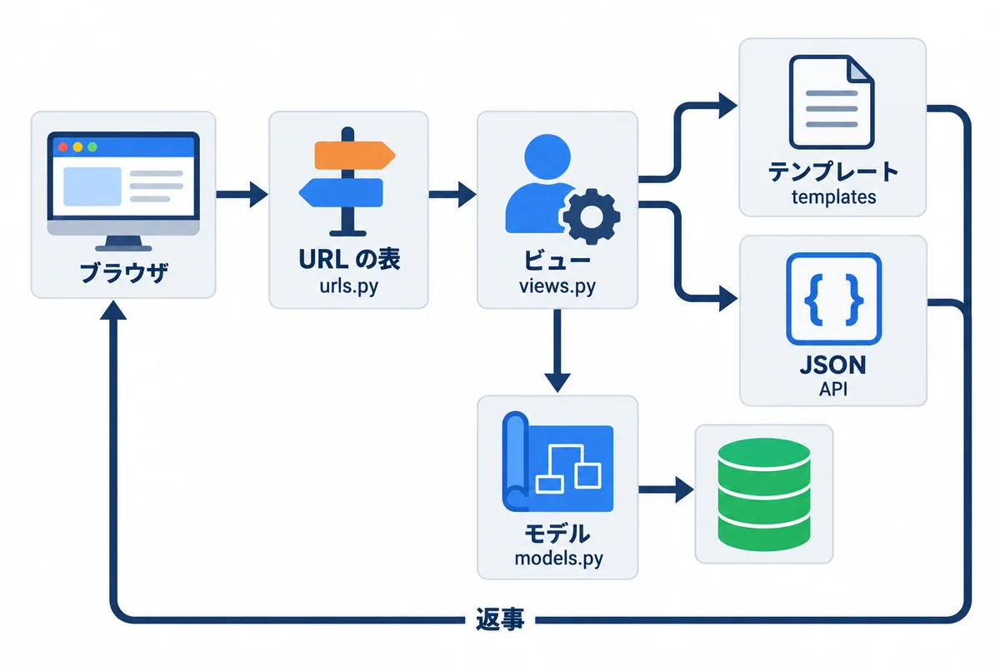
<div style="font-size: 12px; color: #64748b; margin-top: 6px;">図1-1: お願いは、URL の表 → ビュー → モデル → テンプレート（または JSON）の順に流れる</div>
</div>

| 部品 | ファイル | 役目 | たとえ |
|---|---|---|---|
| URL の表 | `urls.py` | どの URL を、どのビューに渡すか | 受付の案内板 |
| ビュー | `views.py` | お願いを受けて、仕事をして、返事を作る | 担当者 |
| モデル | `models.py` | データの形と、データベースとのやり取り | 帳簿の書式 |
| テンプレート | `templates/` | HTML のひな形に、データを埋め込む | 書類のひな形 |
| シリアライザ（DRF） | `serializers.py` | データと JSON の変換と、入力の確かめ | 翻訳と検査の係 |

> **用語:** Django（ジャンゴ：Python の Web アプリのフレームワーク。ログイン・管理画面・データベースの道具・安全の仕組みが、最初から入っている）

## 2. プロジェクトとアプリを作る

<div style="max-width: 760px; margin: 18px auto; text-align: center;">
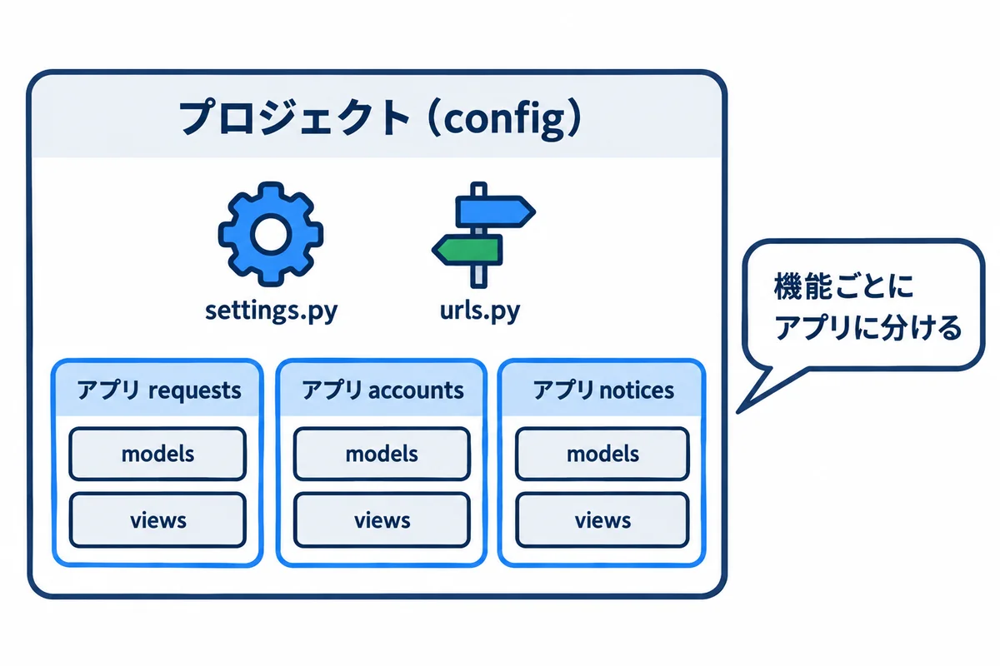
<div style="font-size: 12px; color: #64748b; margin-top: 6px;">図2-1: 1 つのプロジェクトの中に、機能ごとのアプリを入れる</div>
</div>

**▶ 準備:** 00 の 6.4（Python 3.14）。04 を終えていれば、もう入っています。

**▶ 書く所と動かし方:** 完成した物は、資料のフォルダの `webapp_learning\samples\05_django\` にあります。自分で 1 から作って試すときは、**自分用の新しいフォルダ**で始めます（完成した物のフォルダで `startproject` をすると、すでにあるファイルとぶつかります）。下は、資料を `~\Documents\def` に置いたときの例です。

```powershell
# 自分用の練習のフォルダを作って、その中へ移動する
mkdir ~\Documents\my-practice\05_django
cd ~\Documents\my-practice\05_django
# 使う部品の一覧（requirements.txt）を、資料のフォルダから写してくる
Copy-Item ~\Documents\def\webapp_learning\samples\05_django\requirements.txt .
py -3.14 -m venv .venv
.\.venv\Scripts\python.exe -m pip install -r requirements.txt

# プロジェクト（設定の入れ物）を作る。最後の . は「このフォルダに」
.\.venv\Scripts\django-admin.exe startproject config .
# アプリ（機能の入れ物）を作る
.\.venv\Scripts\python.exe manage.py startapp requests_app
```

<!-- first-use -->

> **▶ ここで初めて出てくるコード**
>
> - **`Copy-Item`**（PowerShell）: ファイルやフォルダをコピーするコマンド。`Copy-Item 元 先`。最後の `.` は「今いるフォルダへ」という意味です。
> - **`.\.venv\Scripts\django-admin.exe`**（Django の道具）: 仮想環境に入った Django の道具を動かす書き方。`django-admin.exe startproject config .` で、今いるフォルダに Django のプロジェクト（`manage.py` と `config` フォルダ）を作ります。

<!-- /first-use -->

`requirements.txt`:

```text
Django==5.2.18
djangorestframework==3.18.3
tzdata==2026.6
```

`config/settings.py` で、次の所を直します（全部は、練習のファイルを見てください）。

```python
INSTALLED_APPS = [
    # …（最初から入っている物）…
    'rest_framework',     # API を作る部品
    'requests_app',       # 作ったアプリ
]

LANGUAGE_CODE = 'ja'          # 管理画面やエラーの文を日本語に
TIME_ZONE = 'Asia/Tokyo'      # 日本時間

LOGIN_URL = "/accounts/login/"   # ログインしていないときに案内する画面
LOGIN_REDIRECT_URL = "/"         # ログインした後に開く画面
```

| ファイル | 役目 |
|---|---|
| `manage.py` | Django の管理コマンドの入口（`python manage.py コマンド`） |
| `config/settings.py` | 全体の設定 |
| `config/urls.py` | いちばん上の URL の表 |
| `requests_app/` | 依頼の機能のアプリ |

## 3. モデル: データの設計図

`requests_app/models.py`:

```python
from django.conf import settings
from django.db import models


class Request(models.Model):
    """依頼 1 件"""

    class Status(models.TextChoices):
        # データベースに入る値（英字）と、画面に出す名前（日本語）
        CIRCULATING = "circulating", "回覧中"
        RETURNED = "returned", "差し戻し中"
        PULLED_BACK = "pulled_back", "引き戻し中"
        APPROVED = "approved", "回覧完了"
        IN_PROGRESS = "in_progress", "対応中"
        DONE = "done", "完了"
        WITHDRAWN = "withdrawn", "取り下げ"

    title = models.CharField("件名", max_length=100)
    detail = models.TextField("内容", blank=True)
    due_date = models.DateField("希望の納期")
    status = models.CharField("状態", max_length=20, choices=Status.choices, default=Status.CIRCULATING)
    requester = models.ForeignKey(
        settings.AUTH_USER_MODEL, verbose_name="依頼者", on_delete=models.PROTECT, related_name="requests"
    )
    created_at = models.DateTimeField("作った日時", auto_now_add=True)

    class Meta:
        verbose_name = "依頼"
        verbose_name_plural = "依頼"
        ordering = ["-created_at"]  # 新しい順

    def __str__(self) -> str:
        return f"{self.pk} {self.title}"


class Approval(models.Model):
    """回覧の 1 人分（だれが、何番目に、どうしたか）"""

    class Decision(models.TextChoices):
        WAITING = "waiting", "待ち"
        APPROVED = "approved", "承認"
        RETURNED = "returned", "差し戻し"

    request = models.ForeignKey(Request, verbose_name="依頼", on_delete=models.CASCADE, related_name="approvals")
    order = models.PositiveSmallIntegerField("順番")
    approver = models.ForeignKey(settings.AUTH_USER_MODEL, verbose_name="承認者", on_delete=models.PROTECT)
    decision = models.CharField("結果", max_length=20, choices=Decision.choices, default=Decision.WAITING)
    decided_at = models.DateTimeField("決めた日時", null=True, blank=True)

    class Meta:
        verbose_name = "回覧"
        verbose_name_plural = "回覧"
        ordering = ["request", "order"]
        constraints = [
            # 1 つの依頼の中で、順番は重ならない
            models.UniqueConstraint(fields=["request", "order"], name="unique_order_per_request"),
        ]

    def __str__(self) -> str:
        return f"{self.request_id} の {self.order} 番目"
```

<!-- first-use -->

> **▶ ここで初めて出てくるコード**
>
> - **`.CharField()`**（Django）: `models.CharField("件名", max_length=100)` は、短い文字列の列（最大の長さを必ず決める）を表すモデルの項目です。最初の `"件名"` は、管理画面などに出る名前です。
> - **`.TextField()`**（Django）: 長い文字列（何行もの文）の列を表すモデルの項目。`blank=True` を付けると、入力が空でもよくなります。
> - **`.DateField()`**（Django）: 日付の列を表すモデルの項目。
> - **`.ForeignKey()`**（Django）: ほかの表の 1 行を指す列（外部キー）を表すモデルの項目。`models.ForeignKey(User, on_delete=models.PROTECT, related_name="requests")` は「ユーザーを指す。指されているユーザーは消せない（PROTECT）。ユーザーの側からは `user.requests` で依頼をたどれる」。
> - **`.DateTimeField()`**（Django）: 日時の列を表すモデルの項目。`auto_now_add=True` で、作った時の日時を自動で入れます。
> - **`.PositiveSmallIntegerField()`**（Django）: 0 以上の小さな整数の列を表すモデルの項目（順番などに使う）。
> - **`.UniqueConstraint()`**（Django）: 「この組み合わせの値は、表の中で重ならない」という決まりを表す物。`fields=["request", "order"]` は「同じ依頼の中で、同じ順番は 2 つ作れない」。

<!-- /first-use -->

| 書き方 | 意味 | データベースでは（onprem の 02） |
|---|---|---|
| `class Request(models.Model):` | 1 つのモデル ＝ 1 つのテーブル | `CREATE TABLE` |
| `models.CharField("件名", max_length=100)` | 文字（100 文字まで）。最初の文字は画面に出す名前 | `varchar(100)` |
| `models.TextField(blank=True)` | 長い文字。`blank=True` は「空でもよい」 | `text` |
| `models.DateField`・`DateTimeField` | 日付・日時 | `date`・`timestamp` |
| `models.TextChoices` | 決まった値（DB に入る英字と、画面の日本語の組） | `CHECK` に近い（Django が確かめる） |
| `models.ForeignKey(..., on_delete=models.PROTECT)` | 外部キー。`PROTECT` は「依頼がある社員は消せない」 | `REFERENCES` |
| `on_delete=models.CASCADE` | 依頼を消したら、その回覧も一緒に消える | `ON DELETE CASCADE` |
| `auto_now_add=True` | 作ったときの日時を、自動で入れる | `DEFAULT now()` に近い |
| `class Meta: ordering = ["-created_at"]` | いつもの並べ方（新しい順） | `ORDER BY` |
| `UniqueConstraint(...)` | 1 つの依頼の中で、順番が重ならない | `UNIQUE` |
| `settings.AUTH_USER_MODEL` | Django のユーザー（ログインする人） | `auth_user` テーブル |

> **状態の値を英字にする理由:** データベースに入る値（`"circulating"`）と、画面に出す名前（`"回覧中"`）を分けておくと、名前を変えたくなったときに、データを書きかえずに済みます。

## 4. マイグレーション: テーブルを作る

<div style="max-width: 760px; margin: 18px auto; text-align: center;">
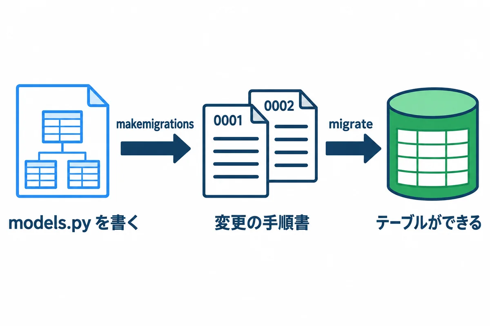
<div style="font-size: 12px; color: #64748b; margin-top: 6px;">図4-1: モデルを書く → 手順書を作る → データベースに当てる</div>
</div>

```powershell
.\.venv\Scripts\python.exe manage.py makemigrations requests_app
.\.venv\Scripts\python.exe manage.py migrate
```

実際の出力（`makemigrations`）:

```text
Migrations for 'requests_app':
  requests_app\migrations\0001_initial.py
    + Create model Request
    + Create model Approval
```

実際の出力（`migrate`。最初の 1 回は、Django が最初から持っているテーブルも作るので長い。途中を省略）:

```text
Operations to perform:
  Apply all migrations: admin, auth, contenttypes, requests_app, sessions
Running migrations:
  Applying contenttypes.0001_initial... OK
  Applying auth.0001_initial... OK
  …
  Applying requests_app.0001_initial... OK
  Applying sessions.0001_initial... OK
```

裏で作られる SQL は、`sqlmigrate` で見られます（実際の出力の最初の所）。

```text
CREATE TABLE "requests_app_request" ("id" integer NOT NULL PRIMARY KEY AUTOINCREMENT, "title" varchar(100) NOT NULL, "detail" text NOT NULL, "due_date" date NOT NULL, "status" varchar(20) NOT NULL, "created_at" datetime NOT NULL, "requester_id" integer NOT NULL REFERENCES "auth_user" ("id") DEFERRABLE INITIALLY DEFERRED);
```

- **モデルを直したら、必ず `makemigrations` → `migrate`** の順に動かします。`makemigrations` が作る `0001_initial.py` などの手順書は、**Git に入れて、ほかの人やサーバーと共有します**（サーバーでは `migrate` だけを動かす。onprem の 05 の 9.5）。
- 手順書を手で書きかえたり、消したりしないでください。データベースと手順書の記録が食い違います。

> **用語:** マイグレーション（モデルの変更を、番号付きの手順書にして、データベースに順に当てる仕組み）

## 5. 管理画面

<div style="max-width: 760px; margin: 18px auto; text-align: center;">
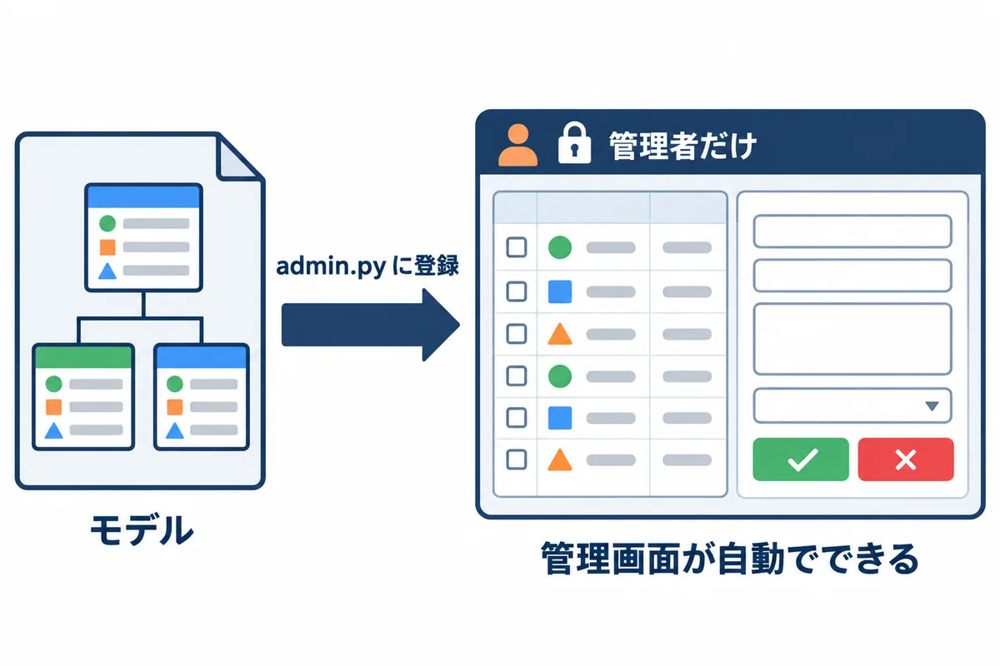
<div style="font-size: 12px; color: #64748b; margin-top: 6px;">図5-1: モデルを登録するだけで、管理画面ができる</div>
</div>

`requests_app/admin.py`:

```python
from django.contrib import admin

from .models import Approval, Request


class ApprovalInline(admin.TabularInline):
    """依頼の画面の中に、回覧の表を並べる"""

    model = Approval
    extra = 0


@admin.register(Request)
class RequestAdmin(admin.ModelAdmin):
    list_display = ["id", "title", "status", "due_date", "requester", "created_at"]  # 一覧に出す列
    list_filter = ["status"]                                                          # 右の絞り込み
    search_fields = ["title", "detail"]                                               # 検索の対象
    inlines = [ApprovalInline]
```

<!-- first-use -->

> **▶ ここで初めて出てくるコード**
>
> - **`.register()`**（Django）: `@admin.register(Request)` は、モデルを管理画面に登録して、画面から見たり直したりできるようにする書き方です。
> - **`@admin`**（Django）: `@admin.register(モデル)` を、管理画面の設定のクラスの上に付けて、そのモデルを管理画面に出します。

<!-- /first-use -->

```powershell
# 管理画面に入れる人（スーパーユーザー）を作る。名前とパスワードを聞かれる
.\.venv\Scripts\python.exe manage.py createsuperuser

# 開発用のサーバーを起動する（止めるときは Ctrl+C）
.\.venv\Scripts\python.exe manage.py runserver
```

`http://127.0.0.1:8000/admin/` を開いて、ログインします。

<div style="max-width: 760px; margin: 18px auto; text-align: center;">
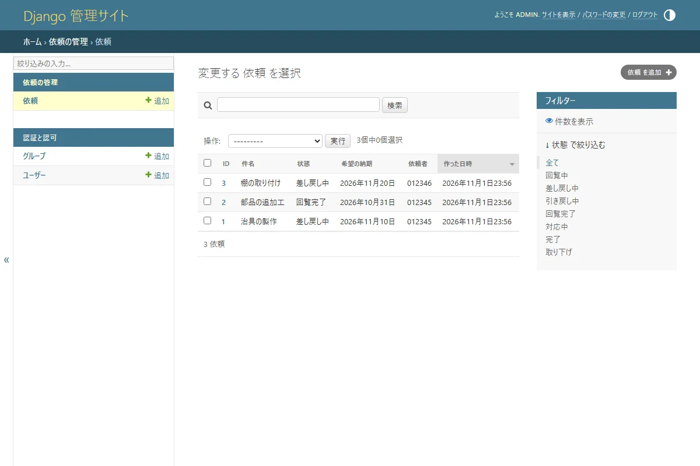
<div style="font-size: 12px; color: #64748b; margin-top: 6px;">図5-2: 依頼の一覧（list_display の列と、list_filter の絞り込み）</div>
</div>

<div style="max-width: 760px; margin: 18px auto; text-align: center;">
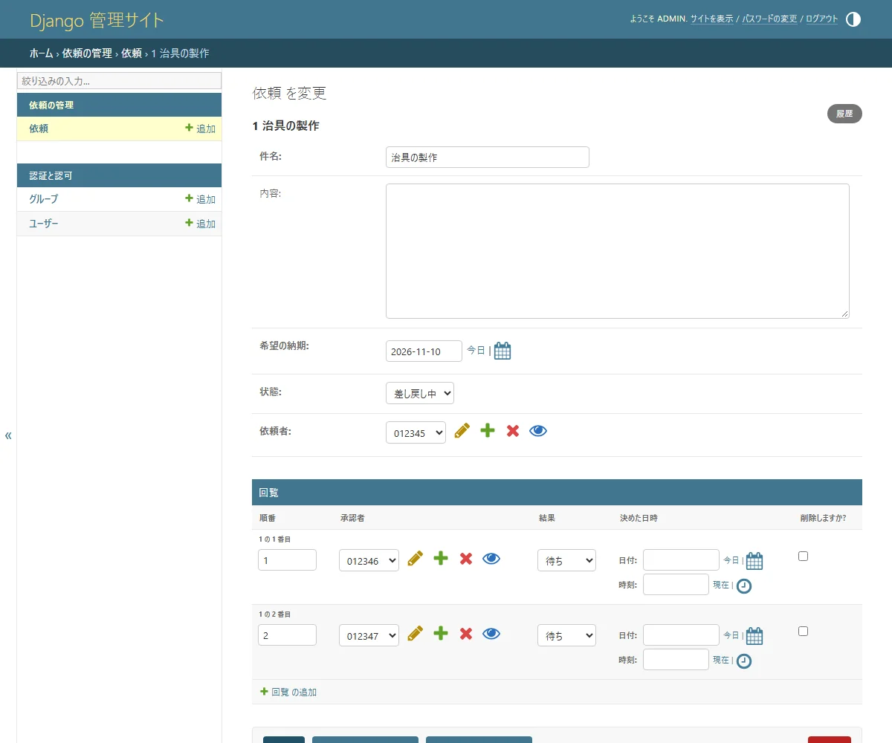
<div style="font-size: 12px; color: #64748b; margin-top: 6px;">図5-3: 1 件の画面。回覧（Approval）も、同じ画面の下に並ぶ（inlines）</div>
</div>

> **管理画面は、管理者のための道具です。** 社員がふだん使う画面ではありません。状態を直接書きかえると、メールが送られないなど、アプリの決まりを飛ばしてしまいます（onprem の 02 の 2.5 と同じ注意）。

## 6. ORM: Python でデータベースを操作する

<div style="max-width: 760px; margin: 18px auto; text-align: center;">
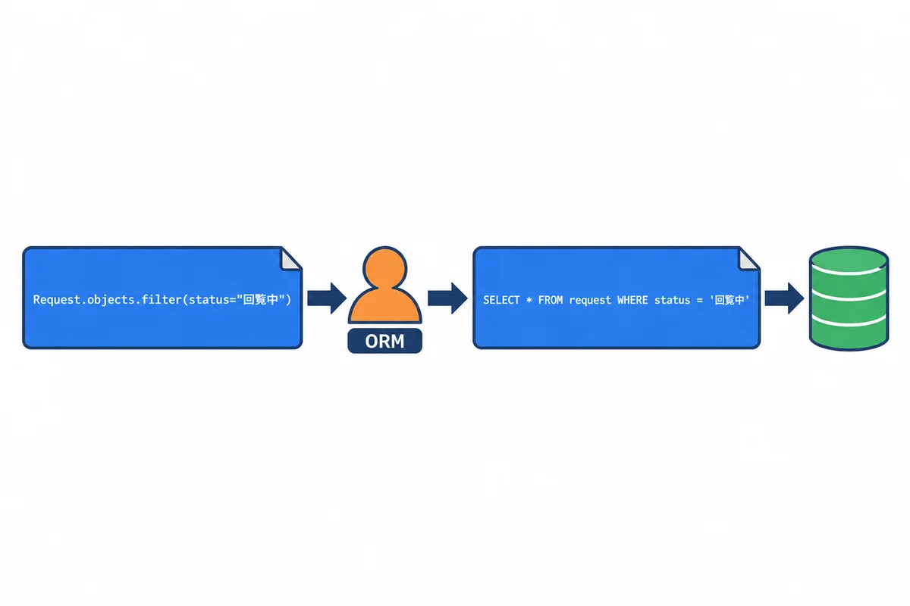
<div style="font-size: 12px; color: #64748b; margin-top: 6px;">図6-1: ORM は、Python の書き方を SQL に通訳する</div>
</div>

`orm_demo.py`（練習用のデータを作り直して、いろいろな操作をする）:

```python
"""ORM の練習。使い方: .venv\\Scripts\\python.exe manage.py shell -c "import orm_demo"
（練習用のデータを作り直すので、何度動かしても同じ結果になる）"""

from datetime import date

from django.contrib.auth import get_user_model
from django.db.models import Count

from requests_app.models import Approval, Request

User = get_user_model()

# 0. 練習用のデータを作り直す
Request.objects.all().delete()
User.objects.filter(username__in=["012345", "012346", "012347"]).delete()
yamada = User.objects.create_user("012345", password="practice-only-1", first_name="太郎", last_name="山田")
sato = User.objects.create_user("012346", password="practice-only-2", first_name="花子", last_name="佐藤")
suzuki = User.objects.create_user("012347", password="practice-only-3", first_name="一郎", last_name="鈴木")

# 1. 作る（INSERT）
r1 = Request.objects.create(title="治具の製作", due_date=date(2026, 11, 10), requester=yamada)
r2 = Request.objects.create(title="部品の追加工", due_date=date(2026, 10, 31), requester=yamada, status=Request.Status.APPROVED)
r3 = Request.objects.create(title="棚の取り付け", due_date=date(2026, 11, 20), requester=sato, status=Request.Status.RETURNED)
Approval.objects.create(request=r1, order=1, approver=sato)
Approval.objects.create(request=r1, order=2, approver=suzuki)
print("作った件数:", Request.objects.count())

# 2. 絞る（WHERE）・並べる（ORDER BY）
circulating = Request.objects.filter(status=Request.Status.CIRCULATING)
print("回覧中:", [r.title for r in circulating])
print("山田さんの依頼（納期の近い順）:", [r.title for r in Request.objects.filter(requester=yamada).order_by("due_date")])

# 3. 裏で作られる SQL を見る
print("SQL:", circulating.query)

# 4. 1 件を取り出して、直す（UPDATE）
r = Request.objects.get(pk=r1.pk)
r.status = Request.Status.RETURNED
r.save()
print(r.title, "→", r.get_status_display())

# 5. 状態ごとの件数（GROUP BY）
counts = Request.objects.values("status").annotate(n=Count("id")).order_by("status")
print("状態ごとの件数:", {row["status"]: row["n"] for row in counts})

# 6. つながったデータ（回覧の順に、承認者の名前）
for a in Approval.objects.filter(request=r1).select_related("approver"):
    print(f"  {a.order} 番目: {a.approver.get_full_name()}（{a.get_decision_display()}）")

# 7. 無い物を get すると、エラーになる
try:
    Request.objects.get(pk=999)
except Request.DoesNotExist:
    print("999 番の依頼は無い")
```

<!-- first-use -->

> **▶ ここで初めて出てくるコード**
>
> - **`.all()`**（Django）: `Request.objects.all()` は、表の全部の行を取り出す（まだ読みに行かない「問い合わせ」を作る）メソッドです。
> - **`.delete()`**（Django）: 問い合わせに合う行（または 1 つの物）を、データベースから消すメソッド。消した件数が返ります。
> - **`.filter()`**（Django）: Django の問い合わせで、条件に合う行だけに絞るメソッド。`Request.objects.filter(status="approved")`。`項目名__条件`（`title__icontains="治具"` など）で、いろいろな条件を書けます（11 巻の B-18）。
> - **`.create_user()`**（Django）: Django の利用者（`User`）を作るメソッド。`User.objects.create_user("012345", password="…")`。パスワードは、そのまま保存せずに、ハッシュにしてから保存してくれます（`create()` で作ると、ハッシュにならないので使わない）。
> - **`.create()`**（Django）: Django で、新しい行を作ってデータベースに保存するメソッド。`Request.objects.create(title="…", …)` は、作ると同時に保存します（`.save()` は要らない）。
> - **`.count()`**（Django）: Django で、条件に合う行の数を数えるメソッド。`Request.objects.count()` は、全部の依頼の数。データベースに `SELECT count(*)` を送るので、全部を読み込むより速いです。
> - **`.order_by()`**（Django）: 問い合わせの結果を並べかえるメソッド。`order_by("due_date")` は納期の近い順、`order_by("-due_date")` は遠い順（`-` で逆）。
> - **`.save()`**（Django）: Django のモデル（1 行分の値）を、データベースに保存するメソッド。新しい物なら行を足し、もうある物なら行を変えます。
> - **`.get_status_display()`**（Django）: `choices` を決めた項目の、画面に出す名前（`"approved"` → `"回覧完了"`）を返すメソッド。Django が `get_項目名_display()` を自動で作ります。
> - **`.values()`**（Django）: Django で、行をモデルではなく、決めた列だけの辞書で受け取るメソッド。`Request.objects.values("status").annotate(n=Count("id"))` は「状態ごとの数」を数える時の書き方です。
> - **`.annotate()`**（Django）: 問い合わせの 1 行ごとに、計算した値（数など）を付け足すメソッド。`values("status").annotate(n=Count("id"))` は「状態ごとの件数」（SQL の GROUP BY）。
> - **`.select_related()`**（Django）: つながった表（外部キーの先）を、1 回の問い合わせでまとめて読むメソッド。`select_related("approver")` で、ループの中で承認者を 1 人ずつ読みに行く無駄（N+1）を防げます。
> - **`get_user_model()`**（Django）: 今のプロジェクトで使っている「ユーザー」のモデルを返す関数。自分でユーザーのモデルを作った時も、これで正しく取れます。
> - **`date()`**（Python）: 日付を表す型。`date(2026, 11, 10)` のように作ります。

<!-- /first-use -->

動かした結果（`.\.venv\Scripts\python.exe manage.py shell -c "import orm_demo"`）:

```text
作った件数: 3
回覧中: ['治具の製作']
山田さんの依頼（納期の近い順）: ['部品の追加工', '治具の製作']
SQL: SELECT "requests_app_request"."id", "requests_app_request"."title", "requests_app_request"."detail", "requests_app_request"."due_date", "requests_app_request"."status", "requests_app_request"."requester_id", "requests_app_request"."created_at" FROM "requests_app_request" WHERE "requests_app_request"."status" = circulating ORDER BY "requests_app_request"."created_at" DESC
治具の製作 → 差し戻し中
状態ごとの件数: {'approved': 1, 'returned': 2}
  1 番目: 花子 佐藤（待ち）
  2 番目: 一郎 鈴木（待ち）
999 番の依頼は無い
```

| ORM | 意味 | SQL（onprem の 02） |
|---|---|---|
| `Request.objects.create(...)` | 作る | `INSERT` |
| `.filter(status=...)` | 絞る | `WHERE` |
| `.order_by("due_date")`・`"-due_date"` | 並べる（`-` は大きい順） | `ORDER BY` |
| `.get(pk=1)` | 1 件だけ取り出す。**無い・2 件以上はエラー** | `WHERE id = 1` |
| `r.save()` | 直した物を保存 | `UPDATE` |
| `.values("status").annotate(n=Count("id"))` | 状態ごとに数える | `GROUP BY` |
| `.select_related("approver")` | つながった表も、1 回でまとめて読む | `JOIN` |
| `.count()` | 数 | `COUNT(*)` |

- `str(qs.query)` で見える SQL は、**読むための物**です（`= circulating` のように、値の `'` が付いていない）。本当は、値は SQL と**別に**データベースへ渡されます。だから、入力に `'` や SQL の文字が入っていても、**SQL インジェクション**（10）が起きません。
- 名前が「花子 佐藤」と、**名・姓の順**に出ています。Django の `get_full_name()` は「名 姓」の順で作るためです。日本の名前の順にしたいときは、06 で、氏名の項目を自分で持つ作りにします。

> **用語:** ORM（オーアールエム。Object-Relational Mapping：プログラムの書き方で、データベースの読み書きをする仕組み。SQL は ORM が作る）

<!-- -->

> **用語:** クエリセット（QuerySet：`filter` などで作る「データベースへのお願いの下書き」。本当に読むのは、`for` で回すときなど、使うときになってから）

## 7. HTML の画面（テンプレート）とログイン

`requests_app/views.py`:

```python
from django.contrib.auth.decorators import login_required
from django.shortcuts import render
from rest_framework import permissions, viewsets

from .models import Request
from .serializers import RequestSerializer


@login_required
def request_list(request):
    """自分の依頼の一覧（Django のテンプレートで HTML を作る）"""
    items = Request.objects.filter(requester=request.user)
    return render(request, "requests_app/request_list.html", {"items": items})


class RequestViewSet(viewsets.ModelViewSet):
    """依頼の API（JSON）。一覧・1 件・作る・直す・消すを、まとめて用意する"""

    serializer_class = RequestSerializer
    permission_classes = [permissions.IsAuthenticated]

    def get_queryset(self):
        # 自分の依頼だけ（ほかの人の依頼は、見えも直せもしない）
        return Request.objects.filter(requester=self.request.user).select_related("requester")

    def perform_create(self, serializer):
        # 依頼者は、送られてきた値ではなく、ログインしている人にする
        serializer.save(requester=self.request.user)
```

<!-- first-use -->

> **▶ ここで初めて出てくるコード**
>
> - **`render()`**（Django）: Django で、テンプレート（HTML のひな形）に値を入れて、答え（HTML）を作る関数。`render(request, "テンプレート名", {"名前": 値})`。
> - **`@login_required`**（Django）: 関数の画面（ビュー）の上に付けると、ログインしていない人をログインの画面へ移す印（デコレーター）です。

<!-- /first-use -->

`requests_app/urls.py`（アプリの URL の表）:

```python
from django.urls import include, path
from rest_framework.routers import DefaultRouter

from . import views

router = DefaultRouter()
router.register("requests", views.RequestViewSet, basename="request")

urlpatterns = [
    path("", views.request_list, name="request_list"),
    path("api/", include(router.urls)),
]
```

<!-- first-use -->

> **▶ ここで初めて出てくるコード**
>
> - **`path()`**（Django）: URL と、それに答える画面（ビュー）を結び付ける関数。`path("requests/<int:pk>/", views.detail)` の `<int:pk>` は、URL の中の数を `pk` という名前で受け取ります。
> - **`include()`**（Django）: URL の決まりの中で、ほかのファイル（アプリ）の URL の決まりを、まとめて取り込む関数。`path("api/", include("requests_app.urls"))` のように使います。

<!-- /first-use -->

`config/urls.py`（いちばん上の URL の表。`accounts/` は Django に付いているログイン・ログアウトの画面）:

```python
urlpatterns = [
    path('admin/', admin.site.urls),
    path('accounts/', include('django.contrib.auth.urls')),
    path('', include('requests_app.urls')),
]
```

`requests_app/templates/requests_app/request_list.html`:

```html

<!doctype html>
<html lang="ja">
  <head>
    <meta charset="utf-8">
    <title>自分の依頼</title>
    <link rel="stylesheet" href="">
  </head>
  <body>
    <header class="site-header">
      <strong>依頼・承認アプリ</strong>
      <nav><span>{{ user.get_full_name|default:user.username }} さん</span></nav>
    </header>
    <main>
      <h1>自分の依頼</h1>
      <table>
        <thead>
          <tr><th>番号</th><th>件名</th><th>希望の納期</th><th>状態</th></tr>
        </thead>
        <tbody>
          
            <tr>
              <td>{{ r.id }}</td>
              <td>{{ r.title }}</td>
              <td>{{ r.due_date|date:"Y-m-d" }}</td>
              <td><span class="badge badge-{{ r.status }}">{{ r.get_status_display }}</span></td>
            </tr>
          
            <tr><td colspan="4">依頼はまだありません</td></tr>
          
        </tbody>
      </table>
    </main>
  </body>
</html>
```

| テンプレートの書き方 | 意味 |
|---|---|
| `{{ r.title }}` | 値を埋め込む。**`<` などの記号は、自動で無害な形に変わる**（XSS を防ぐ。10） |
| ` …  … ` | くり返し。`empty` は 1 件も無いとき |
| `{{ r.due_date\|date:"Y-m-d" }}` | 日付の書き方を決める（フィルター） |
| `{{ r.get_status_display }}` | 状態の、画面に出す名前（回覧中） |
| `` | CSS などの置き場所の URL |
| ``（ログインの画面） | フォームに、CSRF の札を入れる（10） |

<div style="max-width: 760px; margin: 18px auto; text-align: center;">
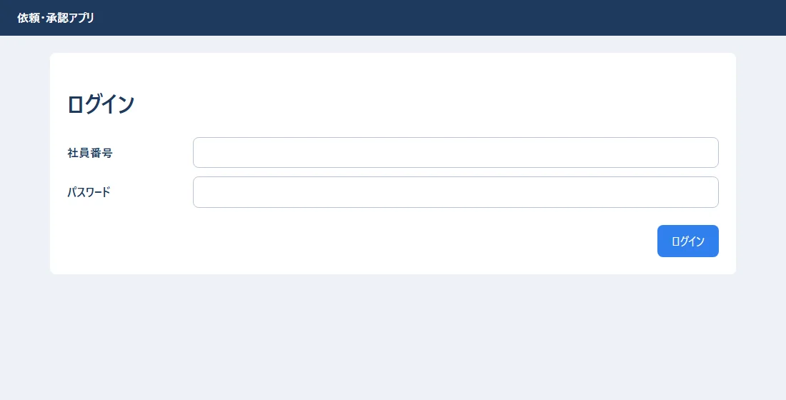
<div style="font-size: 12px; color: #64748b; margin-top: 6px;">図7-1: ログインの画面（Django に付いている LoginView と、自分で書いたテンプレート）</div>
</div>

<div style="max-width: 760px; margin: 18px auto; text-align: center;">
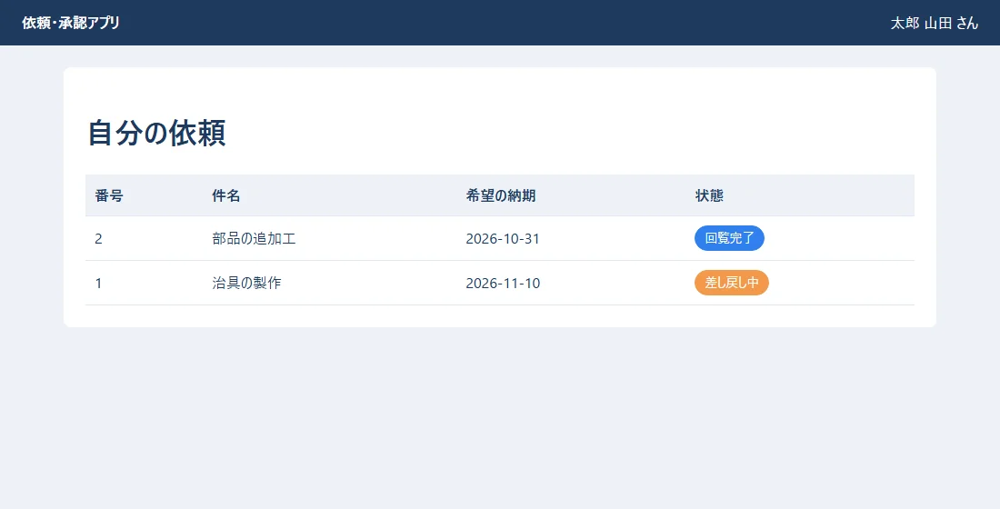
<div style="font-size: 12px; color: #64748b; margin-top: 6px;">図7-2: 社員番号 012345 でログインすると、自分の依頼だけが出る</div>
</div>

- `@login_required` を付けたビューは、ログインしていないと、ログインの画面に案内されます。
- `Request.objects.filter(requester=request.user)` で、**自分の依頼だけ**を出しています。ほかの人の依頼が見えないようにするのは、画面ではなく、**サーバーの仕事**です（10）。

## 8. JSON の API（Django REST framework）

<div style="max-width: 760px; margin: 18px auto; text-align: center;">
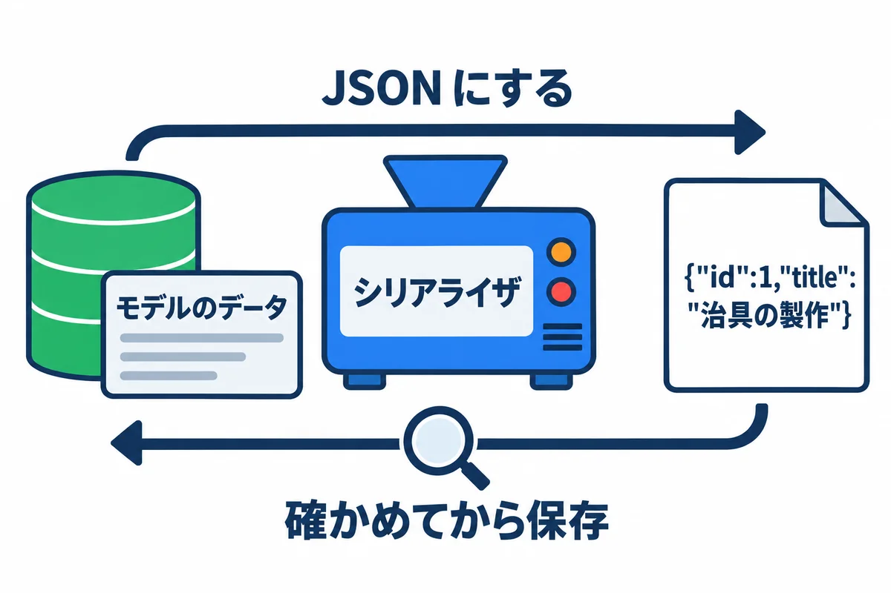
<div style="font-size: 12px; color: #64748b; margin-top: 6px;">図8-1: シリアライザは、データと JSON の変換と、入力の確かめの係</div>
</div>

React の画面（03・06）は、サーバーと JSON でやり取りします。JSON の API は、**Django REST framework（DRF）**で作ります。

`requests_app/serializers.py`:

```python
from rest_framework import serializers

from .models import Request


class RequestSerializer(serializers.ModelSerializer):
    """依頼 ⇔ JSON の変換と、入力の確かめ"""

    status_label = serializers.CharField(source="get_status_display", read_only=True)
    requester_name = serializers.CharField(source="requester.get_full_name", read_only=True)

    class Meta:
        model = Request
        fields = ["id", "title", "detail", "due_date", "status", "status_label", "requester_name", "created_at"]
        read_only_fields = ["status", "created_at"]  # 状態は、画面から直接は変えさせない

    def validate_title(self, value: str) -> str:
        if not value.strip():
            raise serializers.ValidationError("件名を入れてください")
        return value
```

<!-- first-use -->

> **▶ ここで初めて出てくるコード**
>
> - **`.ValidationError()`**（Django REST framework）: Django REST framework で、入力のまちがいを知らせるエラー。`raise serializers.ValidationError("件名を入れてください")` と書くと、その文が `400` の答えに入って返ります。

<!-- /first-use -->

| 書き方 | 意味 |
|---|---|
| `ModelSerializer` | モデルから、JSON の形と確かめを自動で作る |
| `fields = [...]` | JSON に出す項目（**出さない項目は書かない**。パスワードなどを漏らさない） |
| `read_only_fields = ["status", ...]` | 送られてきても、無視する項目 |
| `source="get_status_display"` | 別の値（状態の名前）を、JSON に足す |
| `def validate_title(...)` | 項目ごとの確かめ。`ValidationError` で断る |

ビューの `RequestViewSet`（7 章の `views.py`）は、次の URL をまとめて用意します。

| URL | 方法 | 何をする |
|---|---|---|
| `/api/requests/` | GET | 自分の依頼の一覧 |
| `/api/requests/` | POST | 依頼を作る |
| `/api/requests/1/` | GET・PUT・PATCH・DELETE | 1 件を見る・直す・消す |

ブラウザで `http://127.0.0.1:8000/api/requests/` を開くと、DRF が、人が読める画面で見せてくれます（ログインしている人の依頼だけ）。

<div style="max-width: 760px; margin: 18px auto; text-align: center;">
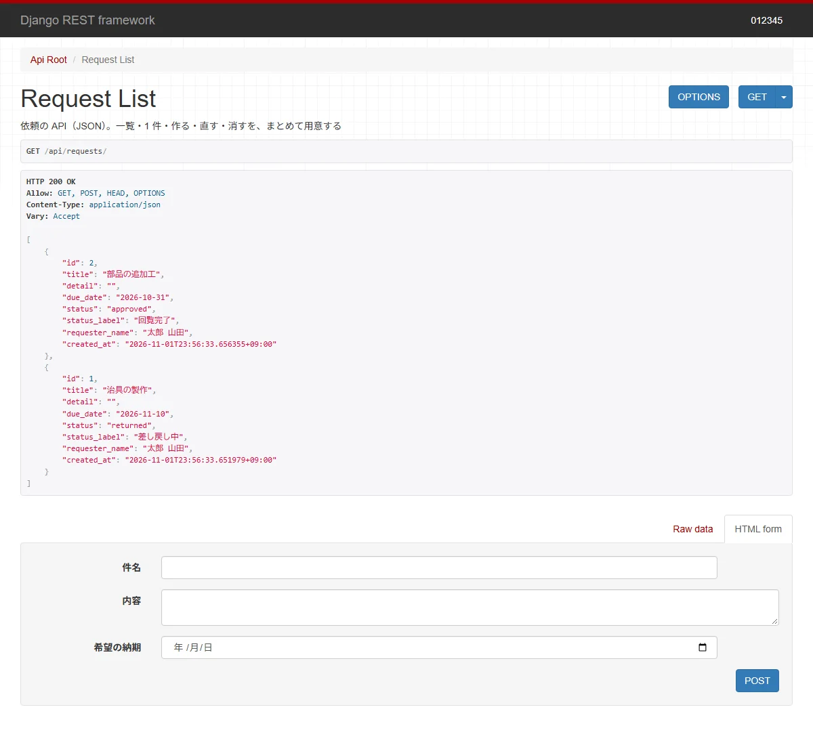
<div style="font-size: 12px; color: #64748b; margin-top: 6px;">図8-2: DRF の画面。JSON の中身と、試しに送るフォームが出る</div>
</div>

- `perform_create` で、**依頼者を「ログインしている人」にしています**。送られてきた JSON に別の人の番号が入っていても、使いません。
- `get_queryset` で、**自分の依頼だけ**に絞っています。`/api/requests/3/` のように、ほかの人の依頼の番号を打っても、「見つからない（404）」になります。

> **用語:** API（エーピーアイ：プログラムどうしがやり取りするための入口。ここでは、JSON でデータをやり取りする URL の一式）

<!-- -->

> **用語:** Django REST framework（DRF：Django で JSON の API を作るための部品）

## 9. 自動のテスト

`requests_app/tests.py`:

```python
from datetime import date

from django.contrib.auth import get_user_model
from rest_framework.test import APITestCase

from .models import Request


class RequestApiTests(APITestCase):
    def setUp(self):
        User = get_user_model()
        self.yamada = User.objects.create_user("012345", password="pass-for-test-1", first_name="太郎", last_name="山田")
        self.sato = User.objects.create_user("012346", password="pass-for-test-2")
        Request.objects.create(title="治具の製作", due_date=date(2026, 11, 10), requester=self.yamada)

    def test_ログインしていないと見られない(self):
        res = self.client.get("/api/requests/")
        self.assertEqual(res.status_code, 403)

    def test_自分の依頼だけが見える(self):
        self.client.force_authenticate(self.sato)
        res = self.client.get("/api/requests/")
        self.assertEqual(res.status_code, 200)
        self.assertEqual(res.json(), [])

    def test_依頼を作ると回覧中になり依頼者は自分になる(self):
        self.client.force_authenticate(self.yamada)
        res = self.client.post("/api/requests/", {"title": "棚の取り付け", "due_date": "2026-11-20", "status": "done"})
        self.assertEqual(res.status_code, 201)
        self.assertEqual(res.json()["status"], "circulating")  # 送った "done" は無視される
        self.assertEqual(res.json()["requester_name"], "太郎 山田")

    def test_件名が空なら断る(self):
        self.client.force_authenticate(self.yamada)
        res = self.client.post("/api/requests/", {"title": "  ", "due_date": "2026-11-20"})
        self.assertEqual(res.status_code, 400)
        self.assertIn("title", res.json())
```

<!-- first-use -->

> **▶ ここで初めて出てくるコード**
>
> - **`.assertEqual()`**（Django）: テストで、2 つの値が同じかを確かめるメソッド。`self.assertEqual(res.status_code, 403)`。
> - **`.force_authenticate()`**（Django REST framework）: テストで、決めたユーザーとしてログインしたことにして API を呼ぶためのメソッド（DRF のテスト用のクライアント）。
> - **`.json()`**（Django）: テストで受け取った答え（レスポンス）の本文を、JSON として読んで、Python のリストや辞書にするメソッド。`self.assertEqual(res.json(), [])`。
> - **`.post()`**（Django）: テストの係（`self.client`）で、POST のリクエストを送るメソッド。`self.client.post("/api/requests/", {…})` で、サーバーを動かさずに、API を試せます。
> - **`.assertIn()`**（Django）: テストで、値が入れ物の中にあるかを確かめるメソッド。`self.assertIn("title", res.json())`。

<!-- /first-use -->

```powershell
.\.venv\Scripts\python.exe manage.py test requests_app
```

実際の出力:

```text
Found 4 test(s).
Creating test database for alias 'default'...
System check identified no issues (0 silenced).
....
----------------------------------------------------------------------
Ran 4 tests in 7.733s

OK
Destroying test database for alias 'default'...
```

- テストは、**テスト専用のデータベース**を作って動き、終わったら消します。本物のデータは変わりません。
- `.` 1 つが、1 つのテストの成功です。失敗すると `F`、エラーは `E` になり、どこが違ったかが表示されます。
- 「ログインしないと見られない」「ほかの人の依頼は見えない」「状態は送っても変えられない」のような、**安全の決まりをテストにしておく**と、あとで直したときに壊していないかを、すぐに確かめられます（10）。

> **用語:** 自動のテスト（プログラムが正しく動くかを確かめる、プログラム。何度でも同じ確かめをすぐにできる）

## 10. よくある失敗

| 症状 | 原因 | 直し方 |
|---|---|---|
| `no such table: requests_app_request` | `migrate` をしていない | `makemigrations` → `migrate` |
| モデルを直したのに、反映されない | `makemigrations` を忘れた | `makemigrations` → `migrate` |
| `TemplateDoesNotExist` | テンプレートの置き場所・名前の違い。`INSTALLED_APPS` にアプリが無い | `requests_app/templates/requests_app/…html` の形か確かめる |
| CSS が当たらない（開発用のサーバー） | `static/` の置き場所の違い・`` 忘れ | アプリの中の `static/` に置く |
| 管理画面にモデルが出ない | `admin.py` で登録していない | `@admin.register(モデル)` |
| `DoesNotExist` | `get` で、無い物を取り出した | `filter(...).first()` を使うか、`try` で受け止める |
| `IntegrityError` | 外部キーの相手が無い・重複してはいけない値が重なった | 入れる値を確かめる（onprem の 02 の 8 章と同じ考え方） |
| API が `403` | ログインしていない・CSRF の札が無い（ブラウザから POST するとき） | 06・10 |
| `You're accessing the development server over HTTPS` | `runserver` に `https://` でつないだ | `http://127.0.0.1:8000/` で開く |
| 本番で `runserver` を使ってしまう | 開発用のサーバーは、速さも安全も、本番向けではない | 本番は waitress（onprem の 05） |

## 11. 練習問題

1. `Request` に「数量」（`quantity`、1 以上の整数）の項目を足して、`makemigrations` → `migrate` を動かしてください。管理画面に出るか確かめます（ヒント：`models.PositiveIntegerField("数量", default=1)`）。
2. 管理画面の依頼の一覧に、「希望の納期」で絞り込めるようにしてください（ヒント：`list_filter` に足す）。
3. `orm_demo.py` に、「納期が 2026-11-01 より前の依頼」を出す 1 行を足してください（ヒント：`filter(due_date__lt=date(2026, 11, 1))`）。
4. `tests.py` に、「件名が 101 文字なら断る」テストを足してください。

## 用語の索引

| 用語 | 短い説明 | 章 |
|---|---|---|
| プロジェクト・アプリ | 設定の入れ物／機能の入れ物 | 2 |
| モデル・フィールド | データの設計図／その項目 | 3 |
| TextChoices | 決まった値の組 | 3 |
| マイグレーション・makemigrations・migrate | テーブルの変更の手順書／作る／当てる | 4 |
| 管理画面・スーパーユーザー | 管理者のための画面／何でもできる人 | 5 |
| ORM・クエリセット | Python で書く DB の操作／その下書き | 6 |
| ビュー・URL の表・テンプレート | 仕事をする関数／案内板／HTML のひな形 | 7 |
| DRF・シリアライザ・ViewSet・API | API の部品／JSON と確かめの係／API をまとめて作る仕組み／入口 | 8 |
| テスト | 自動の確かめ | 9 |
