<div style="text-align: center; padding: 28px 0 8px;">
<div style="font-size: 14px; color: #475569;">Web アプリ開発 学習資料</div>
<div style="font-size: 26px; font-weight: 800; color: #0f172a; margin-top: 6px; line-height: 1.35;">06 Django＋React で練習アプリを作る（前編）— サーバー側</div>
<div style="font-size: 13px; color: #475569; margin-top: 8px;">状態の移り変わり・1 回限りの承認の URL・メール・添付・社員の取り込み・毎朝の通知</div>
</div>

# 06 Django＋React で練習アプリを作る（前編）: サーバー側

## この巻について

いよいよ、練習アプリ（依頼・承認アプリ）を作ります。06 は 2 つに分かれます。

- **前編（この資料）:** サーバー側（Django）。依頼の状態を変える処理、メールの URL から承認する画面、添付ファイルと図面の確かめ、社員の CSV の取り込み、毎朝の通知、テスト。
- **後編:** 画面側（React）。ログイン・依頼の一覧と入力・図面・詳細・グラフの画面を作り、前編の API とつなぎ、Django の中に入れて配る。

練習のコードは `samples/06_django_react/backend/` にあります。**会社のサーバー（onprem の 05）に、そのまま建てられる形**で書いています（00 学習ガイドの 3.1）。この巻の結果と画面の写しは、Django 5.2.18・PostgreSQL 18.3 で**実際に動かした物**です。

## 1. 全体の形

<div style="max-width: 760px; margin: 18px auto; text-align: center;">
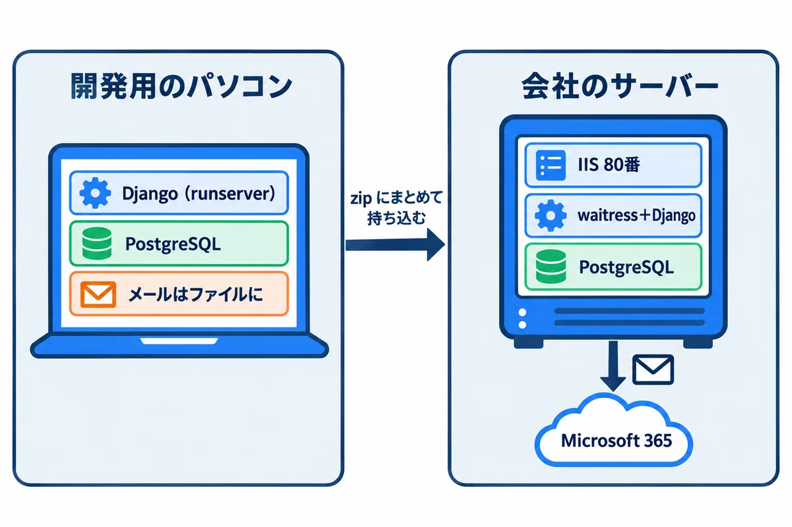
<div style="font-size: 12px; color: #64748b; margin-top: 6px;">図1-1: 開発用のパソコンで作り、会社のサーバーに建てる</div>
</div>

```text
backend\
├─ manage.py
├─ requirements.txt        使う部品と版（onprem の 05 の 6.2 と同じ）
├─ dev.ps1・dev.env.example  開発用のパソコンで動かす道具と、設定の見本（2 章）
├─ config\
│  ├─ settings.py          設定（環境変数から読む。3 章）
│  └─ urls.py              URL の表
├─ accounts\               社員（従業員番号でログイン）
│  ├─ models.py            社員のモデル（4 章）
│  ├─ views.py             ログイン・ログアウトの API
│  └─ management\commands\
│     ├─ import_employees.py  社員の CSV の取り込み（9 章）
│     └─ seed_demo.py         練習用の社員を作る
└─ workflow\               依頼と回覧
   ├─ models.py            依頼・回覧・添付・記録のモデル（4 章）
   ├─ services.py          状態を変える処理（5・6 章）★いちばん大事
   ├─ approve_views.py     メールの URL から開く承認の画面（6 章）
   ├─ validators.py        図面と添付の確かめ（7 章）
   ├─ api.py・serializers.py  React の画面が呼ぶ API（8 章）
   ├─ templates\workflow\   承認の画面とメールのひな形
   ├─ management\commands\send_daily_reminders.py  毎朝の通知（10 章）
   └─ tests.py             自動のテスト（11 章）
```

## 2. 開発の準備

**▶ 準備:** 00 の 6.1（資料のフォルダ）・6.4（Python 3.14）・6.5（PostgreSQL）。04・05 を終えていれば、Python はもう入っています。この巻のコマンドは、PowerShell で**資料のフォルダにいるところから**打ちます。

### 2.1 開発用のデータベース（PostgreSQL）

開発用のパソコンにも、会社のサーバーと同じ PostgreSQL 18 を入れます（入れ方は onprem の 04 の 5 章と同じ）。開発用のデータベースとユーザーを作ります。

```sql
-- postgres でつないで打つ（onprem の 02 の 2.2）
CREATE ROLE webapp_dev_app LOGIN CREATEDB;
\password webapp_dev_app
CREATE DATABASE webapp_dev OWNER webapp_dev_app ENCODING 'UTF8' TEMPLATE template0;
```

- `CREATEDB` は、**自動のテストのため**です。Django のテストは、テスト専用のデータベース（`test_webapp_dev`）を作ってから動き、終わったら消します。この権限が無いと、テストが「permission denied to create database」で止まります。**会社のサーバーのユーザーには付けません。**

### 2.2 部品と設定

```powershell
cd webapp_learning\samples\06_django_react\backend
py -3.14 -m venv .venv
.\.venv\Scripts\python.exe -m pip install -r requirements.txt
Copy-Item dev.env.example dev.env     # dev.env のパスワードを、2.1 で決めた物に書きかえる
```

`requirements.txt`:

```text
Django==5.2.18
djangorestframework==3.18.3
psycopg[binary]==3.3.6
whitenoise==6.12.0
waitress==3.0.2
tzdata==2026.6
```

`dev.env.example`（写して `dev.env` にする。**`dev.env` は Git に入れない**）:

```text
# 開発用のパソコンの設定。このファイルを dev.env という名前で写して、パスワードなどを書きかえる。
# dev.env は Git に入れない（.gitignore に書いてある）。
DJANGO_DEBUG=true
DJANGO_SECRET_KEY=dev-only-not-a-secret
DJANGO_ALLOWED_HOSTS=127.0.0.1,localhost
APP_BASE_URL=http://127.0.0.1:8000
DB_NAME=webapp_dev
DB_USER=webapp_dev_app
DB_PASSWORD=ここに自分で決めたパスワード
DB_PORT=5432
EMAIL_BACKEND=django.core.mail.backends.filebased.EmailBackend
```

### 2.3 dev.ps1: 設定を読み込んで manage.py を動かす

<div style="max-width: 760px; margin: 18px auto; text-align: center;">
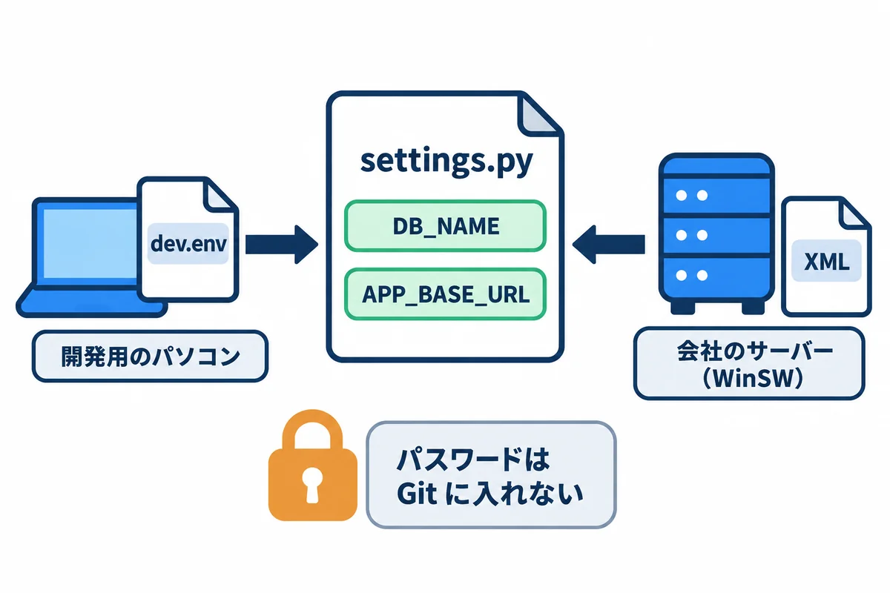
<div style="font-size: 12px; color: #64748b; margin-top: 6px;">図2-1: 設定は、場所ごとに違う方法で、同じ名前の環境変数として渡す</div>
</div>

`dev.ps1`（**「UTF-8 (BOM 付き)」で保存**。onprem の 01 の 3.7）:

```powershell
# 開発用のパソコンで、dev.env の設定を読み込んでから manage.py を動かす（必ず「UTF-8 (BOM 付き)」で保存する）
# 使い方: .\dev.ps1 migrate    .\dev.ps1 runserver    .\dev.ps1 test
# サーバーでは、これではなく onprem の 05 の manage.ps1（WinSW の XML を読む）を使う
param([Parameter(ValueFromRemainingArguments = $true)] [string[]] $ManageArgs)
$ErrorActionPreference = "Stop"

$envFile = Join-Path $PSScriptRoot "dev.env"
if (-not (Test-Path $envFile)) { throw "dev.env がありません。dev.env.example を写して作ってください。" }

$names = @()
foreach ($line in Get-Content $envFile -Encoding UTF8) {
    if ($line -match '^\s*#' -or $line -notmatch '=') { continue }
    $name, $value = $line -split '=', 2
    Set-Item -Path "Env:$($name.Trim())" -Value $value.Trim()
    $names += $name.Trim()
}

Push-Location $PSScriptRoot
try {
    & "$PSScriptRoot\.venv\Scripts\python.exe" manage.py @ManageArgs
    $code = $LASTEXITCODE
} finally {
    # パスワードなどを窓に残さない
    foreach ($n in $names) { Remove-Item -Path "Env:$n" -ErrorAction SilentlyContinue }
    Pop-Location
}
exit $code
```

会社のサーバーでは、これと同じ働きをする `manage.ps1`（WinSW の XML を読む。onprem の 05 の 9.4）を使います。**どちらも、終わったらパスワードを窓に残しません。**

```powershell
.\dev.ps1 migrate          # テーブルを作る
.\dev.ps1 seed_demo        # 練習用の社員を 5 人作る（開発用のパソコンだけ）
.\dev.ps1 runserver        # 開発用のサーバー（http://127.0.0.1:8000/）
.\dev.ps1 test             # 自動のテスト
```

> **PowerShell の落とし穴:** `.\dev.ps1 test -v 2` のように **`-v` を付けると、PowerShell が自分のための指定（`-Verbose`）として受け取ってしまい**、Django に届きません（試して確かめた）。`--verbosity 2` のように、長い書き方を使います。

## 3. 設定（settings.py）

`config/settings.py`:

```python
"""依頼・承認アプリの設定。

onprem の 05（Django＋React版）の形で、会社の Windows Server に建てる前提で書いている。
秘密の値と、サーバーごとに違う値は、環境変数から読む。
- 本番・検証: WinSW の XML の <env> に書く（onprem の 05 の 9.2）
- 開発用のパソコン: dev.ps1 が決める（この巻の 2 章）
"""

import os
import re
from pathlib import Path

BASE_DIR = Path(__file__).resolve().parent.parent


def env(name: str, default: str | None = None) -> str:
    """環境変数を読む。無くて、決まりの値も無いときは、起動を止める"""
    value = os.environ.get(name, default)
    if value is None:
        raise RuntimeError(f"環境変数 {name} がありません")
    return value


SECRET_KEY = env("DJANGO_SECRET_KEY")
DEBUG = env("DJANGO_DEBUG", "false").lower() == "true"

# 社員が開く名前（例: webapp.example.local）。IIS が名前をそのまま渡す（onprem の 04 の 8.3）
ALLOWED_HOSTS = env("DJANGO_ALLOWED_HOSTS").split(",")
CSRF_TRUSTED_ORIGINS = [f"http://{host}" for host in ALLOWED_HOSTS]

# メールに書く URL の頭（例: http://webapp.example.local）
APP_BASE_URL = env("APP_BASE_URL")

INSTALLED_APPS = [
    "django.contrib.admin",
    "django.contrib.auth",
    "django.contrib.contenttypes",
    "django.contrib.sessions",
    "django.contrib.messages",
    "django.contrib.staticfiles",
    "rest_framework",
    "accounts",
    "workflow",
]

MIDDLEWARE = [
    "django.middleware.security.SecurityMiddleware",
    "whitenoise.middleware.WhiteNoiseMiddleware",  # SecurityMiddleware のすぐ後
    "django.contrib.sessions.middleware.SessionMiddleware",
    "django.middleware.common.CommonMiddleware",
    "django.middleware.csrf.CsrfViewMiddleware",
    "django.contrib.auth.middleware.AuthenticationMiddleware",
    "django.contrib.messages.middleware.MessageMiddleware",
    "django.middleware.clickjacking.XFrameOptionsMiddleware",
]

ROOT_URLCONF = "config.urls"

TEMPLATES = [
    {
        "BACKEND": "django.template.backends.django.DjangoTemplates",
        "DIRS": [BASE_DIR / "frontend_dist"],  # React の成果物の index.html（後編）
        "APP_DIRS": True,
        "OPTIONS": {
            "context_processors": [
                "django.template.context_processors.request",
                "django.contrib.auth.context_processors.auth",
                "django.contrib.messages.context_processors.messages",
            ],
        },
    },
]

WSGI_APPLICATION = "config.wsgi.application"

# データベースは、サーバーの中の PostgreSQL（onprem の 04 の 5 章）
DATABASES = {
    "default": {
        "ENGINE": "django.db.backends.postgresql",
        "HOST": "127.0.0.1",
        "PORT": env("DB_PORT", "5432"),
        "NAME": env("DB_NAME"),
        "USER": env("DB_USER"),
        "PASSWORD": env("DB_PASSWORD"),
        "CONN_MAX_AGE": 60,
    }
}

AUTH_USER_MODEL = "accounts.User"  # 従業員番号でログインする、自分のユーザーのモデル

AUTH_PASSWORD_VALIDATORS = [
    {"NAME": "django.contrib.auth.password_validation.MinimumLengthValidator", "OPTIONS": {"min_length": 10}},
    {"NAME": "django.contrib.auth.password_validation.CommonPasswordValidator"},
    {"NAME": "django.contrib.auth.password_validation.NumericPasswordValidator"},
]

LANGUAGE_CODE = "ja"
TIME_ZONE = "Asia/Tokyo"
USE_I18N = True
USE_TZ = True

# 画面の部品（React の成果物）と管理画面の部品は、WhiteNoise が /static/ で配る（onprem の 05 の 6 章）
STATIC_URL = "/static/"
STATIC_ROOT = BASE_DIR / "staticfiles"
STATICFILES_DIRS = [p for p in [BASE_DIR / "frontend_dist"] if p.exists()]
STORAGES = {
    "default": {"BACKEND": "django.core.files.storage.FileSystemStorage"},
    "staticfiles": {"BACKEND": "whitenoise.storage.CompressedStaticFilesStorage"},
}


def _vite_hashed(path, url):
    """Vite が名前に指紋を付けたファイルは、ずっとキャッシュしてよい"""
    return re.match(r"^.+[.-][0-9a-zA-Z_-]{8,12}\..+$", url)


WHITENOISE_IMMUTABLE_FILE_TEST = _vite_hashed

# 添付ファイルの置き場所（例: D:\webapp\prod\files）と、受け取る途中の一時ファイルの置き場所
MEDIA_ROOT = Path(env("DJANGO_MEDIA_ROOT", str(BASE_DIR / "media")))
FILE_UPLOAD_TEMP_DIR = os.environ.get("DJANGO_TMP_DIR")
DATA_UPLOAD_MAX_MEMORY_SIZE = 10 * 1024 * 1024  # 図面の JSON（5MB まで）を受け取れる大きさ

# ログイン: 60 分操作が無ければログアウト。HTTP で動かすので Secure は付けない（onprem の 05 の 8 章）
SESSION_COOKIE_AGE = 60 * 60
SESSION_SAVE_EVERY_REQUEST = True
SESSION_COOKIE_SECURE = False
CSRF_COOKIE_SECURE = False
SILENCED_SYSTEM_CHECKS = ["security.W004", "security.W008", "security.W012", "security.W016"]

# メール: 本番は Microsoft 365 の SMTP リレー（25 番・STARTTLS。onprem の 04 の 10 章、この資料の 09）
EMAIL_BACKEND = env("EMAIL_BACKEND", "django.core.mail.backends.smtp.EmailBackend")
EMAIL_FILE_PATH = BASE_DIR / "sent_mail"  # 開発用（dev.ps1 は、メールをここにファイルで書く）
EMAIL_HOST = env("SMTP_HOST", "localhost")
EMAIL_PORT = int(env("SMTP_PORT", "25"))
EMAIL_USE_TLS = env("SMTP_USE_TLS", "true").lower() == "true"
EMAIL_TIMEOUT = 30
DEFAULT_FROM_EMAIL = env("MAIL_FROM", "noreply@example.com")
# 検証では、全部のメールをこの宛先に送る（社員に本物の依頼が届かないように。onprem の 04 の 10.4）
MAIL_REDIRECT_TO = os.environ.get("MAIL_REDIRECT_TO", "")

REST_FRAMEWORK = {
    "DEFAULT_AUTHENTICATION_CLASSES": ["rest_framework.authentication.SessionAuthentication"],
    "DEFAULT_PERMISSION_CLASSES": ["rest_framework.permissions.IsAuthenticated"],
}

# ログは画面（標準エラー出力）に出す。WinSW が D:\webapp\…\logs に書く（onprem の 05 の 12.2）
LOGGING = {
    "version": 1,
    "disable_existing_loggers": False,
    "formatters": {"plain": {"format": "{asctime} {levelname} {name} {message}", "style": "{"}},
    "handlers": {"console": {"class": "logging.StreamHandler", "formatter": "plain"}},
    "root": {"handlers": ["console"], "level": "INFO"},
}

DEFAULT_AUTO_FIELD = "django.db.models.BigAutoField"
```

onprem の 05 の WinSW の XML と、**同じ名前の環境変数**を読みます。

| 環境変数 | 意味 | 開発用のパソコン（dev.env） | 会社のサーバー（XML。onprem の 05 の 9.2） |
|---|---|---|---|
| `DJANGO_SECRET_KEY` | 秘密の値 | 練習用の値 | 長いでたらめな値（本番と検証で別） |
| `DJANGO_DEBUG` | エラーの詳しい画面を出すか | `true` | 書かない（`false`） |
| `DJANGO_ALLOWED_HOSTS` | 受け付ける名前 | `127.0.0.1,localhost` | `webapp.example.local` |
| `APP_BASE_URL` | メールに書く URL の頭 | `http://127.0.0.1:8000` | `http://webapp.example.local` |
| `DB_NAME`・`DB_USER`・`DB_PASSWORD`・`DB_PORT` | データベース | `webapp_dev` | `webapp_prod` など |
| `DJANGO_MEDIA_ROOT`・`DJANGO_TMP_DIR` | 添付ファイル・一時ファイルの置き場所 | 書かない（`backend\media`） | `D:\webapp\prod\files`・`tmp` |
| `EMAIL_BACKEND` | メールの送り方 | ファイルに書く（`sent_mail\`） | 書かない（SMTP で送る） |
| `SMTP_HOST`・`SMTP_PORT`・`MAIL_FROM` | Microsoft 365 の受付・25 番・送り主 | 書かない | onprem の 04 の 10 章 |
| `MAIL_REDIRECT_TO` | 検証で、全部のメールを送る宛先 | 書かない | **検証だけ**に書く |

> **`DJANGO_DEBUG` を本番で `true` にしない:** エラーのときに、設定やプログラムの中身が画面に丸見えになります（onprem の 05 の 14 章）。

## 4. モデル

### 4.1 社員（accounts/models.py）

```python
from django.contrib.auth.models import AbstractBaseUser, BaseUserManager, PermissionsMixin
from django.db import models


class UserManager(BaseUserManager):
    def create_user(self, employee_no: str, password: str | None = None, **extra):
        user = self.model(employee_no=employee_no, **extra)
        if password:
            user.set_password(password)  # パスワードは、そのままではなく、元に戻せない形にして保存する
        else:
            user.set_unusable_password()
        user.save(using=self._db)
        return user

    def create_superuser(self, employee_no: str, password: str, **extra):
        extra.update(is_staff=True, is_superuser=True, role=User.Role.ADMIN)
        return self.create_user(employee_no, password, **extra)


class User(AbstractBaseUser, PermissionsMixin):
    """社員。従業員番号でログインする"""

    class Role(models.TextChoices):
        MEMBER = "member", "一般"
        WORKER = "worker", "担当者"   # 依頼に対応する部署の人
        ADMIN = "admin", "管理者"

    employee_no = models.CharField("従業員番号", max_length=6, unique=True)
    name = models.CharField("氏名", max_length=50)  # 「山田 太郎」の順でそのまま持つ
    dept = models.CharField("所属", max_length=50, blank=True)
    job_title = models.CharField("役職", max_length=50, blank=True)
    email = models.EmailField("メールアドレス")
    role = models.CharField("権限", max_length=10, choices=Role.choices, default=Role.MEMBER)
    is_active = models.BooleanField("在籍", default=True)
    is_staff = models.BooleanField("管理画面に入れる", default=False)

    objects = UserManager()

    USERNAME_FIELD = "employee_no"
    EMAIL_FIELD = "email"
    REQUIRED_FIELDS = ["name", "email"]

    class Meta:
        verbose_name = "社員"
        verbose_name_plural = "社員"
        ordering = ["employee_no"]

    def __str__(self) -> str:
        return f"{self.name}（{self.employee_no}）"
```

- **従業員番号でログイン**するように、Django の `User` を自分で作り直しています（`USERNAME_FIELD = "employee_no"`）。氏名は「山田 太郎」の順で 1 つの項目に持ちます（05 で、名・姓の順に出た問題を直した）。
- 権限（`role`）は「一般」「担当者」「管理者」の 3 つです。
- **ユーザーのモデルを自分で作るなら、最初の `migrate` の前に**決めます（settings.py の `AUTH_USER_MODEL`）。あとから変えるのは、とても大変です。

### 4.2 依頼・回覧・添付・記録（workflow/models.py）

```python
from django.conf import settings
from django.db import models


class Request(models.Model):
    """依頼 1 件"""

    class Status(models.TextChoices):
        CIRCULATING = "circulating", "回覧中"
        RETURNED = "returned", "差し戻し中"
        PULLED_BACK = "pulled_back", "引き戻し中"
        APPROVED = "approved", "回覧完了"
        IN_PROGRESS = "in_progress", "対応中"
        DONE = "done", "完了"
        WITHDRAWN = "withdrawn", "取り下げ"

    title = models.CharField("件名", max_length=100)
    detail = models.TextField("内容", blank=True)
    due_date = models.DateField("希望の納期")
    status = models.CharField("状態", max_length=20, choices=Status.choices, default=Status.CIRCULATING)
    requester = models.ForeignKey(settings.AUTH_USER_MODEL, verbose_name="依頼者", on_delete=models.PROTECT, related_name="requests")
    assignee = models.ForeignKey(
        settings.AUTH_USER_MODEL, verbose_name="担当者", on_delete=models.PROTECT, null=True, blank=True, related_name="assigned"
    )
    drawing = models.JSONField("図面", null=True, blank=True)
    return_comments = models.TextField("差し戻しのコメント", blank=True)  # 差し戻すたびに追記する
    round = models.PositiveSmallIntegerField("回覧の回数", default=1)      # 出し直すたびに 1 増える
    created_at = models.DateTimeField("作った日時", auto_now_add=True)
    updated_at = models.DateTimeField("直した日時", auto_now=True)

    class Meta:
        verbose_name = "依頼"
        verbose_name_plural = "依頼"
        ordering = ["-created_at"]

    def __str__(self) -> str:
        return f"{self.pk} {self.title}"


class Step(models.Model):
    """回覧の 1 人分。承認の URL の指紋も、ここに持つ"""

    class Decision(models.TextChoices):
        WAITING = "waiting", "待ち"
        APPROVED = "approved", "承認"
        RETURNED = "returned", "差し戻し"
        CANCELLED = "cancelled", "取り消し"  # 引き戻し・差し戻しで、回ってこなくなった

    request = models.ForeignKey(Request, verbose_name="依頼", on_delete=models.CASCADE, related_name="steps")
    round = models.PositiveSmallIntegerField("回覧の回数")
    order = models.PositiveSmallIntegerField("順番")
    approver = models.ForeignKey(settings.AUTH_USER_MODEL, verbose_name="承認者", on_delete=models.PROTECT)
    decision = models.CharField("結果", max_length=10, choices=Decision.choices, default=Decision.WAITING)
    decided_at = models.DateTimeField("決めた日時", null=True, blank=True)
    token_hash = models.CharField("URL の指紋", max_length=64, blank=True, db_index=True)
    token_expires_at = models.DateTimeField("URL の期限", null=True, blank=True)
    sent_at = models.DateTimeField("メールを送った日時", null=True, blank=True)

    class Meta:
        verbose_name = "回覧"
        verbose_name_plural = "回覧"
        ordering = ["request", "round", "order"]
        constraints = [models.UniqueConstraint(fields=["request", "round", "order"], name="unique_step")]

    def __str__(self) -> str:
        return f"{self.request_id} の {self.round} 回目 {self.order} 番目"


class Attachment(models.Model):
    """添付ファイル（JPG・PNG・PDF。1 ファイル 10MB まで）"""

    request = models.ForeignKey(Request, verbose_name="依頼", on_delete=models.CASCADE, related_name="attachments")
    file = models.FileField("ファイル", upload_to="attachments/%Y/%m/")
    original_name = models.CharField("元の名前", max_length=200)
    size = models.PositiveIntegerField("大きさ（バイト）")
    uploaded_at = models.DateTimeField("付けた日時", auto_now_add=True)

    class Meta:
        verbose_name = "添付ファイル"
        verbose_name_plural = "添付ファイル"


class History(models.Model):
    """だれが、いつ、何をしたかの記録（あとから変えない）"""

    request = models.ForeignKey(Request, verbose_name="依頼", on_delete=models.CASCADE, related_name="histories")
    at = models.DateTimeField("日時", auto_now_add=True)
    actor = models.ForeignKey(settings.AUTH_USER_MODEL, verbose_name="した人", on_delete=models.PROTECT, null=True)
    action = models.CharField("したこと", max_length=50)
    note = models.TextField("メモ", blank=True)

    class Meta:
        verbose_name = "記録"
        verbose_name_plural = "記録"
        ordering = ["at", "id"]

    def __str__(self) -> str:
        return f"{self.action}"
```

| モデル | 1 件は | 大事な項目 |
|---|---|---|
| `Request` | 依頼 1 件 | `status`（7 つの状態）・`round`（何回目の回覧か）・`drawing`（図面の JSON）・`return_comments`（差し戻しのコメントの追記） |
| `Step` | 回覧の 1 人分 | `round`・`order`（何番目）・`decision`（待ち・承認・差し戻し・取り消し）・`token_hash`（**URL の文字列ではなく、その指紋**）・`token_expires_at`（期限） |
| `Attachment` | 添付ファイル 1 つ | ファイル・元の名前・大きさ |
| `History` | 記録 1 行 | だれが・いつ・何をしたか（**あとから変えない**） |

- 図面は `JSONField` で、そのままデータベースに入れます（PostgreSQL では `jsonb` の列になる）。
- 回覧の順番と、「承認したか」は、`Step` の 1 行 1 行に持ちます。依頼が出し直されると、`round` が 1 増えて、新しい `Step` の行ができます（前の回の記録は残る）。

## 5. 状態を変える処理を 1 か所に集める（services.py）

<div style="max-width: 760px; margin: 18px auto; text-align: center;">
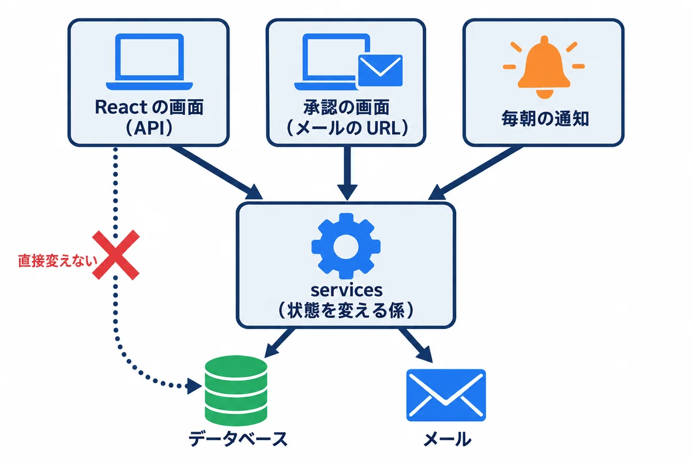
<div style="font-size: 12px; color: #64748b; margin-top: 6px;">図5-1: 状態を変える処理は、services の関数だけで行う</div>
</div>

依頼の状態を変える入口は、3 つあります（React の画面・承認の画面・毎朝の通知）。それぞれが勝手に `status` を書きかえると、「メールを送り忘れた」「記録を残し忘れた」が起きます。そこで、**状態を変える処理を `services.py` の関数に集め、入口からは関数を呼ぶだけ**にします。

`workflow/services.py`:

```python
"""依頼の状態を変える処理を、ここに集める。

画面（API・承認の画面）からは、ここの関数だけを呼ぶ。状態を直接書きかえない。
どの関数も、1 つのトランザクションの中で動き、途中で失敗したら全部取り消す。
メールは、データベースへの保存が確定してから送る（transaction.on_commit）。
"""

import hashlib
import secrets
from dataclasses import dataclass
from datetime import timedelta

from django.conf import settings
from django.contrib.auth import get_user_model
from django.core.mail import send_mail
from django.db import transaction
from django.template.loader import render_to_string
from django.utils import timezone

from .models import History, Request, Step

User = get_user_model()
S = Request.Status
D = Step.Decision
TOKEN_DAYS = 14
MAX_APPROVERS = 3


class WorkflowError(Exception):
    """できない操作。文は、そのまま画面に出してよい"""


# ---------- 承認の URL ----------

def _hash(token: str) -> str:
    return hashlib.sha256(token.encode()).hexdigest()


def _issue_url(step: Step) -> str:
    """推測できない文字列を作り、指紋だけを保存して、URL を返す（前の URL は使えなくなる）"""
    token = secrets.token_urlsafe(32)
    step.token_hash = _hash(token)
    step.token_expires_at = timezone.now() + timedelta(days=TOKEN_DAYS)
    step.sent_at = timezone.now()
    step.save(update_fields=["token_hash", "token_expires_at", "sent_at"])
    return f"{settings.APP_BASE_URL}/approve/{token}/"


@dataclass
class TokenCheck:
    step: Step | None
    message: str = ""  # 使えないときの理由


def check_token(token: str, *, lock: bool = False) -> TokenCheck:
    """URL の文字列を調べる。使えなければ、理由の文を返す"""
    qs = Step.objects.select_related("request", "approver", "request__requester")
    if lock:
        qs = qs.select_for_update()
    step = qs.filter(token_hash=_hash(token)).first()
    if step is None:
        return TokenCheck(None, "この URL は使えません。")
    if step.decision == D.APPROVED:
        return TokenCheck(None, "この依頼は、承認済みです。")
    if step.decision == D.RETURNED:
        return TokenCheck(None, "この依頼は、差し戻し済みです。")
    if step.decision == D.CANCELLED:
        if step.request.status == S.PULLED_BACK:
            return TokenCheck(None, "依頼者により引き戻されました。")
        return TokenCheck(None, "この URL は、取り消されました。")
    if step.token_expires_at and step.token_expires_at < timezone.now():
        return TokenCheck(None, "この URL は、期限が切れています。管理者に再送を頼んでください。")
    return TokenCheck(step)


# ---------- メール ----------

def _mail(to: str, subject: str, template: str, context: dict) -> None:
    body = render_to_string(f"workflow/mail/{template}", context)
    subject = f"【依頼・承認】{subject}"
    if settings.MAIL_REDIRECT_TO:  # 検証: 本物の宛先には送らず、決まった宛先へ
        body = f"（検証のメールです。本来の宛先: {to}）\n\n{body}"
        subject, to = f"【検証】{subject}", settings.MAIL_REDIRECT_TO
    # 保存が確定してから送る。途中で取り消されたら、送らない
    transaction.on_commit(lambda: send_mail(subject, body, None, [to]))


def _send_approval_mail(step: Step) -> None:
    url = _issue_url(step)
    r = step.request
    _mail(step.approver.email, f"承認のお願い: {r.title}", "approval_request.txt",
          {"step": step, "r": r, "url": url, "days": TOKEN_DAYS})


# ---------- 状態を変える操作 ----------

def _log(r: Request, actor, action: str, note: str = "") -> None:
    History.objects.create(request=r, actor=actor, action=action, note=note)


def _check_approvers(requester, approver_ids: list[int]) -> list:
    if not 1 <= len(approver_ids) <= MAX_APPROVERS:
        raise WorkflowError(f"回覧者は 1〜{MAX_APPROVERS} 人にしてください。")
    if len(set(approver_ids)) != len(approver_ids):
        raise WorkflowError("同じ人を 2 回は選べません。")
    if requester.pk in approver_ids:
        raise WorkflowError("自分自身は回覧者にできません。")
    users = {u.pk: u for u in User.objects.filter(pk__in=approver_ids, is_active=True)}
    if len(users) != len(approver_ids):
        raise WorkflowError("回覧者に、いない社員が入っています。")
    return [users[i] for i in approver_ids]


def _start_round(r: Request, approvers: list) -> None:
    steps = [Step.objects.create(request=r, round=r.round, order=i, approver=a) for i, a in enumerate(approvers, start=1)]
    _send_approval_mail(steps[0])


@transaction.atomic
def submit(requester, *, title: str, detail: str, due_date, approver_ids: list[int], drawing=None) -> Request:
    """依頼を出す → 回覧中。1 人目に承認のお願いのメール"""
    approvers = _check_approvers(requester, approver_ids)
    r = Request.objects.create(requester=requester, title=title, detail=detail, due_date=due_date, drawing=drawing)
    _start_round(r, approvers)
    _log(r, requester, "依頼を出した")
    return r


@transaction.atomic
def approve(token: str) -> Request:
    """承認 → 次の人へ。最後の人なら回覧完了"""
    check = check_token(token, lock=True)
    if check.step is None:
        raise WorkflowError(check.message)
    step = check.step
    r = Request.objects.select_for_update().get(pk=step.request_id)  # 同時に押されても 1 回だけ進める
    # 指紋は消さずに残す。同じ URL をもう一度開いた人に「承認済みです」と知らせるため
    step.decision, step.decided_at = D.APPROVED, timezone.now()
    step.save(update_fields=["decision", "decided_at"])
    _log(r, step.approver, f"承認（回覧者{step.order}）")

    nxt = r.steps.filter(round=r.round, decision=D.WAITING).order_by("order").first()
    if nxt:
        _send_approval_mail(nxt)
    else:
        r.status = S.APPROVED
        r.save(update_fields=["status", "updated_at"])
        _mail(r.requester.email, f"回覧完了: {r.title}", "approved.txt", {"r": r})
        for worker in User.objects.filter(role=User.Role.WORKER, is_active=True):
            _mail(worker.email, f"新しい依頼: {r.title}", "new_request.txt", {"r": r})
    return r


@transaction.atomic
def return_request(token: str, comment: str) -> Request:
    """差し戻し → 差し戻し中。コメントは【日時 回覧者n 氏名】を付けて追記する"""
    if not comment.strip():
        raise WorkflowError("差し戻すときは、理由を書いてください。")
    check = check_token(token, lock=True)
    if check.step is None:
        raise WorkflowError(check.message)
    step = check.step
    r = Request.objects.select_for_update().get(pk=step.request_id)
    now = timezone.localtime()
    step.decision, step.decided_at = D.RETURNED, now
    step.save(update_fields=["decision", "decided_at"])
    r.steps.filter(round=r.round, decision=D.WAITING).update(decision=D.CANCELLED)
    line = f"【{now:%m/%d %H:%M} 回覧者{step.order} {step.approver.name}】{comment.strip()}"
    r.return_comments = f"{r.return_comments}\n{line}".strip()
    r.status = S.RETURNED
    r.save(update_fields=["status", "return_comments", "updated_at"])
    _log(r, step.approver, f"差し戻し（回覧者{step.order}）", comment.strip())
    _mail(r.requester.email, f"差し戻し: {r.title}", "returned.txt", {"r": r, "line": line})
    return r


def _lock_own(user, request_id: int) -> Request:
    r = Request.objects.select_for_update().get(pk=request_id)
    if r.requester_id != user.pk:
        raise WorkflowError("自分の依頼ではありません。")
    return r


@transaction.atomic
def pull_back(user, request_id: int) -> Request:
    """引き戻し（回覧中だけ）→ 引き戻し中。承認待ちの人の URL は使えなくなる"""
    r = _lock_own(user, request_id)
    if r.status != S.CIRCULATING:
        raise WorkflowError(f"「{r.get_status_display()}」の依頼は引き戻せません。")
    r.steps.filter(round=r.round, decision=D.WAITING).update(decision=D.CANCELLED)
    r.status = S.PULLED_BACK
    r.save(update_fields=["status", "updated_at"])
    _log(r, user, "引き戻した")
    return r


@transaction.atomic
def resubmit(user, request_id: int, *, title: str, detail: str, due_date, approver_ids: list[int], drawing=None) -> Request:
    """直して出し直す → 回覧中。最初の回覧者からやり直す"""
    r = _lock_own(user, request_id)
    if r.status not in (S.RETURNED, S.PULLED_BACK):
        raise WorkflowError(f"「{r.get_status_display()}」の依頼は出し直せません。")
    approvers = _check_approvers(user, approver_ids)
    r.title, r.detail, r.due_date, r.drawing = title, detail, due_date, drawing
    r.round += 1
    r.status = S.CIRCULATING
    r.save()
    _start_round(r, approvers)
    _log(r, user, f"出し直した（{r.round} 回目）")
    return r


@transaction.atomic
def withdraw(user, request_id: int) -> Request:
    """取り下げ（差し戻し中・引き戻し中だけ）"""
    r = _lock_own(user, request_id)
    if r.status not in (S.RETURNED, S.PULLED_BACK):
        raise WorkflowError(f"「{r.get_status_display()}」の依頼は取り下げられません。")
    r.status = S.WITHDRAWN
    r.save(update_fields=["status", "updated_at"])
    _log(r, user, "取り下げた")
    return r


@transaction.atomic
def assign(worker, request_id: int) -> Request:
    """担当を決める（回覧完了 → 対応中）"""
    if worker.role not in (User.Role.WORKER, User.Role.ADMIN):
        raise WorkflowError("担当者だけができます。")
    r = Request.objects.select_for_update().get(pk=request_id)
    if r.status != S.APPROVED:
        raise WorkflowError(f"「{r.get_status_display()}」の依頼は、担当を決められません。")
    r.assignee, r.status = worker, S.IN_PROGRESS
    r.save(update_fields=["assignee", "status", "updated_at"])
    _log(r, worker, "担当になった")
    return r


@transaction.atomic
def complete(worker, request_id: int) -> Request:
    """引き渡した（対応中 → 完了）"""
    r = Request.objects.select_for_update().get(pk=request_id)
    if r.status != S.IN_PROGRESS or r.assignee_id != worker.pk:
        raise WorkflowError("担当している、対応中の依頼だけを完了にできます。")
    r.status = S.DONE
    r.save(update_fields=["status", "updated_at"])
    _log(r, worker, "完了にした")
    _mail(r.requester.email, f"完了: {r.title}", "done.txt", {"r": r})
    return r


@transaction.atomic
def resend(admin, step_id: int) -> Step:
    """承認のお願いを送り直す（前の URL は使えなくなる）。毎朝の通知でも使う"""
    step = Step.objects.select_for_update().select_related("request", "approver").get(pk=step_id)
    if step.decision != D.WAITING or step.request.status != S.CIRCULATING:
        raise WorkflowError("承認を待っている回覧だけを送り直せます。")
    _send_approval_mail(step)
    _log(step.request, admin, f"承認のお願いを送り直した（回覧者{step.order}）")
    return step


def notify_due_soon(r: Request) -> None:
    """納期が近いことを、依頼者と担当者に知らせる（毎朝の通知で使う）"""
    for to in {r.requester.email, *([r.assignee.email] if r.assignee else [])}:
        _mail(to, f"納期が近づいています: {r.title}", "due_soon.txt", {"r": r})
```

| 関数 | 操作 | 状態の移り変わり（00 学習ガイド 1.2） |
|---|---|---|
| `submit` | 依頼を出す | （新しく）→ 回覧中 |
| `approve` | 承認（URL から） | 回覧中のまま次の人へ／最後なら → 回覧完了 |
| `return_request` | 差し戻し（URL から） | 回覧中 → 差し戻し中 |
| `pull_back` | 引き戻し | 回覧中 → 引き戻し中 |
| `resubmit` | 出し直し | 差し戻し中・引き戻し中 → 回覧中（最初の人から） |
| `withdraw` | 取り下げ | 差し戻し中・引き戻し中 → 取り下げ |
| `assign`・`complete` | 担当を決める・引き渡し | 回覧完了 → 対応中 → 完了 |
| `resend` | 承認のお願いを送り直す | （変わらない。前の URL は使えなくなる） |

### 5.1 全部やるか、全部やめるか（transaction.atomic）

`@transaction.atomic` を付けた関数の中の、データベースへの書き込みは、**全部成功するか、全部取り消されるか**のどちらかになります（onprem の 02 の 7 章）。たとえば「承認を記録した」のに「次の人の回覧を作れなかった」という、中途半端な状態が残りません。

### 5.2 保存が確定してから、メールを送る（transaction.on_commit）

<div style="max-width: 760px; margin: 18px auto; text-align: center;">
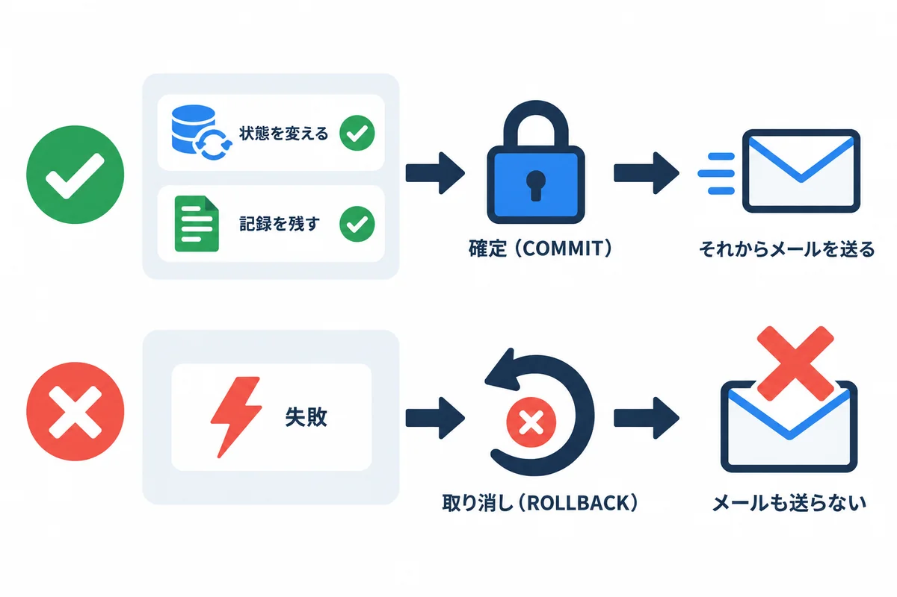
<div style="font-size: 12px; color: #64748b; margin-top: 6px;">図5-2: メールは、保存が確定してから送る</div>
</div>

メールは、一度送ると取り消せません。もし「メールを送った後に、保存が失敗して取り消された」ら、**承認されていないのに、次の人に承認のお願いが届いて**しまいます。`_mail` 関数は、`transaction.on_commit` で、**保存が確定した後に**送るようにしています。

### 5.3 同時に押されても、1 回だけ進める（select_for_update）

<div style="max-width: 760px; margin: 18px auto; text-align: center;">
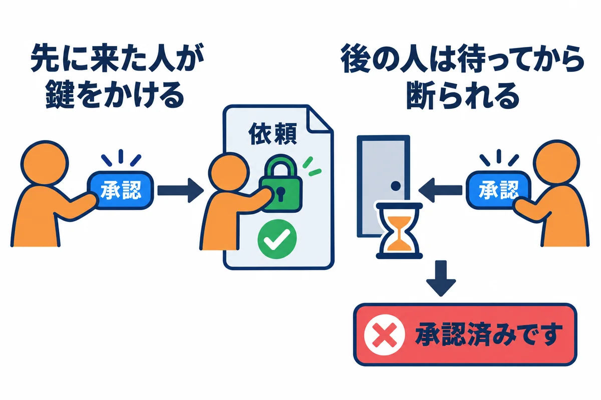
<div style="font-size: 12px; color: #64748b; margin-top: 6px;">図5-3: 先に来た人が行に鍵をかけ、後の人は待ってから断られる</div>
</div>

承認のボタンを 2 回続けて押したり、同じ URL を 2 つの窓で開いて同時に押したりすると、2 つのお願いが同時に届くことがあります。`select_for_update()` は、データベースの**その行に鍵をかけ**、先に来たお願いの処理が終わるまで、後のお願いを待たせます。後のお願いは、鍵が外れてから状態を読み直すので、「承認済みです」で断られます。

### 5.4 出し直すと、最初の回覧者からやり直す（round）

<div style="max-width: 760px; margin: 18px auto; text-align: center;">
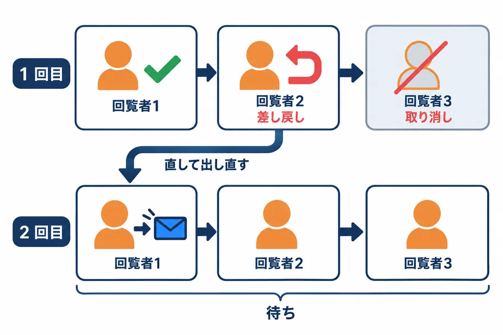
<div style="font-size: 12px; color: #64748b; margin-top: 6px;">図5-4: 出し直すと、round が増えて、最初の回覧者からやり直す</div>
</div>

### 5.5 できない操作は、WorkflowError で断る

できない操作（完了した依頼を引き戻す、ほかの人の依頼を取り下げる、など）は、`WorkflowError` を起こして断ります。文は、そのまま画面に出せる日本語にしています。**「画面にボタンを出さない」だけでは足りません。** ボタンが無くても、API に直接お願いを送ることはできるので、サーバーで必ず確かめます（10）。

## 6. 1 回限りの承認の URL

<div style="max-width: 760px; margin: 18px auto; text-align: center;">
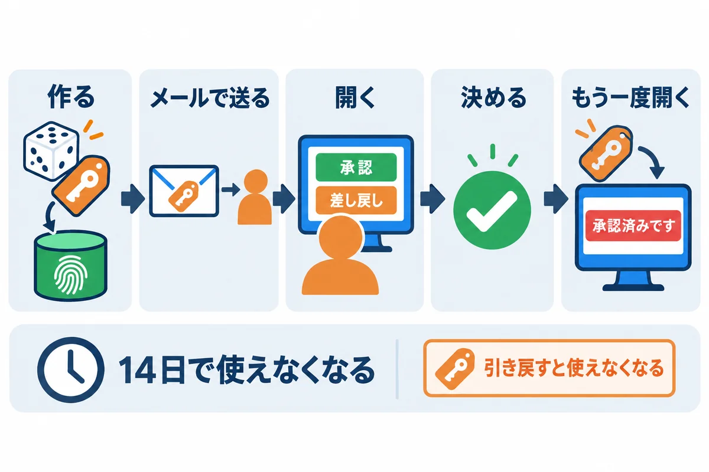
<div style="font-size: 12px; color: #64748b; margin-top: 6px;">図6-1: 承認の URL の一生</div>
</div>

承認者は、アプリにログインせず、**メールの URL から**承認します。URL の中の推測できない文字列が、本人の印になります（04 の 6 章）。

| 決まり | 作り方（services.py） |
|---|---|
| 推測できない | `secrets.token_urlsafe(32)` |
| データベースが盗まれても、URL は分からない | 文字列そのものではなく、**指紋（SHA-256）だけ**を `token_hash` に保存 |
| 1 回だけ使える | 決めたら `decision` が「承認」「差し戻し」になる。もう一度開くと「承認済みです」 |
| 14 日で使えなくなる | `token_expires_at` を過ぎたら「期限が切れています」 |
| 引き戻したら使えなくなる | `decision` を「取り消し」にする。開くと「依頼者により引き戻されました」 |
| 送り直したら、前の URL は使えない | 新しい指紋で上書きする |

> **指紋を消さずに残す理由:** 最初、決めたときに指紋を消す作りにしていたら、自動のテスト（11 章）が「使い済みの URL を開くと、『承認済みです』ではなく『この URL は使えません』になる」ことを見つけました。指紋を残し、`decision` で理由を見分けるように直しました。**テストを書いておくと、こういう食い違いに、動かす前に気付けます。**

### 6.1 承認のお願いのメール

`templates/workflow/mail/approval_request.txt`:

```text
{{ step.approver.name }} さん

次の依頼の、承認をお願いします。（回覧者{{ step.order }}）

件名: {{ r.title }}
依頼者: {{ r.requester.name }}（{{ r.requester.dept }}）
希望の納期: {{ r.due_date|date:"Y-m-d" }}

下の URL を開いて、「承認」か「差し戻し」を選んでください。
{{ url }}

・この URL は、あなただけのものです。ほかの人に転送しないでください。
・この URL は 1 回だけ使えます。{{ days }} 日で使えなくなります。
```

実際に送られたメール（開発用のパソコンで、`sent_mail\` に書かれた物。件名と本文）:

```text
Subject: 【依頼・承認】承認のお願い: 検査用の治具の製作
From: noreply@example.com
To: 012346@example.com

佐藤 花子 さん

次の依頼の、承認をお願いします。（回覧者1）

件名: 検査用の治具の製作
依頼者: 山田 太郎（設計部）
希望の納期: 2026-11-30

下の URL を開いて、「承認」か「差し戻し」を選んでください。
http://127.0.0.1:8000/approve/eMFDHNzld3lgRKV02_4w1oXTHWig1BabLZGNHXwjOBI/

・この URL は、あなただけのものです。ほかの人に転送しないでください。
・この URL は 1 回だけ使えます。14 日で使えなくなります。
```

（URL の文字列は、送るたびに変わります。この URL は、もう使えません。ファイルの中では、件名は `=?utf-8?b?…?=` という形（日本語を英数字だけで表す決まり）で書かれていて、メールソフトが元の日本語に戻して表示します。）

### 6.2 承認の画面

`workflow/approve_views.py`:

```python
"""メールの URL から開く、承認の画面。ログインは要らない（URL の文字列が、本人の印になる）"""

from django.shortcuts import render
from django.views.decorators.http import require_http_methods

from . import services


@require_http_methods(["GET", "POST"])
def approve_page(request, token: str):
    if request.method == "POST":
        try:
            if request.POST.get("decision") == "approve":
                r = services.approve(token)
                message = f"「{r.title}」を承認しました。"
            else:
                r = services.return_request(token, request.POST.get("comment", ""))
                message = f"「{r.title}」を差し戻しました。"
        except services.WorkflowError as e:
            return render(request, "workflow/approve_result.html", {"message": str(e), "ok": False}, status=400)
        return render(request, "workflow/approve_result.html", {"message": message, "ok": True})

    check = services.check_token(token)
    if check.step is None:
        return render(request, "workflow/approve_result.html", {"message": check.message, "ok": False}, status=410)
    r = check.step.request
    return render(request, "workflow/approve.html", {"step": check.step, "r": r, "attachments": r.attachments.all()})
```

`templates/workflow/approve.html`:

```html

承認 - {{ r.title }}

  <h1>承認のお願い（回覧者{{ step.order }}）</h1>
  <p class="hint">{{ step.approver.name }} さん、内容を確かめて、「承認」か「差し戻し」を選んでください。</p>
  <table class="kv">
    <tr><th>件名</th><td>{{ r.title }}</td></tr>
    <tr><th>依頼者</th><td>{{ r.requester.name }}（{{ r.requester.dept }}）</td></tr>
    <tr><th>希望の納期</th><td>{{ r.due_date|date:"Y-m-d" }}</td></tr>
    <tr><th>内容</th><td>{{ r.detail|linebreaksbr }}</td></tr>
    <tr><th>添付</th><td>{{ a.original_name }}、なし</td></tr>
    <tr><th>前の差し戻し</th><td>{{ r.return_comments|linebreaksbr }}</td></tr>
  </table>
  
    <h2>図面</h2>
    <svg class="pad" viewBox="0 0 {{ r.drawing.widthMm }} {{ r.drawing.heightMm }}">
      <rect x="{{ s.x }}" y="{{ s.y }}" width="{{ s.width }}" height="{{ s.height }}" />
    </svg>
  
  <form method="post" class="decide">
    
    <label for="comment">差し戻すときの理由</label>
    <textarea id="comment" name="comment" rows="3" placeholder="例: 寸法を追記してください"></textarea>
    <div class="actions">
      <button type="submit" name="decision" value="return" class="btn-secondary">差し戻し</button>
      <button type="submit" name="decision" value="approve" class="btn-primary">承認</button>
    </div>
  </form>

```

<div style="max-width: 760px; margin: 18px auto; text-align: center;">
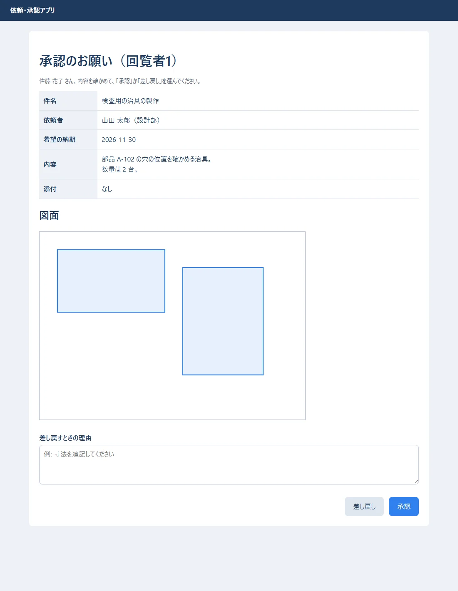
<div style="font-size: 12px; color: #64748b; margin-top: 6px;">図6-2: メールの URL を開くと出る、承認の画面</div>
</div>

「承認」を押したとき・同じ URL をもう一度開いたとき:

<div style="max-width: 760px; margin: 18px auto; text-align: center;">
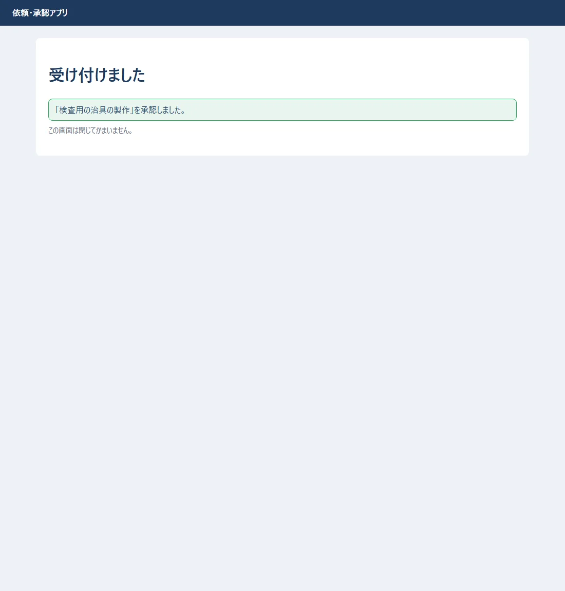
<div style="font-size: 12px; color: #64748b; margin-top: 6px;">図6-3: 承認した（次の回覧者に、新しい URL のメールが送られる）</div>
</div>

<div style="max-width: 760px; margin: 18px auto; text-align: center;">
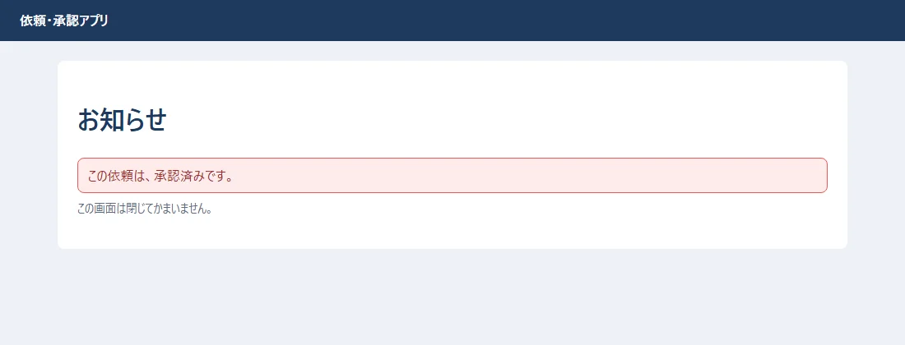
<div style="font-size: 12px; color: #64748b; margin-top: 6px;">図6-4: 同じ URL をもう一度開くと、使えないことと、その理由が出る</div>
</div>

2 人目（回覧者 2）が、理由を書いて「差し戻し」を押したとき:

<div style="max-width: 760px; margin: 18px auto; text-align: center;">
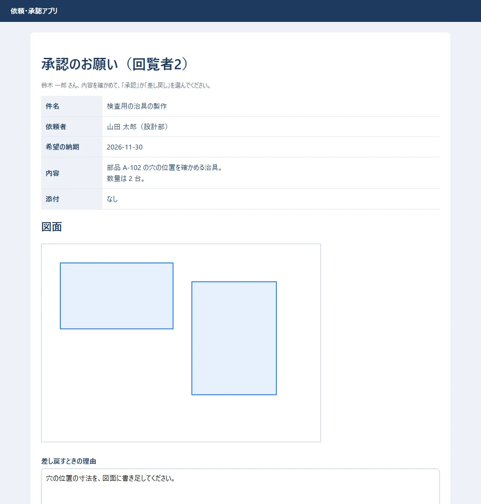
<div style="font-size: 12px; color: #64748b; margin-top: 6px;">図6-5: 差し戻すときは、理由を書く（空なら断る）</div>
</div>

<div style="max-width: 760px; margin: 18px auto; text-align: center;">
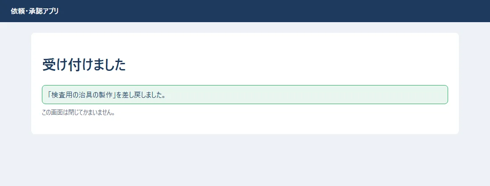
<div style="font-size: 12px; color: #64748b; margin-top: 6px;">図6-6: 差し戻した</div>
</div>

依頼者に届いたメール（本文）:

```text
山田 太郎 さん

依頼「検査用の治具の製作」が、差し戻されました。

【11/02 00:12 回覧者2 鈴木 一郎】穴の位置の寸法を、図面に書き足してください。

アプリで内容を直して、出し直してください。
```

管理画面で、この依頼を開くと、回覧と記録が残っています（管理画面からは変えられないようにしてある）。

<div style="max-width: 760px; margin: 18px auto; text-align: center;">
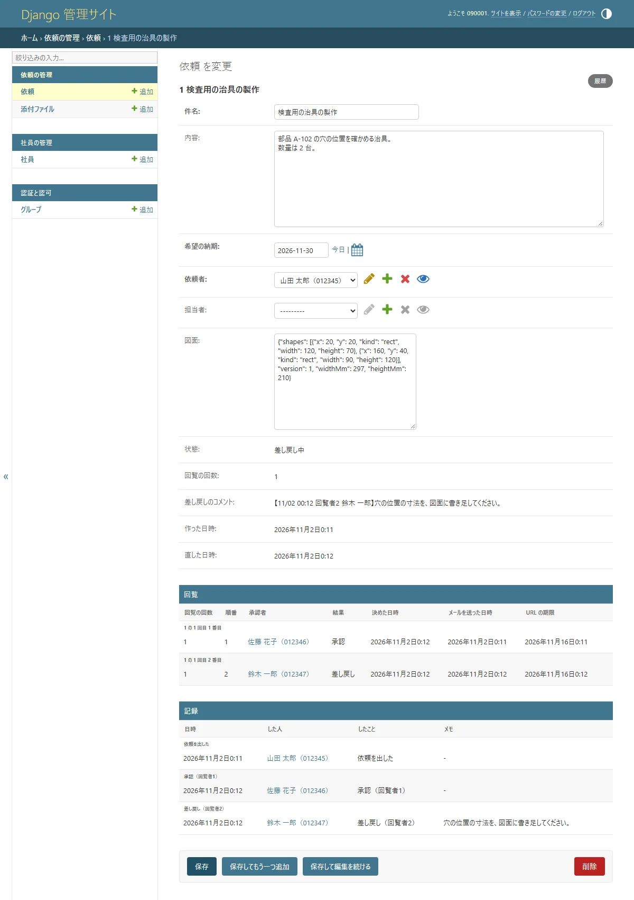
<div style="font-size: 12px; color: #64748b; margin-top: 6px;">図6-7: 管理画面。だれが、いつ、何をしたかが残る</div>
</div>

- 承認の画面は、ログインが要らないので、**CSRF の札（``）**で、ほかのサイトから勝手に送られるのを防いでいます（10）。
- 承認の画面のフォームは `POST` で送ります。`GET`（URL を開くだけ）で承認できる作りにすると、メールのウイルスの検査などが URL を開いただけで、承認されてしまうことがあります。

## 7. 図面と添付ファイルの確かめ

<div style="max-width: 760px; margin: 18px auto; text-align: center;">
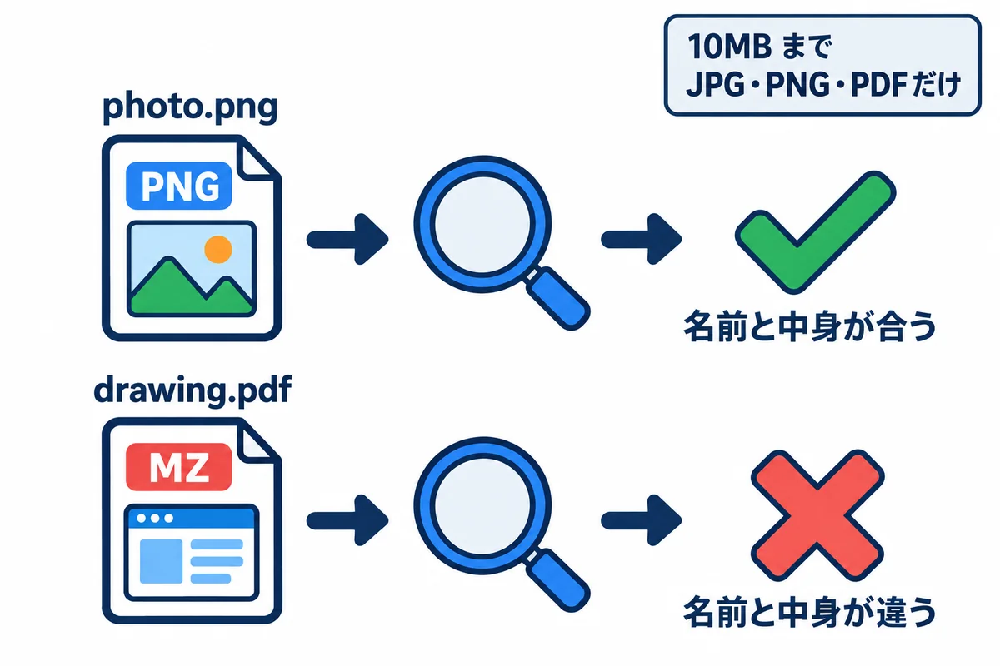
<div style="font-size: 12px; color: #64748b; margin-top: 6px;">図7-1: ファイルの名前だけでなく、中身の先頭も確かめる</div>
</div>

`workflow/validators.py`:

```python
"""外から来た物（図面の JSON・添付ファイル）を確かめる。画面の確かめとは別に、必ずサーバーでも確かめる"""

import json

from django.core.exceptions import ValidationError

MAX_DRAWING_BYTES = 5 * 1024 * 1024
MAX_FILE_BYTES = 10 * 1024 * 1024
SHAPE_KINDS = {"line", "rect", "text"}

# ファイルの先頭の数バイトで、本当の種類を見分ける（名前の拡張子は、いくらでもごまかせる）
SIGNATURES = {
    ".jpg": [b"\xff\xd8\xff"],
    ".jpeg": [b"\xff\xd8\xff"],
    ".png": [b"\x89PNG\r\n\x1a\n"],
    ".pdf": [b"%PDF-"],
}


def validate_drawing(value) -> None:
    if value is None:
        return
    if len(json.dumps(value, ensure_ascii=False).encode()) > MAX_DRAWING_BYTES:
        raise ValidationError("図面は 5MB までです。")
    if not isinstance(value, dict) or value.get("version") != 1 or not isinstance(value.get("shapes"), list):
        raise ValidationError("図面の形が違います。")
    for shape in value["shapes"]:
        if not isinstance(shape, dict) or shape.get("kind") not in SHAPE_KINDS:
            raise ValidationError("図面に、知らない図形が入っています。")


def validate_upload(name: str, head: bytes, size: int) -> None:
    ext = "." + name.rsplit(".", 1)[-1].lower() if "." in name else ""
    if ext not in SIGNATURES:
        raise ValidationError("添付できるのは JPG・PNG・PDF だけです。")
    if size > MAX_FILE_BYTES:
        raise ValidationError("添付ファイルは 1 つ 10MB までです。")
    if not any(head.startswith(sig) for sig in SIGNATURES[ext]):
        raise ValidationError("ファイルの中身が、拡張子と合いません。")
```

- ファイルの名前（拡張子）は、だれでも自由に変えられます。プログラムの実行ファイルに `.pdf` と名前を付けて送ることもできるので、**中身の先頭の数バイト**（ファイルの種類ごとに決まった印）も確かめます。
- 図面の JSON も、**5MB までか、決まった形か**を、サーバーで確かめます（02 の 5 章と同じ考え方を、Python で）。

## 8. React の画面が呼ぶ API

`workflow/api.py`:

```python
"""React の画面が呼ぶ API（JSON）。状態を変える処理は services に任せる"""

from django.contrib.auth import get_user_model
from django.core.exceptions import ValidationError as DjangoValidationError
from django.db.models import Count, Q
from django.http import FileResponse
from django.shortcuts import get_object_or_404
from rest_framework import status
from rest_framework.decorators import api_view, parser_classes
from rest_framework.exceptions import PermissionDenied
from rest_framework.parsers import MultiPartParser
from rest_framework.response import Response

from . import services
from .models import Attachment, Request
from .serializers import (
    AttachmentSerializer,
    RequestDetailSerializer,
    RequestInputSerializer,
    RequestListSerializer,
)
from .validators import validate_upload

User = get_user_model()


def _visible_requests(user):
    """その人が見てよい依頼: 自分が出した・回覧に入っている・担当者と管理者は全部"""
    qs = Request.objects.select_related("requester", "assignee").prefetch_related("steps__approver")
    if user.role in (User.Role.WORKER, User.Role.ADMIN):
        return qs
    return qs.filter(Q(requester=user) | Q(steps__approver=user)).distinct()


def _error(e: Exception) -> Response:
    return Response({"detail": str(e)}, status=status.HTTP_400_BAD_REQUEST)


@api_view(["GET", "POST"])
def requests_view(request):
    if request.method == "GET":
        qs = _visible_requests(request.user)
        if request.query_params.get("mine") == "1":
            qs = qs.filter(requester=request.user)
        return Response(RequestListSerializer(qs, many=True).data)
    data = RequestInputSerializer(data=request.data)
    data.is_valid(raise_exception=True)
    try:
        r = services.submit(request.user, **data.validated_data)
    except services.WorkflowError as e:
        return _error(e)
    return Response({"id": r.pk}, status=status.HTTP_201_CREATED)


@api_view(["GET"])
def request_detail(request, pk: int):
    r = get_object_or_404(_visible_requests(request.user).prefetch_related("attachments", "histories__actor"), pk=pk)
    return Response(RequestDetailSerializer(r).data)


@api_view(["POST"])
def request_action(request, pk: int, action: str):
    """引き戻し・出し直し・取り下げ・担当・完了"""
    try:
        if action == "pull-back":
            services.pull_back(request.user, pk)
        elif action == "withdraw":
            services.withdraw(request.user, pk)
        elif action == "resubmit":
            data = RequestInputSerializer(data=request.data)
            data.is_valid(raise_exception=True)
            services.resubmit(request.user, pk, **data.validated_data)
        elif action == "assign":
            services.assign(request.user, pk)
        elif action == "complete":
            services.complete(request.user, pk)
        else:
            return Response({"detail": "知らない操作です。"}, status=status.HTTP_404_NOT_FOUND)
    except Request.DoesNotExist:
        return Response({"detail": "依頼がありません。"}, status=status.HTTP_404_NOT_FOUND)
    except services.WorkflowError as e:
        return _error(e)
    return Response({"ok": True})


@api_view(["POST"])
@parser_classes([MultiPartParser])
def upload_attachment(request, pk: int):
    r = get_object_or_404(Request, pk=pk, requester=request.user)
    if r.status not in (Request.Status.CIRCULATING, Request.Status.RETURNED, Request.Status.PULLED_BACK):
        return Response({"detail": "この状態の依頼には、添付できません。"}, status=status.HTTP_400_BAD_REQUEST)
    f = request.FILES.get("file")
    if f is None:
        return Response({"detail": "ファイルがありません。"}, status=status.HTTP_400_BAD_REQUEST)
    head = f.read(8)
    f.seek(0)
    try:
        validate_upload(f.name, head, f.size)
    except DjangoValidationError as e:
        return Response({"detail": e.messages[0]}, status=status.HTTP_400_BAD_REQUEST)
    a = Attachment.objects.create(request=r, file=f, original_name=f.name, size=f.size)
    return Response(AttachmentSerializer(a).data, status=status.HTTP_201_CREATED)


@api_view(["GET"])
def download_attachment(request, attachment_id: int):
    a = get_object_or_404(Attachment.objects.select_related("request"), pk=attachment_id)
    if not _visible_requests(request.user).filter(pk=a.request_id).exists():
        raise PermissionDenied("この添付ファイルは見られません。")
    return FileResponse(a.file.open("rb"), as_attachment=True, filename=a.original_name)


@api_view(["GET"])
def employees(request):
    """回覧者を選ぶための社員の検索（氏名・所属・役職の一部）"""
    q = request.query_params.get("q", "").strip()
    qs = User.objects.filter(is_active=True).exclude(pk=request.user.pk)
    if q:
        qs = qs.filter(Q(name__icontains=q) | Q(dept__icontains=q) | Q(job_title__icontains=q))
    return Response([{"id": u.pk, "name": u.name, "dept": u.dept, "job_title": u.job_title} for u in qs[:20]])


@api_view(["GET"])
def stats(request):
    """グラフの元: 状態ごとの件数と、担当者ごとの完了の件数"""
    by_status = Request.objects.values("status").annotate(n=Count("id"))
    labels = dict(Request.Status.choices)
    done_by = (
        Request.objects.filter(status=Request.Status.DONE, assignee__isnull=False)
        .values("assignee__name").annotate(n=Count("id")).order_by("-n")
    )
    return Response({
        "by_status": [{"status": labels[row["status"]], "count": row["n"]} for row in by_status],
        "done_by_assignee": [{"name": row["assignee__name"], "count": row["n"]} for row in done_by],
    })


@api_view(["GET"])
def me(request):
    u = request.user
    return Response({"id": u.pk, "employee_no": u.employee_no, "name": u.name, "role": u.role})
```

`config/urls.py`:

```python
from django.contrib import admin
from django.urls import path

from accounts import views as accounts_views
from workflow import api, approve_views

urlpatterns = [
    path("admin/", admin.site.urls),
    # メールの URL から開く承認の画面（ログインは要らない）
    path("approve/<str:token>/", approve_views.approve_page, name="approve"),
    # React の画面が呼ぶ API
    path("api/login/", accounts_views.login_view),
    path("api/logout/", accounts_views.logout_view),
    path("api/me/", api.me),
    path("api/requests/", api.requests_view),
    path("api/requests/<int:pk>/", api.request_detail),
    path("api/requests/<int:pk>/attachments/", api.upload_attachment),
    path("api/requests/<int:pk>/<str:action>/", api.request_action),
    path("api/attachments/<int:attachment_id>/", api.download_attachment),
    path("api/employees/", api.employees),
    path("api/stats/", api.stats),
]
```

| URL | 方法 | 何をする | だれが |
|---|---|---|---|
| `/api/login/`・`/api/logout/` | POST | ログイン・ログアウト | だれでも |
| `/api/me/` | GET | 自分の名前と権限 | ログインした人 |
| `/api/requests/` | GET・POST | 見てよい依頼の一覧（`?mine=1` で自分の依頼だけ）・依頼を出す | ログインした人 |
| `/api/requests/1/` | GET | 依頼の詳細（回覧・添付・記録） | 見てよい人 |
| `/api/requests/1/pull-back/` など | POST | 引き戻し・出し直し・取り下げ・担当・完了 | services が確かめる |
| `/api/requests/1/attachments/` | POST | 添付ファイルを付ける | 依頼者 |
| `/api/attachments/5/` | GET | 添付ファイルを取り出す | 見てよい人 |
| `/api/employees/?q=設計` | GET | 回覧者を選ぶための社員の検索 | ログインした人 |
| `/api/stats/` | GET | グラフの元（状態ごとの件数・担当者ごとの完了の件数） | ログインした人 |
| `/approve/文字列/` | GET・POST | 承認の画面 | URL を持っている人 |

- **「見てよい依頼」は、`_visible_requests` の 1 か所で決めています**（自分が出した・回覧に入っている・担当者と管理者は全部）。一覧・詳細・添付の取り出しが、全部ここを通るので、見せてはいけない物を見せる漏れが起きにくくなります。
- 画面は、後編で作ります。

## 9. 社員の CSV の取り込み

<div style="max-width: 760px; margin: 18px auto; text-align: center;">
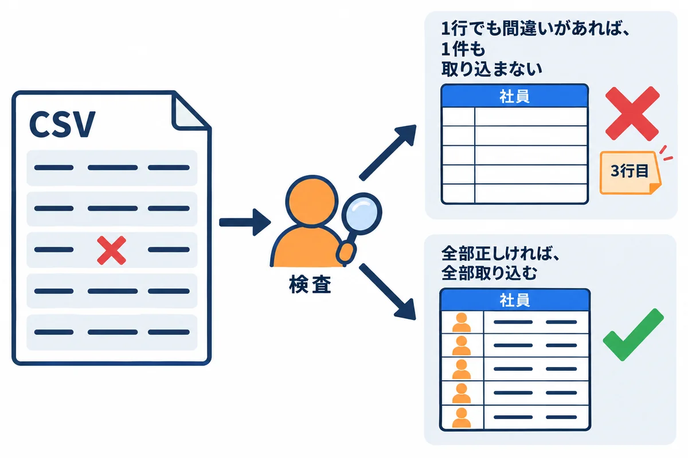
<div style="font-size: 12px; color: #64748b; margin-top: 6px;">図9-1: 取り込みは「全部か、何もしないか」</div>
</div>

`accounts/management/commands/import_employees.py`:

```python
"""社員の CSV を取り込む。使い方: python manage.py import_employees 社員.csv [--dry-run]

・1 行でも間違いがあれば、1 件も取り込まない（全部か、何もしないか）
・同じ従業員番号の社員がいれば、氏名などを書きかえる。いなければ作る（パスワードは未設定）
・CSV は Excel の「CSV UTF-8（コンマ区切り）」で保存した物（04 の 5 章）
"""

import csv
import re
from pathlib import Path

from django.core.management.base import BaseCommand, CommandError
from django.core.validators import validate_email
from django.core.exceptions import ValidationError
from django.db import transaction

from accounts.models import User

COLUMNS = ["従業員番号", "氏名", "所属", "役職", "メールアドレス"]


class Command(BaseCommand):
    help = "社員の CSV を取り込む"

    def add_arguments(self, parser):
        parser.add_argument("path")
        parser.add_argument("--dry-run", action="store_true", help="確かめるだけで、取り込まない")

    def handle(self, path, dry_run, **options):
        rows, errors = self.read(Path(path))
        if errors:
            for e in errors:
                self.stderr.write(f"× {e}")
            raise CommandError(f"{len(errors)} 件の間違いがあるので、取り込みませんでした。")
        if dry_run:
            self.stdout.write(f"間違いはありません（{len(rows)} 件）。--dry-run なので、取り込んでいません。")
            return
        created = updated = 0
        with transaction.atomic():
            for no, name, dept, title, email in rows:
                _, is_new = User.objects.update_or_create(
                    employee_no=no, defaults={"name": name, "dept": dept, "job_title": title, "email": email}
                )
                created += is_new
                updated += not is_new
        self.stdout.write(self.style.SUCCESS(f"取り込みました（新しく {created} 件・書きかえ {updated} 件）。"))

    def read(self, path: Path):
        rows, errors, seen = [], [], set()
        try:
            with path.open(encoding="utf-8-sig", newline="") as f:
                reader = csv.DictReader(f)
                if reader.fieldnames != COLUMNS:
                    return [], [f"1 行目の見出しは {','.join(COLUMNS)} にしてください（今: {reader.fieldnames}）"]
                for n, row in enumerate(reader, start=2):
                    no, name, dept, title, email = (row[c].strip() for c in COLUMNS)
                    if not re.fullmatch(r"\d{6}", no):
                        errors.append(f"{n} 行目: 従業員番号は 6 桁の数字にしてください（{no!r}）")
                    elif no in seen:
                        errors.append(f"{n} 行目: 従業員番号 {no} が 2 回出てきます")
                    elif not name:
                        errors.append(f"{n} 行目: 氏名が空です")
                    else:
                        try:
                            validate_email(email)
                        except ValidationError:
                            errors.append(f"{n} 行目: メールアドレスの形が違います（{email!r}）")
                            continue
                        seen.add(no)
                        rows.append((no, name, dept, title, email))
        except UnicodeDecodeError:
            return [], ["文字コードが UTF-8 ではありません。Excel で「CSV UTF-8」として保存し直してください。"]
        return rows, errors
```

間違いのある CSV（`sample_data\employees_bad.csv`）と、正しい CSV（`sample_data\employees.csv`）で動かした結果:

```text
PS> .\dev.ps1 import_employees sample_data\employees_bad.csv
× 3 行目: 従業員番号は 6 桁の数字にしてください（'30004'）
× 4 行目: メールアドレスの形が違います（'kato.example.com'）
CommandError: 2 件の間違いがあるので、取り込みませんでした。

PS> .\dev.ps1 import_employees sample_data\employees.csv --dry-run
間違いはありません（3 件）。--dry-run なので、取り込んでいません。

PS> .\dev.ps1 import_employees sample_data\employees.csv
取り込みました（新しく 2 件・書きかえ 1 件）。
```

- 04 の `csv_import.py` と同じ確かめ方を、Django の**管理コマンド**にしました。サーバーでは `.\manage.ps1 import_employees D:\work\社員.csv` のように動かします（onprem の 05 の 9.4）。
- `--dry-run` で、取り込む前に間違いだけを確かめられます。
- 取り込んだ社員のパスワードは「未設定」です。最初のパスワードの決め方（本人が設定する画面、管理者が `.\manage.ps1 changepassword 012345` で決める、など）は、会社の決まりに合わせます。

## 10. 毎朝 8:00 の通知

<div style="max-width: 760px; margin: 18px auto; text-align: center;">
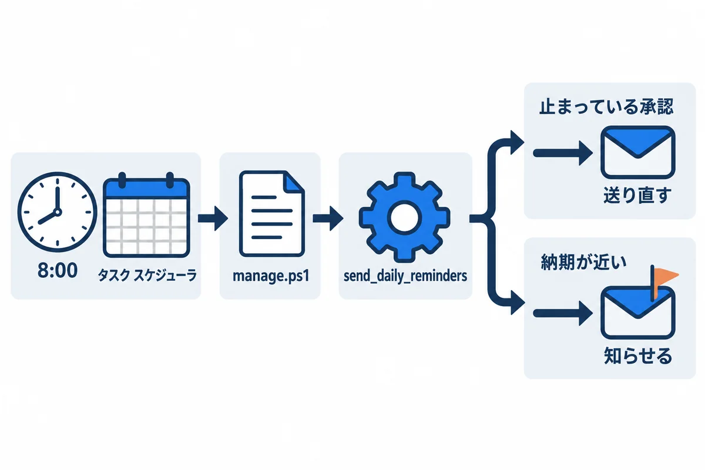
<div style="font-size: 12px; color: #64748b; margin-top: 6px;">図10-1: 毎朝の通知は、タスク スケジューラから管理コマンドを動かす</div>
</div>

`workflow/management/commands/send_daily_reminders.py`:

```python
"""毎朝 8:00 の通知。サーバーでは、タスク スケジューラが manage.ps1 から動かす（onprem の 05 の 12.1）

1. 承認のお願いを送ってから 3 日たっても止まっている回覧 → 承認者に送り直す（前の URL は使えなくなる）
2. 希望の納期まで 3 日以内なのに、まだ終わっていない依頼 → 依頼者と担当者に知らせる
"""

from datetime import timedelta

from django.core.management.base import BaseCommand
from django.utils import timezone

from workflow import services
from workflow.models import Request, Step

STALE_DAYS = 3
DUE_SOON_DAYS = 3


class Command(BaseCommand):
    help = "毎朝の通知（止まっている承認・納期の近い依頼）"

    def handle(self, **options):
        now = timezone.now()
        stale = Step.objects.filter(
            decision=Step.Decision.WAITING,
            request__status=Request.Status.CIRCULATING,
            sent_at__lt=now - timedelta(days=STALE_DAYS),
        )
        resent = 0
        for step in stale:
            services.resend(None, step.pk)
            resent += 1

        today = timezone.localdate()
        due_soon = Request.objects.filter(
            status__in=[Request.Status.APPROVED, Request.Status.IN_PROGRESS],
            due_date__lte=today + timedelta(days=DUE_SOON_DAYS),
        ).select_related("requester", "assignee")
        for r in due_soon:
            services.notify_due_soon(r)
        self.stdout.write(f"送り直した承認のお願い: {resent} 件 / 納期が近い依頼: {len(due_soon)} 件")
```

動かした結果（練習のデータでは、まだ対象が無い）:

```text
PS> .\dev.ps1 send_daily_reminders
送り直した承認のお願い: 0 件 / 納期が近い依頼: 0 件
```

会社のサーバーでは、onprem の 05 の 12.1 のとおり、タスク スケジューラに「毎日 8:00 に `manage.ps1 send_daily_reminders`」を登録します。

## 11. 自動のテスト

`workflow/tests.py` に、18 のテストがあります（全部は、練習のファイルを見てください）。

| テストの名前 | 確かめること |
|---|---|
| 出すと1人目にメールが届き回覧中になる | 依頼を出したときの動き |
| 全員が承認すると回覧完了になり担当者に知らせる | 回覧が最後まで進む |
| URLは1回しか使えない・期限が切れたURLは使えない | 6 章の決まり |
| 差し戻すとコメントが追記され依頼者にメールが届く・理由の無い差し戻しは断る | 差し戻しの決まり |
| 引き戻すと承認待ちの人のURLが使えなくなる | 引き戻しの決まり |
| 出し直すと最初の回覧者からやり直す | round の決まり |
| 回覧中はほかの人の依頼を引き戻せない・回覧者の決まり | できない操作を断る |
| 検証ではメールの宛先を書きかえる | `MAIL_REDIRECT_TO` |
| ログインしないと403・出すと番号が返りほかの人からは見えない | API の決まり |
| 図面の形が違えば断る・拡張子と中身が違うファイルは断る | 7 章の確かめ |
| 件名に改行は入れられない | 細工した送信を断る（10 の巻で足した） |
| 正しいCSVは取り込む・1行でも間違いがあれば1件も取り込まない | 9 章の決まり |

テストの書き方の例（URL は 1 回しか使えない）:

```python
def test_URLは1回しか使えない(self):
    self.submit()
    token = token_in(mail.outbox[0])            # 送られたメールから、URL の文字列を取り出す
    self.act(services.approve, token)            # 1 回目は承認できる
    with self.assertRaisesMessage(services.WorkflowError, "承認済みです"):
        services.approve(token)                  # 2 回目は断られる
```

- テストの中では、メールは本当には送られず、`mail.outbox` という箱にたまります。送られたはずのメールの宛先や本文を確かめられます。
- `captureOnCommitCallbacks(execute=True)` は、「保存が確定した後に送るメール」（5.2）を、テストの中でも送らせるための書き方です。

```powershell
.\dev.ps1 test --noinput
```

PostgreSQL の上で動かした結果（最後の所）:

```text
Ran 18 tests in 55.856s

OK
```

## 12. よくある失敗

| 症状 | 原因 | 直し方 |
|---|---|---|
| `RuntimeError: 環境変数 DB_NAME がありません` | `dev.env` が無い／`python manage.py` を直接動かした | `.\dev.ps1` から動かす |
| `password authentication failed for user "webapp_dev_app"` | `dev.env` のパスワードが違う | 2.1 で決めた物にする |
| テストが `permission denied to create database` | 開発用のユーザーに `CREATEDB` が無い | 2.1 |
| `.\dev.ps1 test -v 2` で、テストが 1 つも見つからない | PowerShell が `-v` を受け取った | `--verbosity 2` |
| `dev.ps1` で、パスワードが窓に残る・途中の行が動かない | BOM 無しで保存した | 「UTF-8 (BOM 付き)」で保存し直す |
| メールが届かない（開発中） | 開発中は、メールはファイルに書かれる | `backend\sent_mail\` を見る |
| 承認の画面で「この URL は使えません」 | URL の打ち間違い・送り直されて古い URL になった | 一番新しいメールの URL を開く |
| 承認の画面で `403 CSRF` | フォームに `` が無い／クッキーが受け取られていない | テンプレートを見る。HTTP なら `CSRF_COOKIE_SECURE = False`（onprem の 05 の 8 章） |
| `AUTH_USER_MODEL` を後から変えて、`migrate` がエラー | ユーザーのモデルは、最初の `migrate` の前に決める | 開発用なら、データベースを作り直す |
| 添付の保存で「ファイルの中身が、拡張子と合いません」 | 名前だけ変えたファイル（PNG を .jpg にした、など） | 元の形式のまま付ける |

## 13. 練習問題

1. `services.py` に、「回覧完了の依頼を、管理者が回覧中に戻す」操作を足して、テストも書いてください（ヒント：`WorkflowError` で、管理者以外を断る）。
2. 承認のお願いのメールに、「希望の納期まで、あと何日か」を足してください（ヒント：テンプレートに渡す前に、日数を計算する）。
3. `send_daily_reminders` で、「回覧中のまま 7 日たった依頼」を管理者に知らせてください。
4. 添付ファイルの種類に、Excel の `.xlsx` を足してください（ヒント：`.xlsx` の先頭は `PK`。ただし、zip の形式の物は、全部 `PK` で始まることに注意）。

## 用語の索引

| 用語 | 短い説明 | 章 |
|---|---|---|
| dev.ps1・dev.env | 開発用の設定を読み込んで manage.py を動かす道具／その設定 | 2 |
| AUTH_USER_MODEL | 自分で作ったユーザーのモデル | 4 |
| JSONField | JSON をそのまま入れる項目 | 4 |
| services | 状態を変える処理を集めた所 | 5 |
| transaction.atomic・on_commit | 全部か何もしないか／確定してから動かす | 5 |
| select_for_update | 行に鍵をかける | 5 |
| round | 何回目の回覧か | 5 |
| token・token_hash | URL の文字列／その指紋 | 6 |
| CSRF の札 | ほかのサイトからの勝手な送信を防ぐ印 | 6 |
| 管理コマンド | `manage.py コマンド` で動かす、自分で作った処理 | 9・10 |
| mail.outbox | テストの中で、送られたメールがたまる箱 | 11 |
