<div style="text-align: center; padding: 28px 0 8px;">
<div style="font-size: 14px; color: #475569;">Web アプリ開発 学習資料</div>
<div style="font-size: 26px; font-weight: 800; color: #0f172a; margin-top: 6px; line-height: 1.35;">06 Django＋React で練習アプリを作る（後編）— 画面側</div>
<div style="font-size: 13px; color: #475569; margin-top: 8px;">React の画面を前編の API とつなぎ、ビルドして Django の中に入れ、会社のサーバーと同じ形で動かす</div>
</div>

# 06 Django＋React で練習アプリを作る（後編）: 画面側

## この巻について

前編で作ったサーバー（Django の API と承認の画面）に、**React の画面**をつなぎます。

- 03 で作った画面の部品（一覧・入力・図面）を、**本物の API** につなぎかえます。
- ログイン・回覧者の検索・添付ファイル・詳細と操作のボタン・グラフの画面を足します。
- React をビルドして、**Django のプロジェクトの中**に入れ、Django（WhiteNoise）が配る形にします。onprem の 05 の形そのものです。

練習のコードは `samples/06_django_react/frontend/` にあります。この巻の画面の写しは、ビルドした物を **waitress（会社のサーバーと同じ）で動かし、Chrome で、依頼を出すところから完了までを実際に操作して撮った**物です。

## 1. 開発中と、ビルドした後

<div style="max-width: 760px; margin: 18px auto; text-align: center;">
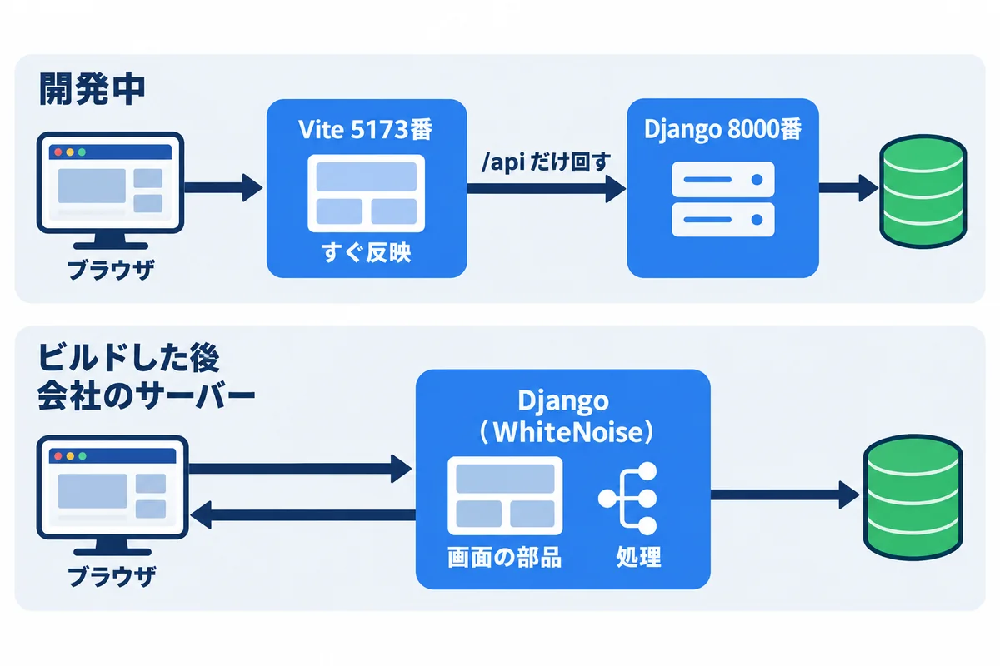
<div style="font-size: 12px; color: #64748b; margin-top: 6px;">図1-1: 開発中は 2 つのサーバー、ビルドした後は Django だけ</div>
</div>

| | 開発中 | ビルドした後（会社のサーバーと同じ） |
|---|---|---|
| 開く URL | `http://localhost:5173/` | `http://127.0.0.1:8000/`（会社では `http://webapp.example.local/`） |
| 画面を出すのは | Vite（直すとすぐ反映） | Django の WhiteNoise（`/static/…`） |
| API（`/api/…`）は | Vite が Django へ回す（`vite.config.ts` の `proxy`） | Django がそのまま答える |
| 動かし方 | 窓を 2 つ開いて、`.\dev.ps1 runserver` と `npm run dev` | `npm run build` の後、`.\dev_serve.ps1` |

`frontend/vite.config.ts`:

```typescript
import { defineConfig } from "vite";
import react from "@vitejs/plugin-react";

export default defineConfig({
  plugins: [react()],
  // 成果物は Django の /static/ から配られる（onprem の 05 の 6.5）
  base: "/static/",
  build: {
    // 成果物を Django のプロジェクトの中（backend/frontend_dist）に書き出す
    outDir: "../backend/frontend_dist",
    emptyOutDir: true,
  },
  server: {
    // 開発中だけ: API と承認の画面は、Django の開発用のサーバーへ回す
    proxy: {
      "/api": "http://127.0.0.1:8000",
      "/approve": "http://127.0.0.1:8000",
    },
  },
});
```

<!-- first-use -->

> **▶ ここで初めて出てくるコード**
>
> - **`defineConfig()`**（JavaScript・TypeScript）: `defineConfig({ … })` は、設定ファイル（Vite の `vite.config` や Playwright の `playwright.config`）で、設定を書くための関数です。書き間違いを、エディターが教えてくれるようになります。
> - **`react()`**（React）: `react()` は、Vite に、React（JSX）のファイルを扱えるようにする部品（プラグイン）です。

<!-- /first-use -->

### 1.1 開発中の動かし方

**▶ 準備:** 00 の 6.3（Node.js）。前編のサーバー側（Django）が動いていること。`npm` が「スクリプトの実行が無効」で止められたら、`npm.cmd` と打ちます（00 の 6.3）。

```powershell
# 窓 1: サーバー（前編）
cd webapp_learning\samples\06_django_react\backend
.\dev.ps1 runserver

# 窓 2: 画面
cd webapp_learning\samples\06_django_react\frontend
npm install
npm run dev        # http://localhost:5173/ を開く
```

### 1.2 ビルドして、会社のサーバーと同じ形で動かす

```powershell
cd webapp_learning\samples\06_django_react\frontend
npm run build      # 型を確かめてから、backend\frontend_dist に成果物を書き出す

cd ..\backend
.\dev_serve.ps1    # 部品を集めて（collectstatic）、waitress で動かす → http://127.0.0.1:8000/
```

<!-- first-use -->

> **▶ ここで初めて出てくるコード**
>
> - **`.\dev_serve.ps1`**（PowerShell）: 今いるフォルダの `dev_serve.ps1`（静的ファイルを集めてから、waitress でアプリを動かすスクリプト）を動かす書き方。

<!-- /first-use -->

`backend/dev_serve.ps1`（**「UTF-8 (BOM 付き)」で保存**）:

```powershell
# 会社のサーバーと同じ形（waitress・DEBUG なし・WhiteNoise が画面の部品を配る）で、手元で動かして確かめる
# （必ず「UTF-8 (BOM 付き)」で保存する）
# 使い方: .\dev_serve.ps1   → http://127.0.0.1:8000/ を開く。止めるときは Ctrl+C
$ErrorActionPreference = "Stop"

$names = @()
foreach ($line in Get-Content (Join-Path $PSScriptRoot "dev.env") -Encoding UTF8) {
    if ($line -match '^\s*#' -or $line -notmatch '=') { continue }
    $name, $value = $line -split '=', 2
    Set-Item -Path "Env:$($name.Trim())" -Value $value.Trim()
    $names += $name.Trim()
}
$env:DJANGO_DEBUG = "false"   # 本番と同じ
$names += "DJANGO_DEBUG"

Push-Location $PSScriptRoot
try {
    $python = "$PSScriptRoot\.venv\Scripts\python.exe"
    & $python manage.py collectstatic --noinput   # 画面の部品を staticfiles に集める
    # onprem の 05 の 9.2 の XML の arguments と同じ（ポートだけ 8000）
    # 行末の ` は「次の行へ続く」という印（長い 1 行を 2 行に分けて書く）
    & $python -m waitress --listen=127.0.0.1:8000 --threads=8 `
        --trusted-proxy=127.0.0.1 --trusted-proxy-headers=x-forwarded-for config.wsgi:application
} finally {
    foreach ($n in $names) { Remove-Item -Path "Env:$n" -ErrorAction SilentlyContinue }
    Pop-Location
}
```

<!-- first-use -->

> **▶ ここで初めて出てくるコード**
>
> - **`$env:名前`**（PowerShell）: `$env:GREETING` のように `$env:` を付けた名前は「環境変数」（プログラムに外から渡す設定）です。`$env:GREETING = "おはよう"` で設定すると、その PowerShell の窓から動かすプログラム（`cargo run` など）が読めます。窓を閉じると消えます。
> - **`` ` ``**（PowerShell）: 行の最後の `` ` ``（バッククォート。`Shift` ＋ `@` で打ちます）は、「次の行へ続く」という印です。長いコマンドを、何行かに分けて書けます。`` ` `` の後ろに空白があると続かないので、注意します。

<!-- /first-use -->

**確かめること:** `http://127.0.0.1:8000/health` が `{"status": "ok"}` を返すこと。画面の部品（`/static/assets/index-（指紋）.js`）の返事に、`Cache-Control: max-age=315360000, public, immutable` が付くこと（試した結果、付いた。onprem の 05 の 8.4 と同じ）。

## 2. 画面の部品の組み立て

<div style="max-width: 760px; margin: 18px auto; text-align: center;">
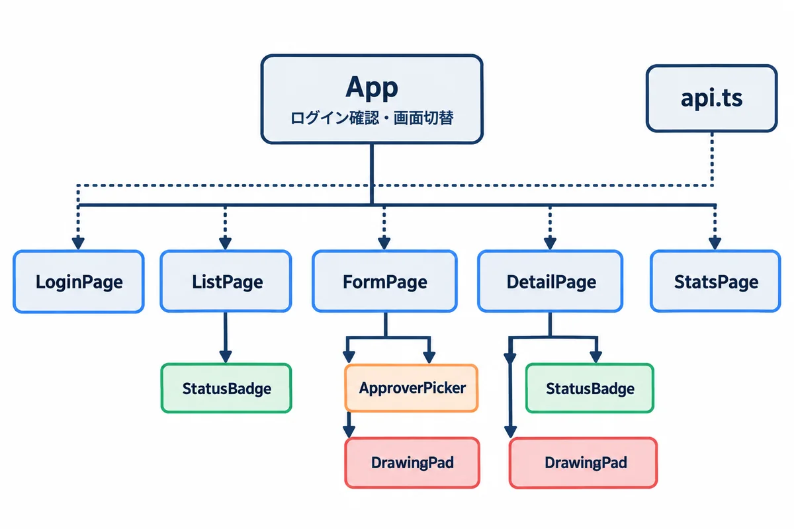
<div style="font-size: 12px; color: #64748b; margin-top: 6px;">図2-1: 練習アプリの画面の部品</div>
</div>

<div style="max-width: 760px; margin: 18px auto; text-align: center;">
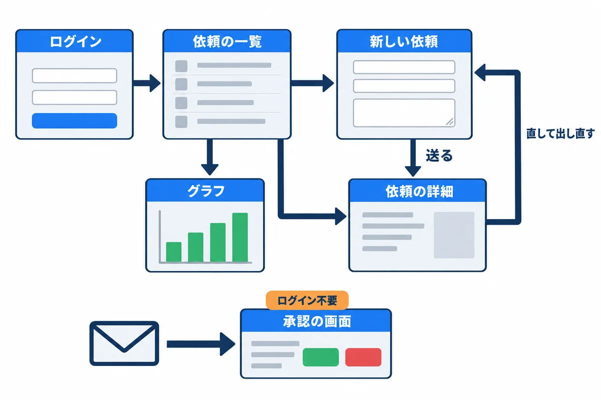
<div style="font-size: 12px; color: #64748b; margin-top: 6px;">図2-2: 画面のつながり（承認の画面だけは、前編の Django のテンプレート）</div>
</div>

```text
frontend\src\
├─ main.tsx            React を HTML に入れる（03 と同じ）
├─ App.tsx             ログインの確かめと、画面の切りかえ
├─ api.ts              サーバーとの窓口（全部の API の呼び方）
├─ types.ts            サーバーとやり取りする物の形
├─ style.css           01 の CSS ＋ 足した物
├─ components\
│  ├─ StatusBadge.tsx    状態の札
│  ├─ DrawingPad.tsx     図面（描く・見る）
│  └─ ApproverPicker.tsx 回覧者を探して選ぶ
└─ pages\
   ├─ LoginPage.tsx  ListPage.tsx  FormPage.tsx  DetailPage.tsx  StatsPage.tsx
```

## 3. サーバーとの窓口（api.ts）と、CSRF の札

`frontend/src/api.ts`:

```typescript
// Django の API を呼ぶ。03 の「にせのサーバー」を、本物に置きかえた物
import type { Employee, Me, RequestDetail, RequestInput, RequestRow } from "./types.ts";

/** API が断ったとき。detail はそのまま画面に出せる日本語 */
export class ApiError extends Error {
  status: number;
  constructor(status: number, message: string) {
    super(message);
    this.status = status;
  }
}

function csrfToken(): string {
  const m = document.cookie.match(/(?:^|; )csrftoken=([^;]+)/);
  return m ? decodeURIComponent(m[1]) : "";
}

/** DRF のエラーの JSON（{"title": ["…"]} や {"detail": "…"}）を、1 つの文にする */
function messageOf(data: unknown, status: number): string {
  if (data && typeof data === "object") {
    const values = Object.values(data as Record<string, unknown>).flat();
    if (values.length > 0) return values.map(String).join(" ");
  }
  return `エラー ${status}`;
}

async function call<T>(path: string, init: RequestInit = {}): Promise<T> {
  const method = init.method ?? "GET";
  const headers: Record<string, string> = method === "GET" ? {} : { "X-CSRFToken": csrfToken() };
  if (init.body && !(init.body instanceof FormData)) headers["Content-Type"] = "application/json";
  const res = await fetch(path, { ...init, method, headers, credentials: "same-origin" });
  if (res.status === 204) return undefined as T;
  const data = await res.json().catch(() => ({}));
  if (!res.ok) throw new ApiError(res.status, messageOf(data, res.status));
  return data as T;
}

const post = <T>(path: string, body?: unknown) =>
  call<T>(path, { method: "POST", body: body instanceof FormData ? body : JSON.stringify(body ?? {}) });

export const api = {
  csrf: () => call<void>("/api/csrf/"),
  me: () => call<Me>("/api/me/"),
  login: (employee_no: string, password: string) => post<{ name: string }>("/api/login/", { employee_no, password }),
  logout: () => post<{ ok: boolean }>("/api/logout/"),
  requests: (mine: boolean) => call<RequestRow[]>(`/api/requests/${mine ? "?mine=1" : ""}`),
  request: (id: number) => call<RequestDetail>(`/api/requests/${id}/`),
  create: (input: RequestInput) => post<{ id: number }>("/api/requests/", input),
  action: (id: number, action: string, input?: RequestInput) => post<{ ok: boolean }>(`/api/requests/${id}/${action}/`, input),
  upload: (id: number, file: File) => {
    const form = new FormData();
    form.append("file", file);
    return post<{ id: number }>(`/api/requests/${id}/attachments/`, form);
  },
  employees: (q: string) => call<Employee[]>(`/api/employees/?q=${encodeURIComponent(q)}`),
  stats: () =>
    call<{ by_status: { status: string; count: number }[]; done_by_assignee: { name: string; count: number }[] }>("/api/stats/"),
};
```

<!-- first-use -->

> **▶ ここで初めて出てくるコード**
>
> - **`class`**（TypeScript）: クラス（データと、それを扱うメソッドをまとめた設計図）を作る書き方。`class ApiError extends Error { … }`。`new ApiError(…)` で作ります。
> - **`extends`**（TypeScript）: クラスを、ほかのクラスを元にして作る書き方。`class ApiError extends Error` は、標準の `Error` に、`status` などを足したエラーです。
> - **`this`**（TypeScript）: クラスの中で「この物自身」を表す言葉。`this.status = status;` は、自分の `status` に値を入れます。
> - **`instanceof`**（TypeScript）: 値が、そのクラスから作られた物かを調べる書き方。`body instanceof FormData` は「ファイル付きのフォームの中身か」。
> - **`.match()`**（TypeScript）: 文字列が正規表現に合う所を探すメソッド。見つかると、その情報（かっこの中の部分など）を配列で、見つからないと `null` を返します。
> - **`.flat()`**（TypeScript）: 配列の中の配列を、1 つの配列に平らにするメソッド。
> - **`.catch()`**（TypeScript）: `Promise` が失敗した時の代わりの処理を登録するメソッド。`res.json().catch(() => ({}))` は「JSON として読めなければ空のオブジェクト」。
> - **`.append()`**（TypeScript）: `FormData` に項目を足すメソッド。`form.append("file", file)` で、ファイル付きのフォームを組み立てます。
> - **`(?:…)`**（正規表現）: 正規表現の `(?: )` は、取り出さないまとまりです。`(?:^|; )` は「行の頭か、`; ` のどちらか」をまとめるだけで、取り出す番号には数えません。
> - **`[^…]`**（正規表現）: 正規表現の `[^ ]` は、「中に書いた文字**以外**の 1 文字」を表します。`[^;]+` は「`;` 以外の文字が 1 つ以上」、`[^\x21-\x7E]` は「英数字と記号（ASCII の見える文字）以外」。
> - **`+`**（正規表現）: 正規表現の `+` は、「すぐ前の物が、1 回以上くり返す」を表します。`\d+` は「数字が 1 つ以上」。
> - **`^`**（正規表現）: 正規表現の `^` は、「行（文字）の頭」を表します。`^#` は「`#` で始まる」。
> - **`|`**（正規表現）: 正規表現の `|` は、「左か右のどちらか」を表します。`api/|admin/` は「`api/` か `admin/`」。
> - **`(…)`**（正規表現）: 正規表現の `( )` は、まとまり（グループ）を作ります。合った文字のうち、`( )` の中の部分だけを、あとから取り出せます（`m[1]`・`m.group(1)`・`$1` など）。`(…)?` のように、まとまりごとくり返しや省略もできます。
> - **`Object`**（JavaScript・TypeScript）: `Object.values(obj)` は、オブジェクトの値だけを並びにします。`Object.keys(obj)` はキーだけ、`Object.entries(obj)` は `[キー, 値]` の組の並びです。
> - **`String`**（JavaScript・TypeScript）: `String(値)` は、値を文字にします。`values.map(String)` は、並びの全部を文字にします。
> - **`RequestInit`**（TypeScript）: `RequestInit` は、`fetch(URL, 設定)` の 2 つ目に渡す「設定」（`method`・`headers`・`body` など）の型です。
> - **`FormData`**（JavaScript・TypeScript）: `FormData` は、フォームの中身（ファイルも含む）を、送れる形にまとめる入れ物です。`fetch` の `body` に入れて、ファイルを送ります。
> - **`decodeURIComponent()`**（JavaScript・TypeScript）: `decodeURIComponent("%E5%B1%B1")` は、URL やクッキーの中で `%XX` の形にした文字を、元の文字（山）に戻します。反対は `encodeURIComponent()` です。
> - **`.cookie`**（JavaScript・TypeScript）: `document.cookie` は、そのページのクッキーを、`名前=値; 名前=値` の形の文字で読みます（`HttpOnly` のクッキーは読めません）。

<!-- /first-use -->

- **API の呼び方を、このファイル 1 つに集めています。** 画面の部品は `api.requests(true)` のように呼ぶだけで、URL や CSRF の札のことを知らなくて済みます（前編の services と同じ考え方）。
- `POST` には、クッキーの `csrftoken` を `X-CSRFToken` という付け札にして付けます（onprem の 05 の 8.2）。
- 札は、画面を開いたときに `/api/csrf/` を呼んで受け取ります（ビルドした後は、`index.html` を返すときにも渡す）。
- サーバーが断ったときの文（`{"detail": "…"}` や `{"title": ["…"]}`）は、`ApiError` にして、そのまま画面に出します。

サーバー側に足した物（`backend/workflow/pages.py`）:

```python
"""React の画面（index.html）を返す所と、動いているかの確かめ（/health）"""

from django.http import HttpResponse, JsonResponse
from django.utils.decorators import method_decorator
from django.views.decorators.csrf import ensure_csrf_cookie
from django.views.generic import TemplateView


@method_decorator(ensure_csrf_cookie, name="dispatch")
class IndexView(TemplateView):
    """React の成果物の index.html を返す。CSRF の札（クッキー）もここで渡す"""

    template_name = "index.html"


@ensure_csrf_cookie
def csrf(request):
    """開発中（Vite の画面から開いたとき）に、CSRF の札を受け取るための入口"""
    return HttpResponse(status=204)


def health(request):
    """動いているかの確かめ（onprem の 06 の check.ps1 が使う）"""
    return JsonResponse({"status": "ok"})
```

<!-- first-use -->

> **▶ ここで初めて出てくるコード**
>
> - **`method_decorator()`**（Django）: 関数用の印（デコレーター）を、クラスの画面（ビュー）のメソッドにも付けられるようにする物。
> - **`@method_decorator`**（Django）: `@method_decorator(ensure_csrf_cookie, name="dispatch")` をクラスの上に付けて、そのクラスの画面に印を付けます。
> - **`@ensure_csrf_cookie`**（Django）: その画面を返す時に、CSRF の札（クッキー）を必ず付ける印。React の画面が、あとで送るフォームに札を付けられるようにします（10 巻の 5 章）。
> - **`HttpResponse`**（Django）: Django の `HttpResponse("文字")` は、文字（HTML など）をそのまま返す、いちばん基本の答えです。
> - **`JsonResponse`**（Django）: Django の `JsonResponse({"status": "ok"})` は、辞書を JSON にして返す答えです。
> - **`TemplateView`**（Django）: Django の `TemplateView` は、決まったテンプレート（HTML）を表示するだけのビューです。`template_name = "index.html"` を書くだけで使えます。

<!-- /first-use -->

`backend/config/urls.py` の最後に、「API・管理画面・部品・承認の画面以外の URL は、React の画面を返す」行を足しました。

```python
re_path(r"^(?!api/|admin/|static/|approve/).*$", pages.IndexView.as_view()),
```

<!-- first-use -->

> **▶ ここで初めて出てくるコード**
>
> - **`.as_view()`**（Django）: クラスで作った画面（ビュー）を、URL の決まりに登録できる形にするメソッド。
> - **`re_path()`**（Django）: 正規表現で URL の決まりを書く関数。`re_path(r"^(?!api/|admin/).*$", …)` は「`api/`・`admin/` で始まらない URL は全部」（React の画面を返す）。
> - **`(?=…)`**（正規表現）: 正規表現の `(?= )` は「この後ろに、こういう形が続く時だけ」、`(?! )` は「この後ろに、こういう形が続かない時だけ」を表します（先読み）。`^(?!api/|admin/).*$` は「`api/` や `admin/` で始まらない物、全部」。中の文字は、合わせた文字には入りません。
> - **`*`**（正規表現）: 正規表現の `*` は、「すぐ前の物が、0 回以上くり返す」を表します。`\s*` は「空白が 0 個以上」、`.*` は「何でも、何文字でも」。
> - **`|`**（正規表現）: 正規表現の `|` は、「左か右のどちらか」を表します。`api/|admin/` は「`api/` か `admin/`」。

<!-- /first-use -->

## 4. ログインと、画面の切りかえ（App.tsx）

`frontend/src/App.tsx`:

```tsx
import { useCallback, useEffect, useState } from "react";
import { api, ApiError } from "./api.ts";
import { DetailPage } from "./pages/DetailPage.tsx";
import { FormPage } from "./pages/FormPage.tsx";
import { ListPage } from "./pages/ListPage.tsx";
import { LoginPage } from "./pages/LoginPage.tsx";
import { StatsPage } from "./pages/StatsPage.tsx";
import type { Me } from "./types.ts";

type Route =
  | { page: "list" }
  | { page: "new" }
  | { page: "detail"; id: number }
  | { page: "edit"; id: number }
  | { page: "stats" };

/** URL の # の後ろ（#/requests/5 など）から、出す画面を決める */
function parse(hash: string): Route {
  const m = hash.match(/^#\/requests\/(\d+)(\/edit)?$/);
  if (m) return m[2] ? { page: "edit", id: Number(m[1]) } : { page: "detail", id: Number(m[1]) };
  if (hash === "#/new") return { page: "new" };
  if (hash === "#/stats") return { page: "stats" };
  return { page: "list" };
}

export function App() {
  const [me, setMe] = useState<Me | null | undefined>(undefined); // undefined = 確かめ中、null = ログインしていない
  const [route, setRoute] = useState<Route>(parse(location.hash));

  const loadMe = useCallback(async () => {
    try {
      setMe(await api.me());
    } catch (e) {
      if (e instanceof ApiError && e.status === 403) setMe(null); // ログインしていない（60 分たった、など）
      else throw e;
    }
  }, []);

  useEffect(() => {
    api.csrf().then(loadMe); // 先に CSRF の札（クッキー）を受け取ってから
    const onChange = () => setRoute(parse(location.hash));
    window.addEventListener("hashchange", onChange);
    return () => window.removeEventListener("hashchange", onChange);
  }, [loadMe]);

  async function logout() {
    await api.logout();
    setMe(null);
  }

  return (
    <>
      <header className="site-header">
        <strong>依頼・承認アプリ</strong>
        {me && (
          <nav>
            <a href="#/">依頼の一覧</a>
            <a href="#/new">新しい依頼</a>
            <a href="#/stats">グラフ</a>
            <span className="who">{me.name} さん</span>
            <button className="link light" onClick={logout}>ログアウト</button>
          </nav>
        )}
      </header>
      <main>
        {me === undefined && <p>読み込み中…</p>}
        {me === null && <LoginPage onLogin={loadMe} />}
        {me && route.page === "list" && <ListPage me={me} />}
        {me && route.page === "new" && <FormPage />}
        {me && route.page === "edit" && <FormPage editId={route.id} />}
        {me && route.page === "detail" && <DetailPage id={route.id} me={me} />}
        {me && route.page === "stats" && <StatsPage />}
      </main>
    </>
  );
}
```

<!-- first-use -->

> **▶ ここで初めて出てくるコード**
>
> - **`.csrf()`**（練習アプリで作る物（TypeScript））: `api.ts` で作る関数の 1 つで、`/api/csrf/` を呼んで、CSRF の札（クッキー）を先に受け取ります。
> - **`useCallback()`**（React）: 関数を覚えておき、描き直しのたびに作り直さないようにするフック。`useEffect` の見張る値に関数を入れる時などに使います。
> - **`\d`**（正規表現）: 正規表現の `\d` は、「数字 1 つ（0〜9）」を表します。
> - **`\.`**（正規表現）: 正規表現の `\.` のように、記号の前に `\` を付けると、その記号を特別な意味にせず、文字そのものとして表します。`\.` は `.`、`\/` は `/` です。
> - **`?`**（正規表現）: 正規表現の `?` は、「すぐ前の物が、あっても無くてもよい（0 回か 1 回）」を表します。`(\/edit)?` は「`/edit` があってもなくてもよい」。
> - **`$`**（正規表現）: 正規表現の `$` は、「行（文字）の終わり」を表します。`\d+$` は「数字で終わる」。`^…$` と両方書くと、「全体がこの形か」を調べられます。
> - **`async () =>`**（JavaScript・TypeScript）: `async () => { … }` は、中で `await`（終わるまで待つ）を使える、名前の無い関数（アロー関数）です。
> - **`Number`**（JavaScript・TypeScript）: `Number("42")` は、文字を数にします。数にできない時は `NaN`（数ではない）になります。

<!-- /first-use -->

<div style="max-width: 640px; margin: 18px auto; text-align: center;">
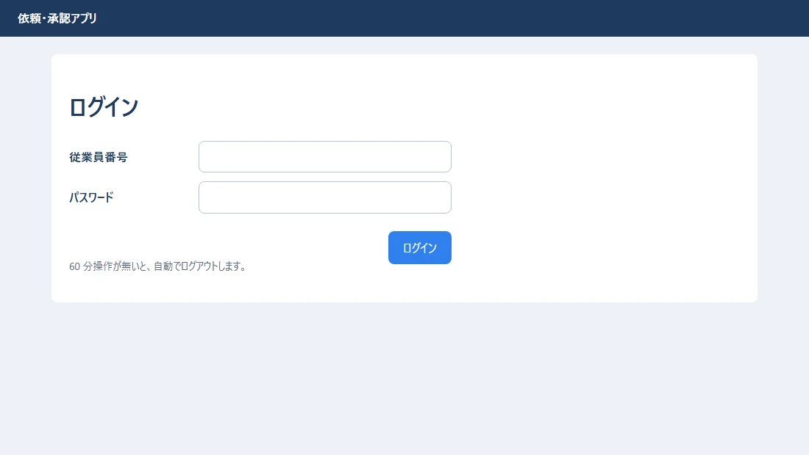
<div style="font-size: 12px; color: #64748b; margin-top: 6px;">図4-1: ログインの画面</div>
</div>

- `/api/me/` が 403 なら「ログインしていない」として、ログインの画面を出します。**60 分たってセッションが切れたとき**も、同じ動きになります（前編の settings.py の `SESSION_COOKIE_AGE`）。
- `me` が `undefined`（確かめ中）・`null`（ログインしていない）・値あり（ログイン中）の 3 つを、型で区別しています。

## 5. 依頼を出す（FormPage と ApproverPicker）

`frontend/src/pages/FormPage.tsx`:

```tsx
import { useEffect, useState, type FormEvent } from "react";
import { api } from "../api.ts";
import { ApproverPicker } from "../components/ApproverPicker.tsx";
import { DrawingPad, emptyDrawing } from "../components/DrawingPad.tsx";
import type { Drawing, Employee } from "../types.ts";

const MAX_FILE = 10 * 1024 * 1024;
const OK_EXT = /\.(jpe?g|png|pdf)$/i;

/** 依頼の入力。editId があれば「直して出し直す」 */
export function FormPage({ editId }: { editId?: number }) {
  const [title, setTitle] = useState("");
  const [detail, setDetail] = useState("");
  const [dueDate, setDueDate] = useState("");
  const [approvers, setApprovers] = useState<Employee[]>([]);
  const [drawing, setDrawing] = useState<Drawing>(emptyDrawing);
  const [files, setFiles] = useState<File[]>([]);
  const [errors, setErrors] = useState<string[]>([]);
  const [sending, setSending] = useState(false);

  useEffect(() => {
    if (editId === undefined) return;
    api.request(editId).then((r) => {
      setTitle(r.title);
      setDetail(r.detail);
      setDueDate(r.due_date);
      setDrawing(r.drawing ?? emptyDrawing);
      setApprovers(r.steps.map((s) => ({ id: s.approver_id, name: s.approver_name, dept: s.approver_dept, job_title: "" })));
    });
  }, [editId]);

  function validate(): string[] {
    const list: string[] = [];
    if (!title.trim()) list.push("件名を入れてください。");
    if (!dueDate) list.push("希望の納期を入れてください。");
    if (approvers.length === 0) list.push("回覧者を 1 人以上選んでください。");
    for (const f of files) {
      if (!OK_EXT.test(f.name)) list.push(`${f.name}: 添付できるのは JPG・PNG・PDF だけです。`);
      if (f.size > MAX_FILE) list.push(`${f.name}: 1 ファイル 10MB までです。`);
    }
    return list;
  }

  async function handleSubmit(e: FormEvent<HTMLFormElement>) {
    e.preventDefault();
    const found = validate();
    setErrors(found);
    if (found.length > 0) return;
    setSending(true);
    try {
      const input = { title, detail, due_date: dueDate, approver_ids: approvers.map((a) => a.id), drawing };
      let id = editId;
      if (id === undefined) {
        id = (await api.create(input)).id;
      } else {
        await api.action(id, "resubmit", input);
      }
      for (const f of files) await api.upload(id, f); // 添付は、依頼を作ってから 1 つずつ送る
      location.hash = `#/requests/${id}`;
    } catch (err) {
      setErrors([err instanceof Error ? err.message : "送れませんでした。"]);
    } finally {
      setSending(false);
    }
  }

  return (
    <form onSubmit={handleSubmit}>
      <h1>{editId === undefined ? "依頼の入力" : `依頼 ${editId} を直して出し直す`}</h1>
      {errors.length > 0 && <ul className="errors" role="alert">{errors.map((m) => <li key={m}>{m}</li>)}</ul>}
      <div className="form-grid">
        <label htmlFor="title" className="required">件名</label>
        <input id="title" value={title} maxLength={100} onChange={(e) => setTitle(e.target.value)} />
        <label htmlFor="detail">内容</label>
        <textarea id="detail" rows={3} value={detail} onChange={(e) => setDetail(e.target.value)} />
        <label htmlFor="due" className="required">希望の納期</label>
        <input id="due" type="date" value={dueDate} onChange={(e) => setDueDate(e.target.value)} />
        <label className="required">回覧者</label>
        <ApproverPicker value={approvers} onChange={setApprovers} />
        <label htmlFor="files">添付ファイル</label>
        <input id="files" type="file" multiple accept=".jpg,.jpeg,.png,.pdf" onChange={(e) => setFiles([...(e.target.files ?? [])])} />
      </div>
      <h2>図面（ドラッグで四角を描く）</h2>
      <DrawingPad value={drawing} onChange={setDrawing} />
      <div className="actions">
        <button type="button" className="btn-secondary" onClick={() => setDrawing(emptyDrawing)}>図面を消す</button>
        <button type="submit" className="btn-primary" disabled={sending}>{sending ? "送っています…" : "依頼を送る"}</button>
      </div>
    </form>
  );
}
```

<!-- first-use -->

> **▶ ここで初めて出てくるコード**
>
> - **`.request()`**（練習アプリで作る物（TypeScript））: `api.ts` で作る関数の 1 つで、依頼 1 件のくわしい中身を問い合わせます。
> - **`.test()`**（TypeScript）: 正規表現が、文字列に合うかを `true`・`false` で返すメソッド。`/\.(jpe?g|png|pdf)$/i.test(名前)` は「拡張子が JPG・PNG・PDF か」。
> - **`.create()`**（練習アプリで作る物（TypeScript））: `api.ts` で作る関数の 1 つで、新しい依頼を送って作ります。作った依頼の番号（`id`）が返ります。
> - **`.upload()`**（練習アプリで作る物（TypeScript））: `api.ts` で作る関数の 1 つで、添付ファイルを 1 つ送ります。
> - **`/…/g`**（JavaScript・TypeScript）: 正規表現の後ろの `g` は、「合う所を全部」という指定（フラグ）です。`.replace(/a/g, "b")` は、全部の `a` を `b` にします（`g` が無いと、最初の 1 つだけ）。`i` は大文字・小文字を区別しない指定です。
> - **`maxLength=`**（React）: JSX の `maxLength={100}` は、入力できる文字の数の上限です（HTML の `maxlength`）。
> - **`accept=`**（React）: `accept=".jpg,.jpeg,.png,.pdf"` は、選べるファイルの種類です（サーバー側でも必ず確かめます）。

<!-- /first-use -->

`frontend/src/components/ApproverPicker.tsx`:

```tsx
import { useEffect, useState } from "react";
import { api } from "../api.ts";
import type { Employee } from "../types.ts";

type Props = { value: Employee[]; onChange: (list: Employee[]) => void; max?: number };

/** 回覧者を、氏名・所属・役職で探して、順番に 3 人まで選ぶ */
export function ApproverPicker({ value, onChange, max = 3 }: Props) {
  const [q, setQ] = useState("");
  const [found, setFound] = useState<Employee[]>([]);

  useEffect(() => {
    // 打つたびにすぐ呼ばず、0.3 秒止まってから探す（サーバーにお願いしすぎない）
    const timer = setTimeout(() => {
      api.employees(q).then(setFound).catch(() => setFound([]));
    }, 300);
    return () => clearTimeout(timer);
  }, [q]);

  const chosenIds = new Set(value.map((e) => e.id));
  return (
    <div className="picker">
      <ol className="chosen">
        {value.map((e, i) => (
          <li key={e.id}>
            回覧者{i + 1}: {e.name}（{e.dept} {e.job_title}）
            <button type="button" className="link" onClick={() => onChange(value.filter((x) => x.id !== e.id))}>外す</button>
          </li>
        ))}
        {value.length === 0 && <li className="hint">まだ選んでいません（1〜{max} 人）</li>}
      </ol>
      {value.length < max && (
        <>
          <input placeholder="氏名・所属・役職で探す" value={q} onChange={(e) => setQ(e.target.value)} aria-label="回覧者を探す" />
          <ul className="found">
            {found.filter((e) => !chosenIds.has(e.id)).slice(0, 5).map((e) => (
              <li key={e.id}>
                <button type="button" className="link" onClick={() => onChange([...value, e])}>
                  ＋ {e.name}（{e.dept} {e.job_title}）
                </button>
              </li>
            ))}
          </ul>
        </>
      )}
    </div>
  );
}
```

<!-- first-use -->

> **▶ ここで初めて出てくるコード**
>
> - **`.has()`**（TypeScript）: `Set` や `Map` に、その値（キー）があれば `true` を返すメソッド。
> - **`.slice()`**（TypeScript）: 配列や文字列の一部分を切り出した、新しい物を返すメソッド。`list.slice(0, 5)` は最初の 5 つ。
> - **`<ol>`**（React）: 番号の付いた並びのタグ。中に `<li>` を並べます（回覧の順番など）。
> - **`setTimeout()`**（JavaScript・TypeScript）: `setTimeout(() => { … }, 3000)` は、3000 ミリ秒（3 秒）たってから、中の処理を 1 回動かします。返ってくる番号を `clearTimeout(番号)` に渡すと、取りやめにできます。
> - **`clearTimeout()`**（JavaScript・TypeScript）: `clearTimeout(timer)` は、`setTimeout` で予約した処理を取りやめにします。React では、部品が消える時の後片づけ（`useEffect` の `return () => …`）で呼びます。

<!-- /first-use -->

<div style="max-width: 760px; margin: 18px auto; text-align: center;">
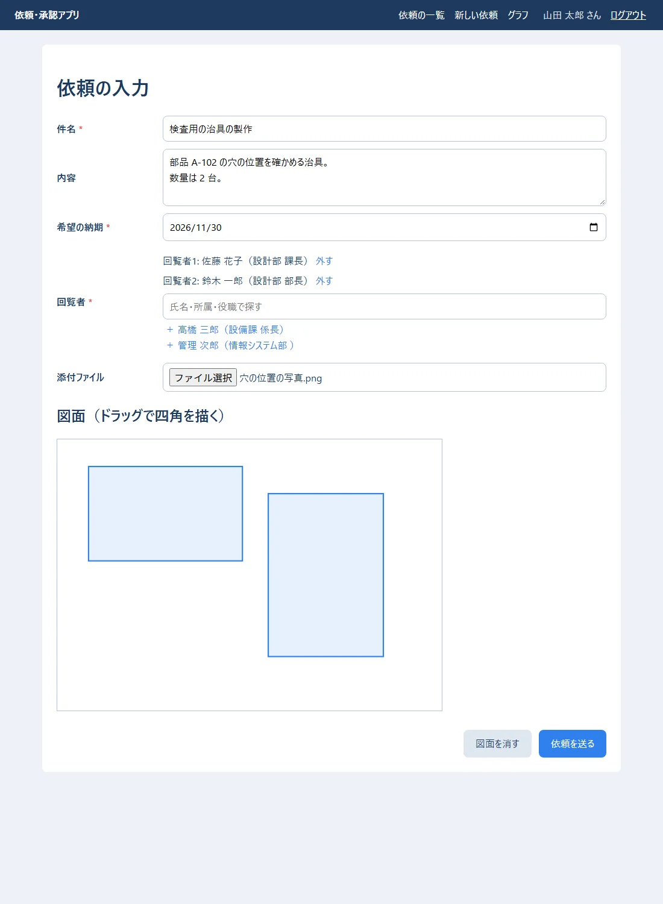
<div style="font-size: 12px; color: #64748b; margin-top: 6px;">図5-1: 回覧者を 2 人選び、写真を添付し、図面に四角を 2 つ描いたところ</div>
</div>

「依頼を送る」を押すと、依頼が作られ、そのあと添付ファイルが送られて、詳細の画面に移ります。

<div style="max-width: 760px; margin: 18px auto; text-align: center;">
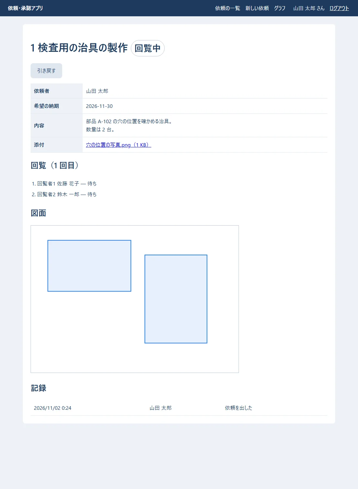
<div style="font-size: 12px; color: #64748b; margin-top: 6px;">図5-2: 出した直後の詳細。1 人目（佐藤さん）に、承認のお願いのメールが届いている</div>
</div>

<div style="max-width: 760px; margin: 18px auto; text-align: center;">
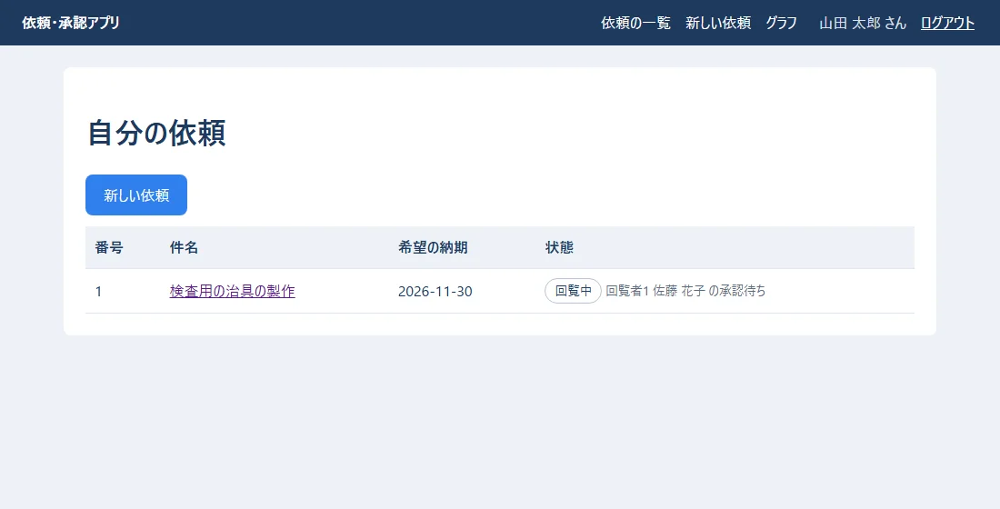
<div style="font-size: 12px; color: #64748b; margin-top: 6px;">図5-3: 一覧には、だれの承認を待っているかも出る</div>
</div>

- 回覧者の検索は、**打つたびにすぐ呼ばず、0.3 秒止まってから**呼びます（`setTimeout` と、`useEffect` の片付けの `clearTimeout`）。1 文字打つたびにサーバーにお願いしないためです。
- 添付ファイルの種類と大きさは、送る前に画面でも確かめますが、**本当の確かめはサーバー**（前編の 7 章）です。
- 回覧者を選んだ順番が、そのまま回覧の順番になります。

## 6. 依頼の詳細と、操作のボタン（DetailPage）

`frontend/src/pages/DetailPage.tsx`:

```tsx
import { useCallback, useEffect, useState } from "react";
import { api } from "../api.ts";
import { DrawingPad } from "../components/DrawingPad.tsx";
import { StatusBadge } from "../components/StatusBadge.tsx";
import type { Me, RequestDetail } from "../types.ts";

const time = (s: string | null) => (s ? new Date(s).toLocaleString("ja-JP", { dateStyle: "short", timeStyle: "short" }) : "");

/** 依頼の詳細。回覧の進み具合・差し戻しのコメント・添付・記録と、今できる操作のボタン */
export function DetailPage({ id, me }: { id: number; me: Me }) {
  const [r, setR] = useState<RequestDetail | null>(null);
  const [message, setMessage] = useState("");
  const load = useCallback(() => api.request(id).then(setR).catch((e: Error) => setMessage(e.message)), [id]);
  useEffect(() => { load(); }, [load]);

  async function run(action: string, done: string) {
    try {
      await api.action(id, action);
      setMessage(done);
      await load();
    } catch (e) {
      setMessage(e instanceof Error ? e.message : "できませんでした。");
    }
  }

  if (r === null) return <p>{message || "読み込み中…"}</p>;
  const mine = r.requester_name === me.name;
  const editable = mine && (r.status === "returned" || r.status === "pulled_back");
  return (
    <section>
      <h1>{r.id} {r.title} <StatusBadge status={r.status} label={r.status_label} /></h1>
      {message && <p className="message">{message}</p>}
      <div className="actions left">
        {mine && r.status === "circulating" && (
          <button className="btn-secondary" onClick={() => run("pull-back", "引き戻しました。")}>
            引き戻す
          </button>
        )}
        {editable && <a className="btn-primary" href={`#/requests/${r.id}/edit`}>直して出し直す</a>}
        {editable && <button className="btn-secondary" onClick={() => run("withdraw", "取り下げました。")}>取り下げる</button>}
        {me.role !== "member" && r.status === "approved" && (
          <button className="btn-primary" onClick={() => run("assign", "担当になりました。")}>
            担当になる
          </button>
        )}
        {r.status === "in_progress" && r.assignee_name === me.name && (
          <button className="btn-primary" onClick={() => run("complete", "完了にしました。")}>
            完了にする
          </button>
        )}
      </div>
      <table className="kv">
        <tbody>
          <tr><th>依頼者</th><td>{r.requester_name}</td></tr>
          <tr><th>希望の納期</th><td>{r.due_date}</td></tr>
          <tr><th>内容</th><td className="pre">{r.detail}</td></tr>
          {r.assignee_name && <tr><th>担当者</th><td>{r.assignee_name}</td></tr>}
          {r.return_comments && <tr><th>差し戻しのコメント</th><td className="pre">{r.return_comments}</td></tr>}
          <tr><th>添付</th><td>{r.attachments.length === 0 ? "なし" : r.attachments.map((a) => (
            <a key={a.id} className="file" href={`/api/attachments/${a.id}/`}>{a.original_name}（{Math.ceil(a.size / 1024)} KB）</a>
          ))}</td></tr>
        </tbody>
      </table>
      <h2>回覧（{r.round} 回目）</h2>
      <ol className="steps">
        {r.steps.map((s) => (
          <li key={s.order} className={`step-${s.decision}`}>
            回覧者{s.order} {s.approver_name} — {s.decision_label} {time(s.decided_at)}
          </li>
        ))}
      </ol>
      {r.drawing && r.drawing.shapes.length > 0 && (<><h2>図面</h2><DrawingPad value={r.drawing} /></>)}
      <h2>記録</h2>
      <table>
        <tbody>
          {r.histories.map((h, i) => (
            <tr key={i}><td>{time(h.at)}</td><td>{h.actor_name}</td><td>{h.action}</td><td>{h.note}</td></tr>
          ))}
        </tbody>
      </table>
    </section>
  );
}
```

<!-- first-use -->

> **▶ ここで初めて出てくるコード**
>
> - **`.toLocaleString()`**（TypeScript）: 日時や数を、その国の書き方の文字列にするメソッド。`new Date(s).toLocaleString("ja-JP", { dateStyle: "short", timeStyle: "short" })` は `2026/11/02 8:00` の形です。
> - **`.ceil()`**（TypeScript）: `Math.ceil(x)` は、小数を切り上げて整数にする関数です（大きさを KB で見せる時など）。
> - **`Date`**（JavaScript・TypeScript）: `new Date(文字)` は、日時の値を作ります。`.toLocaleString("ja-JP")` で、日本の形の日時の文字になります。

<!-- /first-use -->

**今できる操作のボタンだけ**を出します。たとえば「引き戻す」は、自分の依頼が回覧中のときだけです。ただし、ボタンを出さないのは使う人のためのお手伝いで、**できるかどうかを最後に決めるのはサーバー**（前編の services）です。

### 6.1 差し戻されたとき → 直して出し直す

2 人目の鈴木さんが、メールの URL から差し戻すと（前編の 6.2）、依頼した山田さんの画面は次のようになります。

<div style="max-width: 760px; margin: 18px auto; text-align: center;">
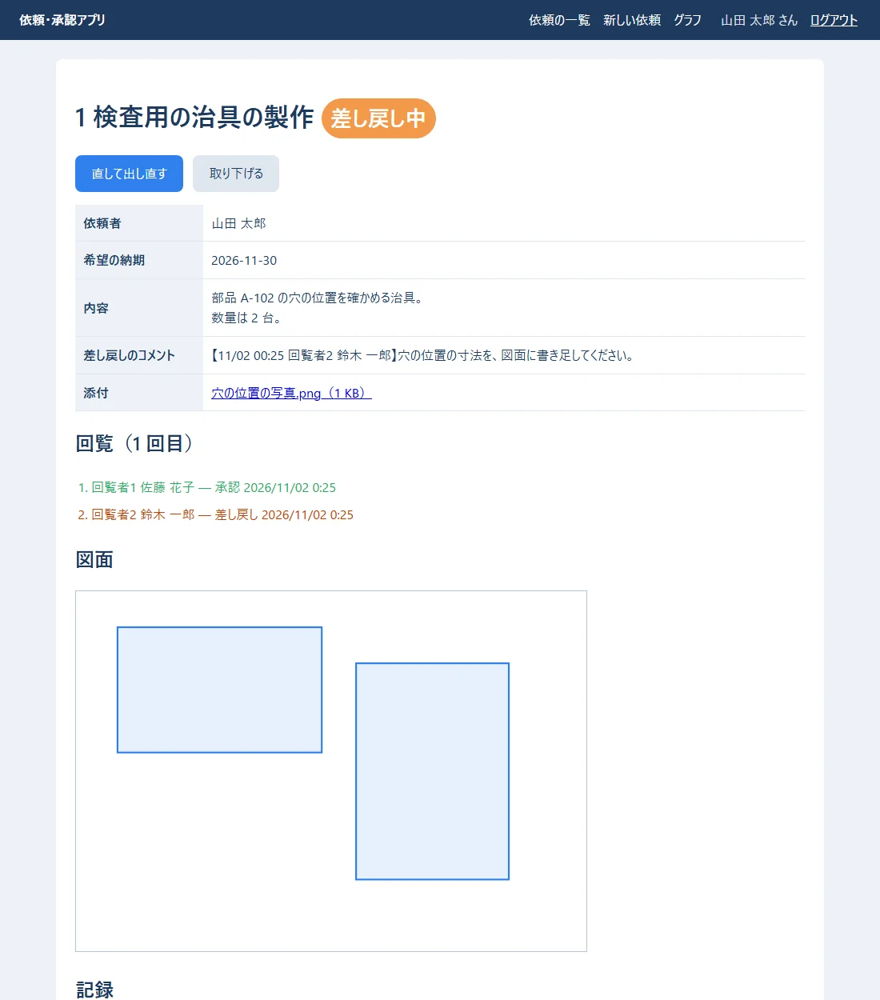
<div style="font-size: 12px; color: #64748b; margin-top: 6px;">図6-1: 差し戻し中。コメントと、だれが差し戻したかが出る</div>
</div>

<div style="max-width: 760px; margin: 18px auto; text-align: center;">
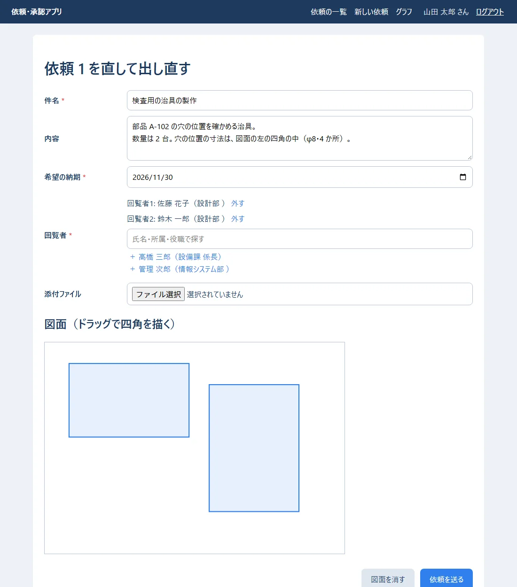
<div style="font-size: 12px; color: #64748b; margin-top: 6px;">図6-2: 「直して出し直す」。前の内容が入った入力の画面になる</div>
</div>

<div style="max-width: 760px; margin: 18px auto; text-align: center;">
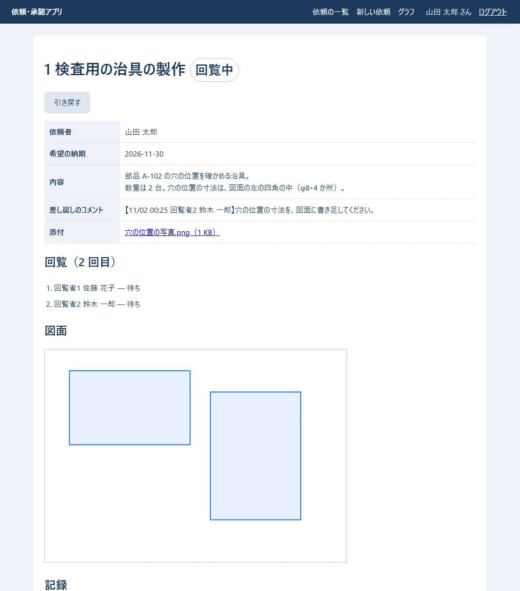
<div style="font-size: 12px; color: #64748b; margin-top: 6px;">図6-3: 出し直すと、2 回目の回覧が、最初の人（佐藤さん）から始まる</div>
</div>

### 6.2 回覧完了 → 担当 → 完了

2 回目の回覧で 2 人が承認すると「回覧完了」になり、担当者（設備課の高橋さん）にメールが届きます。高橋さんがログインして「すべての依頼を見る」にすると:

<div style="max-width: 760px; margin: 18px auto; text-align: center;">
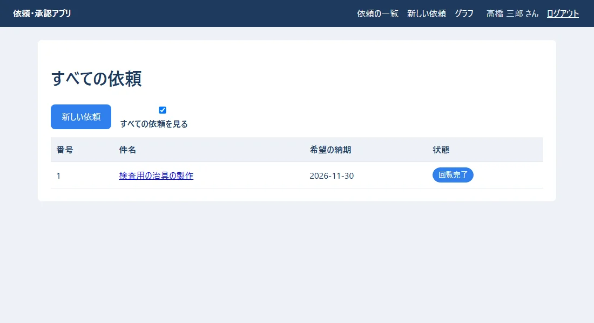
<div style="font-size: 12px; color: #64748b; margin-top: 6px;">図6-4: 担当者は、すべての依頼を見られる</div>
</div>

<div style="max-width: 760px; margin: 18px auto; text-align: center;">
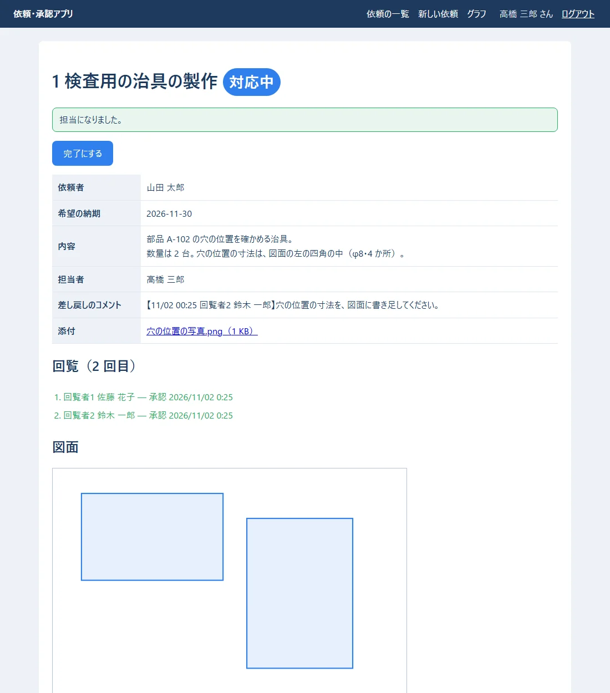
<div style="font-size: 12px; color: #64748b; margin-top: 6px;">図6-5: 「担当になる」を押すと、対応中になる</div>
</div>

<div style="max-width: 760px; margin: 18px auto; text-align: center;">
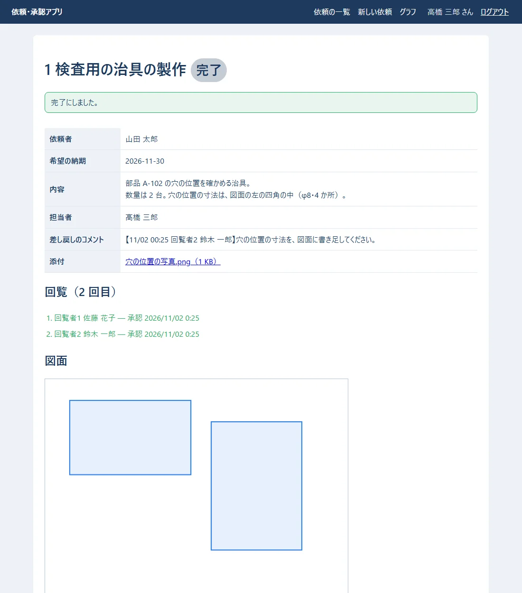
<div style="font-size: 12px; color: #64748b; margin-top: 6px;">図6-6: 引き渡したら「完了にする」。依頼者に完了のメールが届く</div>
</div>

## 7. グラフ（StatsPage）

`frontend/src/pages/StatsPage.tsx`:

```tsx
import { useEffect, useState } from "react";
import { api } from "../api.ts";

type Bar = { label: string; count: number };

/** 横向きの棒グラフ（部品を使わず、SVG で描く） */
function BarChart({ title, bars }: { title: string; bars: Bar[] }) {
  const max = Math.max(1, ...bars.map((b) => b.count));
  const rowH = 32;
  return (
    <figure className="chart">
      <figcaption>{title}</figcaption>
      <svg viewBox={`0 0 600 ${bars.length * rowH + 10}`} role="img" aria-label={title}>
        {bars.map((b, i) => (
          <g key={b.label} transform={`translate(0 ${i * rowH + 5})`}>
            <text x="110" y="18" textAnchor="end" className="axis">{b.label}</text>
            <rect x="120" y="4" height="20" rx="4" width={(b.count / max) * 420} className="bar" />
            <text x={128 + (b.count / max) * 420} y="19" className="value">{b.count} 件</text>
          </g>
        ))}
      </svg>
    </figure>
  );
}

export function StatsPage() {
  const [data, setData] = useState<{ byStatus: Bar[]; byAssignee: Bar[] } | null>(null);

  useEffect(() => {
    api.stats().then((s) =>
      setData({
        byStatus: s.by_status.map((x) => ({ label: x.status, count: x.count })),
        byAssignee: s.done_by_assignee.map((x) => ({ label: x.name, count: x.count })),
      }),
    );
  }, []);

  if (data === null) return <p>読み込み中…</p>;
  return (
    <section>
      <h1>グラフ</h1>
      <BarChart title="状態ごとの依頼の件数" bars={data.byStatus} />
      <BarChart title="担当者ごとの完了の件数" bars={data.byAssignee} />
    </section>
  );
}
```

<!-- first-use -->

> **▶ ここで初めて出てくるコード**
>
> - **`.stats()`**（練習アプリで作る物（TypeScript））: `api.ts` で作る関数の 1 つで、集計（状態ごとの数など）を問い合わせます。
> - **`<figure>`**（React）: 図と、その説明をひとまとめにするタグ。
> - **`<figcaption>`**（React）: `<figure>` の中の、図の説明のタグ。
> - **`<g>`**（React）: SVG の中で、図の部品をまとめるタグ（group）。まとめて動かしたり、色を付けたりできます。
> - **`<text>`**（HTML）: SVG（線や図形で描く絵）の中に、文字を書くタグ。`<text x="110" y="18" textAnchor="end">ラベル</text>` は、決めた位置に、右そろえで文字を書きます。
> - **`transform=`**（React）: SVG の `transform="translate(0 30)"` は、図形を動かす（ずらす）指定です。
> - **`textAnchor=`**（React）: SVG の `textAnchor="end"` は、文字を、置いた位置に右端をそろえて書く指定です（`middle` で真ん中）。
> - **`rx=`**（React）: SVG の `<rect rx="4">` の `rx` は、四角の角を丸くする大きさです。

<!-- /first-use -->

<div style="max-width: 760px; margin: 18px auto; text-align: center;">
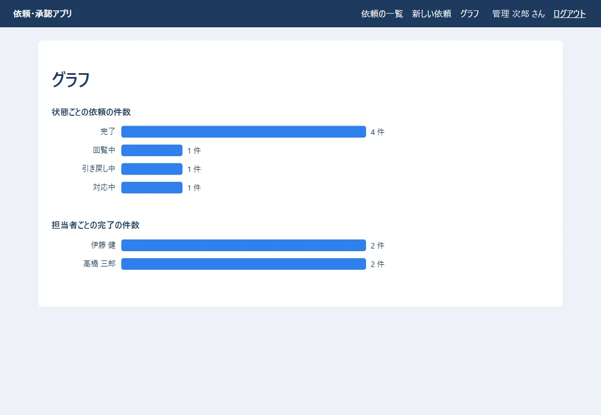
<div style="font-size: 12px; color: #64748b; margin-top: 6px;">図7-1: グラフの画面（練習のデータを足して撮った）</div>
</div>

<div style="max-width: 760px; margin: 18px auto; text-align: center;">
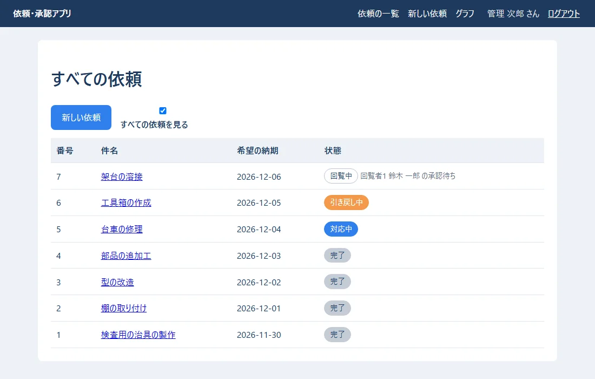
<div style="font-size: 12px; color: #64748b; margin-top: 6px;">図7-2: すべての依頼の一覧（状態の札の色が、01 の CSS のとおりに出ている）</div>
</div>

- グラフは、部品（ライブラリ）を使わず、**SVG の四角**で描いています。件数を、いちばん大きい数に対する割合で、棒の長さにしています。
- 数え方（集計）は、サーバーの `/api/stats/` が SQL の `GROUP BY` で行います（05 の 6 章）。画面は描くだけです。
- 練習のデータは `backend\demo_more.py`（`.\dev.ps1 shell -c "import demo_more"`）で足しました。

## 8. 会社のサーバーに持ち込む

<div style="max-width: 760px; margin: 18px auto; text-align: center;">
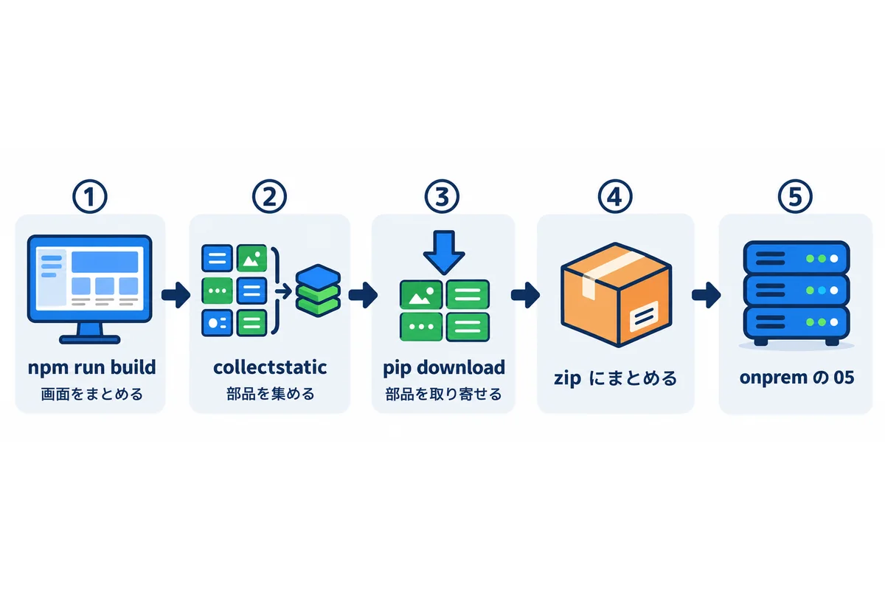
<div style="font-size: 12px; color: #64748b; margin-top: 6px;">図8-1: 作ったアプリを、会社のサーバーに持ち込むまで</div>
</div>

ここから先は、**onprem の 05 のとおり**です。この練習アプリのフォルダの名前に合わせると、次のようになります。

| 手順 | onprem の 05 | この練習アプリでは |
|---|---|---|
| React をビルドする | 7.1 の ① | `frontend\` で `npm run build` |
| 部品を集める | 7.1 の ② | `backend\` で `.\dev.ps1 collectstatic --noinput` |
| Python の部品を取り寄せる | 7.2 | `backend\requirements.txt` から、`--platform win_amd64 --python-version 3.14` で |
| zip にまとめる | 7.3 | `backend\` の中身（`.venv`・`dev.env`・`media`・`sent_mail` は入れない）＋ wheelhouse |
| サーバーに置き、サービスにする | 9 章 | WinSW の XML の環境変数は、前編の 3 章の表のとおり |
| テーブルを作る | 9.5 | `.\manage.ps1 migrate` |
| 社員を取り込む | — | `.\manage.ps1 import_employees 社員.csv`（前編の 9 章） |
| 毎朝の通知 | 12.1 | タスク スケジューラに `manage.ps1 send_daily_reminders` |

> **`seed_demo`・`demo_flow.py`・`demo_more.py` は、開発用のパソコンだけで使います。** `seed_demo` は、`DEBUG` が `true` でないと動かない作りにしてあります。

## 9. よくある失敗

| 症状 | 原因 | 直し方 |
|---|---|---|
| 開発中、画面は出るが、API が 404 か HTML を返す | Django の開発用のサーバーを動かしていない／`proxy` の設定が無い | 窓 1 で `.\dev.ps1 runserver`。`vite.config.ts` の `proxy` |
| ログインで 403 | CSRF の札が無い（`/api/csrf/` を呼ぶ前に送った） | App の最初に `api.csrf()` を呼ぶ |
| ビルドした後、画面が真っ白 | `base: "/static/"` が無い／`collectstatic` をしていない | 1.2・onprem の 05 の 15 章 |
| ビルドした後、画面が古いまま | `npm run build` の後に `collectstatic` をしていない | `.\dev_serve.ps1`（中で `collectstatic` する）か、手で `collectstatic` |
| `TemplateDoesNotExist: index.html` | ビルドしていない（`frontend_dist` が無い） | `npm run build` |
| 回覧者の検索が出ない | ログインしていない・検索の文字に合う人がいない | 空のまま待つと、全員から 5 人が出る |
| 添付で「ファイルの中身が、拡張子と合いません」 | 名前だけ変えたファイル | 前編の 7 章 |
| 詳細で、押したはずのボタンが「できません」 | ほかの人が先に状態を変えた（引き戻した、など） | 画面を読み直す。決めるのはサーバー |
| 60 分たっていないのにログインの画面に戻る | ブラウザのクッキーを消した・`SECRET_KEY` を変えた（セッションはデータベースにあるので、サーバーの再起動だけでは切れない） | `SECRET_KEY` は、漏れたとき以外は変えない（変えると全員のログインが切れる） |

## 10. 練習問題

1. 一覧に「状態でしぼる」選ぶ欄を足してください（03 の練習問題 2 と同じ考え方。データはサーバーから来た物を使う）。
2. 詳細の画面の「記録」に、日付の新しい順・古い順を切りかえるボタンを足してください。
3. グラフに「月ごとの依頼の件数」を足してください（ヒント：サーバーの `stats` で `TruncMonth("created_at")` を使って数える）。
4. 依頼の入力で、図面の四角を「最後の 1 つを消す」ボタンを足してください（03 の練習問題 4）。

## 用語の索引

| 用語 | 短い説明 | 章 |
|---|---|---|
| proxy（Vite） | 開発中に、API のお願いを Django へ回す設定 | 1 |
| dev_serve.ps1 | 会社のサーバーと同じ形（waitress）で手元で動かす道具 | 1.2 |
| api.ts | サーバーとの窓口を集めたファイル | 3 |
| ApiError | API が断ったときのエラー | 3 |
| ensure_csrf_cookie | CSRF の札をクッキーで渡す仕組み | 3 |
| re_path（すべての URL） | API など以外は React の画面を返す | 3 |
| ApproverPicker | 回覧者を探して選ぶ部品 | 5 |
| SVG の棒グラフ | 部品を使わずに描いたグラフ | 7 |
