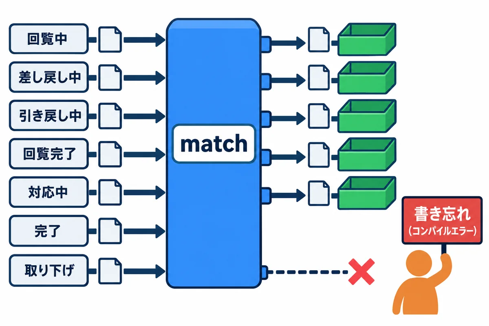
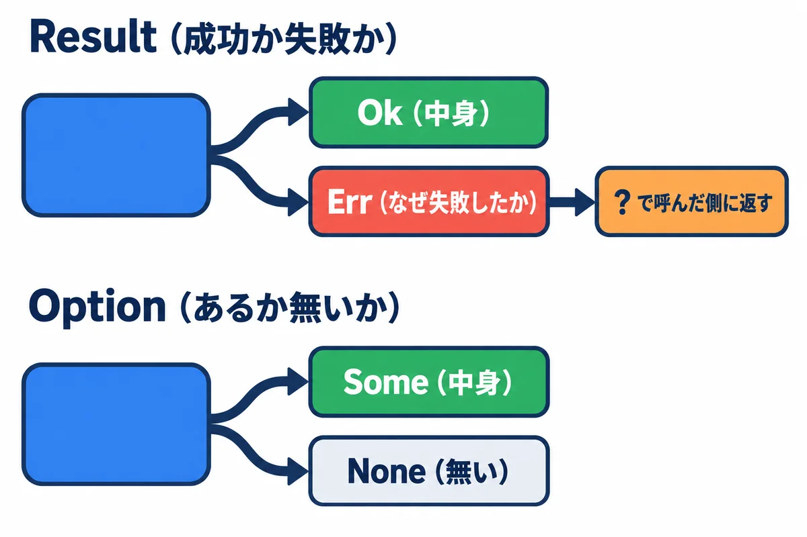
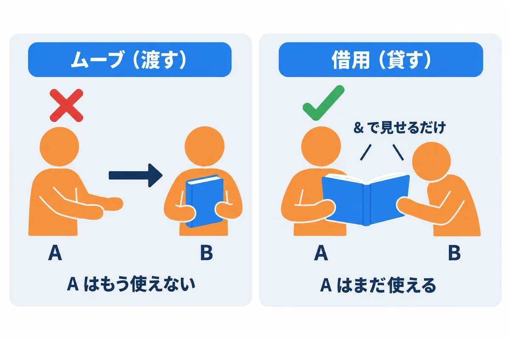
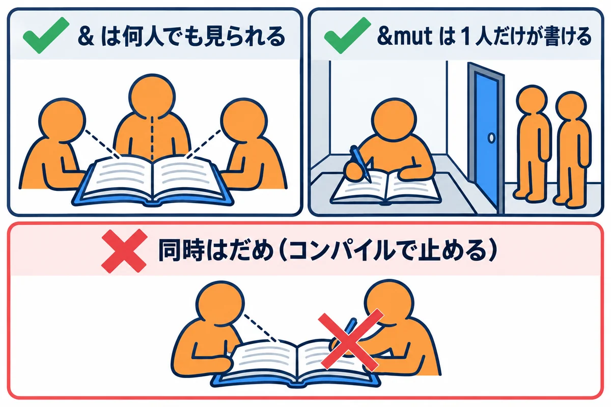
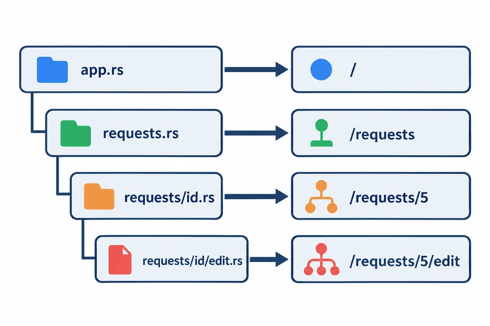
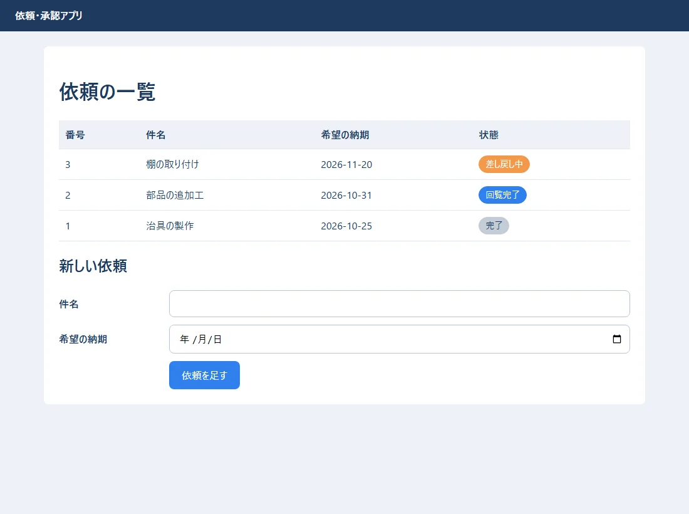
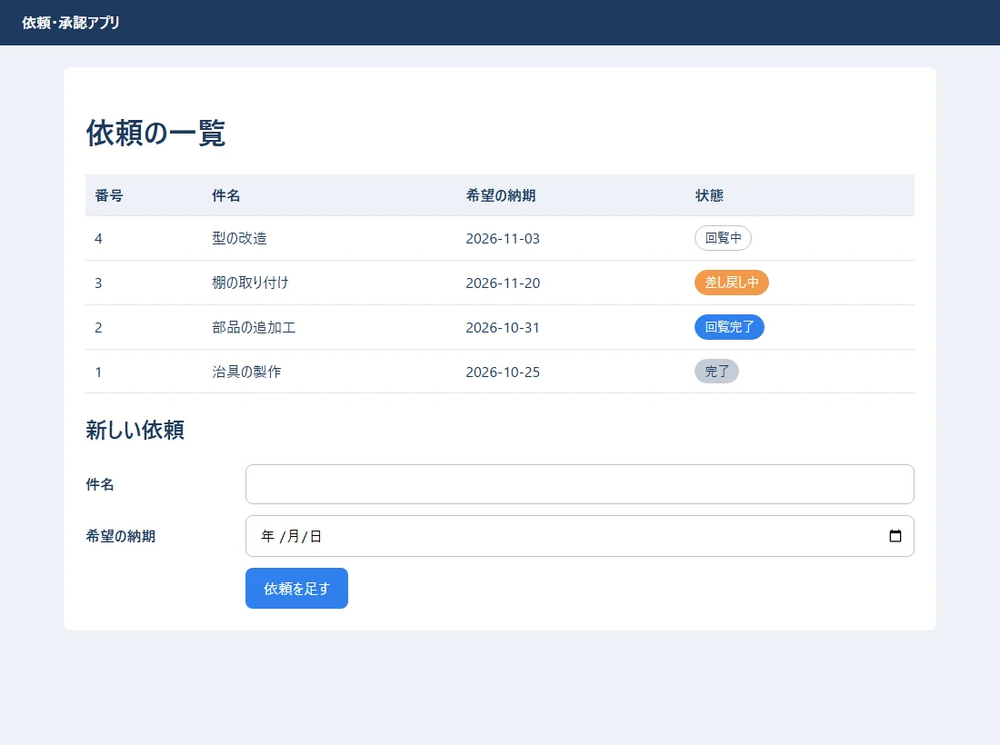
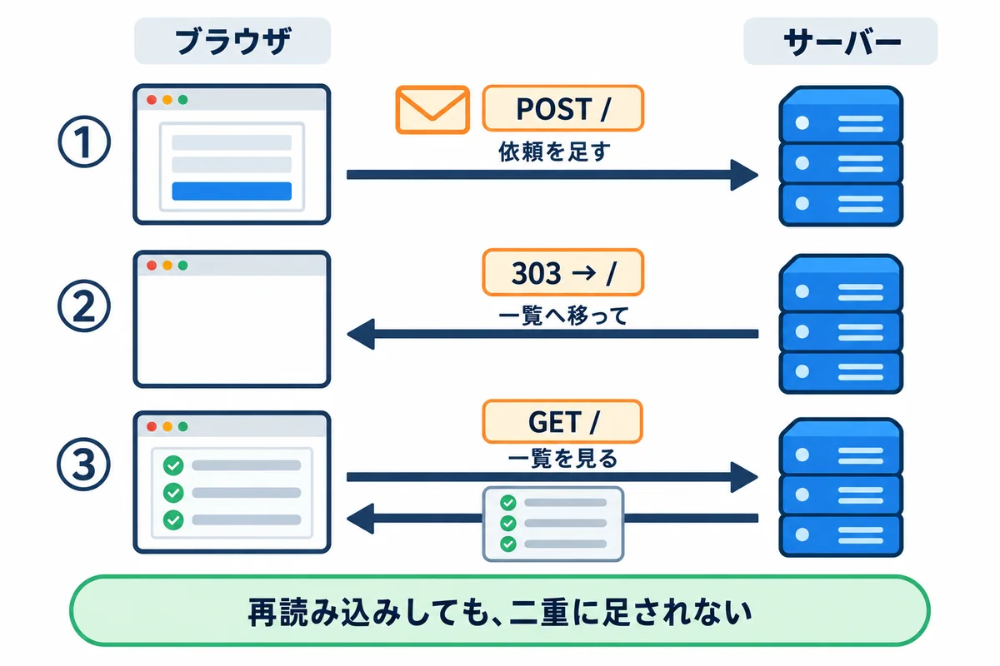
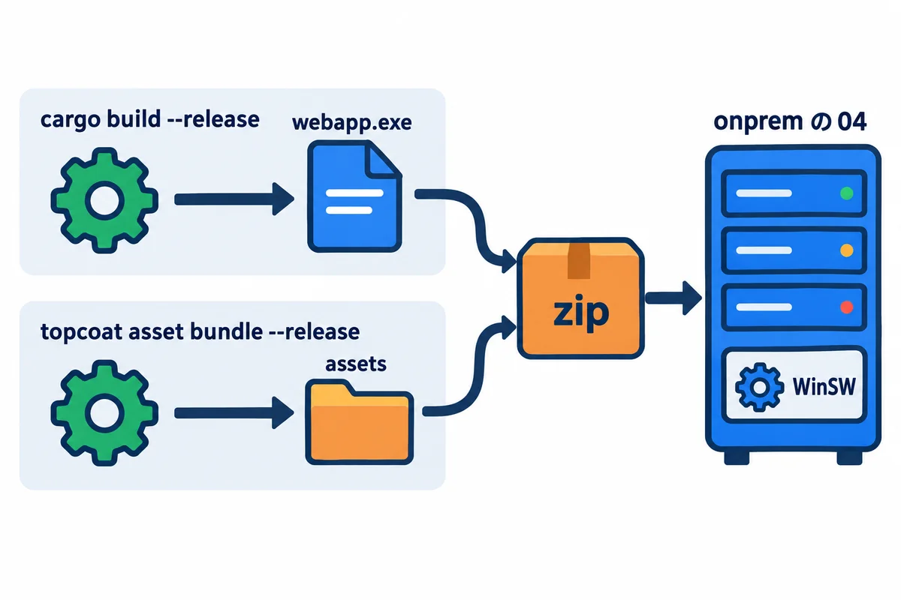

<div style="text-align: center; padding: 28px 0 8px;">
<div style="font-size: 14px; color: #475569;">Web アプリ開発 学習資料</div>
<div style="font-size: 26px; font-weight: 800; color: #0f172a; margin-top: 6px; line-height: 1.35;">07 Rust と Topcoat の基礎 — 速くて間違いに強いサーバー</div>
<div style="font-size: 13px; color: #475569; margin-top: 8px;">依頼の状態を Rust の enum で書き、Topcoat で依頼の一覧と入力の画面を作る</div>
</div>

# 07 Rust と Topcoat の基礎: 速くて間違いに強いサーバー

## この巻について

もう 1 つの作り方、**Rust＋Topcoat** の入口です。Rust はとても奥が深いので、この巻では、練習アプリ（08）を読むのに要る所だけを、これまでの巻（TypeScript・Python）と比べながら説明します。

- **もっと詳しく:** `Rust/` に、Rust と Topcoat を、ゼロから完成まで学ぶ全 14 巻があります。この巻の各章の終わりに、対応する巻を書いています。
- **建てる先:** Rust＋Topcoat のアプリは、onprem の 04 のとおり、**実行ファイル 1 つ**にして、会社の Windows Server に WinSW で建てます。
- 練習のコードは `samples/07_rust_topcoat/` にあります。結果とエラーの文は、**Rust 1.99.1・Topcoat 0.11.0 で実際に動かした物**です。

| 練習のフォルダ | 中身 |
|---|---|
| `status/` | 依頼の状態を Rust で書いた物（`cargo run`・`cargo test`） |
| `mistake/` | わざと間違えた例（`cargo build` で、エラーの文を見る） |
| `hello/` | いちばん小さな Topcoat のアプリ（依頼の一覧と入力） |

## 1. 準備

開発用のパソコン（Windows）に、Rust と Topcoat の道具を入れます（この資料集では、会社のサーバーに合わせて **Windows のまま**作ります）。

**▶ 準備:** 00 の 6.6 のとおり、**Rust/00 の「はじめに: 手を動かす準備」の P-1〜P-4** で、Build Tools と Rust を入れておきます。そのあと、PowerShell（どのフォルダにいてもよい）で、下の 4 行を 1 行ずつ打ちます。`cargo install` は、Topcoat の道具をダウンロードして作るので、数分かかります。くわしい説明（版の選び方など）は Rust/01 にあります。

```powershell
rustc --version          # rustc 1.99.1
cargo --version          # cargo 1.99.1
cargo install topcoat-cli --version 0.11.0 --locked
topcoat --version        # topcoat 0.11.0
```

| 道具 | 役目 | Python・Node.js では |
|---|---|---|
| `rustc` | Rust のコンパイラ（プログラムを実行ファイルに変える） | （無い。Python はそのまま動かす） |
| `cargo` | 部品の管理・ビルド・テスト・実行 | `pip`・`npm` に近い |
| `Cargo.toml` | 使う部品と版を書くファイル | `requirements.txt`・`package.json` |
| `topcoat` | Topcoat の道具（新しいアプリを作る・画面の部品を束ねる・開発用のサーバー） | `django-admin`・`vite` に近い |

> **用語:** コンパイル（プログラムを、パソコンがそのまま動かせる形（実行ファイル）に変えること。Rust は、このときに多くの間違いを見つける）

## 2. 依頼の状態を enum で書く

`status/src/lib.rs`:

```rust
//! 依頼の状態と、状態の移り変わり（02 の status.ts・04 の status.py を Rust で書いた物）

use std::fmt;

/// 依頼の状態。この 7 つ以外は作れない
#[derive(Debug, Clone, Copy, PartialEq, Eq)]
pub enum Status {
    Circulating,
    Returned,
    PulledBack,
    Approved,
    InProgress,
    Done,
    Withdrawn,
}

impl Status {
    /// 画面に出す名前
    pub fn label(self) -> &'static str {
        match self {
            Status::Circulating => "回覧中",
            Status::Returned => "差し戻し中",
            Status::PulledBack => "引き戻し中",
            Status::Approved => "回覧完了",
            Status::InProgress => "対応中",
            Status::Done => "完了",
            Status::Withdrawn => "取り下げ",
        }
    }
}

/// 状態を変える操作
#[derive(Debug, Clone, Copy, PartialEq, Eq)]
pub enum Action {
    ApproveAll,
    Return,
    PullBack,
    Resubmit,
    Withdraw,
    Assign,
    HandOver,
}

/// できない操作をしようとしたときのエラー
#[derive(Debug, PartialEq, Eq)]
pub struct TransitionError {
    pub status: Status,
    pub action: Action,
}

impl fmt::Display for TransitionError {
    fn fmt(&self, f: &mut fmt::Formatter<'_>) -> fmt::Result {
        write!(f, "「{}」の依頼に {:?} はできません", self.status.label(), self.action)
    }
}

impl std::error::Error for TransitionError {}

/// 今の状態と操作から、次の状態を返す。できない操作なら Err
pub fn next_status(current: Status, action: Action) -> Result<Status, TransitionError> {
    use Action::*;
    use Status::*;
    match (current, action) {
        (Circulating, ApproveAll) => Ok(Approved),
        (Circulating, Return) => Ok(Returned),
        (Circulating, PullBack) => Ok(PulledBack),
        (Returned | PulledBack, Resubmit) => Ok(Circulating),
        (Returned | PulledBack, Withdraw) => Ok(Withdrawn),
        (Approved, Assign) => Ok(InProgress),
        (InProgress, HandOver) => Ok(Done),
        _ => Err(TransitionError { status: current, action }),
    }
}

/// 依頼 1 件
#[derive(Debug)]
pub struct Request {
    pub id: u32,
    pub title: String,
    pub status: Status,
    pub comments: Vec<String>,
}

impl Request {
    pub fn new(id: u32, title: &str) -> Request {
        Request { id, title: title.to_string(), status: Status::Circulating, comments: Vec::new() }
    }

    /// 操作をして、状態を進める。できなければ、状態は変えずに Err を返す
    pub fn apply(&mut self, action: Action) -> Result<(), TransitionError> {
        self.status = next_status(self.status, action)?; // ? は「Err ならここで返す」
        Ok(())
    }
}

#[cfg(test)]
mod tests {
    use super::*;

    #[test]
    fn 差し戻してから出し直すと回覧中に戻る() {
        let mut r = Request::new(1, "治具の製作");
        r.apply(Action::Return).unwrap();
        assert_eq!(r.status, Status::Returned);
        r.apply(Action::Resubmit).unwrap();
        assert_eq!(r.status, Status::Circulating);
    }

    #[test]
    fn 完了した依頼は差し戻せない() {
        let err = next_status(Status::Done, Action::Return).unwrap_err();
        assert_eq!(err.to_string(), "「完了」の依頼に Return はできません");
    }

    #[test]
    fn できない操作では状態が変わらない() {
        let mut r = Request::new(2, "部品の追加工");
        assert!(r.apply(Action::HandOver).is_err());
        assert_eq!(r.status, Status::Circulating);
    }
}
```

<div style="max-width: 760px; margin: 18px auto; text-align: center;">

<div style="font-size: 12px; color: #64748b; margin-top: 6px;">図2-1: match は、全部の場合を書かないとコンパイルできない</div>
</div>

| 書き方 | 意味 | TypeScript（02）・Python（04）では |
|---|---|---|
| `enum Status { Circulating, … }` | 決まった値だけの型 | ユニオン型・`StrEnum` |
| `match (current, action) { … }` | 値の組み合わせで分ける。**全部の場合を書かないと、コンパイルエラー** | `switch` と `never`・辞書の表 |
| `(Returned \| PulledBack, Resubmit)` | 2 つのどちらでも | `case` を並べる |
| `_ =>` | それ以外、全部 | `default` |
| `Result<Status, TransitionError>` | 成功（`Ok`）か失敗（`Err`）か | 例外（`raise`・`throw`） |
| `#[derive(Debug, Clone, Copy, PartialEq, Eq)]` | 表示・複製・比べるなどの決まった機能を、自動で付ける | `@dataclass` に近い |
| `impl Status { fn label(self) … }` | その型の関数（メソッド） | クラスのメソッド |
| `#[cfg(test)] mod tests` | テスト。`cargo test` で動く | `tests.py` |

`cargo test` の結果（実際の出力の一部）:

```text
test tests::できない操作では状態が変わらない ... ok
test tests::完了した依頼は差し戻せない ... ok
test tests::差し戻してから出し直すと回覧中に戻る ... ok
test result: ok. 3 passed; 0 failed; 0 ignored; 0 measured; 0 filtered out; finished in 0.00s
```

> **もっと詳しく:** `Rust/02_Rust基礎_値_型_制御_データ構造.md`、`Rust/04_Rust設計_型_trait_エラー_Cargo_テスト.md`

## 3. Result と Option

<div style="max-width: 760px; margin: 18px auto; text-align: center;">

<div style="font-size: 12px; color: #64748b; margin-top: 6px;">図3-1: Result は成功か失敗か、Option はあるか無いか</div>
</div>

Rust には、例外（`raise`・`throw`）がありません。失敗するかもしれない関数は **`Result`** を返し、無いかもしれない値は **`Option`** で表します。**呼んだ側が、失敗と「無い」を必ず扱う**ように、型が強制します。

| 書き方 | 意味 |
|---|---|
| `Ok(値)`・`Err(エラー)` | 成功・失敗 |
| `Some(値)`・`None` | ある・無い |
| `next_status(...)?` | `Err` なら、ここで呼んだ側へ返す（`?` 演算子） |
| `match r { Ok(..) => …, Err(e) => … }` | 成功と失敗で分ける |
| `if let Some(r) = find(...) { … }` | あるときだけ使う |
| `.unwrap()` | 失敗なら**プログラムを止める**。テストや「絶対に失敗しない」所だけで使う |

## 4. 所有権と借用

<div style="max-width: 760px; margin: 18px auto; text-align: center;">

<div style="font-size: 12px; color: #64748b; margin-top: 6px;">図4-1: 値には持ち主が 1 人だけ。渡す（ムーブ）か、貸す（借用）か</div>
</div>

<div style="max-width: 760px; margin: 18px auto; text-align: center;">

<div style="font-size: 12px; color: #64748b; margin-top: 6px;">図4-2: 見るだけなら何人でも、書きかえるなら 1 人だけ</div>
</div>

Rust のいちばんの特徴が、**所有権**です。値には、いつも持ち主（変数）が 1 つだけあります。この決まりのおかげで、**メモリーの間違いや、同時に書きかえる事故を、コンパイルのときに止められます**。

`status/src/main.rs`:

```rust
//! Rust の基本の練習: 所有権・借用・Option・Result・イテレーター
use status::{Action, Request, Status};

/// 借用（&）: 中身を見るだけ。持ち主は変わらない
fn print_request(r: &Request) {
    println!("{} {}（{}）", r.id, r.title, r.status.label());
}

/// 見つからないかもしれないときは Option
fn find(list: &[Request], id: u32) -> Option<&Request> {
    list.iter().find(|r| r.id == id)
}

fn main() {
    let mut list = vec![Request::new(1, "治具の製作"), Request::new(2, "部品の追加工"), Request::new(3, "棚の取り付け")];

    // 1. 借用して表示する（list は、このあとも使える）
    for r in &list {
        print_request(r);
    }

    // 2. 書きかえるときは &mut（同時に 1 か所だけ）
    list[0].apply(Action::Return).unwrap();
    list[0].comments.push("【11/02 09:00 回覧者1 佐藤】寸法を追記してください".to_string());
    list[1].apply(Action::ApproveAll).unwrap();

    // 3. Result: できない操作は Err で返ってくるので、match で分ける
    match list[2].apply(Action::HandOver) {
        Ok(()) => println!("引き渡しました"),
        Err(e) => println!("エラー: {e}"),
    }

    // 4. Option: 見つかったときだけ使う
    if let Some(r) = find(&list, 1) {
        println!("1 番のコメント: {:?}", r.comments);
    }
    println!("99 番はあるか: {}", find(&list, 99).is_some());

    // 5. イテレーター（TypeScript の filter・map と同じ考え方）
    let circulating: Vec<&str> =
        list.iter().filter(|r| r.status == Status::Circulating).map(|r| r.title.as_str()).collect();
    println!("回覧中: {circulating:?}");

    // 6. 所有権の移動（ムーブ）: title を別の変数に渡すと、元の変数は使えなくなる
    let title = String::from("型の改造");
    let moved = title; // ここで持ち主が moved に移る
    // println!("{title}"); // ← これはコンパイルエラーになる（所有権が移ったため）
    println!("移った先: {moved}");
}
```

動かした結果（`cargo run`）:

```text
1 治具の製作（回覧中）
2 部品の追加工（回覧中）
3 棚の取り付け（回覧中）
エラー: 「回覧中」の依頼に HandOver はできません
1 番のコメント: ["【11/02 09:00 回覧者1 佐藤】寸法を追記してください"]
99 番はあるか: false
回覧中: ["棚の取り付け"]
移った先: 型の改造
```

**わざと間違えると:** `mistake/src/main.rs` には、2 つの間違いを入れてあります。

```rust
// わざと間違えた例（2 つ）。cargo build で、コンパイラがどう教えてくれるかを見る

#[derive(Clone, Copy)]
enum Status {
    Circulating,
    Returned,
    Done,
}

fn label(s: Status) -> &'static str {
    match s {
        Status::Circulating => "回覧中",
        Status::Returned => "差し戻し中",
        // 間違い 1: Status::Done の場合を書き忘れた
    }
}

fn main() {
    let title = String::from("型の改造");
    let moved = title;
    println!("{title}"); // 間違い 2: 所有権が moved に移った後で、title を使った
    println!("{moved} {}", label(Status::Done));
}
```

`cargo build` の結果（実際の出力）:

```text
error[E0004]: non-exhaustive patterns: `Status::Done` not covered
  --> src\main.rs:11:11
   |
11 |     match s {
   |           ^ pattern `Status::Done` not covered
   |
note: `Status` defined here
  --> src\main.rs:4:6
   |
 4 | enum Status {
   |      ^^^^^^
...
 7 |     Done,
   |     ---- not covered
   = note: the matched value is of type `Status`
help: ensure that all possible cases are being handled by adding a match arm with a wildcard pattern or an explicit pattern as shown
   |
13 ~         Status::Returned => "差し戻し中",
14 ~         Status::Done => todo!(),
   |

error[E0382]: borrow of moved value: `title`
  --> src\main.rs:21:16
   |
19 |     let title = String::from("型の改造");
   |         ----- move occurs because `title` has type `String`, which does not implement the `Copy` trait
20 |     let moved = title;
   |                 ----- value moved here
21 |     println!("{title}"); // 間違い 2: 所有権が moved に移った後で、title を使った
   |                ^^^^^ value borrowed here after move
   |
help: consider cloning the value if the performance cost is acceptable
   |
20 |     let moved = title.clone();
   |                      ++++++++

Some errors have detailed explanations: E0004, E0382.
For more information about an error, try `rustc --explain E0004`.
error: could not compile `mistake` (bin "mistake") due to 2 previous errors
```

- 1 つ目（`E0004`）は、`match` で `Status::Done` の場合を書き忘れた、という意味です。状態を足したときの書き忘れを、**動かす前に**見つけてくれます（02 の `never` と同じ働き）。
- 2 つ目（`E0382`）は、`title` の持ち主が `moved` に移った（ムーブした）後で、`title` を使った、という意味です。
- どちらも、`help:` に**直し方の案**が出ています。Rust のエラーの文は長いですが、`error[…]:` の行、`-->` のファイルと行、`help:` の 3 か所を読めば、たいてい分かります。

> **もっと詳しく:** `Rust/03_Rust中核_所有権_借用_ライフタイム_スマートポインタ.md`

## 5. Topcoat の最小のアプリ

<div style="max-width: 760px; margin: 18px auto; text-align: center;">

<div style="font-size: 12px; color: #64748b; margin-top: 6px;">図5-1: Topcoat では、ファイル（モジュール）の並びが URL の並びになる</div>
</div>

**Topcoat** は、Rust の Web フレームワークです。Django と違い、**サーバーで HTML を作って返す**作りが中心です（03 の 7 章の「サーバーで画面を作る」）。

```powershell
cd webapp_learning\samples\07_rust_topcoat
topcoat new hello --minimal       # いちばん小さなアプリを作る（練習のフォルダには、作って直した物がある）
cd hello
topcoat dev                        # 開発用のサーバー（直すと自動で作り直して、画面を読み直す）
```

`hello/Cargo.toml`:

```toml
[package]
name = "hello"
version = "0.1.0"
edition = "2024"

# 版は = で固定する（Rust/ の巻と同じ考え方）
[dependencies]
serde = { version = "=1.0.229", features = ["derive"] }
tokio = { version = "=1.54.1", features = ["macros", "rt-multi-thread"] }
topcoat = { version = "=0.11.0", default-features = false, features = ["asset", "discover", "router", "serve", "view"] }

[profile.dev]
debug = "line-tables-only"

[profile.dev.package."*"]
debug = false
```

`hello/src/app.rs`（画面）:

```rust
//! いちばん小さな依頼・承認アプリ（Topcoat 0.11）。データはメモリーに持つ（再起動で消える）
//!
//! | 関数 | URL |
//! |---|---|
//! | `home`   | GET /  … 依頼の一覧と、入力フォーム |
//! | `create` | POST / … 依頼を足して、303 で GET / へ（PRG） |

use std::sync::Mutex;

use serde::Deserialize;
use topcoat::{
    Result,
    asset::{AssetBundle, RouterBuilderAssetExt, asset},
    context::{Cx, app_context},
    router::{Router, Slot, content::Form, error::see_other, href, layout, module_router, page},
    view::{View, view},
};

use crate::features::{Request, Store};

/// ルーターを組み立てる。モジュールの並びが、そのまま URL の並びになる
pub fn router() -> Router {
    module_router!()
        .assets(AssetBundle::load().unwrap())
        .app_context(Mutex::new(Store::sample())) // どのページからも使える、共有のデータ
        .build()
}

fn store(cx: &Cx) -> &Mutex<Store> {
    app_context::<Mutex<Store>>(cx)
}

#[layout]
async fn root(slot: Slot<'_>) -> Result<impl View> {
    Ok(view! {
        <!DOCTYPE html>
        <html lang="ja">
            <head>
                <meta charset="utf-8">
                <meta name="viewport" content="width=device-width, initial-scale=1">
                <title>"依頼・承認アプリ（Topcoat の練習）"</title>
                <link rel="stylesheet" href=(asset!("styles.css"))>
                topcoat::dev::script()
            </head>
            <body>
                <header class="site-header"><strong>"依頼・承認アプリ"</strong></header>
                <main>(slot)</main>
            </body>
        </html>
    })
}

/// フォームから送られてくる値（input の name と同じ名前）
#[derive(Deserialize)]
pub struct NewRequestForm {
    title: String,
    due_date: String,
}

#[page]
async fn home(cx: &Cx) -> Result<impl View> {
    // ロックしている間に、表示に要る物だけ写し取る（ロックを長く持たない）
    let rows: Vec<Request> = store(cx).lock().unwrap().requests.clone();
    Ok(view! {
        <h1>"依頼の一覧"</h1>
        <table>
            <thead><tr><th>"番号"</th><th>"件名"</th><th>"希望の納期"</th><th>"状態"</th></tr></thead>
            <tbody>
                for r in rows {
                    <tr>
                        <td>(r.id)</td>
                        <td>(r.title)</td>
                        <td>(r.due_date)</td>
                        <td><span class=(format!("badge {}", r.status.css_class()))>(r.status.label())</span></td>
                    </tr>
                }
            </tbody>
        </table>

        <h2>"新しい依頼"</h2>
        <form method="post" action=(href!(create)) class="form-grid">
            <label for="title">"件名"</label>
            <input id="title" name="title" required="" maxlength="100">
            <label for="due">"希望の納期"</label>
            <input id="due" name="due_date" type="date" required="">
            <span></span>
            <div><button type="submit" class="btn-primary">"依頼を足す"</button></div>
        </form>
    })
}

#[page(POST)]
async fn create(cx: &Cx, Form(input): Form<NewRequestForm>) -> Result<impl View> {
    let title = input.title.trim();
    if !title.is_empty() {
        store(cx).lock().unwrap().add(title, &input.due_date);
    }
    // PRG: 足したら 303 で一覧（GET）へ。再読み込みで二重に足されない
    Err::<(), _>(see_other(href!(home).resolve(cx)).into())
}
```

`hello/src/features.rs`（データと決まり）:

```rust
//! アプリの「中身」（データと決まり）。画面（app.rs）からは、ここの関数を使う

/// 依頼の状態（status クレートと同じ考え方。ここでは使う所だけ）
#[derive(Debug, Clone, Copy, PartialEq, Eq)]
pub enum Status {
    Circulating,
    Returned,
    Approved,
    Done,
}

impl Status {
    pub fn label(self) -> &'static str {
        match self {
            Status::Circulating => "回覧中",
            Status::Returned => "差し戻し中",
            Status::Approved => "回覧完了",
            Status::Done => "完了",
        }
    }

    /// 01 の CSS の札の class
    pub fn css_class(self) -> &'static str {
        match self {
            Status::Circulating => "badge-circulating",
            Status::Returned => "badge-returned",
            Status::Approved => "badge-approved",
            Status::Done => "badge-done",
        }
    }
}

#[derive(Debug, Clone)]
pub struct Request {
    pub id: u32,
    pub title: String,
    pub due_date: String,
    pub status: Status,
}

/// 依頼の置き場（練習なのでメモリーに持つ。08 では PostgreSQL に置く）
pub struct Store {
    pub requests: Vec<Request>,
}

impl Store {
    pub fn sample() -> Store {
        let row = |id, title: &str, due: &str, status| Request { id, title: title.into(), due_date: due.into(), status };
        Store {
            requests: vec![
                row(3, "棚の取り付け", "2026-11-20", Status::Returned),
                row(2, "部品の追加工", "2026-10-31", Status::Approved),
                row(1, "治具の製作", "2026-10-25", Status::Done),
            ],
        }
    }

    pub fn add(&mut self, title: &str, due_date: &str) {
        let id = self.requests.iter().map(|r| r.id).max().unwrap_or(0) + 1;
        self.requests.insert(0, Request { id, title: title.to_string(), due_date: due_date.to_string(), status: Status::Circulating });
    }
}
```

| 書き方 | 意味 | Django（05）では |
|---|---|---|
| `module_router!()` | このモジュールと子のモジュールから、URL の表を自動で作る | `urls.py` |
| `#[layout]` | 全部のページを包む外枠（HTML の `<html>`・ヘッダー） | テンプレートの `base.html` |
| `#[page]`・`#[page(POST)]` | 1 つの URL の GET・POST を受ける関数 | ビュー |
| `view! { <h1>"…"</h1> }` | HTML を書く。文字は `"…"` で囲む。**`(値)` の中身は、自動で無害な形に変わる**（XSS を防ぐ。10） | テンプレートの `{{ }}` |
| `for r in rows { … }` | `view!` の中のくり返し | `` |
| `Form(input): Form<NewRequestForm>` | フォームの値を、構造体として受け取る（`#[derive(Deserialize)]`） | `request.POST` |
| `see_other(href!(home)…)` | 303 で別の URL へ（PRG） | `redirect` |
| `.app_context(…)`・`app_context::<T>(cx)` | アプリ全体で共有する物を登録する・取り出す | settings やモジュールの変数 |
| `Mutex` | 同時に書きかえないための鍵（4 章の `&mut` の決まりを、実行中に守る） | （Django は、データベースの鍵） |
| `required=""` | 中身の無い属性は、`=""` を付けて書く | `required` |

### 5.1 動かす

```powershell
topcoat asset bundle               # CSS などを束ねて、実行ファイルの隣（target\debug\assets）に置く
cargo run                          # http://127.0.0.1:3000/ で待ち受ける
```

<div style="max-width: 760px; margin: 18px auto; text-align: center;">

<div style="font-size: 12px; color: #64748b; margin-top: 6px;">図5-2: Topcoat で作った一覧（CSS は 01 と同じ物を使っている）</div>
</div>

件名に「型の改造」、納期に 2026-11-03 を入れて「依頼を足す」を押すと:

<div style="max-width: 760px; margin: 18px auto; text-align: center;">

<div style="font-size: 12px; color: #64748b; margin-top: 6px;">図5-3: 足した依頼が、一覧の先頭に出る</div>
</div>

### 5.2 PRG（送ったら、別の URL に移す）

<div style="max-width: 760px; margin: 18px auto; text-align: center;">

<div style="font-size: 12px; color: #64748b; margin-top: 6px;">図5-4: POST → 303 → GET（PRG）</div>
</div>

試した結果: `POST /` は `303`（行き先 `http://127.0.0.1:3000/`）を返し、ブラウザが `GET /` で一覧を読み直しました。POST の画面のまま再読み込みすると、同じ依頼がもう一度送られてしまうので、**送ったら必ず別の URL（GET）に移す**のが決まりです。

> **練習のアプリの限り:** データはメモリーに持っているので、アプリを止めると消えます。ログインもありません。08 で、PostgreSQL・ログイン・承認の回覧を足します。

> **もっと詳しく:** `Rust/06_Web基礎_HTTPとTopcoat_0_11完全ガイド.md`（UNIT 02〜06）、`Rust/rustnote/`（ログイン付きの完成したアプリ）

## 6. async と、会社のサーバーへの持ち込み

- `async fn` と `.await` は、02 の TypeScript と同じ考え方です。データベースやメールの返事を待つ間、ほかのお願いを処理できます。Rust では、**tokio** という部品が、その待ち合わせを受け持ちます（`#[tokio::main]`）。
- Topcoat のアプリは、`topcoat::start` が、環境変数 `HOST`・`PORT` の住所で待ち受けます（何も無いと `127.0.0.1:3000`）。会社のサーバーでは、WinSW の XML で `HOST=127.0.0.1`・`PORT=8080` にします（onprem の 04 の 7.3）。

<div style="max-width: 760px; margin: 18px auto; text-align: center;">

<div style="font-size: 12px; color: #64748b; margin-top: 6px;">図6-1: 実行ファイル 1 つと assets を、会社のサーバーへ（onprem の 04 の 6・7 章）</div>
</div>

```powershell
cargo build --release --locked          # 本番用の実行ファイル（target\release\webapp.exe）
topcoat asset bundle --release          # target\release\assets
```

> **もっと詳しく:** `Rust/05_Rustバックエンド_async_並行処理_ジョブ_運用.md`

## 7. よくある失敗

| 症状 | 原因 | 直し方 |
|---|---|---|
| `error[E0382]: borrow of moved value` | ムーブした後で使った | `&` で貸す・`.clone()` で写しを作る |
| `error[E0004]: non-exhaustive patterns` | `match` で書き忘れた場合がある | `help:` のとおり、足りない場合を書く |
| `error[E0502]: cannot borrow … as mutable because it is also borrowed as immutable` | 見ている途中で、書きかえようとした | 見るのを終えてから書きかえる（変数のスコープを分ける） |
| `called Result::unwrap() on an Err value` で止まる | `unwrap()` した所が失敗した | `?` か `match` で扱う |
| 起動してすぐ `AssetBundle::load` で止まる | `topcoat asset bundle` をしていない | 5.1 |
| `view!` で `expected =` | 中身の無い属性（`required`）を、そのまま書いた | `required=""` |
| 日本語が化けて保存される | フォームの文字の送り方の問題ではなく、試しの道具（コマンドの `curl` など）の文字コード | ブラウザから送って確かめる |
| ビルドがとても遅い | 最初のビルドは、部品を全部コンパイルする | 2 回目からは速い。`topcoat dev` を使う |

## 8. 練習問題

1. `status/src/lib.rs` の `Status` に「保留」（`OnHold`）を足し、`cargo build` で、どこがエラーになるか見てください。`label` と `next_status` を直して、`cargo test` が通るようにします。
2. `hello` の一覧に、「状態」の列で `回覧中` だけを出すボタン（`?status=circulating` の URL）を足してください（ヒント：RustNote の `query_params`）。
3. `hello` の入力に、「件名は 100 文字まで」をサーバーでも確かめる行を足してください（ヒント：`title.chars().count()`）。

## 用語の索引

| 用語 | 短い説明 | 章 |
|---|---|---|
| rustc・cargo・Cargo.toml | コンパイラ／部品とビルドの道具／その設定 | 1 |
| enum・match | 決まった値の型／全部の場合を分ける | 2 |
| Result・Option・? | 成功か失敗か／あるか無いか／失敗を返す | 3 |
| 所有権・ムーブ・借用（&・&mut） | 持ち主は 1 人／渡す／貸す（見る・書く） | 4 |
| Topcoat・module_router・layout・page・view! | Rust の Web の土台／URL の表／外枠／1 ページ／HTML を書く | 5 |
| PRG・303 | 送ったら GET に移す／その返事 | 5.2 |
| async・tokio | 待つことのある処理／その待ち合わせの部品 | 6 |
