<div style="text-align: center; padding: 28px 0 8px;">
<div style="font-size: 14px; color: #475569;">Web アプリ開発 学習資料</div>
<div style="font-size: 26px; font-weight: 800; color: #0f172a; margin-top: 6px; line-height: 1.35;">08 Topcoat で練習アプリを作る（後編）— 画面とサーバーへの持ち込み</div>
<div style="font-size: 13px; color: #475569; margin-top: 8px;">サーバーで HTML を作る画面・入力フォーム・図面・添付ファイル・HTTP の決まり・release ビルド</div>
</div>

# 08 Topcoat で練習アプリを作る（後編）: 画面とサーバーへの持ち込み

## この巻について

前編で作った「状態を変える処理」に、**画面**を付けます。06 後編では React がブラウザで画面を組み立てましたが、ここでは **Topcoat の `view!` で、サーバーが HTML を作って返します**。最後に、onprem の 04 のとおりにサーバーへ持ち込む物を作ります。

- 画面の見た目は、01 の `style.css` に、この巻で使う物を少し足した `styles.css` です（`samples/08_topcoat_app/webapp/styles.css`）。
- この巻の画面は、すべて 2026-11-02 に、練習のアプリを**実際に動かして撮った物**です（headless の Chrome で撮影）。`curl` の出力も、実際に動かした物です（ログインのトークンの所だけ伏せた）。

## 1. 画面の並び（app.rs）

07 で学んだとおり、Topcoat は**モジュールの並びが、そのまま URL の並び**になります。

| ファイル | URL | 中身 |
|---|---|---|
| `src/app.rs` | `/` | 依頼の一覧（と、全部の画面の外枠） |
| `src/app/login.rs` | `/login` | ログイン |
| `src/app/logout.rs` | `/logout` | ログアウト（POST だけ） |
| `src/app/requests/new.rs` | `/requests/new` | 新しい依頼 |
| `src/app/requests/id.rs` | `/requests/{id}`・`/requests/{id}/action` | 依頼の詳しい画面と、ボタンの操作 |
| `src/app/requests/id/edit.rs` | `/requests/{id}/edit` | 直して出し直す |
| `src/app/attachments/id.rs` | `/attachments/{id}` | 添付ファイルのダウンロード |
| `src/app/approve/token.rs` | `/approve/{token}` | 承認の画面（前編の 7 章） |
| `src/app/stats.rs` | `/stats` | 集計 |
| `src/app/health.rs` | `/health` | 動いているかの確かめ（監視用） |

`src/app.rs`:

```rust
//! 画面（ルーティング）。モジュールの並びが、そのまま URL の並びになる
//!
//! | ファイル | URL | 中身 |
//! |---|---|---|
//! | app.rs | `/` | 依頼の一覧（と、全部の画面の外枠） |
//! | app/login.rs | `/login` | ログイン |
//! | app/logout.rs | `/logout` | ログアウト（POST） |
//! | app/requests/new.rs | `/requests/new` | 新しい依頼 |
//! | app/requests/id.rs | `/requests/{id}` | 依頼の詳しい画面と、操作（`/requests/{id}/action`） |
//! | app/requests/id/edit.rs | `/requests/{id}/edit` | 直して出し直す |
//! | app/attachments/id.rs | `/attachments/{id}` | 添付ファイルのダウンロード |
//! | app/approve/token.rs | `/approve/{token}` | メールの URL から開く、承認の画面（ログイン不要） |
//! | app/stats.rs | `/stats` | 集計 |
//! | app/health.rs | `/health` | 動いているかの確かめ（監視用） |

mod approve;
pub mod attachments;
mod health;
pub mod login;
mod logout;
pub mod requests;
mod stats;

use topcoat::{
    Result,
    asset::{AssetBundle, RouterBuilderAssetExt, asset},
    context::Cx,
    cookie::RouterBuilderCookieExt,
    mail::{MailConfig, RouterBuilderMailExt},
    router::{BodyLimit, Router, Slot, StatusCode, error::NotFoundError, href, layout, module_router, page, query_params},
    session::RouterBuilderSessionExt,
    view::{View, error_boundary, view},
};

use crate::{
    auth::{self, current_user, require_user},
    models::fmt_date,
    queries,
    state::{AppState, state},
    views::status_badge,
};

/// ルーターを組み立てる
pub fn router(app_state: AppState, mail: MailConfig) -> Router {
    module_router!()
        .assets(AssetBundle::load().expect("assets フォルダがありません（先に topcoat asset bundle を動かす）"))
        .app_context(app_state) // どのページからも state(cx) で使える
        .mail(mail)
        .cookies()
        .sessions(auth::session_config())
        // 依頼の画面だけ、受け取る大きさの上限を 60MB にする（決まりは 2MB。添付 10MB×5＋図面 5MB が入るように）
        .layer(BodyLimit::max(60 * 1024 * 1024).at("/requests"))
        .build()
}

/// 全部の画面の外枠（ヘッダーとメニュー）
#[layout]
async fn root_layout(cx: &Cx, slot: Slot<'_>) -> Result<impl View> {
    let user = current_user(cx).await?.clone();
    Ok(view! {
        <!DOCTYPE html>
        <html lang="ja">
            <head>
                <meta charset="utf-8">
                <meta name="viewport" content="width=device-width, initial-scale=1">
                <title>"依頼・承認アプリ"</title>
                <link rel="stylesheet" href=(asset!("styles.css"))>
                topcoat::dev::script()
            </head>
            <body>
                <header class="site-header">
                    <strong>"依頼・承認アプリ"</strong>
                    if let Some(u) = &user {
                        <nav>
                            <a href=(href!(home))>"依頼の一覧"</a>
                            <a href=(href!(requests::new::new_page))>"新しい依頼"</a>
                            <a href=(href!(stats::stats_page))>"集計"</a>
                            <span>(&u.name) "（" (u.role.label()) "）"</span>
                            <form method="post" action=(href!(logout::logout))>
                                <button type="submit" class="link">"ログアウト"</button>
                            </form>
                        </nav>
                    }
                </header>
                <main>
                    // ページが「見つからない（404）」で終わったら、外枠の中に案内を出す。
                    // ほかのエラー（ログインの画面へ移す、など）は、そのまま外へ投げ直す
                    error_boundary(
                        fallback: |error| {
                            if error.downcast_ref::<NotFoundError>().is_none() {
                                return Err(error);
                            }
                            Ok(view! {
                                (StatusCode::NOT_FOUND)
                                <h1>"見つかりません"</h1>
                                <p>"依頼が無いか、見る権限がありません。" <a href="/">"依頼の一覧"</a> "へ戻ってください。"</p>
                            })
                        },
                        (slot)
                    )
                </main>
            </body>
        </html>
    })
}

/// 一覧の絞り込み（?mine=1 なら、自分が出した依頼だけ）
#[query_params]
struct ListQuery {
    mine: Option<String>,
}

/// 「自分が出した依頼」のリンクに付ける ?mine=1
#[derive(serde::Serialize)]
struct MineOnly {
    mine: &'static str,
}

/// 依頼の一覧（トップの画面）
#[page]
async fn home(cx: &Cx) -> Result<impl View> {
    let user = require_user(cx).await?;
    let mine = query_params::<ListQuery>(cx).map(|q| q.mine.is_some()).unwrap_or(false);
    let rows = queries::list_requests(&state(cx).pool, &user, mine).await?;
    Ok(view! {
        <h1>"依頼の一覧"</h1>
        <p class="actions left">
            <a href=(href!(home))>"見られる依頼の全部"</a>
            " ｜ "
            <a href=(href!(home).query(MineOnly { mine: "1" }))>"自分が出した依頼"</a>
        </p>
        if rows.is_empty() {
            <p>"依頼はありません。"</p>
        } else {
            <table>
                <thead>
                    <tr><th>"番号"</th><th>"件名"</th><th>"依頼者"</th><th>"希望の納期"</th><th>"状態"</th></tr>
                </thead>
                <tbody>
                    for r in &rows {
                        <tr>
                            <td>(r.id)</td>
                            <td><a href=(href!(requests::id::detail, requests::id::Id(r.id)))>(&r.title)</a></td>
                            <td>(&r.requester_name)</td>
                            <td>(fmt_date(r.due_date))</td>
                            <td>
                                status_badge(status: r.status)
                                if let Some(w) = &r.waiting_for {
                                    " " <small>(w) " さんの承認待ち"</small>
                                }
                            </td>
                        </tr>
                    }
                </tbody>
            </table>
        }
    })
}
```

| 書き方 | 意味 |
|---|---|
| `.app_context(app_state)` | どのページからも `state(cx)` で使える物を渡す |
| `.mail(mail)` | メールの送り方（ファイル・SMTP リレー）を渡す |
| `.cookies()`・`.sessions(…)` | クッキーとセッションを使う（前編の 5 章） |
| `.layer(BodyLimit::max(…).at("/requests"))` | `/requests` の下だけ、受け取る大きさの上限を 60MB にする（5.3） |
| `#[layout]` | 全部の画面の外枠（ヘッダーとメニュー） |
| `error_boundary(fallback: …, (slot))` | ページが「見つからない（404）」で終わったら、外枠の中に案内を出す（10 章） |
| `#[query_params]` | URL の `?mine=1` を struct で受け取る |

- 外枠は、`current_user` で「今だれか」を見て、ログインしていればメニューと名前を出します。ログインの画面と承認の画面では、メニューは出ません。
- `href!(requests::id::detail, requests::id::Id(r.id))` のように、**リンクは関数の名前から作ります**。URL を手で書かないので、ファイルの場所を変えてもリンクが壊れません。

## 2. 画面の部品と、XSS を防ぐ仕組み（views.rs）

`src/views.rs`:

```rust
//! いくつかの画面で使う、画面の部品（コンポーネント）
//!
//! `#[component]` を付けた関数は、`view!` の中で `status_badge(status: r.status)` のように呼べる。
//! `view!` の中の `(式)` は、HTML として危ない文字（`<` `&` など）を自動で置きかえる（XSS を防ぐ）。

use topcoat::{
    Result,
    view::{View, component, view},
};

use crate::{
    drawing::{Drawing, Shape},
    models::{RequestDetail, Status, fmt_date},
};

/// 状態の札（01 の CSS の .badge）
#[component]
pub async fn status_badge(status: Status) -> Result<impl View> {
    Ok(view! { <span class=(status.css_class())>(status.label())</span> })
}

/// 間違いの一覧（無ければ何も出さない）
#[component]
pub async fn error_list(errors: &[String]) -> Result<impl View> {
    Ok(view! {
        if !errors.is_empty() {
            <div class="errors" role="alert">
                <ul>
                    for e in errors {
                        <li>(e)</li>
                    }
                </ul>
            </div>
        }
    })
}

/// 数を、SVG の属性に書く文字にする（小数点以下が 0 なら整数で）
fn num(v: f64) -> String {
    if v.fract() == 0.0 { format!("{}", v as i64) } else { format!("{v:.1}") }
}

/// 図面を SVG で描く（サーバーで描くので、見るだけの画面には JavaScript が要らない）
#[component]
pub async fn drawing_svg(drawing: &Drawing) -> Result<impl View> {
    Ok(view! {
        <svg class="pad" viewBox=(format!("0 0 {} {}", num(drawing.width_mm), num(drawing.height_mm))) role="img" aria-label="図面">
            for shape in &drawing.shapes {
                match shape {
                    Shape::Rect { x, y, width, height } =>
                        <rect x=(num(*x)) y=(num(*y)) width=(num(*width)) height=(num(*height))></rect>,
                    Shape::Line { x1, y1, x2, y2 } =>
                        <line x1=(num(*x1)) y1=(num(*y1)) x2=(num(*x2)) y2=(num(*y2))></line>,
                    Shape::Text { x, y, text } =>
                        <text x=(num(*x)) y=(num(*y))>(text)</text>,
                }
            }
        </svg>
    })
}

/// 依頼の中身の表（詳しい画面と、承認の画面で使う）
#[component]
pub async fn request_table(r: &RequestDetail) -> Result<impl View> {
    Ok(view! {
        <table class="kv">
            <tr><th>"件名"</th><td>(&r.title)</td></tr>
            <tr><th>"依頼者"</th><td>(&r.requester_name) "（" (&r.requester_dept) "）"</td></tr>
            <tr><th>"希望の納期"</th><td>(fmt_date(r.due_date))</td></tr>
            <tr><th>"状態"</th><td>status_badge(status: r.status)</td></tr>
            if let Some(name) = &r.assignee_name {
                <tr><th>"担当"</th><td>(name)</td></tr>
            }
            <tr><th>"内容"</th><td class="pre">(&r.detail)</td></tr>
            if !r.return_comments.is_empty() {
                <tr><th>"差し戻しのコメント"</th><td class="pre">(&r.return_comments)</td></tr>
            }
        </table>
        if let Some(d) = &r.drawing {
            <h2>"図面"</h2>
            drawing_svg(drawing: &d.0)
        }
    })
}
```

- `#[component]` を付けた関数は、`view!` の中で `status_badge(status: r.status)` のように呼べます（React の部品と同じ考え方）。
- **`view!` の中の `(式)` は、HTML として危ない文字（`<` `>` `&` `"` など）を自動で置きかえます。** 件名に `<script>` と書かれても、画面には文字として出るだけで、動きません（XSS を防ぐ。10 の巻で詳しく）。
- 図面は、サーバーで SVG にして返します。見るだけの画面には、JavaScript が要りません。

## 3. ログインの画面（login.rs・logout.rs）

`src/app/login.rs`:

```rust
//! /login … ログイン（GET で画面、POST で確かめる）

use serde::Deserialize;
use topcoat::{
    Result,
    context::Cx,
    router::{StatusCode, content::Form, error::see_other, href, page},
    view::{View, component, view},
};

use crate::auth::{self, current_user};

/// フォームから届く値（input の name と同じ名前）
#[derive(Deserialize)]
pub struct LoginForm {
    employee_no: String,
    password: String,
}

#[component]
async fn login_form(employee_no: &str, error: Option<&str>) -> Result<impl View> {
    Ok(view! {
        <h1>"ログイン"</h1>
        if let Some(e) = error {
            <p class="errors" role="alert">(e)</p>
        }
        <form method="post" class="form-grid">
            <label for="employee_no">"従業員番号"</label>
            <input id="employee_no" name="employee_no" required="" autocomplete="username" inputmode="numeric" value=(employee_no)>
            <label for="password">"パスワード"</label>
            <input id="password" name="password" type="password" required="" autocomplete="current-password">
            <span></span>
            <div class="actions"><button type="submit" class="btn-primary">"ログイン"</button></div>
        </form>
        <p class="hint">"何も操作しないと、60 分でログインが切れます。"</p>
    })
}

#[page]
pub async fn login_page(cx: &Cx) -> Result<impl View> {
    // もうログインしていれば、一覧へ
    if current_user(cx).await?.is_some() {
        return Err(see_other(href!(crate::app::home).resolve(cx)).into());
    }
    Ok(view! { login_form(employee_no: "", error: None) })
}

#[page(POST)]
async fn login_submit(cx: &Cx, Form(input): Form<LoginForm>) -> Result<impl View> {
    if auth::login(cx, &input.employee_no, &input.password).await? {
        // PRG: 成功したら 303 で一覧（GET）へ
        return Err(see_other(href!(crate::app::home).resolve(cx)).into());
    }
    // どちらが違ったかは言わない（社員番号が正しいかどうかを、探られないように）
    Ok(view! {
        (StatusCode::UNAUTHORIZED)
        login_form(employee_no: &input.employee_no, error: Some("従業員番号か、パスワードが違います。"))
    })
}
```

`src/app/logout.rs`:

```rust
//! /logout … ログアウト（POST だけ。GET で消えると、リンクを踏ませるだけでログアウトさせられるため）

use topcoat::{
    Result,
    context::Cx,
    router::{
        error::{SeeOther, see_other},
        href, route,
    },
};

use crate::auth;

#[route(POST)]
pub async fn logout(cx: &Cx) -> Result<SeeOther> {
    auth::logout(cx).await?;
    Ok(see_other(href!(crate::app::login::login_page).resolve(cx)))
}
```

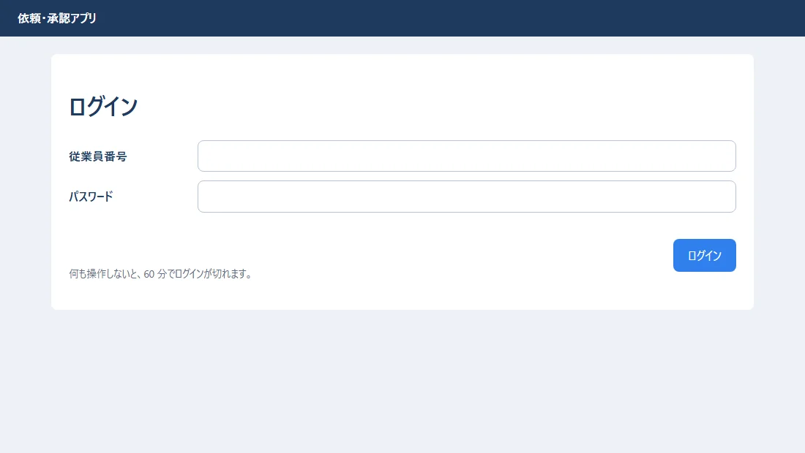

パスワードを間違えた所（状態コードは 401。入れた従業員番号は残し、パスワードは消す）:

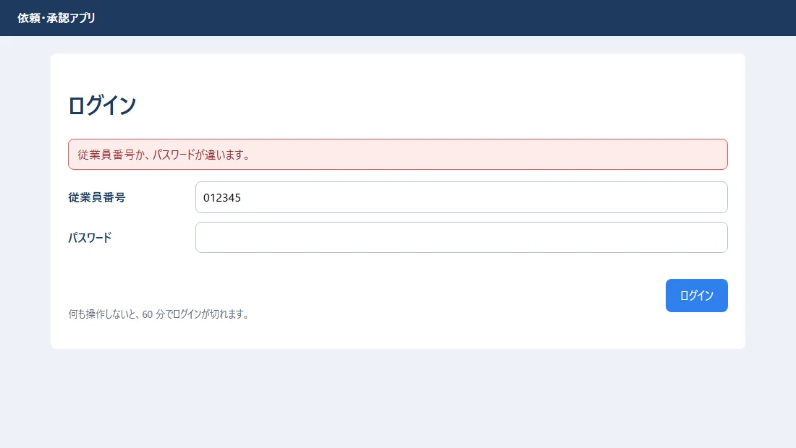

- 成功したら、**303 で一覧へ移します**（PRG。07 の 5.2）。
- 「従業員番号が違う」のか「パスワードが違う」のかは、言いません（社員番号が正しいかどうかを、探られないように）。
- ログアウトを POST だけにするのは、ほかのサイトに置かれたリンクや画像で、勝手にログアウトさせられないようにするためです。

## 4. 依頼の一覧

`app.rs` の `home` が一覧です。担当者（高橋さん）で開いた所:

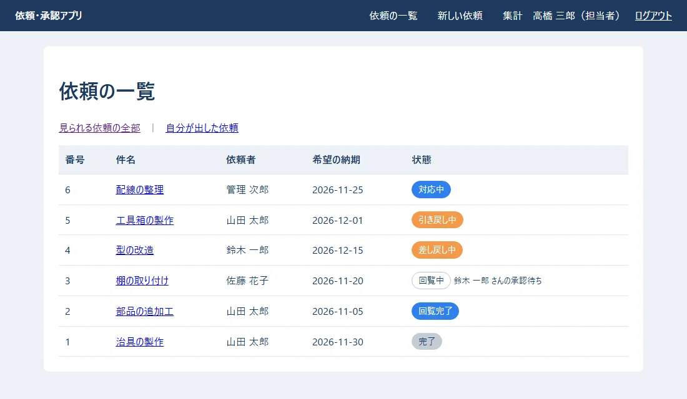

- 担当者・管理者は全部の依頼、一般の人は自分に関係する依頼だけが出ます（前編の 10 章の `list_requests`）。
- 回覧中の行には、今だれの承認を待っているかを出します（SQL の中の副問い合わせで、1 回で読む）。

幅の狭い画面（560px）で開いた所（01 の CSS の `@media` で、ヘッダーが 2 段になる）:

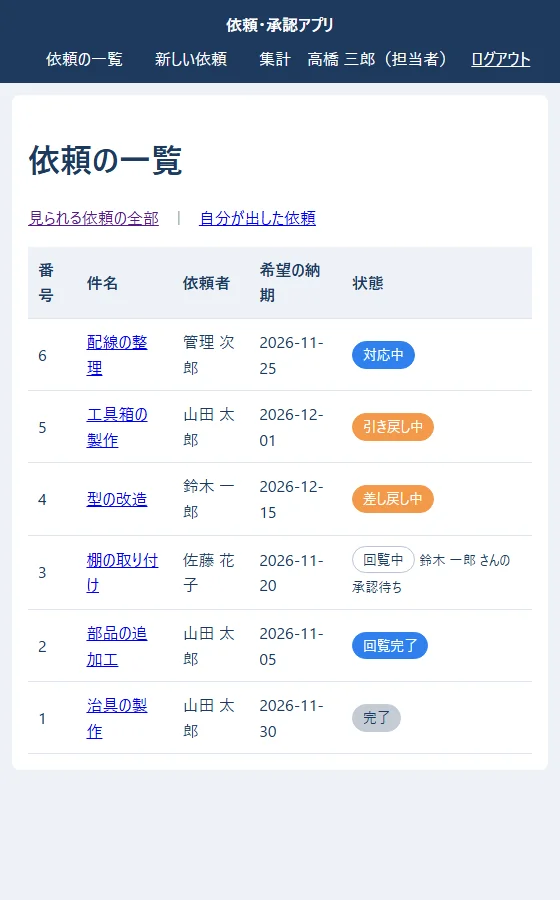

## 5. 入力フォーム（新しい依頼）

### 5.1 フォームの部品（request_form.rs）

新しい依頼と、直して出し直すの 2 つの画面で、同じフォームを使います。

`src/request_form.rs`:

```rust
//! 依頼の入力フォーム（新しい依頼と、直して出し直すの 2 つの画面で使う）
//!
//! ファイルを送るフォームは `enctype="multipart/form-data"` で送られてくるので、
//! `Form<T>` ではなく `Multipart` で 1 項目ずつ読む。

use time::{Date, macros::format_description};
use topcoat::{
    Result,
    asset::asset,
    router::content::multipart::Multipart,
    view::{View, component, view},
};

use crate::{
    drawing,
    models::{AttachmentRow, Employee, RequestDetail, fmt_date},
    upload::{self, UploadedFile},
    views::error_list,
    workflow::{MAX_APPROVERS, RequestInput},
};

/// フォームに入っている値（まだ確かめていない。間違いがあれば、このまま画面に戻す）
#[derive(Debug, Clone, Default)]
pub struct FormValues {
    pub title: String,
    pub detail: String,
    pub due_date: String,
    /// 回覧者の社員の id（選ばなかった欄は空の文字）
    pub approvers: Vec<String>,
    /// 図面の JSON（隠し項目）
    pub drawing: String,
    pub files: Vec<UploadedFile>,
}

impl FormValues {
    /// 直すときは、今の依頼の値を入れておく
    pub fn from_request(r: &RequestDetail, approver_ids: &[i64]) -> FormValues {
        FormValues {
            title: r.title.clone(),
            detail: r.detail.clone(),
            due_date: fmt_date(r.due_date),
            approvers: approver_ids.iter().map(|id| id.to_string()).collect(),
            drawing: r.drawing.as_ref().map(|d| serde_json::to_string(&d.0).unwrap_or_default()).unwrap_or_default(),
            files: Vec::new(),
        }
    }

    /// 送られてきたフォームを、1 項目ずつ読む
    pub async fn read(mut multipart: Multipart) -> Result<FormValues> {
        let mut v = FormValues::default();
        while let Some(field) = multipart.next_field().await? {
            let name = field.name().unwrap_or("").to_string();
            if name == "files" {
                let file_name = upload::clean_name(field.file_name().unwrap_or(""));
                let bytes = field.bytes().await?;
                // ファイルを選ばなかったときも、名前が空の項目が 1 つ届くので、飛ばす
                if !file_name.is_empty() || !bytes.is_empty() {
                    v.files.push(UploadedFile { name: file_name, bytes: bytes.to_vec() });
                }
                continue;
            }
            let text = field.text().await?;
            match name.as_str() {
                "title" => v.title = text,
                "detail" => v.detail = text,
                "due_date" => v.due_date = text,
                "approver" => v.approvers.push(text),
                "drawing" => v.drawing = text,
                _ => {} // 知らない項目は捨てる
            }
        }
        Ok(v)
    }

    /// 確かめる。よければ、状態を変える処理に渡す形にする。だめなら、間違いの文を全部返す
    pub fn validate(&self) -> std::result::Result<RequestInput, Vec<String>> {
        let mut errors = Vec::new();

        let title = self.title.trim().to_string();
        if title.is_empty() {
            errors.push("件名を入れてください。".to_string());
        } else if title.chars().count() > 100 {
            errors.push("件名は 100 文字までです。".to_string());
        } else if title.chars().any(char::is_control) {
            // 入力欄は 1 行だが、細工した送信なら改行を入れられる。メールの件名などに入れさせない（10 の巻）
            errors.push("件名に、改行などは入れられません。".to_string());
        }
        if self.detail.chars().count() > 2000 {
            errors.push("内容は 2000 文字までです。".to_string());
        }
        let due_date = Date::parse(self.due_date.trim(), format_description!("[year]-[month]-[day]")).ok();
        if due_date.is_none() {
            errors.push("希望の納期を、日付で入れてください。".to_string());
        }
        let mut approver_ids = Vec::new();
        for a in self.approvers.iter().map(|a| a.trim()).filter(|a| !a.is_empty()) {
            match a.parse::<i64>() {
                Ok(id) => approver_ids.push(id),
                Err(_) => errors.push("回覧者の選び方が違います。".to_string()),
            }
        }
        if approver_ids.is_empty() {
            errors.push("回覧者を 1 人以上選んでください。".to_string());
        }
        let drawing = drawing::parse(&self.drawing).unwrap_or_else(|e| {
            errors.push(e);
            None
        });
        errors.extend(upload::check_all(&self.files));

        match (errors.is_empty(), due_date) {
            (true, Some(due_date)) => Ok(RequestInput {
                title,
                detail: self.detail.trim().to_string(),
                due_date,
                approver_ids,
                drawing,
                files: self.files.clone(),
            }),
            _ => Err(errors),
        }
    }
}

/// 入力フォーム。action を書かないので、今開いている URL（同じ所）へ POST で送る
#[component]
pub async fn request_form(
    values: &FormValues,
    choices: &[Employee],
    errors: &[String],
    attachments: &[AttachmentRow],
    submit_label: &str,
) -> Result<impl View> {
    Ok(view! {
        error_list(errors: errors)
        <form method="post" enctype="multipart/form-data" class="form-grid">
            <label for="title" class="required">"件名"</label>
            <input id="title" name="title" required="" maxlength="100" value=(&values.title)>

            <label for="detail">"内容"</label>
            <textarea id="detail" name="detail" rows="5" maxlength="2000">(&values.detail)</textarea>

            <label for="due" class="required">"希望の納期"</label>
            <input id="due" name="due_date" type="date" required="" value=(&values.due_date)>

            <label for="approver1" class="required">"回覧者"</label>
            <div class="approvers">
                for i in 0..MAX_APPROVERS {
                    let current = values.approvers.get(i).map(String::as_str).unwrap_or("");
                    <select id=(format!("approver{}", i + 1)) name="approver" aria-label=(format!("回覧者{}", i + 1))>
                        <option value="">(if i == 0 { "（選ぶ）" } else { "（なし）" })</option>
                        for e in choices {
                            let id = e.id.to_string();
                            <option value=(&id) selected=((id == current).then_some(""))>
                                (&e.dept) " " (&e.name) " " (&e.job_title)
                            </option>
                        }
                    </select>
                }
            </div>
            <span class="hint">"1 人目から順に回ります（1〜3 人）。"</span>

            <label>"図面"</label>
            <div>
                <svg id="pad" class="pad" viewBox="0 0 297 210" role="img" aria-label="図面を描く所"></svg>
                <div class="actions left">
                    <button type="button" id="pad-undo" class="btn-secondary">"1 つ戻す"</button>
                    <button type="button" id="pad-clear" class="btn-secondary">"全部消す"</button>
                </div>
                <input type="hidden" id="drawing" name="drawing" value=(&values.drawing)>
            </div>
            <span class="hint">"ドラッグで四角を描きます（JavaScript が動くブラウザで）。"</span>

            <label for="files">"添付ファイル"</label>
            <div>
                <input id="files" name="files" type="file" multiple="" accept=".jpg,.jpeg,.png,.pdf">
                if !attachments.is_empty() {
                    <p>"付いているファイル: "
                        for a in attachments {
                            <span>(&a.original_name) " "</span>
                        }
                    </p>
                }
            </div>
            <span class="hint">"JPG・PNG・PDF。1 つ 10MB まで・1 回に 5 つまで。"</span>

            <span></span>
            <div class="actions">
                <button type="submit" class="btn-primary">(submit_label)</button>
            </div>
        </form>
        <script src=(asset!("drawing.js"))></script>
    })
}

#[cfg(test)]
mod tests {
    use super::*;

    fn values(title: &str) -> FormValues {
        FormValues { title: title.into(), due_date: "2026-11-30".into(), approvers: vec!["2".into()], ..FormValues::default() }
    }

    #[test]
    fn 正しい入力は通る() {
        let input = values("  治具の製作  ").validate().unwrap();
        assert_eq!(input.title, "治具の製作"); // 前後の空白は取る
        assert_eq!(input.approver_ids, vec![2]);
    }

    #[test]
    fn 件名に改行は入れられない() {
        let errors = values("治具の製作\r\nBcc: evil@example.com").validate().unwrap_err();
        assert_eq!(errors, vec!["件名に、改行などは入れられません。".to_string()]);
    }
}
```

- **ファイルを送るフォームは `enctype="multipart/form-data"`** で送られてくるので、`Form<T>` ではなく `Multipart` で、1 項目ずつ読みます（`FormValues::read`）。
- 読む（`read`）と、確かめる（`validate`）を分けました。確かめで間違いがあれば、**入れた値のまま**画面に戻します。間違いは、見つかった物を全部、一度に出します。
- 回覧者は、`<select>` を 3 つ並べました（同じ `name="approver"` なので、送られた順に `Vec` に入る）。06 では、名前で探して選ぶ部品（300ms 待ってから探す）を作りました。社員が数百人までなら `<select>` で足ります。もっと多いなら、06 のような探す部品にします。
- `action` を書かない `<form>` は、**今開いている URL へ**送ります。GET と POST で同じ URL（`/requests/new`）を使うので、これで足ります。

### 5.2 新しい依頼の画面（requests/new.rs）

`src/app/requests/new.rs`:

```rust
//! /requests/new … 新しい依頼（GET で入力の画面、POST で依頼を出す）

use topcoat::{
    Result,
    context::Cx,
    router::{StatusCode, content::multipart::Multipart, error::see_other, href, page},
    view::{View, view},
};

use super::id::{Id, Msg, detail};
use crate::{
    auth::require_user,
    queries,
    request_form::{FormValues, request_form},
    state::state,
    workflow::{self, WorkflowError},
};

#[page]
pub async fn new_page(cx: &Cx) -> Result<impl View> {
    let user = require_user(cx).await?;
    let choices = queries::approver_choices(&state(cx).pool, &user).await?;
    let values = FormValues::default();
    Ok(view! {
        <h1>"新しい依頼"</h1>
        request_form(values: &values, choices: &choices, errors: &[], attachments: &[], submit_label: "依頼を出す")
    })
}

#[page(POST)]
async fn new_submit(cx: &Cx, multipart: Multipart) -> Result<impl View> {
    let user = require_user(cx).await?;
    let values = FormValues::read(multipart).await?;
    // 1. 形を確かめる → 2. 決まりを確かめて保存する。どちらかでだめなら、入れた値のまま画面に戻す
    let errors = match values.validate() {
        Ok(input) => match workflow::submit(cx, &user, input).await {
            // PRG: 保存できたら、303 で詳しい画面（GET）へ。再読み込みで二重に出さない
            Ok(id) => return Err(see_other(href!(detail, Id(id)).query(Msg { msg: "submitted" }).resolve(cx)).into()),
            Err(WorkflowError::Rule(m)) => vec![m],
            Err(e) => return Err(e.into()),
        },
        Err(errors) => errors,
    };
    let choices = queries::approver_choices(&state(cx).pool, &user).await?;
    // ファイルは、もう一度選んでもらう（ブラウザの決まりで、ファイルの欄には値を戻せない）
    let values = FormValues { files: Vec::new(), ..values };
    Ok(view! {
        (StatusCode::BAD_REQUEST)
        <h1>"新しい依頼"</h1>
        request_form(values: &values, choices: &choices, errors: &errors, attachments: &[], submit_label: "依頼を出す")
    })
}
```

入力した所（図面は、ドラッグで四角を 2 つ描いた。添付ファイルを 1 つ選んだ）:

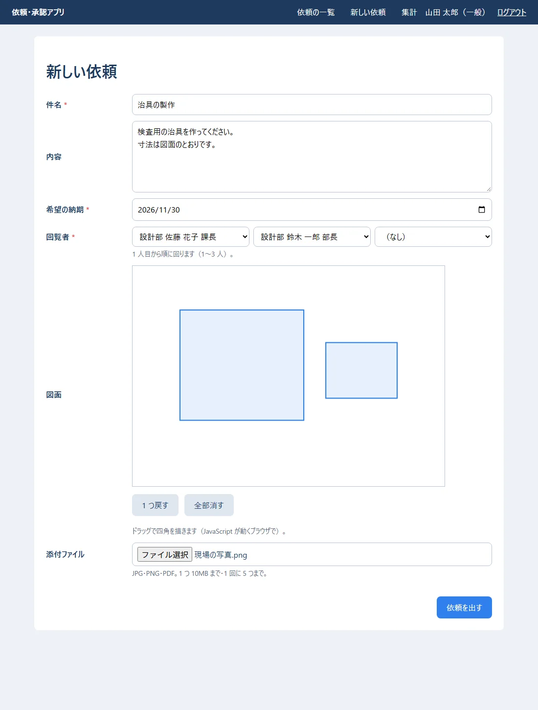

「依頼を出す」を押した所（303 で詳しい画面へ移り、上に知らせが出る）:

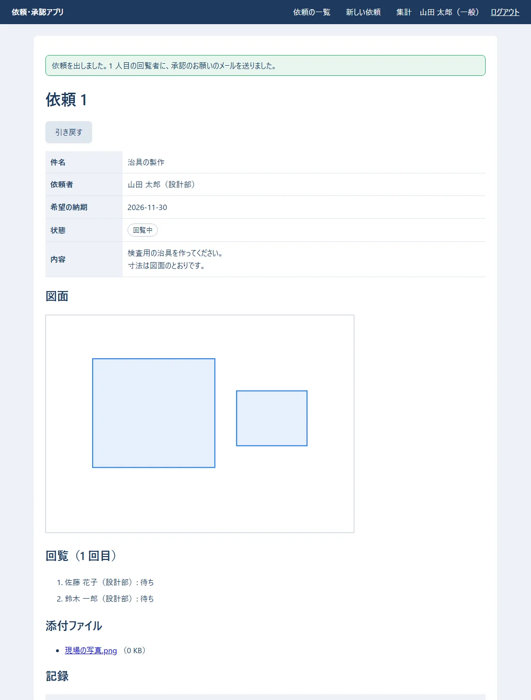

間違いがあった所（回覧者を選ばず、中身が PNG でないファイルを `写真.png` という名前で付けた。状態コードは 400）:

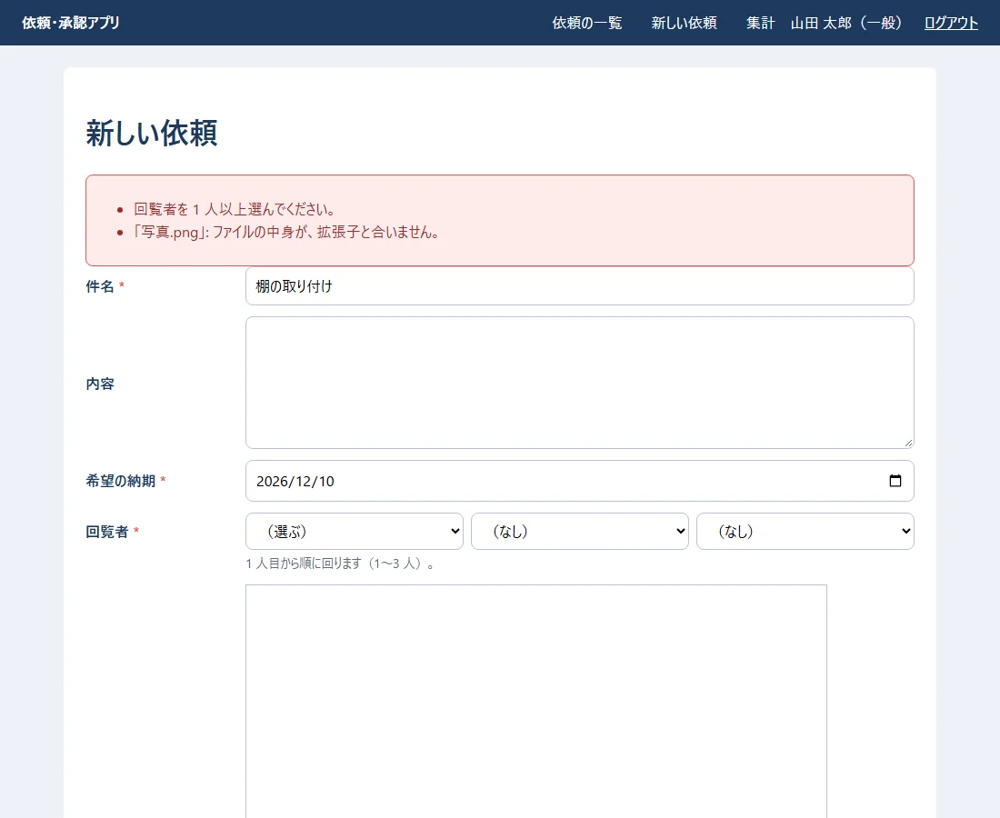

**確かめること:** 件名と納期は、入れた値のまま残っている。ファイルの欄は空になっている（ブラウザの決まりで、ファイルの欄には値を戻せない）。

### 5.3 受け取る大きさの上限（BodyLimit）

- Topcoat は、決まりでは **2MB** より大きい送信を断ります（`413`）。添付ファイル（1 つ 10MB・5 つまで）と図面（5MB まで）を受け取れるように、`/requests` の下だけ 60MB にしました（`app.rs`）。
- ログインの画面などは 2MB のままです。大きな送信で、サーバーのメモリーを使い切らせる攻撃を防ぎます。
- サーバーでは、**IIS の上限（onprem の 04 の 8.5 の `maxAllowedContentLength`。100MB）と、アプリの上限（60MB）の、小さい方**が効きます。IIS が断ると `404.13`、アプリが断ると `413` です。

## 6. 図面

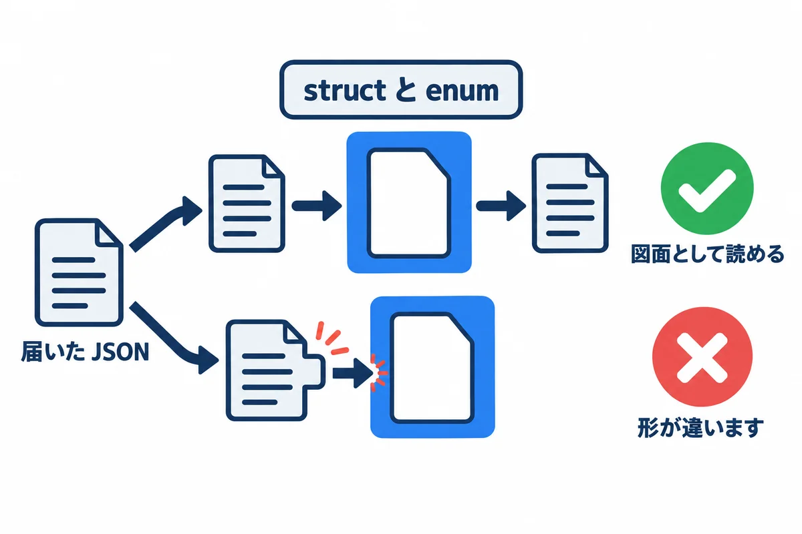

### 6.1 図面の形を、struct と enum で書く（drawing.rs）

`src/drawing.rs`:

```rust
//! 図面（線・四角・文字）の JSON。06 の React 版と同じ形
//!
//! ```json
//! {"version":1,"widthMm":297,"heightMm":210,"shapes":[{"kind":"rect","x":10,"y":10,"width":50,"height":30}]}
//! ```
//!
//! Python では、届いた JSON の形を 1 つずつ if で確かめた（06 の validators.py）。
//! Rust では、**形を struct と enum で書いておき、serde に読ませる**。形が違えば、読み込みがエラーになる。

use serde::{Deserialize, Serialize};

pub const MAX_DRAWING_BYTES: usize = 5 * 1024 * 1024;

#[derive(Debug, Clone, PartialEq, Serialize, Deserialize)]
#[serde(rename_all = "camelCase", deny_unknown_fields)] // widthMm のような名前に合わせる。知らない項目はエラー
pub struct Drawing {
    pub version: u32,
    pub width_mm: f64,
    pub height_mm: f64,
    pub shapes: Vec<Shape>,
}

/// 図形。"kind" の値で、どの形かを見分ける
#[derive(Debug, Clone, PartialEq, Serialize, Deserialize)]
#[serde(tag = "kind", rename_all = "lowercase")]
pub enum Shape {
    Rect { x: f64, y: f64, width: f64, height: f64 },
    Line { x1: f64, y1: f64, x2: f64, y2: f64 },
    Text { x: f64, y: f64, text: String },
}

/// フォームの隠し項目の文字を、図面にする。空なら「図面なし」（None）
pub fn parse(text: &str) -> Result<Option<Drawing>, String> {
    let text = text.trim();
    if text.is_empty() {
        return Ok(None);
    }
    if text.len() > MAX_DRAWING_BYTES {
        return Err("図面は 5MB までです。".into());
    }
    let drawing: Drawing = serde_json::from_str(text).map_err(|_| "図面の形が違います。".to_string())?;
    if drawing.version != 1 {
        return Err("図面の版が違います。".into());
    }
    if !(drawing.width_mm > 0.0 && drawing.height_mm > 0.0) {
        return Err("図面の大きさが違います。".into());
    }
    // 図形が 1 つも無いなら、図面なしと同じに扱う
    Ok(if drawing.shapes.is_empty() { None } else { Some(drawing) })
}

#[cfg(test)]
mod tests {
    use super::*;

    #[test]
    fn 四角と線を読める() {
        let d = parse(r#"{"version":1,"widthMm":297,"heightMm":210,"shapes":[
            {"kind":"rect","x":10,"y":10,"width":50,"height":30},
            {"kind":"line","x1":0,"y1":0,"x2":100,"y2":50}]}"#)
        .unwrap()
        .unwrap();
        assert_eq!(d.shapes.len(), 2);
        assert!(matches!(d.shapes[0], Shape::Rect { width: 50.0, .. }));
    }

    #[test]
    fn 知らない図形はエラー() {
        let err = parse(r#"{"version":1,"widthMm":297,"heightMm":210,"shapes":[{"kind":"circle","r":5}]}"#);
        assert_eq!(err, Err("図面の形が違います。".to_string()));
    }

    #[test]
    fn 空なら図面なし() {
        assert_eq!(parse(""), Ok(None));
    }
}
```

- 06 の Python では、届いた JSON の形を `if` で 1 つずつ確かめました。Rust では、**形を struct と enum で書いておき、serde に読ませます**。`kind` が `"circle"` のような知らない値なら、読み込みがエラーになります。
- `deny_unknown_fields` で、知らない項目が付いていても断ります。
- JSON の形は、06 の React 版と同じです。同じデータベースに入れ替えても読めます。

### 6.2 図面を描く、小さな JavaScript（drawing.js）

`drawing.js`:

```javascript
// 図面のパッド: SVG の上をドラッグして四角を描き、JSON を隠し項目（#drawing）に入れる。
// JSON の形は 06 の React 版（DrawingPad.tsx）と同じ。確かめは、サーバー（drawing.rs）でもう一度する。
(() => {
  const pad = document.getElementById("pad");
  const input = document.getElementById("drawing");
  if (!pad || !input) return;

  const NS = "http://www.w3.org/2000/svg";
  let drawing = { version: 1, widthMm: 297, heightMm: 210, shapes: [] };
  try {
    if (input.value) drawing = JSON.parse(input.value); // 直すときは、今の図面から始める
  } catch {
    // 読めなければ、空から始める
  }

  // 画面の位置（px）を、図面の位置（mm）に直す
  const toMm = (e) => {
    const box = pad.getBoundingClientRect();
    return {
      x: Math.round(((e.clientX - box.left) / box.width) * drawing.widthMm),
      y: Math.round(((e.clientY - box.top) / box.height) * drawing.heightMm),
    };
  };

  const el = (name, attrs) => {
    const node = document.createElementNS(NS, name);
    for (const [k, v] of Object.entries(attrs)) node.setAttribute(k, v);
    return node;
  };

  // 図形を描き直し、隠し項目を新しくする（図形が無ければ空にする = 図面なし）
  function render() {
    pad.replaceChildren();
    for (const s of drawing.shapes) {
      if (s.kind === "rect") pad.append(el("rect", { x: s.x, y: s.y, width: s.width, height: s.height }));
      if (s.kind === "line") pad.append(el("line", { x1: s.x1, y1: s.y1, x2: s.x2, y2: s.y2 }));
      if (s.kind === "text") {
        const t = el("text", { x: s.x, y: s.y });
        t.textContent = s.text; // textContent なので、文字は文字のまま（HTML にならない）
        pad.append(t);
      }
    }
    input.value = drawing.shapes.length ? JSON.stringify(drawing) : "";
  }

  let start = null;
  pad.addEventListener("pointerdown", (e) => {
    start = toMm(e);
    pad.setPointerCapture(e.pointerId);
  });
  pad.addEventListener("pointerup", (e) => {
    if (!start) return;
    const end = toMm(e);
    const width = Math.abs(end.x - start.x);
    const height = Math.abs(end.y - start.y);
    if (width >= 2 && height >= 2) {
      drawing.shapes.push({ kind: "rect", x: Math.min(start.x, end.x), y: Math.min(start.y, end.y), width, height });
    }
    start = null;
    render();
  });
  document.getElementById("pad-undo")?.addEventListener("click", () => {
    drawing.shapes.pop();
    render();
  });
  document.getElementById("pad-clear")?.addEventListener("click", () => {
    drawing.shapes = [];
    render();
  });
  render();
})();
```

- 図面を**描く**所だけは、ブラウザで動く JavaScript が要ります。Topcoat の `asset!("drawing.js")` で、CSS と同じように束ねて配ります。
- JavaScript は、描いた図面を JSON にして、隠し項目（`<input type="hidden" name="drawing">`）に入れるだけです。**確かめは、サーバー（`drawing::parse`）でもう一度します**（ブラウザから来る物は、いくらでも書きかえられるため）。
- 文字は `textContent` で入れます。`innerHTML` を使うと、図面の文字に `<script>` が入っていたときに動いてしまいます。

## 7. 依頼の詳しい画面と、ボタンの操作

### 7.1 詳しい画面（requests/id.rs）

`src/app/requests/id.rs`:

```rust
//! /requests/{id} … 依頼の詳しい画面と、ボタンの操作（/requests/{id}/action）

mod edit;

use serde::{Deserialize, Serialize};
use topcoat::{
    Result,
    context::Cx,
    router::{
        StatusCode,
        content::Form,
        error::{RouterErrorExt, not_found, see_other},
        href, module_param, page, path_param, query_params,
    },
    view::{View, component, view},
};

use crate::{
    auth::require_user,
    models::{Decision, Employee, Role, Status, fmt_datetime, fmt_size},
    queries::{self, FullRequest},
    state::state,
    views::request_table,
    workflow::{self, WorkflowError},
};

// URL の {id} の部分。数でなければ 404
module_param!(pub id: i64, error = not_found);

/// 操作のあとに出す知らせ（?msg=submitted など）。文はこちらで決める（URL の文をそのまま出さない）
#[derive(Serialize)]
pub struct Msg {
    pub msg: &'static str,
}

#[query_params]
struct MsgQuery {
    msg: Option<String>,
}

fn message(key: &str) -> Option<&'static str> {
    Some(match key {
        "submitted" => "依頼を出しました。1 人目の回覧者に、承認のお願いのメールを送りました。",
        "resubmitted" => "出し直しました。1 人目の回覧者から、もう一度回ります。",
        "pull_back" => "引き戻しました。",
        "withdraw" => "取り下げました。",
        "assign" => "担当になりました。",
        "complete" => "完了にしました。依頼者にメールを送りました。",
        "resend" => "承認のお願いを送り直しました（前の URL は使えなくなりました）。",
        _ => return None,
    })
}

/// 見てよい依頼を読む。無い・見てはいけないときは、どちらも 404（あるかどうかも知らせない）
pub(crate) async fn load_visible(cx: &Cx, user: &Employee, id: i64) -> Result<FullRequest> {
    let full = queries::find_request(&state(cx).pool, id).await?.ok_or_not_found()?;
    if !full.visible_to(user) {
        return Err(not_found().into());
    }
    Ok(full)
}

#[page]
pub async fn detail(cx: &Cx) -> Result<impl View> {
    let user = require_user(cx).await?;
    let id = *path_param::<Id>(cx)?;
    let full = load_visible(cx, &user, id).await?;
    let msg = query_params::<MsgQuery>(cx).ok().and_then(|q| q.msg.as_deref().and_then(message));
    Ok(view! {
        if let Some(m) = msg {
            <p class="message" role="status">(m)</p>
        }
        detail_body(user: &user, full: &full, errors: &[])
    })
}

/// 詳しい画面の中身（操作に失敗したときにも、同じ物を出す）
#[component]
async fn detail_body(user: &Employee, full: &FullRequest, errors: &[String]) -> Result<impl View> {
    let r = &full.request;
    let own = r.requester_id == user.id;
    // 押せるボタンだけを出す（押されたときも、サーバーでもう一度確かめる）
    let can_pull_back = own && r.status == Status::Circulating;
    let can_fix = own && matches!(r.status, Status::Returned | Status::PulledBack);
    let can_assign = user.role.is_staff() && r.status == Status::Approved;
    let can_complete = r.status == Status::InProgress && r.assignee_id == Some(user.id);
    let is_admin = user.role == Role::Admin;
    Ok(view! {
        <h1>"依頼 " (r.id)</h1>
        crate::views::error_list(errors: errors)
        <div class="actions left">
            if can_pull_back {
                <form method="post" action=(href!(action, Id(r.id)))>
                    <button name="action" value="pull_back" class="btn-secondary">"引き戻す"</button>
                </form>
            }
            if can_fix {
                <a class="btn-primary" href=(href!(edit::edit_page, Id(r.id)))>"直して出し直す"</a>
                <form method="post" action=(href!(action, Id(r.id)))>
                    <button name="action" value="withdraw" class="btn-secondary">"取り下げる"</button>
                </form>
            }
            if can_assign {
                <form method="post" action=(href!(action, Id(r.id)))>
                    <button name="action" value="assign" class="btn-primary">"担当になる"</button>
                </form>
            }
            if can_complete {
                <form method="post" action=(href!(action, Id(r.id)))>
                    <button name="action" value="complete" class="btn-primary">"完了にする（引き渡した）"</button>
                </form>
            }
        </div>

        request_table(r: r)

        <h2>"回覧（" (r.round) " 回目）"</h2>
        <ol class="steps">
            for s in full.current_steps() {
                <li class=(format!("step-{}", s.decision.as_str()))>
                    (&s.approver_name) "（" (&s.approver_dept) "）: " (s.decision.label())
                    if let Some(at) = s.decided_at {
                        " " (fmt_datetime(at))
                    }
                    if is_admin && s.decision == Decision::Waiting && r.status == Status::Circulating {
                        " "
                        <form method="post" action=(href!(action, Id(r.id))) style="display:inline">
                            <input type="hidden" name="step_id" value=(s.id.to_string())>
                            <button name="action" value="resend" class="link">"承認のお願いを送り直す"</button>
                        </form>
                    }
                </li>
            }
        </ol>

        <h2>"添付ファイル"</h2>
        if full.attachments.is_empty() {
            <p>"ありません。"</p>
        } else {
            <ul>
                for a in &full.attachments {
                    <li>
                        let url = href!(crate::app::attachments::id::download, crate::app::attachments::id::Id(a.id));
                        <a href=(url)>(&a.original_name)</a>
                        " （" (fmt_size(a.size)) "）"
                    </li>
                }
            </ul>
        }

        <h2>"記録"</h2>
        <table>
            <thead><tr><th>"日時"</th><th>"した人"</th><th>"したこと"</th><th>"メモ"</th></tr></thead>
            <tbody>
                for h in &full.histories {
                    <tr>
                        <td>(fmt_datetime(h.at))</td>
                        <td>(h.actor_name.as_deref().unwrap_or("（自動）"))</td>
                        <td>(&h.action)</td>
                        <td class="pre">(&h.note)</td>
                    </tr>
                }
            </tbody>
        </table>
    })
}

/// ボタンから届く値
#[derive(Deserialize)]
struct ActionForm {
    action: String,
    step_id: Option<i64>,
}

#[page(POST "./action")]
async fn action(cx: &Cx, Form(input): Form<ActionForm>) -> Result<impl View> {
    let user = require_user(cx).await?;
    let id = *path_param::<Id>(cx)?;
    load_visible(cx, &user, id).await?; // 見られない依頼は、操作もできない
    let result = match input.action.as_str() {
        "pull_back" => workflow::pull_back(cx, &user, id).await.map(|_| "pull_back"),
        "withdraw" => workflow::withdraw(cx, &user, id).await.map(|_| "withdraw"),
        "assign" => workflow::assign(cx, &user, id).await.map(|_| "assign"),
        "complete" => workflow::complete(cx, &user, id).await.map(|_| "complete"),
        "resend" if user.role == Role::Admin => {
            workflow::resend(cx, Some(&user), input.step_id.unwrap_or_default()).await.map(|_| "resend")
        }
        _ => Err(WorkflowError::Rule("この操作はできません。".into())),
    };
    match result {
        // PRG: 303 で詳しい画面へ戻す
        Ok(key) => Err(see_other(href!(detail, Id(id)).query(Msg { msg: key }).resolve(cx)).into()),
        Err(WorkflowError::Rule(m)) => {
            let full = load_visible(cx, &user, id).await?;
            let errors = vec![m];
            Ok(view! {
                (StatusCode::BAD_REQUEST)
                detail_body(user: &user, full: &full, errors: &errors)
            })
        }
        Err(e) => Err(e.into()),
    }
}
```

| 書き方 | 意味 |
|---|---|
| `module_param!(pub id: i64, error = not_found)` | URL の `{id}` の部分。数でなければ 404 |
| `load_visible` | 無い依頼と、見てはいけない依頼は、**どちらも 404**（あるかどうかも知らせない） |
| `can_pull_back` など | 押せるボタンだけを出す。押されたときも、`workflow` がもう一度確かめる |
| `#[page(POST "./action")]` | `/requests/{id}/action`。どのボタンかは `name="action"` の `value` で分ける |
| `?msg=submitted` | 操作のあとの知らせ。**文はこちらで決めた物だけ**を出す（URL の文をそのまま出さない） |

差し戻された依頼を、依頼者（山田さん）が開いた所:

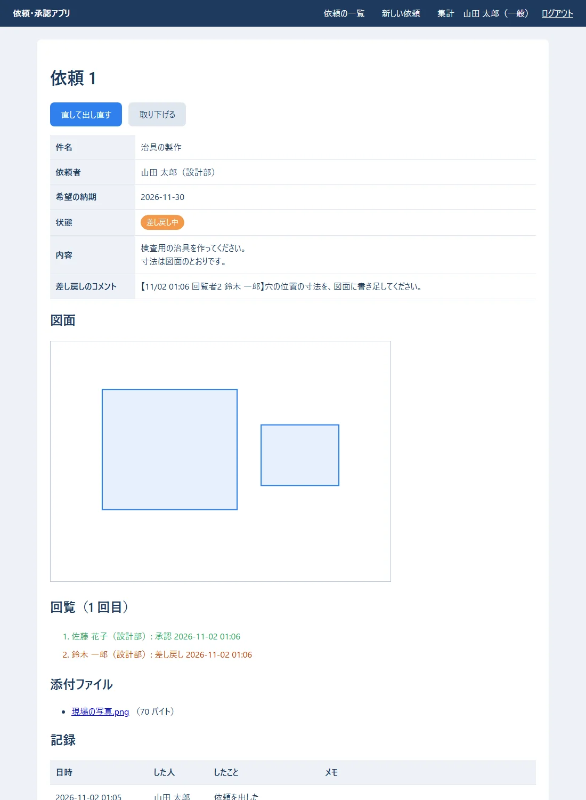

**確かめること:** 差し戻しのコメントに【日時 回覧者2 氏名】が付いている。回覧の 1 人目は「承認」（緑）、2 人目は「差し戻し」（オレンジ）。

### 7.2 直して出し直す（requests/id/edit.rs）

`src/app/requests/id/edit.rs`:

```rust
//! /requests/{id}/edit … 直して出し直す（差し戻し中・引き戻し中の、自分の依頼だけ）

use topcoat::{
    Result,
    context::Cx,
    router::{StatusCode, content::multipart::Multipart, error::see_other, href, page, path_param},
    view::{View, view},
};

use super::{Id, Msg, detail, load_visible};
use crate::{
    auth::require_user,
    models::{Employee, Status},
    queries::{self, FullRequest},
    request_form::{FormValues, request_form},
    state::state,
    workflow::{self, WorkflowError},
};

/// 直せる依頼だけを読む（自分の・差し戻し中か引き戻し中）
async fn load_editable(cx: &Cx, user: &Employee) -> Result<FullRequest> {
    let id = *path_param::<Id>(cx)?;
    let full = load_visible(cx, user, id).await?;
    let r = &full.request;
    if r.requester_id != user.id || !matches!(r.status, Status::Returned | Status::PulledBack) {
        // 直せない依頼なら、詳しい画面へ戻す
        return Err(see_other(href!(detail, Id(id)).resolve(cx)).into());
    }
    Ok(full)
}

#[page]
pub async fn edit_page(cx: &Cx) -> Result<impl View> {
    let user = require_user(cx).await?;
    let full = load_editable(cx, &user).await?;
    // 前の回の回覧者を、はじめから選んでおく
    let approver_ids: Vec<i64> = full.current_steps().map(|s| s.approver_id).collect();
    let values = FormValues::from_request(&full.request, &approver_ids);
    let choices = queries::approver_choices(&state(cx).pool, &user).await?;
    Ok(view! {
        <h1>"依頼 " (full.request.id) " を直して出し直す"</h1>
        if !full.request.return_comments.is_empty() {
            <p class="errors pre">(&full.request.return_comments)</p>
        }
        request_form(values: &values, choices: &choices, errors: &[], attachments: &full.attachments, submit_label: "出し直す")
    })
}

#[page(POST)]
async fn edit_submit(cx: &Cx, multipart: Multipart) -> Result<impl View> {
    let user = require_user(cx).await?;
    let full = load_editable(cx, &user).await?;
    let id = full.request.id;
    let values = FormValues::read(multipart).await?;
    let errors = match values.validate() {
        Ok(input) => match workflow::resubmit(cx, &user, id, input).await {
            Ok(()) => return Err(see_other(href!(detail, Id(id)).query(Msg { msg: "resubmitted" }).resolve(cx)).into()),
            Err(WorkflowError::Rule(m)) => vec![m],
            Err(e) => return Err(e.into()),
        },
        Err(errors) => errors,
    };
    let choices = queries::approver_choices(&state(cx).pool, &user).await?;
    let values = FormValues { files: Vec::new(), ..values };
    Ok(view! {
        (StatusCode::BAD_REQUEST)
        <h1>"依頼 " (id) " を直して出し直す"</h1>
        request_form(values: &values, choices: &choices, errors: &errors, attachments: &full.attachments, submit_label: "出し直す")
    })
}
```

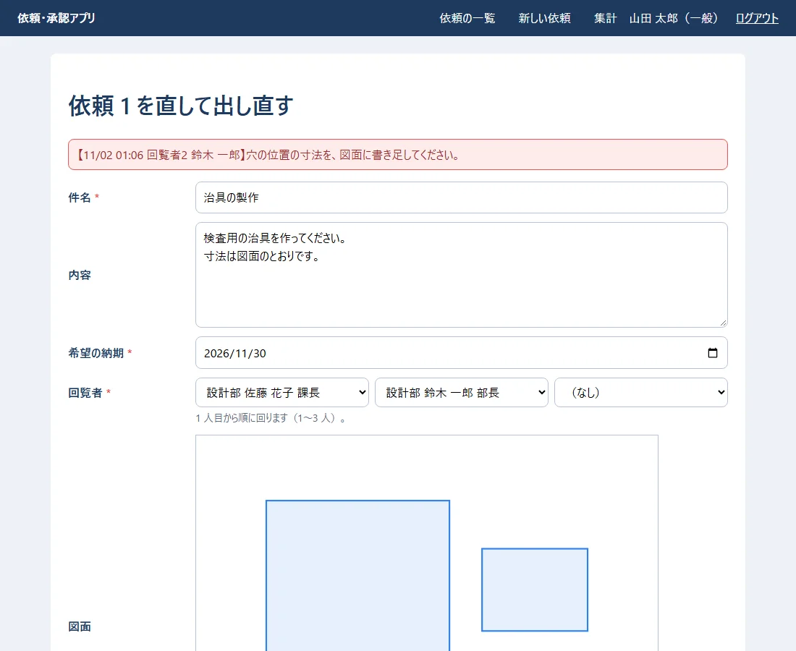

内容に 1 行足して「出し直す」を押した所（回覧は 2 回目になり、1 人目から、もう一度回る）:

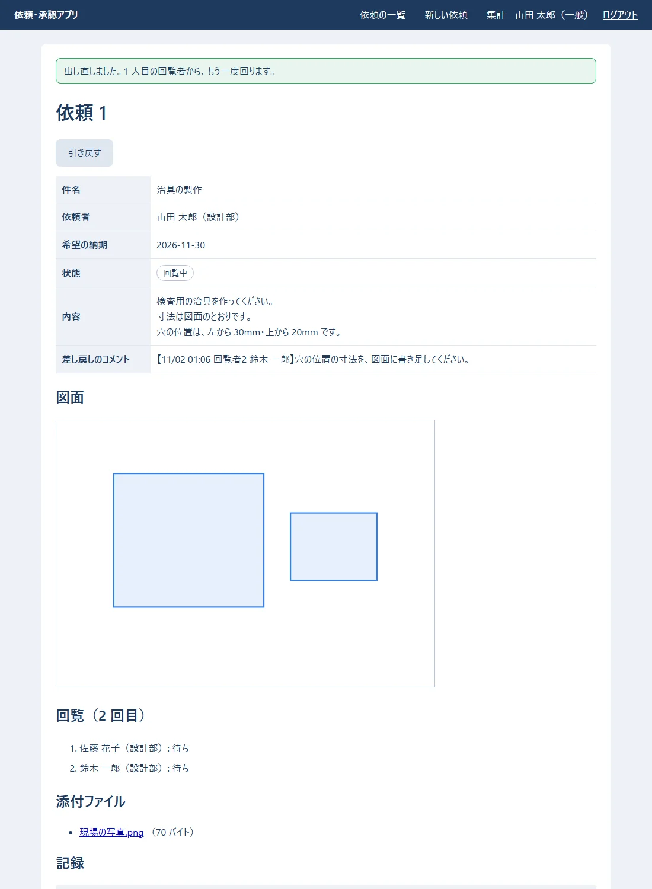

### 7.3 管理者の「送り直す」

管理者でログインすると、承認を待っている回覧者の横に「承認のお願いを送り直す」が出ます。押した所:

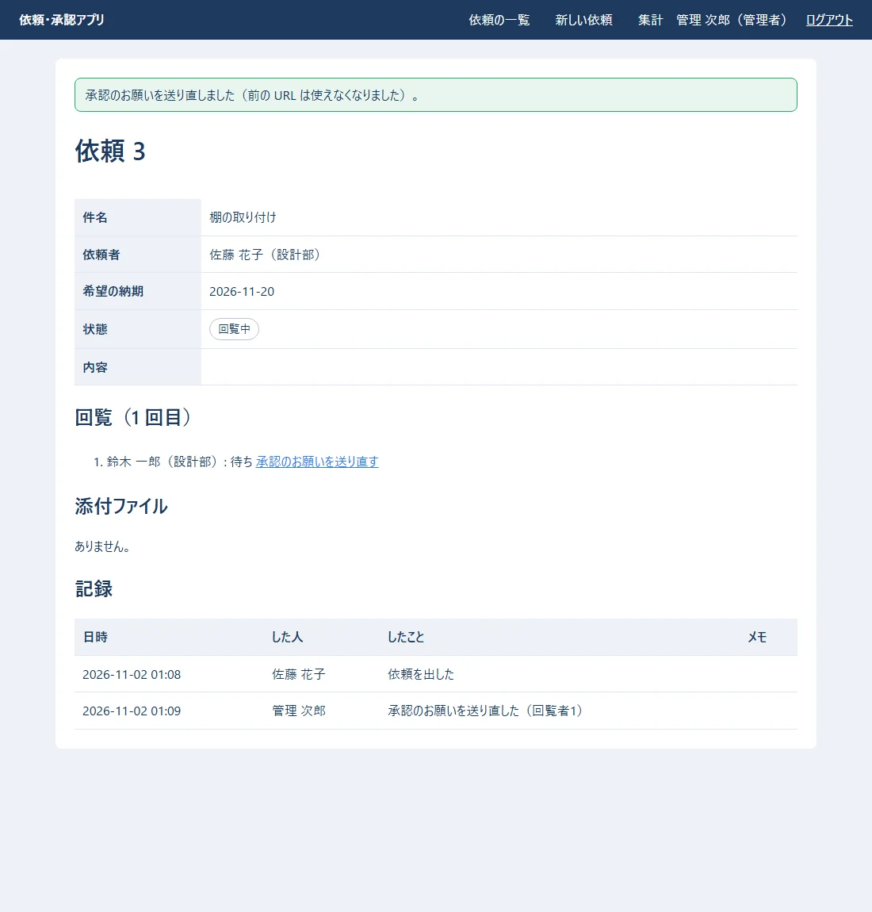

## 8. 添付ファイル

### 8.1 確かめて、置く（upload.rs）

`src/upload.rs`:

```rust
//! 添付ファイル（JPG・PNG・PDF。1 ファイル 10MB まで・1 回に 5 ファイルまで）
//!
//! 外から来たファイルは信用しない。名前の拡張子はいくらでもごまかせるので、
//! **中身の先頭の数バイト（マジックナンバー）** でも種類を確かめる（06 の validators.py と同じ決まり）。
//! フォルダに置くときの名前は、アプリが乱数で決める（送られてきた名前は、表示とダウンロードにだけ使う）。

use std::path::{Path, PathBuf};

pub const MAX_FILE_BYTES: usize = 10 * 1024 * 1024;
pub const MAX_FILES: usize = 5;

/// 送られてきたファイル 1 つ（まだ確かめていない）
#[derive(Debug, Clone)]
pub struct UploadedFile {
    pub name: String,
    pub bytes: Vec<u8>,
}

/// フォルダに置いたファイル 1 つ
#[derive(Debug, Clone)]
pub struct SavedFile {
    pub stored_name: String,
    pub original_name: String,
    pub content_type: &'static str,
    pub size: usize,
}

/// 拡張子と、中身の先頭の印と、種類の名前（Content-Type）
const KINDS: &[(&str, &[u8], &str)] = &[
    ("jpg", b"\xff\xd8\xff", "image/jpeg"),
    ("jpeg", b"\xff\xd8\xff", "image/jpeg"),
    ("png", b"\x89PNG\r\n\x1a\n", "image/png"),
    ("pdf", b"%PDF-", "application/pdf"),
];

/// ブラウザによっては「C:\Users\...\図面.pdf」のように場所ごと送ってくるので、最後の名前だけにする
pub fn clean_name(name: &str) -> String {
    let base = name.rsplit(['/', '\\']).next().unwrap_or("").trim();
    base.chars().filter(|c| !c.is_control()).take(200).collect()
}

/// 1 ファイルを確かめる。よければ、拡張子と種類の名前を返す。だめなら、画面に出す文を返す
pub fn check(file: &UploadedFile) -> Result<(&'static str, &'static str), String> {
    let ext = file.name.rsplit_once('.').map(|(_, e)| e.to_ascii_lowercase()).unwrap_or_default();
    let Some(&(ext, magic, content_type)) = KINDS.iter().find(|(e, _, _)| *e == ext) else {
        return Err(format!("「{}」: 添付できるのは JPG・PNG・PDF だけです。", file.name));
    };
    if file.bytes.len() > MAX_FILE_BYTES {
        return Err(format!("「{}」: 添付ファイルは 1 つ 10MB までです。", file.name));
    }
    if !file.bytes.starts_with(magic) {
        return Err(format!("「{}」: ファイルの中身が、拡張子と合いません。", file.name));
    }
    Ok((ext, content_type))
}

/// 全部を確かめる（数と、1 つずつ）。だめな物の文を全部返す
pub fn check_all(files: &[UploadedFile]) -> Vec<String> {
    let mut errors = Vec::new();
    if files.len() > MAX_FILES {
        errors.push(format!("添付ファイルは、1 回に {MAX_FILES} つまでです。"));
    }
    errors.extend(files.iter().filter_map(|f| check(f).err()));
    errors
}

/// 添付ファイルを置くフォルダ
pub fn attachment_dir(file_dir: &Path) -> PathBuf {
    file_dir.join("attachments")
}

/// フォルダに書く。名前は乱数（32 文字の 16 進）＋拡張子
pub async fn save(file_dir: &Path, file: &UploadedFile) -> std::io::Result<SavedFile> {
    let (ext, content_type) = check(file).map_err(std::io::Error::other)?; // 念のため、もう一度確かめる
    let dir = attachment_dir(file_dir);
    tokio::fs::create_dir_all(&dir).await?;
    let mut random = [0u8; 16];
    getrandom::fill(&mut random).map_err(|e| std::io::Error::other(e.to_string()))?;
    let stored_name = format!("{}.{ext}", hex::encode(random));
    tokio::fs::write(dir.join(&stored_name), &file.bytes).await?;
    Ok(SavedFile { stored_name, original_name: file.name.clone(), content_type, size: file.bytes.len() })
}

/// 保存に失敗したときの後片付け（書いたファイルを消す）
pub async fn remove(file_dir: &Path, saved: &[SavedFile]) {
    for f in saved {
        let _ = tokio::fs::remove_file(attachment_dir(file_dir).join(&f.stored_name)).await;
    }
}

#[cfg(test)]
mod tests {
    use super::*;

    fn file(name: &str, bytes: &[u8]) -> UploadedFile {
        UploadedFile { name: name.into(), bytes: bytes.to_vec() }
    }

    #[test]
    fn 中身がpdfならpdfとして通る() {
        assert_eq!(check(&file("図面.PDF", b"%PDF-1.7 ...")), Ok(("pdf", "application/pdf")));
    }

    #[test]
    fn 拡張子をpngに変えたexeは断る() {
        let err = check(&file("photo.png", b"MZ\x90\x00")).unwrap_err();
        assert!(err.contains("中身が、拡張子と合いません"));
    }

    #[test]
    fn 場所ごとの名前は最後だけにする() {
        assert_eq!(clean_name(r"C:\Users\sato\Desktop\図面.pdf"), "図面.pdf");
    }
}
```

- 06 と同じく、**名前の拡張子と、中身の先頭の数バイト（マジックナンバー）の両方**で確かめます。
- フォルダに置くときの名前は、アプリが乱数で決めます。送られてきた名前（`../../a.exe` のような物も来うる）は、表示とダウンロードにだけ使います。
- 保存に失敗したら、書いたファイルを消します（前編の `finish`。テスト「添付ファイルはフォルダに置き_失敗したら消す」）。

### 8.2 ダウンロード（files.rs・attachments/id.rs）

`src/files.rs`:

```rust
//! 添付ファイルを、ブラウザへ返す（ダウンロード）

use topcoat::router::{Body, response::Response};

use crate::{models::AttachmentRow, upload};

/// フォルダからファイルを読み、ダウンロードの返事を作る
pub async fn download(file_dir: &std::path::Path, a: &AttachmentRow) -> topcoat::Result<Response> {
    let bytes = tokio::fs::read(upload::attachment_dir(file_dir).join(&a.stored_name)).await?;
    Ok(Response::builder()
        .header("Content-Type", a.content_type.as_str())
        // 開かずに保存させる。日本語の名前は filename* に、%XX の形で書く（RFC 6266）
        .header("Content-Disposition", content_disposition(&a.original_name))
        // ブラウザに、中身から種類を推測させない（画像のふりをした HTML を開かせない）
        .header("X-Content-Type-Options", "nosniff")
        .body(Body::from(bytes))?)
}

fn content_disposition(name: &str) -> String {
    // 古いブラウザ向けの filename には、ASCII の文字だけを残す
    let ascii: String = name.chars().map(|c| if c.is_ascii_alphanumeric() || ".-_".contains(c) { c } else { '_' }).collect();
    format!("attachment; filename=\"{ascii}\"; filename*=UTF-8''{}", percent_encode(name))
}

/// URL などに書けない文字を、%XX の形にする
fn percent_encode(s: &str) -> String {
    s.bytes()
        .map(|b| if b.is_ascii_alphanumeric() || b"-._~".contains(&b) { (b as char).to_string() } else { format!("%{b:02X}") })
        .collect()
}

#[cfg(test)]
mod tests {
    use super::*;

    #[test]
    fn 日本語の名前は_xxの形にする() {
        assert_eq!(
            content_disposition("図面 A.pdf"),
            "attachment; filename=\"___A.pdf\"; filename*=UTF-8''%E5%9B%B3%E9%9D%A2%20A.pdf"
        );
    }
}
```

`src/app/attachments/id.rs`:

```rust
//! /attachments/{id} … 添付ファイルのダウンロード（その依頼を見てよい人だけ）

use topcoat::{
    Result,
    context::Cx,
    router::{error::RouterErrorExt, module_param, path_param, response::Response, route},
};

use crate::{app::requests::id::load_visible, auth::require_user, files, queries, state::state};

module_param!(pub id: i64, error = not_found);

#[route(GET)]
pub async fn download(cx: &Cx) -> Result<Response> {
    let user = require_user(cx).await?;
    let id = *path_param::<Id>(cx)?;
    let st = state(cx);
    let a = queries::find_attachment(&st.pool, id).await?.ok_or_not_found()?;
    load_visible(cx, &user, a.request_id).await?; // 依頼を見られない人には、404
    files::download(&st.config.file_dir, &a).await
}
```

実際のダウンロードの返事（`curl -D -` でヘッダーだけ見た）:

```text
HTTP/1.1 200 OK
content-type: image/png
content-disposition: attachment; filename="_____.png"; filename*=UTF-8''%E7%8F%BE%E5%A0%B4%E3%81%AE%E5%86%99%E7%9C%9F.png
x-content-type-options: nosniff
```

- `Content-Disposition: attachment` で、開かずに保存させます。日本語の名前は `filename*` に `%XX` の形で書きます（今のブラウザは、こちらを読む）。
- `X-Content-Type-Options: nosniff` で、ブラウザに中身から種類を推測させません。
- ダウンロードも、**その依頼を見てよい人だけ**です（`load_visible`）。

## 9. 集計と、動いているかの確かめ（stats.rs・health.rs）

`src/app/stats.rs`:

```rust
//! /stats … 集計（状態ごとの件数と、担当者ごとの完了の件数）

use topcoat::{
    Result,
    context::Cx,
    router::page,
    view::{View, view},
};

use crate::{auth::require_user, models::Status, queries, state::state, views::status_badge};

#[page]
pub async fn stats_page(cx: &Cx) -> Result<impl View> {
    require_user(cx).await?;
    let s = queries::stats(&state(cx).pool).await?;
    // 状態の文字を enum にする（知らない値は飛ばす）
    let mut by_status: Vec<(Status, i64)> =
        s.by_status.into_iter().filter_map(|(k, n)| Status::try_from(k).ok().map(|st| (st, n))).collect();
    // 流れの順（回覧中 → … → 完了）に並べる
    by_status.sort_by_key(|(st, _)| Status::ALL.iter().position(|a| a == st));
    let max = by_status.iter().map(|(_, n)| *n).max().unwrap_or(1).max(1);
    Ok(view! {
        <h1>"集計"</h1>
        <h2>"状態ごとの件数"</h2>
        <table>
            <thead><tr><th>"状態"</th><th>"件数"</th><th>"棒グラフ"</th></tr></thead>
            <tbody>
                for (status, n) in &by_status {
                    <tr>
                        <td>status_badge(status: *status)</td>
                        <td>(n)</td>
                        <td><div class="bar" style=(format!("width: {}%", n * 100 / max))></div></td>
                    </tr>
                }
            </tbody>
        </table>
        <h2>"担当者ごとの完了の件数"</h2>
        if s.done_by_assignee.is_empty() {
            <p>"まだありません。"</p>
        } else {
            <table>
                <thead><tr><th>"担当者"</th><th>"完了"</th></tr></thead>
                <tbody>
                    for (name, n) in &s.done_by_assignee {
                        <tr><td>(name)</td><td>(n)</td></tr>
                    }
                </tbody>
            </table>
        }
    })
}
```

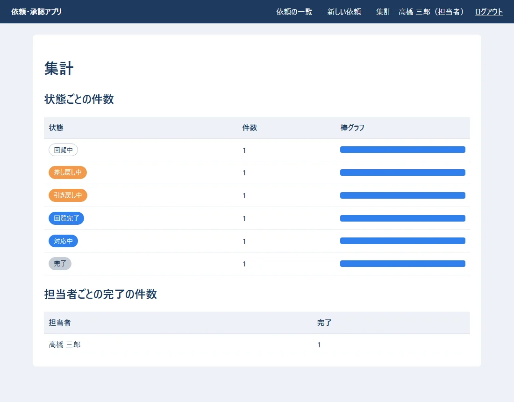

`src/app/health.rs`:

```rust
//! /health … 動いているかの確かめ（onprem の 04 の 12 章の監視で開く）
//!
//! データベースにも聞いてみて、答えがあれば 200「ok」。無ければ 503。

use topcoat::{
    Result,
    context::Cx,
    router::{error::service_unavailable, route},
};

use crate::state::state;

#[route(GET)]
async fn health(cx: &Cx) -> Result<&'static str> {
    match sqlx::query("SELECT 1").execute(&state(cx).pool).await {
        Ok(_) => Ok("ok"),
        Err(e) => {
            eprintln!("health: データベースが答えません: {e}");
            Err(service_unavailable(30).into()) // 30 秒後にもう一度、と知らせる
        }
    }
}
```

- `/health` は、データベースにも `SELECT 1` を聞いて、答えがあれば `ok`（200）、無ければ 503 を返します。onprem の 04 の 12 章の監視で使います。

## 10. HTTP の決まりを、実際に確かめる

`curl` で、決まりどおりに断られるかを確かめました（実際の出力。トークンの所は伏せた）。

```text
### 1 ログイン（成功）
HTTP/1.1 303 See Other
location: /
set-cookie: session=（トークン）; HttpOnly; SameSite=Lax; Path=/; Max-Age=3600
content-length: 0
date: Sun, 01 Nov 2026 16:10:23 GMT


### 2 別のサイトから
HTTP/1.1 403 Forbidden
content-type: text/plain; charset=utf-8
content-length: 9
date: Sun, 01 Nov 2026 16:10:23 GMT

forbidden
### 3 大きすぎる
HTTP/1.1 100 Continue

HTTP/1.1 413 Payload Too Large
content-type: text/plain; charset=utf-8
content-length: 17
date: Sun, 01 Nov 2026 16:10:23 GMT

### 4 無い依頼
HTTP/1.1 404 Not Found
content-type: text/html; charset=utf-8
vary: Accept

### 5 数でない番号
404

### 6 ダウンロード
HTTP/1.1 200 OK
content-type: image/png
content-disposition: attachment; filename="_____.png"; filename*=UTF-8''%E7%8F%BE%E5%A0%B4%E3%81%AE%E5%86%99%E7%9C%9F.png
x-content-type-options: nosniff
set-cookie: session=（トークン）; HttpOnly; SameSite=Lax; Path=/; Max-Age=3600
content-length: 70
date: Sun, 01 Nov 2026 16:10:24 GMT


### 7 見られない依頼（山田さんは、依頼4に関係しない）
404
```

| 確かめたこと | 結果 | 仕組み |
|---|---|---|
| 1. ログイン | 303・クッキーに `Secure` なし | 前編の 5 章 |
| 2. ほかのサイト（`Origin: http://evil.example`）から送る | **403** | Topcoat の OriginPolicy（`Origin` と `Host` を比べる） |
| 3. 2MB を超える送信（`/login`） | **413** | Topcoat の決まりの上限（5.3） |
| 4. 無い依頼 | **404**（外枠の中に案内） | `error_boundary` |
| 5. 数でない番号（`/requests/abc`） | **404** | `module_param!(…, error = not_found)` |
| 6. 添付ファイルのダウンロード | 200 | 8.2 |
| 7. 見てはいけない依頼 | **404** | `load_visible` |

- 2 は、CSRF（ほかのサイトのページから、勝手にフォームを送らせる攻撃）を防ぐ仕組みです。Django の CSRF トークンの代わりに、Topcoat は**ブラウザが付ける `Origin` と、宛先の `Host` を比べます**。そのため、サーバーでは IIS が `Host` をそのまま渡す設定（onprem の 04 の 8.3 の `preserveHostHeader`）が要ります。忘れると、自分のサイトからの送信まで全部 403 になります。

見つからないときの画面（外枠の中に出る）:

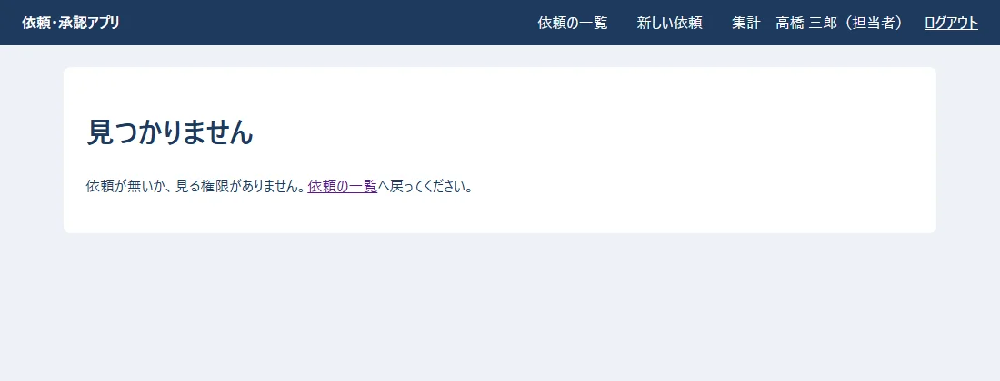

## 11. サーバーへ持ち込む

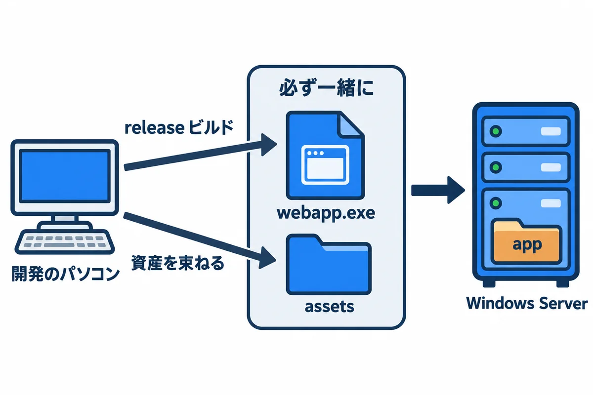

### 11.1 持ち込む物を作る

```powershell
cargo build --release
topcoat asset bundle --release
```

実際の出力:

```text
    Finished `release` profile [optimized] target(s) in 54.12s
bundled assets into C:\…\08_topcoat_app\webapp\target\release\assets
```

できた物:

| 物 | 大きさ・中身 |
|---|---|
| `target\release\webapp.exe` | 9,575,424 バイト（約 9.1MB） |
| `target\release\assets\` | `styles-….css`・`drawing-….js`・`manifest.toml` |

- **`webapp.exe` と `assets\` は、必ず一緒に**持ち込みます（onprem の 04 の 6 章）。ファイル名の `-…` の所は中身から作った印なので、CSS を直すと変わります。古い `assets\` と混ぜないでください。
- サーバーに Rust も Node.js も要りません。部品は全部、exe の中に入っています。

### 11.2 サーバーでの設定

onprem の 04 の 7 章の XML に、前編の 3 章の名前で書きます。検証のサーバーでは `APP_ENV=staging` と `MAIL_REDIRECT_TO` を書きます（書かないと起動しない）。

| onprem の 04 | この巻で関係する所 |
|---|---|
| 5 章 データベースを作る | 表は、`webapp.exe` が起動のときに作る（前編の 4.1） |
| 6.4 HTTP 用のクッキー | `src/http_cookie.rs`（前編の 5.1） |
| 7 章 サービスにする（WinSW） | 環境変数の名前（前編の 3 章） |
| 7.7 初期データ | `webapp.exe import-employees`・`grant-role`・`set-password`（前編の 8 章） |
| 8.3 Host をそのまま渡す | OriginPolicy（10 章） |
| 8.5 送る大きさの上限 | `BodyLimit`（5.3） |
| 10 章 メール | `SMTP_HOST`・`SMTP_PORT=25`・STARTTLS（前編の 6.2。詳しくは 09 の巻） |
| 12.1 毎朝 8:00 の処理 | `src/jobs.rs`（前編の 9 章） |

**確かめること:** サーバーで `http://webapp.example.local/health` を開くと `ok`。ログインして依頼を出すと、1 人目に承認のお願いのメールが届く（検証では `MAIL_REDIRECT_TO` の宛先に届く）。

## 12. 06 と 08 を比べる（まとめ）

| 仕事 | 06 Django＋React | 08 Topcoat |
|---|---|---|
| URL を決める | `urls.py` に並べる | モジュールの並び（`module_router!`） |
| 画面 | React（ブラウザ）＋ JSON の API | `view!`（サーバーで HTML） |
| 入力の確かめ | DRF のシリアライザー | `FormValues::validate`・serde |
| ログイン | Django の認証・セッション | Topcoat のセッション＋自分の `sessions` の表 |
| CSRF | CSRF トークン | `Origin` と `Host` を比べる |
| 状態を変える | `services.py`・`@transaction.atomic` | `workflow.rs`・`pool.begin()` |
| 確定してから送る | `transaction.on_commit` | 送る物の箱（`Outbox`） |
| 同時に押されたら | `select_for_update()` | `FOR UPDATE` |
| 表を作る | `makemigrations`・`migrate` | `migrations/*.sql`（起動のときに流す） |
| 毎朝の通知 | タスク スケジューラ | アプリの中で 1 分ごとに確かめる |
| テスト | `TestCase`・`mail.outbox` | `#[sqlx::test]`・`MemoryTransport` |
| サーバーに置く物 | Python・部品・React の成果物 | `webapp.exe`・`assets\` |

どちらを選ぶかの考え方は、onprem の 03（技術スタックの比較と選定理由）にあります。

## 13. よくある失敗（後編）

| 起きたこと | 原因 | 直し方 |
|---|---|---|
| 起動すると「assets フォルダがありません」 | `topcoat asset bundle` を動かしていない | 動かしてから起動する（release なら `--release`） |
| CSS を直したのに、画面が変わらない | 束ね直していない | `topcoat asset bundle` をもう一度 |
| ログイン・保存などを押すと `403`（本文が forbidden だけ） | IIS が `Host` を書きかえている | onprem の 04 の 8.3 の `preserveHostHeader` |
| ログインしても、すぐログインの画面に戻る | 決まりのクッキー（`Secure` 付き）のまま、HTTP で動かしている | `HttpCookieTokenStore` を使う（前編の 5.1） |
| 添付を付けて送ると `413` | アプリの上限を超えた | `BodyLimit` の値を見る（5.3） |
| 添付を付けて送ると `404.13` | IIS の上限を超えた | onprem の 04 の 8.5 |
| `view!` で `required` がエラーになる | 値の無い属性は、そのままでは書けない | `required=""` と書く |
| `` the trait bound `&Href<…>: AttributeValueViewParts` is not satisfied `` | `href!` で作った物を変数に入れ、`&` を付けて何回も使おうとした | 使う所ごとに `href!(…)` を書く |
| 図面を描けない | JavaScript が止まっている・`drawing.js` が束ねられていない | ブラウザの開発者ツールの「コンソール」を見る |

## 14. 練習問題

1. 一覧に「希望の納期が近い順」に並べかえるリンクを足してください（`ListQuery` に項目を足し、`list_requests` の `ORDER BY` を変える）。並べ方を URL の文字から SQL に入れるときは、どう書けば安全ですか（ヒント: 前編の 6.5）。
2. 件名に `<b>太字</b>` と入れて依頼を出し、一覧と詳しい画面でどう見えるかを確かめてください。なぜ太字にならないのでしょう。
3. 外枠の `error_boundary(…)` を外して `(slot)` だけにし、`/requests/999` を開いてください。何が変わりますか。
4. 回覧者の `<select>` で、同じ人を 2 回選んで送ってください。どこで、どんな文で断られますか。
5. `drawing.js` に「線を引く」道具を足してください（`kind: "line"`）。サーバーの側は、直す必要がありますか。

## 用語の索引

| 用語 | 意味 | 出てくる所 |
|---|---|---|
| `view!` | Rust の中に HTML を書く、Topcoat の書き方 | 1・2 |
| コンポーネント | `#[component]` を付けた、画面の部品の関数 | 2 |
| XSS | 画面に、ほかの人が書いたスクリプトを動かされる攻撃 | 2・6.2 |
| multipart | ファイルを含むフォームを送る形 | 5.1 |
| BodyLimit | 受け取る大きさの上限 | 5.3 |
| serde | Rust の形と、JSON などの行き来をする部品 | 6.1 |
| 資産（asset） | CSS・JavaScript・画像など、画面が使うファイル | 6.2・11 |
| OriginPolicy | `Origin` と `Host` を比べて、ほかのサイトからの送信を断る仕組み | 10 |
| CSRF | ほかのサイトのページから、勝手にフォームを送らせる攻撃 | 10 |
| error_boundary | ページのエラーを受け止めて、代わりの画面を出す仕組み | 1・10 |
| release ビルド | 速く動くように仕上げてコンパイルすること | 11 |
