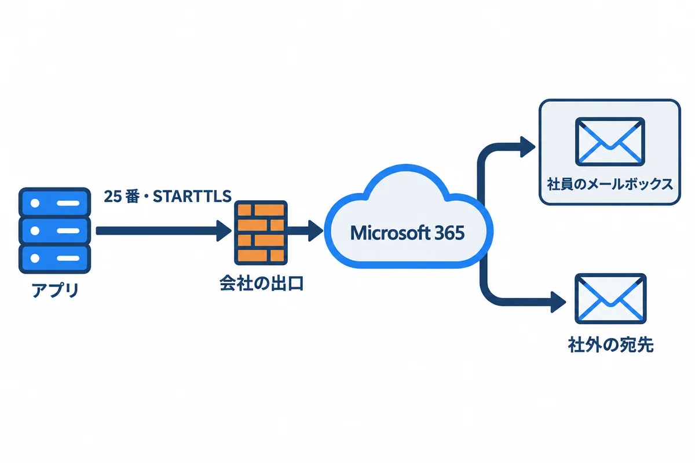
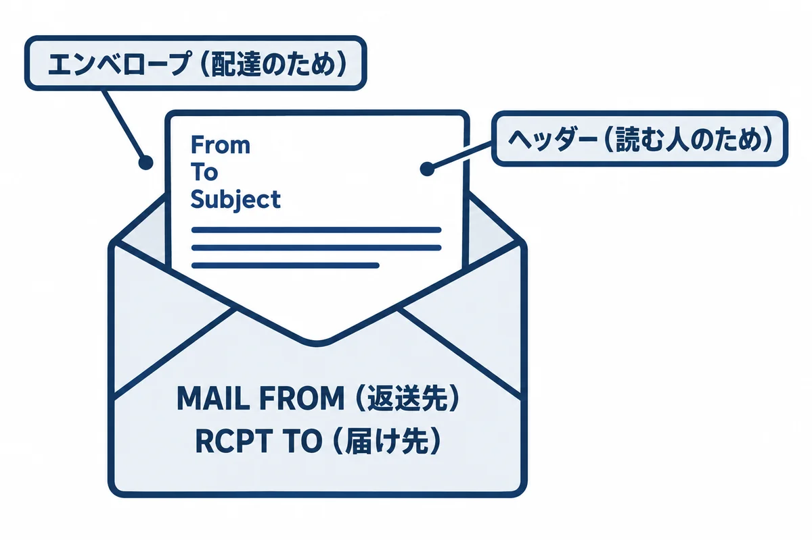
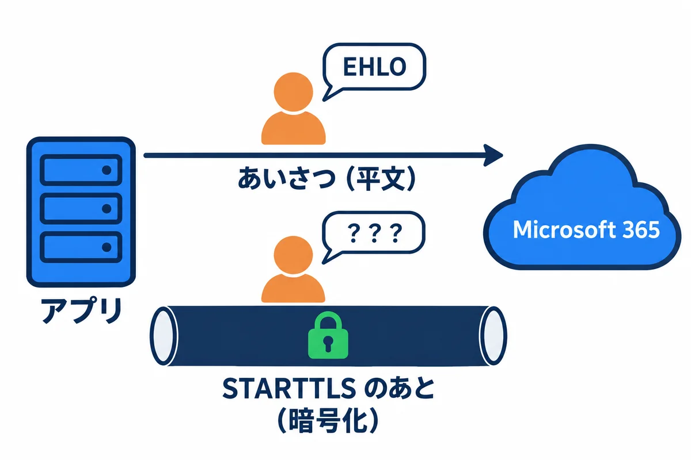
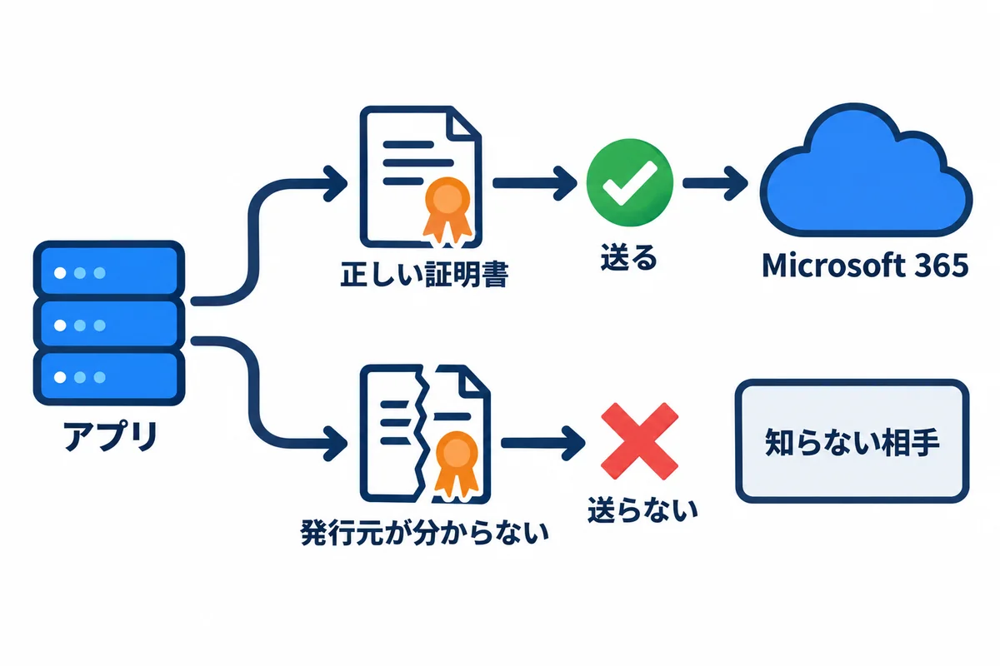
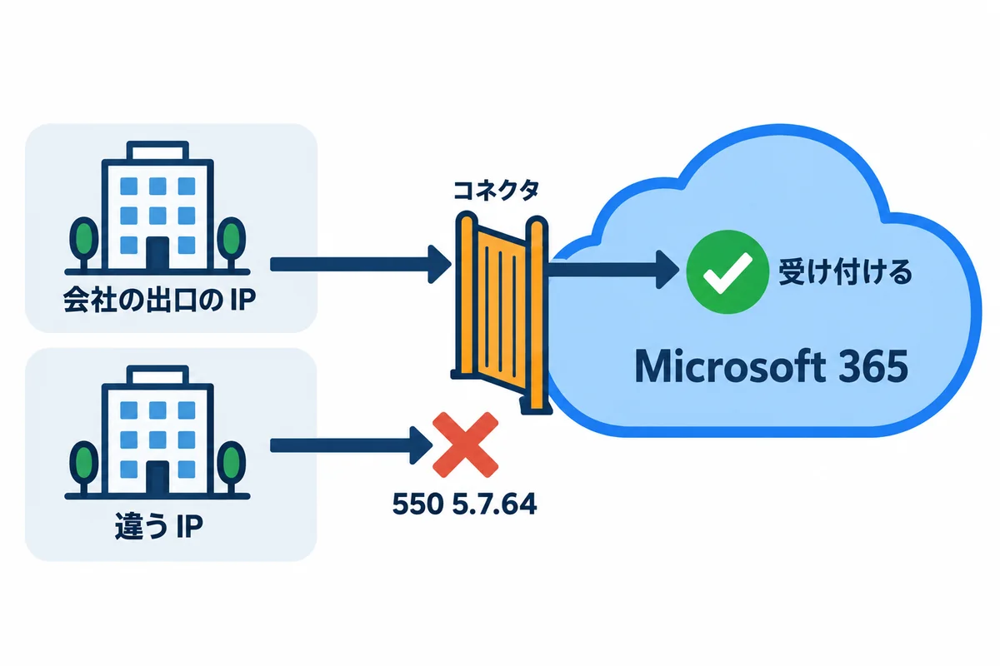
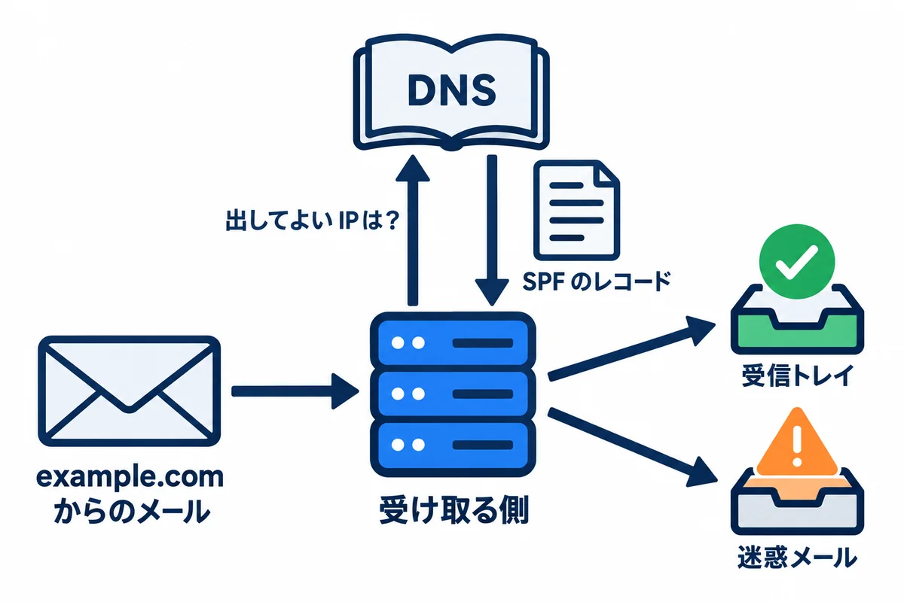
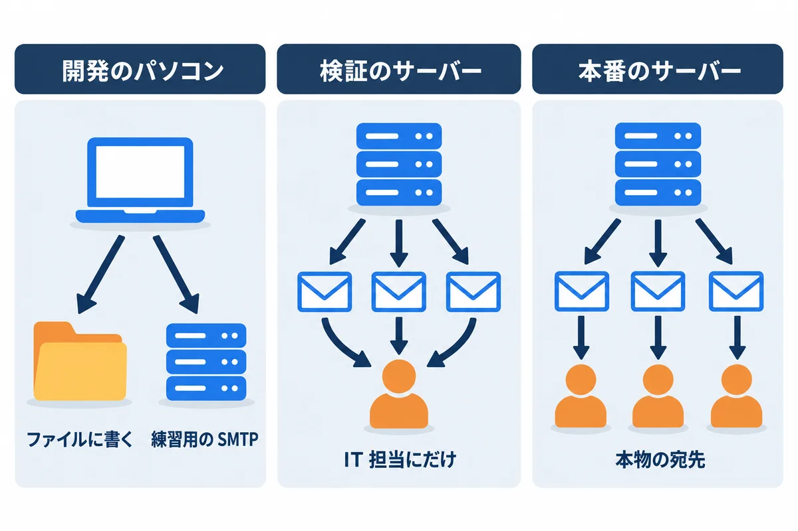

<div style="text-align: center; padding: 28px 0 8px;">
<div style="font-size: 14px; color: #475569;">Web アプリ開発 学習資料</div>
<div style="font-size: 26px; font-weight: 800; color: #0f172a; margin-top: 6px; line-height: 1.35;">09 メールと SMTP リレー — アプリからメールが届くまで</div>
<div style="font-size: 13px; color: #475569; margin-top: 8px;">SMTP の会話を手元で見て、暗号化（STARTTLS）・証明書・Microsoft 365 のリレーの仕組みと、困ったときの切り分けを学ぶ</div>
</div>

# 09 メールと SMTP リレー: アプリからメールが届くまで

## この巻について

06 と 08 の練習アプリは、「承認のお願い」「差し戻し」「回覧完了」などを**メールで知らせます**。会社のサーバーでは、onprem の 04 の 10 章のとおり、**Microsoft 365 の SMTP リレー**（25 番・STARTTLS）にメールを渡します。

この巻では、

1. メールが届くまでの道と、**SMTP の会話**を、手元で実際に見ます。
2. **暗号化（STARTTLS）と証明書の確かめ**が、なぜ要るのかを、わざと失敗させて確かめます。
3. Microsoft 365 の SMTP リレー（コネクタ・SPF）の仕組みを知ります。
4. 06 と 08 の両方のアプリに足した「**テストのメールを送る**」コマンドで、手元から送ってみます。
5. 届かないときに、**どこで止まっているかを分ける**順番を覚えます。

- **試して確かめた範囲:** 2026-11-02 に、開発のパソコンの中で、練習用の SMTP サーバー（Python 3.12）・Django 5.2.18（Python 3.14）・Topcoat 0.11.0 で**実際に動かしました**。会話とエラーの文は、そのときの物です（パソコンの名前だけ伏せた）。
- **本物の Microsoft 365 には送っていません**（会社のアカウントと、情報システム部門の設定が要るため）。6 章の Microsoft 365 の所は、Microsoft の公式のドキュメントの説明（onprem の 04 の 10.1 と同じ）です。サーバーで確かめることは、9 章と onprem の 04 の 10 章に書きました。

| 練習のファイル | 中身 |
|---|---|
| `samples/09_mail/smtp_sink.py` | 練習用の「受け取るだけ」の SMTP サーバー（どこへも転送しない） |
| `samples/09_mail/send_test.py` | Python の smtplib で、テストのメールを 1 通送る |
| `samples/06_django_react/backend/workflow/management/commands/send_test_mail.py` | Django のアプリの「テストのメールを送る」コマンド |
| `samples/08_topcoat_app/webapp/src/cli.rs` の `send_test_mail` | Topcoat のアプリの「テストのメールを送る」コマンド |

## 1. メールが届くまで



| 登場するもの | 役目 | この資料では |
|---|---|---|
| アプリ（送る側） | メールを作り、SMTP で渡す | 06 の Django・08 の Topcoat |
| 会社の出口 | 会社のネットワークとインターネットの境目。通してよい通信を決める | 25 番を外へ通してもらう（onprem の 04 の 10.2） |
| Microsoft 365（Exchange Online） | 受け取ったメールを、宛先まで届ける（**リレー**＝中継） | `example-com.mail.protection.outlook.com` の 25 番 |
| 宛先のメールボックス | 社員が Outlook で読む所 | 承認者・依頼者 |

- Web の画面は **HTTP**（ブラウザ ⇄ サーバー）でした。メールは **SMTP**（送る側 → 受け取る側）です。どちらも「文字の行をやり取りする」決まりです（2 章で実際に見ます）。
- アプリは、宛先の人のパソコンに直接は届けません。**届けるのは Microsoft 365 の仕事**です。アプリの仕事は「Microsoft 365 に、正しく受け取ってもらう」所までです。

> **用語:** SMTP（Simple Mail Transfer Protocol。メールを渡すときの決まり）。リレー（受け取ったメールを、次の所へ中継すること）。MX（ドメインの「メールの受付」の場所。DNS に書いてある）

## 2. SMTP の会話を見る

### 2.1 練習用の「受け取るだけ」の SMTP サーバー

**▶ 準備:** 00 の 6.4（Python。標準の部品だけを使うので、仮想環境は要りません）。下のコマンドは、PowerShell で資料のフォルダから `cd webapp_learning\samples\09_mail` と移動してから打ちます。練習用のサーバーの窓は動かしたままにして、送る側は**もう 1 つ PowerShell を開いて**、同じフォルダに移動してから打ちます。

本物のメールサーバーに送らずに、会話を見るため、**受け取るだけ**の SMTP サーバーを用意しました。届いた会話をそのまま画面に出し、メールを `received\` に保存します。どこへも転送しないので、本物の人には届きません。

`samples/09_mail/smtp_sink.py`:

```python
"""練習用の「受け取るだけ」の SMTP サーバー。

届いた SMTP の会話を、そのまま画面に出し（C: は送ってきた側、S: はこのサーバー）、
メールを received/ フォルダに .eml で保存します。どこへも転送しません（本物の人には届きません）。
開発のパソコンだけで使います。Python の標準の部品だけで動きます（Python 3.11 以上）。

使い方:
  python smtp_sink.py                          127.0.0.1:1025 で待つ（暗号化なし）
  python smtp_sink.py --tls cert.pem key.pem   STARTTLS も使えるようにする（証明書は README の手順で作る）
止めるときは Ctrl+C。
"""

import argparse
import asyncio
import datetime
import pathlib
import ssl

HOST = "127.0.0.1"
OUT = pathlib.Path(__file__).with_name("received")


def show(who: str, line: str) -> None:
    print(f"{who}: {line}", flush=True)


async def handle(reader: asyncio.StreamReader, writer: asyncio.StreamWriter, tls_ctx: ssl.SSLContext | None) -> None:
    peer = writer.get_extra_info("peername")
    print(f"---- {peer[0]}:{peer[1]} からつながった ----", flush=True)

    async def send(line: str) -> None:
        show("S", line)
        writer.write((line + "\r\n").encode("ascii"))
        await writer.drain()

    async def recv() -> str | None:
        data = await reader.readline()
        if not data:
            return None
        line = data.decode("utf-8", "replace").rstrip("\r\n")
        show("C", line)
        return line

    tls = False
    mail_from, rcpts = None, []
    await send("220 localhost ESMTP practice-sink")
    while (line := await recv()) is not None:
        cmd = line.split(" ", 1)[0].upper()
        if cmd in ("EHLO", "HELO"):
            if cmd == "HELO":
                await send("250 localhost")
                continue
            lines = ["250-localhost", "250-SIZE 36700160", "250-8BITMIME"]
            if tls_ctx and not tls:
                lines.append("250-STARTTLS")  # 「暗号化に切りかえられます」という知らせ
            lines.append("250 SMTPUTF8")
            for item in lines:
                await send(item)
        elif cmd == "STARTTLS" and tls_ctx and not tls:
            await send("220 2.0.0 Ready to start TLS")
            try:
                await writer.start_tls(tls_ctx)
            except ssl.SSLError as e:
                # 送る側が、このサーバーの証明書を信じなかった（自分で作った証明書のときに起きる）
                print(f"---- 暗号化に切りかえられなかった: {e.reason} ----", flush=True)
                break
            print("---- ここから先は暗号化されている（途中の機器からは読めない）----", flush=True)
            tls, mail_from, rcpts = True, None, []  # 暗号化のあとは、EHLO からやり直す決まり
        elif cmd == "MAIL":
            mail_from, rcpts = line[10:].strip(), []
            await send("250 2.1.0 OK")
        elif cmd == "RCPT":
            rcpts.append(line[8:].strip())
            await send("250 2.1.5 OK")
        elif cmd == "DATA":
            if not mail_from or not rcpts:
                await send("503 5.5.1 MAIL and RCPT first")
                continue
            await send("354 End data with <CR><LF>.<CR><LF>")
            raw, in_header, body_lines = [], True, 0
            while True:
                data = await reader.readline()
                if data in (b".\r\n", b".\n", b""):
                    break
                if data.startswith(b".."):
                    data = data[1:]  # 行の頭の「.」を 2 つにして送る決まり（ドットの詰め直し）を戻す
                raw.append(data)
                text = data.decode("utf-8", "replace").rstrip("\r\n")
                if in_header:
                    show("C", text)
                    in_header = text != ""
                else:
                    body_lines += 1
            show("C", f"（本文 {body_lines} 行。表示は省く）")
            show("C", ".")
            OUT.mkdir(exist_ok=True)
            name = datetime.datetime.now().strftime("%Y%m%d-%H%M%S-%f") + ".eml"
            (OUT / name).write_bytes(b"".join(raw))
            await send(f"250 2.0.0 OK queued as {name}")
            mail_from, rcpts = None, []
        elif cmd == "RSET":
            mail_from, rcpts = None, []
            await send("250 2.0.0 OK")
        elif cmd == "NOOP":
            await send("250 2.0.0 OK")
        elif cmd == "QUIT":
            await send("221 2.0.0 Bye")
            break
        else:
            await send("502 5.5.2 Command not recognized")
    writer.close()
    print("---- 切れた ----", flush=True)


async def main() -> None:
    parser = argparse.ArgumentParser(description="練習用の、受け取るだけの SMTP サーバー")
    parser.add_argument("--port", type=int, default=1025)
    parser.add_argument("--tls", nargs=2, metavar=("CERT", "KEY"), help="STARTTLS に使う証明書と鍵")
    args = parser.parse_args()
    tls_ctx = None
    if args.tls:
        tls_ctx = ssl.create_default_context(ssl.Purpose.CLIENT_AUTH)
        tls_ctx.load_cert_chain(*args.tls)
    server = await asyncio.start_server(lambda r, w: handle(r, w, tls_ctx), HOST, args.port)
    print(f"{HOST}:{args.port} で待っています（STARTTLS: {'あり' if tls_ctx else 'なし'}）。Ctrl+C で止める。", flush=True)
    async with server:
        await server.serve_forever()


if __name__ == "__main__":
    try:
        asyncio.run(main())
    except KeyboardInterrupt:
        pass
```

<!-- first-use -->

> **▶ ここで初めて出てくるコード**
>
> - **`async`**（Python）: Python で、中で `await` を使える関数にする印（`async def handle(…):`）。`asyncio` の仕組みの上で、たくさんの接続を同時にさばけます。
> - **`await`**（Python）: Python の `async` の関数の中で、時間のかかる処理が終わるまで待つ書き方。`await writer.drain()`。
> - **`while`**（Python）: Python で、条件が `True` の間くり返す書き方。`while True:` は、`break` で抜けるまでずっとくり返します。
> - **`break`**（Python）: Python のくり返しを、途中で抜ける命令。
> - **`pass`**（Python）: 「何もしない」という Python の命令。中身が要らないけれど、形の上で何か書く必要がある所に置きます。
> - **`.Path()`**（Python）: `pathlib.Path(場所)` は、ファイルやフォルダの場所を表す物を作る関数です。`/` でつなげられます。
> - **`.with_name()`**（Python）: `Path` の、最後の名前だけを取りかえた場所を返すメソッド。`Path(__file__).with_name("received")` は「このファイルと同じフォルダの received」。
> - **`.get_extra_info()`**（Python）: `asyncio` の接続から、相手の住所などの情報を取り出すメソッド。
> - **`.drain()`**（Python）: `asyncio` の接続で、書いた物を送り終わるまで待つメソッド（`await writer.drain()`）。
> - **`.readline()`**（Python）: 1 行だけ読むメソッド。
> - **`.decode()`**（Python）: バイトの並びを、文字列に直すメソッド。`data.decode("utf-8", "replace")` は、読めない所を `�` にして直します。
> - **`.rstrip()`**（Python）: 文字列の後ろ（右側）から、空白や指定した文字を取り除くメソッド。`.rstrip("\r\n")` は行の終わりの改行を取ります。
> - **`.upper()`**（Python）: 英字を大文字にした文字列を返すメソッド。
> - **`.start_tls()`**（Python）: `asyncio` の接続を、途中から暗号化（TLS）に切りかえるメソッド（STARTTLS。09 巻）。
> - **`.mkdir()`**（Python）: `Path` のフォルダを作るメソッド。`exist_ok=True` で「もうあってもよい」、`parents=True` で途中のフォルダもまとめて作ります。
> - **`.write_bytes()`**（Python）: `Path` のファイルに、バイトの並びをそのまま書くメソッド。
> - **`.join()`**（Python）: Python で、区切り文字の方に付けて、リストの中身をつなぐメソッド。`" ".join(["a", "b"])` は `"a b"`（TypeScript とは書く順番が逆なので注意）。
> - **`.close()`**（Python）: 接続やファイルを閉じるメソッド。
> - **`.ArgumentParser()`**（Python）: `argparse.ArgumentParser()` は、コマンドの引数（`--port 2525` など）を読み取る係を作る関数です。
> - **`.parse_args()`**（Python）: 決めておいた引数の形で、実際に渡された引数を読み取るメソッド。
> - **`.create_default_context()`**（Python）: `ssl.create_default_context()` は、暗号化（TLS）の設定を、おすすめの値で作る関数です。
> - **`.load_cert_chain()`**（Python）: TLS の設定に、サーバーの証明書と秘密鍵のファイルを読み込むメソッド。
> - **`.start_server()`**（Python）: `asyncio.start_server(関数, ホスト, ポート)` は、接続を待ち受けるサーバーを始める関数です。接続が来るたびに、渡した関数が動きます。
> - **`.serve_forever()`**（Python）: HTTP のサーバーを、止めるまでずっと動かし続けるメソッド。
> - **`.run()`**（Python）: `asyncio.run(main())` は、非同期の関数（`async def`）を動かして、終わるまで待ちます。非同期のプログラムは、ここから始まります。
> - **`%S`**（日時の書式）: 日時の書式の `%S`（大文字）は、2 けたの秒（`00`〜`59`）です。
> - **`%f`**（日時の書式）: 日時の書式の `%f` は、秒より細かい部分（Python では 6 けたのマイクロ秒）です。同じ秒に作ったファイルの名前が、重ならないようにする時に使います。
> - **`:=`**（Python）: `while (line := await recv()) is not None:` の `:=` は、「値を変数に入れて、その値をその場で使う」書き方です（セイウチ演算子）。
> - **`is not`**（Python）: `x is not None` は、「x が None ではない」です。`None` かどうかは、`==` ではなく `is` で調べます。
> - **`KeyboardInterrupt`**（Python）: `KeyboardInterrupt` は、`Ctrl` ＋ `C` で止めた時に起きる、エラーの種類です。`except KeyboardInterrupt:` で受け止めると、止める時の後片づけができます。

<!-- /first-use -->

```powershell
cd webapp_learning\samples\09_mail
python smtp_sink.py      # 127.0.0.1:1025 で待つ。この窓は動かしたままにする
```

<!-- first-use -->

> **▶ ここで初めて出てくるコード**
>
> - **`python`**（Python の道具）: Python を動かすコマンド。`python -c "…"` は、`"…"` の中の Python のコードを 1 回だけ動かします。

<!-- /first-use -->

### 2.2 Python で 1 通送る

`samples/09_mail/send_test.py`:

```python
"""Python の smtplib で、テストのメールを 1 通送る（送る側から見た SMTP の会話を出す）。

使い方:
  python send_test.py                                  127.0.0.1:1025 へ、暗号化なしで
  python send_test.py --starttls --cafile cert.pem     STARTTLS で暗号化してから（自分で作った証明書を信じる）
"""

import argparse
import smtplib
import ssl
from email.message import EmailMessage


def main() -> None:
    parser = argparse.ArgumentParser()
    parser.add_argument("--host", default="127.0.0.1")
    parser.add_argument("--port", type=int, default=1025)
    parser.add_argument("--starttls", action="store_true")
    parser.add_argument("--cafile", help="信じる証明書（練習用に自分で作った物）")
    args = parser.parse_args()

    msg = EmailMessage()
    msg["From"] = "noreply@example.com"
    msg["To"] = "sato@example.com"
    msg["Subject"] = "【依頼・承認】送信テスト"
    msg.set_content("SMTP の練習のメールです。\n")

    with smtplib.SMTP(args.host, args.port, local_hostname="dev-pc", timeout=10) as smtp:
        smtp.set_debuglevel(1)  # やり取りを画面に出す
        smtp.ehlo()
        if args.starttls:
            smtp.starttls(context=ssl.create_default_context(cafile=args.cafile))
            smtp.ehlo()  # 暗号化のあとは、もう一度あいさつする
        smtp.send_message(msg)
    print("送りました。")


if __name__ == "__main__":
    main()
```

<!-- first-use -->

> **▶ ここで初めて出てくるコード**
>
> - **`.set_content()`**（Python）: メール（`EmailMessage`）の本文を決めるメソッド。
> - **`.SMTP()`**（Python）: `smtplib.SMTP(ホスト, ポート)` は、メールを送るためにメールのサーバー（SMTP）へつなぐ関数です。
> - **`.set_debuglevel()`**（Python）: `smtp.set_debuglevel(1)` で、SMTP のやり取りを画面に表示します（練習や、届かない時の調べ）。
> - **`.ehlo()`**（Python）: SMTP のサーバーに、最初のあいさつ（EHLO）を送るメソッド。
> - **`.starttls()`**（Python）: `smtplib` で、メールサーバーとの接続を、途中から暗号化（TLS）に切りかえるメソッド。`smtp.starttls()` のあとに送る中身は、暗号化されます。
> - **`.send_message()`**（Python）: 用意したメールを、SMTP のサーバーへ渡して送るメソッド。
> - **`EmailMessage`**（Python）: `EmailMessage`（`email.message`）は、メール 1 通（宛先・件名・本文）を組み立てる型です。

<!-- /first-use -->

別の窓で `python send_test.py` を動かしたときの、**受け取る側（練習用のサーバー）の画面**（`C:` は送ってきた側、`S:` はサーバーの返事）:

```text
127.0.0.1:1025 で待っています（STARTTLS: なし）。Ctrl+C で止める。
---- 127.0.0.1:59901 からつながった ----
S: 220 localhost ESMTP practice-sink
C: ehlo dev-pc
S: 250-localhost
S: 250-SIZE 36700160
S: 250-8BITMIME
S: 250 SMTPUTF8
C: mail FROM:<noreply@example.com> size=254
S: 250 2.1.0 OK
C: rcpt TO:<sato@example.com>
S: 250 2.1.5 OK
C: data
S: 354 End data with <CR><LF>.<CR><LF>
C: From: noreply@example.com
C: To: sato@example.com
C: Subject: =?utf-8?b?44CQ5L6d6aC844O75om/6KqN44CR6YCB5L+h44OG44K544OI?=
C: Content-Type: text/plain; charset="utf-8"
C: Content-Transfer-Encoding: 8bit
C: MIME-Version: 1.0
C: 
C: （本文 1 行。表示は省く）
C: .
S: 250 2.0.0 OK queued as 20261102-012242-260773.eml
C: QUIT
S: 221 2.0.0 Bye
---- 切れた ----
```

**送る側（smtplib）の画面**（`set_debuglevel(1)` で出した物。最初の所だけ）:

```text
send: 'ehlo dev-pc\r\n'
reply: b'250-localhost\r\n'
reply: b'250-SIZE 36700160\r\n'
reply: b'250-8BITMIME\r\n'
reply: b'250 SMTPUTF8\r\n'
reply: retcode (250); Msg: b'localhost\nSIZE 36700160\n8BITMIME\nSMTPUTF8'
send: 'mail FROM:<noreply@example.com> size=254\r\n'
reply: b'250 2.1.0 OK\r\n'
reply: retcode (250); Msg: b'2.1.0 OK'
send: 'rcpt TO:<sato@example.com>\r\n'
reply: b'250 2.1.5 OK\r\n'
reply: retcode (250); Msg: b'2.1.5 OK'
```

### 2.3 会話の読み方

| 行 | 意味 |
|---|---|
| `S: 220 …` | 「つながりました。話してください」 |
| `C: EHLO 名前` | あいさつ（自分の名前を名乗る）。返事の `250-…` の行に、サーバーが使える機能が並ぶ |
| `C: MAIL FROM:<…>` | 送り主（届かなかったときの返送先）。3 章 |
| `C: RCPT TO:<…>` | 届け先。宛先が 3 人なら 3 回送る |
| `C: DATA` → `S: 354` | 「本文を送ります」→「どうぞ。最後に `.` だけの行を送って」 |
| ヘッダー・空の行・本文・`.` | メールそのもの（4 章） |
| `S: 250 2.0.0 OK queued …` | 「受け取りました」。ここで、送る側の仕事は終わり |
| `C: QUIT` → `S: 221` | 「終わります」 |

返事の頭の 3 けたの数で、結果が分かります。

| 頭の数 | 意味 | 送る側がすること |
|---|---|---|
| 2xx | うまくいった | 次へ進む |
| 3xx | 続きを待っている（`354` など） | 続きを送る |
| 4xx | **一時的に**だめ（混んでいる など） | しばらくしてから送り直す |
| 5xx | **ずっと**だめ（宛先が無い・許されていない など） | 送り直さない。原因を直す |

`2.1.0` のような数は、もっと細かい理由です（例: 6.1 の `550 5.7.64` の `5.7.64` は「許されていない送り主」）。

## 3. エンベロープとヘッダー



メールには、**宛先が 2 か所**にあります。

| 所 | 書く物 | だれのため |
|---|---|---|
| エンベロープ（封筒の表） | `MAIL FROM`・`RCPT TO`（SMTP の命令で渡す） | 配達する仕組みのため。実際の届け先は、こちらで決まる |
| ヘッダー（便せんの頭） | `From:`・`To:`・`Subject:` など | 読む人のため。Outlook に出るのは、こちら |

- **BCC** は、エンベロープの `RCPT TO` にだけ書き、ヘッダーには書きません。だから、ほかの宛先の人からは見えません。
- 届けられなかったときの「届きませんでした」のメール（エラーの返事）は、エンベロープの `MAIL FROM` へ戻ります。

## 4. 日本語のメール（MIME と base64）

2.2 の会話のヘッダーに、こんな行がありました。

```text
Subject: =?utf-8?b?44CQ5L6d6aC844O75om/6KqN44CR6YCB5L+h44OG44K544OI?=
```

SMTP は、もとは英字だけを運ぶ決まりでした。日本語は、**MIME**（メールに英字以外を入れる決まり）で、英字だけの形に変えて運びます。`=?utf-8?b?…?=` は「UTF-8 の文字を、base64 という形で書いた」という印です。Python で読み解くと（実際の出力）:

```text
【依頼・承認】送信テスト
```

- 本文の運び方は、部品によって違います。08 の Topcoat（lettre）は本文も base64 に、06 の Django（Python）は `Content-Transfer-Encoding: 8bit`（UTF-8 のまま）で送りました（8.1・8.2 の会話）。どちらも決まりに合った形で、Outlook では普通に読めます。
- 文字の形を変えるのは、メールの部品（Django・Topcoat）の仕事です。**件名や本文を自分で組み立てて SMTP に流す**ことはしません（文字化けや、改行を使った攻撃の元になる。10 の巻）。

## 5. ポートと暗号化

| ポート | 主な使い道 | 暗号化 |
|---|---|---|
| **25** | サーバーどうしの受け渡し。**Microsoft 365 の SMTP リレーもこれ** | 始めは暗号化なし → `STARTTLS` で切りかえる |
| 587 | メールソフトから送る（ID とパスワードで入る） | `STARTTLS` で切りかえる |
| 465 | 587 と同じ使い道 | 最初から暗号化（implicit TLS） |

### 5.1 STARTTLS: 途中から暗号化に切りかえる



練習用のサーバーを、自分で作った証明書で STARTTLS を使えるようにして（`samples/09_mail/README.md` の手順）、Python から送った時の、受け取る側の画面:

```text
127.0.0.1:1026 で待っています（STARTTLS: あり）。Ctrl+C で止める。
---- 127.0.0.1:52058 からつながった ----
S: 220 localhost ESMTP practice-sink
C: ehlo dev-pc
S: 250-localhost
S: 250-SIZE 36700160
S: 250-8BITMIME
S: 250-STARTTLS
S: 250 SMTPUTF8
C: STARTTLS
S: 220 2.0.0 Ready to start TLS
---- ここから先は暗号化されている（途中の機器からは読めない）----
C: ehlo dev-pc
S: 250-localhost
S: 250-SIZE 36700160
S: 250-8BITMIME
S: 250 SMTPUTF8
C: mail FROM:<noreply@example.com> size=254
S: 250 2.1.0 OK
C: rcpt TO:<sato@example.com>
S: 250 2.1.5 OK
C: data
S: 354 End data with <CR><LF>.<CR><LF>
C: From: noreply@example.com
C: To: sato@example.com
C: Subject: =?utf-8?b?44CQ5L6d6aC844O75om/6KqN44CR6YCB5L+h44OG44K544OI?=
C: Content-Type: text/plain; charset="utf-8"
C: Content-Transfer-Encoding: 8bit
C: MIME-Version: 1.0
C: 
C: （本文 1 行。表示は省く）
C: .
S: 250 2.0.0 OK queued as 20261102-012511-944465.eml
C: QUIT
S: 221 2.0.0 Bye
---- 切れた ----
```

- 1 回目の `EHLO` の返事に `250-STARTTLS`（暗号化に切りかえられます）があります。
- `STARTTLS` → `220 … Ready to start TLS` のあと、**ここから先は暗号化**されます。会社のネットワークの途中の機器からは、宛先も本文も読めません（練習用のサーバーは、受け取る本人なので読めます）。
- 暗号化のあとは、`EHLO` からやり直す決まりです。2 回目の返事には、もう `STARTTLS` はありません。

### 5.2 証明書を確かめる（相手は本物か）



暗号化は、**相手が本物**でなければ意味がありません。にせの相手と暗号化しても、にせの相手には全部読まれるからです。そこで、暗号化のときに相手の**証明書**（「このサーバーは本物です」という、信頼できる所が発行した身分証）を確かめます。

練習用の証明書は自分で作った物なので、アプリは信じません。実際に 08 の Topcoat のアプリから送った結果:

```text
エラー: 送れませんでした（渡した先: localhost:1026（STARTTLS: 使う））: could not deliver the mail
  原因: Connection error: Connection error: invalid peer certificate: UnknownIssuer
  原因: Connection error: invalid peer certificate: UnknownIssuer
  原因: invalid peer certificate: UnknownIssuer
```

そのときの、受け取る側の画面:

```text
---- 127.0.0.1:52060 からつながった ----
S: 220 localhost ESMTP practice-sink
C: EHLO （パソコンの名前）
S: 250-localhost
S: 250-SIZE 36700160
S: 250-8BITMIME
S: 250-STARTTLS
S: 250 SMTPUTF8
C: STARTTLS
S: 220 2.0.0 Ready to start TLS
---- 暗号化に切りかえられなかった: TLSV1_ALERT_UNKNOWN_CA ----
---- 切れた ----
```

06 の Django のアプリから送った結果:

```text
CommandError: 送れませんでした（渡した先: localhost:1026（STARTTLS: 使う））: SSLCertVerificationError: [SSL: CERTIFICATE_VERIFY_FAILED] certificate verify failed: self-signed certificate (_ssl.c:1081)
```

- どちらも、**暗号化に切りかえる所で止まり、メールは送っていません**（`MAIL FROM` まで進んでいない）。
- Microsoft 365 は、正しく発行された証明書を使っているので、この失敗は起きません。**会社のネットワークに、通信をのぞいて調べる機器がある**と、証明書が入れかわって、この失敗が起きることがあります。そのときは、確かめを止めるのではなく、情報システム部門に相談します（9 章）。
- **証明書の確かめを止める（無効にする）設定は、絶対にしません。** 06・08 のアプリにも、その設定は作っていません。

> **用語:** 証明書（サーバーの身分証。信頼できる発行元（認証局）の署名が付いている）。UnknownIssuer（発行元が分からない＝信じられる発行元の署名が無い）

### 5.3 STARTTLS を使えない相手には、送らない

本番と同じ設定（STARTTLS を使う）で、STARTTLS を使えない相手（2.1 の暗号化なしの練習用サーバー）に送った結果です。

Topcoat:

```text
エラー: 送れませんでした（渡した先: 127.0.0.1:1025（STARTTLS: 使う））: could not deliver the mail
  原因: internal client error: STARTTLS is not supported on this server
  原因: STARTTLS is not supported on this server
```

Django:

```text
CommandError: 送れませんでした（渡した先: 127.0.0.1:1025（STARTTLS: 使う））: SMTPNotSupportedError: STARTTLS extension not supported by server.
```

受け取る側の画面（あいさつだけで切れた。どちらも同じ）:

```text
---- 127.0.0.1:55579 からつながった ----
S: 220 localhost ESMTP practice-sink
C: ehlo （パソコンの名前）
S: 250-localhost
S: 250-SIZE 36700160
S: 250-8BITMIME
S: 250 SMTPUTF8
---- 切れた ----
```

- 「暗号化できないなら、暗号化しないで送る」ことはしません。**送らずにエラーにします**。宛先や本文を、平文のまま会社のネットワークに流さないためです。
- 練習用のサーバーへ暗号化なしで送る設定（`SMTP_USE_TLS=false`）は、08 では **`APP_ENV=development` のときだけ**使えます（サーバーで書くと、起動しない）。

## 6. Microsoft 365 の SMTP リレー

### 6.1 コネクタ: 送り主を、会社の出口の IP アドレスで見分ける



- SMTP リレーには、ID とパスワードがありません。代わりに Microsoft 365 は、**どこ（どの公開 IP アドレス）から来たか**で、「この会社のメールだ」と見分けます。その決まりが**コネクタ**です（情報システム部門が Exchange 管理センターで作る）。
- コネクタの IP アドレスと、実際の会社の出口の IP アドレスが違うと、`550 5.7.64 TenantAttribution; Relay Access Denied` で断られます（onprem の 04 の 10.3）。
- 送り主のアドレス（`MAIL_FROM`）は、会社が Microsoft 365 で使っているドメインのアドレスにします（例: `noreply@example.com`）。メールボックスは無くてもかまいません。
- ID とパスワードで送る方式（SMTP 認証の基本認証）は、Microsoft が順に使えなくしていくと案内しているので、使いません（onprem の 04 の 10.1）。

### 6.2 SPF: 迷惑メールと判定されないために



受け取る側は、「このドメインのメールを出してよいのは、どこか」を DNS（**SPF のレコード**）に聞いて確かめます。会社の出口の IP アドレスが書いてないと、届いても迷惑メールのフォルダに入りやすくなります。

SPF のレコードの例（`203.0.113.10` は、説明用に決められた IP アドレス。本物は会社の出口の IP アドレス）:

```text
example.com.  TXT  "v=spf1 include:spf.protection.outlook.com ip4:203.0.113.10 -all"
```

| 部分 | 意味 |
|---|---|
| `include:spf.protection.outlook.com` | Microsoft 365 から出すメールは、よい |
| `ip4:203.0.113.10` | この IP アドレスから出すメールも、よい |
| `-all` | それ以外から出た物は、にせ物として扱ってよい |

- SPF を書きかえるのは、情報システム部門（ドメインの DNS を管理している所）です。頼む内容は onprem の 07 付録にまとめます。
- このほかに **DKIM**（メールに電子の署名を付ける）・**DMARC**（SPF と DKIM に合わないメールをどう扱うかの決まり）もあります。会社のドメイン全体の設定なので、これも情報システム部門の決まりに合わせます。

## 7. アプリの設定と、送り方のコード

### 7.1 Django（06）

`config/settings.py` のメールの所:

```python
# メール: 本番は Microsoft 365 の SMTP リレー（25 番・STARTTLS。onprem の 04 の 10 章、この資料の 09）
EMAIL_BACKEND = env("EMAIL_BACKEND", "django.core.mail.backends.smtp.EmailBackend")
EMAIL_FILE_PATH = BASE_DIR / "sent_mail"  # 開発用（dev.ps1 は、メールをここにファイルで書く）
EMAIL_HOST = env("SMTP_HOST", "localhost")
EMAIL_PORT = int(env("SMTP_PORT", "25"))
EMAIL_USE_TLS = env("SMTP_USE_TLS", "true").lower() == "true"
EMAIL_TIMEOUT = 30
DEFAULT_FROM_EMAIL = env("MAIL_FROM", "noreply@example.com")
# 検証では、全部のメールをこの宛先に送る（社員に本物の依頼が届かないように。onprem の 04 の 10.4）
MAIL_REDIRECT_TO = os.environ.get("MAIL_REDIRECT_TO", "")
```

依頼の流れの中で送る所（`workflow/services.py` の `_mail`。06 前編の 5.2）:

```python
def _mail(to: str, subject: str, template: str, context: dict) -> None:
    body = render_to_string(f"workflow/mail/{template}", context)
    subject = f"【依頼・承認】{subject}"
    if settings.MAIL_REDIRECT_TO:  # 検証: 本物の宛先には送らず、決まった宛先へ
        body = f"（検証のメールです。本来の宛先: {to}）\n\n{body}"
        subject, to = f"【検証】{subject}", settings.MAIL_REDIRECT_TO
    # 保存が確定してから送る。途中で取り消されたら、送らない
    transaction.on_commit(lambda: send_mail(subject, body, None, [to]))
```

足した「テストのメールを送る」コマンド `workflow/management/commands/send_test_mail.py`:

```python
"""テストのメールを 1 通送る（メールの道を確かめる。09 の巻）。使い方: .\\dev.ps1 send_test_mail --to 自分のアドレス

サーバーでは onprem の 05 の manage.ps1 から動かす。検証のサーバーでは、MAIL_REDIRECT_TO の宛先に届く。
アプリの不具合か、メールの道（SMTP リレー・ネットワーク）の問題かを分けるために使う。
"""

from django.conf import settings
from django.core.mail import send_mail
from django.core.management.base import BaseCommand, CommandError
from django.utils import timezone


class Command(BaseCommand):
    help = "テストのメールを 1 通送る"

    def add_arguments(self, parser):
        parser.add_argument("--to", required=True, help="送り先（自分のアドレス）")

    def handle(self, to, **options):
        if settings.EMAIL_BACKEND.endswith("smtp.EmailBackend"):
            where = f"{settings.EMAIL_HOST}:{settings.EMAIL_PORT}（STARTTLS: {'使う' if settings.EMAIL_USE_TLS else '使わない'}）"
        else:
            where = settings.EMAIL_BACKEND
        subject = "【依頼・承認】送信テスト"
        body = f"依頼・承認アプリからの、送信テストです。\n\n送った時刻: {timezone.localtime():%Y-%m-%d %H:%M}\n渡した先: {where}\n"
        if settings.MAIL_REDIRECT_TO:  # 検証のサーバーでは、services._mail と同じく宛先を差し替える
            body = f"（検証のメールです。本来の宛先: {to}）\n\n{body}"
            subject, to = f"【検証】{subject}", settings.MAIL_REDIRECT_TO
        try:
            send_mail(subject, body, None, [to])
        except Exception as e:  # 原因の種類（例外の名前）も出して、調べやすくする
            raise CommandError(f"送れませんでした（渡した先: {where}）: {type(e).__name__}: {e}")
        self.stdout.write(f"渡しました（宛先: {to}・渡した先: {where}）。届いたかを、受け取る側で確かめてください。")
```

<!-- first-use -->

> **▶ ここで初めて出てくるコード**
>
> - **`.endswith()`**（Python）: 文字列が、その文字で終わっていれば `True` を返すメソッド。

<!-- /first-use -->

### 7.2 Topcoat（08）

`src/config.rs` のメールの所:

```rust
        let mail = match var("SMTP_HOST") {
            Some(host) => {
                let port = var("SMTP_PORT").unwrap_or_else(|| "25".into());
                let port = port.parse().map_err(|_| ConfigError(format!("SMTP_PORT が数ではありません（今: {port}）")))?;
                let starttls = match var("SMTP_USE_TLS").as_deref() {
                    None | Some("true") => true,
                    Some("false") => false,
                    Some(other) => return Err(ConfigError(format!("SMTP_USE_TLS は true か false です（今: {other}）"))),
                };
                // 暗号化しないで送るのは、開発のパソコンの中の練習だけ（会社のネットワークに平文で流さない）
                if !starttls && !dev {
                    return Err(ConfigError("SMTP_USE_TLS=false は、APP_ENV=development のときだけ使えます".into()));
                }
                MailSettings::Smtp { host, port, starttls }
            }
            None if dev => MailSettings::File(PathBuf::from("sent_mail")),
            None => return Err(ConfigError("SMTP_HOST がありません".into())),
        };
```

`src/mail.rs` の、送り方を選ぶ所と、1 通を送る所（08 前編の 6.2）:

```rust
/// 設定から、Topcoat のメールの設定を作る（起動のときに 1 回）
pub fn mail_config(settings: &MailSettings) -> Result<MailConfig, topcoat::mail::SmtpError> {
    let builder = MailConfig::builder();
    let builder = match settings {
        // 開発のパソコン: 送らずに、フォルダに .eml のファイルとして書く（メールソフトで開ける）
        MailSettings::File(dir) => builder.transport(FileTransport::new(dir)),
        // サーバー: M365 の SMTP リレーへ。STARTTLS で暗号化してから渡す（ポートは 25）。
        // 相手が STARTTLS を使えなければ、送らずにエラーにする（暗号化しないまま送らない）
        MailSettings::Smtp { host, port, starttls: true } => {
            builder.transport(SmtpTransport::starttls(host)?.port(*port).build())
        }
        // 開発のパソコンだけ: 練習用の SMTP サーバー（09 の smtp_sink.py）へ、暗号化せずに渡す
        MailSettings::Smtp { host, port, starttls: false } => builder.transport(SmtpTransport::unencrypted(host).port(*port).build()),
    };
    Ok(builder.build())
}
```

```rust
/// 1 通を、今すぐ送る（検証のサーバーなら宛先を差し替えてから）。失敗したらエラーを返す
pub async fn send_now(cx: &Cx, item: Outgoing) -> topcoat::Result<()> {
    let config = &state(cx).config;
    let item = redirect(config, item);
    send_one(cx, &config.mail_from, &item).await
}
```

足した「テストのメールを送る」コマンド（`src/cli.rs`）:

```rust
/// テストのメールを 1 通送る。データベースは使わないので、つながなくても動く
async fn send_test_mail(config: Config, args: &[String]) -> anyhow::Result<()> {
    let to = option(args, "--to")?;
    let where_to = match &config.mail {
        crate::config::MailSettings::File(dir) => format!("ファイル（{}）", dir.display()),
        crate::config::MailSettings::Smtp { host, port, starttls } => {
            format!("{host}:{port}（STARTTLS: {}）", if *starttls { "使う" } else { "使わない" })
        }
    };
    let now = time::OffsetDateTime::now_utc().to_offset(crate::models::JST);
    let body = format!(
        "依頼・承認アプリからの、送信テストです。\n\n送った時刻: {}\nAPP_ENV: {:?}\n渡した先: {where_to}\n",
        crate::models::fmt_datetime(now),
        config.app_env
    );
    // connect_lazy は、本当に使うまでデータベースにつながない
    let pool = sqlx::PgPool::connect_lazy(&config.database_url)?;
    let state = AppState { pool, config: Arc::new(config) };
    let cx = Cx::new(background_context(&state)?);
    if let Err(e) = crate::mail::send_now(&cx, crate::mail::Outgoing::new(&to, "送信テスト", body)).await {
        // 原因の連なり（「つなげない」←「証明書を確かめられない」など）を、全部書き出す
        let mut message = e.to_string();
        let mut source = e.source();
        while let Some(s) = source {
            message.push_str(&format!("\n  原因: {s}"));
            source = s.source();
        }
        bail!("送れませんでした（渡した先: {where_to}）: {message}");
    }
    println!("渡しました（宛先: {to}・渡した先: {where_to}）。届いたかを、受け取る側で確かめてください。");
    Ok(())
}
```

### 7.3 3 つの場所で、出し方を変える



| 場所 | 06 Django | 08 Topcoat | 届く先 |
|---|---|---|---|
| 開発のパソコン（ふだん） | `EMAIL_BACKEND=…filebased.EmailBackend` | `SMTP_HOST` を書かない | `sent_mail\` のファイル（だれにも届かない） |
| 開発のパソコン（SMTP の練習） | `SMTP_HOST=127.0.0.1`・`SMTP_PORT=1025`・`SMTP_USE_TLS=false` | 同じ | 練習用の SMTP サーバー（だれにも届かない） |
| 検証のサーバー | `SMTP_HOST`＝M365・`MAIL_REDIRECT_TO`＝IT 担当 | 同じ（`APP_ENV=staging` なら `MAIL_REDIRECT_TO` が無いと起動しない） | IT 担当にだけ。件名に【検証】 |
| 本番のサーバー | `SMTP_HOST`＝M365 | 同じ（`APP_ENV=production`） | 本物の宛先 |

## 8. 手元で、アプリから送ってみる

2.1 の練習用のサーバー（暗号化なし・1025 番）を動かしておきます。

### 8.1 Topcoat（08）から

```powershell
cd webapp_learning\samples\08_topcoat_app\webapp
$env:SMTP_HOST = "127.0.0.1"; $env:SMTP_PORT = "1025"; $env:SMTP_USE_TLS = "false"
cargo run -- send-test-mail --to sato@example.com
Remove-Item Env:SMTP_HOST, Env:SMTP_PORT, Env:SMTP_USE_TLS   # 終わったら消す
```

<!-- first-use -->

> **▶ ここで初めて出てくるコード**
>
> - **`cargo run -- --to`**（cargo のコマンド）: `cargo run -- send-test-mail --to 自分のアドレス` の `--to` は、練習アプリのコマンドに、テストのメールを送る宛先を渡すオプションです。
> - **`;`**（PowerShell）: `;` は、1 行にコマンドを 2 つ以上書く時の区切りです。`cargo fmt --check; $LASTEXITCODE` は、左を動かしてから右を動かします（左が失敗しても、右は動きます）。

<!-- /first-use -->

実際の出力:

```text
渡しました（宛先: sato@example.com・渡した先: 127.0.0.1:1025（STARTTLS: 使わない））。届いたかを、受け取る側で確かめてください。
```

受け取る側の画面:

```text
---- 127.0.0.1:61037 からつながった ----
S: 220 localhost ESMTP practice-sink
C: EHLO （パソコンの名前）
S: 250-localhost
S: 250-SIZE 36700160
S: 250-8BITMIME
S: 250 SMTPUTF8
C: MAIL FROM:<noreply@example.com>
S: 250 2.1.0 OK
C: RCPT TO:<sato@example.com>
S: 250 2.1.5 OK
C: DATA
S: 354 End data with <CR><LF>.<CR><LF>
C: From: noreply@example.com
C: To: sato@example.com
C: Subject: =?utf-8?b?44CQ5L6d6aC844O75om/6KqN44CR6YCB5L+h44OG44K544OI?=
C: Message-ID: <G7i8MkjsdigIk6YUQtEXPWrXUeJ6TbK3Xcab@（パソコンの名前）>
C: MIME-Version: 1.0
C: Date: Sun, 01 Nov 2026 16:28:47 +0000
C: Content-Type: text/plain; charset=utf-8
C: Content-Transfer-Encoding: base64
C: 
C: （本文 5 行。表示は省く）
C: .
S: 250 2.0.0 OK queued as 20261102-012847-259494.eml
C: QUIT
S: 221 2.0.0 Bye
---- 切れた ----
```

`received\` に保存されたメールを読み解いた中身:

```text
【依頼・承認】送信テスト
依頼・承認アプリからの、送信テストです。


送った時刻: 2026-11-02 01:28

APP_ENV: Development

渡した先: 127.0.0.1:1025（STARTTLS: 使わない）
```

**確かめること:** `EHLO` のあとに、自分のパソコンの名前が出る（サーバーから送るときは、サーバーの名前になる）。Python の smtplib と違って、命令が大文字（`MAIL FROM`）。どちらも決まりの上では同じ意味です。

### 8.2 Django（06）から

`dev.env` の `EMAIL_BACKEND=…filebased…` の行の頭に `#` を付けて消し、次の 4 行を足してから動かします（練習が終わったら戻す）。

```text
EMAIL_BACKEND=django.core.mail.backends.smtp.EmailBackend
SMTP_HOST=127.0.0.1
SMTP_PORT=1025
SMTP_USE_TLS=false
```

```powershell
cd webapp_learning\samples\06_django_react\backend
.\dev.ps1 send_test_mail --to sato@example.com
```

実際の出力:

```text
渡しました（宛先: sato@example.com・渡した先: 127.0.0.1:1025（STARTTLS: 使わない））。届いたかを、受け取る側で確かめてください。
```

受け取る側の画面:

```text
---- 127.0.0.1:55578 からつながった ----
S: 220 localhost ESMTP practice-sink
C: ehlo （パソコンの名前）
S: 250-localhost
S: 250-SIZE 36700160
S: 250-8BITMIME
S: 250 SMTPUTF8
C: mail from:<noreply@example.com> size=476
S: 250 2.1.0 OK
C: rcpt to:<sato@example.com>
S: 250 2.1.5 OK
C: data
S: 354 End data with <CR><LF>.<CR><LF>
C: Content-Type: text/plain; charset="utf-8"
C: MIME-Version: 1.0
C: Content-Transfer-Encoding: 8bit
C: Subject: =?utf-8?b?44CQ5L6d6aC844O75om/6KqN44CR6YCB5L+h44OG44K544OI?=
C: From: noreply@example.com
C: To: sato@example.com
C: Date: Sun, 01 Nov 2026 16:26:13 -0000
C: Message-ID: <179355037300.18408.10676062981774792886@（パソコンの名前）>
C: 
C: （本文 4 行。表示は省く）
C: .
S: 250 2.0.0 OK queued as 20261102-012613-012042.eml
C: quit
S: 221 2.0.0 Bye
---- 切れた ----
```

### 8.3 結果のまとめ

| 場面 | 06 Django | 08 Topcoat |
|---|---|---|
| 暗号化なしの練習用サーバー（`SMTP_USE_TLS=false`） | 送れた | 送れた |
| STARTTLS を使えない相手（本番と同じ設定） | **送らない**: `SMTPNotSupportedError` | **送らない**: `STARTTLS is not supported on this server` |
| 信じられない証明書の相手（本番と同じ設定） | **送らない**: `CERTIFICATE_VERIFY_FAILED … self-signed certificate` | **送らない**: `invalid peer certificate: UnknownIssuer` |

作り方は違っても、**守っている決まりは同じ**です。

## 9. サーバーで確かめる順番

届かないときは、**手前から 1 つずつ**確かめます。いきなりアプリを疑いません。

| 順番 | 確かめること | やり方 | 分かること |
|---|---|---|---|
| 1 | MX の名前を引けるか | `Resolve-DnsName example.com -Type MX`（onprem の 04 の 10.2） | DNS の問題か |
| 2 | 25 番につながるか | `Test-NetConnection （MX エンドポイント） -Port 25` | 会社の出口・関所で止まっていないか |
| 3 | アプリを使わずに送れるか | `Send-MailMessage … -UseSsl`（onprem の 04 の 10.3） | Microsoft 365 のコネクタ・送り主の問題か |
| 4 | アプリのコマンドで送れるか | 06: `manage.ps1 send_test_mail --to 自分`／08: `webapp.exe send-test-mail --to 自分`（サービスの XML と同じ値を、窓の中だけ教えてから） | アプリの設定（環境変数）の問題か |
| 5 | 画面の操作で届くか | 依頼を出して、承認のお願いが届くか | アプリの流れの問題か |
| 6 | 受信トレイに入るか | 迷惑メールのフォルダも見る | SPF などの問題か（6.2） |

**確かめること:**

- 1 で `NameExchange` に `…mail.protection.outlook.com` が出る。2 で `TcpTestSucceeded : True`。
- 4 で「渡しました」と出て、自分の受信トレイに【依頼・承認】送信テストが届く。検証のサーバーでは、`MAIL_REDIRECT_TO` の宛先に【検証】付きで届く。
- 5 で届かないのに 4 で届くなら、アプリのログ（onprem の 04 の 12.2・05 の 12.2）に「メールを送れませんでした」が出ていないかを見る。

## 10. よくある失敗

| 出る文・起きたこと | 止まっている所 | 原因と直し方 |
|---|---|---|
| `TcpTestSucceeded : False`・つながらない・時間切れ | 会社の出口・関所 | 25 番を外へ通してもらう（情報システム部門） |
| `550 5.7.64 TenantAttribution; Relay Access Denied` | Microsoft 365 のコネクタ | コネクタの IP アドレスと、会社の出口の IP アドレスをそろえてもらう |
| `STARTTLS is not supported on this server`（08）・`SMTPNotSupportedError`（06） | 渡す先 | `SMTP_HOST` が Microsoft 365 になっているか（違う所へ渡していないか）。途中の機器が STARTTLS を消していないか |
| `invalid peer certificate: UnknownIssuer`（08）・`CERTIFICATE_VERIFY_FAILED`（06） | 証明書の確かめ | `SMTP_HOST` の名前が正しいか。途中で通信をのぞく機器があるなら、情報システム部門に相談（確かめを止めない） |
| `SMTP_USE_TLS=false は、APP_ENV=development のときだけ使えます`（08） | 設定 | サーバーでは `SMTP_USE_TLS` を書かない |
| 届くが、迷惑メールのフォルダに入る | 受け取る側の判定 | SPF に会社の出口の IP アドレスを書いてもらう（6.2） |
| 検証のサーバーから、本物の社員に届いた | 設定 | `MAIL_REDIRECT_TO` を書く（08 は `APP_ENV=staging` で、書かないと起動しない） |
| 開発のパソコンで、メールがどこにも出ない | 設定 | ふだんは `sent_mail\` のファイルを見る。練習用のサーバーなら、その窓を見る |
| 練習用のサーバーで `暗号化に切りかえられなかった: TLSV1_ALERT_UNKNOWN_CA` | 練習用の証明書 | 正しい動き（アプリが、自分で作った証明書を信じなかった）。5.2 |

## 11. 練習問題

1. `send_test.py` で、宛先を 2 人にして送ってください（`msg["To"] = "a@example.com, b@example.com"`）。練習用のサーバーの画面で、`RCPT TO` は何回出ますか。
2. `send_test.py` に `msg["Bcc"] = "c@example.com"` を足して送り、`received\` の `.eml` を開いてください。`Bcc:` の行はありますか。`RCPT TO` には出ていますか（3 章）。
3. 練習用のサーバーの `250 2.1.5 OK`（`RCPT` の返事）を、`550 5.1.1 User unknown` に変えて送ってみてください。Python・Django・Topcoat は、それぞれ何と言いますか。
4. 9 章の表の 2 で `False` だったとき、アプリのログや Microsoft 365 の設定を見ても意味が無いのは、なぜでしょう。
5. 6.2 の SPF の例で、`-all` を `~all` にすると、何が変わりますか（調べてみてください）。

## 用語の索引

| 用語 | 意味 | 出てくる所 |
|---|---|---|
| SMTP | メールを渡すときの決まり | 1・2 |
| リレー | 受け取ったメールを、次の所へ中継すること | 1・6 |
| MX | ドメインの「メールの受付」の場所（DNS に書いてある） | 1・9 |
| エンベロープ | 配達のための宛先（`MAIL FROM`・`RCPT TO`） | 3 |
| ヘッダー | 読む人のための宛先や件名（`From:`・`To:`・`Subject:`） | 3 |
| MIME・base64 | 英字以外を、英字だけの形に変えて運ぶ決まり | 4 |
| STARTTLS | 途中から暗号化に切りかえる命令 | 5.1 |
| 証明書・認証局 | サーバーの身分証と、その発行元 | 5.2 |
| コネクタ | Microsoft 365 が、送り主の会社を見分ける決まり | 6.1 |
| SPF・DKIM・DMARC | にせの送り主を見分けるための、ドメインの設定 | 6.2 |
