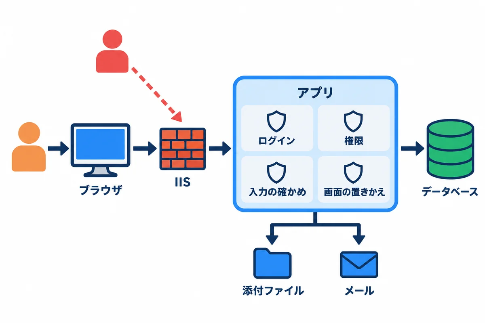
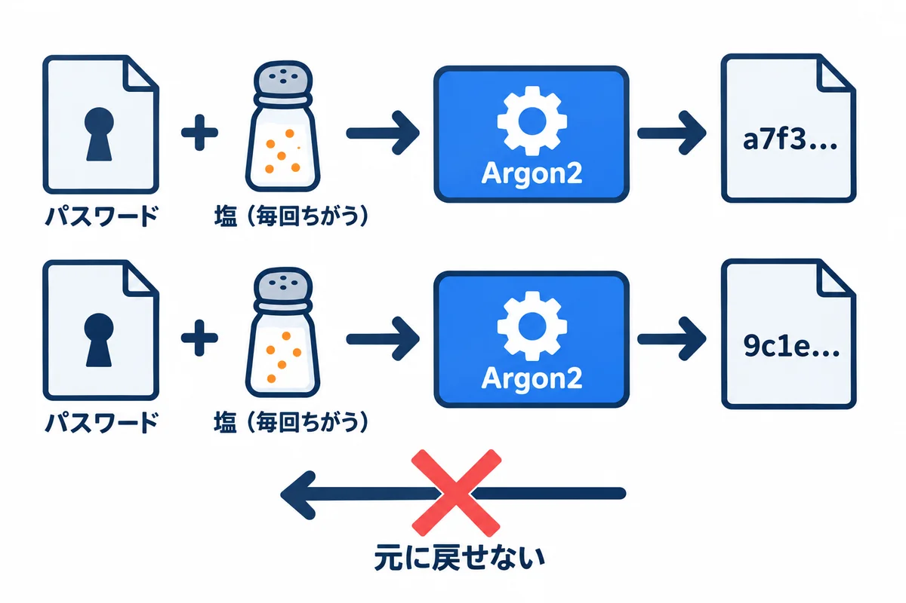
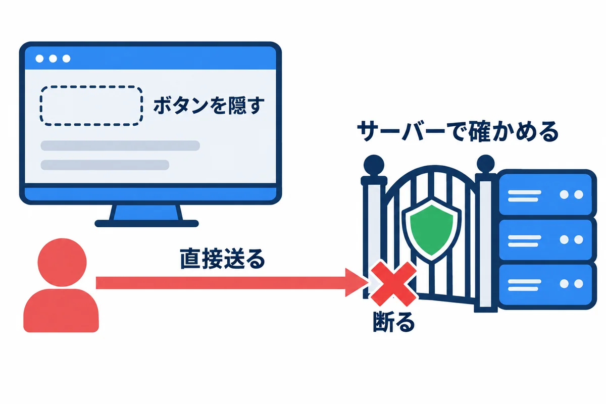
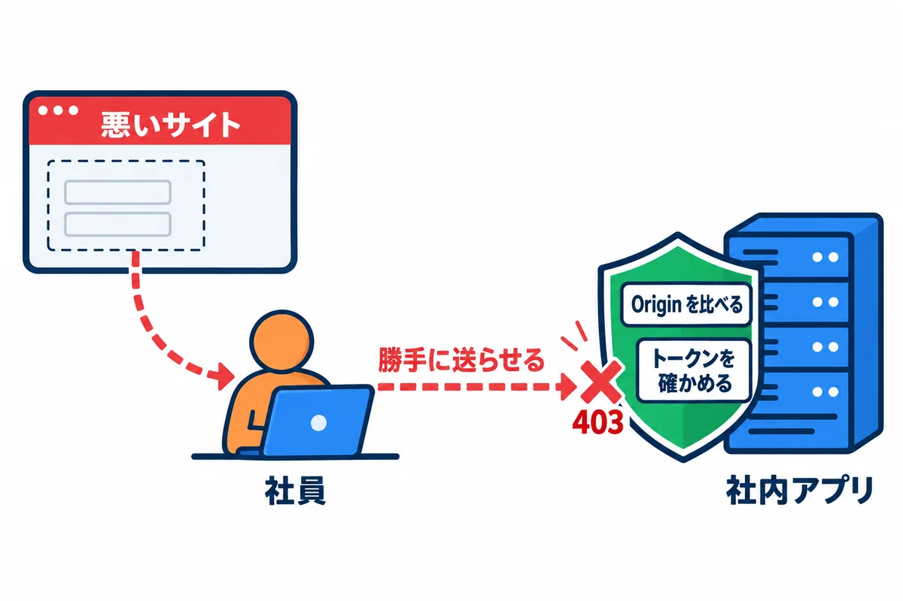
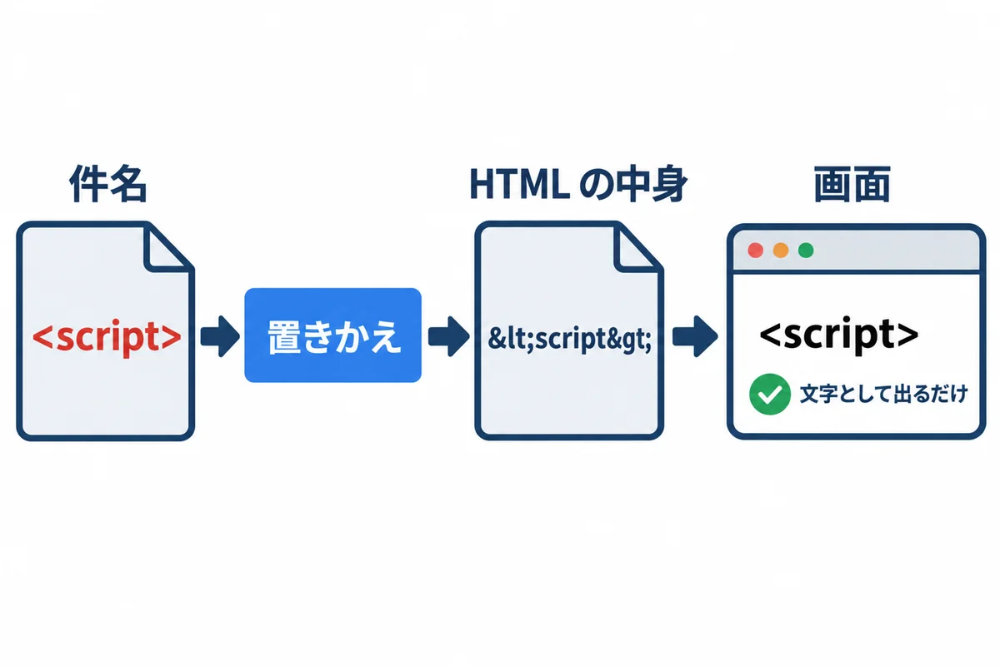
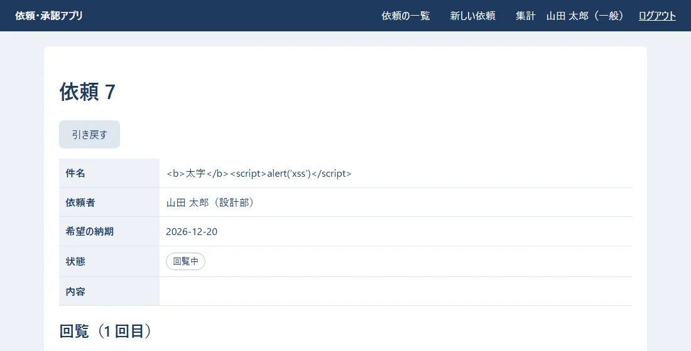
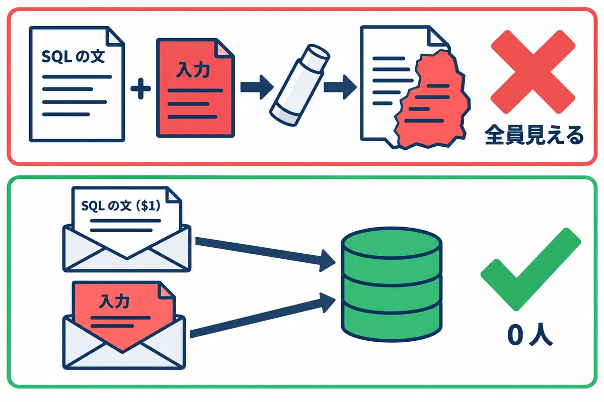
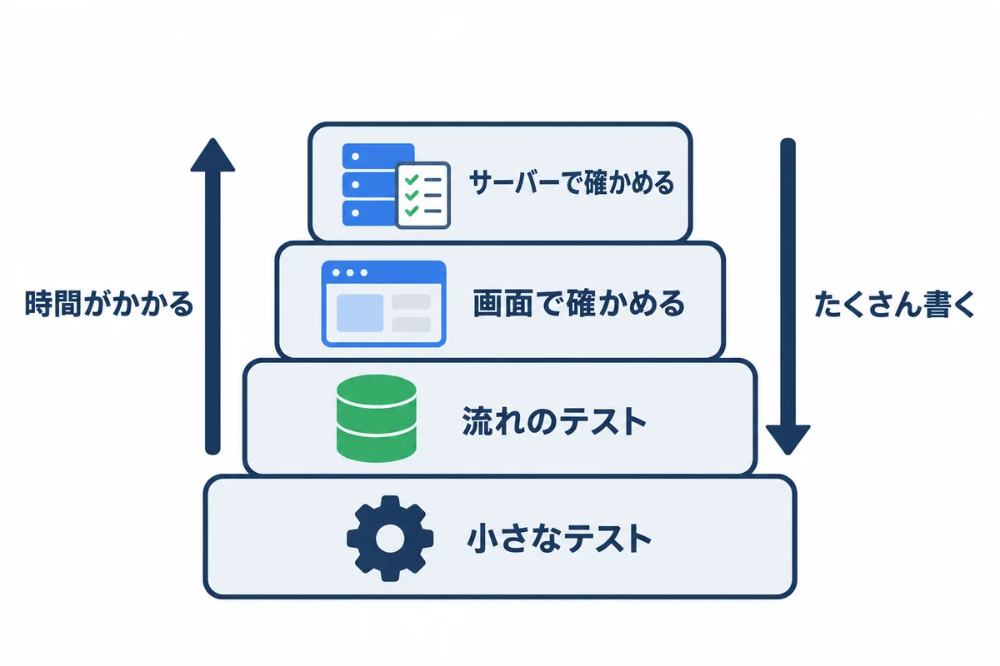

<div style="text-align: center; padding: 28px 0 8px;">
<div style="font-size: 14px; color: #475569;">Web アプリ開発 学習資料</div>
<div style="font-size: 26px; font-weight: 800; color: #0f172a; margin-top: 6px; line-height: 1.35;">10 安全とテスト — 練習アプリを、わざと攻めて確かめる</div>
<div style="font-size: 13px; color: #475569; margin-top: 8px;">パスワード・ログイン・権限・CSRF・XSS・SQL インジェクション・ファイル・メールのヘッダー・秘密の扱い・テスト・出す前のチェック表</div>
</div>

# 10 安全とテスト: 練習アプリを、わざと攻めて確かめる

## この巻について

06（Django＋React）と 08（Topcoat）の練習アプリに入れてきた**安全の仕組み**を、1 か所にまとめます。この巻の特徴は、**説明するだけでなく、実際に攻めてみて、断られることを確かめる**ことです。

- 攻めてみる中で、**本当に弱い所が 2 つ見つかりました**（2.2 と 7 章）。どう見つけ、どう直し、どうテストにしたかも、そのまま載せます。
- **試して確かめた範囲:** 2026-11-02 に、開発のパソコンで、06（Django 5.2.18・React 19.3.1）・08（Topcoat 0.11.0）・PostgreSQL 18.3 を動かして試しました。出力は実際の物です（トークンとパソコンの名前だけ伏せた）。
- **自分のパソコンの、自分の練習アプリだけ**で試します。ほかの人のシステムに試すのは、決してしません（法律で罰せられることがあります）。
- **▶ 準備:** 06 と 08 の練習アプリを、手元で動かせる状態にしておきます（06 前編の 2 章・08 前編の 2 章）。この巻の `curl` や `psql` のコマンドは、それぞれのアプリを動かした PowerShell とは**別の窓**で打ちます。



| 章 | 守る物 | 主な攻め方 | 06 Django | 08 Topcoat |
|---|---|---|---|---|
| 1 | 通信 | 盗み見 | HTTP（社内）。HTTPS は参考の資料 | 同じ |
| 2 | パスワード | データベースを盗まれる | PBKDF2 | Argon2 |
| 3 | ログイン | クッキーを盗む・使い回す | Django のセッション | Topcoat のセッション＋自分の表 |
| 4 | 権限 | ボタンが無い操作を、直接送る | `_visible_requests`・`services.py` | `load_visible`・`workflow.rs` |
| 5 | フォームの送信 | CSRF | CSRF トークン | `Origin` と `Host` を比べる |
| 6 | 画面 | XSS | React が置きかえる | `view!` が置きかえる |
| 7 | 入力 | 改行などを混ぜる | `validate_title` | `FormValues::validate` |
| 8 | データベース | SQL インジェクション | ORM | `$1` と `.bind()` |
| 9 | ファイル | にせの中身・場所の書きかえ | 先頭の数バイト・乱数の名前 | 同じ |
| 10 | 承認の URL | 推測・使い回し | 32 バイトの乱数・指紋だけ保存 | 同じ |
| 11 | メール | ヘッダー インジェクション | `BadHeaderError` で断る | 件名の中に閉じこめる |
| 12 | 秘密 | Git や画面から漏れる | `dev.env` を Git に入れない | `.env` を Git に入れない |

## 1. 通信: HTTP で動かすこと

- この資料のアプリは、onprem の決まりのとおり **HTTP（暗号化なし）**で動かします。会社のネットワークの中だけで使う前提です。
- HTTP では、同じネットワークの途中の機器から、**パスワードやクッキーが読める**おそれがあります。会社のネットワークを信じる、という前提に立っていることを、忘れないでください。
- HTTPS にするときの手順と、変える所（クッキーの `Secure` を戻す など）は、`onprem/参考_HTTPSにする場合.md` にまとめてあります。
- メールの道（アプリ → Microsoft 365）は、**STARTTLS で暗号化します**（09 の巻）。

## 2. パスワード



### 2.1 そのままは保存しない

2 つのアプリが、データベースに入れているパスワードを、実際に見ました（練習用の社員は、全員が同じパスワード `practice-pass-2026`）。

08 Topcoat（`employees.password_hash`）:

```text
 employee_no |   name    |                                           password_hash                                           
-------------+-----------+---------------------------------------------------------------------------------------------------
 012345      | 山田 太郎 | $argon2id$v=19$m=19456,t=2,p=1$6eyNlSGqndcuzM2d11Wkig$hbEDQazl7jVUSCx+CiSCMKkEOrNPaoROc5wvI+BiA8Y
 012346      | 佐藤 花子 | $argon2id$v=19$m=19456,t=2,p=1$toz5KcyB0B8QVQ4IgutSPQ$VHM9+aEqbFUkpCa2CKpJJmFz238MygepohBKnmo0rkM
```

06 Django（`accounts_user.password`）:

```text
 employee_no |   name    |                                         password                                          
-------------+-----------+-------------------------------------------------------------------------------------------
 012345      | 山田 太郎 | pbkdf2_sha256$1000000$VaLA4QWiCi7y9ZejmSObzH$JAndWXp23h/K67EJk3CqZfYcafMgU0YGMVobhJfyIGY=
 012346      | 佐藤 花子 | pbkdf2_sha256$1000000$IqXU8Aj4U6pTNnuRek28ua$oxS79nAV3xH7ks87gJ/FMKW20KhwNkHaLTloj1FPe8Y=
```

| 部分 | 意味 |
|---|---|
| `$argon2id$v=19$m=19456,t=2,p=1$` | Argon2id という作り方と、その重さ（使うメモリー・くり返しの数） |
| `pbkdf2_sha256$1000000$` | PBKDF2 という作り方で、100 万回くり返す（Django の決まり） |
| その次の部分 | **塩（salt）**。人ごと・毎回ちがう乱数 |
| 最後の部分 | ハッシュ（元に戻せない値） |

- **同じパスワードでも、塩が違うので、ハッシュは人ごとに違います。** データベースを盗まれても、「だれとだれが同じパスワードか」は分かりません。
- ログインのときは、入れられたパスワードを**同じ塩と同じ作り方**でハッシュにして、比べます。パスワードそのものは、どこにも残りません。
- **わざと重い計算**にしてあるので、盗んだハッシュから、パスワードを総当たりで探すのに、とても時間がかかります。

### 2.2 見つかった弱い所 1: 練習用のデータで、全員のハッシュが同じだった

この巻の準備で、08 のデータベースを見たところ、練習用の社員 5 人の `password_hash` が、**全部同じ文字（塩も同じ）**でした。原因は、`seed-demo` のコマンドが、ハッシュを **1 回だけ作って、5 人に使い回していた**ことです。

```rust
// 直す前（src/cli.rs の seed_demo）
let hash = auth::hash_password(DEMO_PASSWORD.to_string()).await;   // 1 回だけ作る
for (no, name, dept, title, role) in DEMO_PEOPLE {
    // … 5 人とも、同じ hash を入れていた
}
```

練習用のデータとはいえ、「同じパスワードの人が、ハッシュを見るだけで分かる」形です。**1 人ずつ作る**ように直しました（2.1 の出力は、直した後の物）。本物の社員のパスワードは `set-password` で 1 人ずつ作るので、この問題はありませんでした。

**学ぶこと:** 安全の仕組みは、正しい部品を使うだけでなく、**使い方**でも壊れます。データベースの中身を、実際に見て確かめることが大事です。

### 2.3 確かめ方の細かい所

`src/auth.rs`（08）の一部:

```rust
/// パスワードをハッシュにする。わざと重い計算なので、別のスレッドで動かす（ほかの人の画面を止めない）
pub async fn hash_password(password: String) -> String {
    tokio::task::spawn_blocking(move || hash_password_blocking(&password)).await.expect("ハッシュの計算が止まりました")
}

fn hash_password_blocking(password: &str) -> String {
    // 塩（salt）は、毎回ちがう乱数を Argon2 が自分で作り、結果の文字列の中に入れる
    Argon2::default().hash_password(password.as_bytes()).expect("ハッシュにできません").to_string()
}

/// パスワードが合っているか。合っていなければ false
pub async fn verify_password(password: String, hash: String) -> bool {
    tokio::task::spawn_blocking(move || {
        let Ok(parsed) = PasswordHash::new(&hash) else { return false };
        Argon2::default().verify_password(password.as_bytes(), &parsed).is_ok()
    })
    .await
    .unwrap_or(false)
}

/// 社員がいないときにも、同じ重さの確かめをするための、にせのハッシュ。
/// 「いない社員は早く断られる」と、時間の差で社員番号を探られてしまうので、それを防ぐ
static DUMMY_HASH: LazyLock<String> = LazyLock::new(|| hash_password_blocking("dummy-password-for-timing"));
```

- 社員がいないときも、にせのハッシュで**同じ重さの確かめ**をします。断られるまでの時間の差で、「この社員番号はある」と探られないためです。
- 画面には「従業員番号か、パスワードが違います。」とだけ出し、どちらが違ったかは言いません（08 後編の 3 章）。

## 3. ログインとセッション

08 で、実際に試しました。

```text
### 1. ログインしたクッキーで一覧を開く
200
### 2. ログアウトする
303 http://localhost:3000/login
### 3. ログアウトの前に写しておいたクッキーで、もう一度開く
303 http://localhost:3000/login
### 4. 鈴木さんのセッションの期限を、データベースで過去にする
UPDATE 2
### 5. 鈴木さんのクッキーで開く
303 http://localhost:3000/login
```

| 確かめたこと | 結果 | 仕組み |
|---|---|---|
| ログアウトの前に写しておいたクッキーを、あとで使う | ログインの画面へ（303） | ログアウトで、データベースの記録（`sessions`）を消すので、古いクッキーは使えない |
| 期限（最後に使ってから 60 分）を過ぎたクッキー | ログインの画面へ（303） | 記録の `expires_at` を過ぎた物は、使わない |

- クッキーには `HttpOnly` を付けます。画面の JavaScript から読めないので、6 章の XSS が万一あっても、クッキーを盗まれにくくなります。
- ログインのたびに、**新しいトークン**を作ります（前から知られているトークンを使わせない）。
- データベースには、トークンの**指紋だけ**を入れます（08 前編の 5 章）。

## 4. 権限: 画面で隠すだけでは足りない



画面に「引き戻す」のボタンが出ない人でも、ブラウザの開発者ツールや `curl` を使えば、**ボタンを押したときと同じ送信を、直接**できます。08 で、実際にやってみました（ボタンの出ない人が、`/requests/{id}/action` に直接送った）。

| した人 | したこと | 状態コード | 出た文 |
|---|---|---|---|
| 佐藤さん（依頼 7 の回覧者） | 山田さんの依頼 7 を引き戻す | 400 | 自分の依頼ではありません。 |
| 鈴木さん（依頼 7 に関係ない） | 山田さんの依頼 7 を引き戻す | 404 | （依頼があることも知らせない） |
| 山田さん（一般） | 依頼 2 の担当になる | 400 | 担当者だけができます。 |
| 山田さん（一般） | 管理者だけの「送り直す」 | 400 | この操作はできません。 |

実際の出力（`curl` で送り、状態コードと、画面の間違いの文を取り出した）:

```text
### 佐藤さん（回覧者）が、山田さんの依頼 7 を引き戻そうとする
→ 400 自分の依頼ではありません。

### 鈴木さん（関係ない人）が、山田さんの依頼 7 を引き戻そうとする
→ 404 
### 山田さん（一般）が、依頼 2 の担当になろうとする
→ 400 担当者だけができます。

### 山田さん（一般）が、管理者だけの「送り直す」をする
→ 400 この操作はできません。
```

- **決まりは、全部サーバーで確かめます**（08 の `workflow.rs`、06 の `services.py`）。画面のボタンを出し分けるのは、使いやすさのためで、守りではありません。
- 見てはいけない依頼は、「見られません」ではなく **404** にします。依頼があること自体を知らせないためです。

08 の `src/app/requests/id.rs`:

```rust
/// 見てよい依頼を読む。無い・見てはいけないときは、どちらも 404（あるかどうかも知らせない）
pub(crate) async fn load_visible(cx: &Cx, user: &Employee, id: i64) -> Result<FullRequest> {
    let full = queries::find_request(&state(cx).pool, id).await?.ok_or_not_found()?;
    if !full.visible_to(user) {
        return Err(not_found().into());
    }
    Ok(full)
}
```

06 の `workflow/api.py`:

```python
def _visible_requests(user):
    """その人が見てよい依頼: 自分が出した・回覧に入っている・担当者と管理者は全部"""
    qs = Request.objects.select_related("requester", "assignee").prefetch_related("steps__approver")
    if user.role in (User.Role.WORKER, User.Role.ADMIN):
        return qs
    return qs.filter(Q(requester=user) | Q(steps__approver=user)).distinct()
```

## 5. CSRF: ほかのサイトから、勝手に送らせる



社員がログインしたまま、悪いサイトのページを開くと、そのページが社員のブラウザを使って、社内アプリへフォームを送らせることができます（クッキーは、ブラウザが自動で付けてしまう）。これを CSRF と言います。

**06 Django:** CSRF トークン（ページを開いたときに配る、推測できない札）が付いていない送信を断ります。Django のテストの道具で、札の確かめを有効にして試した結果:

```text
CSRF トークンなしでログイン: 403
CSRF トークンありでログイン: 200
ログイン後、トークンなしで依頼を出す: 403 {"detail":"CSRF Failed: CSRF token missing."}
```

**08 Topcoat:** ブラウザが付ける `Origin`（どのサイトのページから送ったか）と、宛先の `Host` を比べます。`Origin: http://evil.example` を付けて送った結果（08 後編の 10 章）:

```text
HTTP/1.1 403 Forbidden
content-type: text/plain; charset=utf-8
content-length: 9
date: Sun, 01 Nov 2026 16:10:23 GMT
forbidden
```

- どちらも、**状態を変える送信（POST）だけ**を確かめます。だから、GET で状態を変えてはいけません（ログアウトも POST。08 後編の 3 章）。
- クッキーの `SameSite=Lax` も、ほかのサイトからの POST にクッキーを付けさせない、もう 1 つの守りです。

## 6. XSS: 画面に、スクリプトを動かされる

は、HTMLの中では&amp;lt;script&amp;gt;に置きかえられ、画面には<script>という文字として出るだけ" style="width: 100%;">

依頼の件名に、HTML とスクリプトを入れて出してみました（08）。

```text
件名: <b>太字</b><script>alert('xss')</script>
```

サーバーが返した HTML（詳しい画面と、一覧）:

```html
<tr><th>件名</th><td>&lt;b&gt;太字&lt;/b&gt;&lt;script&gt;alert('xss')&lt;/script&gt;</td></tr>
href="/requests/7">&lt;b&gt;太字&lt;/b&gt;&lt;script&gt;alert('xss')&lt;/script&gt;<
```

<!-- first-use -->

> **▶ ここで初めて出てくるコード**
>
> - **`&lt;`**（HTML）: `&lt;` は、`<` という文字そのものを表す書き方（文字参照）です。HTML では `<` がタグの始まりの印なので、文字として見せたい時は `&lt;` と書きます。`&gt;` は `>`、`&amp;` は `&`、`&quot;` は `"` です。入力された文字をこの形に変えておくと、`<script>` を書かれても、ただの文字として表示されます（エスケープ）。
> - **`&gt;`**（HTML）: `&gt;` は、`>` という文字そのものを表す書き方（文字参照）です。

<!-- /first-use -->

画面の見え方:

太字</b><script>alert('xss')</script>が、そのまま文字として出ている" style="width: 100%;">

- `view!` の `(式)` は、`<` を `&lt;` に、`>` を `&gt;` に置きかえて出します。ブラウザは、それを**文字として**出すだけで、スクリプトとしては動かしません。
- 06 の React も同じです。React で、同じ件名を出してみた結果（`renderToStaticMarkup` で HTML にした）:

```text
1. {title} で出す:
<td>&lt;b&gt;太字&lt;/b&gt;&lt;script&gt;alert(&#x27;xss&#x27;)&lt;/script&gt;</td>
2. dangerouslySetInnerHTML で出す（使ってはいけない例）:
<td><b>太字</b><script>alert('xss')</script></td>
```

- React の `{title}` は置きかえます。`dangerouslySetInnerHTML`（名前のとおり「危ない」）を使うと、置きかえずにそのまま出し、スクリプトが動く形になります。**この資料のアプリでは使っていません。**
- JavaScript で文字を入れるときも、`innerHTML` ではなく `textContent` を使います（08 の `drawing.js`）。

## 7. 入力の確かめ: 改行を混ぜられる

### 7.1 見つかった弱い所 2: 06 で、件名に改行を入れると、メールが送れなくなった

件名の入力欄は 1 行なので、画面からは改行を入れられません。しかし、**細工した送信**なら入れられます。06 で、件名に「改行＋`Bcc:`」を入れて、依頼の API に直接送ってみました。

直す前:

```text
状態コード: 500
依頼の数: 7 → 8
```

そのときのログ（最後の行）:

```text
django.core.mail.message.BadHeaderError: Header values can't contain newlines (got '【依頼・承認】承認のお願い: 治具の製作\r\nBcc: evil@example.com' for header 'Subject')
```

- Django のメールの部品は、件名に改行があると `BadHeaderError` で**送るのを断ります**（メールのヘッダーを増やす攻撃を防ぐため。11 章）。そこは正しい動きです。
- ところが、メールは「保存が確定してから」送るので（06 前編の 5.2）、**依頼は保存されたのに（7 → 8 件）、画面は 500 のエラー、承認のお願いのメールは届かない**、という困った形になりました。

### 7.2 直し方: 入り口で断る

件名に**改行などの制御文字**が入っていたら、入力の確かめで断るようにしました。

06 の `workflow/serializers.py`:

```python
    def validate_title(self, value: str) -> str:
        value = value.strip()
        if not value:
            raise serializers.ValidationError("件名を入れてください。")
        # 改行などの制御文字は断る。メールの件名に入ると、保存できてもメールを送れなくなる（10 の巻）
        if any(unicodedata.category(c) == "Cc" for c in value):
            raise serializers.ValidationError("件名に、改行などは入れられません。")
        return value
```

<!-- first-use -->

> **▶ ここで初めて出てくるコード**
>
> - **`.category()`**（Python）: `unicodedata.category(c)` は、文字の種類を 2 文字で返す関数です。`"Cc"` は制御文字（改行・タブなどの、目に見えない特別な文字）。

<!-- /first-use -->

08 の `src/request_form.rs`（08 のメールの部品は、改行を件名の中に閉じこめるので、メールは壊れない（11 章）。それでも、入れる理由の無い文字は、入り口で断る）:

```rust
    pub fn validate(&self) -> std::result::Result<RequestInput, Vec<String>> {
        let mut errors = Vec::new();

        let title = self.title.trim().to_string();
        if title.is_empty() {
            errors.push("件名を入れてください。".to_string());
        } else if title.chars().count() > 100 {
            errors.push("件名は 100 文字までです。".to_string());
        } else if title.chars().any(char::is_control) {
            // 入力欄は 1 行だが、細工した送信なら改行を入れられる。メールの件名などに入れさせない（10 の巻）
            errors.push("件名に、改行などは入れられません。".to_string());
        }
```

直した後に、同じ送信をした結果（06）:

```text
状態コード: 400 {"title":["件名に、改行などは入れられません。"]}
依頼の数: 7 → 7
```

**確かめること:** 400 で断られ、依頼の数は増えない。06 の `test_件名に改行は入れられない`・08 の `件名に改行は入れられない` のテストを足したので、あとで誰かが確かめを消すと、テストが失敗して気付けます。

**学ぶこと:** 確かめは「画面でできること」ではなく、「**送ろうと思えば送れること**」に合わせます。そして、入り口（入力の確かめ）で断るのが、いちばん安全で分かりやすい直し方です。

## 8. SQL インジェクション



PostgreSQL の上で、同じ入力（`' OR '1'='1`）を、2 つのやり方で使ってみました。流した SQL（psql で `-f` で流した）:

```sql
\echo '--- 1. 社員番号を、文字としてつないだ SQL（だめな例）。入力: '' OR ''1''=''1'
SELECT count(*) AS 見つかった数 FROM employees WHERE employee_no = '' OR '1'='1';
\echo '--- 2. 社員番号を、$1 で別に渡した SQL（アプリのやり方）。入力は同じ'
PREPARE find_employee(text) AS SELECT count(*) AS 見つかった数 FROM employees WHERE employee_no = $1;
EXECUTE find_employee(''' OR ''1''=''1');
\echo '--- 3. 正しい社員番号を、$1 で渡す'
EXECUTE find_employee('012345');
```

<!-- first-use -->

> **▶ ここで初めて出てくるコード**
>
> - **`PREPARE`**（SQL）: PostgreSQL で、値を入れる場所（`$1`）付きの SQL を、名前を付けて用意する命令。値は文と別に渡るので、SQL インジェクションが起きません。
> - **`EXECUTE`**（SQL）: `PREPARE` で用意した SQL に、値を渡して実行する命令。
> - **`\echo`**（psql）: psql の `\echo '文字'` は、文字を画面に表示する命令です。SQL のファイルの中で、区切りの説明を出す時に使います。

<!-- /first-use -->

結果（行数の表示は省いた）:

```text
--- 1. 社員番号を、文字としてつないだ SQL（だめな例）。入力: ' OR '1'='1
 見つかった数 
--------------
            7

--- 2. 社員番号を、$1 で別に渡した SQL（アプリのやり方）。入力は同じ
 見つかった数 
--------------
            0

--- 3. 正しい社員番号を、$1 で渡す
 見つかった数 
--------------
            1
```

- 1 は、入力を SQL の文に**くっつけた**ので、`WHERE employee_no = '' OR '1'='1'` という、**別の意味の文**になり、7 人全員が見つかりました。ログインの確かめでこれが起きると、パスワードを知らなくても入れてしまいます。
- 2 は、入力を `$1` で**別に**渡したので、「`' OR '1'='1` という社員番号の人」を探し、0 人でした。
- 08 の sqlx は、値を必ず `.bind()` で渡し、組み立てた SQL の文字をそのまま渡すとコンパイルのエラーにします（08 前編の 6.5）。06 の Django の ORM（`filter(...)`）も、中で値を別に渡します。**SQL の文を、`+` や `format!` や f 文字列で組み立てて、値を入れることはしません。**

## 9. ファイル

| 攻め方 | 守り | 確かめた所 |
|---|---|---|
| 拡張子を `.png` に変えた、別の種類のファイル | 中身の先頭の数バイトでも確かめる | 08 後編の 5.2 の画面・06 の `test_拡張子と中身が違うファイルは断る` |
| `..\..\Windows\evil.png` のような名前で、別のフォルダに書かせる | フォルダに置く名前は、アプリが乱数で決める | 08 の `ファイル名で別のフォルダに書かせない`（12 章） |
| 大きなファイルで、サーバーのメモリーを使い切らせる | 大きさの上限（IIS・アプリ） | 08 後編の 5.3・10 章（413） |
| ダウンロードしたファイルを、ブラウザに HTML として開かせる | `Content-Disposition: attachment`・`X-Content-Type-Options: nosniff` | 08 後編の 8.2 |
| 見てはいけない依頼の添付ファイルを開く | その依頼を見てよいかを確かめる | 08 後編の 8.2 |

## 10. 1 回限りの承認の URL

| 決まり | 理由 | 確かめるテスト（08 / 06） |
|---|---|---|
| 32 バイト（256 ビット）の乱数 | 推測できない | — |
| データベースには指紋（SHA-256）だけ | データベースを見られても、URL を作れない | — |
| 14 日で使えなくなる | 古いメールが、あとから使われない | 期限が切れたurlは使えない |
| 1 回しか使えない | 転送されたメールで、2 回目の承認をさせない | urlは1回しか使えない |
| 引き戻し・差し戻しで、待っている人の URL を取り消す | 進まない依頼の URL を残さない | 引き戻すと承認待ちの人のurlが使えなくなる |
| 送り直すと、前の URL は使えない | 古い URL を無効にする | 毎朝の通知は止まっている承認を送り直す |
| 同時に 2 回押しても 1 回だけ | 二重の承認を防ぐ | 同時に2回押しても1回だけ進む（08） |

- URL は、IIS のログにも残ります。ログのファイルを見られる人は限られていますが、**ログを社外に出さない・必要な期間だけ残す**（onprem の 04 の 12 章）ことも、守りの 1 つです。

## 11. メールのヘッダー インジェクション

メールの件名に「改行＋`Bcc: evil@example.com`」を入れると、部品によっては、**ヘッダーが 1 行増えて**、だれかに勝手に写しを送れてしまいます。2 つの部品の振る舞いを、実際に確かめました。

**06 Django:** 送るのを断る。

```text
BadHeaderError: Header values can't contain newlines (got '【依頼・承認】承認のお願い: 治具の製作\r\nBcc: evil@example.com' for header 'Subject')
```

**08 Topcoat（lettre）:** 送れるが、改行を**件名の中に閉じこめる**（`Bcc:` は件名の文字の一部として符号化され、新しいヘッダーにならない）。作られたメールのヘッダー:

```text
From: noreply@example.com
To: sato@example.com
Subject: =?utf-8?b?44CQ5L6d6aC844O75om/6KqN44CR5om/6KqN44Gu44GK6aGY44GE?=
 =?utf-8?b?OiDmsrvlhbfjga7oo73kvZwNCkJjYzo=?= evil@example.com
Message-ID: <TnQXFIPdeN1NMBVzFuyaowDMSjWDjaV4a01q@（パソコンの名前）>
MIME-Version: 1.0
Date: Sun, 01 Nov 2026 16:34:45 +0000
Content-Type: text/plain; charset=utf-8
Content-Transfer-Encoding: base64
```

- 2 行目の頭の空白は、「前の行（件名）の続き」という印です。`=?utf-8?b?…DQpCY2M6?=` の中に、改行と `Bcc:` が入っています。
- 振る舞いは違っても、**どちらもヘッダーは増えません**。そのうえで、7 章のとおり、入り口で改行を断っています。

## 12. 秘密の扱い

```text
$ git check-ignore -v （秘密が入るファイル）
webapp_learning/samples/08_topcoat_app/webapp/.gitignore:2:.env	webapp_learning/samples/08_topcoat_app/webapp/.env
webapp_learning/samples/06_django_react/.gitignore:4:dev.env	webapp_learning/samples/06_django_react/backend/dev.env
webapp_learning/samples/09_mail/.gitignore:2:*.pem	webapp_learning/samples/09_mail/key.pem

$ git ls-files（Git に入っている、秘密の入りそうな名前のファイル）
（なし）
```

| 秘密 | 置く所 | してはいけないこと |
|---|---|---|
| データベースのパスワード（開発） | `.env`（08）・`dev.env`（06）。Git に入れない | 資料やチャットに貼る |
| データベースのパスワード（サーバー） | WinSW の XML。フォルダの権限で守る（onprem の 04 の 7 章） | 共有のフォルダに写しを置く |
| 社員のパスワード | 本人が決める。管理者は `set-password`（標準入力から読む） | コマンドの引数に書く（履歴に残る） |
| 承認の URL・セッションのトークン | 指紋だけをデータベースへ | ログに、そのまま書く |
| 練習用の証明書の鍵（09） | `*.pem`。Git に入れない | 本物のサーバーで使う |

## 13. テスト



| 段 | 何を確かめるか | この資料では |
|---|---|---|
| 小さなテスト | 1 つの関数（データベースを使わない） | 08: `src/` の中の 12 個・`tests/security.rs` の 3 個 |
| 流れのテスト | 依頼の流れ全体（データベースを使う） | 06: `workflow/tests.py` の 18 個／08: `tests/workflow.rs` の 16 個 |
| 画面で確かめる | 本物のブラウザで操作する | 06 後編・08 後編の画面の写し |
| サーバーで確かめる | 本物の設定・ネットワーク・メール | onprem のチェック表・09 の 9 章 |

### 13.1 安全のテストを足す（tests/security.rs）

`samples/08_topcoat_app/webapp/tests/security.rs`:

```rust
//! 安全のためのテスト（10 の巻）。データベースは使わない

use topcoat::{context::Cx, mail::mail};
use webapp::{drawing, upload};

/// 件名に改行を入れて、ヘッダーを増やそうとする（ヘッダー インジェクション）。
/// メールの部品が、改行を「ヘッダーの区切り」として扱わないことを確かめる
#[tokio::test]
async fn 件名に改行を入れても_ヘッダーは増えない() {
    // 依頼の件名は社員が入れる。悪い人が、件名に「改行＋Bcc:」を入れたとする
    let title = "治具の製作\r\nBcc: evil@example.com";
    let m = mail! {
        from: "noreply@example.com",
        to: "sato@example.com",
        subject: format!("【依頼・承認】承認のお願い: {title}"),
        text: "本文",
    }
    .expect("メールを作れる");
    assert!(m.bcc().is_empty());
    let raw = String::from_utf8(m.formatted(&Cx::default()).expect("形にできる")).unwrap();
    // 改行のあとの「Bcc:」が、本物のヘッダーの行になっていない
    assert!(!raw.contains("\r\nBcc:"), "Bcc のヘッダーが足されてしまった:\n{raw}");
}

/// 図面の文字に、HTML や script を入れても、図面の形として読めるだけ（画面では文字として出る）
#[test]
fn 図面の文字にscriptを入れても_ただの文字() {
    let d = drawing::parse(
        r#"{"version":1,"widthMm":297,"heightMm":210,"shapes":[{"kind":"text","x":1,"y":1,"text":"<script>alert(1)</script>"}]}"#,
    )
    .unwrap()
    .unwrap();
    assert!(matches!(&d.shapes[0], drawing::Shape::Text { text, .. } if text == "<script>alert(1)</script>"));
}

/// 送られてきた名前に「..\」などが入っていても、フォルダに置く名前には使わない
#[tokio::test]
async fn ファイル名で別のフォルダに書かせない() {
    let mut random = [0u8; 8];
    getrandom::fill(&mut random).unwrap();
    let dir = std::env::temp_dir().join(format!("webapp-sec-{}", hex::encode(random)));
    let file = upload::UploadedFile { name: r"..\..\Windows\evil.png".into(), bytes: b"\x89PNG\r\n\x1a\n....".to_vec() };
    let saved = upload::save(&dir, &file).await.unwrap();
    // 置いた名前は、アプリが決めた乱数の名前（32 文字の 16 進＋.png）
    assert_eq!(saved.stored_name.len(), 32 + ".png".len());
    assert!(saved.stored_name.chars().all(|c| c.is_ascii_hexdigit() || c == '.' || c.is_ascii_lowercase()));
    assert!(dir.join("attachments").join(&saved.stored_name).exists());
    let _ = std::fs::remove_dir_all(&dir);
}
```

<!-- first-use -->

> **▶ ここで初めて出てくるコード**
>
> - **`.bcc()`**（Topcoat）: メールの BCC（ほかの受け取り手には見えない宛先）を取り出すメソッド（テストで確かめる）。
> - **`.formatted()`**（Topcoat）: メールを、実際に送る形（ヘッダーと本文の文字の並び）にするメソッド。
> - **`.is_ascii_hexdigit()`**（文字）: その文字が 16 進数の数字（`0`〜`9`・`a`〜`f`・`A`〜`F`）なら `true` を返すメソッド。
> - **`.is_ascii_lowercase()`**（文字）: その文字が、半角の英小文字なら `true` を返すメソッド。
> - **`String::from_utf8()`**（文字列）: バイトの並び（`Vec<u8>`）を、文字列（`String`）に変える関数。UTF-8 の文字として読めない時は `Err` を返します。
> - **`Cx::default()`**（Topcoat）: テストなどで、空のリクエストの情報の箱（`Cx`）を作る書き方。

<!-- /first-use -->

- **「攻めてみた」ことを、テストにして残します。** 一度確かめたことは、あとで誰かがコードを変えても、テストが見張ってくれます。
- テストの名前は、日本語で「何を確かめているか」が分かるようにします。

### 13.2 全部のテストを動かした結果

08（`cargo test`）:

```text
     Running unittests src\lib.rs (target\debug\deps\webapp-8c86094e59d42b38.exe)
test drawing::tests::空なら図面なし ... ok
test drawing::tests::四角と線を読める ... ok
test drawing::tests::知らない図形はエラー ... ok
test employees::tests::shift_jisは断る ... ok
test files::tests::日本語の名前は_xxの形にする ... ok
test upload::tests::中身がpdfならpdfとして通る ... ok
test request_form::tests::正しい入力は通る ... ok
test request_form::tests::件名に改行は入れられない ... ok
test employees::tests::間違いのあるcsvは全部の間違いを返す ... ok
test employees::tests::正しいcsvを読める ... ok
test upload::tests::場所ごとの名前は最後だけにする ... ok
test upload::tests::拡張子をpngに変えたexeは断る ... ok
test result: ok. 12 passed; 0 failed; 0 ignored; 0 measured; 0 filtered out; finished in 0.00s
     Running unittests src\main.rs (target\debug\deps\webapp-729cf1be2339cc29.exe)
test result: ok. 0 passed; 0 failed; 0 ignored; 0 measured; 0 filtered out; finished in 0.00s
     Running tests\security.rs (target\debug\deps\security-eafc82bc57e25215.exe)
test 図面の文字にscriptを入れても_ただの文字 ... ok
test 件名に改行を入れても_ヘッダーは増えない ... ok
test ファイル名で別のフォルダに書かせない ... ok
test result: ok. 3 passed; 0 failed; 0 ignored; 0 measured; 0 filtered out; finished in 0.00s
     Running tests\workflow.rs (target\debug\deps\workflow-e585d0fc1d21207c.exe)
test ほかの人の依頼は引き戻せない ... ok
test urlは1回しか使えない ... ok
test 回覧者の決まり ... ok
test 出し直すと最初の回覧者からやり直す ... ok
test 引き戻すと承認待ちの人のurlが使えなくなる ... ok
test 全員が承認すると回覧完了になり担当者に知らせる ... ok
test 出すと1人目にメールが届き回覧中になる ... ok
test 同時に2回押しても1回だけ進む ... ok
test 検証ではメールの宛先を書きかえる ... ok
test 担当を決めて完了にすると依頼者に知らせる ... ok
test 差し戻すとコメントが追記され依頼者にメールが届く ... ok
test 期限が切れたurlは使えない ... ok
test 添付ファイルはフォルダに置き_失敗したら消す ... ok
test 理由の無い差し戻しは断る ... ok
test 毎朝の通知は8時を過ぎてから1日1回だけ動く ... ok
test 毎朝の通知は止まっている承認を送り直す ... ok
test result: ok. 16 passed; 0 failed; 0 ignored; 0 measured; 0 filtered out; finished in 2.65s
test result: ok. 0 passed; 0 failed; 0 ignored; 0 measured; 0 filtered out; finished in 0.00s
```

06（`.\dev.ps1 test --noinput` の最後の所）:

```text
Ran 18 tests in 55.856s

OK
```

## 14. 出す前のチェック表

サーバーへ出す（更新する）前に、毎回確かめます。

| # | 確かめること | 06 | 08 |
|---|---|---|---|
| 1 | 自動のテストが全部通る | `.\dev.ps1 test` | `cargo test` |
| 2 | コンパイルの警告・指摘が無い | — | `cargo clippy --all-targets` |
| 3 | Django の安全の確かめで、問題が出ない | `check --deploy` が `System check identified no issues (4 silenced).`（HTTP のために止めた 4 つだけ。onprem の 05） | — |
| 4 | `DEBUG` が本番で false | `DJANGO_DEBUG=false` | `APP_ENV=production` |
| 5 | 秘密が Git に入っていない | `git ls-files` で `dev.env` が無い | `.env` が無い |
| 6 | 検証のサーバーは `MAIL_REDIRECT_TO` 付き | XML を見る | 無いと起動しない |
| 7 | IIS が `Host` をそのまま渡す | — | `preserveHostHeader`（onprem の 04 の 8.3） |
| 8 | 部品の版を固定し、記録している | `requirements.txt`・wheelhouse | `Cargo.toml` の `=`・`Cargo.lock` |
| 9 | 部品の弱さの知らせ（セキュリティの更新）を見た | Django・DRF などの更新の案内 | Topcoat・sqlx などの更新の案内 |
| 10 | 更新の前に、データベースのバックアップがある | onprem の 04 の 11 章 | 同じ |

## 15. よくある失敗

| 失敗 | 何が起きるか | 正しいやり方 |
|---|---|---|
| ボタンを隠しただけで、サーバーで確かめない | 直接送られて、操作されてしまう | 4 章 |
| GET で状態を変える | リンクや画像だけで操作され、CSRF の守りも効かない | 状態を変えるのは POST だけ |
| `dangerouslySetInnerHTML`・`innerHTML` で出す | XSS | 6 章 |
| SQL を文字でつなぐ | SQL インジェクション | 8 章 |
| 送られてきたファイル名で保存する | 別のフォルダに書かれる | 9 章 |
| 「画面では入れられない」から確かめない | 細工した送信で、思わぬ所が壊れる | 7 章 |
| パスワードのハッシュを使い回す・自分で作る | 同じパスワードが分かる・弱い | 部品に 1 人ずつ作らせる（2 章） |
| 証明書の確かめを止める | にせの相手に送ってしまう | 09 の 5.2 |
| 秘密を Git に入れる | 履歴から消せない（消したつもりでも残る） | 12 章。入れてしまったら、パスワードを変える |

## 16. 練習問題

1. 08 の一覧の画面に、件名で探す欄を足すとします。SQL の `LIKE` を使うとき、入力をどう渡せば安全ですか。`%` や `_` が入力に入っていたら、どうなりますか。
2. 3 章の表に「パスワードを変えたら、ほかのパソコンのログインも切る」を足すには、どこを直せばよいですか（ヒント: `sessions` の表）。
3. 4 章の表に、「依頼者でない人が、`/requests/{id}/edit` を開く」を足して、08 で試してください。何が起きますか。
4. 7 章のように「画面では入れられないが、送れば入れられる」所を、ほかにも探してください（希望の納期・回覧者・図面）。それぞれ、サーバーで確かめていますか。
5. 13.1 の `security.rs` に、「ログアウトした後の古いクッキーは使えない」テストを足すには、何が要りますか（データベース・ルーター）。

## 用語の索引

| 用語 | 意味 | 出てくる所 |
|---|---|---|
| ハッシュ・塩（salt） | 元に戻せない値と、それを人ごとに変える乱数 | 2 |
| PBKDF2・Argon2 | パスワードのハッシュの作り方（わざと重い） | 2 |
| セッション・トークン | ログインを続ける仕組みと、その札 | 3 |
| 権限（認可） | だれが、何をしてよいか | 4 |
| CSRF | ほかのサイトから、勝手に送らせる攻撃 | 5 |
| XSS | 画面に、スクリプトを動かされる攻撃 | 6 |
| 制御文字 | 改行・タブなど、目に見えない特別な文字 | 7 |
| SQL インジェクション | 入力が、SQL の一部として動いてしまう攻撃 | 8 |
| ヘッダー インジェクション | 改行を混ぜて、メールのヘッダーを増やす攻撃 | 11 |
| テストの段 | 小さなテストから、サーバーでの確かめまでの積み上げ | 13 |
