<div style="text-align: center; padding: 28px 0 8px;">
<div style="font-size: 14px; color: #475569;">Web アプリ開発 学習資料</div>
<div style="font-size: 26px; font-weight: 800; color: #0f172a; margin-top: 6px; line-height: 1.35;">11 付録 — よく使う機能の早見表とサンプル集</div>
<div style="font-size: 13px; color: #475569; margin-top: 8px;">道具のコマンド・HTML と CSS・TypeScript・React・Python・Django の「あれ、どう書くんだっけ？」を、動くサンプルで引く</div>
</div>

# 11 付録: よく使う機能の早見表とサンプル集

## この付録について

01〜10 の巻で使ってきた機能のうち、**毎日のように使う物**を 1 か所に集めた「引くための本」です。

- **道具の早見表（A 章）:** PowerShell・Node.js と npm・Python と pip・Django の `manage.py`・PostgreSQL の `psql`・VS Code・Git の、よく打つコマンド。
- **サンプル集（B 章）:** HTML と CSS・TypeScript・React・Python・Django の ORM の、**そのまま動くサンプル 18 本**。どれも 1 行ごとに日本語のコメントを付け、**2026-11-02 に、この資料を作ったパソコンで動かした本物の結果**（React と HTML は、操作して撮った画面の写し）を載せています。
- **よくある間違い（C 章）:** 初心者がつまずきやすい所を、症状 → 原因 → 直し方の表で。

**読み方:** 頭から全部読む必要はありません。困った時に、下の表から探して、その節だけ読んでください。サンプルは、**動かして、少し書きかえて、もう一度動かす**と身に付きます。

**▶ 準備:** 00 の 6 章（VS Code・Node.js・Python）。サンプルのファイルは、全部 `samples\` の中の、各巻の練習のフォルダに入っています（ファイルの名前が `x01_` のように `x` で始まる物が、この付録のサンプルです）。


### やりたいこと → 見る所

| やりたいこと | 見る所 |
|---|---|
| フォルダを移動する・ファイルを見る・コピーする | A-1 PowerShell |
| TypeScript を動かす・型を確かめる・部品を入れる | A-2 Node.js と npm |
| Python の仮想環境を作る・部品を入れる | A-3 Python と pip |
| Django の表を作る・確かめる・動かす | A-4 Django の manage.py |
| データベースの中を見る | A-5 psql |
| VS Code で速く書く・変更を記録する | A-6 VS Code・A-7 Git |
| よく使う HTML のタグ（見出し・表・フォーム） | B-01 |
| 横に並べる・ます目に並べる・スマホで 1 列にする | B-02 |
| 文字列と数（TypeScript） | B-03 |
| 配列の map・filter・find・reduce・並べかえ | B-04 |
| オブジェクト・型・`?.` と `??` | B-05 |
| async/await・エラー・JSON | B-06 |
| クラス・Map・Set・日付 | B-07 |
| ボタンで値を変える（useState） | B-08 |
| 一覧と絞り込み（map と key） | B-09 |
| 入力フォームと入力の検査 | B-10 |
| 画面が出たあとにデータを取ってくる（useEffect と fetch） | B-11 |
| 部品に分ける（props・children） | B-12 |
| 文字列と数（Python） | B-13 |
| リスト・辞書・集合・内包表記 | B-14 |
| 関数・クラス・dataclass・Enum | B-15 |
| 例外・ファイル・JSON・CSV | B-16 |
| 日付と時刻・日本時間 | B-17 |
| Django の ORM（絞り込み・集計・まとめて変える） | B-18 |
| エラーが出た・動かない | C 章 |

## A. 道具の早見表

### A-1: PowerShell

| やりたいこと | 打つ命令 | メモ |
|---|---|---|
| 今いるフォルダを表示する | `Get-Location`（`pwd`） | |
| フォルダを移動する | `cd フォルダ名` | `cd ..` で 1 つ上、`cd ~` でホーム |
| 中身の一覧を見る | `Get-ChildItem`（`ls`） | `-Recurse` で中のフォルダまで |
| フォルダを作る | `mkdir 名前` | |
| ファイルの中身を見る | `Get-Content 名前 -Encoding utf8` | `-Tail 20` で最後の 20 行、`-Wait` で増えるのを見続ける（ログを見る時） |
| コピー・移動・名前を変える | `Copy-Item`・`Move-Item`・`Rename-Item` | |
| 消す | `Remove-Item 名前` | フォルダは `-Recurse`。ごみ箱に入らない |
| 文字を探す | `Select-String -Path *.py -Pattern "文字"` | 何行目にあるかも出る |
| 前に打った命令 | `↑` キー | `Tab` で名前の続きを自動で入れる |
| 動いている命令（サーバーなど）を止める | `Ctrl` ＋ `C` | |
| 環境変数を決める（この窓だけ） | `$env:名前 = "値"` | 見る: `$env:名前` |
| 直前の命令の終了コード | `$LASTEXITCODE` | 0 なら成功 |

くわしい使い方と、実際の出力は、Rust の資料の付録（`Rust` フォルダの `14_付録_…`）の A-1 にもあります。

### A-2: Node.js と npm（TypeScript・React）

| やりたいこと | 打つ命令（練習のフォルダで） |
|---|---|
| 入っている版を見る | `node --version`・`npm --version` |
| `package.json` に書いてある部品を、まとめて入れる | `npm install`（`package-lock.json` のとおりに入れ直すなら `npm ci`） |
| 部品を足す（動かす時に使う物） | `npm install 部品の名前` |
| 部品を足す（作る時だけ使う物） | `npm install -D 部品の名前` |
| `package.json` の `scripts` を動かす | `npm run 名前`（例: `npm run dev`・`npm run build`・`npm run check`） |
| TypeScript の型を確かめる | `npx tsc`（何も出なければ、間違い無し） |
| TypeScript のファイルを動かす | `node src\ファイル名.ts`（02 の練習のやり方） |
| React の開発用のサーバーを動かす | `npm run dev`（止める時は `Ctrl` ＋ `C`） |
| 入っている部品の一覧 | `npm ls --depth=0` |

**メモ:** PowerShell で `npm` と打って「このシステムではスクリプトの実行が無効」と出る時は、`npm.cmd`・`npx.cmd` と打ちます（00 の 6.3）。

**▼ 実行結果**（`samples\02_typescript` で）

`node --version` → `npm --version` → `npx tsc --version`:

```text
v25.9.0
```

```text
11.12.1
```

```text
Version 7.0.2
```

`npm run check`（`package.json` の `"check": "tsc"` が動く。型の間違いが無いので、`tsc` は何も表示しない）:

```text
> check
> tsc
```

`npm ls --depth=0`（`samples\03_react` で）:

```text
webapp-learning-react@1.0.0 C:\Users\you\Documents\def\webapp_learning\samples\03_react
├── @types/react-dom@19.3.0
├── @types/react@19.3.0
├── @vitejs/plugin-react@6.1.2
├── react-dom@19.3.1
├── react@19.3.1
├── typescript@7.0.2
└── vite@8.3.5
```

- `node` の版は、入れた時期によって違います。02 では `node` で `.ts` のファイルをそのまま動かすので、**Node.js 24 以上**をすすめます（00 の 6.3）。
- `npm ls` の `├──` の行が、`package.json` に書いた部品と、入っている版です。

### A-3: Python と pip

この資料では、仮想環境（`.venv`）の中の Python を、**場所を書いて**動かします（04 の 1 章）。

| やりたいこと | 打つ命令（練習のフォルダで） |
|---|---|
| 仮想環境を作る | `py -3.14 -m venv .venv` |
| 仮想環境の Python の版を見る | `.\.venv\Scripts\python.exe --version` |
| 部品をまとめて入れる | `.\.venv\Scripts\python.exe -m pip install -r requirements.txt` |
| 部品を 1 つ入れる | `.\.venv\Scripts\python.exe -m pip install 部品の名前` |
| 入っている部品の一覧 | `.\.venv\Scripts\python.exe -m pip list` |
| 入っている部品を `requirements.txt` の形で出す | `.\.venv\Scripts\python.exe -m pip freeze > requirements.txt` |
| ファイルを動かす | `.\.venv\Scripts\python.exe ファイル名.py` |
| 1 行ずつ試す（対話モード） | `.\.venv\Scripts\python.exe`（終わる時は `exit()`） |

**▼ 実行結果**（`samples\04_python` で）

```text
Python 3.14.4
```

```text
Package Version
------- -------
pip     26.0.1
tzdata  2026.6
```

**▼ 実行結果**（`samples\05_django` で `pip freeze`。`Django` が使う部品 `asgiref`・`sqlparse` も自動で入っている）

```text
asgiref==3.13.0
Django==5.2.18
djangorestframework==3.18.3
sqlparse==0.6.0
tzdata==2026.6
```

### A-4: Django の manage.py

`manage.py` は、Django のプロジェクトの「何でも係」です。`.\.venv\Scripts\python.exe manage.py 命令` の形で打ちます（下の表では `manage.py 命令` と短く書きます）。

| やりたいこと | 命令 |
|---|---|
| 設定のまちがいを調べる | `manage.py check` |
| モデルを変えたあと、変更の手順（マイグレーション）を作る | `manage.py makemigrations` |
| 手順をデータベースに当てる（表を作る・変える） | `manage.py migrate` |
| どの手順まで当てたか見る | `manage.py showmigrations` |
| モデルとデータベースがずれていないか確かめる | `manage.py makemigrations --check --dry-run` |
| 管理者を作る | `manage.py createsuperuser` |
| 開発用のサーバーを動かす | `manage.py runserver`（`http://127.0.0.1:8000/`） |
| Python の対話モードで、モデルを試す | `manage.py shell`（ファイルを動かすなら `shell -c "import ファイル名"`） |
| テストを動かす | `manage.py test` |
| 静的ファイルを 1 か所に集める（サーバーに出す時） | `manage.py collectstatic` |
| 作れる命令の一覧 | `manage.py help` |

**▼ 実行結果**（`samples\05_django` で）

`manage.py check`:

```text
System check identified no issues (0 silenced).
```

`manage.py showmigrations requests_app`（`[X]` は「当てた」印。`[ ]` なら、まだ `migrate` していない）:

```text
requests_app
 [X] 0001_initial
```

`manage.py makemigrations --check --dry-run`（モデルを変えたのに `makemigrations` を忘れていると、ここで手順の名前が出て、終了コードが 1 になる）:

```text
No changes detected
```

### A-5: psql（PostgreSQL の中を見る）

`psql` の入れ方と SQL の練習は、**onprem の 02**（SQL と PostgreSQL の使い方）にくわしくあります。ここでは、`psql` の中で打つ「`\` で始まる命令」をまとめます。

| やりたいこと | psql の中で打つ |
|---|---|
| データベースの一覧 | `\l` |
| 別のデータベースにつなぎ直す | `\c データベース名` |
| 表の一覧 | `\dt` |
| 表の形（列と型） | `\d 表の名前` |
| ロール（ユーザー）の一覧 | `\du` |
| 結果を縦に並べて見る（列が多い時） | `\x`（もう一度打つと戻る） |
| かかった時間を出す | `\timing` |
| 命令の一覧 | `\?` |
| 終わる | `\q` |

**メモ:** SQL の文（`SELECT ...`）は、最後に `;` を付けると実行されます。付け忘れると、`webapp_dev->` のように、続きを待つ印に変わります。

### A-6: VS Code

| やりたいこと | 押すキー |
|---|---|
| 保存 | `Ctrl` ＋ `S` |
| ファイルの名前で探して開く | `Ctrl` ＋ `P` |
| 何でも命令を探す（コマンドパレット） | `Ctrl` ＋ `Shift` ＋ `P` |
| ターミナル（PowerShell）を出す・しまう | `Ctrl` ＋ `@` |
| 書き方を整える | `Shift` ＋ `Alt` ＋ `F` |
| 行をコメントにする・戻す | `Ctrl` ＋ `/` |
| 同じ言葉を一度に選ぶ | `Ctrl` ＋ `D` |
| フォルダ全体から探す | `Ctrl` ＋ `Shift` ＋ `F` |
| 定義へ飛ぶ・名前をまとめて変える | `F12`・`F2` |
| 指定した行へ飛ぶ | `Ctrl` ＋ `G`（エラーに出た行の番号を入れる） |

### A-7: Git

| やりたいこと | 打つ命令 |
|---|---|
| 今の状態を見る | `git status` |
| 変更の中身を見る | `git diff` |
| 記録に入れるファイルを選ぶ | `git add ファイル名`（全部: `git add .`） |
| 記録する | `git commit -m "何をしたか"` |
| 記録の一覧 | `git log --oneline` |
| 保存していない変更を捨てる | `git restore ファイル名` |
| 記録しないファイルを決める | `.gitignore` に書く（`.venv/`・`node_modules/`・`.env`・`db.sqlite3` など） |

**大事:** パスワードの入った `.env`・`dev.env` は、**記録する前に** `.gitignore` に書きます（10 の 12 章）。練習のフォルダの `.gitignore` が見本です。

実際の出力つきの説明は、Rust の資料の付録の A-5 にあります。

## B. サンプル集

どのサンプルも、**何に使う → ▶ 書く所と動かし方 → コード → 結果 → ここがポイント**の順に載せています。

### B-01: よく使う HTML のタグ（見出し・段落・リンク・並び・表・フォーム）

**何に使う:** 画面の「中身」を書く時。どの画面も、ここに出てくるタグの組み合わせでできています。

**▶ 書く所と動かし方:** `samples\01_html_css\x01_tags.html` をダブルクリックすると、ブラウザで開けます（サーバーは要りません）。書きかえたら保存して、ブラウザで `F5` を押すと、表示が新しくなります。

```html
<!doctype html>
<html lang="ja">
  <head>
    <meta charset="utf-8">
    <meta name="viewport" content="width=device-width, initial-scale=1">
    <title>よく使うタグ - 付録</title>
    <style>
      /* 見やすくするための少しの CSS（タグの働きは B-02 で） */
      body { font-family: "Yu Gothic UI", "Meiryo", sans-serif; margin: 16px 24px; color: #1e3a5f; }
      table { border-collapse: collapse; }
      th, td { border: 1px solid #94a3b8; padding: 4px 10px; }
      th { background: #eef2f7; }
      label { display: block; margin-top: 8px; }
      label.inline { display: inline; }
    </style>
  </head>
  <body>
    <!-- 1. 見出し（h1 が一番大きい。1 ページに h1 は 1 つ） -->
    <h1>見出し h1</h1>
    <h2>見出し h2</h2>

    <!-- 2. 段落・強調・改行・リンク -->
    <p>これは段落です。<strong>大事な所</strong>と<em>強めたい所</em>。<br>br で改行します。</p>
    <p><a href="request_list.html">自分の依頼の一覧へ</a>（同じフォルダの別のページへのリンク）</p>

    <!-- 3. 並び: ul は順番の無い並び、ol は番号つきの並び -->
    <ul>
      <li>治具の製作</li>
      <li>部品の追加工</li>
    </ul>
    <ol>
      <li>依頼を入力する</li>
      <li>承認者が順に確かめる</li>
    </ol>

    <!-- 4. 表: thead（見出しの行）と tbody（中身の行）。th は見出しのます、td は中身のます -->
    <table>
      <thead>
        <tr><th>番号</th><th>件名</th><th>状態</th></tr>
      </thead>
      <tbody>
        <tr><td>1</td><td>治具の製作</td><td>回覧中</td></tr>
        <tr><td>2</td><td>部品の追加工</td><td>回覧完了</td></tr>
      </tbody>
    </table>

    <!-- 5. フォーム: label の for と、入力欄の id を同じにすると、ラベルを押しても入力欄が選ばれる -->
    <form action="#" method="post">
      <label for="title">件名（必須）</label>
      <input id="title" name="title" type="text" required maxlength="100" placeholder="例: 治具の製作">

      <label for="due">希望の納期</label>
      <input id="due" name="due_date" type="date" value="2026-11-10">

      <label for="qty">個数</label>
      <input id="qty" name="qty" type="number" min="1" max="99" value="1">

      <label for="kind">種類</label>
      <select id="kind" name="kind">
        <option value="new">新しく作る</option>
        <option value="fix" selected>直す</option>
      </select>

      <label for="detail">内容</label>
      <textarea id="detail" name="detail" rows="2" cols="40">寸法は図面のとおり</textarea>

      <p>
        <input id="urgent" name="urgent" type="checkbox" checked>
        <label for="urgent" class="inline">至急</label>
        <input id="mail-yes" name="mail" type="radio" value="yes" checked>
        <label for="mail-yes" class="inline">メールで知らせる</label>
        <input id="mail-no" name="mail" type="radio" value="no">
        <label for="mail-no" class="inline">知らせない</label>
      </p>
      <button type="submit">送る</button>
    </form>
  </body>
</html>
```

**▼ 画面**（Chrome で開いて撮った物）

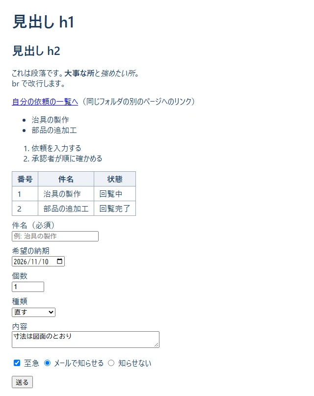

**ここがポイント:**

| タグ | 意味 | メモ |
|---|---|---|
| `<h1>`〜`<h6>` | 見出し | 数が小さいほど大きい。`h1` は 1 ページに 1 つ |
| `<p>` | 段落 | 文のまとまり |
| `<a href="...">` | リンク | `href` に行き先 |
| `<strong>`・`<em>` | 強調 | 太字・斜体は CSS で見た目を変えられる |
| `<ul>`・`<ol>`・`<li>` | 並び | `ul` は点、`ol` は番号。中身は `li` |
| `<table>`・`<tr>`・`<th>`・`<td>` | 表 | `tr` が 1 行、`th` が見出しのます、`td` が中身のます |
| `<form>` | 入力のまとまり | `method="post"` で送る |
| `<label for="id">` | 入力欄の名前 | `for` と入力欄の `id` を同じにする |
| `<input type="...">` | 入力欄 | `text`・`date`・`number`・`checkbox`・`radio`・`file`・`password` など |
| `<select>`・`<option>` | 選ぶ欄 | `selected` で最初に選ばれている物 |
| `<textarea>` | 複数行の入力欄 | |
| `<button type="submit">` | 送るボタン | |

- 入力欄の属性 `required`（必須）・`maxlength`（最大の文字数）・`min`・`max` を付けると、ブラウザが送る前に確かめてくれます。ただし、**サーバーでも必ず確かめます**（ブラウザの確かめは、わざと飛ばせるので。10 の 7 章）。
- ラジオボタンは、`name` が同じ物どうしで「どれか 1 つ」になります。
- `<!-- ... -->` はコメントで、画面には出ません。

### B-02: よく使う CSS（flex・grid・箱の余白・色の変数・スマホの幅）

**何に使う:** 画面の「見た目」と「並べ方」を決める時。

**▶ 書く所と動かし方:** `samples\01_html_css\x02_layout.html` と `x02_layout.css` を、同じフォルダに置いたまま、`x02_layout.html` をダブルクリックして開きます。ブラウザの窓の幅を狭くすると、並び方が変わります。

```html
<!doctype html>
<html lang="ja">
  <head>
    <meta charset="utf-8">
    <meta name="viewport" content="width=device-width, initial-scale=1">
    <title>よく使うレイアウト - 付録</title>
    <link rel="stylesheet" href="x02_layout.css">
  </head>
  <body>
    <!-- 1. flex: 横一列に並べる（左右に分ける） -->
    <header class="bar">
      <strong>依頼・承認アプリ</strong>
      <nav class="menu">
        <a href="#">自分の依頼</a>
        <a href="#">新しい依頼</a>
      </nav>
    </header>

    <main>
      <!-- 2. grid: 何列かのます目に並べる（画面が狭いと 1 列になる） -->
      <section class="cards">
        <div class="card">回覧中 <b>2</b> 件</div>
        <div class="card">差し戻し中 <b>1</b> 件</div>
        <div class="card">完了 <b>5</b> 件</div>
      </section>

      <!-- 3. 箱の中の余白（padding）・外の余白（margin）・枠線（border） -->
      <div class="box">padding 16px ／ border 4px ／ margin 24px の箱</div>

      <!-- 4. 状態で色を変える（class を 2 つ付ける） -->
      <p>
        <span class="badge">回覧中</span>
        <span class="badge badge-warn">差し戻し中</span>
        <span class="badge badge-ok">完了</span>
      </p>

      <!-- 5. ボタン（:hover はマウスを乗せた時の見た目） -->
      <button class="btn">承認する</button>
      <button class="btn btn-danger">差し戻す</button>
    </main>
  </body>
</html>
```

`x02_layout.css`:

```css
/* 付録 B-02: よく使う CSS */

/* 色を変数（--名前）にしておくと、あとで 1 か所を変えるだけで全部そろう */
:root {
  --navy: #1e3a5f;
  --blue: #2f80ed;
  --green: #27ae60;
  --orange: #f2994a;
  --red: #eb5757;
  --gray: #eef2f7;
}

/* 幅に padding と border を含める（大きさの計算が分かりやすくなる） */
* { box-sizing: border-box; }

body {
  margin: 0;
  font-family: "Yu Gothic UI", "Meiryo", sans-serif;
  color: var(--navy);
  background: var(--gray);
}

/* 1. flex: 子を横一列に並べる */
.bar {
  display: flex;
  justify-content: space-between; /* 左右の端に分ける */
  align-items: center;            /* 上下の真ん中にそろえる */
  padding: 12px 24px;
  background: var(--navy);
  color: #fff;
}
.menu {
  display: flex;
  gap: 16px;                      /* 子どうしの間 */
}
.menu a { color: #fff; }

main { padding: 16px 24px; }

/* 2. grid: 3 列のます目。fr は「残りを分ける割合」 */
.cards {
  display: grid;
  grid-template-columns: 1fr 1fr 1fr;
  gap: 12px;
}
.card {
  background: #fff;
  border-radius: 8px;
  padding: 12px;
  text-align: center;
}
.card b { font-size: 24px; }

/* 3. 箱の大きさ: 中の余白（padding）・枠線（border）・外の余白（margin） */
.box {
  margin: 24px 0;
  padding: 16px;
  border: 4px solid var(--blue);
  background: #fff;
}

/* 4. 小さな札（バッジ）。2 つ目の class で色だけ変える */
.badge {
  display: inline-block;
  padding: 2px 10px;
  border-radius: 999px;
  background: var(--blue);
  color: #fff;
  font-size: 14px;
}
.badge-warn { background: var(--orange); }
.badge-ok { background: var(--green); }

/* 5. ボタン。:hover はマウスを乗せた時 */
.btn {
  padding: 8px 20px;
  border: none;
  border-radius: 6px;
  background: var(--blue);
  color: #fff;
  font-size: 16px;
  cursor: pointer;
}
.btn:hover { opacity: 0.85; }
.btn-danger { background: var(--red); }

/* 6. 画面の幅が 600px 以下（スマホなど）の時だけ: カードを 1 列にする */
@media (max-width: 600px) {
  .cards { grid-template-columns: 1fr; }
  .bar { flex-direction: column; gap: 8px; }
}
```

**▼ 画面**（窓の幅 820px）

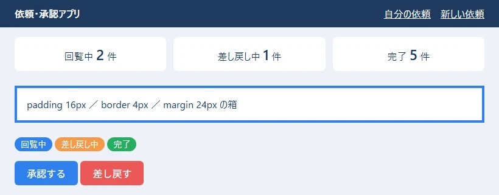

**▼ 画面**（窓の幅 560px。`@media (max-width: 600px)` が効いて、カードが 1 列に、ヘッダーが縦に並ぶ）

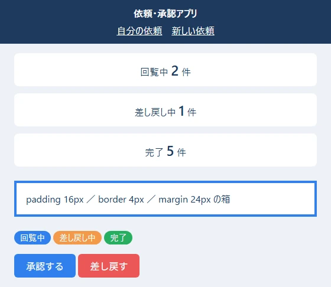

**ここがポイント:**

| やりたいこと | 書き方 |
|---|---|
| 横一列に並べる | `display: flex;` |
| 左右の端に分ける・間を空ける | `justify-content: space-between;`・`gap: 16px;` |
| 上下の真ん中にそろえる | `align-items: center;` |
| 何列かのます目にする | `display: grid; grid-template-columns: 1fr 1fr 1fr;` |
| 中の余白・外の余白・枠線 | `padding`・`margin`・`border` |
| 色を 1 か所で決める | `:root { --blue: #2f80ed; }` と書き、`var(--blue)` で使う |
| マウスを乗せた時 | `.btn:hover { ... }` |
| 画面が狭い時だけ | `@media (max-width: 600px) { ... }` |

- **`box-sizing: border-box;`** を付けておくと、`width` に `padding` と `border` が含まれるので、大きさの計算がずれにくくなります。
- 1 つのタグに **class を 2 つ**（`class="badge badge-warn"`）付けて、共通の見た目と、違う所（色だけ）を分けて書けます。
- `<meta name="viewport" ...>` が無いと、スマホで `@media` が思ったとおりに効きません。HTML の頭に必ず入れます。

### B-03: 文字列と数（TypeScript）

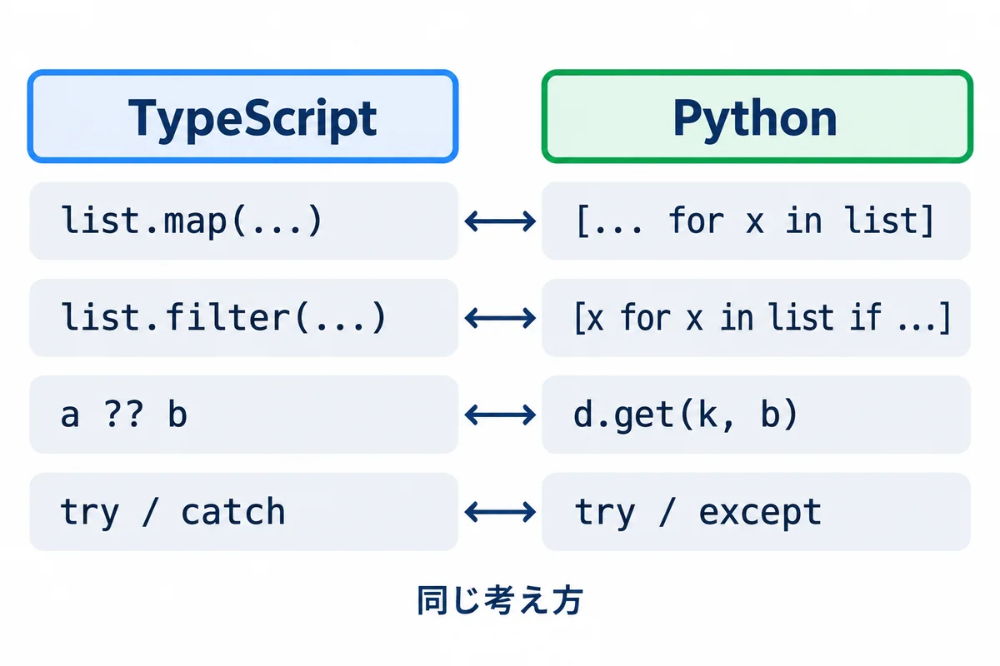

**何に使う:** 画面に出す文を組み立てる時、入力された文字を数に直す時、金額を見やすくする時。

**▶ 書く所と動かし方:** PowerShell で `cd webapp_learning\samples\02_typescript` してから、`node src\x01_text_numbers.ts` を打ちます。型の確かめは `npx tsc` です（B-03〜B-07 は全部同じフォルダ）。

```typescript
// 付録 B-03: 文字列と数でよく使う書き方
const title = "  治具の製作  ";
const requester = "山田 太郎";
const amount = 1234567.891;

// テンプレート文字列: ` で囲み、${ } の中に値や式を書ける
console.log(`依頼者: ${requester}、件名: ${title.trim()}`);

// よく使う文字列の操作
console.log("[" + title.trim() + "]");                 // 前後の空白を取る
console.log("文字数:", title.trim().length);           // 長さ（日本語も 1 文字は 1）
console.log("REQ-7".padStart(8, "0"));                 // 前を 0 で埋めて 8 文字に
console.log("a,b,c".split(","));                       // 区切って配列に
console.log(["山田", "佐藤"].join("、"));               // 配列をつないで 1 つに
console.log("2026-11-02".replaceAll("-", "/"));        // 全部置きかえる
console.log("approved".toUpperCase());                 // 大文字に
console.log("依頼書.pdf".endsWith(".pdf"), "依頼書.pdf".includes("依頼")); // 終わる？ 含む？
console.log("REQ-0001".slice(4));                      // 4 文字目から後ろ（0 から数える）

// 文字列 → 数: Number() は全体が数でないと NaN（数ではない）になる
console.log(Number("42"), Number("42円"), Number.isNaN(Number("42円")));
console.log(Number.parseInt("42円", 10));              // 先頭の数の部分だけ読む

// 数 → 見やすい文字列
console.log(amount.toFixed(2));                        // 小数点以下 2 けた
console.log(amount.toLocaleString("ja-JP"));           // 3 けたごとの区切り
console.log(Math.round(2.5), Math.floor(2.9), Math.ceil(2.1), Math.max(3, 9, 4));

// 小数の計算の誤差: 0.1 + 0.2 は、ぴったり 0.3 にならない（お金は「円」の整数で持つ）
console.log(0.1 + 0.2, 0.1 + 0.2 === 0.3);
```

**▼ 実行結果**

```text
依頼者: 山田 太郎、件名: 治具の製作
[治具の製作]
文字数: 5
000REQ-7
[ 'a', 'b', 'c' ]
山田、佐藤
2026/11/02
APPROVED
true true
0001
42 NaN true
42
1234567.89
1,234,567.891
3 2 3 9
0.30000000000000004 false
```

**ここがポイント:**

- **テンプレート文字列**（`` ` `` で囲む）の `${ }` に、変数や式を書けます。`+` でつなぐより読みやすく、まちがいにくいです。
- **`Number("42円")` は `NaN`（数ではない）になります。** 入力された値を数にする時は、`Number.isNaN(...)` で確かめてから使います。`parseInt` は先頭の数の部分だけを読むので、`"42円"` でも `42` になります（便利ですが、まちがった入力を見逃すこともあります）。
- **`0.1 + 0.2` は、ぴったり `0.3` になりません。** コンピューターは小数を 2 進数で持つので、少し誤差が出ます。お金は「円」の整数で持ち、割り算の結果は `Math.round` などで丸めます。
- `toLocaleString("ja-JP")` で 3 けたごとの区切りが付きます。

### B-04: 配列（map・filter・find・reduce・並べかえ）

**何に使う:** 一覧のデータから、表示する物を選んだり、合計を出したり、並べかえたりする時。React の画面でも、いちばんよく使います。

**▶ 書く所と動かし方:** `samples\02_typescript` で `node src\x02_arrays.ts` を打ちます。

```typescript
// 付録 B-04: 配列（並び）でよく使う書き方
type Req = { id: number; title: string; status: "回覧中" | "承認済み" | "差し戻し"; amount: number };

const requests: Req[] = [
  { id: 1, title: "治具の製作", status: "回覧中", amount: 30000 },
  { id: 2, title: "部品の追加工", status: "承認済み", amount: 12000 },
  { id: 3, title: "棚の取り付け", status: "差し戻し", amount: 8000 },
  { id: 4, title: "工具の修理", status: "回覧中", amount: 5000 },
];

// map: 1 つずつ変換して、新しい配列を作る
console.log(requests.map((r) => r.title));

// filter: 条件に合う物だけの、新しい配列を作る
const circulating = requests.filter((r) => r.status === "回覧中");
console.log("回覧中:", circulating.map((r) => r.id));

// find: 最初に条件に合う物（無ければ undefined）。findIndex は、その位置
console.log(requests.find((r) => r.id === 3)?.title, requests.find((r) => r.id === 9));
console.log(requests.findIndex((r) => r.status === "差し戻し"));

// some: 1 つでも合う？ every: 全部合う？ includes: その値がある？
console.log(requests.some((r) => r.amount > 20000), requests.every((r) => r.amount > 1000));
console.log(["山田", "佐藤"].includes("佐藤"));

// reduce: 1 つの値にまとめる（ここでは合計）
const total = requests.reduce((sum, r) => sum + r.amount, 0);
console.log("合計:", total);

// toSorted: 並べかえた「新しい」配列を作る（元の配列は変わらない）。sort は元の配列を変える
const byAmount = requests.toSorted((a, b) => a.amount - b.amount);
console.log("安い順:", byAmount.map((r) => `${r.title}(${r.amount})`).join(" / "));
console.log("元の順のまま:", requests.map((r) => r.id));

// 足す・取り出す（元の配列が変わる）
const names = ["山田"];
names.push("佐藤", "鈴木"); // 後ろに足す
const last = names.pop();   // 後ろから取り出す
console.log(names, last, names.length);

// スプレッド構文 ...: 配列を広げて、新しい配列を作る（元は変えない）
const more = [...names, "高橋"];
console.log(more, names);

// 分割代入: 配列の中身を、順に変数へ取り出す
const [first, second] = more;
console.log(first, second);

// forEach: 1 つずつ処理する（新しい配列は作らない）。番号も受け取れる
requests.forEach((r, i) => {
  if (i < 2) console.log(`${i + 1}件目: ${r.title}`);
});

// 状態ごとに数える（オブジェクトを表のように使う）
const counts: Record<string, number> = {};
for (const r of requests) {
  counts[r.status] = (counts[r.status] ?? 0) + 1;
}
console.log(counts);
```

**▼ 実行結果**

```text
[ '治具の製作', '部品の追加工', '棚の取り付け', '工具の修理' ]
回覧中: [ 1, 4 ]
棚の取り付け undefined
2
true true
true
合計: 55000
安い順: 工具の修理(5000) / 棚の取り付け(8000) / 部品の追加工(12000) / 治具の製作(30000)
元の順のまま: [ 1, 2, 3, 4 ]
[ '山田', '佐藤' ] 鈴木 2
[ '山田', '佐藤', '高橋' ] [ '山田', '佐藤' ]
山田 佐藤
1件目: 治具の製作
2件目: 部品の追加工
{ '回覧中': 2, '承認済み': 1, '差し戻し': 1 }
```

**ここがポイント:**

| やりたいこと | 書き方 | 返る物 |
|---|---|---|
| 全部を変換 | `a.map((x) => ...)` | 新しい配列 |
| 条件に合う物だけ | `a.filter((x) => ...)` | 新しい配列 |
| 最初に合う物 | `a.find((x) => ...)` | 1 つ（無ければ `undefined`） |
| 合う物があるか・全部合うか | `a.some(...)`・`a.every(...)` | `true`・`false` |
| 1 つの値にまとめる | `a.reduce((合計, x) => ..., 最初の値)` | まとめた値 |
| 並べかえた新しい配列 | `a.toSorted((x, y) => x.amount - y.amount)` | 新しい配列 |
| 足す・取り出す | `a.push(...)`・`a.pop()` | （元の配列が変わる） |
| 広げて新しい配列 | `[...a, 足す物]` | 新しい配列 |

- **元の配列を変えるか、新しい配列を作るか**が大事です。React の state の配列は、`push` や `sort` で変えずに、`[...a, x]`・`filter`・`toSorted` で**新しい配列を作って** set します（B-12）。
- 並べかえの関数 `(a, b) => a.amount - b.amount` は、「マイナスなら a が先、プラスなら b が先」という決まりです。大きい順にするなら `b.amount - a.amount` にします。

### B-05: オブジェクトと型（type・ユニオン型・`?.` と `??`・分割代入・スプレッド）

**何に使う:** 「依頼」「ユーザー」のようなデータの形を決める時。サーバーから届いた JSON の形を書く時。

**▶ 書く所と動かし方:** `samples\02_typescript` で `node src\x03_objects_types.ts` を打ちます。

```typescript
// 付録 B-05: オブジェクトと型でよく使う書き方

// type で「形」に名前を付ける。? は「無くてもよい」項目
type User = {
  employeeNo: string;
  name: string;
  mail?: string;
  isAdmin: boolean;
};

// interface でも形を書ける（ほぼ同じ。この資料では type を使う）
interface Approval {
  order: number;
  approver: string;
}

// ユニオン型: 決まった値のどれか 1 つだけを許す
type Status = "回覧中" | "承認済み" | "差し戻し";

const user: User = { employeeNo: "012345", name: "山田 太郎", isAdmin: false };
const approvals: Approval[] = [{ order: 1, approver: "佐藤" }, { order: 2, approver: "鈴木" }];

// ?. は「無ければ、そこで止めて undefined」。?? は「undefined か null なら右の値」
console.log(user.mail?.toUpperCase());
console.log(user.mail ?? "（メール無し）");

// 分割代入: オブジェクトの項目を、同じ名前の変数へ取り出す
const { name, isAdmin } = user;
console.log(name, isAdmin);

// スプレッド構文: 一部だけ変えた「新しい」オブジェクトを作る（元は変えない）
const promoted = { ...user, isAdmin: true };
console.log(user.isAdmin, promoted.isAdmin);

// Object.keys / Object.entries: 項目の名前・名前と値の組を、配列で取り出す
console.log(Object.keys(user));
for (const [key, value] of Object.entries(user)) {
  console.log(`${key} = ${value}`);
}

// 型の絞り込み: switch で Status の全部の場合を書く
function label(s: Status): string {
  switch (s) {
    case "回覧中":
      return "回覧中（承認を待っている）";
    case "承認済み":
      return "承認済み（完了）";
    case "差し戻し":
      return "差し戻し（直して出し直す）";
  }
}
console.log(label("承認済み"));

// typeof で絞り込む: string | number のどちらかを受け取る
function show(value: string | number): string {
  if (typeof value === "number") {
    return value.toLocaleString("ja-JP") + " 円"; // ここでは number として使える
  }
  return value.trim(); // ここでは string として使える
}
console.log(show(30000), show("  見積もり中  "));

// Record<キーの型, 値の型>: 決まったキーをすべて持つ表
const colors: Record<Status, string> = { 回覧中: "青", 承認済み: "緑", 差し戻し: "オレンジ" };
console.log(colors["差し戻し"]);

// as const: 中身を変えられない、決まった値の並びにする
const steps = ["入力", "回覧", "完了"] as const;
console.log(steps.length, steps[2]);

console.log(approvals.map((a) => `${a.order}. ${a.approver}`).join(" → "));
```

**▼ 実行結果**

```text
undefined
（メール無し）
山田 太郎 false
false true
[ 'employeeNo', 'name', 'isAdmin' ]
employeeNo = 012345
name = 山田 太郎
isAdmin = false
承認済み（完了）
30,000 円 見積もり中
オレンジ
3 完了
1. 佐藤 → 2. 鈴木
```

**ここがポイント:**

- **`?`（`mail?: string`）は「無くてもよい項目」**です。無い時の値は `undefined` です。
- **`a?.b`** は「`a` が無ければ、そこで止めて `undefined`」、**`a ?? b`** は「`a` が `undefined` か `null` なら `b`」です。2 つを組み合わせると、無いかもしれない値を安全に扱えます。
- **ユニオン型**（`"回覧中" | "承認済み" | "差し戻し"`）は、決まった値のどれかだけを許します。打ちまちがい（`"承認ずみ"`）を `npx tsc` が見つけてくれます。`switch` で全部の場合を書くと、場合を足し忘れた時もエラーで分かります。
- **スプレッド構文 `{ ...user, isAdmin: true }`** は、一部だけ変えた**新しい**オブジェクトを作ります。元の `user` は変わりません（結果の `false true`）。React の state を変える時の決まった書き方です。
- `Record<Status, string>` は「`Status` のどの値にも、`string` を 1 つずつ持つ表」です。1 つでも書き忘れると、型のエラーになります。

### B-06: async/await・エラー・JSON

**何に使う:** サーバーからデータを取ってくる（`fetch`）など、**時間のかかる処理を待つ**時と、失敗に備える時。

**▶ 書く所と動かし方:** `samples\02_typescript` で `node src\x04_async_errors.ts` を打ちます。

```typescript
// 付録 B-06: 非同期（async/await）・エラー・JSON でよく使う書き方
import { setTimeout as sleep } from "node:timers/promises";

// 時間のかかる処理のまね（ms ミリ秒待ってから、値を返す）
async function fetchName(id: number, ms: number): Promise<string> {
  await sleep(ms);
  if (id === 0) {
    throw new Error(`id ${id} の人は見つかりません`);
  }
  return `社員${id}`;
}

// 自分のエラーの種類を作る
class ValidationError extends Error {
  field: string;
  constructor(field: string, message: string) {
    super(message);
    this.name = "ValidationError";
    this.field = field;
  }
}

function checkTitle(title: string): string {
  if (title.trim() === "") {
    throw new ValidationError("title", "件名を入れてください");
  }
  return title.trim();
}

async function main() {
  // 1. await: 終わるまで待って、結果を受け取る
  const a = await fetchName(1, 100);
  console.log("1:", a);

  // 2. Promise.all: いくつかを同時に待つ（いちばん遅い物の時間で終わる）
  const start = Date.now();
  const names = await Promise.all([fetchName(2, 200), fetchName(3, 200)]);
  console.log("2:", names, Date.now() - start < 350 ? "同時に待った" : "順番に待った");

  // 3. try / catch / finally: 失敗を受け止める
  try {
    await fetchName(0, 50);
  } catch (e) {
    // catch の e は何が来るか分からないので、Error か確かめてから使う
    console.log("3: 失敗:", e instanceof Error ? e.message : e);
  } finally {
    console.log("3: finally は、成功しても失敗しても最後に動く");
  }

  // 4. 自分のエラーの種類で分ける
  for (const t of ["  治具の製作 ", "   "]) {
    try {
      console.log("4: OK:", checkTitle(t));
    } catch (e) {
      if (e instanceof ValidationError) {
        console.log(`4: 入力の間違い（${e.field}）: ${e.message}`);
      } else {
        throw e; // 思っていないエラーは、上に投げ直す
      }
    }
  }

  // 5. JSON: 文字列 ⇔ オブジェクト。壊れた JSON は JSON.parse でエラーになる
  const text = JSON.stringify({ id: 1, title: "治具", approvers: ["佐藤", "鈴木"] });
  console.log("5:", text);
  const back = JSON.parse(text) as { id: number; title: string; approvers: string[] };
  console.log("5:", back.approvers[1]);
  try {
    JSON.parse("{ id: 1 }");
  } catch (e) {
    console.log("5: 壊れた JSON:", e instanceof SyntaxError);
  }
}

await main();
```

**▼ 実行結果**

```text
1: 社員1
2: [ '社員2', '社員3' ] 同時に待った
3: 失敗: id 0 の人は見つかりません
3: finally は、成功しても失敗しても最後に動く
4: OK: 治具の製作
4: 入力の間違い（title）: 件名を入れてください
5: {"id":1,"title":"治具","approvers":["佐藤","鈴木"]}
5: 鈴木
5: 壊れた JSON: true
```

**ここがポイント:**

- **`async` を付けた関数の中で `await` を書くと、「終わるまで待って、結果を受け取る」**になります。待っている間も、画面などのほかの仕事は止まりません。
- **`Promise.all([...])`** は、いくつかを**同時に**待ちます。1 つずつ `await` するより速く終わります（結果の「同時に待った」）。
- **`try { } catch (e) { } finally { }`** で失敗を受け止めます。`catch` の `e` は何が来るか分からない（`unknown`）ので、`e instanceof Error` で確かめてから `e.message` を使います。
- 自分のエラーのクラス（`ValidationError`）を作ると、「入力の間違い」と「思っていない失敗」を分けて扱えます。思っていない物は `throw e` で投げ直します。
- **`JSON.stringify`**（オブジェクト → 文字列）と **`JSON.parse`**（文字列 → オブジェクト）。壊れた JSON は `SyntaxError` になります。

### B-07: クラス・Map・Set・日付

**何に使う:** データと処理をまとめたい時（クラス）、キーで引く表が欲しい時（Map）、重複を消したい時（Set）、締め切りなどの日付を扱う時。

**▶ 書く所と動かし方:** `samples\02_typescript` で `node src\x05_class_map_date.ts` を打ちます。

```typescript
// 付録 B-07: クラス・Map・Set・日付でよく使う書き方

// クラス: データと、それを扱う関数（メソッド）をまとめる。# の付いた項目は外から見えない
class RequestCounter {
  #counts = new Map<string, number>();

  add(status: string): void {
    this.#counts.set(status, (this.#counts.get(status) ?? 0) + 1);
  }

  // get を付けると、() 無しで値のように読める
  get total(): number {
    let sum = 0;
    for (const n of this.#counts.values()) sum += n;
    return sum;
  }

  summary(): string {
    return [...this.#counts].map(([s, n]) => `${s}:${n}`).join(" ");
  }
}

const counter = new RequestCounter();
for (const s of ["回覧中", "承認済み", "回覧中"]) counter.add(s);
console.log(counter.summary(), "合計", counter.total);

// Map: キー → 値の表。キーに何でも使え、入れた順に回せる
const approvers = new Map<number, string>([
  [1, "佐藤"],
  [2, "鈴木"],
]);
approvers.set(3, "高橋");
console.log(approvers.get(2), approvers.has(9), approvers.size);
for (const [order, name] of approvers) console.log(`${order}番目: ${name}`);

// Set: 同じ値は 1 つしか入らない（重複を消す）
const depts = new Set(["設計", "製造", "設計", "品質"]);
console.log([...depts], depts.has("製造"));

// 日付: 月は 0 から数える（10 は 11 月）。時刻のずれを避けるため、日本時間を指定して表示する
const due = new Date(Date.UTC(2026, 10, 10, 0, 0, 0)); // 2026-11-10 00:00（世界標準時）
console.log(due.toISOString());
console.log(due.toLocaleDateString("ja-JP", { timeZone: "Asia/Tokyo" }));
console.log(due.toLocaleDateString("ja-JP", { timeZone: "Asia/Tokyo", dateStyle: "full" }));

// 日数の差: ミリ秒の差を、1 日のミリ秒で割る
const today = new Date(Date.UTC(2026, 10, 2));
const days = Math.round((due.getTime() - today.getTime()) / (24 * 60 * 60 * 1000));
console.log(`締め切りまで ${days} 日`);

// 数を見やすく: Intl.NumberFormat（通貨の形）
const yen = new Intl.NumberFormat("ja-JP", { style: "currency", currency: "JPY" });
console.log(yen.format(30000));
```

**▼ 実行結果**

```text
回覧中:2 承認済み:1 合計 3
鈴木 false 3
1番目: 佐藤
2番目: 鈴木
3番目: 高橋
[ '設計', '製造', '品質' ] true
2026-11-10T00:00:00.000Z
2026/11/10
2026年11月10日火曜日
締め切りまで 8 日
￥30,000
```

**ここがポイント:**

- **`#` で始まる項目（`#counts`）は、クラスの外から見えません。** 外からは `add`・`total`・`summary` だけを使ってもらいます。
- **`Map`** はキー → 値の表で、`get`・`set`・`has`・`size` を使います。入れた順に回せます。
- **`Set`** は同じ値を 1 つしか持ちません。`[...set]` で配列に戻せます。
- **日付の月は 0 から数えます**（`10` が 11 月）。いちばんよくある間違いです。
- **日付は、表示する時に `timeZone: "Asia/Tokyo"` を付けます。** 付けないと、動かしたパソコンやサーバーの時間帯で表示され、日付が 1 日ずれることがあります。サーバーとのやり取りは `toISOString()` の形（`2026-11-10T00:00:00.000Z`。`Z` は世界標準時）にそろえます。

### B-08: useState とイベント（React）

**何に使う:** ボタンを押したら数が変わる、開く・閉じるを切りかえる、のように、**操作によって画面が変わる**所。

**▶ 書く所と動かし方:** PowerShell で `cd webapp_learning\samples\03_react` してから `npm run dev` を打ち、ブラウザで `http://localhost:5173/appendix.html` を開きます（B-08〜B-12 の全部が 1 ページに出ます。`?demo=x01` を後ろに付けると、1 つだけ出ます）。ファイルを書きかえて保存すると、画面がすぐに変わります。止める時は PowerShell で `Ctrl` ＋ `C` です。サンプルは `src\appendix\` の中にあります。

`src\appendix\X01Counter.tsx`:

```tsx
// 付録 B-08: useState とイベント（ボタンを押すと、画面の数が変わる）
import { useState } from "react";

export function X01Counter() {
  // useState(最初の値) → [今の値, 値を変える関数]
  const [count, setCount] = useState(0);
  const [open, setOpen] = useState(false);

  return (
    <div className="x-card">
      <p>承認した数: <b>{count}</b> 件</p>
      {/* onClick に「押された時にすること」を渡す。setCount で値を変えると、画面が描き直される */}
      <button onClick={() => setCount(count + 1)}>＋1</button>{" "}
      <button onClick={() => setCount(0)} disabled={count === 0}>
        0 に戻す
      </button>

      {/* 条件で表示を変える: 条件 ? A : B と、条件 && A */}
      <p>{count >= 3 ? "たくさん承認しました" : "まだ少しです"}</p>
      <button onClick={() => setOpen(!open)}>{open ? "説明を閉じる" : "説明を開く"}</button>
      {open && <p className="x-note">開いている時だけ、この説明が出ます。</p>}
    </div>
  );
}
```

**▼ 画面**（「＋1」を 3 回押して、「説明を開く」を押したところ）

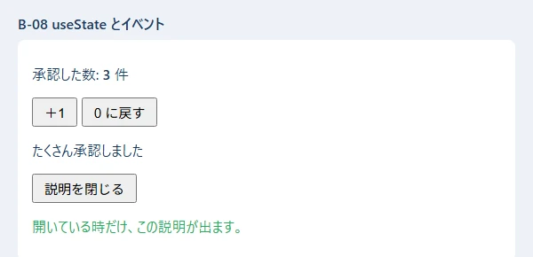

**ここがポイント:**

- **`const [count, setCount] = useState(0);`** で「覚えておく値」を作ります。値を変える時は、必ず `setCount(新しい値)` を使います。`count = 5` のように直接書きかえても、画面は描き直されません。
- `{ }` の中に、JavaScript の式を書けます。**`条件 ? A : B`** で 2 つのどちらかを、**`条件 && A`** で「条件が true の時だけ A」を出します。
- `disabled={count === 0}` のように、属性にも式を書けます。0 の時は「0 に戻す」が押せなくなります。

### B-09: 一覧と絞り込み（map と key）

**何に使う:** 依頼の一覧など、配列を画面に並べる時。検索の欄で絞り込む時。

**▶ 書く所と動かし方:** B-08 と同じく `npm run dev` のまま、`src\appendix\X02List.tsx` を開きます。

```tsx
// 付録 B-09: 配列を一覧にする（map と key）・絞り込み・空の時の表示
import { useState } from "react";

type Item = { id: number; title: string; status: "回覧中" | "差し戻し中" | "完了" };

const ITEMS: Item[] = [
  { id: 1, title: "治具の製作", status: "回覧中" },
  { id: 2, title: "部品の追加工", status: "完了" },
  { id: 3, title: "棚の取り付け", status: "差し戻し中" },
  { id: 4, title: "治具の改造", status: "回覧中" },
];

export function X02List() {
  const [word, setWord] = useState("");
  const [onlyOpen, setOnlyOpen] = useState(false);

  // 表示する物を、毎回の描画のたびに計算する（state にしない）
  const shown = ITEMS.filter((it) => it.title.includes(word)).filter((it) => !onlyOpen || it.status !== "完了");

  return (
    <div className="x-card">
      <input value={word} onChange={(e) => setWord(e.target.value)} placeholder="件名で探す" />{" "}
      <label>
        <input type="checkbox" checked={onlyOpen} onChange={(e) => setOnlyOpen(e.target.checked)} /> 完了を隠す
      </label>
      <p>{shown.length} 件</p>
      {shown.length === 0 ? (
        <p className="x-note">合う依頼がありません</p>
      ) : (
        <ul>
          {/* map で 1 件ずつ <li> にする。key には、変わらない番号（id）を渡す */}
          {shown.map((it) => (
            <li key={it.id}>
              {it.title}（{it.status}）
            </li>
          ))}
        </ul>
      )}
    </div>
  );
}
```

**▼ 画面**（検索の欄に「治具」と入れたところ ／ 「ねじ」と入れたところ）

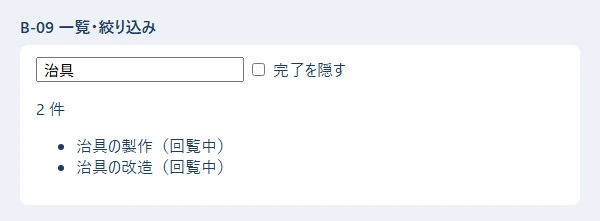

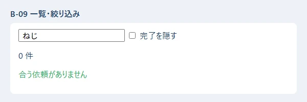

**ここがポイント:**

- **配列を画面に並べる時は `map` で 1 件ずつタグにし、`key` に「変わらない番号」（`id`）を渡します。** `key` が無いと、React が「どの行がどれか」を見分けられず、警告が出ます。配列の番号（`i`）を `key` にすると、並べかえた時に入力中の値がずれることがあるので、`id` を使います。
- **絞り込んだ結果（`shown`）は state にしません。** 元のデータと検索の文字から毎回計算できる物は、計算すればよい、が React の決まりです。state を増やすほど、ずれの元になります。
- 0 件の時の表示（「合う依頼がありません」）も、忘れずに用意します。

### B-10: 入力フォームと入力の検査

**何に使う:** 依頼の入力画面のように、いくつかの入力欄の値を集めて送る時。

**▶ 書く所と動かし方:** `src\appendix\X03Form.tsx` を開きます。

```tsx
// 付録 B-10: フォーム（入力欄の値を state で持つ・入力の検査・送る）
import { useState, type FormEvent } from "react";

type Form = { title: string; kind: string; urgent: boolean };

export function X03Form() {
  // 入力欄の値を、1 つのオブジェクトの state で持つ
  const [form, setForm] = useState<Form>({ title: "", kind: "new", urgent: false });
  const [error, setError] = useState("");
  const [sent, setSent] = useState<Form | null>(null);

  function handleSubmit(e: FormEvent<HTMLFormElement>) {
    e.preventDefault(); // ブラウザがページを移動しないようにする（React で送る時の決まり）
    if (form.title.trim() === "") {
      setError("件名を入れてください");
      return;
    }
    setError("");
    setSent(form); // 本当のアプリでは、ここで fetch してサーバーへ送る
  }

  return (
    <form className="x-card" onSubmit={handleSubmit}>
      <label>
        件名{" "}
        {/* value と onChange の組: 入力欄の中身は、いつも state と同じになる */}
        <input value={form.title} onChange={(e) => setForm({ ...form, title: e.target.value })} />
      </label>{" "}
      <select value={form.kind} onChange={(e) => setForm({ ...form, kind: e.target.value })}>
        <option value="new">新しく作る</option>
        <option value="fix">直す</option>
      </select>{" "}
      <label>
        <input
          type="checkbox"
          checked={form.urgent}
          onChange={(e) => setForm({ ...form, urgent: e.target.checked })}
        />{" "}
        至急
      </label>{" "}
      <button type="submit">送る</button>
      {error && <p className="x-error">{error}</p>}
      {sent && (
        <p className="x-note">
          送った内容: {sent.title.trim()}／{sent.kind === "new" ? "新しく作る" : "直す"}／
          {sent.urgent ? "至急" : "通常"}
        </p>
      )}
    </form>
  );
}
```

**▼ 画面**（何も入れずに「送る」を押したところ ／ 入れてから「送る」を押したところ）

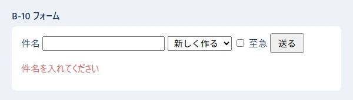

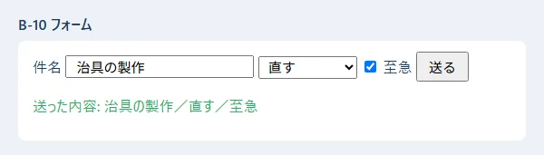

**ここがポイント:**

- **`value={...}` と `onChange={...}` の組**で、入力欄の中身と state をいつも同じにします（制御されたコンポーネント）。チェックボックスは `checked` と `e.target.checked` を使います。
- **`setForm({ ...form, title: e.target.value })`** は「ほかの項目はそのままで、`title` だけ変えた新しいオブジェクト」を作っています（B-05 のスプレッド構文）。
- **`e.preventDefault()`** を忘れると、ブラウザがページを読み直してしまい、入力が消えます。
- 画面での確かめは「早く知らせるため」です。**サーバーでも、同じ確かめを必ずします**（06・08）。

### B-11: useEffect と fetch（画面が出たあとに、データを取ってくる）

**何に使う:** 画面を開いた時に、サーバーから一覧を取ってくる時。

**▶ 書く所と動かし方:** `src\appendix\X04Fetch.tsx` を開きます。取ってくるデータは `public\appendix_requests.json` に置いてあります（`public` の中のファイルは、`http://localhost:5173/appendix_requests.json` で読めます）。

```tsx
// 付録 B-11: useEffect で、画面が出たあとにデータを取ってくる（読み込み中・失敗・成功）
import { useEffect, useState } from "react";

type Row = { id: number; title: string };

export function X04Fetch({ url }: { url: string }) {
  const [rows, setRows] = useState<Row[] | null>(null); // null は「まだ届いていない」
  const [error, setError] = useState("");

  // useEffect(する事, [見張る値]): 最初の描画のあと、url が変わった時に動く
  useEffect(() => {
    let ignore = false; // 古い結果を捨てるための印
    setRows(null);
    setError("");
    fetch(url)
      .then((res) => {
        if (!res.ok) throw new Error(`サーバーの返事が ${res.status} でした`);
        return res.json() as Promise<Row[]>;
      })
      .then((data) => {
        if (!ignore) setRows(data);
      })
      .catch((e: unknown) => {
        if (!ignore) setError(e instanceof Error ? e.message : String(e));
      });
    // 後片づけ: url が変わった・画面から消えた時に呼ばれる
    return () => {
      ignore = true;
    };
  }, [url]);

  if (error) return <p className="x-card x-error">読み込めませんでした: {error}</p>;
  if (rows === null) return <p className="x-card">読み込み中…</p>;
  return (
    <ul className="x-card">
      {rows.map((r) => (
        <li key={r.id}>
          {r.id}. {r.title}
        </li>
      ))}
    </ul>
  );
}
```

**▼ 画面**（読めた時 ／ 無いファイル `/no_such_file.json` を読もうとした時）

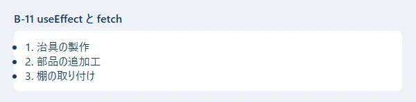

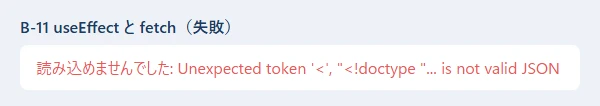

**ここがポイント:**

- **`useEffect(() => { ... }, [url])`** は「画面を描いたあとに、`url` が変わった時だけ」動きます。`[]` にすると、最初の 1 回だけです。**`[ ]` を書き忘れると、描くたびに動いて、何度も fetch してしまいます。**
- **「読み込み中」「失敗」「成功」の 3 つの画面を、必ず用意します。** state を `null`（まだ）・`error`（失敗）・配列（成功）で分けています。
- **`res.ok` を確かめます。** `fetch` は、サーバーが 404 や 500 を返しても「失敗」にはなりません（通信できれば成功扱い）。
- **2 枚目の画面の読み方:** 開発用のサーバー（Vite）は、無いファイルを頼まれると、代わりに HTML のページ（`<!doctype html>...`）を返します。それを JSON として読もうとして、「`<` は JSON の始まりではない」というエラーになりました。**この文が出たら、URL のまちがいを疑います。**
- `return () => { ignore = true; }` は後片づけです。URL がすぐ変わった時に、古い返事で画面を上書きしないようにしています。

### B-12: 部品に分ける（props・子から親へ知らせる・children）

**何に使う:** 同じ見た目のボタンや枠を何度も使う時、画面が大きくなって 1 つのファイルでは読みにくくなった時。

**▶ 書く所と動かし方:** `src\appendix\X05Props.tsx` を開きます。

```tsx
// 付録 B-12: 部品に分ける（props で渡す・子から親へ知らせる・children）
import { useState, type ReactNode } from "react";

// 子の部品 1: 値と「押された時の関数」を props で受け取る
function ApproveButton({ name, onApprove }: { name: string; onApprove: (name: string) => void }) {
  return <button onClick={() => onApprove(name)}>{name} さんとして承認</button>;
}

// 子の部品 2: children は、タグの間に書いた中身
function Panel({ title, children }: { title: string; children: ReactNode }) {
  return (
    <section className="x-card">
      <h3>{title}</h3>
      {children}
    </section>
  );
}

export function X05Props() {
  // 状態は「使う部品たちの、いちばん近い親」に置く（ここでは X05Props）
  const [log, setLog] = useState<string[]>([]);

  function handleApprove(name: string) {
    setLog((prev) => [...prev, `${name} さんが承認しました`]); // 前の値から作る時は関数で渡す
  }

  return (
    <Panel title="回覧">
      <ApproveButton name="佐藤" onApprove={handleApprove} />{" "}
      <ApproveButton name="鈴木" onApprove={handleApprove} />
      <ol>
        {log.map((line, i) => (
          <li key={i}>{line}</li>
        ))}
      </ol>
    </Panel>
  );
}
```

**▼ 画面**（「佐藤 さんとして承認」→「鈴木 さんとして承認」の順に押したところ）

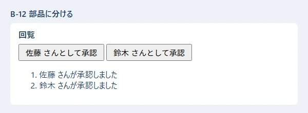

**ここがポイント:**

- **親から子へは props（引数のような物）で渡します。** 子は受け取った値を変えません。
- **子から親へ知らせる時は、親が関数（`onApprove`）を props で渡し、子がそれを呼びます。** state は親が持ち、子は「押された」と知らせるだけです。
- **`children`** は、`<Panel>...</Panel>` のタグの間に書いた中身です。枠だけを部品にして、中身は使う側が決められます。
- **前の値から新しい値を作る時は、`setLog((prev) => [...prev, 新しい行])` のように関数で渡します。** 続けて何度も呼んでも、正しく積み上がります。

### B-13: 文字列と数（Python）

**何に使う:** 画面やメールに出す文を組み立てる時、CSV などから読んだ文字を数に直す時。

**▶ 書く所と動かし方:** PowerShell で `cd webapp_learning\samples\04_python` し、仮想環境を作ってあれば（04 の 1 章）、`.\.venv\Scripts\python.exe x01_text_numbers.py` を打ちます（B-13〜B-17 は全部同じフォルダ）。**Python は字下げに意味があるので、PDF からコピーした時は字下げを確かめます**（00 の 6.7）。

```python
# 付録 B-11: 文字列と数でよく使う書き方
title = "  治具の製作  "
requester = "山田 太郎"
amount = 1234567.891

# f 文字列: f"..." の { } に値や式を書ける。: のあとで形を決められる
print(f"依頼者: {requester}、件名: {title.strip()}")
print(f"{amount:,.2f}")   # 3 けたごとの区切り ＋ 小数点以下 2 けた
print(f"{42:05d}")        # 5 けたになるまで前を 0 で埋める
print(f"[{'右':>6}] [{'左':<6}] [{'中':^6}]")  # 幅 6 で右・左・中央に寄せる
print(f"{0.256:.1%}")     # 割合（% の形）

# よく使う文字列の操作
print("[" + title.strip() + "]")          # 前後の空白を取る
print(len(title.strip()))                 # 文字の数
print("a,b,c".split(","))                 # 区切ってリストに
print("、".join(["山田", "佐藤"]))          # リストをつないで 1 つに（区切り文字の方に .join）
print("2026-11-02".replace("-", "/"))     # 置きかえる
print("approved".upper(), "APPROVED".lower())
print("依頼書.pdf".endswith(".pdf"), "依頼" in "依頼書.pdf")  # 終わる？ 含む？
print("REQ-0001"[4:], "REQ-0001"[:3], "REQ-0001"[-1])     # 切り出し（0 から数える。-1 は最後）
print("7".zfill(4))                       # 前を 0 で埋めて 4 けたに

# 文字列 → 数: int() / float()。数でない時は ValueError
print(int("42") + 1, float("3.5") * 2)
try:
    int("42円")
except ValueError as e:
    print("数にできない:", e)

# 数の計算
print(7 / 2, 7 // 2, 7 % 2, 2 ** 10)      # 割り算・切り捨ての割り算・余り・累乗
print(round(2.5), round(3.5), round(2.675, 2))  # round は「偶数への丸め」と誤差に注意
print(max(3, 9, 4), min([5, 1, 8]), sum([1, 2, 3]), abs(-5))
print(0.1 + 0.2, 0.1 + 0.2 == 0.3)        # 小数の誤差（お金は「円」の整数で持つ）
```

**▼ 実行結果**

```text
依頼者: 山田 太郎、件名: 治具の製作
1,234,567.89
00042
[     右] [左     ] [  中   ]
25.6%
[治具の製作]
5
['a', 'b', 'c']
山田、佐藤
2026/11/02
APPROVED approved
True True
0001 REQ 1
0007
43 7.0
数にできない: invalid literal for int() with base 10: '42円'
3.5 3 1 1024
2 4 2.67
9 1 6 5
0.30000000000000004 False
```

**ここがポイント:**

| 書き方 | 意味 | 結果 |
|---|---|---|
| `f"{amount:,.2f}"` | 3 けた区切り＋小数 2 けた | `1,234,567.89` |
| `f"{42:05d}"` | 5 けたになるまで 0 で埋める | `00042` |
| `f"{'右':>6}"` | 幅 6 で右寄せ（`<` 左・`^` 中央） | `     右` |
| `f"{0.256:.1%}"` | 割合 | `25.6%` |
| `s.strip()` | 前後の空白を取る | |
| `s.split(",")`・`"、".join(リスト)` | 分ける・つなぐ | `join` は**区切り文字の方**に付ける |
| `s[4:]`・`s[:3]`・`s[-1]` | 切り出し | 0 から数える。`-1` は最後の 1 文字 |

- **`int("42円")` は `ValueError` になります。** 外から来た文字を数に直す時は、`try`・`except ValueError` で受け止めます（B-16）。
- **`7 / 2` は `3.5`、`7 // 2` は `3`**（切り捨て）です。TypeScript と違い、Python の `/` は小数の結果になります。
- **`round(2.5)` は `2`** です。Python の `round` は「ちょうど半分なら偶数の方へ」丸めます。`round(2.675, 2)` が `2.67` になるのは、小数の誤差のためです。お金の計算は、整数の「円」で持つか、`decimal` という標準の部品を使います。
- 幅（`>6` など）は**文字の数**で数えるので、日本語は見た目の位置がずれます（結果の `[  中   ]`）。

### B-14: リスト・辞書・集合・内包表記

**何に使う:** 依頼の一覧から選ぶ・並べかえる・数える・グループに分ける時。Django の画面や API の中で、毎日のように使います。

**▶ 書く所と動かし方:** `samples\04_python` で `.\.venv\Scripts\python.exe x02_collections.py` を打ちます。

```python
# 付録 B-12: リスト・辞書・集合・タプルでよく使う書き方
from collections import Counter, defaultdict

requests = [
    {"id": 1, "title": "治具の製作", "status": "回覧中", "amount": 30000},
    {"id": 2, "title": "部品の追加工", "status": "承認済み", "amount": 12000},
    {"id": 3, "title": "棚の取り付け", "status": "差し戻し", "amount": 8000},
    {"id": 4, "title": "工具の修理", "status": "回覧中", "amount": 5000},
]

# リスト: 足す・取り出す・並べかえる
names = ["山田"]
names.append("佐藤")          # 後ろに足す
names.insert(0, "鈴木")       # 0 番目に入れる
last = names.pop()            # 後ろから取り出す
print(names, last, len(names))

# sorted は「新しい」リストを返す。key で「何で並べるか」を決める。reverse=True で逆順
by_amount = sorted(requests, key=lambda r: r["amount"])
print([r["title"] for r in by_amount])
print([r["id"] for r in sorted(requests, key=lambda r: r["amount"], reverse=True)])

# 内包表記: for と if を 1 行で書いて、新しいリストを作る
circulating = [r["id"] for r in requests if r["status"] == "回覧中"]
print("回覧中:", circulating)
print("合計:", sum(r["amount"] for r in requests))
print("2 万円より高い物がある？", any(r["amount"] > 20000 for r in requests))

# enumerate: 番号つきで回す（start=1 で 1 から）。zip: 2 つを組にして回す
for i, r in enumerate(requests[:2], start=1):
    print(f"{i}件目: {r['title']}")
for order, name in zip([1, 2], ["佐藤", "鈴木"]):
    print(f"{order}番目の承認者: {name}")

# 辞書: get は、キーが無い時の値を決められる（[ ] だと KeyError）
user = {"employee_no": "012345", "name": "山田 太郎"}
print(user.get("mail", "（メール無し）"))
user["dept"] = "設計部"                     # 足す・書きかえる
for key, value in user.items():             # キーと値を組で回す
    print(f"{key} = {value}")
print(list(user.keys()), "name" in user)

# 辞書の内包表記: id → 件名 の表を作る
titles = {r["id"]: r["title"] for r in requests}
print(titles[3])

# Counter: 数え上げ。most_common で多い順
counts = Counter(r["status"] for r in requests)
print(counts, counts.most_common(1))

# defaultdict: 無いキーを初めて使う時、自動で空のリストを作る（グループ分け）
by_status = defaultdict(list)
for r in requests:
    by_status[r["status"]].append(r["id"])
print(dict(by_status))

# 集合（set）: 重複を消す・共通・差
a = {"設計", "製造", "品質"}
b = {"製造", "総務"}
print(sorted(a | b), sorted(a & b), sorted(a - b))
print(sorted(set(["設計", "製造", "設計"])))

# タプル: 変えられない組。複数の値を返す・受け取る時によく使う
point = (10, 20)
x, y = point
print(x + y)
```

**▼ 実行結果**

```text
['鈴木', '山田'] 佐藤 2
['工具の修理', '棚の取り付け', '部品の追加工', '治具の製作']
[1, 2, 3, 4]
回覧中: [1, 4]
合計: 55000
2 万円より高い物がある？ True
1件目: 治具の製作
2件目: 部品の追加工
1番目の承認者: 佐藤
2番目の承認者: 鈴木
（メール無し）
employee_no = 012345
name = 山田 太郎
dept = 設計部
['employee_no', 'name', 'dept'] True
棚の取り付け
Counter({'回覧中': 2, '承認済み': 1, '差し戻し': 1}) [('回覧中', 2)]
{'回覧中': [1, 4], '承認済み': [2], '差し戻し': [3]}
['品質', '総務', '製造', '設計'] ['製造'] ['品質', '設計']
['製造', '設計']
30
```

**ここがポイント:**


- **内包表記 `[式 for x in 並び if 条件]`** は、TypeScript の `filter` と `map` を 1 行で書いた物です。`sum(... for r in requests)` のように `[ ]` を外すと、リストを作らずに合計だけを出せます。
- **`sorted(並び, key=lambda r: r["amount"])`** の `key` は「何で並べるか」を返す小さな関数です。`reverse=True` で大きい順。`sorted` は新しいリストを返し、`リスト.sort()` は元のリストを並べかえます。
- **辞書の `d.get(キー, 無い時の値)`** は、キーが無くてもエラーになりません。`d[キー]` は、キーが無いと `KeyError` で止まります。
- **`Counter`**（数え上げ）と **`defaultdict(list)`**（グループ分け）は、`collections` という標準の部品です。自分で `if キー not in d:` を書くより短く、まちがいにくくなります。
- 集合の `|`（どちらかにある）・`&`（両方にある）・`-`（左だけにある）。集合は順番を持たないので、表示する時は `sorted` で並べます。

### B-15: 関数・クラス・dataclass・Enum

**何に使う:** 処理に名前を付けてまとめる時（関数）、データとその扱い方をまとめる時（クラス）。Django のモデルもクラスです。

**▶ 書く所と動かし方:** `samples\04_python` で `.\.venv\Scripts\python.exe x03_functions_classes.py` を打ちます。

```python
# 付録 B-13: 関数とクラスでよく使う書き方
from dataclasses import dataclass, field
from enum import StrEnum


# 既定値つきの引数・名前付きで渡す引数
def make_title(name: str, kind: str = "依頼", urgent: bool = False) -> str:
    mark = "【至急】" if urgent else ""
    return f"{mark}{name}の{kind}"


print(make_title("治具"))
print(make_title("治具", "見積もり"))
print(make_title("治具", urgent=True))      # 名前を付けて渡すと、順番を気にしなくてよい


# *args: いくつでも受け取る（タプルになる）。**kwargs: 名前付きでいくつでも（辞書になる）
def total(*amounts: int, **options: str) -> str:
    unit = options.get("unit", "円")
    return f"{sum(amounts):,}{unit}"


print(total(1000, 2500, 300))
print(total(5, 7, unit="個"))


# 複数の値を返す（本当はタプルを 1 つ返している）
def min_max(values: list[int]) -> tuple[int, int]:
    return min(values), max(values)


low, high = min_max([30000, 12000, 8000])
print(low, high)


# StrEnum: 決まった値の一覧（文字列としても使える）
class Status(StrEnum):
    CIRCULATING = "回覧中"
    APPROVED = "承認済み"
    RETURNED = "差し戻し"


# クラス: データと、それを扱う関数（メソッド）をまとめる
class Request:
    def __init__(self, title: str, amount: int):   # 作る時に呼ばれる
        self.title = title
        self.amount = amount
        self.status = Status.CIRCULATING

    def approve(self) -> None:                      # self は「自分」
        self.status = Status.APPROVED

    @property                                       # () 無しで値のように読める
    def is_expensive(self) -> bool:
        return self.amount >= 20000

    def __str__(self) -> str:                       # print した時の形
        return f"{self.title}（{self.amount:,}円・{self.status}）"


r = Request("治具の製作", 30000)
print(r, r.is_expensive)
r.approve()
print(r, r.status == Status.APPROVED, r.status == "承認済み")


# @dataclass: 項目を書くだけで、__init__・__repr__・== を自動で作る
@dataclass
class Approval:
    order: int
    approver: str
    comments: list[str] = field(default_factory=list)  # リストの既定値はこう書く
    done: bool = False


a1 = Approval(1, "佐藤")
a2 = Approval(1, "佐藤")
a1.comments.append("確認しました")
print(a1)
print(a1 == a2, Approval(2, "鈴木", done=True))
```

**▼ 実行結果**

```text
治具の依頼
治具の見積もり
【至急】治具の依頼
3,800円
12個
8000 30000
治具の製作（30,000円・回覧中） True
治具の製作（30,000円・承認済み） True True
Approval(order=1, approver='佐藤', comments=['確認しました'], done=False)
False Approval(order=2, approver='鈴木', comments=[], done=True)
```

**ここがポイント:**

- **既定値つきの引数**（`kind: str = "依頼"`）は、渡さなければ既定値になります。**名前を付けて渡す**（`urgent=True`）と、順番を気にしなくてよく、読む人にも意味が分かります。
- **`*amounts`** はいくつでも受け取る（タプルになる）、**`**options`** は名前付きでいくつでも受け取る（辞書になる）引数です。
- `return min(values), max(values)` は、値を 2 つ返しています（本当はタプル 1 つ）。受け取る側は `low, high = ...` で分けます。
- **クラスの `__init__`** は作る時に呼ばれ、**`self`** は「その 1 つ」を指します。`__str__` は `print` した時の形、`@property` は `()` 無しで読める値です。
- **`@dataclass`** を付けると、項目を並べるだけで `__init__`・表示の形（`Approval(order=1, ...)`）・`==` の比べ方を自動で作ってくれます。**リストの既定値は `field(default_factory=list)`** と書きます（`= []` と書くと、全部の物で同じリストを使い回してしまうため、Python がエラーにします）。
- **`StrEnum`** は「決まった値の一覧」で、文字列としても比べられます（`r.status == "承認済み"` が `True`）。

### B-16: 例外・ファイル・JSON・CSV

**何に使う:** 入力のまちがいを伝える時、設定やデータをファイルに読み書きする時、CSV を取り込む・書き出す時。

**▶ 書く所と動かし方:** `samples\04_python` で `.\.venv\Scripts\python.exe x04_errors_files.py` を打ちます。プログラムは `work` フォルダを作り、最後に消します。

```python
# 付録 B-14: エラー・ファイル・JSON・CSV でよく使う書き方
import csv
import json
import shutil
from pathlib import Path


class TitleError(ValueError):
    """件名の間違い（自分で作るエラーの種類）"""


def check_title(title: str) -> str:
    if not title.strip():
        raise TitleError("件名を入れてください")   # raise でエラーを起こす
    return title.strip()


# try / except / else / finally
for t in ["  治具の製作 ", "   "]:
    try:
        ok = check_title(t)
    except TitleError as e:
        print("入力の間違い:", e)
    else:
        print("OK:", ok)              # エラーが起きなかった時だけ
    finally:
        print("（毎回ここを通る）")

# Path: ファイルとフォルダの場所を扱う。/ でつなげる
work = Path("work")
data = work / "data"
data.mkdir(parents=True, exist_ok=True)       # 途中のフォルダもまとめて作る

# 書く・読む（日本語を扱う時は encoding="utf-8" を必ず付ける）
memo = data / "memo.txt"
memo.write_text("1 行目\n2 行目\n", encoding="utf-8")
with memo.open("a", encoding="utf-8") as f:   # with: 使い終わると自動で閉じる
    f.write("3 行目（書き足し）\n")
for i, line in enumerate(memo.read_text(encoding="utf-8").splitlines(), start=1):
    print(f"{i}: {line}")
print(memo.exists(), memo.name, memo.suffix, memo.stat().st_size, "バイト")

# JSON: ensure_ascii=False で日本語をそのまま、indent=2 で読みやすく
req = {"id": 1, "title": "治具の製作", "approvers": ["佐藤", "鈴木"]}
(data / "req.json").write_text(json.dumps(req, ensure_ascii=False, indent=2), encoding="utf-8")
back = json.loads((data / "req.json").read_text(encoding="utf-8"))
print(back["approvers"][1], json.dumps(back, ensure_ascii=False))

# CSV: DictWriter で書いて、DictReader で読む（Excel で開くなら encoding="utf-8-sig"）
rows = [{"no": "012345", "name": "山田 太郎"}, {"no": "012346", "name": "佐藤 花子"}]
with (data / "users.csv").open("w", encoding="utf-8-sig", newline="") as f:
    writer = csv.DictWriter(f, fieldnames=["no", "name"])
    writer.writeheader()
    writer.writerows(rows)
with (data / "users.csv").open(encoding="utf-8-sig", newline="") as f:
    for row in csv.DictReader(f):
        print(row["no"], row["name"])

# フォルダの中の一覧（並べかえてから）
print(sorted(p.name for p in data.iterdir()))

# 無いファイルを読むと FileNotFoundError
try:
    (data / "none.txt").read_text(encoding="utf-8")
except FileNotFoundError:
    print("ファイルがありません")

shutil.rmtree(work)                               # 片づけ: フォルダごと消す（よく確かめて使う）
print("work は残っている？", work.exists())
```

**▼ 実行結果**

```text
OK: 治具の製作
（毎回ここを通る）
入力の間違い: 件名を入れてください
（毎回ここを通る）
1: 1 行目
2: 2 行目
3: 3 行目（書き足し）
True memo.txt .txt 48 バイト
鈴木 {"id": 1, "title": "治具の製作", "approvers": ["佐藤", "鈴木"]}
012345 山田 太郎
012346 佐藤 花子
['memo.txt', 'req.json', 'users.csv']
ファイルがありません
work は残っている？ False
```

**ここがポイント:**

- **`try` → `except`（失敗した時）→ `else`（失敗しなかった時だけ）→ `finally`（どちらでも最後に）** の順に動きます。
- **`raise TitleError("...")`** で、自分のエラーを起こします。`ValueError` を元にして作ると、「値がおかしい」という種類のエラーとして扱えます。
- **ファイルを開く時は、必ず `encoding="utf-8"` を付けます。** 付けないと、Windows では古い文字コード（Shift_JIS）で読み書きされ、文字化けやエラーの元になります。
- **`with ... as f:`** の中で使ったファイルは、抜ける時に自動で閉じます。
- **`Path("work") / "data"`** のように、`/` でパスをつなげます。`mkdir(parents=True, exist_ok=True)` は「途中のフォルダもまとめて作る。もうあってもよい」です。
- `memo.txt` が 48 バイトなのは、日本語 1 文字が 3 バイトで、**Windows では改行が 2 バイト（`\r\n`）**で書かれるためです。
- **JSON は `ensure_ascii=False`** にすると、日本語がそのまま書かれます（付けないと `治` のような形になる）。
- **CSV を Excel で開くなら `encoding="utf-8-sig"`**（先頭に印が付き、Excel が UTF-8 だと分かる）、`newline=""` も必ず付けます（付けないと、Windows で空の行がはさまる）。

### B-17: 日付と時刻・日本時間

**何に使う:** 納期・送った時刻・「60 分でログアウト」・「毎朝 8:00」など、日付と時刻を扱う時。

**▶ 書く所と動かし方:** `samples\04_python` で `.\.venv\Scripts\python.exe x05_dates.py` を打ちます（日本時間を使うので、`requirements.txt` の `tzdata` を入れておきます）。

```python
# 付録 B-15: 日付と時刻でよく使う書き方
from datetime import date, datetime, timedelta
from zoneinfo import ZoneInfo

TOKYO = ZoneInfo("Asia/Tokyo")   # 日本時間（Windows では tzdata の部品が要る）

# 日付だけ: date。日付と時刻: datetime（tzinfo で「どこの時間か」を付ける）
due = date(2026, 11, 10)
sent = datetime(2026, 11, 2, 8, 0, tzinfo=TOKYO)
print(due, sent)

# 形を決めて文字にする（strftime）・文字から読む（strptime）
print(due.strftime("%Y年%m月%d日"), sent.strftime("%H:%M"))
print(datetime.strptime("2026/11/02 08:00", "%Y/%m/%d %H:%M"))
print(date.fromisoformat("2026-12-01"))       # 2026-12-01 の形はこれで読める

# 足し算・引き算: timedelta（日・時間・分の長さ）
print(due + timedelta(days=7))                # 1 週間後
print(sent + timedelta(minutes=60))           # 60 分後（ログアウトの時刻など）
left = due - date(2026, 11, 2)
print(left.days, "日")

# 比べる・曜日（月曜が 0）
print(due > date(2026, 11, 1), "月火水木金土日"[due.weekday()])

# 世界標準時（UTC）と日本時間の変換。保存は UTC、表示は日本時間、がよくある決まり
utc = sent.astimezone(ZoneInfo("UTC"))
print(utc.isoformat(), "→", utc.astimezone(TOKYO).isoformat())

# 「今」は datetime.now(TOKYO)。動かすたびに変わるので、ここでは形だけ確かめる
now = datetime.now(TOKYO)
print(now.tzinfo, now.year >= 2026)
```

**▼ 実行結果**

```text
2026-11-10 2026-11-02 08:00:00+09:00
2026年11月10日 08:00
2026-11-02 08:00:00
2026-12-01
2026-11-17
2026-11-02 09:00:00+09:00
8 日
True 火
2026-11-01T23:00:00+00:00 → 2026-11-02T08:00:00+09:00
Asia/Tokyo True
```

**ここがポイント:**

| やりたいこと | 書き方 |
|---|---|
| 日付だけ | `date(2026, 11, 10)` |
| 日付と時刻（日本時間） | `datetime(2026, 11, 2, 8, 0, tzinfo=ZoneInfo("Asia/Tokyo"))` |
| 文字にする | `d.strftime("%Y年%m月%d日")`・`d.isoformat()` |
| 文字から読む | `datetime.strptime("2026/11/02 08:00", "%Y/%m/%d %H:%M")`・`date.fromisoformat("2026-12-01")` |
| 足す・引く | `d + timedelta(days=7)`・`d1 - d2`（`.days` で日数） |
| 今 | `datetime.now(ZoneInfo("Asia/Tokyo"))` |

- **時刻には、必ず「どこの時間か」（`tzinfo`）を付けます。** 付けない時刻は、動かしたパソコンの時間帯で解釈され、サーバーとパソコンで 9 時間ずれる、という事故の元になります。
- **保存は世界標準時（UTC）、表示は日本時間**、がよくある決まりです。Django も、`USE_TZ = True` の時は、データベースに UTC で保存します。
- `+09:00` は「世界標準時より 9 時間進んでいる」（日本時間）、`+00:00` は世界標準時です。同じ瞬間を 2 つの形で書いています。
- **Windows では `tzdata` の部品が要ります。** 無いと `ZoneInfoNotFoundError: 'No time zone found with key Asia/Tokyo'` になります。

### B-18: Django の ORM（絞り込み・並べかえ・集計・まとめて変える）

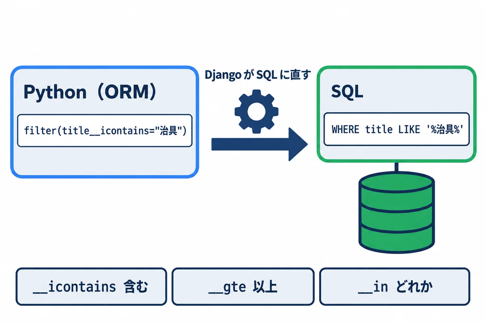

**何に使う:** データベースの表から、条件に合う行を取り出す・数える・書きかえる時。Django では、SQL を直接書かずに、Python のメソッドで書きます（05 の 6 章）。

**▶ 書く所と動かし方:** PowerShell で `cd webapp_learning\samples\05_django` し、05 の 2 章と 4 章の準備（仮想環境と `migrate`）をしてあれば、次を打ちます。練習用のデータを毎回作り直すので、何度動かしても同じ結果になります。

```powershell
.\.venv\Scripts\python.exe manage.py shell -c "import orm_cheatsheet"
```

`samples\05_django\orm_cheatsheet.py`:

```python
"""付録 B-16: Django ORM でよく使う書き方の早見表。
使い方: .venv\\Scripts\\python.exe manage.py shell -c "import orm_cheatsheet"
（練習用のデータを作り直すので、何度動かしても同じ結果になる）"""

from datetime import date

from django.contrib.auth import get_user_model
from django.db import transaction
from django.db.models import Count, F, Max, Min, Q

from requests_app.models import Approval, Request

User = get_user_model()
S = Request.Status

# 0. 練習用のデータを作り直す
Request.objects.all().delete()
User.objects.filter(username__in=["012345", "012346", "012347"]).delete()
yamada = User.objects.create_user("012345", password="practice-only-1", first_name="太郎", last_name="山田")
sato = User.objects.create_user("012346", password="practice-only-2", first_name="花子", last_name="佐藤")
suzuki = User.objects.create_user("012347", password="practice-only-3", first_name="一郎", last_name="鈴木")

# bulk_create: まとめて作る（1 回の SQL で入る）
Request.objects.bulk_create([
    Request(title="治具の製作", due_date=date(2026, 11, 10), requester=yamada),
    Request(title="部品の追加工", due_date=date(2026, 10, 31), requester=yamada, status=S.APPROVED),
    Request(title="棚の取り付け", due_date=date(2026, 11, 20), requester=sato, status=S.RETURNED),
    Request(title="工具の修理", due_date=date(2026, 12, 5), requester=suzuki),
    Request(title="治具の改造", due_date=date(2026, 11, 15), requester=sato),
])
jig = Request.objects.get(title="治具の製作")
Approval.objects.create(request=jig, order=1, approver=sato)
Approval.objects.create(request=jig, order=2, approver=suzuki)


def titles(qs):
    return [r.title for r in qs]


# 1. 数える・あるか・最初と最後
print("1. count:", Request.objects.count(), "/ exists:", Request.objects.filter(status=S.DONE).exists())
print("   first（納期の近い順）:", Request.objects.order_by("due_date").first().title)

# 2. 絞り込みの書き方（項目名__条件）
R = Request.objects  # 長いので、短い名前を付けておく
print("2. 件名に「治具」を含む:", titles(R.filter(title__icontains="治具").order_by("id")))
print("   状態がどれか:", titles(R.filter(status__in=[S.APPROVED, S.RETURNED]).order_by("id")))
nov = R.filter(due_date__year=2026, due_date__month=11).order_by("due_date")
print("   11 月が納期:", titles(nov))
print("   納期が 11/15 以降:", titles(R.filter(due_date__gte=date(2026, 11, 15)).order_by("due_date")))
print("   回覧中でない:", titles(R.exclude(status=S.CIRCULATING).order_by("id")))

# 3. Q で「または」・「ではない」を組み立てる
q = Q(requester=sato) | Q(due_date__lt=date(2026, 11, 1))
print("3. 佐藤さんの依頼、または 11 月より前:", titles(R.filter(q).order_by("id")))
not_yamada = R.filter(~Q(requester=yamada), status=S.CIRCULATING).order_by("id")
print("   山田さん以外で回覧中:", titles(not_yamada))

# 4. つながった先の項目で絞る（__ でたどる）
print("4. 鈴木さんが承認者に入っている:", titles(R.filter(approvals__approver=suzuki)))
print("   依頼者の名字が「佐藤」:", titles(R.filter(requester__last_name="佐藤").order_by("id")))

# 5. 並べる・ページに分ける（[ ] で LIMIT と OFFSET）
ordered = R.order_by("-due_date", "id")
print("5. 納期の遠い順の 1〜2 件目:", titles(ordered[:2]), "/ 3〜4 件目:", titles(ordered[2:4]))

# 6. 値だけを取り出す: values（辞書）・values_list（タプル。flat=True で 1 つの値）
print("6. values:", list(R.filter(requester=yamada).order_by("id").values("title", "status")))
print("   values_list:", list(R.order_by("id").values_list("title", flat=True)))
# distinct の前の order_by() は、Meta の並び順（作った日時）を外すため。外さないと重なりが消えない
names = R.order_by().values_list("requester__last_name", flat=True).distinct()
print("   distinct（重ならない依頼者）:", sorted(names))

# 7. 集計: aggregate（全体で 1 つ）・annotate（1 行ごと）
print("7. 納期の最小・最大:", R.aggregate(first=Min("due_date"), last=Max("due_date")))
users = User.objects.filter(username__in=["012345", "012346", "012347"])
per_user = users.annotate(n=Count("requests")).order_by("username")
print("   依頼者ごとの件数:", [(u.last_name, u.n) for u in per_user])
with_approvers = R.annotate(n=Count("approvals")).filter(n__gt=0)
print("   承認者の人数:", [(r.title, r.n) for r in with_approvers])

# 8. まとめて変える・消す（数が返る）
late = R.filter(status=S.CIRCULATING, due_date__gte=date(2026, 12, 1))
changed = late.update(status=S.IN_PROGRESS)
print("8. update で変えた件数:", changed, "/", R.get(title="工具の修理").get_status_display())

# 9. F: ほかの項目の値を使う（ここでは、承認の順番を 1 つずつ後ろへずらす）
Approval.objects.filter(request=jig).update(order=F("order") + 10)
orders = Approval.objects.filter(request=jig).order_by("order").values_list("order", flat=True)
print("9. F で順番をずらした:", list(orders))

# 10. get_or_create: あれば取り出し、無ければ作る（created で、どちらだったか分かる）
obj, created = R.get_or_create(
    title="治具の製作", defaults={"due_date": date(2026, 1, 1), "requester": yamada}
)
print("10. get_or_create:", obj.title, "作った？", created)

# 11. transaction.atomic: 途中で失敗したら、全部なかったことにする
try:
    with transaction.atomic():
        Request.objects.filter(title="治具の改造").update(status=S.DONE)
        raise RuntimeError("わざと失敗")
except RuntimeError:
    pass
print("11. 失敗したので元のまま:", Request.objects.get(title="治具の改造").get_status_display())

# 12. 消す（delete は、消した件数と、種類ごとの件数を返す。回覧も一緒に消える）
print("12. delete:", Request.objects.filter(title="治具の製作").delete())
```

**▼ 実行結果**

```text
8 objects imported automatically (use -v 2 for details).

1. count: 5 / exists: False
   first（納期の近い順）: 部品の追加工
2. 件名に「治具」を含む: ['治具の製作', '治具の改造']
   状態がどれか: ['部品の追加工', '棚の取り付け']
   11 月が納期: ['治具の製作', '治具の改造', '棚の取り付け']
   納期が 11/15 以降: ['治具の改造', '棚の取り付け', '工具の修理']
   回覧中でない: ['部品の追加工', '棚の取り付け']
3. 佐藤さんの依頼、または 11 月より前: ['部品の追加工', '棚の取り付け', '治具の改造']
   山田さん以外で回覧中: ['工具の修理', '治具の改造']
4. 鈴木さんが承認者に入っている: ['治具の製作']
   依頼者の名字が「佐藤」: ['棚の取り付け', '治具の改造']
5. 納期の遠い順の 1〜2 件目: ['工具の修理', '棚の取り付け'] / 3〜4 件目: ['治具の改造', '治具の製作']
6. values: [{'title': '治具の製作', 'status': 'circulating'}, {'title': '部品の追加工', 'status': 'approved'}]
   values_list: ['治具の製作', '部品の追加工', '棚の取り付け', '工具の修理', '治具の改造']
   distinct（重ならない依頼者）: ['佐藤', '山田', '鈴木']
7. 納期の最小・最大: {'first': datetime.date(2026, 10, 31), 'last': datetime.date(2026, 12, 5)}
   依頼者ごとの件数: [('山田', 2), ('佐藤', 2), ('鈴木', 1)]
   承認者の人数: [('治具の製作', 2)]
8. update で変えた件数: 1 / 対応中
9. F で順番をずらした: [11, 12]
10. get_or_create: 治具の製作 作った？ False
11. 失敗したので元のまま: 回覧中
12. delete: (3, {'requests_app.Approval': 2, 'requests_app.Request': 1})
```

**ここがポイント:**

| やりたいこと | 書き方 | SQL では |
|---|---|---|
| 条件で絞る | `filter(status="approved")` | `WHERE status = 'approved'` |
| 含む（大文字小文字を区別しない） | `filter(title__icontains="治具")` | `WHERE title LIKE '%治具%'` |
| どれか | `filter(status__in=[...])` | `WHERE status IN (...)` |
| 以上・より小さい | `filter(due_date__gte=d)`・`__lt` | `>=`・`<` |
| 年・月で | `filter(due_date__year=2026, due_date__month=11)` | |
| ではない | `exclude(...)`・`filter(~Q(...))` | `NOT` |
| または | <code>filter(Q(a) &#124; Q(b))</code> | `OR` |
| つながった表の項目 | `filter(requester__last_name="佐藤")` | `JOIN` |
| 並べる | `order_by("-due_date", "id")`（`-` は大きい順） | `ORDER BY` |
| 何件目から何件 | `[2:4]` | `LIMIT 2 OFFSET 2` |
| 数・あるか・最初 | `count()`・`exists()`・`first()` | `COUNT`・`EXISTS`・`LIMIT 1` |
| 列だけ | `values(...)`・`values_list(..., flat=True)` | `SELECT 列` |
| 全体の集計 | `aggregate(Min(...), Max(...))` | `MIN`・`MAX` |
| 1 行ごとの集計 | `annotate(n=Count("requests"))` | `GROUP BY` |
| まとめて変える・消す | `update(...)`・`delete()` | `UPDATE`・`DELETE` |
| 列の値を使う | `F("order") + 10` | `"order" + 10` |
| あれば取り出し、無ければ作る | `get_or_create(...)` | |
| 全部成功か、全部取り消し | `with transaction.atomic():` | `BEGIN`・`COMMIT`・`ROLLBACK` |

- 1 行目の `8 objects imported automatically` は、Django 5.2 の `shell` が「モデルなどを 8 つ、自動で使えるようにしました」と知らせる文です。
- **`distinct()` の落とし穴:** モデルの `Meta` に `ordering`（並び順）があると、`distinct()` を付けても重なりが消えません（並び順の列も一緒に比べるため）。`order_by()` を空で呼んで、並び順を外してから `distinct()` します。
- **`update()` と `delete()` は、件数を返します。** 「何件変わったか」を確かめると、条件のまちがいに気付けます。
- **`transaction.atomic()` の中で失敗すると、中でした変更は全部取り消されます**（11 の「元のまま」）。依頼の状態と回覧の記録のように、**両方そろって初めて正しい**変更は、これで囲みます（06 前編）。
- **`get()` は 1 件だけを取り出します。** 無い時は `DoesNotExist`、2 件以上ある時は `MultipleObjectsReturned` になります。無いかもしれない時は `filter(...).first()` を使います（`None` が返る）。

## C. よくある間違いと直し方

| 症状（出る文） | よくある原因 | 直し方 |
|---|---|---|
| `npm : このシステムではスクリプトの実行が無効になっているため…` | PowerShell の実行ポリシー | `npm.cmd`・`npx.cmd` と打つ（00 の 6.3） |
| `Cannot find module` ／ 部品が無いと言われる | `npm install` をしていない・別のフォルダで打った | `package.json` があるフォルダで `npm install` |
| `node src\x.ts` で型のまちがいがあるのに動いてしまう | Node.js は型を確かめない | `npx tsc` で確かめる（02 の 6 章） |
| 画面が真っ白（React） | 実行中のエラー | ブラウザで `F12` → Console のエラーを読む |
| `Each child in a list should have a unique "key" prop.` | `map` で並べたタグに `key` が無い | 変わらない番号（`id`）を `key` に渡す（B-09） |
| 入力欄に文字が打てない（React） | `value` だけあって `onChange` が無い | `onChange` で state を変える（B-10） |
| state を変えたのに画面が変わらない | `push`・直接の書きかえで、同じ配列・オブジェクトのまま | `[...a, x]`・`{ ...o, k: v }` で新しい物を作って set（B-04・B-05） |
| 何度も fetch が飛ぶ | `useEffect` の `[ ]` を書き忘れた | 見張る値を `[ ]` に書く（B-11） |
| `Unexpected token '<', "<!doctype "... is not valid JSON` | URL のまちがい（HTML が返ってきた） | URL を確かめる（B-11） |
| `IndentationError` ／ `expected an indented block` | Python の字下げが崩れた（PDF からのコピーなど） | 字下げを 4 文字ずつそろえる。原稿の `.md` や `samples` からコピー |
| `ModuleNotFoundError: No module named '...'` | 仮想環境に部品が無い・別の Python で動かした | `.\.venv\Scripts\python.exe -m pip install -r requirements.txt` |
| `UnicodeDecodeError` ／ 文字化け | `encoding` を付けずに開いた・Shift_JIS のファイル | `encoding="utf-8"`。Excel の CSV は `"cp932"` か `"utf-8-sig"`（04 の 5 章） |
| `KeyError: 'mail'` | 辞書に無いキーを `[ ]` で引いた | `d.get("mail", 既定値)`（B-14） |
| `no such table: requests_app_request` | `migrate` をしていない | `manage.py migrate`（A-4） |
| モデルを変えたのに表が変わらない | `makemigrations` を忘れた | `makemigrations` → `migrate` |
| `DoesNotExist` | `get()` で無い物を取り出した | `filter(...).first()` か、`try` で受け止める（B-18） |
| `distinct()` で重なりが消えない | `Meta.ordering` の列も比べている | `order_by().values(...).distinct()`（B-18） |
| 日付が 1 日・9 時間ずれる | 時間帯（`tzinfo`・`timeZone`）を付けていない | B-07・B-17 |
